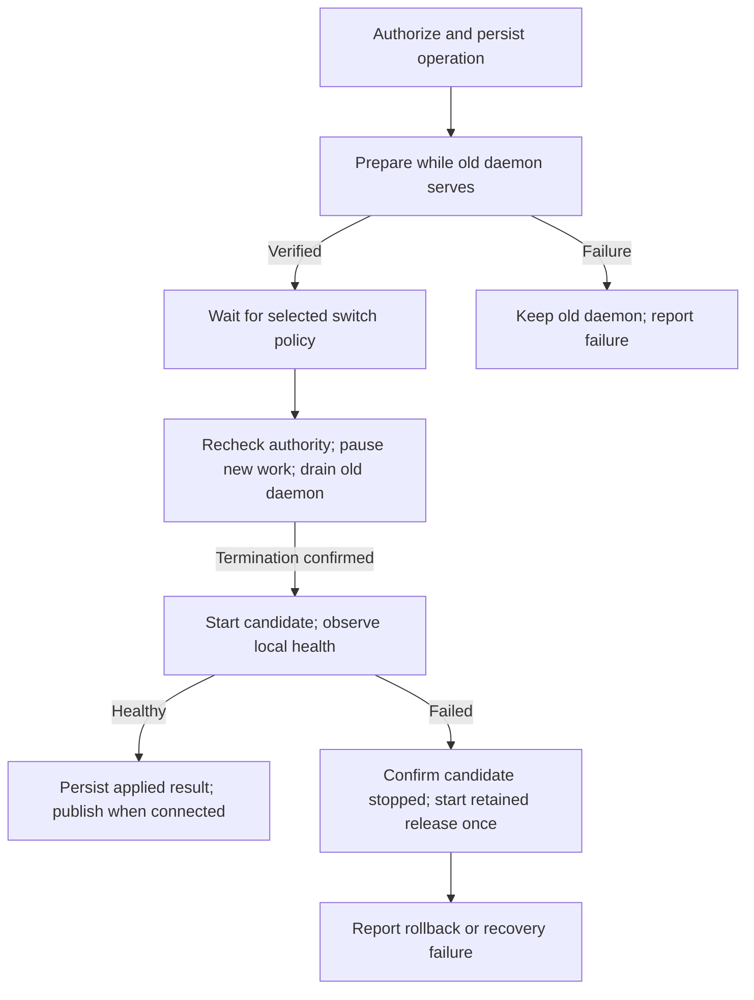

# Managed daemon updates and recovery

Status: draft
Translation: stale

[中文](daemon-upgrade-installation.zh.md)

## Decision for review

Replace remote global npm installation with managed, immutable daemon releases.
Each release pins Node, watchdog/Worker, JavaScript, WASM and prebuilt
native dependencies for an explicit OS/architecture/libc target. Its complete
verified component set must be locally available before switching. The receiver
neither resolves packages nor runs install scripts or compiles native code.
Install into an executable directory writable by the daemon's OS user; subsequent
updates need no additional privilege. External Agent tools remain independently managed.

This decision changes installation ownership, recovery and remote authority.
Implementation and validation boundaries are described in the
[SEA packaging guide](../apps/cli/scripts/sea/README.md). Approval metadata remains
separate from executed acceptance evidence.

## Installation and ownership

The connection UI offers official shell and PowerShell installers instead of npx.
The scripts identify the target platform, resolve the chosen client build channel
once, verify compressed and extracted capsule SHA-256 values, and let that verified
capsule check its pinned Node archive. No system Node, npm, Python or jq is required.
Pairing credentials remain local arguments, never public download URLs or service
configuration. Existing login and daemon-ready checks remain authoritative.

An explicit first install publishes the fixed entry before authentication and start.
An occupied Host still requires the owner to stop it and its service first; the
installer never terminates an unrelated process. Autostart registration is scoped
to the current profile and OS account (boot services for root where supported),
preserves unknown service definitions, and takes effect on the next login/boot.
The initial detached start uses the existing bounded ready handshake. Unavailable
autostart remains visible without preventing the current daemon from running.
Linux user-service persistence after logout may require lingering. Containers and
externally packaged installations retain their explicit installation ownership.

Install a fixed SEA service entry at a stable path registered with the selected OS
service manager. It starts versioned daemon bundles and their Node executables by
absolute path, independently of PATH, npm, nvm, login shells and npx caches. Use
separately tested POSIX and Windows adapters; Windows need not support symlinks.
The launcher stays the service process root during normal daemon replacement.

The launcher serializes machine-wide updates and owns the durable update record,
release selection, child termination and recovery. The fixed entry retains the Host lease throughout an update; versioned children
receive authenticated delegation and cannot claim a second lease. Confirm the previous daemon tree has stopped and released
ownership before starting a successor; an occupied lease never authorizes killing
an unrelated owner. Launcher and watchdog restart responsibilities must not overlap.

Releases live beside each other; user data, configuration and credentials keep
their existing locations outside release directories. One durable record identifies
the current, last locally healthy and previous releases and pending operation.
Atomic replacement and durability barriers require platform-specific verification.
After launcher restart, reconcile the record with real process/lease ownership
before resuming; a state file alone cannot prove termination.

Publish the existing JavaScript CLI to npm and complete SEA capsules to the public
artifact store. Each capsule embeds the complete target-specific CLI tree. Native
addons and file-based Workers are extracted unchanged to a verified digest directory
before stopping the old daemon. Preparation and execution use that same directory.
A separately managed official Node executable runs external JavaScript and helper
processes; a SEA is not a general Node interpreter. Cache that Node by exact
platform/version/digest, independently of SEA releases. Each new SEA still transfers
its embedded Node again. The earlier 55 MiB gzip sample is not a complete install
budget; measure the capsule, additional Node, extracted files and retained releases.

macOS requires platform signing. Windows Authenticode signing is optional: missing
a certificate must not block building or publishing a Windows executable. When
signing is enabled, sign owned native modules before embedding them, preserve their
bytes, then sign the final executable. Configured signing failures stop publication.
Generate the SHA-256 manifest from final bytes. Update manifests are trusted through the configured
HTTPS artifact service; compressed and extracted files must match their SHA-256
values. There is no separate release key pair or manifest signature. Replacing
both the manifest and artifacts at that service is outside this integrity check.
OSS and cloud retain separate product/distribution identities; neither accepts
the other's release.

Node 26.13.0 is the initial SEA/runtime pin. Official Linux glibc builds require
kernel 4.18+, glibc 2.28+ and GLIBCXX_3.4.25+, plus any stricter native dependency
requirements. musl is excluded from initial automatic updates.

The launcher has a separate protocol version. Reject incompatible bundles during
preparation while the old daemon serves. The first implementation updates the
launcher itself through the explicit installer; remote launcher replacement needs
a separately validated crash-safe protocol. Expose this limitation as a capability.

## Update flow and guarantees

- **R1 Authority and identity.** Only the machine owner can authorize lifecycle
  changes. Shared project execution and workspace Owner/Admin roles do not grant
  machine administration. Bind the operation to its immutable target release and
  machine generation. Resolve floating channels once. Requests accept no arbitrary
  package specs, commands or artifact URLs. Follow the [operation contract](machine-lifecycle-ack.md).
- **R2 Preparation.** Download to staging with bounded attempts, cancellation and
  resumable transfers. Validate a release manifest declaring version, channel,
  platform, size, digest, launcher protocol and data compatibility from the trusted
  HTTPS artifact service. Check compressed and extracted SHA-256 values, enforce
  safe extraction and resource limits. Probe bundled Node and
  required native modules in isolation without opening live databases/credentials.
  Publish the immutable release only after validation. Preparation failure never
  stops the old daemon.
- **R3 Switch timing.** Proposed default: download immediately and wait for active
  turns to finish; offer explicit immediate interruption with its effect shown.
  Immediate update skips only idle waiting, never termination proof or writer exclusion. Waiting operations expire and
  are cancellable. At the switch boundary, atomically pause new turn admission
  across workspaces and recheck activity. Idle-only updates must not force-stop
  a busy runtime. Revalidate current owner authority before interruption.
- **R4 Ownership.** Persist candidate and previous identities before stopping old
  processes. Drain within a bounded budget under existing persistence guarantees;
  report unconfirmed writes. Unconfirmed termination prevents a successor writer.
  Start the candidate beneath the same fixed entry, without releasing its Host lease.
  The fixed entry owns recovery until the candidate is observed healthy.
- **R5 Recovery.** Check exact release identity, Host lease, usable local control
  and required local stores over a bounded observation window. Before commit, candidates
  cannot admit tasks or migrate live data; probes are read-only or use isolated stores. Optional workspace,
  provider and network failures alone are not local health failures. On candidate
  failure, confirm its exact tree stopped and start the retained healthy release
  once. Failed termination/rollback reports recovery blocked/failed rather than
  entering an endless restart loop. Keep every release referenced by an operation.
- **R6 Results.** Persist local application and rollback outcomes before publishing.
  UI success requires an authenticated observation naming the same operation,
  generation and actual running release. A locally healthy daemon can remain
  running while remote reporting is unavailable; show outcome unconfirmed until
  retrieved. Cloud outage alone does not trigger rollback. Ordinary restart uses
  this same operation/observation path without downloading.
- **R7 Data safety.** Automatic rollback requires verified compatibility with all
  candidate writes, including those made before a crash. An irreversible migration
  needs a separate reviewed path. Never restore a stale user-data snapshot merely
  to make the old binary boot. Retaining binaries alone is not sufficient rollback.

## Authorization and rollout

Plaintext ingress retains server-verified machine-owner authority. Encrypted ingress
needs a dedicated lifecycle operation authenticated to the machine owner's current
personal device, bound to workspace/genesis and machine generation, with revocation
and freshness checks. Use encrypted transport and machine credentials; never borrow
an account token or expand the read-only encrypted allowlist. Both ingress paths
submit the same narrow, locally verified operation to the launcher. No unauthenticated
remote launcher endpoint is added.

The operation record is versioned, stored under the existing data directory, and
synchronously persisted before stopping any process. After a service crash, reconcile
owned descendants and lease ownership before resuming. Foreign lease ownership or
unconfirmed termination is recovery-blocked, never rolled-back. Track POSIX groups
and Windows Jobs/owned descendants; root exit alone is not tree termination.

Channel selection follows the initiating client's immutable build provenance.
Changing stable/nightly requires explicit confirmation in both directions; a version
downgrade additionally requires data compatibility. Freeze the chosen release once.

Default new daemons to managed installation. npm CLI may remain a convenience
installer/controller; its global package is no longer the daemon update destination.
Every existing npm daemon requires an explicit first migration; do not claim its
old runner can execute SEA. Keep the real JavaScript npm bin so old `node <bin>`
launches remain valid. An explicit installer stops the identified old service,
installs the fixed entry and registers its stable path. Broken or unreachable old
updaters likewise need a local installer run. Preserve identity, pairing,
data and options. Migrate an identified external service explicitly or give actionable
instructions; never silently rewrite arbitrary scripts or start a second daemon.
Container and package-manager-owned deployments declare external update ownership.

## Evidence and acceptance

[Finite lifecycle model](models/daemon-upgrade.model.ts) checks declared state and
ownership rules only. It does not validate real filesystems, crypto or processes.
Product acceptance requires supported Linux/macOS/Windows targets without system
Node/npm, changed PATH, read-only global prefix, interrupted/bad downloads, disk-full
writes, crashes at durable boundaries, lost ACK/results, busy turns, revoked owners,
service restarts and failed termination/rollback. Run a real synthetic Agent turn
after update and rollback; version output and unit tests are insufficient.

Architectural references:

- [Syncthing upgrade source](https://github.com/syncthing/syncthing/blob/main/lib/upgrade/upgrade_supported.go): signed binaries, staging and retained old binary; not proof of health-based rollback.
- [MeshAgent architecture](https://github.com/Ylianst/MeshAgent/blob/master/docs/Architecture.md): bundled JS runtime and native/recovery updates.
- [Teleport managed updates](https://goteleport.com/docs/reference/architecture/agent-update-management/): v2 removes package-manager dependency and decouples updater recovery from agent connectivity.
- [Elastic Agent design](https://github.com/elastic/elastic-agent/blob/main/docs/upgrades.md): versioned homes, markers and watcher; its sequence diagram is explicitly labeled 8.9.0, not proof of current exact ordering.
- [Tailscale update policy](https://tailscale.com/kb/1067/update/): preserve external installation-channel ownership.
- [Raft Computer build](https://github.com/botiverse/raft-source/blob/main/packages/computer/scripts/native/build.mjs): official Node SEA carrier, bundled assets and gzip transport; [native installer](https://github.com/botiverse/raft-computer-installer/blob/main/rust/runner.rs) delegates the update transaction to K separately from the product runtime.

The implementation covers managed POSIX updates; Windows containment and encrypted
lifecycle authorization remain unsupported. Native acceptance is platform-specific
and does not establish the entire matrix above.
