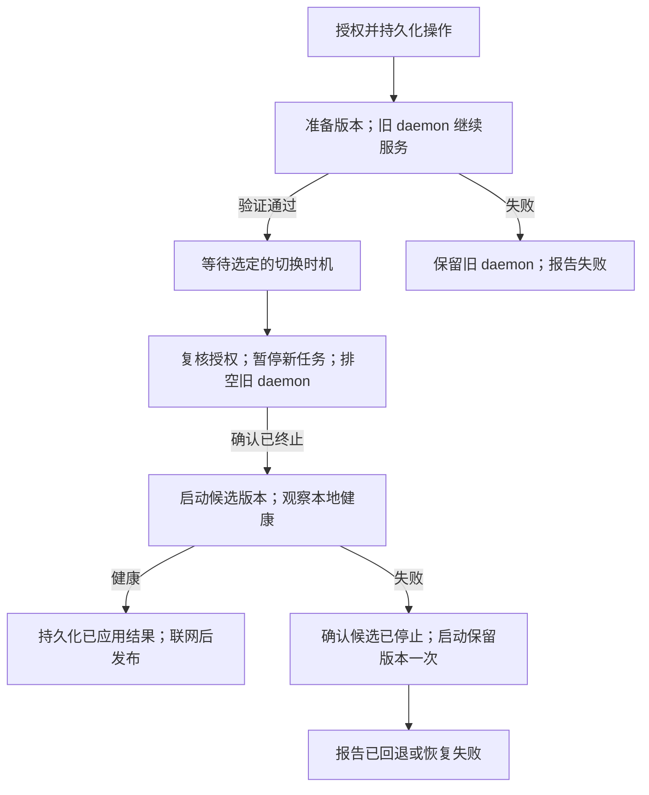

# 托管 daemon 更新与恢复

Status: draft
Translation: stale

[English](daemon-upgrade-installation.md)

## 待评审决策

用托管、不可变的 daemon 版本包替代远程全局 npm 安装。每个版本绑定固定的
Node、watchdog/Worker、JavaScript、WASM 及针对明确 OS/架构/libc 目标预编译的
原生依赖；完整且已验证的组件集合必须在切换前就绪。目标机器不解析依赖、
不执行安装脚本、不编译原生模块。安装目录须由
运行 daemon 的 OS 用户可写且允许执行；后续更新不额外提权。外部 Agent 工具仍独立管理。

本决策改变安装所有权、恢复及远程授权。实现及验收范围见
[SEA 打包说明](../apps/cli/scripts/sea/README.md)。规范审批元数据与执行证据分别记录。

## 安装与所有权

安装一个固定路径的 SEA 服务入口，将其注册到选定的 OS 服务管理器。它使用
绝对路径启动版本包及其 Node，不依赖 PATH、npm、nvm、登录 shell 或 npx 缓存。
POSIX 与 Windows 分别实现并验证适配；Windows 不要求支持符号链接。
常规 daemon 替换期间，启动器保持为服务根进程。

启动器按机器串行化更新，负责持久化操作记录、版本选择、子进程终止和恢复。
固定入口在整个更新期间持有 Host 租约，版本包子进程通过认证委托运行，不能另占租约。只有确认旧进程树停止，
才启动替代进程；租约被占用不授权终止无关进程。启动器与 watchdog 的重启职责不得重叠。

不同版本并列存放；用户数据、配置和凭证保留原路径，位于版本目录之外。
一份持久化记录包含当前版本、最后本地健康版本、上一版本及未完成操作。
原子替换和持久化屏障必须按平台验证。启动器重启后，先核对真实进程、租约和
记录再恢复；状态文件本身不能证明进程已停止。

保留 npm JavaScript CLI，同时发布完整 SEA。解包后的原生模块和实体 Worker 位于校验过的摘要目录，
准备和运行使用同一目录。SEA 不能执行任意外部 JS；Agent adapter、钥匙串辅助进程等使用另一份
按平台、版本、摘要缓存的官方普通 Node。每份新 SEA 仍自带一份 Node，因此首次下载需计算两份运行时。
原生模块先用产品身份签名，保持字节不变，再签名最终 SEA，最后生成 Ed25519 清单。
OSS 与 cloud 使用独立产品身份和可信公钥。

最初固定 Node 26.13.0。Linux glibc 构建要求 kernel 4.18+、glibc 2.28+、GLIBCXX_3.4.25+，
并满足更严格的原生依赖要求；musl 不进入首批自动更新。
固定入口本身只通过本地显式安装器更新，不随普通远程更新替换。

Raft Computer 使用 Node SEA 将 Node 和打包后的 JavaScript 合成一个可执行
文件，另带 WASM 文件。其构建脚本记录 darwin-arm64 示例：原始 143 MB，gzip
约 42 MB。这是上游源码注释，不是当前发布版或 Lody 的实测。SEA 仍包含 Node，
完整可执行文件下载也不能复用未变化的 Node。Lody 的外部原生模块和 Worker
入口需要单独验收后，才能选择 SEA 打包。

启动器有独立协议版本。不兼容的版本包在准备阶段拒绝，旧 daemon 继续服务。
首版通过明确的安装器更新启动器自身；远程替换启动器需要单独验证可承受崩溃的
协议。能力查询必须暴露这个限制。

## 更新流程与保证

- **R1 授权与身份。** 只有机器所有者可授权生命周期操作。共享项目执行权限及
  workspace Owner/Admin 角色不授予机器管理权。操作绑定不可变目标版本及机器
  代际；浮动渠道仅解析一次。请求不接受任意包表达式、命令或下载 URL。
  遵循[操作契约](machine-lifecycle-ack.md)。
- **R2 准备。** 下载到暂存目录，支持有界重试、取消和断点续传。以安装时信任的
  发布密钥验证签名清单，绑定版本、渠道、平台、大小、摘要、启动器协议及数据
  兼容关系。同一未认证来源提供的 checksum 不够。检查安全解包和资源上限；
  隔离检查包内 Node 与必要原生模块，不打开真实数据库或凭证。验证完成后才发布
  不可变版本目录。准备失败不停止旧 daemon。
- **R3 切换时机。** 建议默认立即下载，等待活跃轮次结束；提供明确提示影响的
  立即中断选项。这个默认值仍待产品确认。等待中的操作有有效期且可取消。
  在切换边界，原子地暂停所有 workspace 的新轮次接入，再检查活跃状态。
  仅空闲更新的策略不得强制停止繁忙运行时。中断前重新验证当前所有者授权。
- **R4 所有权。** 停止旧进程前持久化候选与上一版本身份。在有界预算内按现有
  持久化保证排空，并报告未确认写入。无法确认终止时，不启动第二个写入者。
  使用版本包自己的 Node 和协议启动整套候选 watchdog/Worker。
- **R5 恢复。** 在有界观察窗口内检查确切版本、Host 租约、本地控制接口和必要
  本地存储。可选 workspace、Provider 或网络失败本身不等于本地健康失败。
  候选失败后，确认其确切进程树停止，再启动保留的健康版本一次。终止或回退失败
  明确报告恢复被阻塞或失败，不进入无限重启循环。保留所有操作引用的版本。
- **R6 结果。** 先持久化本地应用及回退结果，再发布。UI 只有取得绑定同一操作、
  机器代际和实际运行版本的认证结果才确认成功。本地健康的 daemon 可在远端
  上报不可用时继续运行；取回结果前显示未确认。云端中断本身不触发回退。
  普通重启沿用同一操作和观察流程，跳过下载。
- **R7 数据安全。** 自动回退要求保留版本能读取候选版本的所有写入，包括崩溃前
  的写入，并已经验证这种兼容性。不可逆迁移需另行评审。不得为启动旧程序而
  恢复过时的用户数据快照。仅保留旧程序不代表能安全回退。

## 授权与推广

普通入口保留服务端验证的机器所有者授权。加密入口需要独立生命周期操作，
由机器所有者当前有效的个人设备认证，绑定 workspace/genesis 与机器代际，
检查撤销和新鲜度。使用加密传输与机器凭证，不借用账号 token，不扩展只读加密
接口的允许列表。两类入口向启动器提交同一类经过本地验证的有限操作；
不增加未认证的远程启动器端点。

新 daemon 默认托管安装。npm CLI 可继续作为便捷安装器或控制端，全局包不再是
更新目标。正常工作的旧 daemon 可经过兼容版本迁移；无法触达或旧更新器损坏的
机器，仍需明确运行一次本地安装器。保留身份、配对、数据和选项。明确迁移已识别
的外部服务或提供操作指引，不静默改写任意脚本，也不启动第二个 daemon。
容器及包管理器托管的部署声明由外部负责更新。

## 证据与验收

[有限状态模型](models/daemon-upgrade.model.ts)仅检查声明的状态和所有权规则，
不证明真实文件系统、密码学或进程行为。产品验收须覆盖支持的 Linux/macOS/Windows：
移除系统 Node/npm、修改 PATH、全局目录只读、下载中断或安装包损坏、写盘空间耗尽、
持久化边界崩溃、ACK/结果丢失、活跃轮次、所有者撤销、服务重启及终止/回退失败。
更新和回退后实际运行合成 Agent 轮次；版本输出和单测不足以证明可用。

架构参考：

- [Syncthing 更新源码](https://github.com/syncthing/syncthing/blob/main/lib/upgrade/upgrade_supported.go)：签名程序、暂存与保留旧程序，不证明健康失败后的回退。
- [MeshAgent 架构](https://github.com/Ylianst/MeshAgent/blob/master/docs/Architecture.md)：内置 JS 运行时及原生/恢复更新。
- [Teleport 托管更新](https://goteleport.com/docs/reference/architecture/agent-update-management/)：v2 移除包管理器依赖，updater 恢复与 Agent 连通性分离。
- [Elastic Agent 设计](https://github.com/elastic/elastic-agent/blob/main/docs/upgrades.md)：版本目录、标记和 watcher；其时序图标注为 8.9.0，不证明当前精确执行顺序。
- [Tailscale 更新策略](https://tailscale.com/kb/1067/update/)：保留外部安装渠道的所有权。
- [Raft Computer 构建](https://github.com/botiverse/raft-source/blob/main/packages/computer/scripts/native/build.mjs)：官方 Node SEA、内嵌业务资源及 gzip 传输；[原生安装器](https://github.com/botiverse/raft-computer-installer/blob/main/rust/runner.rs)在产品运行时之外把更新事务交给 K。

本文不声称托管实现或原生产品验收已经完成。

本次实现覆盖托管 POSIX 更新。Windows 后代进程隔离和加密生命周期授权仍不支持。
全部旧 npm daemon 都需要一次本地迁移；保留 JS bin，但旧 runner 不能直接运行 SEA。
原生探针不代表完整 Agent 验收，也不代表所有平台的正式签名、崩溃及磁盘写满验收。
