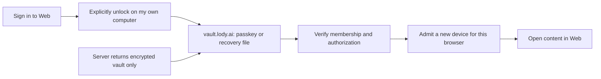

# Web and mobile personal-device custody

Status: draft

Previously approved baseline: [approval](../../.agents/notes/implemented/architecture/2026-10-28-e2ee-spec-approval.md#client-custody-revision-approval)
Translation: current

[中文](client-custody.zh.md)

An existing encrypted workspace can admit a browser profile or mobile installation
as a personal device through the existing desktop approval flow. Login alone does
not admit it. Each installation owns independent Ed25519/X25519 keys; tabs and
workers in one profile share one controlled installation. This Spec extends the
platform boundary without changing ledger v1, HPKE, signed bytes or content formats.
It does not enable a product composition. The [owner approval](../../.agents/notes/implemented/architecture/2026-10-28-e2ee-spec-approval.md#client-custody-revision-approval)
identifies the exact approved revision and its scope. The recovery vault has
its own approval and is outside this work.

## Trust and protection

Web trusts server-delivered application code. UI and documentation must explain
that same-origin code can unwrap keys and use them in JavaScript memory. A
non-extractable KEK prevents direct key export through its API; it does not protect
against malicious delivery, XSS, extensions or a compromised browser, nor promise
hardware resistance to profile copying or reliable JavaScript zeroization. CSP,
reviewed dependencies and controlled releases mitigate that accepted boundary.

Use pure-JS Ed25519/X25519 with core's fixed strict signature verifier, existing
HPKE parameters and secure random source. Native curve support is optional;
iOS/iPadOS 16.4 remains supported. No global WebCrypto replacement or injectable
verifier is permitted. Mathematical verification grants neither current device
permission nor execution authority. Host checks remain bound to a genuine verified
ledger, independently pinned genesis and the expected device.

Local protection uses an AES-256-GCM KEK with a fresh secure 96-bit nonce and
128-bit authentication tag per wrap. Authenticate the wrapping version, account,
workspace, pinned genesis, device signing key, installation incarnation and closed
key purpose. Nonces must not repeat under one KEK across writers or recovery;
retry retained wrappers instead of wrapping again. Epoch and candidate payloads retain core's complete inner bindings.
AES-GCM is local wrapping only. Local wrapping version 1 encodes a blob as
`0x01 || nonce[12] || ciphertext || tag[16]`. Its AAD is canonical DAG-CBOR of
`["lody-e2ee/client-custody/v1\0", 1, accountId, workspaceId, genesis, device, installationId, purpose]`,
where `\0` denotes one NUL, genesis/device are 32-byte byte strings, and
installationId is the lowercase hex of 32 securely generated random bytes.
Reject unknown versions and malformed lengths. This is an opaque local wrapper,
not a ledger envelope or permission to migrate identities across platforms;
ledger/content bytes stay unchanged. Native and browser adapters use this same
wrapping contract without exposing KEK bytes.

| Platform | Required policy | Refusal / evidence boundary |
| --- | --- | --- |
| Web | Persist a non-extractable AES-GCM CryptoKey and wrapped curve/private credential/epoch material in IndexedDB. Read the actual key back and unwrap/verify before reporting protection available. | Unsupported, read-only, lost, null or corrupt retained state blocks protected opening; memory-only protection is insufficient. |
| iOS | A device-bound, nonmigrating Keychain KEK, with `kSecAttrAccessibleAfterFirstUnlockThisDeviceOnly`; no synchronizable item or per-use biometric requirement. App storage retains wrappers and an independent installation marker. | Before first unlock return locked; leftover Keychain without the matching app installation never resumes an old identity. Native attributes and actual reopen need separate acceptance. |
| Android | Device-bound Android Keystore AES-GCM key; randomized encryption, no padding and no per-use user authentication. Keep installation data in credential-encrypted app storage and check `UserManager.isUserUnlocked()` before key use. Do not require the screen to remain unlocked. | API/version probes must establish first-unlock availability, nonexportability, nonce behavior and backup/data-extraction exclusions. Do not equate `setUnlockedDeviceRequired(true)` with after-first-unlock: it also restricts use after screen relock. If the supported target cannot satisfy the policy, refuse opening. |

The native plugin exposes only bound status/create/wrap/unwrap/delete operations.
It never returns the KEK or arbitrary file/Keychain access. Trusted JavaScript may
receive unwrapped curve/epoch material for the existing algorithms. Neither this
port nor the unused experimental host-key API grants arbitrary signing to IPC.

## Installation and originals

The installation store has one slot per account/workspace/genesis, not one slot
per proposed installation ID. Acquire single-writer ownership across tabs/workers
before allocating a device; preserve that ownership through actual native work.
The store captures that routing scope before reading; the retained receipt then
identifies the device/incarnation whose protection must be opened and verified.
Every receipt carries the complete binding. An existing different incarnation is
a conflict, never an empty slot. Store revisions are CAS preconditions, not trust.

| Retained state | Allowed next action |
| --- | --- |
| No receipt and no residual protected state | Explicitly start pairing, allocate independent keys, persist a prepared receipt, then create protection. Absence alone never starts this automatically. |
| prepared | Reconcile creation for this exact incarnation; protect the original keys once. Unknown native results remain unresolved. |
| protected | Read back the KEK and exact wrappers, unwrap and verify the signing/encryption key pairs, then atomically mark ready. |
| ready | Local custody is usable; host must separately verify desktop admission, credential, current membership/device and permitted epochs before runtime access. |
| retired | Refuse reopening this incarnation. After explicit new desktop approval, replace atomically archives this exact receipt and selects a protected independent identity in the same slot, preserving unresolved originals. |
| Missing half, reinstall, corrupt or uncertain state | Preserve originals; reconcile only with the exact retained evidence. Otherwise require desktop reapproval; never reuse residual keys or generate an identity over them. |

An installation transaction atomically stores its wrappers and receipt and reads
back its own write. No crypto or network await spans it. OS/native KEK creation
and app storage are separate transactions: persist intent first, read back after
each side settles, and never infer success or absence from a timeout. A ready
receipt is untrusted local data; reopen repeats unwrap/key binding verification.

Replacement is explicit, not ordinary CAS or a fresh namespace. The host retains
the new candidate's wrapped keys and exact pairing request in its existing pending
pairing journal before network/approval. Candidate custody may protect these
materials, but cannot select the current identity. After independently verifying
the new desktop approval and draining the old incarnation, retire the old receipt
and call `replace({binding: oldBinding, revision: oldRevision}, next)`.
The transaction compares the complete old binding/revision, retains that retired
receipt without modification, and selects `next` with fresh device/installationId,
phase protected and revision oldRevision+1. Reject any archived identity reuse;
never reset revisions, overwrite an archive or clear retired state to create
absence. Ordinary CAS still cannot change identity. Read back both writes before
commit; abort/quota changes neither. An exact retry may acknowledge the same
archive/current pair; other outcomes conflict and reconcile with `read` plus
`readRetired(oldBinding)`. Only actual unwrap/key-pair readback permits ready.
The shared `prepareReplacement` helper checks and copies a write plan, not approval
or persistence; adapters still own the atomic transaction and archive uniqueness.
Keep pending submissions/key journals under their original identity, and preserve
ledger trust pins. Replacement never relabels, deletes or re-signs those originals.
An unusable old wrapper is retained verbatim, not repaired or required to decrypt
before approved replacement; only the incoming identity is eligible for ready.

| Original | Persistence and completion owner |
| --- | --- |
| Pairing request, approval/claim credential and signed submission | Personal-device host retains the first exact request/CBOR and stable IDs before network; existing submission receipt/acknowledgement rules govern completion. |
| Verified ledger bytes, head/count and cursor | Existing feed/pin ports persist before advancing a checkpoint; replay validates the pinned continuation. A saved label is no authority. |
| Incoming envelope, installation report, distribution/repair/outbox/snapshot work | Existing core journals retain original ciphertext, signatures and task state before network or cursor advancement. Unknown results retry the same bytes, never re-sign or rebase. |
| Wrapped identity and local installation receipt | ClientInstallationStore retains one current pointer and immutable retired receipts. Ordinary revision/CAS preserves an incarnation; post-approval atomic replace switches it while retaining old wrappers and journals. ClientKeyCustody owns protection and native settlement, never approval. |

On close stop new operations, drain actual work, then release ownership and owned
buffers. A late callback cannot revive a retired runtime. Ordinary cache cleanup,
logout and scope close retain identity and unresolved originals. Hard reset is an
explicit separate action. Credential-confirmed terminal removal, and credential-confirmed revocation of
this device, follow the existing desktop retention exception: bind the originating incarnation, drain only
its workspace, retain cleanup evidence and spare other accounts/workspaces and
replacement identities. Device revocation erases only this device's identity and
keeps the membership; pairing again installs a new identity. Neither cleanup nor
storage loss revokes copies elsewhere.

## Responsibility and acceptance

| Owner | Boundary |
| --- | --- |
| Core crypto/signer/HPKE | Existing signing interface and fixed verifier; browser compatibility must preserve frozen vectors and bidirectional desktop interoperability. No adapter chooses trust policy. |
| Storage adapters | Implement existing ledger/submission/key ports plus the installation-only CAS store; atomic owned copies, no network/crypto in a transaction. |
| Client custody adapter | Persist/probe the KEK and authenticate the complete local binding; keep installed/candidate capabilities distinct. No plaintext/file fallback. |
| Portable personal-device host | Reuse pairing, claim, full ledger validation, key delivery, management and scoped RPC signing through ports; no Node dependency or copied Electron service tree. |
| Shared runtime/platform bridge | Sole owner of host composition, account/workspace/genesis/device lifetime and retirement through the existing E2eeWorkspaceRuntime contract. Content egress and protected channels consume its explicit capabilities. |

The portable host does not require workspace creation or recovery-vault support.
Protected opening requires durable custody, approved device identity and at least
one epoch key admitted by existing core rules. Absence of the current epoch alone
is not a refusal when an admitted retained epoch is usable. Every operation keeps
existing permissions and epoch/generation checks. Ordinary local workspaces retain
their behavior; no unsupported channel may silently enter a plaintext path.

The [shared fixed vectors](../../packages/e2ee-core/test/client-custody-vector.json)
pin all five purpose strings, the NUL-terminated domain, canonical text/byte-string
AAD and local version-1 wrapper bytes with public synthetic KEK/nonce/payloads.
The standalone generator uses a separate minimal CBOR encoder and OpenSSL; tests
check the pinned DAG-CBOR codec, WebCrypto and noble AES-GCM, including binding and
purpose substitution. Native adapters consume these same JSON bytes. Do not widen
the ledger's bounded CBOR subset, which intentionally omits text, to encode local AAD.
Exercise the public synthetic KEK inside native unit tests; these vectors authorize
no production KEK import/export or additional plugin testing capability.

This change defines ports, a pure replacement planner and fixed-vector checks.
It does not implement a durable installation store. Browser cross-process
KEK persistence, real IDB abort/quota/CAS, curve/HPKE byte equivalence, portable host
and runtime composition, native first unlock/reinstall and minimum-OS device
acceptance remain separate implementation evidence. No deployment is established.

## Pairing start and approver (owner approved 2026-11-01)

**Increment status: approved** on 2026-11-01 ([approval](../../.agents/notes/implemented/architecture/2026-10-28-e2ee-spec-approval.md#account-wide-personal-device-pairing)). Together with the [account-wide pairing increment](../e2ee-foundations.md#account-wide-personal-device-pairing-owner-approved-2026-11-01),
this replaces two parts of the approved text:
- the rule that the absence of a receipt "never starts this automatically";
- the requirement of desktop approval.

**Mobile.** Opening an encrypted workspace with no receipt and no residual protected
state starts pairing automatically. The device is a personal installation behind the
OS lock.

**Web.** Pairing starts only after the user explicitly chooses "Request access".
Browsers are often public or shared, so a signed-in session there must not silently
create a persistent device identity or ask the account owner's devices to admit it.

**Both.** Any active personal device of the same user may approve; machines and
recovery devices may not. Every other row and rule is unchanged: residual, retired,
missing or uncertain state still reconciles from exact evidence and never generates an
identity over it.

## Browser self-unlock (pending owner review)

Increment status: draft. This is a security and product proposal, not authorization
inherited from earlier approvals. Approved persistent custody and pairing remain in
force. If approved, this adds an admission source without changing ledger v1,
content formats, membership roles or existing device keys. Research and alternatives
are recorded in the [recovery integration note](../../.agents/notes/proposed/feature/2026-10-30-e2ee-recovery-vault-desktop.md#browser-self-unlock-trade-offs).

### What the user experiences

The server stores a locked box. Signing in retrieves it; the user's own passkey or
recovery file opens it. The client must still verify workspace membership and
authorization before admitting this browser as a new device. **No other device
running Lody needs to be online to approve it.**

This borrows the experience of opening a cloud key package with a user's own secret,
not 1Password's authentication protocol. An ordinary sign-in passkey cannot decrypt;
this requires a separately enrolled vault passkey with actual PRF support. Initial
setup still needs an active personal device to complete recovery enrollment and a
real decryption test for each workspace. Missing enrollment, absent entries or an
inactive R require approval from another device; login cannot fabricate recovery
identities. The first version opens existing workspaces, without adding Web creation.

### Decision table

| Owner decision | Recommendation | Cost and alternative |
| --- | --- | --- |
| Unlock secret | Start with passkey PRF and a recovery-file entry/fallback; no new encryption password | Without PRF, use the file or another device. A typed password plus Secret Key needs separate protocol review below. |
| Reuse | Reuse the account vault V and per-workspace R; do not upload personal-device private-key copies | Compromised unlock material affects the entire vault, beyond the selected workspace. |
| Existing pairing | Keep both entries; self-unlock needs no other physical device | Internally R admits isolated C, which pairs ordinary Web B; authorization checks remain. |
| Ordinary Web receives | Only B's independent device material and selected workspace content keys | V, R, PRF output and the recovery file stay on the isolated origin. |
| Public computers | Refuse self-unlock and new persistent pairing in the first version; direct users to their own devices | No session-only mode: memory-only identity violates current custody. A self-declared personal computer is not a security proof. |
| Rollout | Keep file recovery first, Web after macOS/iPhone; all default-off | Recovery remains outside MVP. These dependencies do not gate previously authorized device pairing. |

### KDF, wrapping and server responsibility

The recommendation introduces neither a human-password KDF nor SRP. Existing account
authentication remains separate from decryption. The complete byte contract stays in
[recovery vault](recovery-vault.md#recovery-material-and-ciphertext) and its
[fixed vectors](../../packages/e2ee-core/test/recovery-vault-vector.json):

- Registration verifies `enabled: true`; unlock requires a real user-verified
  assertion yielding 32-byte `results.first`. The exact RP is `vault.lody.ai` and
  PRF input is `lody-e2ee/vault-v1/prf-input\0`. Never derive decryption keys from
  signatures, account passwords or login tokens.
- Derive a 32-byte wrap key from PRF output using HKDF-SHA256, the 32-byte vaultId
  as salt and `lody-e2ee/vault-v1/prf-wrap\0` as info. Random 32-byte U from the
  recovery file uses the same structure with `file-wrap`. Each wraps the same
  random 32-byte V: either entry opens it; these are not two factors.
- Reuse vault-v1's two-layer XChaCha20-Poly1305 with independent fresh secure
  24-byte nonces. Canonical DAG-CBOR inner AAD is
  `["vault-v1", vaultId, entryId, revision, previous, purpose]`; outer AAD is
  `["vault-v1", vaultId, entryId, revision, "encrypted-header"]`, with a separately
  derived `encrypted-header` purpose key. Retain index CAS, exact readback,
  observed high-water pins and rollback rejection.
- The service stores account association, vaultId, opaque entryId/revision,
  ciphertext, index references and necessary credential routing information,
  never plaintext U, V, PRF output, R or personal private keys. Account, timing
  and traffic metadata remain visible; ciphertext-only describes secret payloads,
  not all metadata. A fresh browser still depends on the existing service
  freshness assumption: successful decryption cannot prove latest authorization.
- B and C retain the existing IndexedDB nonextractable AES-GCM KEK and local v1
  wrappers. V does not replace that KEK; identities are not exported or copied
  across origins. Failed persistent-protection probes stop opening. V, R and PRF
  output are never persisted. None of these secrets or the recovery file enter
  logs, telemetry, URLs, clipboard, ordinary Web or return messages.

Each `\0` denotes one NUL. Reusing existing vectors does not establish acceptance
of this new flow.

**If the owner selects password plus Secret Key.** This is an unselected alternative:
an independent encryption password and a client-random Secret Key of at least 128
bits jointly derive a wrap key for a separately domain/versioned V entry. An OAuth
or email-login password is not an available secret; never send the Secret Key to
the service. HKDF alone is insufficient for a short password. Review must first
specify a slow KDF such as Argon2id, parameters, memory budget and bounds,
UTF-8/normalization, salt, secret combination, AEAD/AAD, upgrades, test vectors and
whether PAKE authentication is also needed. It cannot reuse the byte identity of
`file-wrap` or `prf-wrap`. Unresolved parameters are not an implementable protocol:
selecting this alternative requires completing and reviewing this same Spec before
implementation. SRP authenticates; 2SKD combines two secrets. Neither replaces the other.

### Opening ordinary Web through the isolated origin

After a user click, ordinary Web B captures the account and target scope, probes
persistent custody, retains a new device candidate and exact pairing originals,
then opens a separate top-level `vault.lody.ai` page. That page signs in to the same
account, unlocks V using PRF/file, authenticates genesis from the recovery package,
replays membership history through its checkpoint, checks current membership and
active R, actually decrypts an envelope and checks the key commitment. R admits an
independent personal device C on the isolated origin through existing recovery;
R cannot sign content or act as an ordinary pairing approver.

C then approves B through existing account-wide pairing, after explicit user
confirmation of the browser and workspace list on the isolated page. Same-browser
handoff removes manual code copying, not one-time-secret authentication. Transfer
the existing pairing request and secret through captured windows and a browser
channel strictly checking exact origin/source, never the server, URLs or wildcard
origins. Bind it to a fresh challenge, the same account, B's public key and selected
workspaces; reject replay, expiry, source/account changes and request substitution.
If this channel cannot be established, stop and offer existing QR pairing rather
than accepting a service-selected request. The implementation PR must demonstrate
these conditions for its concrete channel design.

B opens protected content only after independently verifying C's admission and
approval, full history and keys. B and C each retain independent per-workspace
device identities. Release V, R and PRF output immediately after recovery. Reopening
C requires explicit unlock confirmation again; it cannot become a silent permanent
approval service. Continue uncertain results from originals without re-signing,
overwriting identities or erasing conflicts. Report success, pending work and
failure per workspace. Page closure or a successful return message does not mean
B completed; B's actual verification and installation determine completion.

### Revocation, loss and password changes

Changing the account password or recovering account access neither rewraps V,
decrypts history nor revokes browsers. The recommendation has no additional
encryption password. Removing a passkey commits the index before deleting its wrap,
retaining a recovery file or another tested entry. This cannot recall copied wraps,
V or R. Suspected unlock-material exposure requires existing whole-vault replacement,
per-workspace old-R revocation and rekeying, with unhandled workspaces identified.
Deleting cloud entries alone is not completed revocation.

The device page lists B and isolated C separately with their association. “Remove
this browser” enumerates the identities it will revoke and confirms both per
workspace, retaining failed steps for continuation. Revoking C never cascades to B
or other devices it approved; suspected exposure also requires reviewing all newly
admitted devices. Revoked devices follow existing credential-confirmed cleanup;
no promise erases copies or immediately invalidates issued tokens. Logout retains
protected identities and must say so, with a separate removal action. Logout cannot
be presented as making public computers safe.

If password wrapping is added later, an ordinary encryption-password change must
unlock V through an existing entry, produce a new wrap with new parameters,
read back, CAS-publish and then remove the old wrap. Forgotten passwords require
another unlock entry or a surviving personal device for whole-vault replacement.
Copied old wraps still decrypt old V. A password change alone cannot address
exposure; old R and admitted devices must also be handled.

### Replacement interaction and p6-web differences

Ryugi `artboard/e2ee-settings-ux`, “Supplement P2 · Web / p6-web”, remains the
original pairing direction. This is a proposed textual replacement, not a claim
that the artboard was modified or tested:

| State | Existing direction | Proposed copy/action |
| --- | --- | --- |
| Not open | Ask another device to approve | “Open encrypted workspace”; after confirming “This is my own computer”, choose passkey, recovery file or another device. |
| Before unlock | Show pairing request | Show exact `vault.lody.ai`, browser and workspace list. Explain that this browser will join the user's devices and unlock material can open vault workspaces; use only on one's own computer. |
| Risk explanation | Web trust notice | Explain that Web uses server-delivered code; tampering can expose encrypted content and unlock material during unlock. Offer native apps for users concerned about this risk. |
| Ceremony canceled/unavailable | Wait for approval | Stay in place and retain originals. No automatic retry after cancellation; offer file or another device when unsupported. |
| Missing/partial recovery | Wait for approval | List workspaces this method can open and those needing another device. Do not automatically enroll recovery. |
| Completed/pending | Open after approval | Open only after verification, custody and installation. Otherwise offer continuation; new identities appear in device lists and notifications. |
| Public computer | Browser pairing | Ask the user to open on their own device. No session-only button in the first version. |

User copy says “security code” and “membership and authorization information”,
not ledger, version or key generation. Existing recovery/pairing notifications
apply, but are not a security barrier: the service can suppress them.

### Approval and subsequent boundaries

The owner must explicitly approve an exact revision of the decision table,
particularly entry selection, two-origin device handoff, public-computer limits
and recovery-dependent rollout. No implementation or approved status before that.
After approval, align recovery Spec, whitepaper and runtime/host contracts first;
then split public core/client/cloud-api protocol work from private Web/storage
composition. No public dependency on `@lody/convex` or private packages and no
OSS desktop product-cloud calls.

Product acceptance must cover real PRF/file interoperability, two-origin and
multi-tab durable reopen, quota/storage loss, account/window changes, substituted
and replayed requests, R/C/B revocation, partial completion and resumable failures.
Keep the isolated surface's CSP, absence of third-party scripts and telemetry, and
independent deployment credentials. These mitigate delivered-code risk without
eliminating a malicious operator. This PR contains documents only; public sources
and external research establish neither deployment nor real-browser/native acceptance.

## References

- [Client ports](../../packages/e2ee-core/src/services/client-custody.ts), [existing service contracts](../../packages/e2ee-core/docs/services.md), [desktop custody](desktop-custody.md).
- [Runtime contract](../../packages/platform/src/e2ee-workspaces.ts), [runtime composition](../../packages/components/src/providers/runtime-provider.tsx), [existing content bridge](../../packages/components/src/providers/desktop-e2ee-content.ts).
- [Apple accessibility](https://developer.apple.com/documentation/security/ksecattraccessibleafterfirstunlockthisdeviceonly).
- [Android Direct Boot](https://developer.android.com/privacy-and-security/direct-boot), [UserManager](https://developer.android.com/reference/android/os/UserManager#isUserUnlocked()), [key policy](https://developer.android.com/reference/android/security/keystore/KeyGenParameterSpec.Builder#setUnlockedDeviceRequired(boolean)).
