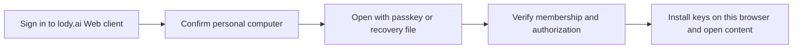

# Web and mobile personal-device custody

Status: approved · [approval](../../.agents/notes/implemented/architecture/2026-10-28-e2ee-spec-approval.md#same-origin-web-recovery)
Previously approved revision: [approval](../../.agents/notes/implemented/architecture/2026-10-28-e2ee-spec-approval.md#browser-self-unlock)

Previously approved baseline: [approval](../../.agents/notes/implemented/architecture/2026-10-28-e2ee-spec-approval.md#client-custody-revision-approval)
Translation: current

[中文](client-custody.zh.md)

An existing encrypted workspace can admit a browser profile or mobile installation
as a personal device through the existing desktop approval flow. Login alone does
not admit it. Each installation owns independent Ed25519/X25519 keys; tabs and
workers in one profile share one controlled installation. This Spec extends the
platform boundary without changing ledger v1, HPKE, signed bytes or content formats.
It does not enable a product composition. The [owner approval](../../.agents/notes/implemented/architecture/2026-10-28-e2ee-spec-approval.md#client-custody-revision-approval)
identifies the exact approved revision and its scope. The recovery vault has
its own approval and is outside this work.

## Trust and protection

Web trusts server-delivered application code. UI and documentation must explain
that same-origin code can unwrap keys and use them in JavaScript memory. A
non-extractable KEK prevents direct key export through its API; it does not protect
against malicious delivery, XSS, extensions or a compromised browser, nor promise
hardware resistance to profile copying or reliable JavaScript zeroization. CSP,
reviewed dependencies and controlled releases mitigate that accepted boundary.

Use pure-JS Ed25519/X25519 with core's fixed strict signature verifier, existing
HPKE parameters and secure random source. Native curve support is optional;
iOS/iPadOS 16.4 remains supported. No global WebCrypto replacement or injectable
verifier is permitted. Mathematical verification grants neither current device
permission nor execution authority. Host checks remain bound to a genuine verified
ledger, independently pinned genesis and the expected device.

Local protection uses an AES-256-GCM KEK with a fresh secure 96-bit nonce and
128-bit authentication tag per wrap. Authenticate the wrapping version, account,
workspace, pinned genesis, device signing key, installation incarnation and closed
key purpose. Nonces must not repeat under one KEK across writers or recovery;
retry retained wrappers instead of wrapping again. Epoch and candidate payloads retain core's complete inner bindings.
AES-GCM is local wrapping only. Local wrapping version 1 encodes a blob as
`0x01 || nonce[12] || ciphertext || tag[16]`. Its AAD is canonical DAG-CBOR of
`["lody-e2ee/client-custody/v1\0", 1, accountId, workspaceId, genesis, device, installationId, purpose]`,
where `\0` denotes one NUL, genesis/device are 32-byte byte strings, and
installationId is the lowercase hex of 32 securely generated random bytes.
Reject unknown versions and malformed lengths. This is an opaque local wrapper,
not a ledger envelope or permission to migrate identities across platforms;
ledger/content bytes stay unchanged. Native and browser adapters use this same
wrapping contract without exposing KEK bytes.

| Platform | Required policy | Refusal / evidence boundary |
| --- | --- | --- |
| Web | Persist a non-extractable AES-GCM CryptoKey and wrapped curve/private credential/epoch material in IndexedDB. Read the actual key back and unwrap/verify before reporting protection available. | Unsupported, read-only, lost, null or corrupt retained state blocks protected opening; memory-only protection is insufficient. |
| iOS | A device-bound, nonmigrating Keychain KEK, with `kSecAttrAccessibleAfterFirstUnlockThisDeviceOnly`; no synchronizable item or per-use biometric requirement. App storage retains wrappers and an independent installation marker. | Before first unlock return locked; leftover Keychain without the matching app installation never resumes an old identity. Native attributes and actual reopen need separate acceptance. |
| Android | Device-bound Android Keystore AES-GCM key; randomized encryption, no padding and no per-use user authentication. Keep installation data in credential-encrypted app storage and check `UserManager.isUserUnlocked()` before key use. Do not require the screen to remain unlocked. | API/version probes must establish first-unlock availability, nonexportability, nonce behavior and backup/data-extraction exclusions. Do not equate `setUnlockedDeviceRequired(true)` with after-first-unlock: it also restricts use after screen relock. If the supported target cannot satisfy the policy, refuse opening. |

The native plugin exposes only bound status/create/wrap/unwrap/delete operations.
It never returns the KEK or arbitrary file/Keychain access. Trusted JavaScript may
receive unwrapped curve/epoch material for the existing algorithms. Neither this
port nor the unused experimental host-key API grants arbitrary signing to IPC.

## Installation and originals

The installation store has one slot per account/workspace/genesis, not one slot
per proposed installation ID. Acquire single-writer ownership across tabs/workers
before allocating a device; preserve that ownership through actual native work.
The store captures that routing scope before reading; the retained receipt then
identifies the device/incarnation whose protection must be opened and verified.
Every receipt carries the complete binding. An existing different incarnation is
a conflict, never an empty slot. Store revisions are CAS preconditions, not trust.

| Retained state | Allowed next action |
| --- | --- |
| No receipt and no residual protected state | Explicitly start pairing, allocate independent keys, persist a prepared receipt, then create protection. Absence alone never starts this automatically. |
| prepared | Reconcile creation for this exact incarnation; protect the original keys once. Unknown native results remain unresolved. |
| protected | Read back the KEK and exact wrappers, unwrap and verify the signing/encryption key pairs, then atomically mark ready. |
| ready | Local custody is usable; host must separately verify desktop admission, credential, current membership/device and permitted epochs before runtime access. |
| retired | Refuse reopening this incarnation. After explicit new desktop approval, replace atomically archives this exact receipt and selects a protected independent identity in the same slot, preserving unresolved originals. |
| Missing half, reinstall, corrupt or uncertain state | Preserve originals; reconcile only with the exact retained evidence. Otherwise require desktop reapproval; never reuse residual keys or generate an identity over them. |

An installation transaction atomically stores its wrappers and receipt and reads
back its own write. No crypto or network await spans it. OS/native KEK creation
and app storage are separate transactions: persist intent first, read back after
each side settles, and never infer success or absence from a timeout. A ready
receipt is untrusted local data; reopen repeats unwrap/key binding verification.

Replacement is explicit, not ordinary CAS or a fresh namespace. The host retains
the new candidate's wrapped keys and exact pairing request in its existing pending
pairing journal before network/approval. Candidate custody may protect these
materials, but cannot select the current identity. After independently verifying
the new desktop approval and draining the old incarnation, retire the old receipt
and call `replace({binding: oldBinding, revision: oldRevision}, next)`.
The transaction compares the complete old binding/revision, retains that retired
receipt without modification, and selects `next` with fresh device/installationId,
phase protected and revision oldRevision+1. Reject any archived identity reuse;
never reset revisions, overwrite an archive or clear retired state to create
absence. Ordinary CAS still cannot change identity. Read back both writes before
commit; abort/quota changes neither. An exact retry may acknowledge the same
archive/current pair; other outcomes conflict and reconcile with `read` plus
`readRetired(oldBinding)`. Only actual unwrap/key-pair readback permits ready.
The shared `prepareReplacement` helper checks and copies a write plan, not approval
or persistence; adapters still own the atomic transaction and archive uniqueness.
Keep pending submissions/key journals under their original identity, and preserve
ledger trust pins. Replacement never relabels, deletes or re-signs those originals.
An unusable old wrapper is retained verbatim, not repaired or required to decrypt
before approved replacement; only the incoming identity is eligible for ready.

| Original | Persistence and completion owner |
| --- | --- |
| Pairing request, approval/claim credential and signed submission | Personal-device host retains the first exact request/CBOR and stable IDs before network; existing submission receipt/acknowledgement rules govern completion. |
| Verified ledger bytes, head/count and cursor | Existing feed/pin ports persist before advancing a checkpoint; replay validates the pinned continuation. A saved label is no authority. |
| Incoming envelope, installation report, distribution/repair/outbox/snapshot work | Existing core journals retain original ciphertext, signatures and task state before network or cursor advancement. Unknown results retry the same bytes, never re-sign or rebase. |
| Wrapped identity and local installation receipt | ClientInstallationStore retains one current pointer and immutable retired receipts. Ordinary revision/CAS preserves an incarnation; post-approval atomic replace switches it while retaining old wrappers and journals. ClientKeyCustody owns protection and native settlement, never approval. |

On close stop new operations, drain actual work, then release ownership and owned
buffers. A late callback cannot revive a retired runtime. Ordinary cache cleanup,
logout and scope close retain identity and unresolved originals. Hard reset is an
explicit separate action. Credential-confirmed terminal removal, and credential-confirmed revocation of
this device, follow the existing desktop retention exception: bind the originating incarnation, drain only
its workspace, retain cleanup evidence and spare other accounts/workspaces and
replacement identities. Device revocation erases only this device's identity and
keeps the membership; pairing again installs a new identity. Neither cleanup nor
storage loss revokes copies elsewhere.

## Responsibility and acceptance

| Owner | Boundary |
| --- | --- |
| Core crypto/signer/HPKE | Existing signing interface and fixed verifier; browser compatibility must preserve frozen vectors and bidirectional desktop interoperability. No adapter chooses trust policy. |
| Storage adapters | Implement existing ledger/submission/key ports plus the installation-only CAS store; atomic owned copies, no network/crypto in a transaction. |
| Client custody adapter | Persist/probe the KEK and authenticate the complete local binding; keep installed/candidate capabilities distinct. No plaintext/file fallback. |
| Portable personal-device host | Reuse pairing, claim, full ledger validation, key delivery, management and scoped RPC signing through ports; no Node dependency or copied Electron service tree. |
| Shared runtime/platform bridge | Sole owner of host composition, account/workspace/genesis/device lifetime and retirement through the existing E2eeWorkspaceRuntime contract. Content egress and protected channels consume its explicit capabilities. |

The portable host does not require workspace creation or recovery-vault support.
Protected opening requires durable custody, approved device identity and at least
one epoch key admitted by existing core rules. Absence of the current epoch alone
is not a refusal when an admitted retained epoch is usable. Every operation keeps
existing permissions and epoch/generation checks. Ordinary local workspaces retain
their behavior; no unsupported channel may silently enter a plaintext path.

The [shared fixed vectors](../../packages/e2ee-core/test/client-custody-vector.json)
pin all five purpose strings, the NUL-terminated domain, canonical text/byte-string
AAD and local version-1 wrapper bytes with public synthetic KEK/nonce/payloads.
The standalone generator uses a separate minimal CBOR encoder and OpenSSL; tests
check the pinned DAG-CBOR codec, WebCrypto and noble AES-GCM, including binding and
purpose substitution. Native adapters consume these same JSON bytes. Do not widen
the ledger's bounded CBOR subset, which intentionally omits text, to encode local AAD.
Exercise the public synthetic KEK inside native unit tests; these vectors authorize
no production KEK import/export or additional plugin testing capability.

This change defines ports, a pure replacement planner and fixed-vector checks.
It does not implement a durable installation store. Browser cross-process
KEK persistence, real IDB abort/quota/CAS, curve/HPKE byte equivalence, portable host
and runtime composition, native first unlock/reinstall and minimum-OS device
acceptance remain separate implementation evidence. No deployment is established.

## Pairing start and approver (owner approved 2026-11-01)

**Increment status: approved** on 2026-11-01 ([approval](../../.agents/notes/implemented/architecture/2026-10-28-e2ee-spec-approval.md#account-wide-personal-device-pairing)). Together with the [account-wide pairing increment](../e2ee-foundations.md#account-wide-personal-device-pairing-owner-approved-2026-11-01),
this replaces two parts of the approved text:
- the rule that the absence of a receipt "never starts this automatically";
- the requirement of desktop approval.

**Mobile.** Opening an encrypted workspace with no receipt and no residual protected
state starts pairing automatically. The device is a personal installation behind the
OS lock.

**Web.** Pairing starts only after the user explicitly chooses "Request access".
Browsers are often public or shared, so a signed-in session there must not silently
create a persistent device identity or ask the account owner's devices to admit it.

**Both.** Any active personal device of the same user may approve; machines and
recovery devices may not. Every other row and rule is unchanged: residual, retired,
missing or uncertain state still reconciles from exact evidence and never generates an
identity over it.

## Open with passkey or recovery file in Web (2026-11-10 approved revision)

Increment status: approved by zxch3n on 2026-11-10. Keep the passkey/file choice approved on 2026-11-09;
the owner selected same-origin Web on 2026-11-10, superseding the dedicated origin
and cross-page pairing direction. See the [recovery vault revision](recovery-vault.md#passkey-unlock).
The changed security boundary is covered by the approval record above; this is not rollout approval.

Use RP ID `lody.ai`. Opening, saving/reimporting the first recovery file and adding
passkeys happen in the existing Web client. No isolated page, second browser
identity, cross-page channel or manual pairing-code fallback remains for this path.
Other-device approval is independent and reuses the same account-pairing protocol,
including phone approval; do not invent a Web-specific protocol.

### Secrets and service storage

Reuse recovery U, V, per-workspace R and approved wrappers: random U in the file;
a real user-verified PRF output with existing HKDF domains/vaultId wraps V; V protects
R packages. Keep vault-v1 XChaCha20-Poly1305, purpose/AAD separation, index CAS,
originals, readback and rollback checks. No password KDF, new wire format or migration.
Account login alone cannot open content; a future login passkey requires a different
RP ID, not a different path or label under the recovery RP.

The service stores account association, routing, ciphertext and opaque index data,
not plaintext U/V/R/PRF/device private keys. Ciphertext storage does not hide access
metadata or remove first-device freshness assumptions. Persistent browser identity
still uses IndexedDB's non-extractable AES-GCM KEK; V is not a KEK substitute. Failed
protection probes do not fall back to plaintext or temporary identity.

### First sign-in and workspace authority

A user may explicitly create an **empty vault and recovery file** without workspace
keys. Save and reimport the file; never silently overwrite an existing vault. An
empty vault recovers no workspace. An admitted browser may enroll/test recovery and
add passkeys. An unadmitted browser without a usable recovery package still needs
another personal device's approval. **Browser-first encrypted-workspace creation
remains unsupported.**

### Recover within the existing device owner

Authenticate the package before allocating identity, replay complete history from
its genesis/checkpoint, and check account, membership, R and current key commitment.
R admits this browser through existing recovery. A currently admitted identity with
missing keys retains its exact offer/identity and is not admitted twice; revoked
identities cannot regain access. Preserve originals, pins, custody and installation
readback. Admission is not key receipt; content opens only after independent verified
installation on this browser.

One Web application owner retains its executor/host. Recovery borrows its current
session and controlled installation capability. Never globally close existing readers
for recovery setup. UI close releases only its own borrow; actually running native
work retains complete ownership until settlement before secret cleanup. Cancellation,
logout and account switches reject new work/late publication without deleting identity
or changing namespaces. Workspaces report unfinished outcomes independently.

### Broader trust boundary and copy

Pages on `lody.ai` and every subdomain, including marketing/analytics scripts, can
request ceremonies for this RP. System prompts and user verification remain barriers,
but compromised client code can expose other vault workspaces after a ceremony or file
selection. Files and transient V/R/PRF now enter ordinary Web memory: no logging,
telemetry, clipboard or persistence; pause telemetry while recovery UI is present.
Do not claim origin isolation protects these materials. Public computers and
session-only temporary devices remain unsupported.

Copy says “Open with passkey or recovery file”, “Save recovery file”, “Add passkey”,
“Signing in alone cannot open encrypted content” and “This empty file has no workspace
backup yet”. Say “security code” and “membership and authorization information”, never
ledger/version/key generation. Independent content/approval stays available on partial
failure. Default-off gates remain; deployed/native acceptance is separate evidence.

### Verified comparison scope

| Reference | Previously verified mechanism | Tradeoff |
| --- | --- | --- |
| 1Password | Distinct SRP authentication and password/Secret Key 2SKD | Borrow user-held-secret experience, not its login protocol; password/Secret Key was not selected |
| Proton | Login and private-key wrapping have separate roles | Login does not grant content keys |
| MetaMask | Browser vault encryption still trusts executing code | Accept the same-origin code boundary; file/PRF does not resist modified client code |
| WhatsApp Web | An existing device approves a new device | Keep personal-device approval when no recovery package exists |

The references below remain the recorded source basis, not fresh product acceptance.
Latest RP/format only; no old-RP fallback or compatibility migration. The owner's
pre-production premise is not a production-data audit.

## References

- [Client ports](../../packages/e2ee-core/src/services/client-custody.ts), [existing service contracts](../../packages/e2ee-core/docs/services.md), [desktop custody](desktop-custody.md).
- [Runtime contract](../../packages/platform/src/e2ee-workspaces.ts), [runtime composition](../../packages/components/src/providers/runtime-provider.tsx), [existing content bridge](../../packages/components/src/providers/desktop-e2ee-content.ts).
- [Apple accessibility](https://developer.apple.com/documentation/security/ksecattraccessibleafterfirstunlockthisdeviceonly).
- [Android Direct Boot](https://developer.android.com/privacy-and-security/direct-boot), [UserManager](https://developer.android.com/reference/android/os/UserManager#isUserUnlocked()), [key policy](https://developer.android.com/reference/android/security/keystore/KeyGenParameterSpec.Builder#setUnlockedDeviceRequired(boolean)).
