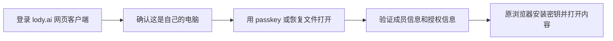

# Web 与移动端个人设备保管

Status: approved · [批准记录](../../.agents/notes/implemented/architecture/2026-10-28-e2ee-spec-approval.zh.md#同源网页恢复)
Previously approved revision: [approval](../../.agents/notes/implemented/architecture/2026-10-28-e2ee-spec-approval.zh.md#网页自助解锁)

此前批准的基线： [批准记录](../../.agents/notes/implemented/architecture/2026-10-28-e2ee-spec-approval.zh.md#client-custody-修订批准)
Translation: current

[English](client-custody.md)

既有加密工作区通过现有桌面审批流程接纳浏览器 profile 或手机安装作为个人设备。
登录不等于设备获准。每个安装持有独立 Ed25519/X25519 密钥，同 profile 的标签与
worker 共用一个受控安装。本 Spec 扩展平台边界，不改变账本 v1、HPKE、签名字节或
内容格式，也不启用产品组合。[Owner 批准记录](../../.agents/notes/implemented/architecture/2026-10-28-e2ee-spec-approval.zh.md#client-custody-修订批准)
列明获批的确切修订及范围。恢复库另行批准，不属于本次工作。

## 信任与保护

Web 信任服务端下发的应用代码。界面与文档须说明：同源代码能解包密钥并在 JS 内存
中使用它们。不可导出 KEK 阻止通过其 API 直接导出密钥，但不抵抗恶意代码下发、
XSS、扩展或被攻陷的浏览器，不承诺 profile 复制的硬件防护或 JS 可靠零化。
CSP、经审依赖与发布权限控制缓解这个已接受的边界。

纯 JS Ed25519/X25519 沿用 core 固定严格验签器、现有 HPKE 参数和安全随机源。
原生曲线支持是可选优化，仍支持 iOS/iPadOS 16.4。禁止全局替换 WebCrypto 或注入
可改变信任的验签器。数学验签不授予当前设备权限或执行权；host 仍以真正验证的账本、
独立钉住的 genesis 和预期设备为依据。

本地保护使用 AES-256-GCM KEK，每次包装使用新的安全 96 位 nonce 和 128 位 tag。
认证包装版本、账号、工作区、钉住的 genesis、设备签名公钥、安装身份及封闭的密钥
用途。同一 KEK 的 nonce 在不同写入者或恢复后也不能重复；重试保留包装，不重新包装。
epoch 与候选载荷保留 core 完整内层绑定。AES-GCM 只用于本地包装。
本地包装版本 1 的 blob 为 `0x01 || nonce[12] || ciphertext || tag[16]`。
AAD 为以下数组的规范 DAG-CBOR：
`["lody-e2ee/client-custody/v1\0", 1, accountId, workspaceId, genesis, device, installationId, purpose]`。
其中 `\0` 表示一个 NUL，genesis/device 为 32 字节串，installationId 为安全随机
32 字节的小写 hex。拒绝未知版本或错误长度。这是本地不透明包装，不是账本信封，也不
授权跨平台迁移身份；账本/内容字节保持不变。原生和浏览器适配器使用同一包装合同，
不暴露 KEK 字节。

| 平台 | 必需策略 | 拒绝与证据边界 |
| --- | --- | --- |
| Web | IndexedDB 持久化不可导出的 AES-GCM CryptoKey 与已包装的曲线私钥、设备凭证、epoch 材料。报告保护可用前，读回实际密钥并解包/验证。 | 不支持、只读、丢失、读回 null 或保留数据损坏均阻塞保护空间打开；仅内存保护不足。 |
| iOS | 设备绑定、不可迁移的 Keychain KEK，使用 `kSecAttrAccessibleAfterFirstUnlockThisDeviceOnly`，不可同步，不要求每次生物识别。应用存储保留包装和独立安装 marker。 | 首次解锁前返回 locked；Keychain 残留但应用安装不匹配时不得续用旧身份。原生属性和实际重开须单独验收。 |
| Android | 设备绑定的 Android Keystore AES-GCM 密钥；随机加密、无 padding、不要求每次用户认证。安装数据只存 credential-encrypted 应用存储，使用密钥前检查 `UserManager.isUserUnlocked()`，不要求屏幕一直解锁。 | API/版本探针须证明首次解锁可用、不可导出、nonce 行为及 backup/data-extraction 排除。`setUnlockedDeviceRequired(true)` 在重新锁屏后也限制使用，不能当作首次解锁后可用。目标版本无法满足策略时拒开。 |

原生插件仅提供绑定后的 status/create/wrap/unwrap/delete，不返回 KEK，不提供任意
文件/Keychain API。受信 JS 可接收解包的曲线/epoch 材料用于现有算法。本端口和未接入
的实验 host-key API 均不向 IPC 授予任意签名能力。

## 安装与原件

安装 store 按账号/工作区/genesis 只有一个位置，不按候选安装 ID 各建一个位置。
分配设备前先取得跨标签/worker 的单写者所有权，并保持到原生工作实际结束。
store 先捕获该路由范围再读取；保留回执标识要打开保护并验证的设备/安装。
每份回执携带完整绑定。已有其他安装是冲突，不能当作空记录；store revision 是 CAS
前置条件，不是信任依据。

| 保留状态 | 允许的下一步 |
| --- | --- |
| 无回执且无保护状态残留 | 显式启动配对，分配独立密钥，先保存 prepared 回执，再创建保护；单纯缺失不能自动启动。 |
| prepared | 只核对同一安装的创建，原密钥只包装一次；原生结果未知则保持未决。 |
| protected | 读回 KEK 与精确包装，解包并验证签名/加密密钥对，再原子标为 ready。 |
| ready | 仅表示本地保管可用；host 仍须分别验证桌面接纳、凭证、当前成员/设备和获准 epoch，才能开放 runtime。 |
| retired | 拒绝重开该安装。显式桌面重新审批后，replace 在同一位置原子归档精确旧回执并选择受保护的新身份，保留未决原件。 |
| 任一侧缺失、重装、损坏或状态不明 | 保留原件，仅以完整保留证据核对同一操作；否则要求桌面重新审批，不续用残余钥匙，不生成身份覆盖。 |

安装事务原子保存包装与回执并读回自身写入，不跨 crypto/网络 await。OS/原生 KEK
创建与应用存储是两个事务：先保存意图，每侧实际结束后读回；超时不能证明成功或缺失。
ready 回执是未受信本地数据；重开须重新解包并验证密钥绑定。

替换是显式操作，不是普通 CAS，也不新开命名空间。host 在联网/审批前，用既有待配对
journal 保留新候选的包装密钥和精确请求。候选 custody 可以保护这些材料，但不选择
当前身份。独立验证新的桌面批准、排空旧安装后，先退休旧回执，再调用
`replace({binding: oldBinding, revision: oldRevision}, next)`。
事务核对完整旧绑定/revision，原样保留退休回执，并选择 device/installationId 都新的
next，phase 为 protected，revision 为 oldRevision+1。拒绝复用任何已归档身份；
不重置 revision、不覆盖归档、不清退休记录制造缺失。普通 CAS 仍不能换身份。
提交前读回两份写入；abort/配额失败均保持原状。精确重试可确认相同归档/当前记录对；
其他结果冲突，通过 `read` 与 `readRetired(oldBinding)` 核对。实际解包/密钥对读回后
才可 ready。共享 `prepareReplacement` 只校验并复制写入计划，不代表批准或持久化；
适配器仍负责原子事务及归档唯一性。待决提交/密钥 journal 保持原身份，账本信任 pin
保持不变；替换不重新标记、删除或重签原件。
旧包装即使不可用也原样保留，不修复，也不要求先解包才能执行获准替换；仅新身份可进入 ready。

| 原件 | 持久化与完成的负责人 |
| --- | --- |
| 配对请求、审批/claim 凭证及签名提交 | 个人设备 host 在联网前保留第一份精确请求/CBOR 与稳定 ID，完成沿用既有提交回执/确认规则。 |
| 已验证账本字节、head/count 和游标 | 既有 feed/pin 端口在推进检查点前持久化；重放验证钉住的连续历史。保存的标签不授予权限。 |
| 入站信封、安装报告、distribution/repair/outbox/snapshot 工作 | 既有 core journal 在联网或推进游标前保留原密文、签名及任务状态；结果未知重试相同字节，不重签、不换 parent。 |
| 包装身份与本地安装回执 | ClientInstallationStore 保留一个当前指针和不可变退休回执。普通 revision/CAS 保留同一安装；批准后的原子 replace 切换身份并保留旧包装/journal。ClientKeyCustody 拥有保护与原生操作生命周期，不决定批准。 |

关闭时先拒绝新操作，等待实际工作结束，再释放所有权和自有缓冲。晚到回调不能复活
已退役 runtime。普通清缓存、logout 和 scope 关闭保留身份及未决原件；hard reset
是单独显式操作。凭证确认的整个成员移除，以及凭证确认的本设备撤销，沿用桌面保留例外：
绑定原安装，只排空其工作区，保留清理证据，不影响其他账号/工作区或替代身份。设备撤销只
删除本设备身份并保留成员资格；重新配对会安装新身份。清理和失存储不撤销别处副本。

## 责任与验收

| 负责人 | 边界 |
| --- | --- |
| Core crypto/signer/HPKE | 现有签名接口与固定验签器；浏览器兼容须保留冻结向量及桌面双向互操作，适配器不选择信任策略。 |
| 存储适配器 | 实现既有账本/提交/密钥端口及仅负责安装的 CAS store；原子持有副本，事务不含网络/crypto。 |
| Client custody 适配器 | 持久化/探测 KEK，认证完整本地绑定，区分 installed/candidate 能力；无明文/文件回退。 |
| 可移植个人设备 host | 通过 ports 复用配对、claim、完整账本验证、收钥、管理与限定 RPC 签名；无 Node 依赖，不复制 Electron 服务树。 |
| 共享 runtime/platform bridge | 通过现有 E2eeWorkspaceRuntime 合同独占 host 组合与账号/工作区/genesis/设备的生命周期和退役；正文出口、保护通道消费其显式能力。 |

可移植 host 不要求新建工作区或恢复库。保护空间打开需要持久保管、获准设备身份，
以及至少一把按现有 core 规则可用的 epoch key；已有获准旧 epoch 可用时，缺当前代
密钥不单独构成拒开条件。各操作保留现有权限、epoch/generation 检查。普通本地工作区
保持行为；不支持的通道不得静默进入明文路径。

[共享固定向量](../../packages/e2ee-core/test/client-custody-vector.json)固定全部五种用途、
NUL 结尾 domain、规范文本/字节串 AAD 和本地版本 1 包装字节，KEK/nonce/载荷均为公开
合成输入。独立生成器使用另一份最小 CBOR 编码器与 OpenSSL；测试核对锁定的 DAG-CBOR
库、WebCrypto 和 noble AES-GCM，并拒绝绑定/用途调换。原生适配器使用同一 JSON 字节。
本地 AAD 不得扩展刻意不含文本的账本受限 CBOR 子集。
公开合成 KEK 在原生单元测试内部使用；这些向量不授权增加生产 KEK 导入/导出或插件
测试能力。

本次定义端口、纯替换计划器和固定向量检查，不实现持久安装 store。
浏览器跨进程 KEK 持久化、真实 IDB abort/配额/CAS、
曲线/HPKE 字节互通、可移植 host/runtime 组合、原生首次解锁/重装及最低 OS 真机验收
均须后续实现证据，不表示已部署。

## 配对的发起与批准方（owner 于 2026-11-01 批准）

**增量状态：已批准**，2026-11-01（[批准记录](../../.agents/notes/implemented/architecture/2026-10-28-e2ee-spec-approval.zh.md#账号级个人设备配对)）。本节与[账号级配对增量](../e2ee-foundations.zh.md#账号级个人设备配对owner-于-2026-11-01-批准)一起替换已批准文本中的两处：
- "仅因缺少 receipt 不得自动开始"这条规则；
- 必须由桌面批准的要求。

**移动端。** 打开一个既无 receipt、也无残留受保护状态的加密工作区时，自动开始配对。这台设备是 OS 锁屏保护下的个人安装。

**网页端。** 只有在用户明确选择"请求访问"后才开始配对。浏览器经常是公共或共享的，因此在浏览器里登录的会话不能悄悄创建持久设备身份，也不能悄悄请求账号所有者的设备接纳它。

**两者通用。** 同一用户的任意一台活跃个人设备都可以批准；机器和恢复设备不可以。其余各行和规则不变：残留、已退役、缺失或不确定的状态，仍须依据精确证据对账，绝不在其上生成新身份。

## 网页内用 passkey 或恢复文件打开（2026-11-10 已批准修订）

增量状态：2026-11-10 由 zxch3n 批准。2026-11-09 已批准的 passkey＋恢复文件选择保留；专用隔离源与
跨页配对由 owner 于 2026-11-10 选择的同源方向取代，见[恢复保险库修订](recovery-vault.zh.md#passkey-解锁)。
本节的安全边界变化已获上述批准记录确认，不据此批准上线。

RP ID 为 `lody.ai`。打开、首次保存并重新导入恢复文件、添加 passkey 都在现有网页
客户端中完成；不另建隔离页、第二个浏览器身份、跨页消息通道或手动配对码备用步骤。
已有设备批准仍是独立路径，手机批准复用同一账号的现有审批协议，不另做网页协议。

### 用户秘密与服务器

复用恢复 Spec 的 U、V、逐工作区 R 和已批准包装：恢复文件持有客户端随机 U；
passkey 使用经真实用户验证的 PRF 输出，通过既有 HKDF 域与 vaultId 包装 V；V 再保护 R 包。
复用 vault-v1 的 XChaCha20-Poly1305、独立用途/AAD、索引 CAS、原件、读回和拒绝回滚规则，
不新增密码 KDF、线格式或兼容迁移。普通账号登录本身不能打开内容；登录 passkey 未来
必须使用不同 RP ID，不能用同一 RP 下的路径或名称区分用途。

服务器保存账号关联、必要路由信息、密文与不透明索引，不保存 U、V、R、PRF 或设备
私钥明文。“只存密文”不隐藏访问时间和账号元数据，也不解决新设备对服务端新鲜度的依赖。
持久设备身份仍用本浏览器 IndexedDB 不可导出的 AES-GCM KEK 包装，不用 V 替代 KEK，
保护探测失败时停止，不能退回明文或临时身份。

### 首次登录与工作区权限

首次登录可在用户明确选择后创建**空保险库和恢复文件**，不需要已有工作区密钥。
文件须保存并重新导入验证，已有保险库不得被自动覆盖。空库不能打开或恢复工作区。
已获准浏览器可为自己的工作区设置恢复并真实测试、添加 passkey；未被接纳且无可用
恢复包的新浏览器仍需另一台个人设备批准。**第一台设备就是浏览器的加密工作区创建
暂不支持。**

### 在现有设备宿主内恢复

先认证恢复包，再以包内 genesis 验证完整成员历史及检查点，核对当前账号、成员身份、R
和当前密钥承诺。R 仅按既有恢复协议接纳当前浏览器；已有效接纳但缺钥匙时沿用同一
设备身份与原 offer，不重复接纳，不恢复已撤销设备。保留原件、pins、保管与安装读回。
成功接纳不等于已收到钥匙；只有当前浏览器独立验证并安装后才开放内容。

Web 应用拥有唯一宿主和执行器。恢复命令借用它已有的会话与受控安装入口；已有读者
不因恢复设置被全局关闭，完成或关闭恢复 UI 只释放自己的借用。原生调用仍在运行时
保留完整资源所有权，实际结束后才清理所借用的秘密。取消、退出登录和账号切换拒绝
新操作与迟到结果，不能清除原身份或用新 namespace 绕过失败；各工作区分别报告未完成。

### 新信任边界与用户文案

`lody.ai` 及其所有子域页面、官网营销和统计脚本都可发起该 RP 的仪式。系统弹窗和
用户验证仍是屏障，但客户端代码被篡改时，用户确认仪式或选择恢复文件可能暴露
保险库中的其他工作区。文件和临时 V/R/PRF 现在进入普通网页客户端内存；不得记录、
遥测、写剪贴板或持久化，恢复 UI 期间暂停遥测。不得承诺独立来源能隔离这些材料。
公共电脑首版不支持，不提供“仅本次”临时设备。

用户可见名称为“用 passkey 或恢复文件打开”“保存恢复文件”“添加 passkey”；说明
“登录本身不能打开加密内容”“空恢复文件还未备份任何工作区”。统一使用“安全码”与
“成员信息和授权信息”，不显示账本、版本号或密钥代数。部分失败保留继续入口，不阻塞
已获准内容和其他设备批准。功能继续默认关闭，部署、真实系统提示和实体设备验收另行记录。

### 取舍与已查证范围

| 参照 | 已查证的机制 | 本方案取舍 |
| --- | --- | --- |
| 1Password | 账号密码＋Secret Key 的 2SKD 与 SRP 分工 | 借鉴自己持有秘密的体验，不复制其登录协议；未选择密码＋安全码 |
| Proton | 登录与私钥包装不是同一层 | 账号登录不直接授予内容密钥 |
| MetaMask | 浏览器内加密保险库仍信任执行代码 | 接受同源代码边界；不能把文件/PRF 保护说成能抵御网页代码被篡改 |
| WhatsApp Web | 已有设备批准新设备 | 没有恢复包时继续复用现有个人设备批准 |

上表依据仍为下方已记录的公开资料，未重新验收这些产品。本修订只认当前 RP/格式，
不做旧 RP 或旧格式兼容；owner 提供的上线前状态不是一次生产数据审计。

## 依据

- [Client 端口](../../packages/e2ee-core/src/services/client-custody.ts)、[既有服务合同](../../packages/e2ee-core/docs/services.zh.md)、[桌面保管](desktop-custody.zh.md)。
- [Runtime 合同](../../packages/platform/src/e2ee-workspaces.ts)、[runtime 组合](../../packages/components/src/providers/runtime-provider.tsx)、[既有内容桥](../../packages/components/src/providers/desktop-e2ee-content.ts)。
- [Apple accessibility](https://developer.apple.com/documentation/security/ksecattraccessibleafterfirstunlockthisdeviceonly)。
- [Android Direct Boot](https://developer.android.com/privacy-and-security/direct-boot)、[UserManager](https://developer.android.com/reference/android/os/UserManager#isUserUnlocked())、[密钥策略](https://developer.android.com/reference/android/security/keystore/KeyGenParameterSpec.Builder#setUnlockedDeviceRequired(boolean))。
