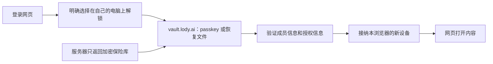

# Web 与移动端个人设备保管

Status: draft

此前批准的基线： [批准记录](../../.agents/notes/implemented/architecture/2026-10-28-e2ee-spec-approval.zh.md#client-custody-修订批准)
Translation: current

[English](client-custody.md)

既有加密工作区通过现有桌面审批流程接纳浏览器 profile 或手机安装作为个人设备。
登录不等于设备获准。每个安装持有独立 Ed25519/X25519 密钥，同 profile 的标签与
worker 共用一个受控安装。本 Spec 扩展平台边界，不改变账本 v1、HPKE、签名字节或
内容格式，也不启用产品组合。[Owner 批准记录](../../.agents/notes/implemented/architecture/2026-10-28-e2ee-spec-approval.zh.md#client-custody-修订批准)
列明获批的确切修订及范围。恢复库另行批准，不属于本次工作。

## 信任与保护

Web 信任服务端下发的应用代码。界面与文档须说明：同源代码能解包密钥并在 JS 内存
中使用它们。不可导出 KEK 阻止通过其 API 直接导出密钥，但不抵抗恶意代码下发、
XSS、扩展或被攻陷的浏览器，不承诺 profile 复制的硬件防护或 JS 可靠零化。
CSP、经审依赖与发布权限控制缓解这个已接受的边界。

纯 JS Ed25519/X25519 沿用 core 固定严格验签器、现有 HPKE 参数和安全随机源。
原生曲线支持是可选优化，仍支持 iOS/iPadOS 16.4。禁止全局替换 WebCrypto 或注入
可改变信任的验签器。数学验签不授予当前设备权限或执行权；host 仍以真正验证的账本、
独立钉住的 genesis 和预期设备为依据。

本地保护使用 AES-256-GCM KEK，每次包装使用新的安全 96 位 nonce 和 128 位 tag。
认证包装版本、账号、工作区、钉住的 genesis、设备签名公钥、安装身份及封闭的密钥
用途。同一 KEK 的 nonce 在不同写入者或恢复后也不能重复；重试保留包装，不重新包装。
epoch 与候选载荷保留 core 完整内层绑定。AES-GCM 只用于本地包装。
本地包装版本 1 的 blob 为 `0x01 || nonce[12] || ciphertext || tag[16]`。
AAD 为以下数组的规范 DAG-CBOR：
`["lody-e2ee/client-custody/v1\0", 1, accountId, workspaceId, genesis, device, installationId, purpose]`。
其中 `\0` 表示一个 NUL，genesis/device 为 32 字节串，installationId 为安全随机
32 字节的小写 hex。拒绝未知版本或错误长度。这是本地不透明包装，不是账本信封，也不
授权跨平台迁移身份；账本/内容字节保持不变。原生和浏览器适配器使用同一包装合同，
不暴露 KEK 字节。

| 平台 | 必需策略 | 拒绝与证据边界 |
| --- | --- | --- |
| Web | IndexedDB 持久化不可导出的 AES-GCM CryptoKey 与已包装的曲线私钥、设备凭证、epoch 材料。报告保护可用前，读回实际密钥并解包/验证。 | 不支持、只读、丢失、读回 null 或保留数据损坏均阻塞保护空间打开；仅内存保护不足。 |
| iOS | 设备绑定、不可迁移的 Keychain KEK，使用 `kSecAttrAccessibleAfterFirstUnlockThisDeviceOnly`，不可同步，不要求每次生物识别。应用存储保留包装和独立安装 marker。 | 首次解锁前返回 locked；Keychain 残留但应用安装不匹配时不得续用旧身份。原生属性和实际重开须单独验收。 |
| Android | 设备绑定的 Android Keystore AES-GCM 密钥；随机加密、无 padding、不要求每次用户认证。安装数据只存 credential-encrypted 应用存储，使用密钥前检查 `UserManager.isUserUnlocked()`，不要求屏幕一直解锁。 | API/版本探针须证明首次解锁可用、不可导出、nonce 行为及 backup/data-extraction 排除。`setUnlockedDeviceRequired(true)` 在重新锁屏后也限制使用，不能当作首次解锁后可用。目标版本无法满足策略时拒开。 |

原生插件仅提供绑定后的 status/create/wrap/unwrap/delete，不返回 KEK，不提供任意
文件/Keychain API。受信 JS 可接收解包的曲线/epoch 材料用于现有算法。本端口和未接入
的实验 host-key API 均不向 IPC 授予任意签名能力。

## 安装与原件

安装 store 按账号/工作区/genesis 只有一个位置，不按候选安装 ID 各建一个位置。
分配设备前先取得跨标签/worker 的单写者所有权，并保持到原生工作实际结束。
store 先捕获该路由范围再读取；保留回执标识要打开保护并验证的设备/安装。
每份回执携带完整绑定。已有其他安装是冲突，不能当作空记录；store revision 是 CAS
前置条件，不是信任依据。

| 保留状态 | 允许的下一步 |
| --- | --- |
| 无回执且无保护状态残留 | 显式启动配对，分配独立密钥，先保存 prepared 回执，再创建保护；单纯缺失不能自动启动。 |
| prepared | 只核对同一安装的创建，原密钥只包装一次；原生结果未知则保持未决。 |
| protected | 读回 KEK 与精确包装，解包并验证签名/加密密钥对，再原子标为 ready。 |
| ready | 仅表示本地保管可用；host 仍须分别验证桌面接纳、凭证、当前成员/设备和获准 epoch，才能开放 runtime。 |
| retired | 拒绝重开该安装。显式桌面重新审批后，replace 在同一位置原子归档精确旧回执并选择受保护的新身份，保留未决原件。 |
| 任一侧缺失、重装、损坏或状态不明 | 保留原件，仅以完整保留证据核对同一操作；否则要求桌面重新审批，不续用残余钥匙，不生成身份覆盖。 |

安装事务原子保存包装与回执并读回自身写入，不跨 crypto/网络 await。OS/原生 KEK
创建与应用存储是两个事务：先保存意图，每侧实际结束后读回；超时不能证明成功或缺失。
ready 回执是未受信本地数据；重开须重新解包并验证密钥绑定。

替换是显式操作，不是普通 CAS，也不新开命名空间。host 在联网/审批前，用既有待配对
journal 保留新候选的包装密钥和精确请求。候选 custody 可以保护这些材料，但不选择
当前身份。独立验证新的桌面批准、排空旧安装后，先退休旧回执，再调用
`replace({binding: oldBinding, revision: oldRevision}, next)`。
事务核对完整旧绑定/revision，原样保留退休回执，并选择 device/installationId 都新的
next，phase 为 protected，revision 为 oldRevision+1。拒绝复用任何已归档身份；
不重置 revision、不覆盖归档、不清退休记录制造缺失。普通 CAS 仍不能换身份。
提交前读回两份写入；abort/配额失败均保持原状。精确重试可确认相同归档/当前记录对；
其他结果冲突，通过 `read` 与 `readRetired(oldBinding)` 核对。实际解包/密钥对读回后
才可 ready。共享 `prepareReplacement` 只校验并复制写入计划，不代表批准或持久化；
适配器仍负责原子事务及归档唯一性。待决提交/密钥 journal 保持原身份，账本信任 pin
保持不变；替换不重新标记、删除或重签原件。
旧包装即使不可用也原样保留，不修复，也不要求先解包才能执行获准替换；仅新身份可进入 ready。

| 原件 | 持久化与完成的负责人 |
| --- | --- |
| 配对请求、审批/claim 凭证及签名提交 | 个人设备 host 在联网前保留第一份精确请求/CBOR 与稳定 ID，完成沿用既有提交回执/确认规则。 |
| 已验证账本字节、head/count 和游标 | 既有 feed/pin 端口在推进检查点前持久化；重放验证钉住的连续历史。保存的标签不授予权限。 |
| 入站信封、安装报告、distribution/repair/outbox/snapshot 工作 | 既有 core journal 在联网或推进游标前保留原密文、签名及任务状态；结果未知重试相同字节，不重签、不换 parent。 |
| 包装身份与本地安装回执 | ClientInstallationStore 保留一个当前指针和不可变退休回执。普通 revision/CAS 保留同一安装；批准后的原子 replace 切换身份并保留旧包装/journal。ClientKeyCustody 拥有保护与原生操作生命周期，不决定批准。 |

关闭时先拒绝新操作，等待实际工作结束，再释放所有权和自有缓冲。晚到回调不能复活
已退役 runtime。普通清缓存、logout 和 scope 关闭保留身份及未决原件；hard reset
是单独显式操作。凭证确认的整个成员移除，以及凭证确认的本设备撤销，沿用桌面保留例外：
绑定原安装，只排空其工作区，保留清理证据，不影响其他账号/工作区或替代身份。设备撤销只
删除本设备身份并保留成员资格；重新配对会安装新身份。清理和失存储不撤销别处副本。

## 责任与验收

| 负责人 | 边界 |
| --- | --- |
| Core crypto/signer/HPKE | 现有签名接口与固定验签器；浏览器兼容须保留冻结向量及桌面双向互操作，适配器不选择信任策略。 |
| 存储适配器 | 实现既有账本/提交/密钥端口及仅负责安装的 CAS store；原子持有副本，事务不含网络/crypto。 |
| Client custody 适配器 | 持久化/探测 KEK，认证完整本地绑定，区分 installed/candidate 能力；无明文/文件回退。 |
| 可移植个人设备 host | 通过 ports 复用配对、claim、完整账本验证、收钥、管理与限定 RPC 签名；无 Node 依赖，不复制 Electron 服务树。 |
| 共享 runtime/platform bridge | 通过现有 E2eeWorkspaceRuntime 合同独占 host 组合与账号/工作区/genesis/设备的生命周期和退役；正文出口、保护通道消费其显式能力。 |

可移植 host 不要求新建工作区或恢复库。保护空间打开需要持久保管、获准设备身份，
以及至少一把按现有 core 规则可用的 epoch key；已有获准旧 epoch 可用时，缺当前代
密钥不单独构成拒开条件。各操作保留现有权限、epoch/generation 检查。普通本地工作区
保持行为；不支持的通道不得静默进入明文路径。

[共享固定向量](../../packages/e2ee-core/test/client-custody-vector.json)固定全部五种用途、
NUL 结尾 domain、规范文本/字节串 AAD 和本地版本 1 包装字节，KEK/nonce/载荷均为公开
合成输入。独立生成器使用另一份最小 CBOR 编码器与 OpenSSL；测试核对锁定的 DAG-CBOR
库、WebCrypto 和 noble AES-GCM，并拒绝绑定/用途调换。原生适配器使用同一 JSON 字节。
本地 AAD 不得扩展刻意不含文本的账本受限 CBOR 子集。
公开合成 KEK 在原生单元测试内部使用；这些向量不授权增加生产 KEK 导入/导出或插件
测试能力。

本次定义端口、纯替换计划器和固定向量检查，不实现持久安装 store。
浏览器跨进程 KEK 持久化、真实 IDB abort/配额/CAS、
曲线/HPKE 字节互通、可移植 host/runtime 组合、原生首次解锁/重装及最低 OS 真机验收
均须后续实现证据，不表示已部署。

## 配对的发起与批准方（owner 于 2026-11-01 批准）

**增量状态：已批准**，2026-11-01（[批准记录](../../.agents/notes/implemented/architecture/2026-10-28-e2ee-spec-approval.zh.md#账号级个人设备配对)）。本节与[账号级配对增量](../e2ee-foundations.zh.md#账号级个人设备配对owner-于-2026-11-01-批准)一起替换已批准文本中的两处：
- "仅因缺少 receipt 不得自动开始"这条规则；
- 必须由桌面批准的要求。

**移动端。** 打开一个既无 receipt、也无残留受保护状态的加密工作区时，自动开始配对。这台设备是 OS 锁屏保护下的个人安装。

**网页端。** 只有在用户明确选择"请求访问"后才开始配对。浏览器经常是公共或共享的，因此在浏览器里登录的会话不能悄悄创建持久设备身份，也不能悄悄请求账号所有者的设备接纳它。

**两者通用。** 同一用户的任意一台活跃个人设备都可以批准；机器和恢复设备不可以。其余各行和规则不变：残留、已退役、缺失或不确定的状态，仍须依据精确证据对账，绝不在其上生成新身份。

## 网页自助解锁（待 owner 审批）

增量状态：draft。以下是安全与产品提案，不是既有批准的延伸授权。上文已批准的
持久保管与配对方案继续有效；本节若获批，仅增加一种接纳浏览器的来源，不改变
账本 v1、内容格式、成员角色或现有设备的密钥。研究依据和替代方案见
[恢复接入 Note](../../.agents/notes/proposed/feature/2026-10-30-e2ee-recovery-vault-desktop.zh.md#网页自助解锁的取舍)。

### 先看用户会经历什么

服务器像保管上锁盒子的仓库。登录只让用户取回盒子；用户自己的 passkey 或恢复文件
才是开盒子的钥匙。打开盒子后仍要检查工作区的成员信息和授权信息，才能把这个
浏览器登记为用户的新设备。**不需要另一台已打开 Lody 的设备在线批准。**

图中“自己的秘密打开云端密钥包”借鉴密码管理器的体验，不代表照搬 1Password 的
登录协议。普通登录 passkey 不具备解密能力；这里指专门登记、真实支持 PRF 的
保险库 passkey。首次设置仍须已有有效个人设备，为各工作区完成恢复设置和真实解密
测试。尚未设置、没有条目或 R 已失效的工作区，继续走另一台设备批准，不能只凭登录
补造恢复身份。首版只打开既有工作区，不新增网页创建能力。

### 决策表

| 需要 owner 决定 | 建议 | 代价与替代项 |
| --- | --- | --- |
| 用什么秘密 | 首版用 passkey PRF，恢复文件作为并列入口与退路；不新增加密密码 | 没有 PRF 时须拿文件或找设备批准。若必须手输“密码＋安全码”，需另审密码协议，见下文。 |
| 复用什么 | 复用同一账号恢复保险库 V 和逐工作区 R；不上传个人设备私钥副本 | 解锁材料泄露影响整个保险库，不只当前工作区。 |
| 与旧方案关系 | 两条入口并存；自助路径不要求另一台实体设备批准 | 内部仍通过 R→隔离设备 C→普通网页设备 B 的既有接纳/配对，不跳过验权。 |
| 普通网页能得到什么 | 仅 B 的独立设备材料和已选工作区内容密钥 | V、R、PRF 输出、恢复文件只进入隔离源；不可直接传给普通网页。 |
| 公共电脑 | 首版拒绝自助解锁与新持久配对，引导用自己的设备 | 暂不提供“仅本次”模式；纯内存身份违反现有保管约定。客户端自报“个人电脑”不是安全证明。 |
| 上线顺序 | 沿用文件恢复先跑通、macOS/iPhone 后 Web；全部默认关闭 | 恢复库仍不在 MVP 内。本提案不以新门槛阻塞已获准的设备配对路径。 |

### KDF、包装与服务端职责

建议路径不增加人类密码 KDF，也不采用 SRP；账号登录沿用现有认证，与解密分开。
完整字节合同仍由[恢复保险库](recovery-vault.zh.md#恢复材料与密文)及其
[固定向量](../../packages/e2ee-core/test/recovery-vault-vector.json)拥有：

- passkey 注册验证 `enabled: true`；解锁必须是真实的用户验证认证，取得 32 字节
  `results.first`。RP 精确为 `vault.lody.ai`，PRF 输入固定为
  `lody-e2ee/vault-v1/prf-input\0`。不得从签名、账号密码或登录 token 派生解密钥。
- PRF 输出以 HKDF-SHA256 派生 32 字节包装钥：salt 为 32 字节 vaultId，info 为
  `lody-e2ee/vault-v1/prf-wrap\0`。恢复文件的随机 32 字节 U 使用相同结构，
  purpose 为 `file-wrap`；二者分别包装同一个随机 32 字节 V，是“任一可开”，不是双因素。
- 复用 vault-v1 的双层 XChaCha20-Poly1305，内外层各取新的安全随机 24 字节 nonce。
  内层规范 DAG-CBOR AAD 为 `["vault-v1", vaultId, entryId, revision, previous, purpose]`；
  外层 AAD 为 `["vault-v1", vaultId, entryId, revision, "encrypted-header"]`，使用独立
  `encrypted-header` 用途派生钥。沿用索引 CAS、精确读回、已见高水位和拒绝回滚规则。
- 服务端保存账号关联、vaultId、opaque entryId/revision、密文、索引引用和必要的
  凭据路由信息，不保存 U、V、PRF 输出、R 或个人设备私钥的明文。它仍能观察账号、
  访问时间与流量；“只存密文”仅指秘密载荷，不表示隐藏全部元数据。新浏览器未见过
  新状态，仍依赖现有服务端新鲜度假设，解密成功不能证明拿到最新授权状态。
- B、C 的长期保管仍采用上文 IndexedDB 不可导出 AES-GCM KEK 及本地 v1 包装，
  不用 V 代替本地 KEK，不导出/跨源复制身份。持久保护探测失败就停止；V、R、PRF
  输出不持久化，也不进入日志、遥测、URL、剪贴板、普通网页或消息回传。

`\0` 均表示一个 NUL。既有向量的重用不是本次新流程已验收的证据。

**若 owner 选密码＋安全码。** 这是另一项尚未选定的方案：独立加密密码与客户端随机
至少 128 bit 的安全码共同派生包装钥，再为 V 增加一个有独立域和版本的包装入口；
不能把 OAuth/邮箱登录密码当作已知秘密，也不能把安全码发给服务端。不得仅对短密码
做 HKDF。需先审定慢 KDF（例如 Argon2id）的参数、内存预算与上下限、UTF-8/规范化、
salt、双秘密组合、AEAD/AAD、升级和测试向量，以及是否另引入 PAKE 登录。它不复用
`file-wrap`/`prf-wrap` 的字节身份。本稿不把未定参数当作可实现协议；若选此项，须先补齐
同一 Spec 并重新审阅，再实施。SRP 负责认证，2SKD 负责组合两种秘密，二者不能互相替代。

### 隔离源如何让普通网页打开

用户点击后，普通网页 B 捕获账号与目标范围，先完成持久保管探测，保留新设备候选和
同一份配对原件，再打开独立顶层 `vault.lody.ai` 页面。隔离页面登录同一账号，以
passkey/文件打开 V，认证恢复包的 genesis、重放包含包内检查点的成员历史，检查
当前 membership、R 有效性，并真实打开信封、核对密钥承诺。R 只按现有恢复流程接纳
隔离源上的独立个人设备 C，不能直接签内容或充当普通配对批准方。

随后 C 按既有账号级配对批准 B，用户在隔离页面核对浏览器和工作区清单后明确确认。
同一浏览器的交接免去手抄配对码，不免去一次性秘密认证：通过捕获的窗口和严格限定
精确 origin/source 的浏览器通道传递既有配对请求及一次性秘密，不经服务器、URL 或
通配 origin。通道绑定本次随机挑战、同一账号、目标 B 公钥和用户选择的工作区；拒绝
重放、过期、来源/账号切换或请求替换。不能建立这条通道时停止并提供既有扫码路径，
不自动接受服务端请求。具体通道封装需在实现 PR 里证明这些条件。

B 独立验证 C 的接纳与批准、完整历史和密钥后，才开放保护内容 runtime。B、C 都保留
每工作区独立设备身份；隔离页面完成恢复后立即释放 V、R 和 PRF 输出，C 后续打开需
再次明确解锁确认，不能无感成为网页的常驻批准服务。未完成结果按原件续做，
不重新签名、覆盖已有身份或清除冲突。每个工作区分别报告成功、待续做和失败。
页面关闭/回传成功不等于 B 已完成；以 B 的实际验证和安装为准。

### 撤销、丢失与改密码

登录密码的更改或账号恢复不重新包装 V，不解密历史内容，也不撤销浏览器。推荐路径
没有额外加密密码。移除 passkey 先提交索引再删除包装，保留恢复文件或另一个经过验证
的入口；它不能撤回已复制的包装、V 或 R。怀疑解锁材料泄露时，走既有整库换新、
逐工作区撤销旧 R 与换钥，明确报告无法覆盖的工作区；仅删除云端条目不算撤销完成。

设备页把 B 和隔离 C 分开展示并记录其关联；“移除此浏览器”列出实际将撤销的身份，
逐工作区提交并确认两者的撤销，失败项可续做。撤销 C 不会级联撤销 B 或它批准的其他
设备；怀疑泄露时还须审查全部新增设备。被撤销设备遵守已有凭证确认后的清理规则，
不能承诺擦掉副本或立即使已发访问 token 失效。退出登录仍保留受保护身份；界面须
明确说明，提供单独的“移除此浏览器”入口。公共电脑不能以“退出即安全”作承诺。

若以后引入密码包装，正常改加密密码必须先用旧入口解锁 V、用新参数新包装、读回并
CAS 发布，之后移除旧包装。忘记密码只能依赖其他解锁入口或幸存个人设备整库换新；
被复制的旧包装仍可解密旧 V。泄露时仅改密码不足，必须处理旧 R 和已接纳设备。

### 替代交互及与 p6-web 的差异

Ryugi `artboard/e2ee-settings-ux` 的“补充 P2 · 网页版 / p6-web”仍是原配对方向。
以下是待批准的文字替代稿，未声称已修改或实测该画布：

| 状态 | 原稿方向 | 建议替代文案/动作 |
| --- | --- | --- |
| 尚未打开 | 请求另一台设备批准 | “打开加密工作区”；“这是我自己的电脑”确认后，可选“用 passkey 解锁”“用恢复文件解锁”“请其他设备批准”。 |
| 解锁前 | 展示配对请求 | 显示准确域名 `vault.lody.ai`、浏览器名称和工作区清单；提示“这会把此浏览器加入你的设备。解锁材料可打开保险库中的工作区，请只在自己的电脑上使用。” |
| 风险说明 | Web 信任说明 | “网页版使用服务器提供的代码。如果这些代码被篡改，解锁时可能泄露你的加密内容和解锁材料。更重视这一风险时，请使用原生应用。” |
| 系统提示取消/不支持 | 等待批准 | 留在解锁页，保留原件；取消不自动重试，不支持时提供恢复文件或其他设备批准。 |
| 没有恢复设置/部分缺失 | 等待批准 | “这些工作区还不能用此方式打开”；列出可打开与需其他设备批准的工作区，不自动创建恢复设置。 |
| 完成/未完成 | 已批准后打开 | 只有验证、保管和安装完成才打开；否则显示“尚未完成，可继续”，提供续做。设备清单与通知可见新加入身份。 |
| 公共电脑 | 浏览器配对 | “请在自己的设备上打开加密工作区”；首版无“仅本次”按钮。 |

安全码和“成员信息和授权信息”用于需要解释验证的用户文案，不显示账本、版本号或
密钥代数。通知沿用恢复与配对规则，不作为安全屏障；服务端可压下通知。

### 审批与后续边界

需要 owner 对决策表整体明确批准确切修订，尤其是入口选择、两源设备交接、公共电脑
限制及依赖恢复库的上线顺序。批准前不实现，不改为 approved。获批后先对齐恢复 Spec、
白皮书和 runtime/host 约定，再拆分公开 core/client/cloud-api 协议与私有 Web/存储组合
PR；不让公开仓依赖 `@lody/convex` 或私有包，不启用 OSS desktop 云请求。

后续产品验收需覆盖真实 PRF 与文件互通、两源/双标签持久重开、配额与存储丢失、
账号/窗口切换、请求替换与重放、R/C/B 撤销、部分完成和中断续做。CSP、无第三方脚本、
无遥测、独立部署凭据沿用隔离界面约定，只能缓解代码下发风险，不能消除恶意运营者。
本 PR 只有文档；公开源码与外部资料都不能证明部署、真实浏览器或原生验收通过。

## 依据

- [Client 端口](../../packages/e2ee-core/src/services/client-custody.ts)、[既有服务合同](../../packages/e2ee-core/docs/services.zh.md)、[桌面保管](desktop-custody.zh.md)。
- [Runtime 合同](../../packages/platform/src/e2ee-workspaces.ts)、[runtime 组合](../../packages/components/src/providers/runtime-provider.tsx)、[既有内容桥](../../packages/components/src/providers/desktop-e2ee-content.ts)。
- [Apple accessibility](https://developer.apple.com/documentation/security/ksecattraccessibleafterfirstunlockthisdeviceonly)。
- [Android Direct Boot](https://developer.android.com/privacy-and-security/direct-boot)、[UserManager](https://developer.android.com/reference/android/os/UserManager#isUserUnlocked())、[密钥策略](https://developer.android.com/reference/android/security/keystore/KeyGenParameterSpec.Builder#setUnlockedDeviceRequired(boolean))。
