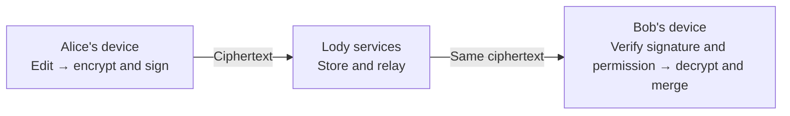

# Lody Security Whitepaper

Status: draft
Translation: current

This public draft preserves the pinned proposed architecture. References to independent implementations describe the prototype source, not completion in this repository. Current public implementation and unresolved protocol decisions are tracked in the [migration guide](../../.agents/docs/e2ee-migration.md). No production E2EE entrypoint is enabled.

End-to-End Encryption, Device Trust, and Organization Collaboration

Version 0.18 · 2026-10-22 · [中文](whitepaper.zh.md)

> E2EE documentation · 22 accepted decisions. These choices are reflected here; the recovery-vault format and desktop custody decisions are now specified in their draft contracts. This paper describes a proposed security architecture, not current product guarantees or an independent security audit. The [permission-ledger draft (Chinese)](permission-ledger.zh.md) distinguishes confirmed roles and interactions from proposals and open choices. Implementation status remains in the checklist.

## Abstract

Lody brings people, devices, and remote machines into a shared workspace. Beyond keeping content private, this creates another security question: who sent an operation, and are they authorized to make a machine act on it?

Device signatures identify the source, Org keys protect content, and a single signed ledger determines permitted actions. The ledger uses a hash chain and atomic compare-and-swap append (CAS), applying permissions in successful commit order rather than using an authorization DAG or concurrent-revocation priority. Content is encrypted by the sender and decrypted by authorized recipients; servers store and relay ciphertext. Recovery uses a passkey, a separately stored recovery file, or another trusted device, without an additional encryption password. Keys are distributed through recipient-specific encrypted envelopes rather than MLS.

## Implementation decisions added on 2026-10-10

A document decryption failure pauses remote synchronization only for that document. Other documents continue; local content and pending edits remain intact. There is no plaintext fallback, and failed data is not marked as processed. Workspace authorization failures remain subject to the existing authorization rules.

Clients reject invalid snapshots and handle recovery. Servers do not decrypt or reconstruct document contents. Recovery sources, history retention, and replacement steps require implementation and validation; when no recovery source is available, the affected document explicitly remains awaiting recovery.

Each platform should use its native security facilities to protect stored keys wherever practical. Secure storage and hardware execution are distinct capabilities. Any limitation and fallback must be explicit, with no silent fallback to plaintext key files. Personal devices use OS secure storage only. A machine device without a usable OS keystore (common on servers, containers, and SSH-only computers) instead keeps its keys in a local file readable only by its user, and machine pairing approval shows this protection to the user. This does not add application-level encryption requirements for local content or caches. See the accepted implementation decisions.

## 1. System Boundary and Threat Model

Version one creates an encrypted organization (Org) directly, without a Team layer. Each encrypted Org has its own membership, permissions, signed ledger, and content keys, with exactly one transferable highest-authority Owner. Server membership tables or billing roles do not grant decryption or management authority; eligibility comes from that Org's trusted authorization state (an authenticated signed snapshot plus verified increments, or an independent full audit). A product workspace MUST bind one-to-one to a fixed Org genesis, independent of names or login sessions. Encrypted workspaces are newly created; existing plaintext workspaces are not converted in place. A stable encryption-user ID is separate from email and account display, and management authority is separate from billing responsibility.

Beta MUST support macOS, Windows and Linux desktop, Web, mobile (iOS and Android), and CLI together. The exact Beta feature set remains subject to acceptance; unfinished optional features stay unavailable. Device and recovery private keys require protection. Local content, drafts, indexes and caches keep existing storage; extra application-level encryption and mandatory disk encryption are outside this integration scope. Offline drafts still require reliable persistence.

Personal computers, phones, and authorized machines hold decryption secrets. Servers hold only ciphertext, public verification material, and necessary routing information. Document updates, snapshots, attachments, sensitive indexes, presence payloads, and commands are encrypted; not all membership relationships, traffic sizes, or timing information are hidden.

The analysis assumes uncompromised clients, operating systems, and randomness, and correctly established recipient identities. Cloud ciphertext or ordinary account credentials alone then do not disclose content. Version one trusts the Loro Streams backend for a complete, non-rollback, non-forking view of the latest published ledger, atomic conditional append, and JWT-enforced cloud access control. It does not give that service keys or let it replace the ledger as the authority for a signer's permissions. Unpublished offline events are not part of this definition of “latest.” A backend violating this assumption still cannot forge signatures, but may conceal revocations, fork ownership history, or induce honest clients to send keys to former members. Global consistency, remote write cutoffs, and isolation of future content are then not guaranteed. Directory identities still require independent verification.

## 2. Key Architecture

The ability to decrypt and the authority to administer are supported by different keys and evidence. The table describes private or symmetric key material; corresponding public keys can be used for verification or to send keys to their holders.

| Key                                                                                     | Custody                                                                | Purpose                                                                          |
| --------------------------------------------------------------------------------------- | ---------------------------------------------------------------------- | -------------------------------------------------------------------------------- |
| Recovery-device R keys: independent signing and encryption pairs per user per workspace | Encrypted recovery package; temporarily unlocked for setup or recovery | Receive Org keys and authorize the user's new personal devices                   |
| Device keys: separate signing and encryption key pairs                                  | The individual device                                                  | Sign operations and receive content keys                                         |
| Management authority (not a separate key)                                               | Active personal devices of Owners and Admins                           | Device signatures, determined by current user role and device kind               |
| Org epoch key                                                                           | Endpoints authorized to access content from that epoch                 | Derive document and resource keys                                                |
| Recovery-vault unlock material                                                          | Recovery file or a verified Passkey PRF entry                          | Open workspace-specific R packages, without deriving future workspace identities |

Each organization epoch has an independently generated random 256-bit key. [HKDF-SHA-256](https://www.rfc-editor.org/rfc/rfc5869) derives 32B document keys bound to the protocol domain, organization genesis, organization epoch, stable document ID and document generation. Loro/Flock updates and snapshots for one document share a key; purpose remains authenticated in AAD and signatures. Other resource purposes retain key isolation. Document IDs are public context and cannot yield a key alone. Sharing only a document key does not expose the organization root or grant write authority; external collaborator identity, ACLs and key delivery remain unimplemented. Document generation is reserved at 0, without document-only rotation or revocation.

The proposed fixed suite uses Ed25519 signatures, [HPKE](https://www.rfc-editor.org/rfc/rfc9180) key envelopes, and [XChaCha20-Poly1305](https://doc.libsodium.org/secret-key_cryptography/aead/chacha20-poly1305/xchacha20-poly1305_construction) for content and backups. HPKE uses Base mode with X25519/HKDF-SHA-256/ChaCha20-Poly1305; an outer signature authenticates the sender. Each new content or backup encryption uses a cryptographically random 24-byte nonce. Encryption stops if secure randomness is unavailable. Versioning, encoding, and purpose separation prevent a valid ciphertext in one context from being accepted as content in another.

## 3. Identity and Device Trust

The user is the subject of membership and roles; recovery does not introduce a user root private key above devices. Every physical device generates independent keys rather than copying an old device. Login only establishes a service session. A currently valid personal or recovery device registered in the Org may authorize that user's new personal device under ledger rules. Authorization binds the membership instance, new public keys, Org, and purpose, with new-device proof of possession. Email or directory entries cannot grant this association. Recovery cannot expand the user's current authority.

For example, Alice creates her identity on a computer and pairs a phone by scanning a QR code. Confirmation binds a one-time challenge, the new public keys, and pairing scope. Each device binds directly to Alice's identity; the approver is audit history, not an authorization tree. Revoking the computer affects only that computer, not the phone or other devices it approved. Compromise of recovery-device secrets also requires revoking that recovery device.

The server supplies a public-key directory, but a signature proves possession of a private key, not that its holder is Alice. Clients pin the expected Org/genesis and an authenticated endorser, accept its signed authorization snapshot, and verify subsequent authorization and ownership-transfer increments. QR codes or safety codes bind this public material for comparison in person or over another trusted channel without revealing private keys. Member keys come from the accepted authorization state; directory responses cannot overwrite them. Unverified first contact still trusts the directory. Matching group fingerprints establish matching views, not the real-world identity of every participant.

After normal approval and automated verification, use may begin before optional manual safety-code comparison. Explicit confirmation of the target machine during pairing remains required.

## 4. How Encrypted Collaboration Works

When creating an Org, the Owner locally generates its first epoch key and signs genesis. A newcomer can scan a workspace QR code, register, and submit an email, public keys, and signed join request for an Owner or Admin to review. Either party may additionally compare public keys through another channel. Existing users can receive signed invitations encrypted to verified device public keys and accept later. Neither party must be online simultaneously, and unrelated head changes do not require renewed consent. Final submission checks current ledger authority. The entry link grants no permissions; expiry and cancellation details remain in the permission-ledger draft. The host binds a pending request to the authenticated account that submitted it, keeps it immutable, and never lets another party replace it; the approving client verifies the request signature, and the final admission record is verified with the ledger record before it is written.

After admission commits and is verified, any active device that holds the current content key (personal or machine, not a recovery device) can send current-key envelopes to the newcomer's active devices, including registered recovery devices, without waiting for an Owner or Admin online. Recipients do not judge key authenticity by the sender's role; they check the ledger key commitment and the recipient device's eligibility. Admins may also rotate epochs, but cannot thereby remove members, change roles, or transfer ownership. Request delivery, committed membership, and usable keys remain distinct states. The host identifies the sending device by its device access credential and appends to the key stream only complete envelopes that name that device as sender, for the current epoch and a current recipient device; the host does not verify envelope signatures, which recipients check together with the key commitment; a recipient installs a key into the epoch whose commitment it checked, never into a later epoch because the ledger has since advanced.

Before submission, joining can be cancelled. Once submission starts, cancellation cannot promise rollback; unknown outcomes must reconcile the exact original record. Request lifetimes remain separate parameters.

### 4.1 Centralized Key Delivery and Installation Reports

Version one uses a centralized durable mailbox for recipient-specific encrypted key envelopes. Recipients fetch them after reconnecting; sender and recipient need not be online simultaneously. The server stores ciphertext sealed to the recipient device's encryption public key, never the Org key. Its directory or delivery work lists cannot replace ledger-based eligibility.

After verified epoch publication and durable local key installation, the publishing device starts resumable distribution to every active recipient, including personal devices, machines, Guest devices and recovery devices R. New device admission also triggers current-key delivery without another rotation. Other eligible devices holding the current key may repair missing deliveries. Recovery must rediscover unfinished distribution after a publisher crash rather than depend on the original call remaining active.

The server tracks progress by Org, epoch and recipient, separating missing envelopes from stored envelopes with no installation report. Clients treat lists as candidate work and refresh the ledger to recheck eligibility, public keys and epoch before sending or resuming. The gateway still checks the sending device, current epoch and recipient eligibility (signatures are verified by recipients, not on the server); revocation or a later epoch stops old work. Terminal results remain durable until acknowledged by the application, so failures remain discoverable after restart. Stored envelopes remain available without reports, rather than being repeatedly re-encrypted while recipients are offline. Recovery R normally stays offline and cannot be required to report installation immediately.

After signature verification, decryption, ledger-commitment checks and durable installation, a recipient submits a device-signed installation report. It binds purpose, Org, epoch, device, commitment and installation provenance: sender and envelope digest for received keys, or the verified genesis/publication record for locally generated keys. Stored ciphertext is not installation, and a report describes reported past installation, not continued key possession or current permission. Local key loss and unusable envelopes need an explicit repair path. Envelopes and reports use durable, idempotent retries; receive context survives a crash after installation but before reporting. Old reports cannot update a later epoch's status. These mechanisms retain the existing trusted-host and freshness assumptions, without introducing an atomic cutoff across streams.

The independent package already has distribution coordination, mailbox-index contracts, installation reports and reference persistence. Applications still need real storage, authentication, scheduling and UI integration and service-level acceptance. These mechanisms and package tests are not deployed guarantees.

### 4.2 Content Updates

A document update then follows the path below. Updates originating from Bob follow the same process.

Updates use experimental v0 at batch granularity, without wrapping individual CRDT operations. A packet is `version(1B, value 0) | orgEpoch(u32be) | docEpoch(u16be, value 0) | signerPublicKey(32B) | nonce(24B) | sealed | signature(64B)`. `sealed` includes the single XChaCha20-Poly1305 16B tag, giving 143B fixed overhead before SDK wrapping. Document generation appears once per batch/snapshot; omitted API values normalize to 0 and nonzero/invalid values fail. API `epoch` retains its organization meaning. Genesis, resource, purpose and claimed authors are not repeated on wire.

Both parties supply independently trusted organization genesis, stable logical document ID and purpose; URLs route content only. Canonical document context is `D = genesis(raw32) || epoch(u32be) || docEpoch(u16be) || resourceLength(u16be) || resource(1..1024 printable non-whitespace ASCII bytes)`, with full authentication context `C = D || purposeCode(u8)`. Codes 1..9 distinguish Loro update/snapshot, Flock update/snapshot, blob, epoch-history, presence and RPC request/response. Document HKDF-SHA-256 uses salt `lody-content-hkdf/v0\0`, info `lody-document-key/v0\0 || D`, and length 32B; other resources use info `lody-content-key/v0\0 || C`. AEAD AAD is `lody-content-aad/v0\0 || C || fixed packet prefix`, and signing input is `lody-content-signature/v0\0 || C || complete unsigned packet`. Integers are big-endian; domains include the trailing zero byte. Purpose substitution fails signatures; re-signing unchanged ciphertext cannot bypass AEAD binding.

`ContentCipher.deriveDocumentKey` returns an immutable scoped document key. `exportDocumentKey` / `importDocumentKey` copy leaf bytes; `sealDocument` / `openDocument` use the leaf directly without a second HKDF or organization root. The same policy and strict signature checks apply; key possession does not admit an unregistered external signer. Providers require exactly one local source, `readKey(epoch)` or `readDocumentKey(epoch, docEpoch)`, without hidden network fetches. Resolved leaf scope must match the fixed organization/resource and generations.

Exact SDK AAD stays external to ciphertext. For nonempty `B = u16be(additionalData.length) || additionalData` (at most 1024B), AEAD uses `lody-content-aad-bound/v0\0 || C || B || fixed packet prefix`, and signing uses `lody-content-signature-bound/v0\0 || C || B || complete unsigned packet`. SDK outer version and its `loro-streams-crdt-payload-protection/v2\0` domain stay unchanged. The 51B AAD is reconstructed by hosts from the envelope. Provider headers remain 3/4, rejecting old 1/2. Snapshot continuationOffset stays authenticated and encrypted. An update POST body is the length-framed batch plus 158B, only 2B above optimized v2's 156B for the reserved generation; single/five-update samples measure 244→246B and 600→602B, excluding HTTP/TLS. The reader accepts only the current v0 format. Earlier experimental formats are unsupported; no old reader, fallback or migration is shipped.

Recipients accept signing keys only through the specified Org's verified ledger and derive device, original member instance and user from it. Full verified replay maintains original author mappings; revocation or rejoining cannot reattribute old signatures to a new membership. A qualified endorsed snapshot carries every device ever admitted with its original member instance and user, so a snapshot-origin reader attributes historical content exactly as a full replay does. This extends the existing trust in a qualified endorser to historical attribution; an endorser forging attribution is outside the threat model. It does not relax the endorser's independent role and position qualification or make an endorsed view a full-history one. Historical verification stays separate from new publication permission; authority is rechecked after async crypto, and Guest/R key possession does not grant write permission. SDK open returns original batch/snapshot bytes while retaining SDK AAD and continuationOffset authentication, with document persistence before durable cursor advancement. Earlier experimental data is outside the supported format; no compatibility reader, migration or re-signing is provided. Ledger records, epoch envelopes and 72B history packets are unchanged. This format supplies neither command replay protection nor per-operation authorship proofs.

Content snapshots may be published by document-write-capable personal devices or machines, not Guests or recovery devices R. A snapshot signature identifies its producer, not proof of every original update author's signature. The trusted host checks authenticated submitter/signing-device equality, current write permission and the original deadline at admission. It retains admitted content identity: different bytes cannot replace the same position; only the signing device's exact retries may be idempotent, never making an older snapshot current again, and the host admits only positions storage can accept. Legitimate history remains valid after later author revocation; readers still verify signatures and Org/document/epoch/purpose/continuation-position bindings. This trusts the host, does not resist host/revoked-device collusion, and adds no cross-stream transaction. The independent package provides an in-memory prototype and a single-host SQLite admission backend with atomic ciphertext/identity/current-pointer commits and restart recovery. Production Streams storage and JWT/gateway integration are not implemented. Full attachment, presence, RPC and local-connection protection remains a product integration requirement.

Encryption failure must not fall back to plaintext. Notifications and diagnostic logs must not become plaintext bypasses.

## 5. Membership Changes, History, and Ownership

### 5.1 One Owner and Bounded Authority

Highest authority belongs to one user identity, not one physical device; the Owner's authorized computer and phone may both act. The Owner appoints or removes Admins, removes members, rotates keys, and transfers ownership. The confirmed initial scope allows Admins to invite ordinary members, not grant Admin or Owner roles. Final member-removal signatures belong to the Owner; authorized personal devices of both Owners and Admins may rotate epochs. Every user can revoke their own devices through an active personal device without Owner approval, but gains no authority over other users. Roles are Owner, Admin, Member, and Guest. Guests are read-only: their signatures remain valid for possession proofs and their own device flows, but do not authorize content writes or machine execution.

Each operation reads the user's role and device eligibility from the preceding ledger state. Devices do not have separate roles; user promotion or demotion affects all their devices. Device revocation affects only its explicit target. Other committed device registrations remain valid even when approved by that device. User removal invalidates the entire membership instance. Revocation affects only the current Org. Management capability is not registered per device: an Owner's or Admin's active personal devices can manage, while machines and recovery devices never do. The Owner must keep at least one active personal or recovery device after revoking devices.

### 5.2 A Verifiable Sequential Ledger

Membership, devices, roles, and epoch changes share one control stream. Ordinary records contain the previous hash, submitting device public key, operation, and one submitter signature; operations may carry possession or consent proofs. Fixed DAG-CBOR arrays encode binary fields directly, and complete-record hashes link trusted genesis without repeating an Org ID, sequence number, or generic operation ID. Convex tables are projections.

First join normally accepts an authorization-state snapshot signed by an authenticated existing device, without replaying from genesis. The signature binds protocol purpose, expected Org and genesis anchor, position and head, and the complete authorization state, including members, devices, public keys, capabilities, revocations, replay protection, and every membership and device ever admitted with its user, keys and membership. Trust in the signer must be established outside the snapshot: its claim that the signer is Owner is not sufficient. Endorsers are restricted to active management-capable personal devices of Owners or Admins, excluding machines and recovery devices. The format and entry point are implemented in the independent package. Accepting the snapshot trusts its endorser, rather than independently validating the entire history.

Clients then verify every incremental chain link, signature, and permission against the preceding state before CAS submission against the stream tail. Conflicts require refresh and reauthorization, never unconditional append. Dedicated credentials and admission checks protect the control endpoint; document JWTs cannot write it. The host uses the chain tail it verified as the CAS condition and never forwards client-controlled storage control parameters. Bad chains or missing increments after the accepted starting point retain evidence and stop advancement; a new snapshot cannot bypass a bad chain or roll back accepted state. Full history remains available for optional audit and historical keys, not as a mandatory prerequisite for ordinary join.

Commit order decides authority: C remains if B admits C before the Owner removes B; removal first invalidates B's pending invitation. Readmission does not revive old device eligibility.

Safety codes bind the protocol, Org, genesis, position, head, and a digest of the actual authorization state. Comparing only a head is insufficient: incorrect state can be accompanied by a correct head. Users can compare with another authenticated member over an independent trusted channel. Matching digests at the same position establish agreement on state and history commitment, not the validity of every historical operation, real-world identities, or global freshness. Different positions require synchronization or comparison at a common position, not an immediate attack verdict.

The UI distinguishes “not independently compared” from “independently compared at this position,” without implying permanent future safety. A colluding inviter and server may deceive a newcomer before comparison; independent comparison with at least one honest member can reveal divergent views. Comparing only with the original inviter adds no independent assurance. A same-position mismatch must produce an explicit warning, not automatic branch selection. Independent witnesses are not a version-one dependency.

### 5.3 Rotation and Historical Access

Before removing a member, the Owner MUST generate the new epoch key and history package locally and durably save both the candidate key and exact pending record. **One ledger record and one conditional commit remove the member and activate the new epoch together:** both succeed or neither takes effect. Two sequential calls, including an automatic fallback after failure, do not satisfy this contract. Recipients are computed from the resulting state, excluding every personal, machine and recovery device of the removed membership. The new key is not delivered to the removed party during preparation.

After reading back and verifying the committed record, deliver the key to remaining eligible devices. Atomicity covers authorization and epoch activation; delivery may finish later. An unknown outcome is reconciled and retried using the same bytes, without creating or re-signing a new request after a timeout. A confirmed conflict terminates that attempt; refresh and reauthorize before explicitly preparing another. Independently retrievable backup of the new key, including whether it is mandatory before activation or Beta, remains an open design detail.

Users may still revoke their own individual devices without the Owner, without cascading to devices they previously approved. Ordinary members do not gain Org rotation authority. Such revocation first marks rotation required; an eligible Owner/Admin subsequently publishes an epoch. Scheduling and the waiting experience still need detail. While waiting, honest clients pause new updates and snapshots sealed under the old key, resuming after acquiring the new key; local editing may persist. Previously sealed content may upload under current write permissions and host admission, and historical content stays readable. This does not prove old ciphertext predates revocation or prevent a malicious endpoint using an old key it retains. Only content correctly encrypted with the new epoch is confidential from revoked recipients.

Owners/Admins may rotate proactively. Admission, role changes and ownership transfer do not themselves require rotation. Validly admitted C remains eligible if inviter B is later removed.

Each rotation embeds one history package—the previous epoch key encrypted under the new key—directly in its ledger record, authenticating the Org, both epochs, and purpose. The package is signed, CAS-committed, and stored with the record: no separate historical-key stream or coordination between two commits is needed. Per-device new-key envelopes still use a separate delivery channel. Pure ledger verification does not decrypt anything; key holders check the recovered key against its old-epoch commitment. A valid record signature alone does not prove that the package contains the correct key.

A new member receives the current key and follows packages in the verified ledger backward, for example `K₂ → K₁ → K₀`; an old key cannot derive a newer one. This shares all retained history, not just content created after admission. Historical rotation records require long-term retention, not ordinary message expiry or trimming. Server deletion or withholding can still prevent recovery: signatures do not guarantee availability. Installed keys are append-only and never overwritten. Document updates and encryption integration reuse streams-crdt, with epoch-key lookup supplied by the application key module rather than a parallel content API.

Documents, attachments, and presence retain their own streams. Version one provides no cross-stream sealing or common cryptographic cutoff proof. Trusted servers enforce cloud access with JWTs. Each device receives an access credential bound at admission; issuance and renewal identify the device by that credential and check current eligibility against the state the server maintains while accepting ledger records. Control-plane services (ledger, key delivery, access credentials and join requests) verify signatures only when accepting ledger records and perform no other server-side cryptographic verification; content write admission is described in §4.2. Further reads, writes, and streaming stop within 15 minutes of committed revocation, including projection delays, old credentials, clock tolerance, connections, and in-flight requests—not separate additive windows. Known revocation stops access immediately. JWTs cannot reclaim old keys, undo effects, or protect direct connections bypassing the cloud. Offline editing remains possible; clients still verify signatures and permissions. Historical relays and snapshots preserve authorship, without claiming proof that every old-epoch update predates revocation.

### 5.4 Ownership Transfer

Transfers use the same ledger and CAS as other security operations, binding current Owner configuration; only one competing transfer against a given head can succeed. The former Owner becomes an Admin, retaining invitation and rotation powers, without a separate management key. Lost responses require reconciliation, not duplicate submission.

The current Owner unilaterally signs a transfer through an active management-capable personal device. The successor must be an existing active member with at least one active personal or recovery device; no recipient consent signature is required. Transfer cannot reclaim historical keys, and server takeover is not promised when all valid devices and recovery material are lost.

## 6. Backup and Recovery

**One recovery file opens a cloud-hosted encrypted recovery vault. Each user has a separate recovery device R in each workspace.** R has independent signing and encryption key pairs and is bound to the current membership in that workspace. Normally inactive, it receives epoch-key envelopes and can authorize that user's new personal devices. It cannot directly write content, execute commands, administer the workspace or forward keys to other devices. Recovery is a device kind, not the Guest role.

The canonical CBOR recovery file is `["vault-v1", 1, vaultId, serviceLocator, U]`, with independent random 256-bit vaultId and unlock material U. A separate random vault master key V is wrapped using an HKDF-SHA256 key derived from U, bound to vaultId and purpose, and XChaCha20-Poly1305. Entries and the index use separate V-derived keys; each new encryption obtains a fresh secure 24-byte nonce. See the [recovery-vault draft](recovery-vault.md) for exact AAD, immutable entry upload, index CAS and rollback pins. The cloud stores only client-encrypted R private-key packages and encrypted envelopes addressed to R; it cannot read those private keys. The file is neither a seed for all future workspace keys nor a full offline content backup. The same file can open later vault entries, but recovery still depends on their ciphertext remaining available.

First-time recovery setup for a workspace MUST satisfy the following completion conditions on the client. The following four steps persist their original entry ID, index-CAS intent, signed ledger bytes and completed phase. Upload/readback precedes index CAS; concurrent setup in the same workspace reuses the winner, while disjoint workspaces merge explicitly. Conflicting identities remain visible. Reconcile persisted results after interruptions instead of regenerating committed identities:

1. Generate an independent R for this user and workspace, and unlock the vault using the file or a verified PRF recovery entry.
2. Encrypt R's private-key package locally, upload it, and read back and decrypt it. Ordinary cloud-account credentials cannot decrypt it.
3. Register R's public keys in the workspace ledger through the user's active personal device, then verify the result. Uploading the private-key package grants no authority.
4. Persist a current-epoch envelope for the enrolled R. Mark this workspace recoverable only after testing enrollment, the private-key package, trusted genesis material and current-key availability.

Generation, vault upload and ledger registration form a resumable multi-step process, not a cross-store atomic transaction. Another device of the same user joining this workspace reuses its active R. Readmission after removal uses a new membership and a new R, without reviving retired devices or reusing retired public keys.

Ordinary epoch rotation uses **R's public key** to encrypt and upload a new envelope; the user need not reopen the file and the server need not decrypt R. Track the last recovery test separately from current envelope availability, without presenting an earlier test as a successful test of the new epoch.

Recovery opens the vault on the new device, decrypts the target workspace's R, verifies trusted ledger state and current eligibility, opens the current envelope and follows history packages. The new personal device generates independent keys C, is enrolled by R, then uses C and clears temporary R secrets. No administrator needs to be online only if R is active and the required ciphertext is stored. Missing new keys cannot be reconstructed. C inherits the user's current role; recovery never expands it.

**Passkeys.** Only actual [WebAuthn PRF](https://www.w3.org/TR/webauthn-3/#prf-extension) support with a verified recovery path can provide another entry to the same vault. Ordinary passkey login is not decryption. The vault-v1 wrapping format is specified above. Cross-platform PRF ceremony support remains platform work; this does not restore the former shared-R-across-workspaces design.

**Phones and onboarding.** An authorized phone can approve a new device without keeping R private keys resident. Every platform and the Owner may skip recovery setup after acknowledging the risk. Remind users on joining and show per-workspace setup and verification progress. Pairing, envelope receipt and actual recoverability are distinct states.

**Replacement and compromise.** Routine replacement verifies the new method before retiring the old. Known compromise prioritizes revocation, even if recovery is temporarily unavailable. Exposure of one R affects its workspace; exposure of the vault unlock key and matching cloud ciphertext may affect all covered workspaces. Merely changing the file or deleting an entry does not invalidate copied R secrets. Replace and revoke affected Rs and rotate in each affected workspace; partial success is possible, with no cross-workspace atomicity. Revoking R does not cascade to C it previously approved, so inspect other suspicious devices. Login controls retrieval and the file controls decryption; these are not cryptographic two-factor protection.

Losing all eligible devices and recovery material may lose content and Owner access, but does not prevent ordinary login or creating new workspaces. Servers cannot take over secrets, and deleting backups cannot reclaim exposed history. Account deletion when an Owner has lost all keys remains a separate open policy.

## 7. Remote Machines and Execution Authorization

A machine pairs with the current Org and frontend device through a frontend-generated command and one-time auth key, then presents its own public keys. The frontend shows a location estimated from the connection IP to help identify the intended machine; location does not replace identity verification. The local machine and frontend display matching public-key fingerprints for user confirmation. The proposed order verifies a committed device registration before sending a key package encrypted to the machine. The one-time code alone grants no authority. If the machine lacks a usable OS keystore and keeps its keys in a local file, the frontend shows this before approval.

The machine is a decryption endpoint, not merely a relay. Its content key package does not include other device private keys or recovery secrets. Machines have no management authority. Owners, Admins, and Members may read, write, and request machine execution within Org authorization; Guests may only read. Request and target bindings must still be verified. Plaintext given to the machine and its AI services lies within those endpoints' trust boundaries.

Version one keeps existing machine sharing: once the machine owner shares it, workspace members with execution permission may use it. Finer per-member, per-operation and per-directory configuration and new isolation mechanisms are future work, not Beta prerequisites.

Execution requests include starting an Agent turn, saving a remote file and terminal operations; they do not mean redesigning every local CLI command. Their signatures bind the device, Org, target machine, operation and arguments, stable request ID, and expiry. The machine checks the device-to-user authorization, current execution permission, and request integrity, and durably records execution state to prevent duplicate retries. Unknown results MUST be queried before any rerun. If the result remains unknown, the operation MUST NOT be automatically rerun; surface the uncertainty for explicit user action. Arbitrary shell effects are not promised exactly once. Explicitly new user intent gets a new ID. Successful decryption, new CRDT content, or possession of a login token does not replace execution authorization.

Org execution permissions obey the same worst-case 15-minute revocation bound. Caches cannot outlive the original freshness proof, and forwarding, receipt, or restart does not start a new timer. Known revocation invalidates them immediately; failure to refresh by expiry blocks new execution. This bound depends on the server honestly supplying current control state: a local timer cannot prevent a malicious server from continually concealing revocation. Cancelling an already started command is a separate process; revocation does not automatically undo its effects.

The [M5 realtime review draft](../e2ee-foundations.md#realtime-rpc-and-presence-m5-review-draft)
details shared encrypted frames, target-machine signer binding, progress/results,
freshness acquisition and durable deduplication. The selected direction binds
machineId in signed machine admissions, keeps execution freshness in memory after
the machine's own authenticated latest-ledger read, and reuses the workspace
device signing identity for iroh. The complete Spec revision remains draft;
record encoding, concrete iroh domain-separation audit and product acceptance
remain separate work. Unavailable iroh must leave encrypted Streams RPC usable;
neither transport may
bypass authorization or re-sign/re-encrypt the original request on retry.

## 8. Security Properties and Trade-offs

Normal first join verifies a signed snapshot and subsequent increments. The requirement to verify signatures and replay permissions for 10,000 raw records from zero within 100ms is therefore withdrawn, along with mandatory SIMD/Wasm/multithreading optimization for that target. Withdrawal is not a passing measurement. Full audits remain available and still verify every signature. The entry point is implemented with stage-level tests in the independent package, not acceptance of product integration or production services.

Authorization snapshots do not replace authorship and permission evidence for content snapshots. Historical-key packages and old-epoch commitments must still authenticate to accepted state. Recovery devices need sufficient stored authentication material; removing full replay must not introduce an online-administrator requirement. Formats, persisted recovery, and adversarial comparison cases are tracked in the remaining-work plan. Existing genesis-based formal models do not automatically prove the authenticity of a new snapshot.

Key-distribution cost grows linearly with active devices, including recovery devices; ordinary content is not encrypted separately for each member. Approximately 20 users is the initial validation scenario, not a protocol membership limit. This design does not use MLS and does not provide forward secrecy or automatic post-compromise recovery. Current keys can access retained history, and secret compromise requires explicit revocation, rotation, and reauthorization.

The mechanism does not remedy compromised endpoints, disclosure by authorized members, malicious client updates, or previously leaked history. Independent directory witnesses and append-only-history verification could help detect identity substitution or inconsistent views. They are not protections already deployed in the first version, and do not replace verification of a person's identity or evidence of current permissions.

The pure verification layer checks ledger records sequentially from explicit state and evidence, without network, storage access or inferred permissions. Higher-level workflows may execute delivery and recovery through storage, cryptographic and transport services explicitly supplied by the application, without implicitly selecting servers or starting background scheduling. Concrete central storage, transport adapters, scheduling and interfaces remain application responsibilities. Security changes require online confirmation; ordinary content retains local offline operation. The formal-verification plan checks sequential transitions, unique ownership, and key recipients. A finite model is not a proof of the complete protocol. A complete protocol, security audit, and cross-platform validation remain prerequisites for product guarantees.

## 9. Product Integration Boundaries

- **Content paths:** encrypt small payloads as a whole; chunk large files and authenticate their manifest, order, length and workspace context. Check documents, attachments, presence, machine traffic, previews and direct connections. Unsupported protection means the feature stays unavailable, never plaintext fallback.
- **Cloud and AI:** servers relay ciphertext; authorized endpoints perform work needing plaintext. Machines and AI services receiving user-delegated plaintext are within that trust boundary. Notifications omit body content by default; public sharing requires explicitly publishing a copy.
- **UX:** the first-use path contains essential steps, with persistent follow-up tasks for remaining setup. Login, device approval, key availability, document readiness and execution readiness have distinct states.
- **Deletion:** distinguish logout, local cleanup, account deletion and workspace deletion; permanent deletion needs explicit confirmation and an opportunity to export first. Never silently discard the only draft.
- **Compatibility and diagnostics:** reuse capability checks and request upgrades for unsupported encryption formats. Read-only access still requires an understood format and current reading permission. Default diagnostics contain minimal fixed fields; detailed reports are previewed locally and sent only at the user's request.
- **Release:** every platform must complete the agreed Beta capabilities and checks before Beta, with more features added later. Vault-v1 and desktop safeStorage-wrapped KEK custody now have concrete draft contracts. Web/mobile/CLI custody and product enablement remain unavailable. Strict deadline B, remaining platform acceptance and release gates are separate. Accepted direction does not mean protocol completion or product acceptance.

## References and Document Scope

The organization of this paper draws on the threat-model, system-design, and mechanism-oriented structure of the [Skiff Security Whitepaper](https://skiff.com/security-model), and the explanations of key custody and sharing in the [Termius Encryption Overview](https://docs.termius.com/security/encryption-overview). It does not adopt their password-login designs or security claims. Recovery devices draw on [Messenger Labyrinth's virtual-device design](https://engineering.fb.com/wp-content/uploads/2026/05/Minos-Updates-2026-Encrypted-Backups-White-Paper.pdf), not its complete protocol or security proofs.

This version and the [Chinese version](whitepaper.md) describe the same design. The [permission-ledger draft (Chinese)](permission-ledger.zh.md) owns detailed roles, interactions, and approval boundaries; implementation and acceptance remain in the checklist.

For research background on separating authorization from key agreement, see [DCGKA](https://eprint.iacr.org/2020/1281). Lody chooses trusted backend ordering and one Owner rather than adopting that concurrent group protocol or inheriting its proofs.
