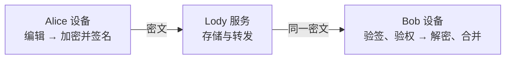

# Lody 安全白皮书

Status: draft
Translation: current

本公开草案保留固定来源的设计意图。文中的独立包实现指来源原型，不表示本公共仓已完成；实际迁移与未定协议见[迁移指南](../../.agents/docs/e2ee-migration.zh.md)。生产 E2EE 入口未开放。

端到端加密、设备信任与团队协作

版本 0.18 · 2026-10-22 · [English](whitepaper.md)

> E2EE 文档入口 · 22 项已定决策。本文已同步这些方案方向，恢复库格式和桌面密钥保管已有本轮具体草案；它描述拟采用的安全架构，非现有产品保证或独立安全审计。详细角色、签名及交互见[权限账本草案](permission-ledger.zh.md)，其中建议和待确认项不是已批准规则；实现进度见实施清单。

## 摘要

Lody 让人、设备与远程机器共同协作。除了内容保密，系统还需要回答：消息来自谁，它是否有权让机器执行操作？

设备签名标识来源，Org 密钥保护内容，单一签名账本决定能做什么。账本使用 hash chain 与原子条件追加（CAS），按成功提交顺序处理权限，不使用授权 DAG 或并发撤权优先规则。内容在发送端加密，在获授权的接收端解密；服务端保存和转发密文。Passkey、独立恢复文件或可信设备提供恢复路径，无需另记加密密码。密钥通过接收者专属的加密信封分发，不使用 MLS。

## 实施规则补充（2026-10-10）

单个文档解密失败时，仅暂停该文档的远端同步，保留本地内容及待同步修改，其他文档继续工作；不回退明文，不把失败数据标记为已处理。工作区权限失效仍按原有权限规则处理。

坏快照由客户端拒绝并负责恢复；服务端不负责解密或重建正文。客户端恢复来源、历史保留及替换步骤须单独实现与验证，没有可恢复来源时明确显示等待恢复。

各平台尽量使用原生安全能力保存密钥，区分系统安全存储与硬件内执行。原生能力不足时明确记录限制和替代方案，不静默降级为明文文件。个人设备只使用系统安全存储；机器设备在没有可用系统钥匙串时（常见于服务器、容器和只通过 SSH 登录的电脑），改用只有本用户可读的本地文件保存密钥，并在机器配对批准时向用户明确展示这种保护方式。本地正文与缓存仍不新增应用层加密要求。参见补充决定。

## 1. 系统边界与威胁模型

首版直接创建加密组织（Org），不引入 Team 层。每个加密 Org 独立管理成员、权限、签名账本和内容密钥，只有一名可转让的最高权限 Owner。服务端成员表或账单角色不授予解密和管理权；资格以该 Org 的可信权限状态为准（认证签名快照与已验证增量，或独立全量审计）。一个产品工作区 MUST 一对一绑定固定 Org 创世身份，不因名称变化或重新登录更换。新模式创建新的加密工作区，已有明文工作区不原地转换。加密用户编号独立于邮箱和云账号展示，管理权与付款责任分开。

Beta MUST 同时支持 macOS、Windows、Linux 桌面、Web、手机（iOS、Android）和 CLI；具体首发功能仍按已定范围逐项验收，未完成的附加功能不开放。设备及恢复私钥须受保护；本地正文、草稿、索引和缓存沿用现有存储，不增加应用层静态加密要求，也不以强制磁盘加密作为本次接入条件。离线草稿仍须可靠保存。

个人电脑、手机和获授权机器持有解密秘密；服务端只持有密文、公开验证材料及必要路由信息。文档增量、快照、附件、敏感索引、在线状态载荷及命令内容均加密；不承诺隐藏全部成员关系、流量大小和时间。

安全分析假设客户端软件、操作系统及随机源未被攻破，接收者身份得到正确确认。在此前提下，获得云端密文或普通账号凭证，不足以读取内容。首版信任 Loro Streams backend 提供完整、不回滚、不分叉的最新已发布账本、原子条件追加，以及按 JWT 执行的云端访问控制；不要求它看到密钥，也不让它替代账本决定签名者有何权限。离线未上传的事件不属于这里的“最新”。若后端违背此前提，它仍不能伪造签名，但可能隐瞒撤权、分叉 Owner 历史并诱使诚实端给旧成员分发密钥；全局一致性、远端写入截止及未来内容隔离不再保证。目录身份仍需独立核验。

## 2. 密钥体系

解密能力与管理权限分别控制。下表说明秘密材料的职责；对应公钥用于验证或分发密钥。

| 密钥                                                         | 保管范围                                | 作用                                                  |
| ------------------------------------------------------------ | --------------------------------------- | ----------------------------------------------------- |
| 恢复设备密钥 R：每个用户在每个工作区独立生成签名与加密密钥对 | 云端加密恢复库；仅设置与恢复时临时解锁  | 接收该工作区密钥、授权本人的新个人设备                |
| 设备密钥：签名与加密分别使用独立密钥对                       | 对应设备                                | 签署操作、接收内容密钥                                |
| 管理权限（不是独立密钥）                                     | Owner/Admin 的有效个人设备              | 使用设备签名，由用户当前角色与设备种类决定            |
| Org 代次密钥                                                 | 有权访问该代内容的端点                  | 派生文档和资源密钥                                    |
| 恢复库解锁材料                                               | 恢复文件，或验证可用的 Passkey PRF 入口 | 打开恢复库中的各工作区 R 私钥包；不生成未来工作区的 R |

每个组织代次（Epoch）独立随机生成 256 位密钥。[HKDF-SHA-256](https://www.rfc-editor.org/rfc/rfc5869) 从组织密钥派生 32B 文档密钥，绑定协议域、组织 genesis、组织代次、稳定文档 ID 与文档代次。同篇文档的 Loro/Flock update 与 snapshot 共用一把文档钥，用途仍参与 AAD 与签名；其他资源用途保持密钥隔离。文档 ID 是公开上下文，仅有 ID 无法算出文档密钥。可只共享单篇文档密钥而不暴露组织钥；这不授予写权，也尚未实现外部协作者身份、ACL 或密钥投递。文档代次当前仅预留为 0，不提供单文档换代或撤权。

拟采用的固定套件为 Ed25519 签名、[HPKE](https://www.rfc-editor.org/rfc/rfc9180) 密钥信封，以及 [XChaCha20-Poly1305](https://doc.libsodium.org/secret-key_cryptography/aead/chacha20-poly1305/xchacha20-poly1305_construction) 内容和备份加密。HPKE 使用 X25519/HKDF-SHA-256/ChaCha20-Poly1305 的 Base 模式，发送者身份由外层签名认证。内容和备份的每次新加密使用安全随机的 24 字节 nonce；随机源不可用时停止加密。版本、编码和用途分离避免把一种上下文中的合法密文当作另一种内容接受。

## 3. 身份与设备信任

用户是成员和角色的主体，不因恢复需要而另设凌驾于设备之上的用户根私钥。首台及后续实体设备各自生成密钥，不复制旧设备私钥。登录只建立服务会话；当前 Org 已登记的有效个人设备或恢复设备，才能按账本规则授权本人的新个人设备。授权绑定用户成员实例、新公钥、Org 和用途，新设备证明持钥；邮箱或目录不能自行授予这种关联。恢复不扩大当前用户权限。

例如，Alice 用电脑创建身份，再用手机扫码。双方确认绑定一次性挑战、新公钥和配对范围。每台设备直接绑定 Alice 的用户身份；批准来源只供审计，不形成授权树。撤销电脑只影响该电脑，不连带手机或它批准的其它设备。如果恢复设备秘密也泄露，还须撤销对应恢复设备。

服务端提供公钥目录，但签名只能证明“持有这把私钥”，不能独自证明“这是 Alice”。客户端固定预期 Org/创世与已认证背书者，接受其签名权限快照并验证之后的授权和 Owner 移交增量；二维码或安全码绑定这些公开材料，可在线下或其他可信信道核对，不泄漏私钥。成员公钥从已接受的权限状态取得，不以目录返回值覆盖。正常批准和机器校验完成后可先使用，额外的人工安全码核对可以稍后进行；这不取消机器配对时对目标机器的明确确认。未独立核验的首次联系仍依赖目录真实性；群组摘要一致只能证明视图一致，不能独自证明其中每个人的现实身份。

## 4. 加密协作如何发生

创建 Org 时，Owner 本地生成首代内容密钥，签署创立记录。新人可扫描工作区二维码注册，提交邮箱、公钥和签名申请，由 Owner/Admin 核对后确认；双方可额外比对公钥。已有用户也可通过已核验的设备公钥接收加密签名邀请，稍后确认。双方不必同时在线，无关链头变化不要求重复接受。最终按当前账本验权并提交；申请入口不自动授予权限，提交前可取消；进入提交后，取消不能保证撤回，结果未知须先核对原始提交。具体申请期限见权限账本待定参数。宿主把待审申请绑定到提交它的已认证账户并保持不可变，不允许他人替换同一申请；申请签名由审批端验证，最终的入账记录在写入账本前随账本记录一起验证。

加入提交并验证后，任何持有当前内容密钥的有效设备（个人或机器，不含恢复设备）都可以向新人的有效设备（含已登记的恢复设备）发送当前内容密钥信封，不必等 Owner 或 Admin 在线。接收端不凭发送者角色判断钥匙真伪，而是核对账本上的密钥承诺与收件设备资格。Admin 另获准换代，但不能因此移除成员、升降角色或转让 Owner。申请送达、成员入账与密钥可用是不同状态。宿主用设备访问凭证确认发送设备，只把声明的发送者就是该设备、面向当前代次与当前有效收件设备的完整信封写入密钥流；宿主不验证信封签名，信封签名和密钥承诺由接收端验证；接收端把钥匙装入核对承诺时的那一代，不因账本随后前进而装入新代次。

### 4.1 中心化密钥投递与安装报告

首版采用中心化持久信箱保存各设备专属的加密密钥信封，接收设备恢复在线后领取，不要求发送者与接收者同时在线。服务器保存的是用目标设备加密公钥封装的密文，不持有组织密钥；服务器目录或投递列表也不能替代账本授予接收资格。

新代次提交并验证、发布设备持久保存新钥后，启动可恢复的全设备分发，包含当前有效的个人设备、机器、Guest 设备和恢复设备 R。新设备入账同样触发当前代投递，不要求再次换代。其他具备转发资格且持有当前钥的设备可以补发；发布设备崩溃后，恢复流程须重新发现尚未完成的分发，而不是依赖原调用仍在运行。

服务器按 Org、代次和接收设备维护投递进度，分别列出「缺少信封」与「已有信封、尚无安装报告」。客户端将列表当作候选任务，发送及恢复投递前刷新账本，重新核对目标资格、公钥与当前代次。网关仍核对发送设备、当前代次和收件资格（不在服务端验证签名，签名由接收端验证）；撤权或再次换代后停止旧任务，持久保留终态结果，直到应用明确确认消费，避免重启后无人获知失败。已保存但尚无报告的信封继续保留，不因接收者离线而不断重新加密；R 平时不在线，不能强制它即时报告安装。

接收端验签、解密、核对账本承诺并持久安装之后，提交由设备签名的安装报告，绑定用途、Org、代次、设备、承诺和安装来源：领取信封时绑定发送者与信封摘要，本地产生密钥时绑定已验证创立或换代记录。服务器保存信封不等于设备安装；报告只能说明设备曾报告安装，不证明持续持钥或当前仍有权限。本地丢钥和不可用信封需要可请求的修复路径。信封和报告均持久重试、幂等处理，保存接收上下文以恢复「已安装但尚未报告」的崩溃窗口；旧代报告不得更新新代状态。以上依赖既有可信宿主和新鲜度假设，不新增跨流原子截止保证。

独立包已有分发协调、投递索引契约、安装报告及参考持久实现。应用仍须接入实际存储、认证、调度和界面，并完成真实服务验收；这些设计和独立包测试不是已部署保证。

### 4.2 内容更新

此后，一次文档更新的路径如下；Bob 发起更新时遵循相同流程。

更新以整个 batch 为单位使用实验 v0，不逐条包装 CRDT operation。包为 `version(1B，值0) | orgEpoch(u32be) | docEpoch(u16be，值0) | signerPublicKey(32B) | nonce(24B) | sealed | signature(64B)`；`sealed` 已含 XChaCha20-Poly1305 的唯一 16B tag，固定开销 143B，不含 SDK 外层。文档代次每个 batch/快照只带一次；当前 API 省略则补 0，非零或非法值均拒绝。API 的 `epoch` 仍表示组织代次。不重复传输 genesis、资源、用途或自报作者。

双方独立提供可信组织 genesis、稳定逻辑文档 ID 与用途；URL 只负责路由。规范文档上下文 `D = genesis(raw32) || epoch(u32be) || docEpoch(u16be) || resourceLength(u16be) || resource(1..1024B可打印非空白ASCII)`，完整认证上下文 `C = D || purposeCode(u8)`。用途码 1..9 依次区分 Loro 更新/快照、Flock 更新/快照、blob、epoch-history、presence、RPC 请求/响应。文档密钥 HKDF-SHA-256 使用 salt `lody-content-hkdf/v0\0`、info `lody-document-key/v0\0 || D`，长度 32B；其他资源使用 info `lody-content-key/v0\0 || C`。AEAD AAD 为 `lody-content-aad/v0\0 || C || 固定包头`，签名输入为 `lody-content-signature/v0\0 || C || 未签名完整包`。整数大端，域包含末尾零字节。用途不符时验签失败；重新签名原密文也不能绕过 AEAD 绑定。

`ContentCipher.deriveDocumentKey` 返回绑定 scope 的不可变文档钥；`exportDocumentKey` / `importDocumentKey` 复制叶子钥，`sealDocument` / `openDocument` 直接使用它，不再 HKDF，也不需要组织秘密。相同 policy 和严格验签仍执行；拿到文档钥不能使未登记的外部签名者被接受。provider 二选一本地 `readKey(epoch)` 或 `readDocumentKey(epoch, docEpoch)`；不自动联网取钥，返回的文档钥必须匹配固定组织、资源与代次。

SDK 精确 AAD 仍是外部输入，不复制到密文。非空 `B = u16be(additionalData.length) || additionalData`（上限 1024B）时，AEAD 使用 `lody-content-aad-bound/v0\0 || C || B || 固定包头`，签名使用 `lody-content-signature-bound/v0\0 || C || B || 未签名完整包`。SDK 外层版本及 `loro-streams-crdt-payload-protection/v2\0` 域不变；AAD 共 51B，宿主从信封重建相同字节。provider header 3/4 保持，拒绝旧 1/2。快照 continuationOffset 保持加密认证。update POST body 为带长度 batch 加 158B，较优化后 v2 的 156B 仅增加文档代次 2B；单/五 update 实测 244→246B、600→602B，不含 HTTP/TLS。reader 只接受当前 v0 格式；不支持此前实验格式，不提供旧 reader、后备或迁移。

接收端只接受指定组织已验证账本登记的签名公钥，再推导设备、成员实例与用户。完整已验证回放维护原始作者索引；撤权或重新加入不能把旧签名归给新成员实例。合格背书快照携带所有曾登记设备及其原成员实例与用户，因此从快照起步的读者对历史内容的归属与完整回放一致。这把对合格背书者的既有信任延伸到历史归属；背书者伪造归属不在威胁模型内。它不放宽背书者独立的角色与位置资格校验，也不把背书视图当作完整历史视图。历史验签和当前新写准入分开；异步密码操作后仍复核 authority，Guest/R 持钥不授予写权。SDK 打开后返回原始 batch/快照字节，仍认证 SDK AAD 和快照 continuationOffset，文档保存先于持久游标推进。此前实验数据不在支持范围内；不提供兼容 reader、迁移或重签。账本记录、epoch 信封及 72B 历史包不改；本格式不提供命令防重放或逐条 operation 作者证明。

内容快照可由有文档写权限的个人设备或机器发表，Guest 与恢复设备 R 不可。快照签名证明生成者，不等于逐条保存或重新证明所有原始更新作者的签名。可信宿主在接纳时核验已认证提交设备与签名设备一致、当前写权限及原始授权截止，并保留已接纳内容身份：同位置不同字节不得替换；只有签名设备本人的精确重试可幂等，且不会把较旧快照重新设为当前；宿主只接纳存储可接受的位置。合法历史不因作者后来撤权失效；读端仍验证签名及 Org、文档、代次、用途和续读位置。此方案信任宿主执行，不抵抗宿主与撤权者合谋，不引入跨流事务。独立包提供内存原型与单机 SQLite 准入后端，原子保存密文字节、接纳身份与当前位置，并支持重启恢复；生产 Streams 存储及 JWT/网关尚未接线。附件、在线状态、RPC 与本地直连的完整保护仍是产品接入要求。

加密失败不得回退明文；通知和诊断日志不得成为明文旁路。

## 5. 成员变更、历史与管理权

### 5.1 单一 Owner 与权限层级

最高管理权属于一个用户身份，而非唯一一台设备；Owner 的获授权电脑和手机均可操作。Owner 可任免 Admin、移除成员、轮换密钥和移交管理权。首版权限已确定：Admin 可邀请普通成员，不能授予 Admin 或 Owner；移除成员的最终签署交给 Owner；Owner/Admin 均可通过有效管理设备换代。所有用户均可通过有效个人设备撤销自己的设备资格，无需 Owner 审批，不因此获得管理其他用户的权限。角色为 Owner、Admin、Member、Guest；Guest 只读，其签名仍可用于持钥和本人设备流程，但不能授权内容写入或机器执行。

每次操作从账本上一状态读取用户角色及设备资格。设备不另存一套角色；用户升降级影响其全部设备。撤销设备只撤明确目标，已成功登记的其它设备保持有效，即使它们由该设备批准。移除用户才取消该成员实例的全部资格。撤设备仅影响当前 Org。管理能力不按设备单独登记：用户为 Owner/Admin 时其有效个人设备即可管理，机器与恢复设备永不管理。Owner 撤销设备后须至少保留一台有效个人设备或恢复设备。

### 5.2 可核对的顺序账本

成员、设备、角色和密钥换代共用一条控制流。普通记录为前驱 hash、提交设备公钥、操作和单个提交者签名；操作可附持钥或同意证明。DAG-CBOR 固定数组直接编码二进制字段，完整记录 hash 连接可信创世，不逐条重复 Org ID、序号或通用操作 ID。Convex 表只是投影。

首次加入默认接受已认证的已有设备签署的权限快照，不要求从创世回放。签名同时绑定协议用途、预期 Org 与创世锚点、位置与链头，以及完整权限状态，包括成员、设备、公钥、权限、撤销、防重放信息，以及所有曾登记的成员关系和设备及其用户、密钥与成员关系。签署者的可信身份必须从快照之外建立，不能因为快照自称其是 Owner 就信任它。背书者限定为 Owner/Admin 的有效管理个人设备，机器与恢复设备不可背书；格式与入口已在独立包实现。接受快照意味着信任签署者对该状态的背书，不等于独立验证了全部历史。

此后客户端逐条验证增量的链连接、签名和前一状态中的权限，再按流尾 CAS 提交。冲突刷新并重新验权，不降级普通追加。控制入口有独立凭证和准入检查，普通文档 JWT 不能写控制流；宿主以自己验证过的链尾作为 CAS 条件，不转发客户端可控的存储控制参数。起点后的坏链或缺失增量保留证据、停止推进；不能通过新快照跳过坏链或回滚已接受的状态。完整历史继续保存，供按需审计和获取历史密钥，而非日常加入的强制前置条件。

提交顺序决定权限：B 先接纳 C、Owner 后移除 B，C 保留；移除先提交，B 的旧邀请失效。成员重新加入不复活旧设备资格。

安全码同时绑定协议、Org、创世、位置、链头与实际权限状态摘要。只比较链头不够：错误状态可以附带一个正确链头。用户可通过独立可信信道与另一位已认证成员核对；同一位置的摘要一致，表示双方接受相同状态和历史承诺，不证明历史每条操作都合法、现实身份正确或状态全球最新。位置不同先同步或核对共同位置，不直接判定攻击。

未核对时显示“尚未独立核对”，成功后显示“已在该位置独立核对”，不声称以后永久安全。邀请者与服务端合谋时，仍可能在核对前欺骗新成员；与至少一位诚实成员的独立核对可以发现不同视图。只与原邀请者核对不构成额外独立保证；同位置摘要冲突必须明确告警，不能自动选边。独立见证不是首版依赖。

### 5.3 轮换与历史访问

Owner 移除成员 MUST 先在本机生成新代密钥和历史包，持久保存候选密钥与待提交原文，再用**一条账本记录、一次条件提交**同时完成“移除目标成员”和“启用新代密钥”。两者要么一起成功，要么都不生效。不能用先移除、再自动调用换钥的两次请求冒充一次提交；首次失败不能静默改走两次提交。新代接收者按移除后的状态计算，排除该成员实例的全部个人设备、机器和恢复设备。提交前不向被移除者交付新钥。

提交后读回并验证原文，再向仍获准设备投递新钥。**原子的是权限与新代启用，发钥可以稍后完成**；提交成功不代表所有端已拿到钥。结果未知时对账并重试相同原文，不因超时生成或重签新的请求。确认冲突后刷新并重新验权；原请求以冲突终结，新的尝试须显式准备，不悄悄重签原意图。如何在发布设备同时丢失时仍能找回新钥，以及是否要求提交前有独立加密备份，仍待单独定稿。

本人撤销自己的单台设备仍无需 Owner 审批，且不连带撤销它曾批准的其他设备。普通成员不会因此得到组织换钥权限；这类撤销先标记需要换代，后续由有效 Owner/Admin 发布新代，具体调度及等待体验仍须补齐。等待期间诚实客户端暂停用旧钥加密新的更新与快照，取得新代钥后恢复；本地编辑可保存。撤权前已加密内容仍可按当前写权限与宿主准入上传，旧代内容可读。这不证明每份旧密文都早于撤权，也不能阻止恶意端继续使用其持有的旧钥。只有正确使用新代密钥的内容才对被撤者保密。

Owner/Admin 仍可主动换代。新成员、新设备、角色调整与 Owner 移交本身不要求换代；已有效加入的 C 不因邀请者 B 后来被移除而失权。

每次换代将一份“新代密钥加密上一代密钥”的历史包直接放入换代记录，认证绑定 Org、前后代次和用途。历史包随记录一起签名、CAS 提交和保存，不另设历史密钥流，也不协调两处提交。每设备的新钥信封仍走独立分发通道。纯账本验证不需要解密；持钥端解包后核对旧代密钥承诺，签名本身不证明包内密钥正确。

新成员取得当前密钥后，沿已验证账本中的历史包逐级恢复旧钥，例如 `K₂ → K₁ → K₀`；旧钥不能反推出新钥。因此本设计共享全部保留历史，不限制为加入后的内容。历史换代记录须长期保留，不能按普通消息过期或裁剪；服务端删失或拒绝提供历史仍会影响恢复，签名不保证可用性。已安装的旧钥只追加，不被覆盖。文档增量与加密接入复用 `streams-crdt`，应用持钥模块提供代次密钥查找，不另造平行内容 API。

文档、附件和在线状态仍用各自的数据流；首版不提供跨流封存或统一密码学截止证明。可信服务端按 JWT 控制云端访问。每台设备入账时绑定一份设备访问凭证；签发和续签用这份凭证识别设备，并按服务端在接受账本记录时维护的当前状态核验资格。账本、密钥投递、访问凭证与加入申请这些控制面服务，只在接受账本记录时验证签名，其余请求不做服务端密码学验证；内容写入准入见 §4.2。撤权入账后最多 15 分钟停止继续读写与流式交付，期限包含投影、旧凭证、时钟容差、连接和在途请求，不能分别累计；已知撤权立即停止。JWT 不收回旧钥、不撤回副作用、不保护绕过云端的直连。离线编辑可继续；客户端仍验签验权，历史转发和快照保留作者证据，但不声称能证明每条旧代更新都早于撤权。

### 5.4 Owner 移交

移交与其它安全操作共用账本和 CAS，绑定当前 Owner 配置；同链头的两次竞争移交只能成功一个。前任默认 Admin，保留邀请与换代能力，不设独立管理密钥。响应丢失先对账，不凭超时重复提交。

当前 Owner 通过有效管理个人设备单方签署移交，接任者须是当前有效成员且至少有一台有效个人设备或恢复设备，不要求接任者另签同意。移交不收回历史密钥；无任何有效设备或恢复材料时不承诺服务端接管。

## 6. 备份与恢复

**一份恢复文件打开一个云端加密恢复库；每个用户在每个工作区有独立的恢复设备 R。** R 是已登记、平时不运行的设备，有独立签名与加密密钥对，绑定该工作区中的当前成员实例。它接收该工作区各代密钥信封，并能授权本人的新个人设备；不能直接写内容、执行命令、管理工作区或替其他设备发钥。它是设备类型，不是 Guest 角色。

恢复文件使用规范 CBOR `["vault-v1", 1, vaultId, serviceLocator, U]`，vaultId 与解锁材料 U 均为独立的随机 256 位值。另生成独立随机主密钥 V，以 U 经 HKDF-SHA256（绑定 vaultId 与用途）派生的包装密钥，用 XChaCha20-Poly1305 包装 V。条目与索引使用按用途分离的 V 派生密钥，每次新加密使用安全随机的 24 字节 nonce。精确 AAD、不可变上传、索引 CAS 与拒绝回滚见[恢复库草案](recovery-vault.zh.md)。云端只保存经客户端加密的 R 私钥包及发给 R 的密钥信封，无法读取具体 R 的私钥。文件不是所有未来工作区密钥的种子，也不是包含全部文档的离线备份。文件保持不变，后来新增的工作区恢复条目可以继续加入库中；读取仍依赖云端保留对应密文。

首次为一个工作区设置恢复，客户端 MUST 满足以下完成条件。四步持久保存原 entryId、索引 CAS 意图、账本签名原字节及完成阶段。上传并回读后才做索引 CAS；同工作区并发设置复用赢家的 R，不同工作区显式合并，同身份冲突对用户可见。中断后先核对已保存结果，不重新生成已提交的身份：

1. 在客户端为本用户、本工作区生成独立 R，并打开恢复文件或经验证可用的 PRF 恢复入口。
2. 在客户端加密 R 的私钥包，上传恢复库，回读并确认能解开；普通云端账号凭证不能完成这一步解密。
3. 用本人的有效个人设备把 R 公钥登记到该工作区账本，验证结果；上传私钥包本身不授予权限。
4. 给已登记 R 保存当前代密钥信封，实际验证登记、私钥包、可信创世材料和当前钥可用后，才将该工作区标为可恢复。

生成 R、上传私钥包和登记 R 是可恢复的多步流程，不宣称跨库与账本原子提交。同一用户的第二台设备加入已有工作区时复用该工作区有效 R，无须每台设备新建一个。成员被移除后重新加入，使用新的成员实例及新 R，不复活旧设备或复用已退役公钥。

普通密钥换代时，获准发送端只需用 R 的公钥封装新钥并上传信封，**无需用户再次打开恢复文件，也无需服务器解密 R**。备份检测时间与当前代信封状态分开显示，不把旧检测冒充本次换代已实测。

恢复时，用户在新设备打开恢复库，解出目标工作区 R，验证可信账本及其当前资格，领取并解开当前代信封，再沿历史包恢复旧钥。新设备生成独立密钥 C，由 R 授权入账，之后使用 C 并清理 R 的临时秘密。仅当 R 有效且所需密文已保存，才无需管理员此刻在线；缺失的新钥不能凭空恢复。C 按用户当前角色取得权限，恢复不扩大角色。

**Passkey。** 仅在实际支持 [WebAuthn PRF](https://www.w3.org/TR/webauthn-3/#prf-extension) 且验证恢复成功时，才可作为同一恢复库的另一解锁入口。普通 Passkey 登录不等于解密。vault-v1 包装格式按上述草案；跨端 PRF 仪式支持仍属平台工作，不据此恢复“所有工作区共用 R”的旧方案。

**手机与引导。** 获准手机本身可批准新设备，不必常驻 R 私钥。所有端及 Owner 都可确认风险后跳过恢复设置；加入时提醒，并逐工作区显示未设置、待验证或已验证等实际进度。配对完成、曾收到信封和已能恢复是不同状态。

**更换与泄漏。** 普通更换先验证新方式再撤旧；确认泄漏时优先撤销，不为保持可恢复而继续保留已泄漏身份。单个 R 私钥泄漏影响对应工作区；恢复文件解锁密钥与相应云端密文一起泄漏，可能影响库中全部已覆盖工作区。只更换文件或删除入口不能使复制出去的 R 私钥失效，需要在受影响工作区替换、撤销 R 并换代；各工作区可分别成功或失败，不宣称跨工作区原子完成。撤销 R 不连带撤销它已经批准的 C，仍应检查是否存在其他可疑设备。登录控制下载，文件控制解密，两者不是密码学双因子。

所有有效设备及恢复材料丢失，可能同时失去内容和 Owner 入口，但不阻断普通登录或创建新工作区。服务器不能接管秘密，删除备份也不能收回已泄漏历史。Owner 丢失全部钥匙后的账号注销规则仍待单独确定。

## 7. 远程机器与执行授权

机器通过前端生成的命令和一次性 auth key 与当前 Org、前端设备配对，再回传自身公钥。前端显示由连接 IP 估算的位置，帮助用户确认预期机器；位置不代替身份核验。机器本地与前端显示一致公钥摘要，用户核对后点击授权。建议先登记 CAS 并验证，再发送按机器公钥加密的 key package；一次性码本身不授予权限。机器没有可用系统钥匙串、改用本地文件保存密钥时，前端在授权前明确显示这一点。

机器是解密端，不是纯转发服务。内容包不包含其他设备私钥或恢复秘密；机器无管理权。Owner/Admin/Member 可在 Org 授权范围内读写及请求机器执行，Guest 只读；具体请求和目标绑定仍须验证。用户交给机器及其调用 AI 服务的明文处于这些端点的信任范围内。

首版沿用现有机器共享：机器所有者选择共享后，工作区内具有执行权限的成员可使用；更细的逐成员、逐操作、逐目录配置及新的隔离方案留待后续，不是本次 Beta 前提。

这里的“执行请求”包括让 Agent 开始一轮工作、远程保存文件、终端操作等发给机器的请求，不是把所有本地 CLI 命令重新设计一遍。请求签名绑定设备、Org、目标机器、操作及参数、固定请求 ID 和有效期。机器验证设备到用户的授权、当前执行权限和请求完整性，并持久保存执行状态、防止重试重复执行。结果未知时 MUST 先查询原请求，不自动重跑；任意 shell 副作用不承诺恰好发生一次，用户明确发起的新意图使用新编号。解密成功、CRDT 出现新内容或持有登录 token，都不能代替执行授权。

Org 执行权限使用同一最坏 15 分钟撤权上限。缓存不得晚于原新鲜度证明到期，转发、收到证明或重启不重新计时；已知撤权立即失效，到期无法刷新拒绝新执行。该时限依赖服务端诚实提供最新控制状态；本地计时无法阻止恶意服务端持续隐瞒撤权。已启动命令的取消是另一条流程，撤权不自动撤回既有副作用。

## 8. 安全属性与取舍

正常首次加入改为验证签名快照与后续增量，因此撤销“一万条原始日志从零验签与权限回放须在 100ms 内完成”的验收门槛，不再为该门槛要求 SIMD/Wasm/多线程优化；撤销不等于测量通过。全量审计仍保留，执行时不能省略验签。该入口已在独立包实现并完成阶段性测试，不代表产品接入或生产服务已验收。

权限快照不替代文档快照的作者和权限证据。历史密钥包及旧代承诺仍须能够认证到已接受的状态；恢复设备需要保存足够的认证材料，不能因不再全量回放而新增“必须有管理员在线”的要求。相关格式、持久化恢复和核对反例由剩余任务计划追踪。现有从创世推演的形式化模型不自动证明新快照的真实性。

密钥分发开销随有效设备（含恢复设备）数量线性增长，日常内容不按成员重复加密。约 20 人是首批验证场景，不是协议人数上限。本设计不使用 MLS，也不提供前向安全或泄露后自动恢复安全：当前密钥可访问保留历史，秘密泄露后需显式撤销、换代和重新授权。

端点入侵、授权成员外传、恶意客户端更新及已经泄漏的历史不受此机制补救。公钥目录的独立见证与追加历史验证可帮助发现身份替换或不一致视图，但不是首版已经部署的保障，也不能代替真人身份核验或最新权限证据。

纯验证层根据显式状态和证据逐条验证账本，不联网、不访问存储或猜测权限。高层工作流可通过应用显式注入的存储、密码与传输服务执行投递和恢复，不隐式选择服务器或启动后台调度；具体中央存储、传输适配、调度和界面由应用提供。安全变更必须在线确认；日常内容保留本地离线能力。形式化验证计划 检查顺序状态转换、Owner 唯一性与密钥接收者；有限模型不是整套协议已证明。完整协议、安全审计与跨端验证仍是产品保证的前提。

## 9. 产品接入边界

- **内容路径：**小内容整份加密，大文件分块并验证加密清单、顺序、长度和所属工作区；正文、附件、presence、机器通信、预览与直连逐条检查。未完成保护的功能不开放，不回退明文。
- **云端与 AI：**云端转送密文，需要正文的任务由获准设备执行；用户交给机器或 AI 的明文处于这些接收端的信任范围。通知默认不含正文，公开分享须明确发布副本。
- **界面：**首次使用先走必要步骤，剩余设置保留可继续的待办。登录、设备批准、拿钥、文档可用与机器执行各有独立状态，不统称“已就绪”。
- **删除：**退出登录、清理本地、注销账号、删除工作区分别说明影响；永久删除须明确确认并提供事先导出的机会，不能静默丢弃唯一草稿。
- **版本与诊断：**复用现有能力检查；不支持加密格式时提示升级。只读也须能验证格式且仍有读取权限。默认诊断只记必要固定字段，详细报告先在本机预览，再由用户主动提交。
- **发布：**所有平台完成约定 Beta 功能和检查后才可发 Beta；更完整功能逐步增加。vault-v1 和桌面 safeStorage 包装 KEK 已有具体草案；Web／移动／CLI 保管及产品启用仍不可用。严格期限 B、平台实际验收及发布门槛另行核定。方案方向完整不等于协议细节或产品验收完整。

## 参考与文档范围

组织方式参考 [Skiff Security Whitepaper](https://skiff.com/security-model)；密钥保管与共享的叙述参考 [Termius Encryption Overview](https://docs.termius.com/security/encryption-overview)。不继承其密码方案或安全声明。恢复设备参考 [Messenger Labyrinth 的虚拟设备设计](https://engineering.fb.com/wp-content/uploads/2026/05/Minos-Updates-2026-Encrypted-Backups-White-Paper.pdf)，仅借鉴设备化的恢复入口，不采用其整套协议或继承安全证明。

中英文描述同一设计。权限与交互的确认边界见[权限账本草案](permission-ledger.zh.md)，实现约束和验收见实施清单。

授权与密钥层分离的研究背景见 [DCGKA](https://eprint.iacr.org/2020/1281)。本设计选择可信后端顺序与单一 Owner，不采用其并发群组协议，也不继承其证明。
