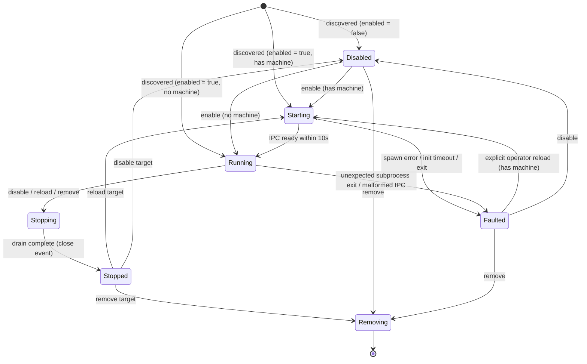

# Lody Plugin System Specification

Status: draft
Translation: current

[简体中文](plugin-system.zh.md)

Purpose: Define the normative runtime architecture, public SDK contract, process and UI lifecycle state machines, IPC/RPC wire semantics, encrypted-workspace (E2EE) security boundaries, reference algorithms, and conformance test matrix for the Lody Plugin System across `local`, `headless`, and `web` topologies. Architectural rationale and rejected alternatives are recorded in [Plugin architecture convergence and E2EE workspace boundaries](../.agents/notes/proposed/architecture/2026-11-22-plugin-architecture-and-e2ee-boundaries.md).

## 1. Normative Language

The key words `MUST`, `MUST NOT`, `REQUIRED`, `SHALL`, `SHALL NOT`, `SHOULD`, `SHOULD NOT`, `RECOMMENDED`, `MAY`, and `OPTIONAL` in this document are to be interpreted as described in RFC 2119 and RFC 8174.

`Implementation-defined` means the behavior is part of the host contract, but this specification permits multiple concrete mechanisms provided the implementation documents its selected policy and preserves every normative invariant in this document.

### 1.1 Conformance Profiles

This specification defines three validation and implementation profiles:

- `Core Conformance`: REQUIRED for every conforming Lody host implementation (`local` desktop and `headless` daemon). Covers package validation, per-plugin subprocess lifecycle, single-layer IPC, client UI/theme/style registries, host queries and Session actions, bounded persistence, and baseline E2EE/capability gates.
- `Extension Conformance`: REQUIRED only when an implementation ships an OPTIONAL extension defined in this specification (specifically remote `MachineRpc` plugin routing and cross-device E2EE client bundle distribution for `web` and remote desktop clients).
- `Real Integration Profile`: REQUIRED operational verification using real OS child processes, filesystem faults, and browser/Electron rendering before production release.

### 1.2 Implementation-Defined Items

Conforming implementations MUST explicitly document their choices for the following `Implementation-defined` behaviors:

1. **Secret storage backend** used to persist machine-owner `manifest.env` values on the host OS (for example macOS Keychain, Linux Secret Service, Windows DPAPI, or `0600` encrypted local store).
2. **Development bundler driver** used inside the ephemeral `--dev` compiler subprocess (for example `esbuild` or `rolldown`), provided output purity, externalization, and `1000 ms` idle-reap invariants hold.
3. **Durable receipt store** backing `(workspace, user, target, pluginId, requestId)` Session creation receipts and active `businessKey` reservations on the daemon (for example SQLite table or atomic journal).
4. **Operator UI layout** for plugin installation management, the sidebar view switcher, untrusted-bundle prompts, and the `--safe-mode` indicator banner.

---

## 2. Problem & Goals

### 2.1 Problem Statement

Fixed-feature coding-agent clients force users and teams into hard forks whenever they need custom tool renderers, issue-tracker context attachments, multi-Agent sidebar trees, or deep visual customization. Conversely, naive plugin architectures fail in four predictable ways inside a local-first, multi-machine, end-to-end encrypted (E2EE) workspace:

- Streaming live plugin tool output through Session CRDT history causes severe Loro document bloat and E2EE frame amplification.
- Running backend plugins in-process or inside a single shared worker causes collateral crashes, unattributed infinite loops or V8 heap OOMs, and complex fault-attribution heuristics.
- Stuffing host data into component props or exposing a singleton `sidebar.replace` hook causes multi-plugin collisions and offline fragility when individual machines disconnect.
- Treating dynamic plugin queries as safe read-only calls or allowing un-rooted daemon callbacks to mint Session prompts breaks E2EE Guest isolation, per-project `MachineSharing`, and signed execution-intent provenance (`e2eeIntent`).

The Lody Plugin System solves these problems by keeping admission, permissions, immediate `Stop`, history persistence, and cryptographic custody strictly inside the Lody Host Kernel while exposing one typed SDK across `shared`, `client`, and `machine` entrypoints.

### 2.2 Goals

- Isolate every enabled backend (`machine`) plugin inside its own dedicated OS child process with deterministic `shutdown -> SIGTERM -> SIGKILL` drain-before-respawn semantics.
- Zero backend process overhead (`0` child processes) for client-only, theme, or skill-only plugins, and zero lingering bundler processes in `--dev` mode.
- Render live `running` tool progress without Loro CRDT writes, and render completed tool history offline from bounded (`<= 16 KiB`) inline snapshots paired with `ctx.dataDir` artifact lookups.
- Expose Lody's raw reactive data (`lodyQueries` via `useLodyQuery` and `ctx.lody.read`) and gated Session operations (`create`, `send`, `answerQuestion`, `requestStop`, `requestArchive`) symmetrically without prop-stuffing.
- Support conflict-free UI composition across three orthogonal sidebar layers (`sessionRow.decorate`, `headerItems`/`footerItems` + `screens.add`, and selectable `sidebar.views.add`) plus an Obsidian-style two-tier theme and host-managed custom CSS model.
- Preserve all E2EE workspace invariants: non-Guest execution gating, machine-owner vs `MachineSharing` scope isolation, personal-device `memberInput` and root-Turn `derivedFrom` `machineInput` signing, single-frame Iroh P2P budgets, and custody-scoped storage wipe on revocation.

### 2.3 Non-Goals & Explicitly Deferred Capabilities

The following are **Non-Goals** of this specification:

- **Untrusted-code security sandboxing:** Lody does not run plugins inside V8 isolates, WASM sandboxes, or cross-origin iframes to defend against actively malicious code installed by the machine owner.
- **Direct CRDT or permission mutation:** Plugins MUST NOT mutate raw Loro documents, bypass Session Inbox admission, swallow `Stop`, or auto-approve/spoof tool `permission` prompts.
- **Transparent cross-machine failover or silent RPC retries:** Machine-scoped plugin calls target one explicit `machineId` and never fail over silently or auto-retry across crashes.
- **Agent self-installation:** Coding agents MUST NOT install, enable, reload, or configure plugins through MCP or internal tool calls.

The following capabilities are **Explicitly Deferred** beyond v1 Core Conformance and MUST NOT be exposed in the v1 public SDK surface until validated by production runtime feedback:

- Loopback external peripheral server (`createLodyClient()`).
- Portable multi-Agent role blueprints (`manifest.agentRoles`, `roleTarget`, `pluginRoleId`).
- Host-generated settings forms (`manifest.settings`, `usePluginSettings`); v1 plugins register custom settings UI via `settings.pages.add` backed by their own `defineQuery` / `defineMutation`.
- Cross-plugin background polling and Session wake predicates (`defineObservation`, `CreateSessionRequest.waitCondition`, `machine.onSessionEvent`, `businessKeyScope: 'project'`).
- Plugin-bundled ACP agent binaries and MCP child servers (`manifest.acpProviders`, `manifest.mcpServers`).
- Workspace-level standalone pages (`workspace.pages.add`) and global chrome/shortcut hooks (`shell.overlays`, `shell.statusBar`, `commands.add`).
- Native React evaluation of `client.js` on iOS and Android (`apps/mobile`).

### 2.4 Trust & Principal Model

Lody plugins are **explicitly user-installed, trusted, unsandboxed code** governed by process containment, capability scoping, and cryptographic workspace boundaries. Implementations MUST distinguish four principals on every operation:

| Principal                           | Trust & Authority                                                                                                                                                                                                                               |
| ----------------------------------- | ----------------------------------------------------------------------------------------------------------------------------------------------------------------------------------------------------------------------------------------------- |
| `MachineOwner`                      | Human operator of a machine. Sole principal permitted to install, enable, disable, reload, remove, or `--dev`-link plugins on that machine, configure `manifest.env` secrets, and invoke `'machine'`-scoped plugin handlers in E2EE workspaces. |
| `Collaborator` (`admin` / `member`) | Authenticated workspace writer. In E2EE workspaces, MAY invoke `'project'`- and `'session'`-scoped plugin handlers on a remote machine ONLY while `MachineSharing` actively grants both that `machineId` and every project bound to the target. |
| `Guest` (`read`)                    | Read-only workspace viewer. MUST NOT trigger any plugin subprocess code execution (`plugin/query`, `plugin/mutate`, `plugin/attachment-*`); MAY view inline `<= 16 KiB` history snapshots and host-owned `useLodyQuery` catalog state.          |
| `SessionAgent`                      | Coding agent executing inside a Session Turn. MAY invoke `defineTool` tools advertised to that Session via the host MCP bridge; MUST NOT invoke plugin lifecycle/install APIs or answer `ask_user_question` / `permission` prompts.             |

---

## 3. System Architecture

### 3.1 Main Components

1. `Host Kernel` (Lody Core)

   - Owns `HistoryWriter`, Session Inbox admission and anti-loop counters, interactive tool `permission` prompts, immediate `Stop` cancellation, capability minting/verification, E2EE `e2eeIntent` verification, `MachineSharing` evaluation, custody lifecycle, and the `lody --safe-mode` gate.

2. `Machine Plugin Host` (`PluginHost`, Daemon)

   - Discovers installed and `--dev` plugin packages on the local machine.
   - Validates `lody.plugin.json` manifests, entry paths, and required `env` bindings.
   - Owns the authoritative in-memory `MachinePluginState` and one serialized lifecycle queue per `plugin_id`.
   - Spawns, monitors, and drains one `child_process.fork` subprocess per enabled plugin that declares `manifest.machine`.
   - Routes `query`, `mutation`, `tool`, and `attachmentSource` invocations over single-layer IPC with hard deadlines and `AbortSignal` cancellation.
   - Bridges registered `defineTool` descriptors into the daemon's internal Session MCP tool registry and bridges `skills/` directories into skill discovery.
   - Captures child `stdout`/`stderr` into a bounded per-plugin ring buffer.

3. `Dev Plugin Compiler` (Ephemeral Daemon Child, `--dev` only)

   - Compiles TypeScript/TSX `client` and `machine` sources on demand in a separate child process.
   - Enforces browser-pure (`client`) and Node-pure (`machine`) externalization/import rules and computes `clientDigest`.
   - Automatically terminates itself after `1000 ms` of idle time so long-lived daemons hold zero bundler heap and leave zero orphaned compiler processes.

4. `Client Plugin Host` (`ClientPluginHost`, Desktop / Browser Renderer)

   - Evaluates trusted `client.js` ES modules when `--safe-mode` is inactive and workspace E2EE mode is resolved.
   - Owns `ClientPluginInstance` records keyed by `(source_machine_id, plugin_id)`, keyed for hot-swap by `clientDigest`.
   - Owns each plugin instance's `AbortController`, scoped `useQuery` cache, registered UI contributions, theme registrations, and host-managed `<style>` nodes.
   - Wraps every mounted plugin React surface in an isolated `SurfaceErrorBoundary` with built-in fallback chrome.

5. `Remote Plugin Transport Bridge` (`Extension`, `MachineRpc` / E2EE)
   - Exposes explicit allowlisted `MachineRpc` endpoints (`plugin/catalog`, `plugin/bundle-chunk`, `plugin/query`, `plugin/mutate`, `plugin/attachment-search`, `plugin/attachment-resolve`) across local IPC, encrypted Streams, and single-frame Iroh P2P (`purpose 8` / `purpose 9`).

### 3.2 Component Boundary Invariants

- `ClientPluginHost` MUST NOT execute Node built-in modules, read `ctx.env` secrets, or open direct network connections carrying daemon credentials.
- `PluginHost` MUST NOT load or execute plugin `machine.js` code inside the main daemon process; built-in migrated plugins and external plugins MUST use the identical subprocess boundary.
- Neither `PluginHost` nor `ClientPluginHost` MAY layer an internal WebSocket server on top of Node child IPC.
- UI surface failures in `ClientPluginHost` MUST NOT crash the workspace shell, block Session switching, or prevent `Stop` and permission interactions.

### 3.3 Execution Topologies

| Topology                   | `ClientPluginHost` Behavior                                                                                                                        | `PluginHost` Behavior                                                                                                                          |
| -------------------------- | -------------------------------------------------------------------------------------------------------------------------------------------------- | ---------------------------------------------------------------------------------------------------------------------------------------------- |
| `local` (Desktop)          | Evaluates local trusted `client.js` bundles; supports `--dev` HMR, `themes`, and local `styles`.                                                   | Runs in local daemon; spawns 1 subprocess per enabled `machine` plugin (`0` for client-only plugins).                                          |
| `headless` (Daemon Server) | Absent (`0` browser evaluation overhead).                                                                                                          | Runs on server daemon; executes `defineTool`, `defineQuery`, `defineMutation`, `defineAttachmentSource`, and `skills/`.                        |
| `web` (Browser Client)     | Core v1 renders built-in structured fallbacks; with Remote Transport Extension, evaluates `clientDigest`-trusted bundles from authorized machines. | Absent locally; all `machine` calls route over `MachineRpc` to target `machineId` and return `unavailable (machine_offline)` when unreachable. |

---

## 4. Domain Model

### 4.1 Core Entities

#### 4.1.1 `PluginInstallation` (Daemon-Owned)

Represents a discovered plugin package bound to `(workspace_custody_scope, machine_id, plugin_id)`.

Fields (logical):

- `plugin_id` (string, REQUIRED): Canonical kebab-case identifier (`^[a-z0-9]+(?:-[a-z0-9]+)*$`).
- `machine_id` (string, REQUIRED): Owning daemon machine identifier.
- `package_root` (absolute normalized path, REQUIRED): Realpath-verified directory containing `lody.plugin.json`.
- `mode` (`'installed' | 'dev'`, REQUIRED): Static package vs live `--dev` watched source.
- `enabled` (boolean, REQUIRED): Persisted operator enablement flag.
- `manifest` (`PluginManifest`, REQUIRED): Validated manifest snapshot.
- `client_digest` (string or null): `sha256:<64-hex>` of packed `client` bundle + `assets/`, or `null` when neither `client`, `themes`, nor `styles` is present.
- `data_dir` (absolute normalized path, REQUIRED): Persistent plugin data directory scoped to the active workspace/custody identity.
- `lifecycle_state` (`'disabled' | 'starting' | 'running' | 'stopping' | 'stopped' | 'faulted' | 'removing'`, REQUIRED).
- `active_instance` (`MachinePluginInstance` or null): Non-null only when `manifest.machine` is present and `lifecycle_state` is `'starting' | 'running' | 'stopping'`.
- `last_error` (`{ code: string, message: string, at_ms: integer }` or null).
- `logs_ring` (bounded ring buffer): Recent `stdout`/`stderr` lines (`<= 500` lines, `<= 262_144` UTF-8 bytes).

#### 4.1.2 `MachinePluginInstance` (Daemon Runtime-Only)

Represents one live OS child process spawned for a `PluginInstallation` with a `machine` entry.

Fields (logical):

- `instance_id` (string, REQUIRED): Monotonic runtime token (`inst_<counter>`), unique per process spawn.
- `plugin_id` (string, REQUIRED).
- `pid` (integer, REQUIRED): Host OS process ID.
- `started_at_ms` (monotonic timestamp, REQUIRED).
- `registered_handlers` (maps of `descriptor_id` -> metadata for `query`, `mutation`, `tool`, and `attachment_source`, frozen upon `ready`).
- `inflight` (map `call_id -> Invocation`).

#### 4.1.3 `ClientPluginInstance` (Renderer Runtime-Only)

Represents one mounted client plugin registration inside `ClientPluginHost`.

Fields (logical):

- `plugin_id` (string, REQUIRED).
- `source_machine_id` (string, REQUIRED).
- `client_digest` (string, REQUIRED): Exact `sha256:<64-hex>` digest of the evaluated bundle/assets.
- `state` (`'untrusted' | 'mounting' | 'active' | 'disposing' | 'disposed' | 'faulted' | 'bypassed_safe_mode'`).
- `abort_controller` (`AbortController`, REQUIRED): Aborted atomically on disable, `client_digest` replacement, or workspace close.
- `query_cache` (scoped reactive cache): Keyed by `(descriptor_id, target_key, canonical_input_json)`.
- `cleanup_fn` (`(() => void | Promise<void>) | null`): Optional teardown callback returned by `defineClientPlugin`.
- `contributions` (immutable set of UI/theme registrations owned by this instance).
- `style_elements` (list of `<style>` DOM nodes injected by `manifest.styles` and `lody.styles.add`).

#### 4.1.4 `Invocation`

Represents one in-flight call dispatched to a `MachinePluginInstance`.

Fields (logical):

- `call_id` (string, REQUIRED): Host-generated unique request ID.
- `plugin_id` (string, REQUIRED).
- `instance_id` (string, REQUIRED): Pinned `MachinePluginInstance` serving this call.
- `kind` (`'query' | 'mutation' | 'tool' | 'attachment_search' | 'attachment_resolve'`, REQUIRED).
- `descriptor_id` (string, REQUIRED).
- `scope` (`'machine' | 'project' | 'session'`, REQUIRED).
- `target_ref` (`MachineRef | ProjectRef | SessionRef`, REQUIRED).
- `caller` (principal descriptor + optional `root_turn_provenance` when `kind == 'tool'`).
- `deadline_ms` (monotonic timestamp, REQUIRED).
- `side_effect_class`: `'unverified_read'` for `query` and `attachment_*`; `'effectful'` for `mutation` and `tool`.

#### 4.1.5 `Capability References` (`WorkspaceRef`, `MachineRef`, `ProjectRef`, `SessionRef`)

Capability references ([`sdk/shared.d.ts`](../scripts/fixtures/plugin-sdk/sdk/shared.d.ts)) are host-minted, unforgeable runtime tokens:

- `WorkspaceRef { workspaceId }`: Logical workspace handle. MUST NOT contain `machineId`.
- `MachineRef { workspaceId, machineId }`: Targets one specific daemon machine.
- `ProjectRef { workspaceId, machineId, projectId }`: Targets one repository/project bound to `machineId`.
- `SessionRef { workspaceId, machineId, sessionId, projectId? }`: Targets one Session bound to `machineId` (with optional `projectId` for unbound Sessions).

Plain JSON objects carrying matching string fields MUST NOT be accepted by `LodyClient` or `MachineHostPort` without passing host capability table lookup and live authorization.

#### 4.1.6 `SessionCreationReceipt` & `BusinessKeyReservation`

Durable idempotency records owned by the target machine's Host Kernel:

- `SessionCreationReceipt`: Keyed by `(workspace_id, caller_user_id, target_key, plugin_id, request_id)` -> `{ normalized_request_sha256, session_ref, created_at_ms }`. Retained across Session archive.
- `BusinessKeyReservation`: Keyed by `(workspace_id, caller_user_id, target_key, plugin_id, business_key)` -> `{ active_session_ref, request_id }`. Released atomically when `active_session_ref` transitions to `archived = true`.

### 4.2 Identifiers, Normalization, and Digest Rules

- **`plugin_id`:** MUST match `^[a-z0-9]+(?:-[a-z0-9]+)*$` (length `1..64`). Underscores and uppercase characters are forbidden so MCP tool names remain bijective.
- **`descriptor_id` (`query`, `mutation`, `tool`, `attachmentSource`, surface `id`):** MUST match `^[A-Za-z0-9._-]+$` (length `1..128`) and MUST NOT contain double underscores (`__`).
- **Canonical MCP Tool Name:** Every registered `defineTool` descriptor is advertised to Sessions on that machine as `plugin__<plugin_id>__<tool_id>`. Because `plugin_id` forbids `_` and `tool_id` forbids `__`, parsing on `__` (`["plugin", plugin_id, tool_id]`) is lossless and collision-free.
- **`clientDigest` Calculation:** Computed as `"sha256:" + hex(SHA256( framing ))` over all included client files (`client.js` if present, plus every referenced `themes[].path` and `styles[]` asset under `assets/`), sorted in ascending UTF-8 byte order of their normalized POSIX relative path, with each entry framed as `relative_path + "\0" + decimal_byte_length + "\0" + raw_bytes`. Changes to `machine.js` or `skills/` MUST NOT alter `clientDigest`.
- **`dataDir` Path Containment:** `data_dir` MUST resolve under `<custody_root>/plugins/<plugin_id>`. Before spawning or serving a plugin, `PluginHost` MUST verify via `lstat` / `realpath` that neither `package_root` (in `installed` mode) nor `data_dir` escapes its parent directory via `..` or symbolic links.

---

## 5. Package & SDK Contract

### 5.1 Package Layout & Bundle Purity

A conforming plugin package directory contains:

- `lody.plugin.json` (REQUIRED): UTF-8 JSON manifest conforming to [`sdk/manifest.d.ts`](../scripts/fixtures/plugin-sdk/sdk/manifest.d.ts).
- `client` bundle (OPTIONAL): Single browser-pure ES module (`default` export produced by `defineClientPlugin`).
  - MUST NOT import `@lody/plugin-sdk/machine`, Node built-in modules (`node:*`, `fs`, `child_process`, `net`, etc.), or Electron APIs.
  - MUST treat `react`, `react/jsx-runtime`, `zod`, `@lody/ui`, `@lody/plugin-sdk`, and `@lody/plugin-sdk/client` as host-supplied externals so React hooks and brand symbols share one singleton realm with `ClientPluginHost`.
- `machine` bundle (OPTIONAL): Node.js module (`default` export produced by `defineMachinePlugin`).
  - MUST NOT import `@lody/plugin-sdk/client` or rely on browser DOM globals (`window`, `document`).
  - MUST treat `zod`, `@lody/plugin-sdk`, and `@lody/plugin-sdk/machine` as host-supplied externals.
- `skills/<skill_name>/SKILL.md` (OPTIONAL): Markdown skill folders listed in `manifest.skills`.
- `assets/**` (OPTIONAL): Static theme JSON files and CSS stylesheets referenced by `manifest.themes` and `manifest.styles`.

### 5.2 Manifest Schema & Validation (`lody.plugin.json`)

Required fields:

- `id` (string): Matches `plugin_id` rule in Section 4.2.
- `version` (string): Valid SemVer string (`MAJOR.MINOR.PATCH`).
- `sdk` (string): MUST equal `"^1.0.0"`. Unsupported major ranges MUST fail validation with `invalid_manifest`.
- `title` (non-empty string, `<= 120` chars).

Optional fields:

- `description` (string, `<= 500` chars).
- `client` (relative POSIX path inside package).
- `machine` (relative POSIX path inside package).
- `skills` (array of skill directory names under `skills/`).
- `themes` (array of `PluginThemeContribution`: `{ id, label, appearance: 'dark' | 'light', tokens?, path | seed }`, mutually excluding `path` and `seed`).
- `styles` (array of relative `.css` asset paths inside package).
- `env` (map of `^[A-Z][A-Z0-9_]*$` -> `{ description, required?, secret? }`).

Validation rules:

1. A manifest MUST declare at least one contribution (`client`, `machine`, `skills`, `themes`, or `styles`); empty manifests fail validation.
2. Unknown top-level manifest keys MUST fail validation with `invalid_manifest` (preventing typos or deferred v2 fields from silently doing nothing).
3. Every relative path (`client`, `machine`, `themes[].path`, `styles[]`, `skills[]`) MUST normalize within `package_root` without `..` segments or symlink escape, and the target file MUST exist.
4. If `manifest.env.<KEY>.required` is `true` and the machine owner has not configured a non-empty value for `<KEY>`, `PluginHost` MUST refuse to transition `machine` to `running` and record `missing_required_env`.

### 5.3 Normative Byte & Resource Budgets

Conforming implementations MUST enforce the exact constants declared in [`sdk/shared.d.ts`](../scripts/fixtures/plugin-sdk/sdk/shared.d.ts):

| Constant / Limit                      | Value                     | Enforcement Boundary                                                                                    |
| ------------------------------------- | ------------------------- | ------------------------------------------------------------------------------------------------------- |
| `MAX_INLINE_PLUGIN_TOOL_OUTPUT_BYTES` | `16_384` (16 KiB)         | UTF-8 JSON byte length of validated `defineTool` output written to `HistoryWriter`.                     |
| `MAX_PLUGIN_RPC_REQUEST_BYTES`        | `262_144` (256 KiB)       | UTF-8 JSON byte length of a `plugin/query`, `plugin/mutate`, or `plugin/attachment-*` request envelope. |
| `MAX_PACKED_CLIENT_BUNDLE_BYTES`      | `4_194_304` (4 MiB)       | Total uncompressed byte size of `client.js` plus all referenced `assets/` files.                        |
| `MAX_PLUGIN_LOG_LINES` / `BYTES`      | `500` lines / `262_144` B | Per-plugin daemon ring buffer (`16_384` B max per individual line before truncation).                   |

### 5.4 SDK Surface & Schema Enforcement

The normative TypeScript surface is defined by [`sdk/shared.d.ts`](../scripts/fixtures/plugin-sdk/sdk/shared.d.ts), [`sdk/client.d.ts`](../scripts/fixtures/plugin-sdk/sdk/client.d.ts), [`sdk/machine.d.ts`](../scripts/fixtures/plugin-sdk/sdk/machine.d.ts), and [`sdk/manifest.d.ts`](../scripts/fixtures/plugin-sdk/sdk/manifest.d.ts):

- `useLodyQuery` accepts ONLY `LodyQueryDescriptor` values from `lodyQueries`; `useQuery` accepts ONLY plugin `QueryDescriptor` values from `defineQuery`.
- Every `defineQuery`, `defineMutation`, and `defineTool` invocation MUST validate raw caller input via `descriptor.input.safeParse(rawInput)` before invoking the plugin handler, and MUST validate the handler's return value via `descriptor.output.safeParse(rawOutput)` before returning to the caller or committing to `HistoryWriter`. Any schema failure rejects with `validation_failed`.

---

## 6. Lifecycle State Machine

### 6.1 Machine Plugin Lifecycle States



State invariants:

- **Client-only / Theme / Skill-only fast path:** When `manifest.machine` is absent, `enable` transitions directly `Disabled -> Running` with `active_instance = null` and **`0` spawned OS processes**.
- **No automatic crash-loop restarts:** Entering `Faulted` MUST NOT schedule automatic background restarts. A `Faulted` plugin remains quarantined (returning `plugin_faulted` on all RPCs) until an explicit operator `reload`, `disable`, or daemon restart.

### 6.2 Per-Plugin Serialized Command Queue

`PluginHost` MUST maintain one FIFO async command queue per `plugin_id`:

- All `enable`, `disable`, `reload`, and `remove` operations for `plugin_id` MUST execute strictly one at a time in queue order.
- Multiple back-to-back `reload` requests queued while an earlier transition is still running MAY coalesce into a single trailing `reload` using the latest disk snapshot, but MUST NOT start until the in-progress transition finishes.
- Lifecycle transitions for distinct plugins (`plugin_a` vs `plugin_b`) MAY execute concurrently.

### 6.3 Escalating Shutdown & Drain-Before-Respawn Invariant

When stopping an active `MachinePluginInstance` (for `disable`, `reload`, `remove`, or daemon shutdown), `PluginHost` MUST execute this exact sequence:

1. Transition `lifecycle_state` to `stopping` and stop admitting new invocations (new calls reject immediately with `plugin_disabled`).
2. Keep the Node IPC channel open (`PluginHost` MUST NOT call `child.disconnect()` while awaiting shutdown, ensuring IPC messages flush and OS `close` observation is never lost). Send `{ type: "shutdown", graceMs: 2000 }`.
3. Inside the child, invoke the optional `MachinePluginCleanup` function returned by `defineMachinePlugin` and exit `0` when complete.
4. Wait up to `2000 ms` for the child process to emit `close`.
5. If the child has not emitted `close` after `2000 ms`, send `SIGTERM` (or platform equivalent) and wait up to an additional `2000 ms` for `close`.
6. If the child has still not emitted `close` after `4000 ms` cumulative elapsed time, send `SIGKILL` and await the OS `close` event.
7. Settle any remaining `inflight` invocations (`outcome_unknown` for `mutation`/`tool`; `plugin_disabled` for `query`/`attachment_*`) and clear `active_instance = null`.

**Normative Invariant (Drain-Before-Respawn):** During `reload`, `PluginHost` MUST NOT call `child_process.fork` for the replacement `MachinePluginInstance` until Step 6/7 has observed `close` on the previous `pid`. Two OS processes for the same `(workspace_custody_scope, machine_id, plugin_id)` MUST NEVER run concurrently.

### 6.4 Dev Compiler Subprocess Lifecycle (`--dev`)

- When one or more `mode == 'dev'` plugins watch source files, file changes enqueue a build job on `DevPluginCompiler`.
- If no compiler subprocess is alive, `PluginHost` forks the compiler child, runs the build, and starts/resets a `1000 ms` idle timer upon build completion.
- When the `1000 ms` idle timer fires with zero queued builds, the compiler child terminates cleanly.
- If a `--dev` build fails (syntax/type/purity/size error), `PluginHost` MUST log the build error, surface diagnostic status to the operator, and keep the last valid compiled `client` / `machine` artifacts running rather than crashing the daemon.
- If a `--dev` rebuild changes ONLY `client.js` / `assets/` (leaving `machine.js` byte-identical), `PluginHost` updates `client_digest` and notifies clients WITHOUT restarting the running `MachinePluginInstance` or interrupting active `defineTool` calls.

### 6.5 Client Plugin Instance Lifecycle & `clientDigest` Idempotency

`ClientPluginHost` reconciles enabled plugins against the workspace catalog and local `--dev` state:

1. If `lody --safe-mode` is active, transition all plugins to `bypassed_safe_mode` without evaluating any `client.js`, applying any plugin `themes`, or injecting any `styles`.
2. If workspace E2EE mode is `unknown`, hold `ClientPluginHost` unmounted until mode and custody epoch are resolved.
3. For each enabled plugin with `client_digest`:
   - If the bundle originates from a remote machine (`Extension`) and `(workspace_id, plugin_id, client_digest)` is not trusted by the local user, mark `untrusted` and render built-in fallback views.
   - **Idempotency Rule:** If an `active` `ClientPluginInstance` already exists for `(source_machine_id, plugin_id)` with the **exact same `client_digest`**, `ClientPluginHost` MUST keep the instance mounted, MUST NOT abort `abort_controller`, and MUST preserve `query_cache`.
   - **Atomic Replacement Rule:** If `client_digest` changed, or if the plugin was disabled/removed, `ClientPluginHost` MUST first dispose the prior instance — invoking `cleanup_fn()` (isolating any sync/async error), calling `abort_controller.abort()`, removing all UI surface registrations, reverting active plugin themes if removed, and detaching all managed `<style>` DOM elements — before evaluating and registering the new `client_digest` module.

---

## 7. RPC & Execution Semantics

### 7.1 Single-Layer Subprocess IPC Protocol

`PluginHost` launches each `machine` subprocess with `stdio: ['ignore', 'pipe', 'pipe', 'ipc']`. `stdout` and `stderr` carry diagnostic text only (never protocol frames) so `console.log` inside plugin code cannot corrupt IPC messages.

Host-to-Child envelopes:

- `{ type: "init", pluginId, instanceId, workspaceId, machineId, dataDir, env }`
- `{ type: "invoke", callId, kind, descriptorId, scope, target, input, toolCallId? }`
- `{ type: "cancel", callId }`
- `{ type: "host_read_result", reqId, ok: true, data } | { type: "host_read_result", reqId, ok: false, code, message }`
- `{ type: "host_session_result", reqId, ok: true, data } | { type: "host_session_result", reqId, ok: false, code, message }`
- `{ type: "shutdown", graceMs }`

Child-to-Host envelopes:

- `{ type: "ready", queries: string[], mutations: string[], tools: ToolWireSpec[], attachmentSources: string[] }`
- `{ type: "invoke_result", callId, data }`
- `{ type: "invoke_error", callId, code: "validation_failed" | "handler_error", message }`
- `{ type: "invalidate", descriptorId, scope, target? }`
- `{ type: "host_read", reqId, scope, target, queryId, input }`
- `{ type: "host_session_action", reqId, action: "create" | "send" | "requestStop" | "requestArchive", target, payload, viaToolCallId? }`
- `{ type: "shutdown_ack" }`

Handshake & framing rules:

- Upon spawn, `PluginHost` sends `init` and starts a `10_000 ms` (`INIT_TIMEOUT_MS`) timer.
- All `machine.query`, `machine.mutation`, `machine.tool`, and `machine.attachmentSource` calls inside `defineMachinePlugin` MUST complete synchronously before the child emits `ready`; late registrations after `ready` MUST throw inside the child.
- If `ready` is not received within `10_000 ms`, `PluginHost` aborts startup via Section 6.3 (`SIGTERM -> SIGKILL`) and transitions to `Faulted`.
- Any IPC message from the child that fails envelope schema validation (missing/unknown `type`, non-string `callId`, or payload exceeding wire limits) is a protocol violation: `PluginHost` immediately kills the subprocess and transitions to `Faulted`.

### 7.2 Timeouts, Cancellation, and Session `Stop`

Normative invocation timeouts:

- `QUERY_TIMEOUT_MS`: `30_000` (30 seconds)
- `MUTATION_TIMEOUT_MS`: `30_000` (30 seconds)
- `ATTACHMENT_TIMEOUT_MS`: `30_000` (30 seconds)
- `TOOL_TIMEOUT_MS`: `600_000` (10 minutes)

Cancellation and `Stop` rules:

1. When a client `useQuery` unmounts or changes parameters, or when an invocation deadline expires, `PluginHost` sends `{ type: "cancel", callId }` to the child, triggering `ctx.signal.abort()` for that invocation.
2. When a user triggers `Stop` on a Session with an in-flight plugin `defineTool` call, the Host Kernel MUST immediately settle the Session Turn cancellation without waiting for the plugin subprocess, while `PluginHost` dispatches `{ type: "cancel", callId }`. A non-cooperative plugin handler ignoring `ctx.signal` MUST NOT block Session `Stop` responsiveness; if it later exceeds `TOOL_TIMEOUT_MS`, deadline enforcement handles teardown.
3. When a deadline expires on an effectful call (`mutation` or `tool`), the caller receives `outcome_unknown` because side effects before timeout cannot be disproven.

### 7.3 Error Code Taxonomy & Zero-Auto-Retry Rule

Every failed plugin operation surfaces a `PluginCallError` carrying one of the 11 normative `PluginCallErrorCode` values ([`sdk/shared.d.ts`](../scripts/fixtures/plugin-sdk/sdk/shared.d.ts)):

| Error Code              | Meaning & Trigger Condition                                                                                                                                                    |
| ----------------------- | ------------------------------------------------------------------------------------------------------------------------------------------------------------------------------ |
| `untrusted_plugin`      | Remote `clientDigest` bundle has not been trusted by the local user.                                                                                                           |
| `plugin_disabled`       | Plugin is disabled, stopping, or running under `--safe-mode`.                                                                                                                  |
| `plugin_faulted`        | Plugin subprocess crashed, failed `init`, violated IPC framing, or is quarantined awaiting `reload`.                                                                           |
| `machine_offline`       | Target `machineId` is disconnected or unreachable over `MachineRpc`.                                                                                                           |
| `forbidden`             | Principal lacks capability, E2EE execution freshness, `MachineSharing` grant, root-Turn `e2eeIntent` provenance, or attempted tool `permission` approval via `answerQuestion`. |
| `not_found`             | Unknown `pluginId`, unregistered `descriptorId`, or non-existent target entity.                                                                                                |
| `idempotency_conflict`  | `sessions.create` reused an existing `requestId` with different normalized request fields.                                                                                     |
| `business_key_conflict` | `sessions.create` used a new `requestId` whose `businessKey` already has an active (non-archived) Session.                                                                     |
| `outcome_unknown`       | Subprocess crashed, exited, disconnected, or timed out after a `mutation` or `tool` invocation was dispatched and before a terminal reply arrived.                             |
| `validation_failed`     | Request exceeded `MAX_PLUGIN_RPC_REQUEST_BYTES`, `defineTool` output exceeded `MAX_INLINE_PLUGIN_TOOL_OUTPUT_BYTES`, or Zod `input`/`output` `safeParse` failed.               |
| `handler_error`         | Plugin handler threw an exception or returned a rejected promise cleanly over IPC.                                                                                             |

**Normative Zero-Auto-Retry Rule:** Neither `PluginHost` nor `ClientPluginHost` MAY automatically retry any failed `query`, `mutation`, `tool`, or `attachmentSource` invocation. Callers explicitly retry reads via `refresh()` and recover uncertain Session creations by re-submitting the identical `CreateSessionRequest` with the original `requestId`.

### 7.4 Remote `MachineRpc` Envelope (`Extension`)

When shipping remote client support (`web` or cross-machine desktop), implementations MUST register ONLY fixed allowlisted `MachineRpc` methods:

- Read-catalog / bundle transport: `plugin/catalog` and `plugin/bundle-chunk` (`256 KiB` pages up to `MAX_PACKED_CLIENT_BUNDLE_BYTES = 4 MiB`, compatible with E2EE `purpose 9` paged reads).
- Dynamic execution RPCs: `plugin/query`, `plugin/mutate`, `plugin/attachment-search`, and `plugin/attachment-resolve`, each enforcing `MAX_PLUGIN_RPC_REQUEST_BYTES = 256 KiB` before encryption so Desktop-to-Machine E2EE calls fit inside a single `1 MiB` `purpose 8` Iroh QUIC frame.

---

## 8. Client Extensions & Appearance Contract

### 8.1 Thin-Props & Surface Registration Rules

Every component registered on `ClientPluginRegistry` ([`sdk/client.d.ts`](../scripts/fixtures/plugin-sdk/sdk/client.d.ts)) MUST obey these rules:

- **Thin Capability Props:** Host surfaces pass ONLY capability references (`workspace`, `project`, `session`, `machine`) and immutable `params: Readonly<Record<string, string>>` (plus `toolCallId`, `input`, `status`, `output`, and `appendToDraft` on `ToolRenderProps`). The host MUST NOT pre-populate raw repository, diff, or catalog payloads in props.
- **Per-Surface Error Containment:** Every mounted plugin component (`tools.render`, `composer.actions`, `session.panels`, `screens`, `project.pages`, `sidebar.*`, `settings.pages`) MUST be wrapped in an independent `SurfaceErrorBoundary`. A render throw MUST isolate failure to that single widget/slot and display a compact host recovery fallback without unmounting sibling surfaces.
- **`tools.render` Lifecycle & Validation:**
  - While a tool call is executing, `ClientPluginHost` mounts the registered component with `{ status: 'running', output: undefined, toolCallId, input, session, project?, appendToDraft }` once `tool.input.safeParse` succeeds.
  - When completed, `ClientPluginHost` runs `tool.output.safeParse(storedPayload)`. If `safeParse` succeeds, it mounts `{ status: 'completed', output: parsed.data, ... }`; if `safeParse` fails, if the bundle is `untrusted`, or if `SurfaceErrorBoundary` catches a throw, the card MUST fall back to Lody's built-in structured JSON/raw viewer while preserving host header chrome, timing, and raw toggle.
- **Route & Panel Parameter Safety:** Standalone `project.pages` and `screens` persist plugin query parameters under the `p.<key>` URL namespace; `lody.panels.openSession(session, panelId, params)` passes `params` to `SessionPanelProps`. URL/panel `params` are untrusted strings and MUST NEVER mint or widen capability references.

### 8.2 Three-Layer Orthogonal Sidebar Composition

Sidebar extensions ([`sidebar-surface.ts`](../packages/components/src/components/sidebar-surface.ts)) compose across three non-colliding layers:

1. **Row Decorators (`sidebar.sessionRow.decorate`):**
   - Multiple plugins MAY register `trailing` badges and `hoverCard` popovers simultaneously.
   - Decorators render in deterministic `(plugin_id, decorator_id)` lexicographic order, each inside its own `SurfaceErrorBoundary` so a broken badge never hides the Session row or blocks clicking the Session.
2. **Header & Footer Navigation (`sidebar.headerItems.add`, `sidebar.footerItems.add`):**
   - Render between the workspace switcher, view body, and footer using `<SidebarRow />` so metrics match native navigation rows.
3. **Selectable Custom Views (`sidebar.views.add` & `<SessionRow />`):**
   - Multiple plugins MAY register custom sidebar views alongside Lody's built-in `"Default"` view; the host MUST always keep `"Default"` selectable in the sidebar header switcher.
   - Whenever a custom sidebar view renders `<SessionRow session={summary} />`, `<SessionRow />` MUST automatically attach all active `sidebar.sessionRow.decorate` `trailing` badges and `hoverCard` popovers so row-level plugins and tree-view plugins compose without coupling.

### 8.3 Two-Tier Theme & Host-Managed Custom CSS Contract

Because client plugins execute as trusted, unsandboxed ES modules in the renderer realm, appearance customization separates **SemVer-stable design tokens** from **disposable power-user CSS**:

1. **Tier 1 — SemVer-Stable Theme Contract (`manifest.themes`, `lody.themes.add`, `lody.themes.activate`):**
   - Accepts either a VS Code color theme JSON (`path`) or a seed palette (`PluginThemeSeedColors`), plus optional `PluginThemeTokens` (`fontSans`, `fontMono`, `radius`, `density`).
   - Applied via [`vscode-theme-dom.ts`](../packages/components/src/lib/vscode-theme/vscode-theme-dom.ts) (`applyVSCodeThemeCssVariables`) and [`vscode-theme-css.ts`](../packages/components/src/lib/vscode-theme/vscode-theme-css.ts) as root `--*` CSS custom properties covering app chrome, panels, diffs, Monaco, Shiki, and terminal surfaces.
   - Documented `--*` CSS variable names are SemVer-stable within SDK `^1.0.0`. If the currently active theme belongs to a plugin that is disabled, removed, or started under `--safe-mode`, the host MUST invoke `dispose()` on that theme application and revert to the fallback built-in theme.
2. **Tier 2 — Host-Managed Local Custom CSS (`manifest.styles`, `lody.styles.add`):**
   - Injects `<style data-lody-plugin="<plugin_id>" data-lody-style="<style_id>">` into the local client document ONLY for the opting-in local profile; custom styles MUST NEVER auto-propagate to other workspace members' clients.
   - `ClientPluginHost` tracks every injected `<style>` node on `ClientPluginInstance.style_elements` and MUST remove all nodes synchronously upon plugin disablement, `clientDigest` replacement, or `--safe-mode`.
   - **Non-Freezing Rule:** Internal React component hierarchy and hashed/internal class names are NOT part of the public SDK contract; only documented `--*` CSS variables carry cross-release stability guarantees.

---

## 9. Host Capabilities (`LodyClient` & `MachineHostPort`)

### 9.1 `lodyQueries` & Reactive Subscription Semantics

`lodyQueries` ([`sdk/shared.d.ts`](../scripts/fixtures/plugin-sdk/sdk/shared.d.ts)) provides 13 typed host read descriptors shared by `useLodyQuery`, `LodyClient.read`, and `MachineHostPort.read`:

- **Workspace-scoped catalog reads (`WorkspaceRef`):** `machines`, `projects`, `agentRoles`, `members`, `schedules`, and `sessions`. On the client, `useLodyQuery` MUST subscribe directly to Lody's shared ref-counted Loro/Flock rooms and presence stores (`0` duplicate room connections and `0` machine RPCs), remaining available when individual machines are offline.
- **Machine/Project/Session reads:** `schedules` (`machine`/`project`), `sessions` (`machine`/`project`), `sessionDetail`, `gitState`, `worktrees`, `sessionDiff`, `filePreview`, `pullRequests`, and `skills`. Route through `WorkspaceMachineRpcFacade` / platform cloud ports and resolve to `{ status: 'unavailable', reason: 'machine_offline' | 'forbidden' | 'unknown', refresh }` when unavailable.
- **Cross-Plugin Business-Key Isolation:** In `lodyQueries.sessions` and `sessionDetail`, the host MUST populate `SessionSummary.businessKey` ONLY when `session.createdByPluginId === caller_plugin_id` (setting `businessKey: undefined` for all other callers), and `createdByPlugin: true` MUST filter strictly to `caller_plugin_id`.

### 9.2 Session Lifecycle Actions & Creation Idempotency

Both `LodyClient.sessions` and `MachineHostPort.sessions` expose `create`, `send`, `requestStop`, and `requestArchive`:

1. **`sessions.create(target, request)` Atomic Idempotency Rules:**
   - Normalized payload hash `H = SHA256(canonical_json({ target, businessKey, roleId, parentSession, prompt, skillIds, pullRequestUrl }))`.
   - Lookup `SessionCreationReceipt` by `(workspace_id, caller_user_id, target_key, plugin_id, request.requestId)`:
     - If found and `receipt.normalized_request_sha256 == H`: MUST return `receipt.session_ref` without creating a second Session, **even if `receipt.session_ref` has since been archived**.
     - If found and `receipt.normalized_request_sha256 != H`: MUST reject with `idempotency_conflict`.
   - If not found and `request.businessKey` is present, lookup `BusinessKeyReservation` by `(workspace_id, caller_user_id, target_key, plugin_id, request.businessKey)`:
     - If an active (non-archived) Session reservation exists: MUST reject with `business_key_conflict`.
   - Otherwise, create the Session via standard Host Kernel admission, atomically persist `SessionCreationReceipt` and (if `businessKey` is set) `BusinessKeyReservation`, and return the new `SessionRef`.
   - Archiving a Session (`requestArchive` or user archive) MUST release its `BusinessKeyReservation` while preserving its `SessionCreationReceipt`.
2. **`sessions.send(session, request)`:**
   - Deduplicates retries per `(session_id, plugin_id, request.idempotencyKey)` when `idempotencyKey` is supplied.
   - Enters standard Session Inbox admission (`disposition: 'started' | 'queued' | 'steered'`) and obeys all kernel anti-loop and Turn limits.
3. **`sessions.requestStop` & `sessions.requestArchive`:**
   - Delegate directly to Host Kernel stop/archive handlers after verifying caller capability over `session`.

### 9.3 `answerQuestion` vs Kernel Permission Exclusivity

`LodyClient.sessions.answerQuestion(session, request)` exists ONLY on the client (`useLody()`) and is intentionally omitted from `MachineHostPort`:

- The Host Kernel MUST verify that `session` currently holds a pending interaction with `requestId == request.requestId` AND `kind === 'ask_user_question'` ([`ask-user-question.ts`](../packages/shared/src/acp/ask-user-question.ts)), then submit normalized answers keyed by `getAskUserQuestionAnswerKey` through `WorkspaceWriter.respondSessionPermission` ([`use-permission-response.ts`](../packages/components/src/hooks/use-permission-response.ts)).
- **Hard Security Rule:** If `request.requestId` targets a tool `permission` prompt (`kind === 'permission'`), the Host Kernel MUST reject `answerQuestion` with `forbidden`. Tool execution permissions remain 100% owned by Lody's native kernel UI.

---

## 10. Persistence, History & Data Ownership

### 10.1 Bounded Session History (`HistoryWriter`)

- **Zero Streaming Writes:** While a `defineTool` handler is running, `PluginHost` MUST NOT write intermediate progress frames into `HistoryWriter` / Loro Session documents. Live UI updates use `ctx.dataDir` + `ctx.invalidate` + `useQuery`.
- **16 KiB Inline Completion Cap:** Upon handler return, `PluginHost` validates the output against `tool.output` (`safeParse`) and measures UTF-8 byte length of the serialized JSON:
  - If `<= MAX_INLINE_PLUGIN_TOOL_OUTPUT_BYTES` (`16_384` bytes), `HistoryWriter` persists the structured payload inline on the `tool_call` history entry ([`tool-call-history.ts`](../packages/shared/src/acp/tool-call-history.ts)) so offline and reopened clients render the completed card with zero daemon calls.
  - If `> 16_384` bytes, `PluginHost` MUST NOT truncate JSON or write the oversized blob to Loro; it MUST reject the tool execution with `validation_failed` and return a structured size-limit error to the Agent. Tools producing large artifacts MUST write full artifacts into `ctx.dataDir` keyed by immutable `ctx.toolCallId` and return a `<= 16 KiB` summary + `toolCallId` lookup handle.

### 10.2 Plugin `dataDir` Ownership, Atomicity & Cleanup

- Each installation owns a single directory `ctx.dataDir` (`0700` POSIX permissions / Windows owner-only DACL):
  - Plaintext workspaces: `<daemon_state_root>/workspaces/<workspace_id>/plugins/<plugin_id>/data`
  - E2EE workspaces: `<daemon_state_root>/e2ee/<account_hash>/<workspace_id>/content/<genesis>/<signing_key>/plugins/<plugin_id>/data`
- Because Drain-Before-Respawn (Section 6.3) guarantees at most one OS process per installation, cross-process file locking is unnecessary; however, handlers performing concurrent async mutations inside one process MUST serialize read-modify-write sequences per file and commit via exclusive temporary file (`flag: 'wx'`) + atomic `rename` (removing temporary files on write failure without touching pre-existing unrelated files).
- `disable` preserves `ctx.dataDir`; `remove` preserves `ctx.dataDir` unless explicit `--purge` is requested; confirmed E2EE `RemoveMember` or device revocation erases the custody subtree unconditionally.

### 10.3 Scoped Query Cache & Invalidation

- `ClientPluginHost` caches `useQuery` results inside the owning `ClientPluginInstance.query_cache` under `(descriptor.id, target_key, canonical_input_json)`.
- Calling `ctx.invalidate(descriptor, target?)` inside `MachineContext` or `ToolExecutionContext` emits `{ type: "invalidate", descriptorId: descriptor.id, scope: descriptor.scope, target }`.
- Matching mounted `useQuery` hooks (`plugin_id` + `descriptor.id`, and matching `target` when `target` is specified or all targets of that descriptor when `target` is omitted) mark stale and re-fetch once; unmounted cache entries simply mark stale without firing network traffic.

---

## 11. Security Boundaries & E2EE Constraints

### 11.1 Human-Only Lifecycle & Subprocess Environment Minimization

1. **Zero Agent MCP Lifecycle Surface:** Commands or RPCs that install, link (`--dev`), enable, disable, reload, remove, trust, or set `env` secrets for plugins MUST NOT be registered on `apps/cli/src/mcp` or exposed to `SessionAgent`.
2. **Subprocess Environment Minimization:** When forking a `machine` subprocess, `PluginHost` MUST construct a scrubbed environment containing ONLY baseline OS runtime variables (`PATH`, `HOME`, `TMPDIR`, `LANG`, `TZ`, `NODE_ENV`, platform equivalents) while injecting configured `manifest.env` values exclusively into `ctx.env` (or explicitly declared env keys) — `PluginHost` MUST strip daemon E2EE signing keys, custody KEKs, cloud session tokens, and every sibling plugin's `manifest.env` secrets from the child environment.

### 11.2 Client Bundle Trust & `lody --safe-mode`

- Local packages installed by `MachineOwner` on the same desktop machine are implicitly trusted for that local client.
- Remote `client.js` bundles (`Extension`) MUST NOT execute until the local user explicitly trusts `(workspace_id, plugin_id, client_digest)` (or holds an active `MachineOwner` `--dev` lease for that machine). Untrusted plugins MUST render built-in raw fallback cards/views and reject programmatic bundle calls with `untrusted_plugin`.
- Launching with `lody --safe-mode` MUST unconditionally disable evaluation of all `client.js` modules, plugin `themes`, and custom `styles`, and force the native `"Default"` sidebar while keeping core Session viewing, `HistoryWriter`, permissions, and `Stop` intact.

### 11.3 E2EE Guest (`read`) vs Non-Guest Execution Gate

Per [`e2ee-rpc.ts`](../packages/shared/src/e2ee-rpc.ts), a method name cannot prove arbitrary plugin Node code is read-only or free of `ctx.env` side effects:

- `plugin/query`, `plugin/mutate`, `plugin/attachment-search`, and `plugin/attachment-resolve` MUST NOT be added to `E2EE_READ_QUERY_METHODS`. Every call MUST pass non-Guest `authorizeExecution` (`admin` or `member` role with `< 15 min` verified RAM ledger freshness).
- Only host-static `plugin/catalog` and `plugin/bundle-chunk` (`Extension`, involving zero plugin subprocess execution) MAY enter `E2EE_READ_QUERY_METHODS`.
- On E2EE Guest clients, `useQuery` against any plugin `QueryDescriptor` MUST settle cleanly to `{ status: 'unavailable', reason: 'forbidden', refresh }`.

### 11.4 Machine Owner vs Per-Project `MachineSharing`

Per [`specs/e2ee/machine-sharing.md`](e2ee/machine-sharing.md) and [`packages/e2ee-machine-sharing/AGENTS.md`](../packages/e2ee-machine-sharing/AGENTS.md):

- Plugin installation, enable/disable/reload, `binding: 'installation'` settings pages, `ctx.env` configuration, and all `'machine'`-scoped `defineQuery` / `defineMutation` calls are **strictly `MachineOwner`-only** in E2EE workspaces (`Collaborator` calls reject with `forbidden` so shared project members cannot inspect unshared repositories on the same machine).
- `Collaborator` principals MAY invoke `'project'`- and `'session'`-scoped handlers ONLY when live `MachineSharing` state currently grants access to BOTH the target `machineId` AND every project bound to that `ProjectRef` or `SessionRef`. Unbound E2EE Sessions (`projectId == undefined`) are `MachineOwner`-only.

### 11.5 Signed Execution Intent (`e2eeIntent`) & 20-Derivation Cap

Per [`e2ee-execution-intent.ts`](../packages/shared/src/e2ee-execution-intent.ts):

- **Client-originated `sessions.create` / `send`:** Signs a personal-device `memberInput` (`kind = 1`) over the canonical prompt and attachment snapshots before dispatch.
- **Tool-originated `ToolExecutionContext.lody.sessions.create` / `send`:** Signs a daemon `machineInput` (`kind = 2`) carrying `derivedFrom: { sessionId, userTurnId }` anchored to the verified human root Turn currently executing `toolCallId`. Shared-member root Turns MUST enforce the **20-derivation reservation cap** per root Turn and the **single-machine derivation invariant** (rejecting cross-machine targets with `forbidden` / `e2ee_derivation_cross_machine_unsupported`).
- **Un-rooted `MachineContext` prohibition:** Inside `query`, `mutation`, or `attachmentSource` handlers (which lack an active human root Turn on the daemon), calling `ctx.lody.sessions.create` or `ctx.lody.sessions.send` in an E2EE workspace MUST reject immediately with `forbidden`.

### 11.6 Custody Isolation, Redaction, Static Share & Network Disclosure

- **Custody Tuple & Terminal Wipe:** In E2EE workspaces, persistent client bundle caches and trust grants (`Extension`) as well as daemon `ctx.dataDir` MUST bind to `<account>/<workspace>/<genesis>/<signing-key>` ([`client-custody.md`](e2ee/client-custody.md), [`desktop-custody.md`](e2ee/desktop-custody.md), [`apps/cli/src/lib/e2ee/AGENTS.md`](../apps/cli/src/lib/e2ee/AGENTS.md)). Confirmed `e2ee_member_removed` or `e2ee_device_revoked` transitions MUST atomically wipe the corresponding custody-scoped plugin caches, trust records, and managed `dataDir`.
- **Presence & Telemetry Redaction:** Ephemeral presence payloads and E2EE telemetry MUST strip all `pluginId`s, custom surface IDs, tool names, Zod error payloads, and guest stack traces, recording at most fixed `PluginCallErrorCode` enums.
- **Plaintext Static Share Fallback:** Exporting a Session to a static plaintext share exports only inline `<= 16 KiB` `tool_call` history payloads (never reading or uploading `ctx.dataDir`) and renders Lody's built-in structured fallback viewer for anonymous readers rather than loading third-party `client.js`.
- **Zero Cloud Tokens & Egress Disclosure:** E2EE plugins receive zero Lody-hosted cloud/GitHub installation tokens; enabling a plugin declaring `env` or `attachmentSource` MUST display a machine-owner disclosure that `machine` code has OS network access.

---

## 12. Failure & Recovery Model

### 12.1 Failure Classes

1. `Package & Build Failures`: Missing/invalid `lody.plugin.json`, unsupported `sdk` range, path/symlink escape, bundle size overflow, cross-runtime import violation, or missing required `env`.
2. `Subprocess Lifecycle Failures`: `fork` OS error, `init` handshake exceeding `10s`, unexpected non-zero exit or signal death, malformed IPC frame, or hung `shutdown` requiring `SIGTERM` / `SIGKILL`.
3. `Invocation Failures`: Request `> 256 KiB`, input/output Zod `validation_failed`, `defineTool` output `> 16 KiB`, handler throw (`handler_error`), deadline timeout (`30s` / `10min`), caller `cancel`, or mid-flight crash (`outcome_unknown`).
4. `Client Surface & Appearance Failures`: `client.js` top-level evaluation error, React component render throw, invalid theme JSON/seed color, or broken custom CSS rule.
5. `Authorization & Continuity Failures`: `machine_offline`, `untrusted_plugin`, `forbidden`, `idempotency_conflict`, or `business_key_conflict`.

### 12.2 Deterministic Quarantine & Recovery Matrix

| Failure Event                         | Immediate Host Action                                                                                                      | State Transition                               | Recovery Trigger                             |
| ------------------------------------- | -------------------------------------------------------------------------------------------------------------------------- | ---------------------------------------------- | -------------------------------------------- |
| Manifest / purity / missing `env`     | Refuse activation; record `last_error`.                                                                                    | `Faulted` (no child spawned)                   | Fix manifest/env + explicit `reload`         |
| Child exits unexpectedly / bad IPC    | Settle `inflight` (`mutation`/`tool` -> `outcome_unknown`, `query` -> `plugin_faulted`); keep ring logs; `0` auto-retries. | `Running -> Faulted`                           | Explicit operator `reload` or daemon restart |
| `--dev` rebuild fails                 | Log build error; keep prior valid compiled artifacts active.                                                               | Remains `Running` (or `Faulted` if none prior) | Next valid source save in `--dev`            |
| Single invocation throws or fails Zod | Return `handler_error` / `validation_failed` to caller only; keep subprocess alive.                                        | Remains `Running`                              | Caller fixes input or retries manually       |
| React surface component throws        | Catch in `SurfaceErrorBoundary`; render built-in fallback card/slot.                                                       | Sibling surfaces remain `Active`               | Component remount / `reload`                 |
| Bad custom CSS obscures UI            | Operator restarts with `lody --safe-mode` and disables offending plugin.                                                   | `bypassed_safe_mode -> Disabled`               | Normal launch after disable                  |

### 12.3 Restart Semantics

- **Daemon Restart:** `PluginHost` loads persisted `enabled` flags, `SessionCreationReceipt`s, and non-archived `BusinessKeyReservation`s; prior runtime `Faulted` states reset and each `enabled` plugin runs fresh startup (`Starting -> Running`). In-flight invocations from before daemon death are NOT replayed.
- **Client Reload / Reopen:** `ClientPluginHost` reconstructs UI surfaces from trusted `clientDigest` bundles and renders historical `defineTool` cards immediately from inline `<= 16 KiB` Loro history entries even when the owning machine is offline.

### 12.4 Operator Intervention Points

Operators retain four deterministic controls that never depend on plugin cooperation:

1. `plugin reload <plugin_id>`: Drains/kills any stuck child (`<= 4s`) and starts a fresh `instanceId`.
2. `plugin disable <plugin_id>`: Drains/kills the child, disposes client surfaces/themes/styles, and blocks new calls with `plugin_disabled`.
3. `lody --safe-mode`: Bypasses all client plugin evaluation, themes, and custom CSS at startup.
4. `plugin logs <plugin_id>`: Reads the daemon's bounded `500`-line / `256 KiB` ring buffer without attaching a debugger.

---

## 13. Reference Algorithms

The following language-neutral algorithms define normative control flow for conforming implementations.

### 13.1 Serialized Lifecycle Dispatch & Drain-Before-Respawn

```text
function enqueue_lifecycle(host, plugin_id, action):
  queue = host.queues[plugin_id]
  if action == "reload" and queue.has_pending_trailing_reload():
    return queue.join_pending_reload()

  return queue.push_and_run_serially(fn ->
    installation = host.installations[plugin_id]
    switch action:
      case "enable":
        installation.enabled = true
        persist_enabled_flag(plugin_id, true)
        return start_installation(host, installation)

      case "disable":
        installation.enabled = false
        persist_enabled_flag(plugin_id, false)
        stop_and_drain_instance(host, installation, reason="plugin_disabled")
        installation.lifecycle_state = "disabled"
        publish_catalog_update(host)

      case "reload":
        stop_and_drain_instance(host, installation, reason="plugin_disabled")
        # INVARIANT: old OS pid has emitted 'close' before start_installation runs
        return start_installation(host, installation)

      case "remove":
        stop_and_drain_instance(host, installation, reason="plugin_disabled")
        installation.lifecycle_state = "removing"
        remove_installation_records(host, installation)
        publish_catalog_update(host)
  end)

function stop_and_drain_instance(host, installation, reason):
  instance = installation.active_instance
  if instance is null:
    installation.lifecycle_state = "stopped"
    return

  installation.lifecycle_state = "stopping"
  # Keep IPC connected so shutdown frame flushes and 'close' reliably fires
  send_ipc_best_effort(instance.child, {type: "shutdown", graceMs: 2000})

  exited = wait_for_process_close(instance.child, timeout_ms=2000)
  if not exited:
    send_signal_best_effort(instance.child, SIGTERM)
    exited = wait_for_process_close(instance.child, timeout_ms=2000)

  if not exited:
    send_signal_best_effort(instance.child, SIGKILL)
    wait_for_process_close_unbounded(instance.child)

  settle_all_inflight(instance, query_code=reason, effectful_code="outcome_unknown")
  installation.active_instance = null
  installation.lifecycle_state = "stopped"

function start_installation(host, installation):
  validation = validate_manifest_paths_and_env(installation)
  if validation is not ok:
    installation.lifecycle_state = "faulted"
    installation.last_error = validation.error
    publish_catalog_update(host)
    return

  installation.client_digest = compute_client_digest(installation)
  if installation.manifest.machine is absent:
    installation.lifecycle_state = "running"
    installation.last_error = null
    publish_catalog_update(host)
    return

  installation.lifecycle_state = "starting"
  instance_id = next_monotonic_instance_id()
  scrubbed_env = build_minimal_child_env(installation.manifest.env)
  child = fork_subprocess(installation.manifest.machine, stdio=["ignore", "pipe", "pipe", "ipc"], env=scrubbed_env)

  if child spawn failed:
    installation.lifecycle_state = "faulted"
    installation.last_error = {code: "spawn_failed", message: child.error}
    publish_catalog_update(host)
    return

  attach_ring_buffer_log_pipes(child.stdout, child.stderr, installation.logs_ring)
  send_ipc(child, {type: "init", pluginId: installation.plugin_id, instanceId: instance_id, dataDir: installation.data_dir, env: installation.configured_env})

  ready = wait_for_ipc_ready(child, timeout_ms=10000)
  if ready failed:
    kill_and_await_close(child)
    installation.lifecycle_state = "faulted"
    installation.last_error = ready.error
    publish_catalog_update(host)
    return

  installation.active_instance = {instance_id, pid: child.pid, child, registered_handlers: ready.handlers, inflight: {}}
  installation.lifecycle_state = "running"
  installation.last_error = null
  watch_unexpected_exit(host, installation, installation.active_instance)
  publish_catalog_update(host)
```

### 13.2 Machine Invocation, Timeout, Cancel & Crash Settlement

```text
function invoke_machine_handler(host, principal, plugin_id, kind, descriptor_id, scope, target, raw_input, caller_signal):
  if utf8_byte_length(json_encode(raw_input)) > MAX_PLUGIN_RPC_REQUEST_BYTES:
    return error("validation_failed", "request exceeds 256 KiB")

  auth = authorize_plugin_rpc(host, principal, scope, target)
  if auth is not ok:
    return error("forbidden", auth.reason)

  installation = host.installations[plugin_id]
  if installation is null:
    return error("not_found", "unknown plugin")
  if installation.lifecycle_state == "faulted":
    return error("plugin_faulted", installation.last_error.message)
  if installation.lifecycle_state != "running" or installation.active_instance is null:
    return error("plugin_disabled", "plugin is not running")

  instance = installation.active_instance
  descriptor = instance.registered_handlers[kind][descriptor_id]
  if descriptor is null or descriptor.scope != scope:
    return error("not_found", "unregistered descriptor")

  parsed_in = descriptor.input_schema.safeParse(raw_input)
  if not parsed_in.success:
    return error("validation_failed", parsed_in.error)

  call_id = new_call_id()
  timeout_ms = (kind == "tool") ? 600000 : 30000
  side_effect = (kind in ["mutation", "tool"]) ? "effectful" : "unverified_read"

  promise = register_inflight(instance, call_id, side_effect, timeout_ms, on_timeout=fn ->
    send_ipc_best_effort(instance.child, {type: "cancel", callId: call_id})
    return (side_effect == "effectful") ? error("outcome_unknown", "invocation timed out") : error("handler_error", "query timed out")
  end)

  on_abort(caller_signal, fn ->
    send_ipc_best_effort(instance.child, {type: "cancel", callId: call_id})
  end)

  send_ipc(instance.child, {type: "invoke", callId: call_id, kind, descriptorId: descriptor_id, scope, target, input: parsed_in.data})
  raw_result = await promise  # ZERO automatic retries on any error

  parsed_out = descriptor.output_schema.safeParse(raw_result)
  if not parsed_out.success:
    return error("validation_failed", parsed_out.error)

  if kind == "tool" and utf8_byte_length(json_encode(parsed_out.data)) > MAX_INLINE_PLUGIN_TOOL_OUTPUT_BYTES:
    return error("validation_failed", "inline tool output exceeds 16 KiB; store large artifacts in ctx.dataDir")

  return ok(parsed_out.data)

function on_subprocess_unexpected_exit(host, installation, crashed_instance, exit_info):
  if installation.active_instance != crashed_instance:
    return  # Already drained by an intentional stop/reload

  settle_all_inflight(crashed_instance, query_code="plugin_faulted", effectful_code="outcome_unknown")
  installation.active_instance = null
  installation.lifecycle_state = "faulted"
  installation.last_error = {code: "subprocess_crashed", message: format_exit(exit_info)}
  publish_catalog_update(host)
```

### 13.3 Client Bundle Reconciliation & Zero-Leak Replacement

```text
function reconcile_client_plugin(client_host, key, desired_entry):
  current = client_host.instances[key]

  if client_host.safe_mode_enabled:
    if current is not null:
      dispose_client_instance(client_host, key, current)
    return

  if desired_entry is null or not desired_entry.enabled or desired_entry.client_digest is null:
    if current is not null:
      dispose_client_instance(client_host, key, current)
    return

  if desired_entry.is_remote and not is_digest_trusted(client_host.custody, desired_entry.plugin_id, desired_entry.client_digest):
    if current is not null:
      dispose_client_instance(client_host, key, current)
    client_host.untrusted[key] = desired_entry.client_digest
    return

  # Idempotency: identical clientDigest keeps subscriptions, cache, and mounted state intact
  if current is not null and current.state == "active" and current.client_digest == desired_entry.client_digest:
    return

  if current is not null:
    dispose_client_instance(client_host, key, current)

  mount_client_instance(client_host, key, desired_entry)

function dispose_client_instance(client_host, key, instance):
  instance.state = "disposing"
  instance.abort_controller.abort()
  call_isolated(instance.cleanup_fn)
  unregister_all_surfaces(client_host.registry, instance.contributions)
  revert_and_dispose_plugin_themes(client_host.theme_manager, instance.contributions.themes)
  for style_el in instance.style_elements:
    style_el.remove()
  instance.query_cache.clear()
  instance.state = "disposed"
  client_host.instances.remove(key)
```

### 13.4 Idempotent Session Creation & Business-Key Reservation

```text
function plugin_create_session(kernel, caller_user_id, plugin_id, target, req, e2ee_context):
  verify_e2ee_session_creation_intent(kernel, caller_user_id, target, req, e2ee_context)  # Rejects un-rooted MachineContext with 'forbidden'

  req_hash = sha256(canonical_json({target, businessKey: req.businessKey, roleId: req.roleId, parentSession: req.parentSession, prompt: req.prompt, skillIds: req.skillIds, pullRequestUrl: req.pullRequestUrl}))
  receipt_key = (target.workspaceId, caller_user_id, canonical_target_key(target), plugin_id, req.requestId)

  in_atomic_transaction(kernel.receipt_store):
    existing = lookup_receipt(receipt_key)
    if existing is not null:
      if existing.normalized_request_sha256 != req_hash:
        return error("idempotency_conflict", "requestId reused with different parameters")
      return ok(existing.session_ref)  # Returned even if Session was later archived

    if req.businessKey is present:
      res_key = (target.workspaceId, caller_user_id, canonical_target_key(target), plugin_id, req.businessKey)
      active_res = lookup_active_reservation(res_key)
      if active_res is not null and not is_session_archived(active_res.active_session_ref):
        return error("business_key_conflict", "active Session already exists for businessKey")

    session_ref = kernel.admit_new_session(caller_user_id, target, req, created_by_plugin_id=plugin_id)
    insert_receipt(receipt_key, {normalized_request_sha256: req_hash, session_ref})
    if req.businessKey is present:
      upsert_active_reservation(res_key, {active_session_ref: session_ref, request_id: req.requestId})

    return ok(session_ref)
```

### 13.5 E2EE Plugin Request Authorization Gate

```text
function authorize_plugin_rpc(host, principal, scope, target):
  if not verify_capability_token(host, principal, target):
    return deny("invalid capability reference")

  if not host.workspace_is_e2ee(target.workspaceId):
    return allow()

  # Dynamic plugin calls NEVER execute for E2EE 'read' Guests
  if not authorize_non_guest_execution(principal, max_ledger_staleness_ms=900000):
    return deny("guest or stale E2EE ledger cannot execute plugin code")

  if scope == "machine":
    if principal.user_id != host.machine_owner_user_id:
      return deny("machine-scoped E2EE plugin calls are machine-owner-only")
    return allow()

  if principal.user_id == host.machine_owner_user_id:
    return allow()

  # Collaborator on 'project' or 'session' scope
  bound_projects = resolve_bound_projects(target)
  if bound_projects is empty:
    return deny("unbound E2EE sessions are machine-owner-only")

  if not machine_sharing_grants_all(host.machine_id, principal.user_id, bound_projects):
    return deny("MachineSharing does not grant target machine and all bound projects")

  return allow()
```

---

## 14. Conformance & Validation Matrix

Validation profiles follow Section 1.1:

- Sections 14.1 through 14.6 are `Core Conformance` (deterministic automated tests REQUIRED for all conforming implementations).
- Section 14.7 is `Extension Conformance` (REQUIRED when remote `MachineRpc` / `web` / cross-collaborator bundle distribution is shipped).
- Section 14.8 is `Real Integration Profile` (REQUIRED real-subprocess and real-browser E2E acceptance suite before production release).

### 14.1 Core Conformance — Manifest, Purity & SDK Contracts

- Manifest parser accepts valid `lody.plugin.json` packages (`client`+`machine`, `machine`-only, `client`-only, `themes`/`styles`) and rejects invalid `id` characters (including `_` or uppercase), unsupported `sdk` major versions (`^2.0.0`), unknown top-level keys, empty manifests, `..` path segments, and symlink escapes.
- Browser-pure TypeScript compilation rejects `@lody/plugin-sdk/machine` and Node built-ins (`node:fs`, etc.) inside `client` bundles.
- Node-only TypeScript compilation rejects `@lody/plugin-sdk/client` and DOM globals (`window`, `document`) inside `machine` bundles.
- `useLodyQuery` rejects plugin `QueryDescriptor` inputs at compile time, and `useQuery` rejects `LodyQueryDescriptor` inputs at compile time.
- Missing `required: true` `manifest.env` secret prevents `Starting -> Running` and records `missing_required_env`.

### 14.2 Core Conformance — Subprocess Lifecycle & Drain-Before-Respawn

- Enabling a plugin without `manifest.machine` transitions to `Running` with `0` spawned child processes.
- Enabling a plugin with `manifest.machine` spawns exactly `1` dedicated subprocess and transitions `Starting -> Running` upon `ready`.
- Subprocess failing to emit `ready` within `10_000 ms` is terminated and transitions to `Faulted`.
- Per-plugin lifecycle queue serializes concurrent `enable` / `reload` / `disable` / `remove` requests in FIFO order without racing spawns.
- **Drain-Before-Respawn:** During `reload`, if the existing subprocess traps `shutdown` and `SIGTERM`, `PluginHost` escalates to `SIGKILL` after `4000 ms` and spawns the replacement PID strictly AFTER the old PID emits `close`.
- `Faulted` plugins do not auto-restart in the background and return `plugin_faulted` until explicit `reload`.

### 14.3 Core Conformance — IPC Framing, Timeouts, Cancel & Fail-Stop

- Child `console.log` / `stdout` and `stderr` writes are captured into `logs_ring` (`<= 500` lines, `<= 256 KiB`, `<= 16 KiB`/line) without corrupting IPC messages.
- Malformed IPC payloads from the child immediately kill the subprocess and transition the plugin to `Faulted`.
- Input/output Zod schema mismatches reject with `validation_failed` without crashing the subprocess.
- Requests exceeding `MAX_PLUGIN_RPC_REQUEST_BYTES` (`256 KiB`) reject with `validation_failed` prior to dispatch.
- Client unmount, parameter change, or Session `Stop` sends `cancel(callId)` and aborts `ctx.signal` inside the handler; a hung tool handler does not delay Session `Stop` settlement.
- Unexpected child exit or timeout rejects in-flight `mutation` and `tool` calls with `outcome_unknown`, rejects in-flight `query` calls without retry, and performs **`0` automatic retries** across both reads and writes.

### 14.4 Core Conformance — Client Surfaces, Sidebars & Two-Tier Appearance

- Unchanged `clientDigest` across catalog refreshes preserves the mounted `ClientPluginInstance`, active subscriptions, and `query_cache`.
- Changed `clientDigest` or `disable` invokes `cleanup_fn`, aborts `abort_controller`, unregisters surfaces, reverts removed plugin themes, and removes all injected `<style>` elements before mounting replacements.
- `tools.render` mounts `{ status: 'running', output: undefined }` during active execution and `{ status: 'completed', output }` after `safeParse`; invalid output schemas or render throws fall back cleanly via `SurfaceErrorBoundary`.
- Multiple `sidebar.sessionRow.decorate` plugins compose deterministically on both the built-in `"Default"` sidebar and custom `sidebar.views.add` trees rendering `<SessionRow />`; a throwing decorator does not hide the Session row.
- `manifest.themes` and `lody.themes.add` (`PluginThemeSeedColors` + `PluginThemeTokens`) apply and dispose `--*` root CSS variables cleanly via `applyVSCodeThemeCssVariables`.
- `lody --safe-mode` skips all `client.js` evaluation, plugin `themes`, and `styles`, while keeping Session viewing, permissions, and `Stop` functional.

### 14.5 Core Conformance — Host Capabilities, Idempotency & Persistence

- `WorkspaceRef` carries no `machineId`; workspace-scoped `useLodyQuery` descriptors remain `ready` when individual machines are offline, while `MachineRef`/`ProjectRef`/`SessionRef` plugin queries resolve to `unavailable (machine_offline)`.
- Forged plain JSON objects without host-minted capability identity are rejected.
- `lodyQueries.sessions` exposes `businessKey` ONLY to the creating `plugin_id`.
- `sessions.create` with identical `(requestId, normalized_payload)` returns the original `SessionRef` before and after Session archive; changed payload with same `requestId` rejects with `idempotency_conflict`; new `requestId` colliding with an active `businessKey` rejects with `business_key_conflict`; archiving releases `businessKey` while retaining the `requestId` receipt.
- `sessions.answerQuestion` resolves `ask_user_question` prompts and rejects tool `permission` request IDs with `forbidden`.
- `defineTool` outputs `<= 16 KiB` persist inline in `HistoryWriter`; outputs `> 16 KiB` reject with `validation_failed` without mutating Loro history; concurrent `ctx.dataDir` writes using exclusive temp files + atomic `rename` preserve committed data across injected `EACCES`/`EIO` read, write, and rename faults.

### 14.6 Core Conformance — Security, Env Minimization & E2EE Gates

- Zero plugin install, enable, disable, reload, or `env` configuration tools appear in the Agent MCP tool list.
- Spawned `machine` subprocess environment excludes daemon custody/signing keys, cloud tokens, and sibling plugins' `manifest.env` secrets.
- In E2EE workspaces:
  - `plugin/query`, `plugin/mutate`, and `plugin/attachment-*` are absent from `E2EE_READ_QUERY_METHODS`; Guest `useQuery` calls resolve to `{ status: 'unavailable', reason: 'forbidden' }`.
  - `'machine'`-scoped plugin calls by non-owner collaborators reject with `forbidden`.
  - `'project'`- and `'session'`-scoped plugin calls by collaborators succeed ONLY when `MachineSharing` grants the machine and all bound projects, and immediately reject with `forbidden` once unshared.
  - Un-rooted `MachineContext` (`query`, `mutation`, `attachmentSource`) rejects `sessions.create` and `sessions.send` with `forbidden`; `ToolExecutionContext` signs `derivedFrom` `machineInput` and enforces the 20-derivation cap and single-machine rule.
  - Presence and telemetry frames contain zero plugin IDs, tool names, or guest stack traces; static plaintext Session shares render built-in fallback cards without uploading `ctx.dataDir` or loading third-party `client.js`.

### 14.7 Extension Conformance — Remote `MachineRpc` & E2EE Bundle Custody

If remote `web` or cross-collaborator plugin bundle distribution is implemented:

- `plugin/bundle-chunk` pages `<= 4 MiB` bundles in `256 KiB` `purpose 9` chunks; bundles `> 4 MiB` are rejected.
- Untrusted remote `clientDigest` bundles do not execute `client.js` until explicit user trust and fall back to built-in raw views.
- E2EE bundle caches and trust records are encrypted/scoped under `<account>/<workspace>/<genesis>/<signing-key>`, stay unmounted while workspace E2EE mode is `unknown`, and are atomically wiped upon confirmed `e2ee_member_removed` or `e2ee_device_revoked`.

### 14.8 Real Integration Profile — OS Subprocess & Browser E2E Suite

Before declaring Phase 1 production-ready, the implementation MUST pass these real-environment integration tests (zero mocked child processes, zero mocked DOM):

1. **Stubborn Subprocess Drain-Before-Respawn E2E:** Spawn a real Node plugin subprocess that installs `process.on('SIGTERM', () => {})` and writes its PID to `ctx.dataDir`; trigger `reload`; verify old PID dies via `SIGKILL` within `<= 4500 ms` and new PID starts strictly after old PID exit with zero file corruption.
2. **Infinite-Loop Stop & Zero Zombie Compiler E2E:** Trigger a `while(true){}` synchronous hang in a real `machine` subprocess; invoke `disable`; verify process termination within `<= 4500 ms` while main daemon RPC stays responsive; run a `--dev` TypeScript edit, wait `1500 ms`, and assert `0` surviving compiler child processes.
3. **Mid-Mutation Crash `outcome_unknown` E2E:** Have a real `machine` subprocess call `process.kill(process.pid, 'SIGKILL')` mid-`defineMutation`; assert the client receives `outcome_unknown` and the daemon records `1` invocation (`0` retries) and transitions to `Faulted`.
4. **Browser/Electron UI, Sidebar, Theme & `--safe-mode` E2E:** Mount `test-report`, `worktrees`, `focus-sidebar`, and a custom theme + `styles` plugin in a real renderer; verify live `running -> completed` tool rendering, hover `answerQuestion` submission, `disable` removing all `<style>` tags and reverting `--*` theme variables with `0` active query leaks, and `lody --safe-mode` bypassing a deliberately broken stylesheet/component plugin.

---

## 15. Definition of Done & Repository Evidence

### 15.1 REQUIRED for Core Conformance (`local` & `headless`)

An implementation satisfies v1 Core Conformance ONLY when all of the following exist and pass automated verification:

- Public `@lody/plugin-sdk` (`shared`, `client`, `machine`, `manifest`) matching Section 5 and [`scripts/fixtures/plugin-sdk/sdk/`](../scripts/fixtures/plugin-sdk/sdk/shared.d.ts).
- Daemon `PluginHost` with per-plugin `child_process.fork` isolation, `0`-process client-only handling, `1000 ms` idle-reaped `--dev` compiler subprocess, per-plugin FIFO lifecycle queue, `shutdown -> 2s SIGTERM -> 2s SIGKILL` Drain-Before-Respawn, single-layer IPC, scrubbed child environments, and bounded ring-buffer logs.
- `ClientPluginHost` with `clientDigest` idempotency, `AbortController` + scoped `query_cache` teardown, `SurfaceErrorBoundary` containment, three-layer orthogonal sidebars, SemVer `--*` theme tokens + disposable `<style>` management, and `lody --safe-mode`.
- Host Kernel wiring for `lodyQueries`, `HistoryWriter` `16 KiB` inline cap, durable `(requestId, businessKey)` Session creation receipts, `ask_user_question`-only `answerQuestion`, zero Agent MCP lifecycle exposure, and baseline E2EE authorization/intent/custody gates.
- Built-in dogfood plugins (`test-report`, `worktrees`, `focus-sidebar`, `issue-context`) running on the public SDK without private host imports, passing all checks in Sections 14.1–14.6 and Section 14.8.

### 15.2 Conditional Requirements for Extensions (`web` & Cross-Collaborator Bundles)

- Shipping remote plugin UI or cross-machine collaborator execution additionally requires passing all checks in Section 14.7 (`MachineRpc` allowlist, `256 KiB` single-frame Iroh budget, `4 MiB` paged bundle reads, per-`clientDigest` trust gate, and `<account>/<workspace>/<genesis>/<signing-key>` custody wipe).

### 15.3 Operational Release Gate

- Every test in Section 14.8 (`Real Integration Profile`) MUST run in CI against real OS subprocesses and headless Chromium/Electron without silent skips; any failure blocks release.

### 15.4 Repository Evidence & Current Implementation Status

- **Normative specification & SDK contracts:** This document, [Plugin architecture convergence and E2EE workspace boundaries](../.agents/notes/proposed/architecture/2026-11-22-plugin-architecture-and-e2ee-boundaries.md), and the TypeScript SDK contract definitions in [`sdk/shared.d.ts`](../scripts/fixtures/plugin-sdk/sdk/shared.d.ts), [`sdk/client.d.ts`](../scripts/fixtures/plugin-sdk/sdk/client.d.ts), [`sdk/machine.d.ts`](../scripts/fixtures/plugin-sdk/sdk/machine.d.ts), and [`sdk/manifest.d.ts`](../scripts/fixtures/plugin-sdk/sdk/manifest.d.ts).
- **Inspected host owners & boundaries:** [`packages/ui/src/index.ts`](../packages/ui/src/index.ts), [`packages/components/src/components/loro-app-sidebar.tsx`](../packages/components/src/components/loro-app-sidebar.tsx), [`packages/components/src/components/sidebar-surface.ts`](../packages/components/src/components/sidebar-surface.ts), [`packages/components/src/hooks/use-permission-response.ts`](../packages/components/src/hooks/use-permission-response.ts), [`packages/components/src/lib/vscode-theme/vscode-theme-dom.ts`](../packages/components/src/lib/vscode-theme/vscode-theme-dom.ts), [`packages/components/src/lib/vscode-theme/vscode-theme-css.ts`](../packages/components/src/lib/vscode-theme/vscode-theme-css.ts), [`packages/components/src/providers/workspace-machine-rpc-facade.ts`](../packages/components/src/providers/workspace-machine-rpc-facade.ts), [`packages/shared/src/schema.ts`](../packages/shared/src/schema.ts), [`packages/shared/src/acp/ask-user-question.ts`](../packages/shared/src/acp/ask-user-question.ts), [`packages/shared/src/acp/history-apply.ts`](../packages/shared/src/acp/history-apply.ts), [`packages/shared/src/acp/tool-call-history.ts`](../packages/shared/src/acp/tool-call-history.ts), [`packages/shared/src/e2ee-rpc.ts`](../packages/shared/src/e2ee-rpc.ts), [`packages/shared/src/e2ee-execution-intent.ts`](../packages/shared/src/e2ee-execution-intent.ts), [`packages/platform/AGENTS.md`](../packages/platform/AGENTS.md), [`packages/e2ee-machine-sharing/AGENTS.md`](../packages/e2ee-machine-sharing/AGENTS.md), [`apps/cli/src/lib/e2ee/AGENTS.md`](../apps/cli/src/lib/e2ee/AGENTS.md), [`apps/cli/src/mcp/AGENTS.md`](../apps/cli/src/mcp/AGENTS.md), and [`.agents/docs/failure-containment.md`](../.agents/docs/failure-containment.md).
- **Executed validation vs unimplemented runtime:** [`scripts/plugin-sdk-contracts.test.mjs`](../scripts/plugin-sdk-contracts.test.mjs) currently enforces dual-tsconfig browser/Node purity checks, compile-time positive/negative SDK assertions ([`contracts.ts`](../scripts/fixtures/plugin-sdk/contracts.ts), [`machine-contracts.ts`](../scripts/fixtures/plugin-sdk/machine-contracts.ts)), four reference plugins ([`test-report`](../scripts/fixtures/plugin-sdk/examples/test-report/client.tsx), [`issue-context`](../scripts/fixtures/plugin-sdk/examples/issue-context/machine.ts), [`worktrees`](../scripts/fixtures/plugin-sdk/examples/worktrees/client.tsx), [`focus-sidebar`](../scripts/fixtures/plugin-sdk/examples/focus-sidebar/client.tsx)), and concurrent atomic `ctx.dataDir` fault-injection tests. Production `PluginHost`, `DevPluginCompiler`, `ClientPluginHost`, durable `SessionCreationReceipt` storage, and E2EE RPC/custody enforcement remain unimplemented pending Phase 1 execution against Sections 1–15 above.
