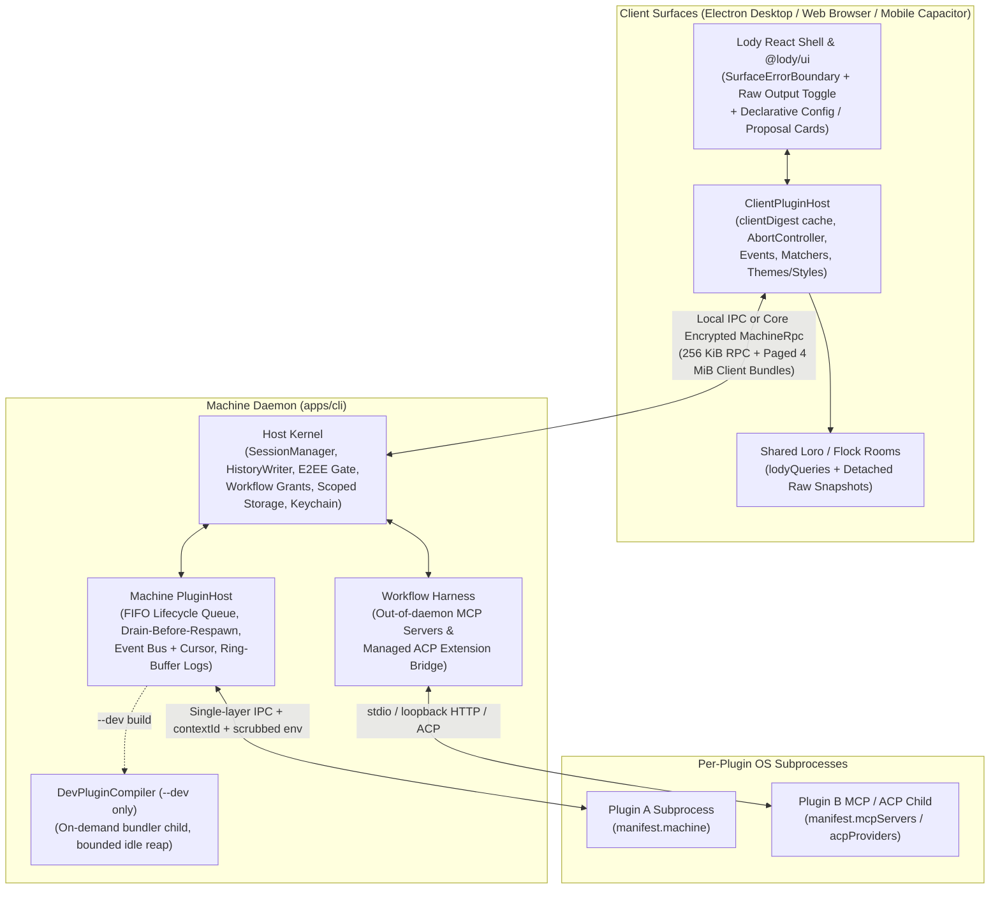

# Lody Plugin System Specification

Status: draft
Translation: current

[简体中文](plugin-system.zh.md)

This document is the formal, implementation-ready **Normative Specification** for the Lody Plugin System. It pairs a **lean, fail-stop per-plugin OS subprocess runtime** with **full no-fork Agent Workspace plasticity** — covering Extensibility, Workspace Data & Raw Snapshots, Runtime Lifecycle, Developer Experience (DX), End-User Experience (UX), and End-to-End Encrypted (E2EE) security invariants.

For the adversarial convergence rationale behind these boundaries, see [Plugin architecture convergence and E2EE workspace boundaries](../.agents/notes/proposed/architecture/2026-11-22-plugin-architecture-and-e2ee-boundaries.md).

---

## 1. Normative Language & Conformance Profiles

The key words **MUST**, **MUST NOT**, **REQUIRED**, **SHALL**, **SHALL NOT**, **SHOULD**, **SHOULD NOT**, **RECOMMENDED**, **MAY**, and **OPTIONAL** in this document are to be interpreted as described in RFC 2119 and RFC 8174 when, and only when, they appear in all capitals, as shown here.

### 1.1 Conformance Profiles

Verification and implementation compliance are divided into four profiles (Section 16):

- **Core Conformance (`REQUIRED`):** Mandatory across **Desktop (`Electron`)**, **Web Browser (`web`)**, **Headless CLI (`headless`)**, and **Mobile Capacitor (`apps/mobile-capacitor` inline cards, events, and declarative config)**. Covers package validation, per-plugin subprocess isolation, `Drain-Before-Respawn`, single-layer IPC (`contextId`-bound `host_call`), remote `client.js` bundle streaming (`<= 4 MiB` paged chunks + `clientDigest` trust gate), workspace-vs-machine client ownership & multi-machine deduplication, Host Events (`client` + `machine` + local cursor resume), Command Palette / Slash Commands / Client Pre-Sign `beforeSend` / UI primitives (`toast`, `confirm`), Universal Tool (`replace` + additive `enhance`) & Message Block Renderers, Three-Layer Sidebars + lightweight Session/Message/StatusBar slots, Two-Tier Themes + `@layer lody-plugin` Managed CSS, Workflow `agentRoles` + `skills` + `mcpServers`, Two-Tier Workspace Reads (Tier-1 normalized `lodyQueries` + synced `annotations` + host-managed scoped `storage`; Tier-2 opt-in `unstable` allowlist snapshots), Declarative `manifest.config` (with `project` scope) + `onboarding` + explicit `manifest.permissions`, Agent-Assisted `lody_plugin` `propose_*` approval cards, and Dual-Model E2EE security gates (live-turn `SignedTurnOrigin` + owner-signed `DeclaredWorkflowGrant`).
- **Workflow Provider Conformance (`Conditional`):** **REQUIRED** when enabling `manifest.acpProviders` (declarative bindings bridging into Lody's managed ACP extension runtime contract `LodyAI/acp-extension-core` and `acp-session-start-gate.ts`). Kept separate from Core so custom ACP runtimes reuse native auth, non-Node binaries, and capability caching instead of a parallel toy launcher.
- **Mobile Extended UI Conformance (`Conditional`):** **REQUIRED** when a mobile host advertises `HostCapabilities.containers.sidebarViews`, `sessionPanels`, `screens`, or `projectPages` (`true`) to mount shell container views inside mobile drawers/sheets.
- **Real Integration Profile (`REQUIRED` for Production Release):** Mandatory unmocked OS subprocess (`SIGTERM`/`SIGKILL`, OOM/crash, `--dev` compiler reaping) and real multi-client (Electron + headless Web + mobile viewport) E2E acceptance suite (Section 16.8).

### 1.2 Implementation-Defined Items

The following items are explicitly **Implementation-defined** and MUST NOT be coupled to by plugin code:

- Exact directory layout of Lody's internal SQLite/KV databases storing enabled flags, scoped plugin KV storage, `SessionCreationReceipt` rows, `DeclaredWorkflowGrant` records, `plugin_proposal` states, and trust records.
- Internal React Fiber tree, CSS class names, and DOM wrapper hierarchy outside Lody's published `@lody/ui` components and documented `--*` CSS custom properties.
- Exact IPC serialization framing on Node's `stdio[3]` channel, provided all logical envelopes in Section 9.1 are preserved losslessly.
- Specific bundler binary (`esbuild`, `rolldown`, or `swc`) and idle-reap interval inside the `--dev` compiler child process, provided output purity and bounded idle/shutdown cleanup (Section 8.4) hold.

---

## 2. Problem, Product Vision & Goals

### 2.1 Problem Statement & Product North Star

Lody is an AI-native multi-Agent workspace spanning local and remote machines, Desktop, Web, and Mobile. A plugin system that only offers static React slots and plugin-private RPCs reduces Lody to a conventional CRUD extension host — forcing developers to fork Lody whenever they want to add workspace sound effects, reshape Claude/Codex/MCP tool outputs, ship a domain-specific multi-Agent workflow (such as Sorbet Super Assistant), or build custom real-time workspace control planes. Conversely, co-hosting plugins inside a shared worker with speculative retries and canary reproduction workers destabilizes the core daemon.

**Product North Star:** Developers MUST be able to turn Lody into their own AI workspace product **without forking Lody**, while the underlying runtime guarantees that no misbehaving plugin can hang the daemon, silently corrupt state, or weaken E2EE cryptographic boundaries.

### 2.2 Goals

1. **No-Fork Extensibility:** First-class Client & Machine Host Events (with cursor resume and long-lived background services), Command Palette, Slash Commands, Client Pre-Sign `beforeSend`, Universal Tool Call (`replace` + additive `enhance`) & Message Block Renderers (with mandatory raw-output escape toggles), Three-Layer Sidebars + Session/Message/StatusBar slots, Full Screens, Two-Tier Themes + `@layer lody-plugin` Managed CSS, and Complete Workflow Composition (`agentRoles`, `skills`, `mcpServers`, conditional managed `acpProviders`).
2. **Two-Tier Read Access, Host-Managed Storage & Controlled Writes:** Combine Tier-1 normalized `lodyQueries`, synced per-entity `annotations`, and host-managed atomic scoped `storage` with an explicit Tier-2 opt-in **`unstable` allowlist snapshot escape hatch** (`lody.unstable.readSnapshot` / `useUnstableLodySnapshot`) so heavy customizer plugins never hit artificial walls without freezing Lody's internal CRDT storage schemas into SemVer `^1.0.0`, while `HistoryWriter` and Kernel commands remain the sole write path.
3. **End-to-End Developer & User Journey:** Fast CLI scaffolding, live `--dev` hot-reload across Desktop AND Web simultaneously, structured Plugin Inspector diagnostics, declarative `manifest.config` + explicit `manifest.permissions` + First-Run Onboarding, and Agent-assisted plugin creation gated by human-confirmed `plugin_proposal` cards.
4. **Unified Cross-Device Experience & Clean Multi-Machine Ownership:** Workspace/user client plugins mount once per workspace and stay active even when individual machines are offline; machine-bound plugins route RPCs per machine while deduplicating shared UI surfaces; one `@lody/plugin-sdk/client` bundle runs across Electron, Web, and Mobile Capacitor via `useHostCapabilities()`.
5. **Strict OS Process Isolation & Clear Dual-Model E2EE Integrity:** Dedicated subprocess per `machine` plugin (`0` processes for client-only plugins), `Drain-Before-Respawn`, `0` automatic retries (`outcome_unknown` on interrupted writes), and explicit E2EE separation between live-turn `SignedTurnOrigin` derivation and owner-signed `DeclaredWorkflowGrant` background execution.

### 2.3 Non-Goals & Anti-Patterns

- **Untrusted Security Sandbox:** Plugins are user-trusted code. Lody does NOT run V8 isolates, WASM jails, or capability-attenuated JS realms to make hostile malware safe to install. Within a single machine plugin subprocess, host-side `ActorContext` scoping prevents accidental privilege bleed across calls, not adversarial in-process subversion.
- **Unconfirmed Autonomous Code Installation by Agents:** Coding Agents MAY scaffold plugin source code and propose installation/enablement via `lody_plugin`, but MUST NOT unilaterally install, enable, reload, or mutate secret config without explicit human confirmation. Environment variables such as `LODY_AGENT_SESSION_ID` serve only as cooperative guardrails against accidental CLI self-activation, never as a security boundary against a shell-capable agent.
- **Post-Signing Silent Prompt Mutation (`machine.beforeSessionTurn`):** Mutating a prompt on the daemon after personal-device `memberInput` signing violates E2EE prompt integrity and MUST NOT exist. Prompt augmentation belongs on the client *before* personal-device signing (`lody.composer.beforeSend`).
- **Direct Mutable CRDT / Loro Handle Exposure or Denylist Raw-Tree Dumps:** Plugins read Tier-1 normalized queries or Tier-2 allowlist-projected frozen snapshots and write through validated Kernel / `HistoryWriter` commands; exposing live mutable CRDT containers or denylist-filtered internal storage trees is prohibited.
- **Shared Multi-Plugin Worker, Canary Attribution, or Automatic Retries:** Co-hosting plugins in one worker or silently retrying failed plugin calls is prohibited.

### 2.4 Trust & Principal Model

| Principal                    | Authority & Boundary                                                                                                                                                                                                                                         |
| ---------------------------- | ------------------------------------------------------------------------------------------------------------------------------------------------------------------------------------------------------------------------------------------------------------ |
| **Machine Owner**            | Full authority over the machine daemon: approves/installs/enables/disables/removes plugins, approves `plugin_proposal` cards targeting that machine, configures `machine` secrets, and executes `'machine'`-scoped plugin handlers.                          |
| **Workspace Collaborator**   | May run Desktop, Web, or Mobile client UI for trusted `clientDigest` bundles and invoke `'project'` / `'session'` handlers (and rooted workflow events) ONLY on machines/projects granted via `MachineSharing` (in E2EE) or workspace membership (non-E2EE). |
| **Workspace Guest (`read`)** | Read-only observer. Views inline `<= 16 KiB` persisted history outputs and authorized `lodyQueries` / snapshots, but **MUST NOT** trigger dynamic `machine` plugin execution or session mutations in E2EE workspaces.                                        |
| **Coding Agent (ACP / MCP)** | Invokes enabled `defineTool` and plugin `mcpServers` tools, and MAY call `lody_plugin` (`list`, `inspect`, `diagnostics`, `scaffold`, `propose_*`). **MUST NOT** bypass human confirmation to activate executable plugin code.                               |

---

## 3. System Architecture & Cross-Device Topologies

### 3.1 Main Components



1. **`Host Kernel`:** Owns Session lifecycle, `HistoryWriter`, host-managed artifact spilling for oversized tool outputs, custody-scoped plugin KV `storage`, `SessionCreationReceipt` persistence, owner-signed `DeclaredWorkflowGrant` records, `plugin_proposal` ledger, declarative `manifest.config` & keychain secret storage, E2EE authorization/intent verification, and canonical Session/Turn/Tool event emission with a local monotonic event sequence log.
2. **`Machine PluginHost`:** Owns plugin discovery, manifest validation, per-plugin `child_process.fork` lifecycle (`onStart`, long-lived `service`, `onUpgrade`, `onUninstall`), `Drain-Before-Respawn`, single-layer IPC dispatch, bounded machine event fan-out + cursor resume, and bounded ring-buffer logs.
3. **`Workflow Harness`:** Registers plugin-contributed `agentRoles`, `skills`, out-of-daemon `mcpServers`, and (`Workflow Provider Conformance`) managed `acpProviders` onto Lody's native Role/Skill/MCP/ACP subsystems without running MCP or ACP code inside the daemon process.
4. **`DevPluginCompiler`:** Ephemeral child process spawned only for `--dev` plugins; compiles TypeScript/TSX, recomputes `clientDigest`, notifies connected Desktop and Web clients for live preview, and exits automatically after bounded inactivity (implementation-defined idle window, e.g., `30 s` default in dev, and immediately on `PluginHost` shutdown).
5. **`ClientPluginHost`:** Runs identically in Electron, Web Browser, and Mobile Capacitor WebView; separates workspace-owned client plugins from machine-bound companion bundles, deduplicates workspace-wide UI contributions across multiple machines, verifies `clientDigest` trust, evaluates `client.js`, wires `events`, `commands`, `composer.slashCommands` / `beforeSend`, universal `tools.matchRender` (`replace` + `enhance`) / `messages.renderBlock`, sidebars, lightweight slots, screens, `themes`, `@layer lody-plugin` `styles`, and `useHostCapabilities()`, and enforces zero-leak disposal.

### 3.2 Component Boundary Invariants

- **Zero In-Daemon Guest Execution:** Neither `manifest.machine`, `manifest.mcpServers`, nor `manifest.acpProviders` SHALL ever be `import()`ed or evaluated inside the main daemon Node process.
- **Zero-Subprocess Client/Asset Plugins:** Plugins declaring `client`, `themes`, `styles`, `assets`, `config`, or `skills` without `machine` MUST run with `0` spawned `PluginHost` child processes.
- **Write-Path Singularity:** Plugins read rich typed queries and raw document snapshots freely, but all durable workspace/session mutations MUST flow through Kernel commands (`sessions.*`, `HistoryWriter`, `config.set`).

### 3.3 Cross-Device Execution Topologies

| Topology                                                    | Client Bundle Delivery                                                                  | UI Surfaces Active                                                                                                                                                                                                                                             | Machine Execution                                                              |
| ----------------------------------------------------------- | --------------------------------------------------------------------------------------- | -------------------------------------------------------------------------------------------------------------------------------------------------------------------------------------------------------------------------------------------------------------- | ------------------------------------------------------------------------------ |
| **`desktop` (`Electron`)**                                  | Local verified bundle or remote `MachineRpc` paged chunks (`Core`)                      | All Core inline contributions + all shell `containers` (`sidebarViews`, `sessionPanels`, `screens`, `projectPages`)                                                                                                                                            | Local or remote daemon via `WorkspaceMachineRpcFacade`                         |
| **`web` (`Browser`)**                                       | Remote `MachineRpc` `plugin/bundle-chunk` (`<= 4 MiB`, `clientDigest`-verified, `Core`) | **Exact parity with `desktop`** (all Core inline contributions + all shell `containers`: `sidebarViews`, `sessionPanels`, `screens`, `projectPages`)                                                                                                           | Remote daemon via `WorkspaceMachineRpcFacade`                                  |
| **`mobile` (`apps/mobile-capacitor`, iOS 16.4+ / Android)** | Remote `MachineRpc` `plugin/bundle-chunk` (`Core`)                                      | `Core`: inline session/composer contributions (`tools`, `messages`, `composer`, `sidebar.sessionRow`), `events`, `manifest.config`. `Conditional`: shell `containers` (`sidebarViews`, `sessionPanels`, `screens`, `projectPages`) via `useHostCapabilities()` | Remote daemon via `WorkspaceMachineRpcFacade`                                  |
| **`headless` (`CLI`)**                                      | skipped (`client` not evaluated)                                                        | N/A                                                                                                                                                                                                                                                            | Full `machine`, `events`, `agentRoles`, `skills`, `mcpServers`, `acpProviders` |

---

## 4. Domain Model & Stable Identifiers

### 4.1 Core Entities

- **`PluginInstallation`:** `{ plugin_id, version, scope: 'workspace' | 'machine', root_dir, manifest, enabled, lifecycle_state, client_digest, config_values, secret_keys_present, granted_permissions[], workflow_grant?, active_instance?, workflow_registrations, diagnostics[], logs_ring }`.
- **`MachinePluginInstance`:** `{ instance_id, pid, started_at_ms, registered_handlers, event_subscriptions, has_background_service, inflight_calls }`.
- **`ClientPluginInstance`:** `{ plugin_id, source_key: 'workspace' | 'local' | 'machine:<id>', client_digest, state, abort_controller, cleanup_fn?, contributions, style_elements[], query_cache }`.
- **`DeclaredWorkflowGrant`:** Machine-owner-signed, revocable authorization record `{ grant_id, workspace_id, machine_id, plugin_id, allowed_ops[], allowed_project_ids: string[] | '*', allowed_role_ids: string[] | '*', issued_by_user_id, issued_at_ms, signature }` authorizing out-of-turn autonomous daemon actions (`session.turn.completed`, `onStart`, `machine.service`, `sessions.respondInteraction`).
- **`PluginProposalRecord`:** `{ workspace_id, machine_id, request_id, proposing_session_id, plugin_id, source_dir_or_pkg, manifest_summary, requested_permissions[], status: 'pending' | 'approved' | 'rejected' | 'superseded', resolved_by_user_id?, resolved_at_ms? }`.
- **`SessionCreationReceipt`:** Durable `(workspace_id, caller_user_id, target_key, plugin_id, request_id)` idempotency record paired with active `business_key` reservation (Section 7.3).

### 4.2 Identifiers, Normalization, and Digest Rules

1. **`plugin_id`:** MUST match `^[a-z0-9]+(?:-[a-z0-9]+)*$` (`1..64` ASCII chars; `_` prohibited).
2. **`descriptor_id` / `contribution_id`:** MUST match `^[a-zA-Z0-9]+(?:[._-][a-zA-Z0-9]+)*$` (`1..96` chars) and MUST NOT contain `__`.
3. **Bijective Namespacing:**
   - Plugin `defineTool` MCP name: `plugin__<plugin_id>__<tool_id>`.
   - Plugin `agentRoles` ID: `plugin:<plugin_id>:<role_id>`.
   - Plugin `mcpServers` ID: `plugin:<plugin_id>:<mcp_id>`.
   - Plugin `acpProviders` ID: `plugin:<plugin_id>:<provider_id>`.
4. **`clientDigest`:** Lowercase hex `SHA-256` over length-prefixed relative paths and raw bytes of `manifest.client` plus all packaged client `themes`, `styles`, and `assets` (`"lody-client-bundle-v1\0"` framing). Omitted (`undefined`) only when a plugin has no client entry, themes, or styles.
5. **Path Containment:** Every manifest path and `ctx.dataDir` target MUST resolve via `realpath` strictly inside `root_dir` or `data_dir`; `..` traversal or symlink escapes MUST be rejected prior to I/O.

---

## 5. Package Format, Manifest & SDK Contract

### 5.1 Package Layout & Bundle Purity

- **Client Bundle (`manifest.client`):** Single browser-pure ESM bundle targeting ES2023 + Safari/WKWebView 16.4 (`apps/mobile-capacitor/AGENTS.md`). MUST NOT import `@lody/plugin-sdk/machine` or Node built-ins (`node:*`); `react`, `react/jsx-runtime`, `zod`, `@lody/ui`, and `@lody/plugin-sdk/*` are externalized and supplied by `ClientPluginHost`.
- **Machine Entry (`manifest.machine`):** Node ESM bundle targeting Node >= 22. MUST NOT import `@lody/plugin-sdk/client` or reference DOM globals (`window`, `document`).

### 5.2 Manifest Schema, Declarative Config, Permissions & Workflow Contributions

`lody.plugin.json` MUST be strict UTF-8 JSON conforming to [`PluginManifest`](../packages/plugin-sdk/src/manifest.ts):

- **Required:** `id`, `version` (valid SemVer), `sdk` (standard SemVer range checked against the host SDK version — e.g. `"^0.1.0"` during preview and `"^1.0.0"` once stabilized, NEVER hardcoded to a single literal string), `title`, and at least one contribution (`client`, `machine`, `skills`, `agentRoles`, `mcpServers`, `acpProviders`, `themes`, or `styles`). Unknown top-level keys MUST fail validation.
- **Explicit Capability Permissions (`manifest.permissions`):**
  - High-privilege host operations MUST be declared explicitly in `manifest.permissions` rather than granted implicitly to every `manifest.machine` plugin:
    - `sessions.write` (`sessions.create`, `sessions.send`, `sessions.requestStop`, `sessions.requestArchive`, `sessionFork`)
    - `sessions.approve` (`sessions.respondInteraction` — settling ACP permission/elicitation prompts)
    - `workflow.autonomous` (invoking `sessions.*` outside an active human turn — from `session.turn.completed`, `onStart`, or `machine.service` — backed by a machine-owner-signed `DeclaredWorkflowGrant`)
    - `unstable.rawState` (Tier-2 opt-in access to `lody.unstable.readSnapshot` / `useUnstableLodySnapshot`)
  - Calling a gated operation without the corresponding declared & approved permission MUST reject with `forbidden`.
- **Declarative `config` & `onboarding`:**
  - Supports `string`, `secret`, `number`, `boolean`, and `select` fields with `scope: "client" | "machine" | "project" | "both"`.
  - Any field with `type: "secret"` MUST have `scope: "machine"` (or omit `scope`, defaulting to `"machine"`); manifests declaring a `"client"`, `"project"`, or `"both"` secret MUST be rejected at validation time (`manifest_invalid`).
  - `onboarding` lists `config` keys surfaced in Lody's native First-Run Setup Sheet when enabling the plugin (consolidating legacy separate `env` declarations into `manifest.config`).
- **Workflow Fields:** `skills` (`skills/<name>/SKILL.md`), `agentRoles` (Role metadata + `promptPath` + `skills` + `mcpServers` + `defaultProvider`), `mcpServers` (v1 Core: `stdio` out-of-daemon entrypoints; `http` transport requires explicit loopback URL/readiness handshake before activation), and `acpProviders` (conditional declarative bridge to Lody's managed ACP extension runtime contract).

### 5.3 Normative Byte & Resource Budgets

| Constant / Resource                   | Limit                         | Enforcement                                                                                                                            |
| ------------------------------------- | ----------------------------- | -------------------------------------------------------------------------------------------------------------------------------------- |
| `MAX_PLUGIN_RPC_REQUEST_BYTES`        | `262,144` (`256 KiB`)         | UTF-8 request cap; fits one `1 MiB` E2EE Iroh `purpose 8` frame.                                                                       |
| `MAX_INLINE_PLUGIN_TOOL_OUTPUT_BYTES` | `16,384` (`16 KiB`)           | Inline `HistoryWriter` cap; outputs `16 KiB .. 2 MiB` auto-spill into host-managed turn artifact storage with inline summary pointer.  |
| `MAX_UNSTABLE_SNAPSHOT_BYTES`         | `524,288` (`512 KiB`)         | Hard serialized cap per `lody.unstable.readSnapshot` slice; prevents IPC OOM in `256 MiB` workers and main-thread freeze.              |
| `MAX_PLUGIN_ANNOTATION_BYTES`         | `4,096` (`4 KiB`)             | Per-plugin synced metadata budget on a Session or Project (`annotations[plugin_id]`).                                                  |
| `MAX_PACKED_CLIENT_BUNDLE_BYTES`      | `4,194,304` (`4 MiB`)         | Total packed `client.js` + `themes`/`styles`/`assets`; paged in `256 KiB` `purpose 9` chunks.                                          |
| `MAX_SUBPROCESS_LOG_RING`             | `500` lines / `262,144` bytes | Per-plugin daemon ring buffer (`<= 16 KiB` per line).                                                                                  |

### 5.4 SDK Surface & Bidirectional Schema Enforcement

Conforming hosts MUST expose `@lody/plugin-sdk`, `@lody/plugin-sdk/client`, `@lody/plugin-sdk/machine`, and `@lody/plugin-sdk/manifest` matching [`@lody/plugin-sdk`](../packages/plugin-sdk/src/index.ts). Every `defineQuery`, `defineMutation`, `defineTool`, and `defineAttachmentSource` payload MUST pass `safeParse` on BOTH input and output; failure rejects with `validation_failed` without crashing the subprocess.

---

## 6. Extensibility Contract — Events, Commands, Universal Renderers & Workflow Composition

### 6.1 Host Lifecycle & UI Interaction Events

Conforming hosts MUST provide a first-class, push-based event bus on both `ClientPluginRegistry.events.on` and `MachinePluginRegistry.events.on` so plugins never resort to DOM mutation observers or Session status polling:

1. **Canonical Session & Agent Lifecycle Events (`MachineHostEventMap` — available on BOTH machine and client):**
   - `session.created`, `session.archived`, `session.status.changed`, `session.turn.started`, `session.turn.completed` (including `agentRoleId?`, `stopReason`: `"end_turn" | "cancelled" | "error" | "max_tokens" | "unknown"`, and `durationMs`), `session.tool.started`, `session.tool.completed` (`ObservedToolCall`), `session.waiting_input` (`PendingInteractionSummary`: `{ requestId, turnId?, kind: "permission" | "elicitation", title?, options }`), and `session.interaction.resolved` (`{ requestId, turnId?, kind, outcome }`, enabling remote Slack/Telegram/Feishu approval bridges to update or clear resolved prompts when settled on Desktop/Mobile).
2. **Client UI Interaction Events (`ClientHostEventMap` — client-only):**
   - `ui.message.submitted`, `ui.session.switched`, `ui.interaction.resolved`, and `ui.command.invoked`.
3. **Delivery, Backpressure, Cursor Resume & Teardown Rules:**
   - Event delivery is **non-blocking observer fan-out**: a slow or throwing listener in Plugin A MUST NOT delay Session execution, block UI interaction, or prevent Plugin B from receiving the event.
   - Machine event delivery MUST enforce bounded per-plugin queue depth and MUST NOT allow a slow `session.tool.completed` handler to head-of-line block high-priority control events (`session.waiting_input`, `session.interaction.resolved`, `session.turn.completed`); each event handler has a `30_000 ms` execution deadline (`ctx.signal` aborts on timeout or plugin shutdown) and multiple listeners per event type compose rather than overwrite.
   - **Local Monotonic Event Cursor (`resumeFromCursor`):** The daemon records recent canonical `MachineHostEventMap` envelopes in a bounded custody-scoped local SQLite ring with monotonic `seq` IDs so `machine.events.on(type, handler, { resumeFromCursor: true })` can replay missed events after daemon restart/reload in order (deduplicated against durable `SessionCreationReceipt` / `ctx.storage`) without forcing every workflow plugin to write 200-line full-history pagination scans.
   - All client event listeners registered by an instance MUST be automatically detached when `abort_controller.abort()` fires on disablement or `clientDigest` replacement.
4. **Orthogonal Asset & Lifecycle Primitives (`lody.assets.url`, `lody.signal`, `lody.ui`):**
   - `lody.assets.url(relativePath)` resolves packaged `assets/*` uniformly across Electron local protocols, Web `plugin/bundle-chunk` caches, and Mobile Capacitor WebViews.
   - `lody.signal: AbortSignal` aborts automatically on plugin disablement or `clientDigest` hot-swap so plugins compose standard Web Platform APIs (`AudioContext` / `HTMLAudioElement`, `Canvas`, `fetch`, timers) directly without inventing scenario-specific SDK namespaces (such as `lody.audio`).
   - `LodyClient.ui` provides basic host feedback primitives: `toast`, `confirm`, `openExternalUrl`, and `copyToClipboard`.

### 6.2 Universal Tool Call Matchers & Structured Message Block Renderers

Plugins MUST NOT be restricted to rendering only their own `defineTool` descriptors:

1. **Own-Tool Strongly Typed Renderer (`tools.render(tool, Component)`):**
   - Matches `plugin__<plugin_id>__<tool.id>` with highest default specificity for that plugin's own tool, narrowing `ToolRenderProps` between `{ status: "running", output?: undefined }` and `{ status: "completed", output: TOutput }` after Zod `safeParse`.
2. **Universal Cross-Provider Tool Matcher (`tools.matchRender(spec)`):**
   - Matches built-in, ACP (Claude Code, Codex, Antigravity, custom ACP), and MCP tool calls via `ToolCallMatcher` (`toolNames`, `mcpServer`, `acpKinds`, `commandPattern` compiled with bounded RE2/non-backtracking semantics or guarded execution, and pure `when(call)` predicate).
   - **Mode Separation (`replace` vs additive `enhance`):**
     - **`mode: "replace"` (default):** Selects a single deterministic winner in order: (1) explicit user per-tool renderer preference (Settings), else (2) exact own-tool `tools.render`, else (3) highest `priority` (`default = 0`), tie-broken deterministically by `(plugin_id ASC, source_key ASC, spec.id ASC)`. Shadowed `"replace"` matchers record `matcher_shadowed` in Plugin Inspector (Section 11.3).
     - **`mode: "enhance"`:** Does NOT compete in winner-takes-all replacement; all matching `"enhance"` renderers compose additively as supplementary cards/actions alongside the active tool view, ordered by `(priority DESC, plugin_id ASC, source_key ASC, spec.id ASC)` and individually wrapped in `SurfaceErrorBoundary`.
3. **Structured Message Block Renderer & Stable Block Identity (`messages.renderBlock(spec)`):**
   - Matches assistant fenced code blocks whose language tag appears in `spec.languages` (e.g., `sorbet-plan`, `test-report`, `openapi-preview`), passing `turnId`, deterministic `blockId = "<turnId>:block:<ordinal>"` (`0`-indexed fenced-block ordinal within that assistant turn), `code`, `meta`, and `streaming` (`true` while open, `false` upon fence closure).
   - **Stateful Incremental Updates:** `ClientPluginHost` MUST key mounted block subtrees by `(session.sessionId, blockId, winner.plugin_id, winner.id)` — NEVER by `code`, `meta`, `streaming`, or transient AST node references. While tokens stream into an open block and across the `streaming: true -> false` transition, the host MUST preserve the mounted React component instance and update props in place so interactive local state (`useState`, `useRef`, form inputs, chart zoom/selection, canvas contexts) is never reset. Unmounting within a visible turn is permitted ONLY on `"View Raw Markdown"` toggle, `SurfaceErrorBoundary` crash, winning renderer / `clientDigest` replacement, or parent turn/session unmount.
4. **Mandatory Ground-Truth Escape Toggle & `ai-gui` Invariants:**
   - Whenever a `"replace"`-mode `tools.matchRender` or `messages.renderBlock` mounts, the host shell MUST render a non-spoofable chrome toggle (**`"View Raw Output"`** / **`"View Raw Markdown"`**) outside the plugin subtree and wrap the plugin subtree in `SurfaceErrorBoundary`.
   - Per [`packages/components/src/components/ai-gui/AGENTS.md`](../packages/components/src/components/ai-gui/AGENTS.md), plugin tool/block renderers MUST NOT inject `searchBlockId` into Lody's prose-only conversation search index, MUST NOT mount nested full-height scroll traps inside collapsed activity groups, and MUST preserve turn-folding layout invariants.

### 6.3 Commands, Composer Hooks, Orthogonal Sidebars & Cross-Device Capability Negotiation

1. **Command Palette, Slash Commands & Client Pre-Signing Composer Hook:**
   - `commands.register({ id, title, shortcut?, when?, run })`: Registers plugin actions in Lody's Command Palette (`Cmd+K`) and optional non-conflicting keybindings.
   - `composer.slashCommands.add({ name, description, run })`: Registers actionable `/command` triggers in the composer (expanding drafts, invoking plugin flows, or opening screens/panels).
   - `composer.beforeSend(handler)`: Client-side **pre-signing** composer hook executing on the user's personal device *before* E2EE `memberInput` signing (enabling visible Working Memory / context injection, template expansion, or PII checks with 100% E2EE integrity, cleanly replacing forbidden daemon-side `machine.beforeSessionTurn`). Any prompt transformation MUST be reflected in the signed input submitted by the user and bounded by a short interactive timeout (`<= 3000 ms`, cancelable by the user).
2. **Three-Layer Orthogonal Sidebar Composition & Lightweight Inline Slots (`sidebar.*` over [`sidebar-surface.ts`](../packages/components/src/components/sidebar-surface.ts)):**
   - `sidebar.sessionRow.decorate`: Composable `trailing` badges and `hoverCard` popovers sorted by `(plugin_id, decorator_id)`. Rendering `<SessionRow />` inside any custom `sidebar.views.add` MUST automatically compose all active row decorators.
   - `sidebar.headerItems` / `footerItems`: Navigation rows using `<SidebarRow />` paired with `screens.add`.
   - `sidebar.views.add`: Selectable sidebar bodies alongside Lody's built-in `"Default"` view; disabling the active view reverts immediately to `"Default"`.
   - Lightweight contextual slots: `session.headerActions.add` (session toolbar actions), `messages.actions.add` (per-turn/message footer actions), and `statusBar.items.add` (compact status indicators).
   - **Contribution ID Scoping:** Unqualified IDs passed to `lody.screens.open`, `lody.panels.openSession`, and `lody.pages.openProject` resolve strictly within the calling plugin's namespace (`<calling_plugin_id>:<id>`); cross-plugin navigation uses explicit `<plugin_id>:<id>`.
3. **Cross-Device Capability Negotiation (`useHostCapabilities()`):**
   - Plugins write **one unified client codebase** against `@lody/plugin-sdk/client` and inspect `useHostCapabilities()` (`platform: "desktop" | "web" | "mobile"`, `formFactor: "wide" | "compact"`, `containers: { sidebarViews, sessionPanels, screens, projectPages }`), where `containers` maps 1:1 to `ClientPluginRegistry` shell mount namespaces rather than mixing feature flags or machine presence.
   - Inline session/composer contributions (`tools`, `messages`, `composer`, `commands`, `sidebar.sessionRow`), `events`, and `manifest.config` are `Core Conformance` invariants across `desktop`, `web`, and `mobile`. Both `desktop` and `web` MUST also enable all shell `containers` (`sidebarViews`, `sessionPanels`, `screens`, `projectPages`) in Core; `mobile` (`apps/mobile-capacitor`) exposes them when `Mobile Extended UI Conformance` is active. Registering an unmounted shell container on a compact host MUST NOT throw — the host records `capability_unavailable_on_platform` in diagnostics while keeping inline contributions, `events`, and `config` active.

### 6.4 Two-Tier Appearance System

- **Tier 1 — SemVer-Stable Theme Tokens (`manifest.themes`, `lody.themes.add`, `lody.themes.activate`):** `PluginThemeSeedColors` + `PluginThemeTokens` (`fontSans`, `fontMono`, `radius`, `density`) compile to root `--*` CSS custom properties via [`vscode-theme-dom.ts`](../packages/components/src/lib/vscode-theme/vscode-theme-dom.ts) and [`vscode-theme-css.ts`](../packages/components/src/lib/vscode-theme/vscode-theme-css.ts). Documented `--*` variables are **SemVer-stable across the stabilized major SDK line**.
- **Tier 2 — Host-Managed Custom CSS (`manifest.styles`, `lody.styles.add`):** Tracked `<style data-lody-plugin="<plugin_id>">` tags wrapped inside `@layer lody-plugin` (keeping lower cascade priority than host critical chrome, `SurfaceErrorBoundary`, and `"View Raw Output"` escape controls), disposed on disablement/HMR, bypassed in `lody --safe-mode`, and never auto-synced to collaborators. Does NOT freeze internal React DOM structure.

### 6.5 Complete Workflow Composition (`agentRoles`, `skills`, `mcpServers`, `acpProviders`)

A single plugin package MAY ship an end-to-end multi-Agent workflow:

1. **Skills (`manifest.skills`):** Exposed to Agent Role pickers and `CreateSessionRequest.skillIds` while enabled.
2. **Agent Roles (`manifest.agentRoles` — `Core Conformance`):** Registered as `plugin:<plugin_id>:<role_id>`, binding system prompt markdown (`promptPath`), bundled `skills`, bundled `mcpServers`, and optional `defaultProvider`. Shown in Lody's Role selector with plugin provenance badge; editing creates a user Role override without mutating the plugin package.
3. **Out-of-Daemon MCP Servers (`manifest.mcpServers` — `Core Conformance`):** Spawned per Agent Session through Lody's standard MCP harness ([`apps/cli/src/agent/AGENTS.md`](../apps/cli/src/agent/AGENTS.md) invariant: **MCP tools MUST NOT run inside the daemon process**), receiving only minimal OS env plus `envKeys` resolved from the plugin's declared `manifest.config`. Prefer `manifest.mcpServers` (`stdio`) for heavy, isolated, or long-running tools so they cannot block or OOM the plugin's shared `machine` query/event subprocess; `transport: "http"` is permitted only when the server implements Lody's explicit loopback readiness/port-discovery contract.
4. **Managed ACP Agent Providers (`manifest.acpProviders` — `Workflow Provider Conformance`):** Declaratively bridges into Lody's existing managed ACP extension contract (`LodyAI/acp-extension-core`, `acp-session-start-gate.ts`, capability caching, and provider sign-in/auth flows) under `plugin:<plugin_id>:<provider_id>` instead of duplicating a parallel Node-only provider launcher. Supports native binaries, external harnesses, and OAuth/sign-in without forking `apps/cli/src/agent`.

---

## 7. Workspace Data, Two-Tier Reads, Storage & Host Capabilities Contract

### 7.1 Tier 1 — Normalized Typed `lodyQueries` & Synced Entity Annotations

`lodyQueries` provides normalized, SemVer-stable reactive descriptors over Lody's shared ref-counted Loro/Flock rooms, `sessionData`/Roost readers (handling legacy rows and `updateCopies` deduplication transparently), and `WorkspaceMachineRpcFacade`:

- **Workspace Scope (`WorkspaceRef` — no single `machineId`, resilient when individual machines are offline):** `machines`, `projects`, `agentRoles`, `agentConfigs`, `plugins`, `members`, `schedules`, `sessions`.
- **Project / Machine Scope:** `gitState`, `worktrees`, `filePreview`, `pullRequests`, `skills`, plus scoped `sessions` and `schedules`.
- **Session Scope (`SessionRef`):** `sessionDetail`, `sessionTurns` (windowed full normalized `SessionTurnRecord`s with prose, thoughts, plans, usage, `ObservedToolCall[]`, and `SubagentRunSummary[]`), `subagentRun` (on-demand nested transcript via `readSubagentRun`), `automations`, `sessionDiff`, `gitState`, `filePreview`.
- **Cross-Plugin `businessKey` Privacy:** `SessionSummary.businessKey` MUST be populated ONLY when `createdByPluginId === calling_plugin_id`.
- **Namespaced Plugin Annotations (`annotations[plugin_id]`):** Plugins MAY attach up to `4 KiB` of JSON metadata per Session or Project via `lodyCommands.sessionSetAnnotation` / `projectSetAnnotation`. Annotations sync alongside entity metadata and are readable offline in `SessionSummary` / `ProjectSummary` — eliminating per-row remote `defineQuery` RPC storms for badges and workflow tags.

### 7.2 Tier 2 — Opt-In Unstable Allowlist Snapshots (`lody.unstable.readSnapshot` / `useUnstableLodySnapshot`)

Mirroring the Two-Tier Appearance model (Section 6.4), Lody preserves a read-only escape hatch so heavy customizer plugins (custom control planes, analytics, experimental views) are never forced to fork Lody while waiting for new Tier-1 query fields — **without** freezing internal CRDT storage layouts into `^1.0.0` or risking denylist leaks:

1. **Explicit Tier-2 / Unstable Classification & Permission Gate:**
   - Exposed under `lody.unstable.readSnapshot` / `useUnstableLodySnapshot` (and `ctx.lody.unstable.readSnapshot` on machines) and gated on explicit `manifest.permissions: ["unstable.rawState"]` disclosed at install/approval time.
   - Documented explicitly as **outside SemVer stability guarantees** (same stability contract as `manifest.styles`): Lody MAY evolve internal Loro/Flock/Roost schemas without maintaining perpetual compatibility shims for Tier-2 readers. Standard workflow/UI plugins MUST prefer Tier-1 `lodyQueries`, event payloads, and `annotations`.
2. **Allowlist-Only Domain Projection (No Denylist Raw-Tree Dumps):**
   - Hosts MUST NOT dump an unfiltered internal CRDT document and strip secrets via a denylist (which silently leaks newly introduced sensitive fields). Instead, each `UnstableSnapshotTarget` projects an **explicit allowlist of top-level domain collections** (`sessions`, `projects`, `machines`, `roles`, `schedules`, `rateLimits`, `session-turns`) directly over Lody's existing Loro/Flock and `sessionData`/Roost readers with zero parallel Domain Store. Newly added internal control or credential fields stay invisible by default.
3. **Mandatory Scoping, Lazy Materialization & Hard Byte Cap:**
   - Unscoped whole-workspace dumps are prohibited: `workspace-state` and `project-state` MUST specify a required `collection` / `path` slice (plus pagination when applicable), and `session-transcript` MUST specify `turnIds` or a bounded `limit` window.
   - Zero allocation occurs when unsubscribed; materialized `RawDocumentSnapshot` (`{ schemaVersion, revision, doc }`) payloads MUST be detached, deeply frozen (`Object.freeze`), and bounded by `MAX_UNSTABLE_SNAPSHOT_BYTES` (`512 KiB`) so neither React main-thread cloning nor `256 MiB` machine subprocess IPC can stall or OOM.

### 7.3 Shared Host Command Registry (`lodyCommands`), Session Idempotency, `respondInteraction` & Event Cursor Recovery

0. **Unified Typed Host Command Registry (`lodyCommands` + `lody.execute` / `useLodyCommand` / `ctx.lody.execute`):**
   - First-party UI and third-party plugins invoke the **exact same authorized command handlers** via `lody.execute(target, command, input)` / `useLodyCommand` on clients and `ctx.lody.execute(target, command, input)` on machines (with `sessions.{create, send, respondInteraction, requestStop, requestArchive}` retained as thin typed SDK aliases over `lodyCommands.session*`, using a single `lody.execute` IPC wire op).
   - **Stability Tiering Within `lodyCommands`:** Core domain commands (`sessionCreate`, `sessionSend`, `sessionRespondInteraction`, `sessionStop`, `sessionArchive`, `sessionRestore`, `sessionFork`, `sessionUpdateTitle`, `sessionSetAnnotation`, `projectSetAnnotation`, `scheduleSetEnabled`, `scheduleRunNow`) are Tier-1 stable. Shell-specific sidebar triage commands (`sessionSetPinned`, `sessionSnooze`, `sessionSettle`, `sessionMoveToFocus`, `sessionMoveOrder`, `sessionMarkRead`, `sessionMarkUnread`, `pinSection*` backed by [`status-view/command.ts`](../packages/shared/src/status-view/command.ts)) are marked **shell-coupled / experimental** so future sidebar redesigns are not permanently frozen by the plugin SDK.
   - **Invocation-Scoped `ActorContext` & First-Party `prefer` / `manage` / `execute` Reuse:** Every `lodyCommands` invocation binds a host `ActorContext` (carried via `contextId` on machine `host_call` frames): client calls bind the authenticated signed-in user; daemon `plugin/query` and `plugin/mutate` RPCs bind the authenticated requesting member; `ToolExecutionContext` binds the live owning/signing user of that active Session/Turn; and out-of-turn `MachineEventContext` / `MachineStartupContext` / `MachineServiceContext` calls execute under the plugin's verified `DeclaredWorkflowGrant` principal (rejecting un-attributed personal `prefer` writes such as `sessionMarkRead` with `forbidden`). Both executors enforce Lody's existing first-party `prefer` vs `manage` guards ([`use-session-management-guard.ts`](../packages/components/src/hooks/use-session-management-guard.ts)), `manifest.permissions`, and E2EE gates.
1. **Atomic `(requestId, businessKey)` `sessions.create` Receipt:**
   - Keyed by `(workspace_id, caller_user_id, canonical_target_key, plugin_id, request_id)` in durable custody-scoped storage (no TTL).
   - Replaying the identical normalized payload returns the original `SessionRef` even after Session archive; replaying `requestId` with a modified payload rejects with `idempotency_conflict`.
   - A new `requestId` targeting an already-active (non-archived) `businessKey` rejects with `business_key_conflict`; archiving the Session releases `businessKey` while retaining the `requestId` receipt.
2. **Symmetric 1:1 ACP Interaction Settlement (`sessions.respondInteraction`):**
   - Both `LodyClient.sessions.respondInteraction` (custom sidebars, hover cards, voice/hardware controllers) and `MachineHostPort.sessions.respondInteraction` (Telegram/Slack/Feishu approval bridges running in `machine.service`, policy orchestrators) settle pending `permission` or `elicitation` requests via `{ requestId, turnId?, outcome, originTurn? }`, mapping 1:1 to `sessionData.commands.respondPermission` / `PermissionOutcomeSchema` ([`use-permission-response.ts`](../packages/components/src/hooks/use-permission-response.ts), [`message-schemas.ts`](../packages/shared/src/message-schemas.ts)).
   - Requires explicit `manifest.permissions: ["sessions.approve"]` on machine plugins (and an active `DeclaredWorkflowGrant` in E2EE workspaces when invoked outside an active turn).
3. **Crash/Restart Workflow Recovery via Scoped KV + Event Cursor (No Hand-Rolled Full-History Scans):**
   - Workflow plugins persist task state via host-managed atomic `ctx.storage` (Section 10.2) and subscribe with `{ resumeFromCursor: true }` (Section 6.1.3) to replay missed canonical events in order after daemon restart, deduplicating side effects via `SessionCreationReceipt` (`requestId`, `businessKey`).
   - `lodyQueries.sessions` (`sessionIds`, `agentRoleId`, inclusive `updatedAfter`) + `lodyQueries.sessionTurns` remain available as fallback catch-up queries if a plugin was offline longer than the local event ring retention window.

---

## 8. Lifecycle State Machine

### 8.1 Machine Plugin Lifecycle States & Long-Lived Services

- `Disabled`: Not running; zero subprocesses, zero active tools/events/roles/MCP/ACP registrations.
- `Starting`: Manifest validated; spawning `child_process.fork` (if `manifest.machine` is present) and awaiting `ready` within `10_000 ms`. Plugins without `manifest.machine` transition `Disabled -> Running` directly with `0` subprocesses.
- `Running`: Active `instance_id` serving RPCs (`query`, `mutation`, `tool`, `attachmentSource`), `events`, background `service`, and workflow contributions.
  - **Non-Blocking Startup & Event Resume:** Immediately upon `ready`, `PluginHost` transitions `Running` for read queries, attaches `subscribedEvents` into a bounded startup buffer, invokes `machine.onStart(ctx)` (`30_000 ms` quick-init hook; optional `onUpgrade(ctx, { fromVersion, toVersion })` runs before `onStart` on version changes), replays any missed cursor events for `{ resumeFromCursor: true }` subscriptions plus buffered events in order, and launches any registered long-lived `machine.service(ctx)` whose `ctx.signal` stays alive until `shutdown` (enabling Slack/Telegram/Feishu bridges, WebSocket connectors, and local webhook listeners without hitting the `30_000 ms` `onStart` deadline).
- `Stopping`: Draining via `shutdown -> 2s SIGTERM -> 2s SIGKILL` (aborting `service` `ctx.signal` and awaiting cleanup).
- `Stopped`: Transient drained state (`active_instance = null`) during `reload` or daemon shutdown.
- `Faulted`: Quarantined after unexpected exit, `ready` timeout, missing required secret/config, or IPC protocol violation. **Zero automatic background restarts**; exits `Faulted` ONLY on explicit `reload`, `disable`, or `remove`.
- `Removing`: Terminal teardown running optional `onUninstall(ctx)` (bounded `10_000 ms`, best-effort) and deleting installation registry records while preserving `ctx.dataDir` and scoped `storage` unless `--purge-data` is explicitly requested.

### 8.2 Per-Plugin Serialized Command Queue

`PluginHost` MUST maintain one FIFO async command queue per `plugin_id`. Concurrent `enable`, `disable`, `reload`, and `remove` calls execute strictly serially; rapid `--dev` `reload` bursts MAY coalesce into one trailing `reload` behind the active transition.

### 8.3 Escalating Shutdown & Drain-Before-Respawn Invariant

1. Send `{ type: "shutdown", graceMs: 2000 }` over IPC **without** calling `child.disconnect()` prematurely.
2. Wait up to `2000 ms` for OS `close`; if still alive, send `SIGTERM` and wait `2000 ms`; if still alive, send `SIGKILL` and await `close`.
3. **Drain-Before-Respawn Invariant:** `PluginHost` MUST NOT spawn a replacement subprocess for `plugin_id` until the previous OS PID has emitted `close`.

### 8.4 Dev Compiler Subprocess Lifecycle (`--dev`)

Source-linked `--dev` plugins compile inside `DevPluginCompiler`, an out-of-daemon child process that exits automatically after bounded inactivity (implementation-defined idle window, e.g., `30 s` default to avoid per-save cold-start thrashing) and is terminated unconditionally on `PluginHost` shutdown (leaving `0` orphaned bundler processes).

### 8.5 Workspace vs Machine Client Ownership, Deduplication & `clientDigest` Idempotency

`ClientPluginHost` distinguishes **Workspace/User Client Plugins** from **Machine-Bound Plugins** so multi-machine workspaces neither lose client UX when a machine sleeps nor mount duplicate copies of the same UI/event plugin:

- **Workspace/User Client Installation (`source_key = "workspace"`):** Client-only plugins (themes, styles, sound effects, sidebar views, universal tool/block renderers, slash commands) are owned at the workspace/user level, persist non-secret `scope: "client"` config in user/workspace preferences, mount **once per workspace**, and remain active regardless of individual machine online state.
- **Machine-Bound Companion Installation (`source_key = "machine:<machine_id>"` or `"local"`):** Plugins with `manifest.machine` or machine-scoped workflow contributions bind RPC routing and machine-scoped panels to `(workspace_id, source_key, plugin_id)`. When the same `plugin_id` is enabled on multiple online machines in one workspace, `ClientPluginHost` MUST deduplicate workspace-wide client contributions (`events.on`, `commands`, `composer.slashCommands`, `composer.beforeSend`, `tools.matchRender`, `messages.renderBlock`, `sidebar.*`, `screens`, `themes`, `styles`) onto a single deterministic primary client instance (selecting the highest SemVer version, tie-broken by `source_key ASC`) rather than firing duplicate sounds, duplicate sidebar entries, or self-shadowed matchers.
- **Bundle Key (`(plugin_id, clientDigest)`):** Deduplicates immutable bundle download (`plugin/bundle-chunk`), SHA-256 integrity verification, custody cache storage, and static `assets/*`.
- **Per-Instance Module Isolation:** Each active client instance evaluates `client.js` in an isolated ES module instance revoked on teardown/HMR while sharing externalized host `react` / `zod` / `@lody/ui` / `@lody/plugin-sdk/*` singletons.

- If `clientDigest` is unchanged and state is `Active`, reconciliation MUST be a no-op (preserving subscriptions, event listeners, and `query_cache`).
- On `clientDigest` change or `disable`, `ClientPluginHost` MUST abort `abort_controller` (detaching all `events.on` listeners and in-flight queries), run `cleanup_fn`, unregister all UI/matcher/command/theme contributions, remove `<style>` tags, and clear `query_cache` before mounting any replacement.

---

## 9. RPC, Event Delivery & Execution Semantics

### 9.1 Single-Layer Subprocess IPC Protocol

`PluginHost` and the `machine` subprocess communicate over `stdio: ['ignore', 'pipe', 'pipe', 'ipc']`:

- **Host -> Child:** `init` (`pluginId`, `instanceId`, `dataDir`, `config`, `permissions`), `start` (dispatched once after `ready` to invoke `onUpgrade?` + `onStart` + launch `service?`), `invoke` (`callId`, `kind`, `descriptorId`, `scope`, `target`, `actorUserId`, `input`), `event` (`eventId`, `seq`, `eventType`, `payload`, `actorUserId?`, `rootUserTurnId?`), `cancel` (`callId`), `host_result` (`hostCallId`, `ok`, `data`/`error`), `shutdown` (`graceMs`).
- **Child -> Host:** `ready` (`handlers`, `subscribedEvents`, `hasService`), `result` (`callId`, `ok`, `data`/`error`), `invalidate` (`descriptorId`, `scope`, `target?`), `host_call` (`hostCallId`, `contextId` — binding the originating `callId`, `eventId`, `"start"`, or `"service"` so the host resolves the exact `ActorContext`, `op`: `"lody.read" | "lody.unstable.readSnapshot" | "lody.execute" | "storage.get" | "storage.set" | "storage.delete" | "storage.update"`, `payload`). SDK convenience methods `ctx.lody.sessions.*` compile directly to `op: "lody.execute"` rather than duplicating wire ops.
- `stdout` and `stderr` are strictly diagnostic pipes captured into `logs_ring`; malformed IPC frames kill the child and transition to `Faulted`.

### 9.2 Core Remote `MachineRpc` & Bundle Streaming

To deliver exact Desktop and Web parity in `Core Conformance`, `WorkspaceMachineRpcFacade` exposes a fixed plugin allowlist:

- `plugin/catalog`: Lists installed/enabled plugins, `clientDigest`, declared `permissions`, active `workflowGrant` summaries, declarative `config` schemas, and capability summaries.
- `plugin/bundle-chunk`: Streams `client.js` and `themes`/`styles`/`assets` (`<= 4 MiB`) in `256 KiB` `purpose 9` paged chunks, verified against `clientDigest` before cache commit or execution.
- `plugin/query`, `plugin/mutate`, `plugin/attachment-search`, `plugin/attachment-resolve`: Single-frame `<= 256 KiB` requests.

### 9.3 Timeouts, Cancellation, and Session `Stop`

- **Deadlines:** `init -> ready`: `10_000 ms`; `start` (`machine.onStart`) / `query` / `mutation` / `attachment-*` / `event`: `30_000 ms`; `defineTool`: `600_000 ms` (`10 min`); `machine.service`: unbounded lifetime until `shutdown` (`ctx.signal` aborts on `disable` / `reload` / daemon exit).
- **Cancellation & Immediate Session `Stop`:** Client unmount, input change, or user Session `Stop` sends `cancel(callId)` to abort `ctx.signal`. User Session `Stop` settles the Session turn immediately without waiting for a hung plugin handler.

### 9.4 Error Code Taxonomy & Zero-Auto-Retry Rule

`PluginCallErrorCode` consists of: `untrusted_plugin`, `plugin_disabled`, `plugin_faulted`, `machine_offline`, `forbidden`, `not_found`, `idempotency_conflict`, `business_key_conflict`, `outcome_unknown`, `validation_failed`, `handler_error`.

- **Zero Automatic Retries:** Neither `ClientPluginHost` nor `PluginHost` SHALL automatically retry any failed `query`, `mutation`, or `tool` call. Subprocess exit or timeout during `mutation` or `tool` MUST reject with `outcome_unknown`.

---

## 10. Persistence, History & Data Ownership

### 10.1 Bounded Session History (`HistoryWriter`) & Host Artifact Spilling

- Plugins MUST NOT perform streaming Loro history writes during `defineTool` execution.
- When `defineTool` completes, the validated output is serialized to UTF-8 JSON:
  - Payloads `<= 16,384` bytes (`MAX_INLINE_PLUGIN_TOOL_OUTPUT_BYTES`) are written inline through `HistoryWriter`.
  - Payloads between `16,384` bytes and `2 MiB` are **automatically spilled by the host** into host-managed, custody-scoped turn artifact storage (with lifecycle-tied GC), writing a bounded inline summary + artifact reference through `HistoryWriter` so neither the LLM nor UI loses results and plugins do not have to hand-roll file GC for moderate outputs. Payloads exceeding `2 MiB` reject with `validation_failed`.

### 10.2 Host-Managed Scoped Storage (`storage`) & Plugin `dataDir`

- **Host-Managed Scoped KV/JSON Storage (`ctx.storage` & client `lody.storage`):**
  - Hosts MUST provide an atomic, custody-scoped KV/JSON store (`get`, `set`, `delete`, serialized compare-and-swap `update`) backed by Lody's local SQLite store (machine scope) and user/workspace preference storage (client/workspace scope).
  - Eliminates hand-rolled temp-file locking boilerplate in machine plugins and enables zero-subprocess client-only plugins to store structured state without abusing unscoped `localStorage`. Automatically wiped on confirmed E2EE member removal or device revocation.
- **Plugin `ctx.dataDir` (Large Files / Binaries / SQLite):**
  - Scoped per `(workspace_id, plugin_id)` (and `<account>/<workspace>/<genesis>/<signing-key>` in E2EE workspaces).
  - Direct file writes SHOULD use atomic temp-file + `fs.rename` when replacing state files.
  - `disable` and `remove` preserve `ctx.dataDir` and `storage` by default; `remove --purge-data` deletes both only after `Drain-Before-Respawn` confirms subprocess exit.

### 10.3 Declarative Config & Secret Custody Split

- `scope: "client"` / `"both"` non-secret `manifest.config` values persist in user/workspace preferences (NOT trapped in a single machine's `catalog.json`) and hydrate synchronously into `lody.config.get()` and `usePluginConfig()`.
- `scope: "project"` non-secret `manifest.config` values persist per project (paired with `settings.pages.add({ binding: "project" })`).
- `type: "secret"` and `scope: "machine"` values persist exclusively in the target machine's OS Keychain / encrypted daemon secret store, never enter Loro/Flock documents, and are never returned to client bundles.

### 10.4 Scoped Query Cache & Invalidation

Each `ClientPluginInstance` owns an isolated `query_cache` keyed by `(descriptor_id, scope, canonical_target_key, canonical_input_json)`. `ctx.invalidate(descriptor, target?)` invalidates matching active subscriptions without clearing unrelated plugins' caches.

---

## 11. Developer Experience (DX) Contract

### 11.1 Zero-to-One Scaffolding (`lody plugin create`)

`lody plugin create <id> --template <ui | sound | renderer | workflow>` MUST generate a complete, zero-config project containing:

1. Validated `lody.plugin.json` with typed `@lody/plugin-sdk` imports and explicit `permissions`.
2. Dual `tsconfig.json` (browser-pure) and `tsconfig.machine.json` (Node-pure) pre-wired to `@lody/plugin-sdk/*` and `@lody/ui`.
3. Ready-to-run template source and a local contract test runnable via `node --test`.

### 11.2 Live `--dev` Hot-Reload & Simultaneous Desktop + Web Preview

1. `lody plugin link --dev <path>` watches `lody.plugin.json`, `client`, `machine`, `themes`, `styles`, `assets`, `skills`, and `agentRoles`.
2. Saving a client/theme/style edit triggers `DevPluginCompiler`, updates `clientDigest`, and hot-swaps the `ClientPluginInstance` **simultaneously across both local Electron Desktop AND connected Web Browser sessions** (with zero per-save confirmation prompts once the developer grants a scoped **Trusted Dev Session** per Section 13.2) without restarting the `machine` subprocess or interrupting active Agent Turns.
3. Saving a `machine` edit runs serialized `Drain-Before-Respawn` and re-registers handlers/events/services within a single workflow command.
4. `lody plugin preview <path>` opens a local/sandboxed preview harness with synthetic `ObservedToolCall`, `MessageBlock`, and `SessionSummary` fixtures so UI and renderer matchers can be verified across Desktop, Web, and compact Mobile viewports without spending live LLM tokens.

### 11.3 Plugin Inspector & Contribution Diagnostics

Host implementations MUST surface structured, actionable diagnostics (in Settings -> Plugins -> Inspector and `lody plugin doctor <path>`), never silent registration drops:

- Every rejected manifest, failed Zod `safeParse`, shadowed `"replace"` `tools.matchRender` (`matcher_shadowed`, naming the winning `plugin_id:id` and `priority`), caught `SurfaceErrorBoundary` crash (`surface_render_crashed` with component stack), unsupported mobile surface (`capability_unavailable_on_platform`), missing permission (`permission_denied`), or rejected E2EE call (`e2ee_intent_rejected`) MUST be recorded on `PluginInstallation.diagnostics`.
- Inspector displays live `lifecycle_state`, OS `pid`, `clientDigest`, granted `permissions` / `DeclaredWorkflowGrant` scope, registered surfaces/commands/matchers/events/roles/MCP/ACP endpoints, and the `500`-line `logs_ring`.

### 11.4 Packaging, Sharing & SemVer Update Lifecycle

- `lody plugin pack` validates purity, bundles `client.js` / `machine.js`, verifies `MAX_PACKED_CLIENT_BUNDLE_BYTES` (`<= 4 MiB`), computes `clientDigest`, and emits a standard npm-compatible `.tgz` archive (optionally suffixed `.lodypkg`) with an embedded SHA-256 integrity manifest and `lody.plugin.json`.
- Plugins MAY be installed from a local `.tgz` / `.lodypkg` / directory, an npm-compatible registry tarball, a pinned Git release / HTTPS tarball URL, or a workspace catalog entry.
- Updating an installed plugin runs `Drain-Before-Respawn` on the daemon, invokes optional `onUpgrade(ctx, { fromVersion, toVersion })`, preserves `ctx.storage`, `ctx.dataDir`, and user `config` values, re-prompts if new `permissions` or `required` onboarding fields were added, and retains the previous generation for one-click `lody plugin rollback <id>`.

---

## 12. End-User Experience (UX) Contract

### 12.1 Discovery, Capability Disclosure & Trust

Before enabling an untrusted plugin, granting new permissions, or trusting a new remote `clientDigest`, Lody MUST present a clear capability disclosure card enumerating concrete permissions derived from `lody.plugin.json`:

- `Runs Machine Code on <machine_name>` (`manifest.machine`)
- `Provides Agent Role / MCP / ACP Runtime` (`agentRoles`, `mcpServers`, `acpProviders`)
- `Customizes Tool / Message Rendering / Commands` (`client`)
- `Applies Theme / Custom Stylesheet` (`themes`, `styles`)
- `Requires Secret Credentials` (`manifest.config` `secret` fields)
- Explicit high-privilege permissions from `manifest.permissions`:
  - `Create / Send / Stop Sessions` (`sessions.write`)
  - `Approve or Reject Agent Permission Prompts` (`sessions.approve`)
  - `Run Autonomous Background Workflows on <machine_name>` (`workflow.autonomous` — shows exact project/role scope of the `DeclaredWorkflowGrant`)
  - `Read Unstable Internal State Projections` (`unstable.rawState`)

### 12.2 Agent-Assisted Plugin Authoring & Propose-Confirm Workflow (`lody_plugin` MCP)

Users MUST be able to ask any Lody Agent _"Build me a plugin that..."_ and go from idea to running plugin in one conversation without sacrificing execution safety — modeled directly on Lody's [`schedules/AGENTS.md`](../apps/cli/src/lib/schedules/AGENTS.md) (`schedule_proposal.ts`) and `lody_agent_role` flow:

1. **Exposed `lody_plugin` MCP Actions:** `list`, `inspect`, `diagnostics`, `scaffold`, `propose_install`, `propose_update`, `propose_enable`, `propose_reload`.
2. **Idempotent `plugin_proposal` System Card:** Calling `propose_*` validates the package (`lody plugin doctor`), freezes the package digest + requested permissions, and publishes one idempotent `plugin_proposal` card per `requestId` into the invoking Session transcript. Repeated calls with the same `requestId` return the current human decision (`pending` | `approved` | `rejected`).
3. **Human Confirmation Gate:** `lody_plugin` exposes **zero** unilateral `install` / `enable` / `reload` / grant / secret-write actions. A proposal takes effect ONLY when the human clicks **Approve & Enable** on the trusted host card (which also issues any approved `DeclaredWorkflowGrant`) or executes an interactive human CLI command.

### 12.3 Declarative Settings UI & First-Run Onboarding

- Plugins declaring `manifest.config` automatically get a native Lody Settings panel (text inputs, masked keychain secret inputs, numeric sliders/steppers, switches, and select dropdowns) across workspace, project, and machine scopes on Desktop, Web, and Mobile without writing custom Settings React code.
- If `manifest.onboarding` is present or any `required: true` `manifest.config` field is unset when enabling the plugin, Lody automatically opens the **First-Run Setup Sheet** and transitions the plugin to `Running` immediately upon submission. Plugins MAY additionally register `lody.settings.pages.add` for advanced custom views.

### 12.4 Cross-Device Continuity & Recovery UX

- Opening a workspace on **Web** loads workspace-owned client plugins and streams trusted machine companion `clientDigest` bundles from online machines (`plugin/bundle-chunk`), delivering the exact same custom tool cards, commands, sidebars, screens, themes, and sound/event behaviors as **Desktop Electron**.
- Opening a workspace on **Mobile Capacitor** renders custom inline tool/message cards and declarative plugin settings natively, while gracefully hiding wide-only panels unless negotiated via `useHostCapabilities()`.
- If a plugin enters `Faulted` or throws in UI, Lody displays a non-modal inline recovery banner (`[Reload Plugin]` / `[Open Logs]` / `[Disable]`) and always preserves `lody --safe-mode` as a one-flag escape hatch.

---

## 13. Security Boundaries & E2EE Constraints

### 13.1 Human-Confirmed Lifecycle Gate & Subprocess Environment Minimization

- Only trusted host UI confirmation (Settings / `plugin_proposal` Approve button) or interactive human CLI commands MAY activate, grant workflow permissions to, or reload plugin code. Checking for `LODY_AGENT_SESSION_ID` in CLI commands is strictly a **cooperative guardrail against accidental agent self-activation**, NOT a security boundary against a shell-capable agent that can unset environment variables; privileged daemon mutations from untrusted or sandboxed environments MUST require a trusted UI approval or daemon interactive confirmation token.
- Spawned `machine`, `mcpServers`, and `acpProviders` child processes MUST receive a scrubbed environment (`PATH`, `HOME`, `TMPDIR`, `LANG`, `TZ`, `NODE_ENV`) plus ONLY `envKeys` explicitly referencing that plugin's own declared `manifest.config`. Daemon E2EE signing keys, KEKs, cloud auth tokens, and sibling plugins' secrets MUST NEVER enter child `process.env`.

### 13.2 Client Bundle Trust, Scoped `Trusted Dev Session` & `lody --safe-mode`

- **Installed / Published Plugins (`devMode !== true`):** Remote `clientDigest` bundles on Web, Mobile, and collaborator Desktops require explicit per-`(workspace_id, plugin_id, clientDigest)` trust approval before evaluating `client.js`.
- **Scoped `Trusted Dev Session` for `--dev` HMR:** When the machine owner links a plugin via `lody plugin link --dev`, `PluginHost` attaches an ephemeral 128-bit `devSessionNonce` (`devMode: true` in `plugin/catalog`, visible ONLY to the machine owner). Remote Web/Desktop/Mobile sessions authenticated as that machine owner MAY grant an explicit, opt-in **Trusted Dev Session** lease bound strictly to `(workspace_id, machine_id, plugin_id, devSessionNonce)` in ephemeral session state (`sessionStorage` / memory, never durable cross-session trust):
  1. Subsequent `clientDigest` rebuilds on that exact `devSessionNonce` auto-accept and hot-swap without repetitive approval prompts;
  2. Host chrome displays a persistent, non-spoofable **`Dev HMR Trusted · Revoke`** indicator for one-click revocation;
  3. Any `lody.plugin.json` change adding a new capability class or permission (`machine`, `mcpServers`, `acpProviders`, `secret` config, or any new `manifest.permissions` entry) pauses auto-HMR and re-prompts capability disclosure;
  4. Unlinking `--dev`, restarting `link --dev` (rotating `devSessionNonce`), closing the browser tab/session, or entering `?safeMode=1` immediately expires the lease. Collaborators NEVER receive `Trusted Dev Session` leases.
- **Emergency Escape Hatch (`lody --safe-mode`):** Launching with `lody --safe-mode` (or `?safeMode=1` on Web) MUST skip all `client.js` evaluation, `themes`, and `styles` while keeping core Session viewing, permissions, and `Stop` operational.

### 13.3 E2EE Guest (`read`) vs Non-Guest Execution Gate

In E2EE workspaces ([`specs/e2ee-foundations.md`](e2ee-foundations.md) and [`packages/shared/src/e2ee-rpc.ts`](../packages/shared/src/e2ee-rpc.ts)):

- `plugin/query`, `plugin/mutate`, and `plugin/attachment-*` MUST NOT appear in `E2EE_READ_QUERY_METHODS`; all require non-Guest `authorizeExecution` (`< 15 min` ledger freshness). Guest `useQuery` resolves to `{ status: "unavailable", reason: "forbidden" }`.

### 13.4 Machine Owner vs Per-Project `MachineSharing`

Per [`specs/e2ee/machine-sharing.md`](e2ee/machine-sharing.md):

- Plugin lifecycle approvals, `DeclaredWorkflowGrant` issuance/revocation, `machine` secrets, `acpProviders` credentials, and `'machine'`-scoped calls are **Machine Owner ONLY**.
- Collaborators invoke `'project'` and `'session'` plugin handlers ONLY while `MachineSharing` actively grants both `target.machineId` and every bound project of the target Session/Project.

### 13.5 Dual-Model E2EE Signed Execution Intent (Live-Turn Derivation vs Owner-Signed Workflow Grant)

Per [`packages/shared/src/e2ee-execution-intent.ts`](../packages/shared/src/e2ee-execution-intent.ts) and [shared-member derivation](../.agents/notes/implemented/architecture/2026-10-31-e2ee-shared-member-derivation.md), E2EE workspaces strictly separate **in-turn human derivation** from **out-of-turn autonomous workflow execution** so neither contradicts the other:

1. **Client Interactive Writes (`memberInput`, `kind = 1`):** Client `lody.execute` / `sessions.{create, send, respondInteraction}` signs `E2EE_INTENT_KIND.memberInput` (`kind = 1`) on the personal device (after any visible client `composer.beforeSend` hook).
2. **Model A — Live-Turn Derivation (`ToolExecutionContext` during an active turn):**
   - Applies ONLY when the driving human turn is **actively running in the live daemon runtime** (such as inside `defineTool`) and `originTurn: { session, userTurnId }` matches its stored human-signed `memberInput` in local `sessionData`.
   - Signs `derivedFrom` `machineInput` (`kind = 2`) subject to active member/project `MachineSharing`, the same machine, and the 20-derivation cap.
   - An already-signed input may still start after daemon restart subject to current authorization, **but historical `originTurn` records alone NEVER authorize signing a brand-new input after the driving turn has ended**.
3. **Model B — Owner-Signed Workflow Grant (`DeclaredWorkflowGrant` for post-turn events, `onStart` recovery & `machine.service` bridges):**
   - Because `session.turn.completed`, `machine.onStart` recovery, and long-lived `machine.service` connectors (e.g., Slack/Telegram approval bridges) execute **after** or **outside** a live human turn, they MUST NOT attempt live-turn member derivation.
   - Instead, they require BOTH the relevant `manifest.permissions` (`workflow.autonomous`, plus `sessions.write` / `sessions.approve`) AND a verified, unrevoked, **machine-owner-signed `DeclaredWorkflowGrant`** covering `(workspace_id, machine_id, plugin_id, op, target_project_id, role_id)` on that machine (signed by the machine owner using the same trust model as owner-approved Schedules/Automations).
   - Execution runs strictly under the declared workflow principal (never elevating collaborator privileges and never permitting personal `prefer` mutations such as `sessionMarkRead`). Any `originTurn` attached to the request is recorded as audit provenance only.
4. **Un-Rooted Interactive RPCs:** `MachineContext` (`query`, `mutation`, `attachmentSource`) MUST reject `sessions.create`, `sessions.send`, and `sessions.respondInteraction` with `forbidden` in E2EE workspaces.

### 13.6 Custody Isolation, Allowlist Projection, Static Share & Network Disclosure

- E2EE daemon `ctx.dataDir`, `ctx.storage`, `SessionCreationReceipt`, `DeclaredWorkflowGrant`, local event cursor ring, and Core Web/Desktop/Mobile bundle & trust caches MUST live under `<account>/<workspace>/<genesis>/<signing-key>`, stay unmounted while workspace E2EE mode is `unknown`, and wipe atomically on confirmed `e2ee_member_removed` or `e2ee_device_revoked`.
- Tier-2 `lody.unstable.readSnapshot` MUST use allowlist-only domain projection (Section 7.2.2) so newly added internal secrets, auth tokens, or E2EE keys are never exposed by default.
- Presence, Flock summaries, and telemetry MUST strip all `pluginId`, tool names, and plugin stack traces.
- Static plaintext Session shares render built-in fallback cards over inline `<= 16 KiB` history outputs without uploading `ctx.dataDir` or executing third-party `client.js`.

---

## 14. Failure & Recovery Model

### 14.1 Failure Classes

1. **Manifest / Config / Permission Validation Failure:** Malformed JSON, invalid ID, `"client"`/`"project"`/`"both"`-scoped secret, missing required secret, or undeclared `manifest.permissions`.
2. **Subprocess Spawn / Handshake / Crash / Hang:** Process exit, `10s` `ready` timeout, `30s`/`10min` call timeout, or `while(true)` loop.
3. **UI Surface / Matcher / Event Fault:** Render throw inside `tools.matchRender` / `messages.renderBlock` / `sidebar`, or unhandled rejection in `events.on`.
4. **Transport / Authorization Failure:** `machine_offline`, `untrusted_plugin`, `forbidden`, `idempotency_conflict`, `business_key_conflict`.

### 14.2 Deterministic Quarantine & Recovery Matrix

| Failure                             | In-Flight `query`              | In-Flight `mutation` / `tool`   | Host Action                                    | Recovery                                     |
| ----------------------------------- | ------------------------------ | ------------------------------- | ---------------------------------------------- | -------------------------------------------- |
| Missing required secret/config      | `plugin_disabled`              | `plugin_disabled`               | Open First-Run Setup Sheet                     | Auto-starts upon config save                 |
| Subprocess crash / `SIGKILL`        | `plugin_faulted` (`0` retries) | `outcome_unknown` (`0` retries) | Transition to `Faulted`, log ring              | User clicks `Reload` or `lody plugin reload` |
| Call timeout (`30s` / `10m`)        | `handler_error` (`0` retries)  | `outcome_unknown` (`0` retries) | Send `cancel(callId)`                          | Caller inspects receipt/state                |
| `matchRender` / `renderBlock` throw | Unaffected                     | Unaffected                      | `SurfaceErrorBoundary` reveals raw output      | Hot-reload fix or toggle raw view            |
| `events.on` listener throws         | Unaffected                     | Unaffected                      | Isolate error into `diagnostics` + `logs_ring` | Sibling plugins & Session continue           |

### 14.3 Restart Semantics

- **Daemon Restart & Workflow Recovery:** Re-evaluates persisted `enabled = true` plugins, preserves `ctx.storage`, `ctx.dataDir`, `DeclaredWorkflowGrant`, `SessionCreationReceipt`, local event cursor state, and `PluginProposalRecord` rows. Upon `ready`, `PluginHost` runs `machine.onStart(ctx)`, replays missed cursor events for `{ resumeFromCursor: true }` listeners, and starts `machine.service(ctx)` — deduplicating side effects via `SessionCreationReceipt` and authorizing post-turn E2EE actions via `DeclaredWorkflowGrant` without hitting `onStart` scan timeouts.
- **Client Reload / Reconnect:** Reconciles `clientDigest` from catalog/cache without restarting daemon subprocesses.

### 14.4 Operator Intervention Points

1. `lody --safe-mode` / `?safeMode=1` (bypasses all client plugin JS, themes, and styles).
2. Host header `"View Raw Output"` / `"View Raw Markdown"` toggle on every matched tool/message block.
3. `lody plugin disable <id>`, `lody plugin reload <id>`, `lody plugin rollback <id>`, `lody plugin doctor <path>`, and `lody plugin logs <id>`.

---

## 15. Reference Algorithms

### 15.1 Serialized Lifecycle Dispatch & Drain-Before-Respawn

```text
function enqueue_lifecycle(host, plugin_id, action):
  queue = host.queues[plugin_id]
  if action == "reload" and queue.has_pending_trailing_reload():
    return queue.join_pending_reload()

  return queue.push_and_run_serially(fn ->
    installation = host.installations[plugin_id]
    switch action:
      case "enable":
        installation.enabled = true
        persist_enabled_flag(plugin_id, true)
        return start_installation(host, installation)
      case "disable":
        installation.enabled = false
        persist_enabled_flag(plugin_id, false)
        unregister_workflow_contributions(host.workflow_harness, installation)
        stop_and_drain_instance(host, installation, reason="plugin_disabled")
        installation.lifecycle_state = "disabled"
        publish_catalog_update(host)
      case "reload":
        unregister_workflow_contributions(host.workflow_harness, installation)
        stop_and_drain_instance(host, installation, reason="plugin_disabled")
        # INVARIANT: old OS PID has emitted 'close' before start_installation runs
        return start_installation(host, installation)
      case "remove":
        unregister_workflow_contributions(host.workflow_harness, installation)
        stop_and_drain_instance(host, installation, reason="plugin_disabled")
        installation.lifecycle_state = "removing"
        remove_installation_records(host, installation)
        publish_catalog_update(host)
  end)

function stop_and_drain_instance(host, installation, reason):
  instance = installation.active_instance
  if instance is null:
    installation.lifecycle_state = "stopped"
    return

  installation.lifecycle_state = "stopping"
  send_ipc_best_effort(instance.child, {type: "shutdown", graceMs: 2000})
  if not wait_for_process_close(instance.child, timeout_ms=2000):
    send_signal_best_effort(instance.child, SIGTERM)
    if not wait_for_process_close(instance.child, timeout_ms=2000):
      send_signal_best_effort(instance.child, SIGKILL)
      wait_for_process_close_unbounded(instance.child)

  settle_all_inflight(instance, query_code=reason, effectful_code="outcome_unknown")
  installation.active_instance = null
  installation.lifecycle_state = "stopped"
```

### 15.2 Machine Invocation, Timeout, Cancel & Crash Settlement

```text
function invoke_machine_handler(host, principal, plugin_id, kind, descriptor_id, scope, target, raw_input, caller_signal):
  if utf8_byte_length(json_encode(raw_input)) > MAX_PLUGIN_RPC_REQUEST_BYTES:
    return error("validation_failed", "request exceeds 256 KiB")

  auth = authorize_plugin_rpc(host, principal, scope, target)
  if auth is not ok:
    return error("forbidden", auth.reason)

  installation = host.installations[plugin_id]
  if installation is null: return error("not_found", "unknown plugin")
  if installation.lifecycle_state == "faulted": return error("plugin_faulted", installation.last_error.message)
  if installation.lifecycle_state != "running" or installation.active_instance is null:
    return error("plugin_disabled", "plugin is not running")

  instance = installation.active_instance
  descriptor = instance.registered_handlers[kind][descriptor_id]
  if descriptor is null or descriptor.scope != scope:
    return error("not_found", "unregistered descriptor")

  parsed_in = descriptor.input_schema.safeParse(raw_input)
  if not parsed_in.success: return error("validation_failed", parsed_in.error)

  call_id = new_call_id()
  timeout_ms = (kind == "tool") ? 600000 : 30000
  side_effect = (kind in ["mutation", "tool"]) ? "effectful" : "unverified_read"

  promise = register_inflight(instance, call_id, side_effect, timeout_ms, on_timeout=fn ->
    send_ipc_best_effort(instance.child, {type: "cancel", callId: call_id})
    return (side_effect == "effectful") ? error("outcome_unknown", "invocation timed out") : error("handler_error", "query timed out")
  end)
  on_abort(caller_signal, fn -> send_ipc_best_effort(instance.child, {type: "cancel", callId: call_id}) end)

  send_ipc(instance.child, {type: "invoke", callId: call_id, kind, descriptorId: descriptor_id, scope, target, input: parsed_in.data})
  raw_result = await promise  # ZERO automatic retries

  parsed_out = descriptor.output_schema.safeParse(raw_result)
  if not parsed_out.success: return error("validation_failed", parsed_out.error)
  if kind == "tool":
    encoded_bytes = utf8_byte_length(json_encode(parsed_out.data))
    if encoded_bytes > MAX_SPILLABLE_TOOL_OUTPUT_BYTES: # 2 MiB
      return error("validation_failed", "tool output exceeds 2 MiB ceiling")
    if encoded_bytes > MAX_INLINE_PLUGIN_TOOL_OUTPUT_BYTES:
      return ok(spill_to_host_turn_artifact_with_summary(parsed_out.data))
  return ok(parsed_out.data)
```

### 15.3 Universal Renderer Resolution (`replace` + Additive `enhance`) & Mandatory Raw Fallback

```text
function resolve_tool_renderer(client_host, user_prefs, observed_call):
  if client_host.safe_mode_enabled or observed_call.user_toggled_raw_view:
    return { primary: BuiltinRawToolSheet, enhancers: [] }

  replace_candidates = []
  enhancers = []
  if is_plugin_own_tool(observed_call.toolName):
    own = client_host.own_tool_renderers[observed_call.toolName]
    if own is not null:
      replace_candidates.push({kind: "own", priority: Infinity, plugin_id: own.plugin_id, source_key: own.source_key, id: own.tool_id, Component: own.Component})

  for matcher in client_host.universal_tool_matchers:
    if matches_declarative_and_predicate(matcher.match, observed_call):
      entry = {kind: "match", priority: matcher.priority ?? 0, plugin_id: matcher.plugin_id, source_key: matcher.source_key, id: matcher.id, mode: matcher.mode ?? "replace", Component: matcher.Component}
      if entry.mode == "enhance":
        enhancers.push(entry)
      else:
        replace_candidates.push(entry)

  enhancers = sort(enhancers, order_by=[priority DESC, plugin_id ASC, source_key ASC, id ASC])
  if replace_candidates is empty:
    return { primary: BuiltinRawToolSheet, enhancers: wrap_each_in_error_boundary(enhancers) }

  winner = select_by_user_override_or_sort(replace_candidates, user_prefs[observed_call.toolName],
    order_by=[priority DESC, is_own DESC, plugin_id ASC, source_key ASC, id ASC])

  for loser in replace_candidates where loser != winner:
    record_diagnostic(client_host, loser.plugin_id, "matcher_shadowed", {winner: winner.plugin_id + ":" + winner.id})

  # Host shell ALWAYS wraps replacement renderers with non-spoofable Raw Output toggle + ErrorBoundary
  return {
    primary: wrap_with_host_raw_toggle_and_error_boundary(winner.Component, fallback=BuiltinRawToolSheet),
    enhancers: wrap_each_in_error_boundary(enhancers)
  }

function mount_message_block_renderer(client_host, session_ref, turn_id, block_ordinal, block_ast, winner):
  block_id = turn_id + ":block:" + string(block_ordinal)
  stable_mount_key = session_ref.sessionId + ":" + block_id + ":" + winner.plugin_id + ":" + winner.id
  # INVARIANT: key NEVER includes block_ast.code, block_ast.meta, or block_ast.streaming;
  # React updates props in place across streaming chunks and streaming: true -> false closure.
  return render_keyed_with_raw_toggle_and_error_boundary(
    key=stable_mount_key,
    Component=winner.Component,
    props={turnId: turn_id, blockId: block_id, language: block_ast.lang, code: block_ast.code, meta: block_ast.meta, streaming: block_ast.streaming, session: session_ref},
    fallback=BuiltinMarkdownCodeFence
  )
```

### 15.4 Agent Propose-Confirm Lifecycle Gate (`lody_plugin` MCP)

```text
function mcp_propose_plugin_action(kernel, invoking_session_id, request_id, action, plugin_dir_or_pkg):
  caller = verify_session_owner_on_this_machine(kernel, invoking_session_id)
  existing = lookup_proposal_by_request_id(kernel, caller.workspace_id, request_id)
  if existing is not null:
    return {status: existing.status, proposalId: existing.id}  # Idempotent report

  doctor_report = validate_and_digest_plugin_package(plugin_dir_or_pkg)
  if not doctor_report.ok:
    return error("validation_failed", doctor_report.diagnostics)

  proposal = insert_proposal_record(kernel, {
    request_id,
    proposing_session_id: invoking_session_id,
    plugin_id: doctor_report.manifest.id,
    digest: doctor_report.package_sha256,
    permissions: doctor_report.manifest.permissions ?? [],
    capabilities: summarize_capabilities(doctor_report.manifest),
    status: "pending",
  })
  append_system_proposal_card_to_session(invoking_session_id, proposal)
  return {status: "pending", proposalId: proposal.id}
  # Executable installation/enablement and DeclaredWorkflowGrant issuance ONLY run when the
  # human approves on the trusted host card (verified against frozen proposal.digest) or
  # completes interactive human CLI confirmation.
```

### 15.5 Dual-Model E2EE Plugin RPC & Workflow Authorization

```text
function authorize_e2ee_plugin_session_write(kernel, plugin, context_kind, caller_or_event, op, target_machine_id, target_project_id, role_id):
  required_perm = (op == "sessionRespondInteraction") ? "sessions.approve" : "sessions.write"
  if not plugin.has_granted_permission(required_perm):
    return deny("forbidden: missing manifest permission " + required_perm)

  if not kernel.workspace_is_e2ee:
    return allow_unsigned()

  if context_kind == "client_interactive":
    return require_personal_device_member_input_signature(caller_or_event)

  # Model A: In-turn human derivation (active driving turn only, e.g. defineTool)
  if context_kind == "tool_execution":
    origin = caller_or_event.bound_origin_turn
    if not verify_live_driving_turn_and_stored_member_signature(kernel, origin):
      return deny("forbidden: inactive or unverified driving turn")
    return require_active_sharing_same_machine_and_reserve_derivation_then_sign(origin, target_machine_id, limit=20)

  # Model B: Out-of-turn autonomous workflow / recovery / service bridge
  if context_kind in ["machine_event", "machine_startup", "machine_service"]:
    if not plugin.has_granted_permission("workflow.autonomous"):
      return deny("forbidden: missing manifest permission workflow.autonomous")
    grant = verify_owner_signed_workflow_grant(kernel, plugin.id, target_machine_id, op, target_project_id, role_id)
    if grant is null:
      return deny("forbidden: missing or out-of-scope DeclaredWorkflowGrant")
    return sign_as_declared_workflow(grant, provenance_origin=caller_or_event.optional_origin_turn)

  # Un-rooted query / mutation / attachmentSource
  return deny("forbidden: un-rooted MachineContext cannot originate E2EE Session turns")
```

---

## 16. Conformance & Validation Matrix

Validation profiles follow Section 1.1: Sections 16.1–16.6 are `Core Conformance` (`REQUIRED`), Section 16.7 covers `Conditional Conformance` (`Workflow Provider` & `Mobile Extended UI`), and Section 16.8 is `Real Integration Profile` (`REQUIRED` for release).

### 16.1 Core Conformance — Manifest, Purity, Config, Permissions & SDK

- Validates `lody.plugin.json` including SemVer range `sdk`, `permissions`, `config` (`client` | `machine` | `project` | `both`), `onboarding`, `agentRoles`, `skills`, `mcpServers`, `acpProviders`, `themes`, `styles`, and `assets`; rejects invalid IDs, unknown keys, `..` / symlink escapes, and non-`"machine"` `secret` fields.
- Enforces browser-pure (`tsconfig.json`, Safari/WKWebView 16.4 target) and Node-only (`tsconfig.machine.json`) compilation boundaries.
- Enforces compile-time separation of `useLodyQuery`, `useUnstableLodySnapshot`, `usePluginConfig`, and `useQuery`.

### 16.2 Core Conformance — Subprocess Lifecycle, IPC, Storage & Fail-Stop

- Client-only / sound / theme plugins spawn `0` child processes; `machine` plugins spawn `1` dedicated subprocess and obey FIFO lifecycle serialization + `Drain-Before-Respawn` (`shutdown -> 2s SIGTERM -> 2s SIGKILL`).
- `host_call` frames carry `contextId` and route all host command writes through `lody.execute`; `machine.service(ctx)` runs beyond the `30_000 ms` `onStart` window and aborts cleanly on `shutdown`.
- `stdio` ring-buffer logs (`<= 500` lines / `256 KiB`) never corrupt IPC frames; oversized `defineTool` outputs (`16 KiB .. 2 MiB`) auto-spill to host turn artifact storage with an inline summary.
- Timeouts and crashes settle `mutation` / `tool` as `outcome_unknown` with `0` automatic retries and transition crashes to `Faulted` without background restart loops.

### 16.3 Core Conformance — Extensibility: Events, Commands, Universal Renderers, Sidebars & Themes

- **Product Scenario — Sound Effect & Multi-Machine Deduplication:** Workspace-scoped client-only plugin composes `lody.events.on`, declarative `config`, `lody.assets.url`, `lody.signal`, and standard Web Audio with `0` machine subprocesses, remains active when machines sleep, never fires duplicate sounds when installed on two machines, pauses active clips on `signal` abort, and detaches `100%` of listeners upon disablement.
- **Product Scenario — Commands, Slash Commands & Pre-Sign `beforeSend`:** Plugin registers a Command Palette action, a composer `/slash` trigger, and a client `composer.beforeSend` hook that injects visible context *before* personal-device E2EE signing, plus `lody.ui.toast` / `confirm` feedback.
- **Product Scenario — Universal Tool (`replace` + `enhance`) & Block Renderers:** `tools.matchRender` selects one deterministic `"replace"` winner (with `"View Raw Output"` toggle and `matcher_shadowed` diagnostics) while composing `"enhance"` renderers additively; `messages.renderBlock` preserves mounted component state across incremental `streaming: true -> false` updates and respects `ai-gui` search/folding invariants.
- **Sidebars, Slots & Two-Tier Appearance:** Three-layer sidebars and lightweight session/message/status-bar slots compose cleanly; `--*` theme tokens and `@layer lody-plugin` `<style>` sheets apply and revert cleanly; `lody --safe-mode` bypasses all client plugin execution and stylesheets.

### 16.4 Core Conformance — Two-Tier Workspace Data, Storage, Event Cursor & Workflow Roles/MCP

- **Product Scenario — Synced Annotations & Tier-2 Unstable Escape Hatch:** Plugins persist synced `<= 4 KiB` metadata via `sessionSetAnnotation` (visible offline without per-row RPCs) and structured private state via host-managed `storage`; power dashboards declaring `permissions: ["unstable.rawState"]` read allowlist-projected, path-scoped, `<= 512 KiB`, deeply frozen `useUnstableLodySnapshot` slices without exposing newly added internal secret fields.
- **Product Scenario — Workflow Role + MCP + Event Cursor + Background Service Recovery:** Enabling a workflow plugin registers `plugin:<id>:<role>` and spawns `manifest.mcpServers` out-of-daemon; `machine.events.on("session.turn.completed", ..., { resumeFromCursor: true })` persists state in atomic `ctx.storage` and spawns a child verifier Session with `(requestId, businessKey)` idempotency authorized by a machine-owner `DeclaredWorkflowGrant`; daemon restart replays missed cursor events without hitting `onStart` timeouts and without duplicating Sessions. A `machine.service` bridge receives `session.waiting_input` / `session.interaction.resolved` and settles approvals via `sessions.respondInteraction` when `sessions.approve` + `workflow.autonomous` are granted.

### 16.5 Core Conformance — DX, UX, Propose-Confirm & Desktop/Web/Mobile Parity

- **Product Scenario — Zero-to-Live DX:** `lody plugin create` scaffolds a passing plugin; `lody plugin link --dev` hot-swaps UI edits across **both Desktop Electron and Web Browser simultaneously** under an opt-in, revocable `Trusted Dev Session` (`(workspace_id, machine_id, plugin_id, devSessionNonce)`, while normal installed plugins enforce per-release `clientDigest` trust) and `DevPluginCompiler` reaps idle/shutdown bundler processes cleanly; `Plugin Inspector` and `lody plugin doctor` surface structured diagnostics.
- **Product Scenario — Agent-Assisted Authoring (`lody_plugin`):** An Agent scaffolds a plugin and calls `propose_install`; Lody renders one idempotent `plugin_proposal` card enumerating `manifest.permissions`; zero code executes until the human clicks `Approve & Enable`; First-Run Onboarding prompts for required `manifest.config` fields and immediately transitions the plugin to `Running`.
- **Product Scenario — Cross-Device Parity:** Opening the workspace on **Web** runs workspace-owned client plugins and streams `<= 4 MiB` `clientDigest`-verified companion bundles via `plugin/bundle-chunk` with Desktop parity; **Mobile Capacitor** renders inline tool/message cards and declarative settings cleanly while gating unsupported wide-only views via `useHostCapabilities()`.

### 16.6 Core Conformance — Security & Dual-Model E2EE Gates

- Subprocess environments for `machine`, `mcpServers`, and `acpProviders` exclude daemon E2EE keys, cloud tokens, and sibling plugins' secrets.
- Calling `sessions.write`, `sessions.approve`, `workflow.autonomous`, or `unstable.rawState` operations without the corresponding declared & approved `manifest.permissions` rejects with `forbidden`.
- In E2EE workspaces: Guests cannot invoke `plugin/query` or `plugin/mutate`; non-owners cannot invoke `'machine'` scope or issue `DeclaredWorkflowGrant`; collaborators require active `MachineSharing` across all bound projects; **Model A** (`ToolExecutionContext`) verifies live active driving turns and enforces the 20-derivation `machineInput` cap (rejecting new member derivations from ended/historical turns); **Model B** (`machine_event` / `machine_startup` / `machine_service`) requires a valid, unrevoked, owner-signed `DeclaredWorkflowGrant` covering the plugin, machine, operation, project, and role (and rejects personal `prefer` writes); un-rooted queries/mutations reject session writes with `forbidden`; `<account>/<workspace>/<genesis>/<signing-key>` custody stores (`dataDir`, `storage`, receipts, grants, event cursor, bundle cache) wipe atomically on member removal or device revocation.

### 16.7 Conditional Conformance — Workflow ACP Providers & Mobile Extended UI

- **`Workflow Provider Conformance`:** Declarative `manifest.acpProviders` bridge cleanly into Lody's managed ACP extension runtime (`LodyAI/acp-extension-core` and `acp-session-start-gate.ts`), reusing native auth/sign-in, capability caching, per-session stop/cancel, and out-of-daemon process isolation.
- **`Mobile Extended UI Conformance`:** Mobile hosts advertising `containers.sidebarViews` / `sessionPanels` / `screens` / `projectPages` mount plugin views inside mobile drawer/sheet containers respecting `--safe-area-bottom` and `--native-keyboard-height` ([`apps/mobile-capacitor/AGENTS.md`](../apps/mobile-capacitor/AGENTS.md)).

### 16.8 Real Integration Profile — Unmocked OS Subprocess & Multi-Client E2E Suite

1. **Stubborn Subprocess Drain-Before-Respawn E2E:** Real Node subprocess trapping `SIGTERM` is killed via `SIGKILL` within `<= 4500 ms` on `reload`; replacement PID spawns strictly after old PID `close` with zero `ctx.storage` / `ctx.dataDir` corruption.
2. **Infinite-Loop Stop, Crash `outcome_unknown` & Zero Zombie Compiler E2E:** Real `while(true){}` hang terminates on `disable` while main daemon stays responsive; mid-mutation `SIGKILL` yields `outcome_unknown` (`0` retries) and `Faulted`; `--dev` compiler leaves `0` child processes after configured idle reap and on daemon shutdown.
3. **Desktop + Web Simultaneous Live Preview & Multi-Machine Deduplication E2E:** Edit a `--dev` plugin and verify both Electron and headless Chromium Web sessions hot-swap via `plugin/bundle-chunk` with `0` leaked subscriptions or `<style>` tags, and verify multi-machine workspaces do not duplicate client event/sidebar effects.
4. **Full Product Scenarios E2E (`sound-effects`, `test-report`, `focus-sidebar`, `sorbet-workflow`, `lody_plugin` Proposal & `--safe-mode`):** Verify event-driven audio dispatch, universal tool `"replace"` + `"enhance"` rendering and `"View Raw Output"` toggle, Command Palette / pre-sign `beforeSend`, First-Run Onboarding sheet, human approval of an Agent `plugin_proposal` card + `DeclaredWorkflowGrant`, mobile viewport card/config rendering, and `lody --safe-mode` recovery.

---

## 17. Definition of Done & Repository Evidence

### 17.1 REQUIRED for Core Conformance

v1 Core Conformance is complete ONLY when `@lody/plugin-sdk`, `PluginHost` (including `contextId`-bound IPC, `storage`, event cursor, and `machine.service`), `Workflow Harness` (`agentRoles` + `skills` + `mcpServers`), `DevPluginCompiler`, `ClientPluginHost` (workspace-vs-machine ownership + multi-machine deduplication across Electron, Web `plugin/bundle-chunk`, and Mobile Capacitor inline cards/config), declarative `manifest.config` + `manifest.permissions` + Onboarding UI, `lody_plugin` Propose-Confirm MCP + chat cards, `Plugin Inspector` / `lody plugin create|link|preview|doctor|pack`, Dual-Model E2EE runtime gates (`SignedTurnOrigin` + `DeclaredWorkflowGrant`), and reference dogfood plugins pass all checks in Sections 16.1–16.6 and Section 16.8.

### 17.2 Conditional Conformance Profiles

- Shipping custom ACP runtimes via `manifest.acpProviders` requires passing Section 16.7 (`Workflow Provider Conformance`).
- Enabling full-screen plugin screens/sidebars on Mobile Capacitor requires passing Section 16.7 (`Mobile Extended UI Conformance`).

### 17.3 Operational Release Gate

Every E2E test in Section 16.8 MUST run continuously in CI against real OS subprocesses and real Electron + Chromium Web + mobile WebView targets without silent skips; any failure blocks release.

### 17.4 Repository Evidence & Current Implementation Status

- **Normative specification & SDK contracts:** This document, [Plugin architecture convergence and E2EE workspace boundaries](../.agents/notes/proposed/architecture/2026-11-22-plugin-architecture-and-e2ee-boundaries.md), [Plugin system implementation design and stacked PR plan](../.agents/notes/proposed/architecture/2026-11-23-plugin-system-implementation-design.md), [`packages/plugin-sdk`](../packages/plugin-sdk/src/index.ts).
- **Inspected host owners & boundaries:** [`packages/ui/src/index.ts`](../packages/ui/src/index.ts), [`packages/components/src/components/loro-app-sidebar.tsx`](../packages/components/src/components/loro-app-sidebar.tsx), [`packages/components/src/components/sidebar-surface.ts`](../packages/components/src/components/sidebar-surface.ts), [`packages/components/src/components/ai-gui/AGENTS.md`](../packages/components/src/components/ai-gui/AGENTS.md), [`packages/components/src/hooks/use-permission-response.ts`](../packages/components/src/hooks/use-permission-response.ts), [`packages/components/src/lib/vscode-theme/vscode-theme-dom.ts`](../packages/components/src/lib/vscode-theme/vscode-theme-dom.ts), [`packages/components/src/lib/vscode-theme/vscode-theme-css.ts`](../packages/components/src/lib/vscode-theme/vscode-theme-css.ts), [`packages/components/src/providers/workspace-machine-rpc-facade.ts`](../packages/components/src/providers/workspace-machine-rpc-facade.ts), [`packages/shared/src/schema.ts`](../packages/shared/src/schema.ts), [`packages/shared/src/session-data/AGENTS.md`](../packages/shared/src/session-data/AGENTS.md), [`packages/shared/src/acp/ask-user-question.ts`](../packages/shared/src/acp/ask-user-question.ts), [`packages/shared/src/acp/history-apply.ts`](../packages/shared/src/acp/history-apply.ts), [`packages/shared/src/acp/tool-call-history.ts`](../packages/shared/src/acp/tool-call-history.ts), [`packages/shared/src/e2ee-rpc.ts`](../packages/shared/src/e2ee-rpc.ts), [`packages/shared/src/e2ee-execution-intent.ts`](../packages/shared/src/e2ee-execution-intent.ts), [`apps/cli/src/agent/AGENTS.md`](../apps/cli/src/agent/AGENTS.md), [`apps/cli/src/lib/acp/AGENTS.md`](../apps/cli/src/lib/acp/AGENTS.md), [`apps/cli/src/lib/schedules/AGENTS.md`](../apps/cli/src/lib/schedules/AGENTS.md), [`apps/cli/src/lib/e2ee/AGENTS.md`](../apps/cli/src/lib/e2ee/AGENTS.md), [`apps/cli/src/mcp/AGENTS.md`](../apps/cli/src/mcp/AGENTS.md), [`apps/mobile-capacitor/AGENTS.md`](../apps/mobile-capacitor/AGENTS.md), [`packages/platform/AGENTS.md`](../packages/platform/AGENTS.md), [`packages/e2ee-machine-sharing/AGENTS.md`](../packages/e2ee-machine-sharing/AGENTS.md), and [`.agents/docs/failure-containment.md`](../.agents/docs/failure-containment.md).
- **Executed validation & current implementation gaps:**
  - `PR-1` and `PR-2` foundations exist in [`packages/plugin-sdk`](../packages/plugin-sdk/src/index.ts), [`packages/shared/src/plugins/`](../packages/shared/src/plugins/manifest-schema.ts), [`apps/cli/src/plugins/`](../apps/cli/src/plugins/workflow/plugin-host.ts), and [`packages/components/src/plugins/`](../packages/components/src/plugins/client-host.ts). [`scripts/plugin-sdk-contracts.test.mjs`](../scripts/plugin-sdk-contracts.test.mjs) and [`scripts/plugin-dev-acceptance.py`](../scripts/plugin-dev-acceptance.py) exercise the baseline SDK contracts, subprocess lifecycle, and local CLI dev loop.
  - **Recorded spec-to-code gaps pending PR-3 / PR-4 alignment:** Current `manifest-schema.ts` still literals `sdk: "^1.0.0"` and omits `manifest.permissions` and `scope: "project"`; `ipc-protocol.ts` still omits `contextId` on `host_call` and duplicates `sessions.*` wire ops; `plugin-worker-entry.ts` stores one event listener per event type and does not yet expose `machine.service`, `ctx.storage`, or cursor resume; `ClientPluginHost` does not yet decouple workspace-owned client plugins from machine catalogs or deduplicate multi-machine client contributions; Tier-2 `lody.unstable.readSnapshot`, `annotations`, `commands`/`slashCommands`/`beforeSend`, `lody.ui`, host tool-output spilling, `DeclaredWorkflowGrant`, and `lody_plugin` proposals remain unimplemented.
