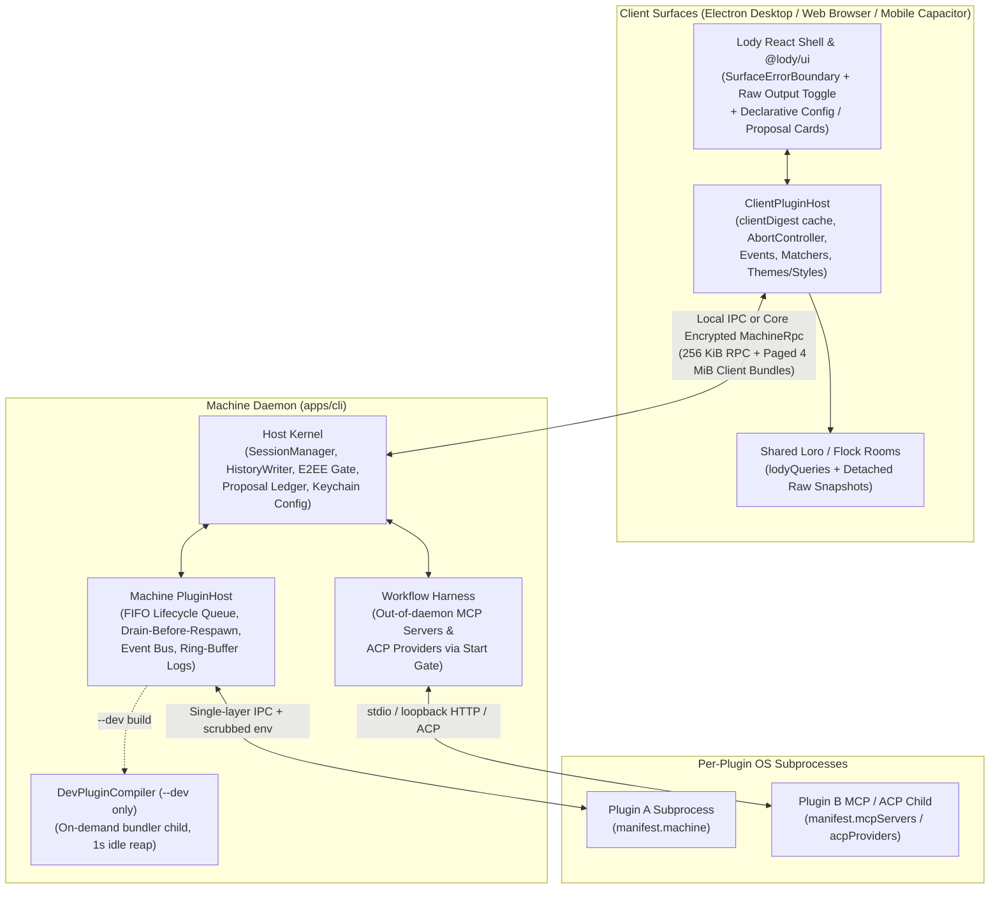

# Lody Plugin System Specification

Status: draft
Translation: current

[简体中文](plugin-system.zh.md)

This document is the formal, implementation-ready **Normative Specification** for the Lody Plugin System. It pairs a **lean, fail-stop per-plugin OS subprocess runtime** with **full no-fork Agent Workspace plasticity** — covering Extensibility, Workspace Data & Raw Snapshots, Runtime Lifecycle, Developer Experience (DX), End-User Experience (UX), and End-to-End Encrypted (E2EE) security invariants.

For the adversarial convergence rationale behind these boundaries, see [Plugin architecture convergence and E2EE workspace boundaries](../.agents/notes/proposed/architecture/2026-11-22-plugin-architecture-and-e2ee-boundaries.md).

---

## 1. Normative Language & Conformance Profiles

The key words **MUST**, **MUST NOT**, **REQUIRED**, **SHALL**, **SHALL NOT**, **SHOULD**, **SHOULD NOT**, **RECOMMENDED**, **MAY**, and **OPTIONAL** in this document are to be interpreted as described in RFC 2119 and RFC 8174 when, and only when, they appear in all capitals, as shown here.

### 1.1 Conformance Profiles

Verification and implementation compliance are divided into four profiles (Section 16):

- **Core Conformance (`REQUIRED`):** Mandatory across **Desktop (`Electron`)**, **Web Browser (`web`)**, **Headless CLI (`headless`)**, and **Mobile Capacitor (`apps/mobile-capacitor` inline cards, events, and declarative config)**. Covers package validation, per-plugin subprocess isolation, `Drain-Before-Respawn`, single-layer IPC, remote `client.js` bundle streaming (`<= 4 MiB` paged chunks + `clientDigest` trust gate), Host Events (`client` + `machine`), Universal Tool & Message Block Renderers, Three-Layer Sidebars, Two-Tier Themes + Managed CSS, Workflow `agentRoles` + `skills` + `mcpServers`, Typed `lodyQueries` + Raw Read-Only Snapshots (`useLodySnapshot` / `readSnapshot`), Declarative `manifest.config` + `onboarding`, Agent-Assisted `lody_plugin` `propose_*` approval cards, and E2EE security gates.
- **Workflow Provider Conformance (`Conditional`):** **REQUIRED** when enabling `manifest.acpProviders` (custom bundled ACP Agent runtimes such as Sorbet Super Assistant launched via `acp-session-start-gate.ts`). Specified in full in v1 so workflow contracts are unified from day one.
- **Mobile Extended UI Conformance (`Conditional`):** **REQUIRED** when a mobile host advertises `HostCapabilities.containers.sidebarViews`, `sessionPanels`, `screens`, or `projectPages` (`true`) to mount shell container views inside mobile drawers/sheets.
- **Real Integration Profile (`REQUIRED` for Production Release):** Mandatory unmocked OS subprocess (`SIGTERM`/`SIGKILL`, OOM/crash, `--dev` compiler reaping) and real multi-client (Electron + headless Web + mobile viewport) E2E acceptance suite (Section 16.8).

### 1.2 Implementation-Defined Items

The following items are explicitly **Implementation-defined** and MUST NOT be coupled to by plugin code:

- Exact directory layout of Lody's internal SQLite/KV databases storing enabled flags, `SessionCreationReceipt` rows, `plugin_proposal` states, and trust records.
- Internal React Fiber tree, CSS class names, and DOM wrapper hierarchy outside Lody's published `@lody/ui` components and documented `--*` CSS custom properties.
- Exact IPC serialization framing on Node's `stdio[3]` channel, provided all logical envelopes in Section 9.1 are preserved losslessly.
- Specific bundler binary (`esbuild`, `rolldown`, or `swc`) inside the `--dev` compiler child process, provided output purity and idle-reap bounds (Section 8.4) hold.

---

## 2. Problem, Product Vision & Goals

### 2.1 Problem Statement & Product North Star

Lody is an AI-native multi-Agent workspace spanning local and remote machines, Desktop, Web, and Mobile. A plugin system that only offers static React slots and plugin-private RPCs reduces Lody to a conventional CRUD extension host — forcing developers to fork Lody whenever they want to add workspace sound effects, reshape Claude/Codex/MCP tool outputs, ship a domain-specific multi-Agent workflow (such as Sorbet Super Assistant), or build custom real-time workspace control planes. Conversely, co-hosting plugins inside a shared worker with speculative retries and canary reproduction workers destabilizes the core daemon.

**Product North Star:** Developers MUST be able to turn Lody into their own AI workspace product **without forking Lody**, while the underlying runtime guarantees that no misbehaving plugin can hang the daemon, silently corrupt state, or weaken E2EE cryptographic boundaries.

### 2.2 Goals

1. **No-Fork Extensibility:** First-class Client & Machine Host Events, Universal Tool Call & Message Block Renderers (with mandatory raw-output escape toggles), Three-Layer Sidebars, Full Screens, Two-Tier Themes + Managed CSS, and Complete Workflow Composition (`agentRoles`, `skills`, `mcpServers`, `acpProviders`).
2. **Unrestricted Reactive Read Access, Controlled Writes:** Combine 18 typed `lodyQueries` descriptors with detached, deeply frozen **Raw Read-Only Document Snapshots** (`useLodySnapshot` / `readSnapshot`) so custom workspace dashboards never hit artificial summary walls, while `HistoryWriter` and Kernel commands remain the sole write path.
3. **End-to-End Developer & User Journey:** Zero-to-one CLI scaffolding, live `--dev` hot-reload across Desktop AND Web simultaneously, structured Plugin Inspector diagnostics, declarative `manifest.config` + First-Run Onboarding, and Agent-assisted plugin creation gated by human-confirmed `plugin_proposal` cards.
4. **Unified Cross-Device Experience:** One `@lody/plugin-sdk/client` bundle runs identically across Electron Desktop and Web Browser in `Core Conformance`, and adapts cleanly to Mobile Capacitor via `useHostCapabilities()`.
5. **Strict OS Process Isolation & E2EE Integrity:** Dedicated subprocess per `machine` plugin (`0` processes for client-only plugins), `Drain-Before-Respawn`, `0` automatic retries (`outcome_unknown` on interrupted writes), and cryptographic E2EE execution/custody gates.

### 2.3 Non-Goals & Anti-Patterns

- **Untrusted Security Sandbox:** Plugins are user-trusted code. Lody does NOT run V8 isolates, WASM jails, or capability-attenuated JS realms to make hostile malware safe to install.
- **Unconfirmed Autonomous Code Installation by Agents:** Coding Agents MAY scaffold plugin source code and propose installation/enablement via `lody_plugin`, but MUST NOT unilaterally install, enable, reload, or mutate secret config without explicit human confirmation.
- **Post-Signing Silent Prompt Mutation (`machine.beforeSessionTurn`):** Mutating a prompt on the daemon after personal-device `memberInput` signing violates E2EE prompt integrity and MUST NOT exist.
- **Direct Mutable CRDT / Loro Handle Exposure:** Plugins read detached snapshots and write through validated Kernel / `HistoryWriter` commands; exposing live mutable CRDT containers would bypass history schemas and E2EE commit signing.
- **Shared Multi-Plugin Worker, Canary Attribution, or Automatic Retries:** Co-hosting plugins in one worker or silently retrying failed plugin calls is prohibited.

### 2.4 Trust & Principal Model

| Principal                    | Authority & Boundary                                                                                                                                                                                                                                         |
| ---------------------------- | ------------------------------------------------------------------------------------------------------------------------------------------------------------------------------------------------------------------------------------------------------------ |
| **Machine Owner**            | Full authority over the machine daemon: approves/installs/enables/disables/removes plugins, approves `plugin_proposal` cards targeting that machine, configures `machine` secrets, and executes `'machine'`-scoped plugin handlers.                          |
| **Workspace Collaborator**   | May run Desktop, Web, or Mobile client UI for trusted `clientDigest` bundles and invoke `'project'` / `'session'` handlers (and rooted workflow events) ONLY on machines/projects granted via `MachineSharing` (in E2EE) or workspace membership (non-E2EE). |
| **Workspace Guest (`read`)** | Read-only observer. Views inline `<= 16 KiB` persisted history outputs and authorized `lodyQueries` / snapshots, but **MUST NOT** trigger dynamic `machine` plugin execution or session mutations in E2EE workspaces.                                        |
| **Coding Agent (ACP / MCP)** | Invokes enabled `defineTool` and plugin `mcpServers` tools, and MAY call `lody_plugin` (`list`, `inspect`, `diagnostics`, `scaffold`, `propose_*`). **MUST NOT** bypass human confirmation to activate executable plugin code.                               |

---

## 3. System Architecture & Cross-Device Topologies

### 3.1 Main Components



1. **`Host Kernel`:** Owns Session lifecycle, `HistoryWriter`, `SessionCreationReceipt` persistence, `plugin_proposal` ledger, declarative `manifest.config` & keychain secret storage, E2EE authorization/intent verification, and canonical Session/Turn/Tool event emission.
2. **`Machine PluginHost`:** Owns plugin discovery, manifest validation, per-plugin `child_process.fork` lifecycle, `Drain-Before-Respawn`, single-layer IPC dispatch, machine event fan-out, and bounded ring-buffer logs.
3. **`Workflow Harness`:** Registers plugin-contributed `agentRoles`, `skills`, out-of-daemon `mcpServers`, and (`Workflow Provider Conformance`) `acpProviders` onto Lody's native Role/Skill/MCP/ACP subsystems without running MCP or ACP code inside the daemon process.
4. **`DevPluginCompiler`:** Ephemeral child process spawned only for `--dev` plugins; compiles TypeScript/TSX, recomputes `clientDigest`, notifies connected Desktop and Web clients for live preview, and exits after `1000 ms` of inactivity.
5. **`ClientPluginHost`:** Runs identically in Electron, Web Browser, and Mobile Capacitor WebView; verifies `clientDigest` trust, evaluates `client.js`, wires `events`, universal `tools.matchRender` / `messages.renderBlock`, sidebars, screens, `themes`, `styles`, and `useHostCapabilities()`, and enforces zero-leak disposal.

### 3.2 Component Boundary Invariants

- **Zero In-Daemon Guest Execution:** Neither `manifest.machine`, `manifest.mcpServers`, nor `manifest.acpProviders` SHALL ever be `import()`ed or evaluated inside the main daemon Node process.
- **Zero-Subprocess Client/Asset Plugins:** Plugins declaring `client`, `themes`, `styles`, `assets`, `config`, or `skills` without `machine` MUST run with `0` spawned `PluginHost` child processes.
- **Write-Path Singularity:** Plugins read rich typed queries and raw document snapshots freely, but all durable workspace/session mutations MUST flow through Kernel commands (`sessions.*`, `HistoryWriter`, `config.set`).

### 3.3 Cross-Device Execution Topologies

| Topology                                                    | Client Bundle Delivery                                                                  | UI Surfaces Active                                                                                                                                                                                                                                             | Machine Execution                                                              |
| ----------------------------------------------------------- | --------------------------------------------------------------------------------------- | -------------------------------------------------------------------------------------------------------------------------------------------------------------------------------------------------------------------------------------------------------------- | ------------------------------------------------------------------------------ |
| **`desktop` (`Electron`)**                                  | Local verified bundle or remote `MachineRpc` paged chunks (`Core`)                      | All Core inline contributions + all shell `containers` (`sidebarViews`, `sessionPanels`, `screens`, `projectPages`)                                                                                                                                            | Local or remote daemon via `WorkspaceMachineRpcFacade`                         |
| **`web` (`Browser`)**                                       | Remote `MachineRpc` `plugin/bundle-chunk` (`<= 4 MiB`, `clientDigest`-verified, `Core`) | **Exact parity with `desktop`** (all Core inline contributions + all shell `containers`: `sidebarViews`, `sessionPanels`, `screens`, `projectPages`)                                                                                                           | Remote daemon via `WorkspaceMachineRpcFacade`                                  |
| **`mobile` (`apps/mobile-capacitor`, iOS 16.4+ / Android)** | Remote `MachineRpc` `plugin/bundle-chunk` (`Core`)                                      | `Core`: inline session/composer contributions (`tools`, `messages`, `composer`, `sidebar.sessionRow`), `events`, `manifest.config`. `Conditional`: shell `containers` (`sidebarViews`, `sessionPanels`, `screens`, `projectPages`) via `useHostCapabilities()` | Remote daemon via `WorkspaceMachineRpcFacade`                                  |
| **`headless` (`CLI`)**                                      | skipped (`client` not evaluated)                                                        | N/A                                                                                                                                                                                                                                                            | Full `machine`, `events`, `agentRoles`, `skills`, `mcpServers`, `acpProviders` |

---

## 4. Domain Model & Stable Identifiers

### 4.1 Core Entities

- **`PluginInstallation`:** `{ plugin_id, version, root_dir, manifest, enabled, lifecycle_state, client_digest, config_values, secret_keys_present, active_instance?, workflow_registrations, diagnostics[], logs_ring }`.
- **`MachinePluginInstance`:** `{ instance_id, pid, started_at_ms, registered_handlers, event_subscriptions, inflight_calls }`.
- **`ClientPluginInstance`:** `{ plugin_id, machine_id, client_digest, state, abort_controller, cleanup_fn?, contributions, style_elements[], query_cache }`.
- **`PluginProposalRecord`:** `{ workspace_id, machine_id, request_id, proposing_session_id, plugin_id, source_dir_or_pkg, manifest_summary, requested_capabilities[], status: 'pending' | 'approved' | 'rejected' | 'superseded', resolved_by_user_id?, resolved_at_ms? }`.
- **`SessionCreationReceipt`:** Durable `(workspace_id, caller_user_id, target_key, plugin_id, request_id)` idempotency record paired with active `business_key` reservation (Section 7.3).

### 4.2 Identifiers, Normalization, and Digest Rules

1. **`plugin_id`:** MUST match `^[a-z0-9]+(?:-[a-z0-9]+)*$` (`1..64` ASCII chars; `_` prohibited).
2. **`descriptor_id` / `contribution_id`:** MUST match `^[a-zA-Z0-9]+(?:[._-][a-zA-Z0-9]+)*$` (`1..96` chars) and MUST NOT contain `__`.
3. **Bijective Namespacing:**
   - Plugin `defineTool` MCP name: `plugin__<plugin_id>__<tool_id>`.
   - Plugin `agentRoles` ID: `plugin:<plugin_id>:<role_id>`.
   - Plugin `mcpServers` ID: `plugin:<plugin_id>:<mcp_id>`.
   - Plugin `acpProviders` ID: `plugin:<plugin_id>:<provider_id>`.
4. **`clientDigest`:** Lowercase hex `SHA-256` over length-prefixed relative paths and raw bytes of `manifest.client` plus all packaged client `themes`, `styles`, and `assets` (`"lody-client-bundle-v1\0"` framing). Omitted (`undefined`) only when a plugin has no client entry, themes, or styles.
5. **Path Containment:** Every manifest path and `ctx.dataDir` target MUST resolve via `realpath` strictly inside `root_dir` or `data_dir`; `..` traversal or symlink escapes MUST be rejected prior to I/O.

---

## 5. Package Format, Manifest & SDK Contract

### 5.1 Package Layout & Bundle Purity

- **Client Bundle (`manifest.client`):** Single browser-pure ESM bundle targeting ES2023 + Safari/WKWebView 16.4 (`apps/mobile-capacitor/AGENTS.md`). MUST NOT import `@lody/plugin-sdk/machine` or Node built-ins (`node:*`); `react`, `react/jsx-runtime`, `zod`, `@lody/ui`, and `@lody/plugin-sdk/*` are externalized and supplied by `ClientPluginHost`.
- **Machine Entry (`manifest.machine`):** Node ESM bundle targeting Node >= 22. MUST NOT import `@lody/plugin-sdk/client` or reference DOM globals (`window`, `document`).

### 5.2 Manifest Schema, Declarative Config & Workflow Contributions

`lody.plugin.json` MUST be strict UTF-8 JSON conforming to [`PluginManifest`](../scripts/fixtures/plugin-sdk/sdk/manifest.d.ts):

- **Required:** `id`, `version` (valid SemVer), `sdk` (`"^1.0.0"`), `title`, and at least one contribution (`client`, `machine`, `skills`, `agentRoles`, `mcpServers`, `acpProviders`, `themes`, or `styles`). Unknown top-level keys MUST fail validation.
- **Declarative `config` & `onboarding`:**
  - Supports `string`, `secret`, `number`, `boolean`, and `select` fields with `scope: "client" | "machine" | "both"`.
  - Any field with `type: "secret"` MUST have `scope: "machine"` (or omit `scope`, defaulting to `"machine"`); manifests declaring a `"client"` or `"both"` secret MUST be rejected at validation time (`manifest_invalid`).
  - `onboarding` lists `config` keys surfaced in Lody's native First-Run Setup Sheet when enabling the plugin (consolidating legacy separate `env` declarations into `manifest.config`).
- **Workflow Fields:** `skills` (`skills/<name>/SKILL.md`), `agentRoles` (Role metadata + `promptPath` + `skills` + `mcpServers` + `defaultProvider`), `mcpServers` (`stdio` | `http` out-of-daemon entrypoints), and `acpProviders` (bundled ACP server entrypoints).

### 5.3 Normative Byte & Resource Budgets

| Constant / Resource                   | Limit                         | Enforcement                                                                                   |
| ------------------------------------- | ----------------------------- | --------------------------------------------------------------------------------------------- |
| `MAX_PLUGIN_RPC_REQUEST_BYTES`        | `262,144` (`256 KiB`)         | UTF-8 request cap; fits one `1 MiB` E2EE Iroh `purpose 8` frame.                              |
| `MAX_INLINE_PLUGIN_TOOL_OUTPUT_BYTES` | `16,384` (`16 KiB`)           | Inline `HistoryWriter` cap; larger artifacts use `ctx.dataDir` + summary pointer.             |
| `MAX_PACKED_CLIENT_BUNDLE_BYTES`      | `4,194,304` (`4 MiB`)         | Total packed `client.js` + `themes`/`styles`/`assets`; paged in `256 KiB` `purpose 9` chunks. |
| `MAX_SUBPROCESS_LOG_RING`             | `500` lines / `262,144` bytes | Per-plugin daemon ring buffer (`<= 16 KiB` per line).                                         |

### 5.4 SDK Surface & Bidirectional Schema Enforcement

Conforming hosts MUST expose `@lody/plugin-sdk`, `@lody/plugin-sdk/client`, `@lody/plugin-sdk/machine`, and `@lody/plugin-sdk/manifest` matching [`scripts/fixtures/plugin-sdk/sdk/`](../scripts/fixtures/plugin-sdk/sdk/shared.d.ts). Every `defineQuery`, `defineMutation`, `defineTool`, and `defineAttachmentSource` payload MUST pass `safeParse` on BOTH input and output; failure rejects with `validation_failed` without crashing the subprocess.

---

## 6. Extensibility Contract — Events, Universal Renderers & Workflow Composition

### 6.1 Host Lifecycle & UI Interaction Events

Conforming hosts MUST provide a first-class, push-based event bus on both `ClientPluginRegistry.events.on` and `MachinePluginRegistry.events.on` so plugins never resort to DOM mutation observers or Session status polling:

1. **Canonical Session & Agent Lifecycle Events (`MachineHostEventMap` — available on BOTH machine and client):**
   - `session.created`, `session.status.changed`, `session.turn.started`, `session.turn.completed` (including `stopReason`: `"end_turn" | "cancelled" | "error" | "max_tokens" | "unknown"` and `durationMs`), `session.tool.started`, `session.tool.completed` (`ObservedToolCall`), and `session.waiting_input` (`PendingInteractionSummary`: `{ requestId, kind: "permission" | "elicitation", title? }`).
2. **Client UI Interaction Events (`ClientHostEventMap` — client-only):**
   - `ui.message.submitted`, `ui.session.switched`, `ui.interaction.resolved`, and `ui.command.invoked`.
3. **Delivery, Isolation & Teardown Rules:**
   - Event delivery is **non-blocking observer fan-out**: a slow or throwing listener in Plugin A MUST NOT delay Session execution, block UI interaction, or prevent Plugin B from receiving the event.
   - Machine event handlers have a `30_000 ms` execution deadline (`ctx.signal` aborts on timeout or plugin shutdown); unhandled rejections log to `logs_ring` and record a diagnostic without crashing sibling plugins.
   - All client event listeners registered by an instance MUST be automatically detached when `abort_controller.abort()` fires on disablement or `clientDigest` replacement.
4. **Orthogonal Asset & Lifecycle Primitives (`lody.assets.url`, `lody.signal`):**
   - `lody.assets.url(relativePath)` resolves packaged `assets/*` uniformly across Electron local protocols, Web `plugin/bundle-chunk` caches, and Mobile Capacitor WebViews.
   - `lody.signal: AbortSignal` aborts automatically on plugin disablement or `clientDigest` hot-swap so plugins compose standard Web Platform APIs (`AudioContext` / `HTMLAudioElement`, `Canvas`, `fetch`, timers) directly without inventing scenario-specific SDK namespaces (such as `lody.audio`).

### 6.2 Universal Tool Call Matchers & Structured Message Block Renderers

Plugins MUST NOT be restricted to rendering only their own `defineTool` descriptors:

1. **Own-Tool Strongly Typed Renderer (`tools.render(tool, Component)`):**
   - Matches `plugin__<plugin_id>__<tool.id>` with highest default specificity for that plugin's own tool, narrowing `ToolRenderProps` between `{ status: "running", output?: undefined }` and `{ status: "completed", output: TOutput }` after Zod `safeParse`.
2. **Universal Cross-Provider Tool Matcher (`tools.matchRender(spec)`):**
   - Matches built-in, ACP (Claude Code, Codex, Antigravity, custom ACP), and MCP tool calls via `ToolCallMatcher` (`toolNames`, `mcpServer`, `acpKinds`, `commandPattern` compiled with bounded RE2/non-backtracking semantics or guarded execution, and pure `when(call)` predicate).
   - **Deterministic Winner Selection:** When multiple enabled renderers match an `ObservedToolCall`, the host selects:
     1. Explicit user per-tool renderer preference (if set in Settings), else
     2. An exact own-tool `tools.render` registration (unless another matcher has explicit user override), else
     3. Highest `priority` (`default = 0`), tie-broken deterministically by `(plugin_id ASC, spec.id ASC)`.
   - Shadowed matchers record a `matcher_shadowed` diagnostic entry in the Plugin Inspector (Section 11.3).
3. **Structured Message Block Renderer (`messages.renderBlock(spec)`):**
   - Matches assistant fenced code blocks whose language tag appears in `spec.languages` (e.g., `sorbet-plan`, `test-report`, `openapi-preview`), streaming live `code` updates with `streaming: true` until fence closure (`streaming: false`).
4. **Mandatory Ground-Truth Escape Toggle & `ai-gui` Invariants:**
   - Whenever a `"replace"`-mode `tools.matchRender` or `messages.renderBlock` mounts, the host shell MUST render a non-spoofable chrome toggle (**`"View Raw Output"`** / **`"View Raw Markdown"`**) outside the plugin subtree and wrap the plugin subtree in `SurfaceErrorBoundary`.
   - Per [`packages/components/src/components/ai-gui/AGENTS.md`](../packages/components/src/components/ai-gui/AGENTS.md), plugin tool/block renderers MUST NOT inject `searchBlockId` into Lody's prose-only conversation search index, MUST NOT mount nested full-height scroll traps inside collapsed activity groups, and MUST preserve turn-folding layout invariants.

### 6.3 Orthogonal Sidebars & Cross-Device Capability Negotiation

1. **Three-Layer Orthogonal Sidebar Composition (`sidebar.*` over [`sidebar-surface.ts`](../packages/components/src/components/sidebar-surface.ts)):**
   - `sidebar.sessionRow.decorate`: Composable `trailing` badges and `hoverCard` popovers sorted by `(plugin_id, decorator_id)`. Rendering `<SessionRow />` inside any custom `sidebar.views.add` MUST automatically compose all active row decorators.
   - `sidebar.headerItems` / `footerItems`: Navigation rows using `<SidebarRow />` paired with `screens.add`.
   - `sidebar.views.add`: Selectable sidebar bodies alongside Lody's built-in `"Default"` view; disabling the active view reverts immediately to `"Default"`.
2. **Cross-Device Capability Negotiation (`useHostCapabilities()`):**
   - Plugins write **one unified client codebase** against `@lody/plugin-sdk/client` and inspect `useHostCapabilities()` (`platform: "desktop" | "web" | "mobile"`, `formFactor: "wide" | "compact"`, `containers: { sidebarViews, sessionPanels, screens, projectPages }`), where `containers` maps 1:1 to `ClientPluginRegistry` shell mount namespaces rather than mixing feature flags or machine presence.
   - Inline session/composer contributions (`tools`, `messages`, `composer`, `sidebar.sessionRow`), `events`, and `manifest.config` are `Core Conformance` invariants across `desktop`, `web`, and `mobile`. Both `desktop` and `web` MUST also enable all shell `containers` (`sidebarViews`, `sessionPanels`, `screens`, `projectPages`) in Core; `mobile` (`apps/mobile-capacitor`) exposes them when `Mobile Extended UI Conformance` is active. Registering an unmounted shell container on a compact host MUST NOT throw — the host records `capability_unavailable_on_platform` in diagnostics while keeping inline contributions, `events`, and `config` active.

### 6.4 Two-Tier Appearance System

- **Tier 1 — SemVer-Stable Theme Tokens (`manifest.themes`, `lody.themes.add`, `lody.themes.activate`):** `PluginThemeSeedColors` + `PluginThemeTokens` (`fontSans`, `fontMono`, `radius`, `density`) compile to root `--*` CSS custom properties via [`vscode-theme-dom.ts`](../packages/components/src/lib/vscode-theme/vscode-theme-dom.ts) and [`vscode-theme-css.ts`](../packages/components/src/lib/vscode-theme/vscode-theme-css.ts). Documented `--*` variables are **SemVer-stable across `^1.0.0`**.
- **Tier 2 — Host-Managed Custom CSS (`manifest.styles`, `lody.styles.add`):** Tracked `<style data-lody-plugin="<plugin_id>">` tags disposed on disablement/HMR, bypassed in `lody --safe-mode`, and never auto-synced to collaborators. Does NOT freeze internal React DOM structure.

### 6.5 Complete Workflow Composition (`agentRoles`, `skills`, `mcpServers`, `acpProviders`)

A single plugin package MAY ship an end-to-end multi-Agent workflow:

1. **Skills (`manifest.skills`):** Exposed to Agent Role pickers and `CreateSessionRequest.skillIds` while enabled.
2. **Agent Roles (`manifest.agentRoles` — `Core Conformance`):** Registered as `plugin:<plugin_id>:<role_id>`, binding system prompt markdown (`promptPath`), bundled `skills`, bundled `mcpServers`, and optional `defaultProvider`. Shown in Lody's Role selector with plugin provenance badge; editing creates a user Role override without mutating the plugin package.
3. **Out-of-Daemon MCP Servers (`manifest.mcpServers` — `Core Conformance`):** Spawned per Agent Session through Lody's standard MCP harness ([`apps/cli/src/agent/AGENTS.md`](../apps/cli/src/agent/AGENTS.md) invariant: **MCP tools MUST NOT run inside the daemon process**), receiving only minimal OS env plus `envKeys` resolved from the plugin's declared `manifest.config`.
4. **Custom ACP Agent Providers (`manifest.acpProviders` — `Workflow Provider Conformance`):** Launched through `acp-session-start-gate.ts` (`LODY_MAX_CONCURRENT_ACP_SESSION_STARTS`) as `plugin:<plugin_id>:<provider_id>`, speaking Lody's standard ACP protocol (`newSession`, `loadSession`, `subagentEvents`, `configOptions`, permission/elicitation bridges). Enables Sorbet Super Assistant and domain-specific harnesses to run as native Lody Session drivers without forking `apps/cli/src/agent`.

---

## 7. Workspace Data & Host Capabilities Contract

### 7.1 Expanded Typed `lodyQueries`

`lodyQueries` provides 18 typed reactive descriptors over Lody's shared ref-counted Loro/Flock rooms and `WorkspaceMachineRpcFacade`:

- **Workspace Scope (`WorkspaceRef` — no single `machineId`, resilient when individual machines are offline):** `machines`, `projects`, `agentRoles`, `agentConfigs`, `plugins`, `members`, `schedules`, `sessions`.
- **Project / Machine Scope:** `gitState`, `worktrees`, `filePreview`, `pullRequests`, `skills`, plus scoped `sessions` and `schedules`.
- **Session Scope (`SessionRef`):** `sessionDetail`, `sessionTurns` (windowed full `SessionTurnRecord`s with prose, thoughts, plans, `ObservedToolCall[]`, and `SubagentRunSummary[]`), `subagentRun` (on-demand nested transcript via `readSubagentRun`), `automations`, `sessionDiff`, `gitState`, `filePreview`.
- **Cross-Plugin `businessKey` Privacy:** `SessionSummary.businessKey` MUST be populated ONLY when `createdByPluginId === calling_plugin_id`.

### 7.2 Raw Read-Only Document & State-Tree Snapshots (`useLodySnapshot` / `readSnapshot`)

To guarantee custom Workspace / multi-Agent control planes are never bottlenecked by fixed summary types while keeping Lody's core runtime zero-overhead:

1. **Direct Reuse of Existing Loro/Flock & `sessionData`/Roost Infrastructure (Zero Parallel Domain Store):** Hosts MUST NOT introduce a separate plugin Domain Store or shadow state mirror, and MUST NOT rebuild or freeze full state trees on every document commit or streaming token. `lodyQueries` and `useLodySnapshot` / `readSnapshot` bind directly to Lody's existing shared Loro/Flock room readers and `sessionData` / Roost narrow directory & windowed turn readers (`readSessionHistory`, `readTurn`, `readTurnOutput`, `readSubagentRun`).
2. **Lazy, On-Demand Scoped Materialization (`RawSnapshotTarget`):** When zero plugins subscribe to a target, zero snapshot allocation occurs. Active subscriptions hook Lody's existing narrow change notifications (changed `turnIds`, structural ranges, or Flock key updates) and materialize **only** the authorized, scoped slice (`path` on `workspace-state` / `project-state`, `session-meta`, `schedule-doc`, or bounded `turnIds` / `limit` window on `session-transcript` — never performing automatic whole-history sweeps).
3. **Detachment, Deep Immutability & Selector Memoization:** Every materialized `RawDocumentSnapshot` (`{ schemaVersion, revision, doc }`) MUST be detached from live CRDT handles and deeply frozen (`Object.freeze` in development/strict mode) while `HistoryWriter` and Kernel commands remain the sole write path ([`packages/shared/src/session-data/AGENTS.md`](../packages/shared/src/session-data/AGENTS.md)). `useLodySnapshot(target, selector, isEqual)` re-renders ONLY when `selector(snapshot)` changes under `isEqual` (default `Object.is`).
4. **Redaction & Authorization:** Snapshots apply the exact same workspace/E2EE visibility gates as `lodyQueries` and strip keychain secrets, auth tokens, E2EE KEKs/signing keys, and other plugins' `businessKey` values prior to freezing.

### 7.3 Session Orchestration, Idempotency & Host-Exclusive Interaction Resolution

1. **Atomic `(requestId, businessKey)` `sessions.create` Receipt:**
   - Keyed by `(workspace_id, caller_user_id, canonical_target_key, plugin_id, request_id)` in durable storage.
   - Replaying the identical normalized payload returns the original `SessionRef` even after Session archive; replaying `requestId` with a modified payload rejects with `idempotency_conflict`.
   - A new `requestId` targeting an already-active (non-archived) `businessKey` rejects with `business_key_conflict`; archiving the Session releases `businessKey` while retaining the `requestId` receipt.
2. **Host-Exclusive Permission & Elicitation Settlement:**
   - Pending user interactions (`kind: "permission" | "elicitation"`) are exposed to plugins purely as read-only state (`SessionSummary.pendingInteraction`) and lifecycle events (`session.waiting_input`, `ui.interaction.resolved`).
   - Submitting outcomes through `WorkspaceWriter.respondSessionPermission` ([`use-permission-response.ts`](../packages/components/src/hooks/use-permission-response.ts), [`ask-user-question.ts`](../packages/shared/src/acp/ask-user-question.ts) — including provider-specific elicitation schemas and `isSecret` inputs) MUST remain exclusively owned by Lody's native host UI; plugins MUST NOT expose or invoke raw permission/elicitation response mutators.

---

## 8. Lifecycle State Machine

### 8.1 Machine Plugin Lifecycle States

- `Disabled`: Not running; zero subprocesses, zero active tools/events/roles/MCP/ACP registrations.
- `Starting`: Manifest validated; spawning `child_process.fork` (if `manifest.machine` is present) and awaiting `ready` within `10_000 ms`. Plugins without `manifest.machine` transition `Disabled -> Running` directly with `0` subprocesses.
- `Running`: Active `instance_id` serving RPCs, `events`, tools, and workflow contributions; immediately upon entering `Running` (including after daemon restart), `PluginHost` dispatches `machine.onStart(ctx)` so workflow plugins can reconcile durable `ctx.dataDir` progress journals and resume incomplete steps idempotently.
- `Stopping`: Draining via `shutdown -> 2s SIGTERM -> 2s SIGKILL`.
- `Stopped`: Transient drained state (`active_instance = null`) during `reload` or daemon shutdown.
- `Faulted`: Quarantined after unexpected exit, `ready` timeout, missing required secret/config, or IPC protocol violation. **Zero automatic background restarts**; exits `Faulted` ONLY on explicit `reload`, `disable`, or `remove`.
- `Removing`: Terminal teardown deleting installation registry records while preserving `ctx.dataDir` unless `--purge-data` is explicitly requested.

### 8.2 Per-Plugin Serialized Command Queue

`PluginHost` MUST maintain one FIFO async command queue per `plugin_id`. Concurrent `enable`, `disable`, `reload`, and `remove` calls execute strictly serially; rapid `--dev` `reload` bursts MAY coalesce into one trailing `reload` behind the active transition.

### 8.3 Escalating Shutdown & Drain-Before-Respawn Invariant

1. Send `{ type: "shutdown", graceMs: 2000 }` over IPC **without** calling `child.disconnect()` prematurely.
2. Wait up to `2000 ms` for OS `close`; if still alive, send `SIGTERM` and wait `2000 ms`; if still alive, send `SIGKILL` and await `close`.
3. **Drain-Before-Respawn Invariant:** `PluginHost` MUST NOT spawn a replacement subprocess for `plugin_id` until the previous OS PID has emitted `close`.

### 8.4 Dev Compiler Subprocess Lifecycle (`--dev`)

Source-linked `--dev` plugins compile inside `DevPluginCompiler`, which exits automatically after `1000 ms` idle and is terminated on `PluginHost` shutdown (leaving `0` orphaned bundler processes).

### 8.5 Client Plugin Instance Lifecycle & `clientDigest` Idempotency

`ClientPluginHost` keys instances by `(workspace_id, source_key, plugin_id)`:

- If `clientDigest` is unchanged and state is `Active`, reconciliation MUST be a no-op (preserving subscriptions, event listeners, and `query_cache`).
- On `clientDigest` change or `disable`, `ClientPluginHost` MUST abort `abort_controller` (detaching all `events.on` listeners and in-flight queries), run `cleanup_fn`, unregister all UI/matcher/theme contributions, remove `<style>` tags, and clear `query_cache` before mounting any replacement.

---

## 9. RPC, Event Delivery & Execution Semantics

### 9.1 Single-Layer Subprocess IPC Protocol

`PluginHost` and the `machine` subprocess communicate over `stdio: ['ignore', 'pipe', 'pipe', 'ipc']`:

- **Host -> Child:** `init` (`pluginId`, `instanceId`, `dataDir`, `config`), `start` (dispatched once after `ready` to invoke `machine.onStart`), `invoke` (`callId`, `kind`, `descriptorId`, `scope`, `target`, `input`), `event` (`eventId`, `eventType`, `payload`, `rootUserTurnId?`), `cancel` (`callId`), `host_result` (`hostCallId`, `ok`, `data`/`error`), `shutdown` (`graceMs`).
- **Child -> Host:** `ready` (`handlers`, `subscribedEvents`), `result` (`callId`, `ok`, `data`/`error`), `invalidate` (`descriptorId`, `scope`, `target?`), `host_call` (`hostCallId`, `op`: `"lody.read" | "lody.readSnapshot" | "sessions.create" | "sessions.send" | "sessions.requestStop" | "sessions.requestArchive"`, `payload`).
- `stdout` and `stderr` are strictly diagnostic pipes captured into `logs_ring`; malformed IPC frames kill the child and transition to `Faulted`.

### 9.2 Core Remote `MachineRpc` & Bundle Streaming

To deliver exact Desktop and Web parity in `Core Conformance`, `WorkspaceMachineRpcFacade` exposes a fixed plugin allowlist:

- `plugin/catalog`: Lists installed/enabled plugins, `clientDigest`, declarative `config` schemas, and capability summaries.
- `plugin/bundle-chunk`: Streams `client.js` and `themes`/`styles`/`assets` (`<= 4 MiB`) in `256 KiB` `purpose 9` paged chunks, verified against `clientDigest` before cache commit or execution.
- `plugin/query`, `plugin/mutate`, `plugin/attachment-search`, `plugin/attachment-resolve`: Single-frame `<= 256 KiB` requests.

### 9.3 Timeouts, Cancellation, and Session `Stop`

- **Deadlines:** `init -> ready`: `10_000 ms`; `query` / `mutation` / `attachment-*` / `event`: `30_000 ms`; `defineTool`: `600_000 ms` (`10 min`).
- **Cancellation & Immediate Session `Stop`:** Client unmount, input change, or user Session `Stop` sends `cancel(callId)` to abort `ctx.signal`. User Session `Stop` settles the Session turn immediately without waiting for a hung plugin handler.

### 9.4 Error Code Taxonomy & Zero-Auto-Retry Rule

`PluginCallErrorCode` consists of: `untrusted_plugin`, `plugin_disabled`, `plugin_faulted`, `machine_offline`, `forbidden`, `not_found`, `idempotency_conflict`, `business_key_conflict`, `outcome_unknown`, `validation_failed`, `handler_error`.

- **Zero Automatic Retries:** Neither `ClientPluginHost` nor `PluginHost` SHALL automatically retry any failed `query`, `mutation`, or `tool` call. Subprocess exit or timeout during `mutation` or `tool` MUST reject with `outcome_unknown`.

---

## 10. Persistence, History & Data Ownership

### 10.1 Bounded Session History (`HistoryWriter`)

- Plugins MUST NOT perform streaming Loro history writes during `defineTool` execution.
- When `defineTool` completes, the validated output is serialized to UTF-8 JSON: payloads `<= 16,384` bytes (`MAX_INLINE_PLUGIN_TOOL_OUTPUT_BYTES`) are written once through `HistoryWriter`; payloads `> 16,384` bytes reject with `validation_failed` without mutating Session history (large artifacts belong in `ctx.dataDir` keyed by immutable `toolCallId`, fetched on demand via `defineQuery`).

### 10.2 Plugin `dataDir` Ownership, Atomicity & Cleanup

- Scoped per `(workspace_id, plugin_id)` (and `<account>/<workspace>/<genesis>/<signing-key>` in E2EE workspaces).
- Concurrent file updates MUST write to an exclusive unique sibling temp file (`flag: 'wx'`) and `fs.rename` onto the destination; read/parse/write faults MUST leave the previously committed file intact.
- `disable` and `remove` preserve `ctx.dataDir` by default; `remove --purge-data` deletes `ctx.dataDir` only after `Drain-Before-Respawn` confirms subprocess exit.

### 10.3 Declarative Config & Secret Custody Split

- `scope: "client"` / `"both"` non-secret `manifest.config` values persist in user/workspace preferences and hydrate synchronously into `lody.config.get()` and `usePluginConfig()`.
- `type: "secret"` and `scope: "machine"` values persist exclusively in the target machine's OS Keychain / encrypted daemon secret store, never enter Loro/Flock documents, and are never returned to client bundles.

### 10.4 Scoped Query Cache & Invalidation

Each `ClientPluginInstance` owns an isolated `query_cache` keyed by `(descriptor_id, scope, canonical_target_key, canonical_input_json)`. `ctx.invalidate(descriptor, target?)` invalidates matching active subscriptions without clearing unrelated plugins' caches.

---

## 11. Developer Experience (DX) Contract

### 11.1 Zero-to-One Scaffolding (`lody plugin create`)

`lody plugin create <id> --template <ui | sound | renderer | workflow>` MUST generate a complete, zero-config project in `< 5 seconds` containing:

1. Validated `lody.plugin.json` with typed `@lody/plugin-sdk` imports.
2. Dual `tsconfig.json` (browser-pure) and `tsconfig.machine.json` (Node-pure) pre-wired to `@lody/plugin-sdk/*` and `@lody/ui`.
3. Ready-to-run template source and a local contract test runnable via `node --test`.

### 11.2 Live `--dev` Hot-Reload & Simultaneous Desktop + Web Preview

1. `lody plugin link --dev <path>` watches `lody.plugin.json`, `client`, `machine`, `themes`, `styles`, `assets`, `skills`, and `agentRoles`.
2. Saving a client/theme/style edit triggers `DevPluginCompiler` (`1000 ms` idle reap), updates `clientDigest`, and hot-swaps the `ClientPluginInstance` **simultaneously across both local Electron Desktop AND connected Web Browser sessions** without restarting the `machine` subprocess or interrupting active Agent Turns.
3. Saving a `machine` edit runs serialized `Drain-Before-Respawn` and re-registers handlers/events within a single workflow command.
4. `lody plugin preview <path>` opens a local/sandboxed preview harness with synthetic `ObservedToolCall`, `MessageBlock`, and `SessionSummary` fixtures so UI and renderer matchers can be verified across Desktop, Web, and compact Mobile viewports without spending live LLM tokens.

### 11.3 Plugin Inspector & Contribution Diagnostics

Host implementations MUST surface structured, actionable diagnostics (in Settings -> Plugins -> Inspector and `lody plugin doctor <path>`), never silent registration drops:

- Every rejected manifest, failed Zod `safeParse`, shadowed `tools.matchRender` (`matcher_shadowed`, naming the winning `plugin_id:id` and `priority`), caught `SurfaceErrorBoundary` crash (`surface_render_crashed` with component stack), unsupported mobile surface (`capability_unavailable_on_platform`), or rejected E2EE call (`e2ee_intent_rejected`) MUST be recorded on `PluginInstallation.diagnostics`.
- Inspector displays live `lifecycle_state`, OS `pid`, `clientDigest`, registered surfaces/matchers/events/roles/MCP/ACP endpoints, and the `500`-line `logs_ring`.

### 11.4 Packaging, Sharing & SemVer Update Lifecycle

- `lody plugin pack` validates purity, bundles `client.js` / `machine.js`, verifies `MAX_PACKED_CLIENT_BUNDLE_BYTES` (`<= 4 MiB`), computes `clientDigest`, and emits a deterministic `.lodypkg` archive with an embedded SHA-256 integrity manifest.
- Plugins MAY be installed from a local `.lodypkg` / directory, a pinned Git release / HTTPS tarball URL, or a workspace catalog entry.
- Updating an installed plugin runs `Drain-Before-Respawn` on the daemon, preserves `ctx.dataDir` and user `config` values, prompts for newly added `required` onboarding fields, and retains the previous `.lodypkg` generation for one-click `lody plugin rollback <id>`.

---

## 12. End-User Experience (UX) Contract

### 12.1 Discovery, Capability Disclosure & Trust

Before enabling an untrusted plugin or a new remote `clientDigest`, Lody MUST present a clear capability disclosure card enumerating concrete permissions derived from `lody.plugin.json`:

- `Runs Machine Code on <machine_name>` (`manifest.machine`)
- `Provides Agent Role / MCP / ACP Runtime` (`agentRoles`, `mcpServers`, `acpProviders`)
- `Customizes Tool / Message Rendering` (`client`)
- `Applies Theme / Custom Stylesheet` (`themes`, `styles`)
- `Requires Secret Credentials` (`manifest.config` `secret` fields)

### 12.2 Agent-Assisted Plugin Authoring & Propose-Confirm Workflow (`lody_plugin` MCP)

Users MUST be able to ask any Lody Agent _"Build me a plugin that..."_ and go from idea to running plugin in one conversation without sacrificing execution safety — modeled directly on Lody's [`schedules/AGENTS.md`](../apps/cli/src/lib/schedules/AGENTS.md) (`schedule_proposal.ts`) and `lody_agent_role` flow:

1. **Exposed `lody_plugin` MCP Actions:** `list`, `inspect`, `diagnostics`, `scaffold`, `propose_install`, `propose_update`, `propose_enable`, `propose_reload`.
2. **Idempotent `plugin_proposal` System Card:** Calling `propose_*` validates the package (`lody plugin doctor`), freezes the package digest + requested capabilities, and publishes one idempotent `plugin_proposal` card per `requestId` into the invoking Session transcript. Repeated calls with the same `requestId` return the current human decision (`pending` | `approved` | `rejected`).
3. **Strict Human Confirmation Gate:** `lody_plugin` exposes **zero** unilateral `install` / `enable` / `reload` / secret-write actions. A proposal takes effect ONLY when the human clicks **Approve & Enable** on the trusted host card (or runs `lody plugin ...` in an interactive human terminal where `LODY_AGENT_SESSION_ID` is cleared).

### 12.3 Declarative Settings UI & First-Run Onboarding

- Plugins declaring `manifest.config` automatically get a native Lody Settings panel (text inputs, masked keychain secret inputs, numeric sliders/steppers, switches, and select dropdowns) on Desktop, Web, and Mobile without writing custom Settings React code.
- If `manifest.onboarding` is present or any `required: true` `manifest.config` field is unset when enabling the plugin, Lody automatically opens the **First-Run Setup Sheet** and transitions the plugin to `Running` immediately upon submission. Plugins MAY additionally register `lody.settings.pages.add` for advanced custom views.

### 12.4 Cross-Device Continuity & Recovery UX

- Opening a workspace on **Web** automatically streams trusted `clientDigest` bundles from the online machine (`plugin/bundle-chunk`), delivering the exact same custom tool cards, sidebars, screens, themes, and sound/event behaviors as **Desktop Electron**.
- Opening a workspace on **Mobile Capacitor** renders custom inline tool/message cards and declarative plugin settings natively, while gracefully hiding wide-only panels unless negotiated via `useHostCapabilities()`.
- If a plugin enters `Faulted` or throws in UI, Lody displays a non-modal inline recovery banner (`[Reload Plugin]` / `[Open Logs]` / `[Disable]`) and always preserves `lody --safe-mode` as a one-flag escape hatch.

---

## 13. Security Boundaries & E2EE Constraints

### 13.1 Human-Confirmed Lifecycle Gate & Subprocess Environment Minimization

- Only interactive human UI actions (Settings / `plugin_proposal` Approve button) or authenticated human CLI commands (`LODY_AGENT_SESSION_ID` absent) MAY activate or reload plugin code.
- Spawned `machine`, `mcpServers`, and `acpProviders` child processes MUST receive a scrubbed environment (`PATH`, `HOME`, `TMPDIR`, `LANG`, `TZ`, `NODE_ENV`) plus ONLY `envKeys` explicitly referencing that plugin's own declared `manifest.config`. Daemon E2EE signing keys, KEKs, cloud auth tokens, and sibling plugins' secrets MUST NEVER enter child `process.env`.

### 13.2 Client Bundle Trust & `lody --safe-mode`

- Remote `clientDigest` bundles on Web, Mobile, and collaborator Desktops require explicit per-`(workspace_id, plugin_id, clientDigest)` trust approval before evaluating `client.js`.
- Launching with `lody --safe-mode` (or `?safeMode=1` on Web) MUST skip all `client.js` evaluation, `themes`, and `styles` while keeping core Session viewing, permissions, and `Stop` operational.

### 13.3 E2EE Guest (`read`) vs Non-Guest Execution Gate

In E2EE workspaces ([`specs/e2ee-foundations.md`](e2ee-foundations.md) and [`packages/shared/src/e2ee-rpc.ts`](../packages/shared/src/e2ee-rpc.ts)):

- `plugin/query`, `plugin/mutate`, and `plugin/attachment-*` MUST NOT appear in `E2EE_READ_QUERY_METHODS`; all require non-Guest `authorizeExecution` (`< 15 min` ledger freshness). Guest `useQuery` resolves to `{ status: "unavailable", reason: "forbidden" }`.

### 13.4 Machine Owner vs Per-Project `MachineSharing`

Per [`specs/e2ee/machine-sharing.md`](e2ee/machine-sharing.md):

- Plugin lifecycle approvals, `machine` secrets, `acpProviders` credentials, and `'machine'`-scoped calls are **Machine Owner ONLY**.
- Collaborators invoke `'project'` and `'session'` plugin handlers ONLY while `MachineSharing` actively grants both `target.machineId` and every bound project of the target Session/Project.

### 13.5 Signed Execution Intent Across Interactive, Tool & Rooted Workflow Events

Per [`packages/shared/src/e2ee-execution-intent.ts`](../packages/shared/src/e2ee-execution-intent.ts):

- Client `useLody().sessions.create` / `send` signs `E2EE_INTENT_KIND.memberInput` (`kind = 1`) on the personal device.
- Daemon `ToolExecutionContext` AND `MachineEventContext` triggered by a lifecycle event carrying a verified `rootUserTurnId` (or a human-signed workflow activation declaration on that same machine) MAY sign `derivedFrom` `E2EE_INTENT_KIND.machineInput` (`kind = 2`), enforcing the **20-derivation cap** and **single-machine rule**.
- Un-rooted `MachineContext` (`query`, `mutation`, `attachmentSource`) MUST reject `sessions.create` and `sessions.send` with `forbidden`.

### 13.6 Custody Isolation, Snapshot Redaction, Static Share & Network Disclosure

- E2EE daemon `ctx.dataDir` and Core Web/Desktop/Mobile bundle & trust caches MUST live under `<account>/<workspace>/<genesis>/<signing-key>`, stay unmounted while workspace E2EE mode is `unknown`, and wipe atomically on confirmed `e2ee_member_removed` or `e2ee_device_revoked`.
- Presence, Flock summaries, and telemetry MUST strip all `pluginId`, tool names, and plugin stack traces.
- Static plaintext Session shares render built-in fallback cards over inline `<= 16 KiB` history outputs without uploading `ctx.dataDir` or executing third-party `client.js`.

---

## 14. Failure & Recovery Model

### 14.1 Failure Classes

1. **Manifest / Config Validation Failure:** Malformed JSON, invalid ID, `"client"`-scoped secret, or missing required secret.
2. **Subprocess Spawn / Handshake / Crash / Hang:** Process exit, `10s` `ready` timeout, `30s`/`10min` call timeout, or `while(true)` loop.
3. **UI Surface / Matcher / Event Fault:** Render throw inside `tools.matchRender` / `messages.renderBlock` / `sidebar`, or unhandled rejection in `events.on`.
4. **Transport / Authorization Failure:** `machine_offline`, `untrusted_plugin`, `forbidden`, `idempotency_conflict`, `business_key_conflict`.

### 14.2 Deterministic Quarantine & Recovery Matrix

| Failure                             | In-Flight `query`              | In-Flight `mutation` / `tool`   | Host Action                                    | Recovery                                     |
| ----------------------------------- | ------------------------------ | ------------------------------- | ---------------------------------------------- | -------------------------------------------- |
| Missing required secret/config      | `plugin_disabled`              | `plugin_disabled`               | Open First-Run Setup Sheet                     | Auto-starts upon config save                 |
| Subprocess crash / `SIGKILL`        | `plugin_faulted` (`0` retries) | `outcome_unknown` (`0` retries) | Transition to `Faulted`, log ring              | User clicks `Reload` or `lody plugin reload` |
| Call timeout (`30s` / `10m`)        | `handler_error` (`0` retries)  | `outcome_unknown` (`0` retries) | Send `cancel(callId)`                          | Caller inspects receipt/state                |
| `matchRender` / `renderBlock` throw | Unaffected                     | Unaffected                      | `SurfaceErrorBoundary` reveals raw output      | Hot-reload fix or toggle raw view            |
| `events.on` listener throws         | Unaffected                     | Unaffected                      | Isolate error into `diagnostics` + `logs_ring` | Sibling plugins & Session continue           |

### 14.3 Restart Semantics

- **Daemon Restart & Workflow Recovery:** Re-evaluates persisted `enabled = true` plugins, preserves `ctx.dataDir`, `SessionCreationReceipt`, and `PluginProposalRecord` rows, and invokes `machine.onStart(ctx)` so workflow plugins recover unfinished multi-Session tasks idempotently using persisted `(requestId, businessKey)` without modifying Lody Core.
- **Client Reload / Reconnect:** Reconciles `clientDigest` from catalog/cache without restarting daemon subprocesses.

### 14.4 Operator Intervention Points

1. `lody --safe-mode` / `?safeMode=1` (bypasses all client plugin JS, themes, and styles).
2. Host header `"View Raw Output"` / `"View Raw Markdown"` toggle on every matched tool/message block.
3. `lody plugin disable <id>`, `lody plugin reload <id>`, `lody plugin rollback <id>`, `lody plugin doctor <path>`, and `lody plugin logs <id>`.

---

## 15. Reference Algorithms

### 15.1 Serialized Lifecycle Dispatch & Drain-Before-Respawn

```text
function enqueue_lifecycle(host, plugin_id, action):
  queue = host.queues[plugin_id]
  if action == "reload" and queue.has_pending_trailing_reload():
    return queue.join_pending_reload()

  return queue.push_and_run_serially(fn ->
    installation = host.installations[plugin_id]
    switch action:
      case "enable":
        installation.enabled = true
        persist_enabled_flag(plugin_id, true)
        return start_installation(host, installation)
      case "disable":
        installation.enabled = false
        persist_enabled_flag(plugin_id, false)
        unregister_workflow_contributions(host.workflow_harness, installation)
        stop_and_drain_instance(host, installation, reason="plugin_disabled")
        installation.lifecycle_state = "disabled"
        publish_catalog_update(host)
      case "reload":
        unregister_workflow_contributions(host.workflow_harness, installation)
        stop_and_drain_instance(host, installation, reason="plugin_disabled")
        # INVARIANT: old OS PID has emitted 'close' before start_installation runs
        return start_installation(host, installation)
      case "remove":
        unregister_workflow_contributions(host.workflow_harness, installation)
        stop_and_drain_instance(host, installation, reason="plugin_disabled")
        installation.lifecycle_state = "removing"
        remove_installation_records(host, installation)
        publish_catalog_update(host)
  end)

function stop_and_drain_instance(host, installation, reason):
  instance = installation.active_instance
  if instance is null:
    installation.lifecycle_state = "stopped"
    return

  installation.lifecycle_state = "stopping"
  send_ipc_best_effort(instance.child, {type: "shutdown", graceMs: 2000})
  if not wait_for_process_close(instance.child, timeout_ms=2000):
    send_signal_best_effort(instance.child, SIGTERM)
    if not wait_for_process_close(instance.child, timeout_ms=2000):
      send_signal_best_effort(instance.child, SIGKILL)
      wait_for_process_close_unbounded(instance.child)

  settle_all_inflight(instance, query_code=reason, effectful_code="outcome_unknown")
  installation.active_instance = null
  installation.lifecycle_state = "stopped"
```

### 15.2 Machine Invocation, Timeout, Cancel & Crash Settlement

```text
function invoke_machine_handler(host, principal, plugin_id, kind, descriptor_id, scope, target, raw_input, caller_signal):
  if utf8_byte_length(json_encode(raw_input)) > MAX_PLUGIN_RPC_REQUEST_BYTES:
    return error("validation_failed", "request exceeds 256 KiB")

  auth = authorize_plugin_rpc(host, principal, scope, target)
  if auth is not ok:
    return error("forbidden", auth.reason)

  installation = host.installations[plugin_id]
  if installation is null: return error("not_found", "unknown plugin")
  if installation.lifecycle_state == "faulted": return error("plugin_faulted", installation.last_error.message)
  if installation.lifecycle_state != "running" or installation.active_instance is null:
    return error("plugin_disabled", "plugin is not running")

  instance = installation.active_instance
  descriptor = instance.registered_handlers[kind][descriptor_id]
  if descriptor is null or descriptor.scope != scope:
    return error("not_found", "unregistered descriptor")

  parsed_in = descriptor.input_schema.safeParse(raw_input)
  if not parsed_in.success: return error("validation_failed", parsed_in.error)

  call_id = new_call_id()
  timeout_ms = (kind == "tool") ? 600000 : 30000
  side_effect = (kind in ["mutation", "tool"]) ? "effectful" : "unverified_read"

  promise = register_inflight(instance, call_id, side_effect, timeout_ms, on_timeout=fn ->
    send_ipc_best_effort(instance.child, {type: "cancel", callId: call_id})
    return (side_effect == "effectful") ? error("outcome_unknown", "invocation timed out") : error("handler_error", "query timed out")
  end)
  on_abort(caller_signal, fn -> send_ipc_best_effort(instance.child, {type: "cancel", callId: call_id}) end)

  send_ipc(instance.child, {type: "invoke", callId: call_id, kind, descriptorId: descriptor_id, scope, target, input: parsed_in.data})
  raw_result = await promise  # ZERO automatic retries

  parsed_out = descriptor.output_schema.safeParse(raw_result)
  if not parsed_out.success: return error("validation_failed", parsed_out.error)
  if kind == "tool" and utf8_byte_length(json_encode(parsed_out.data)) > MAX_INLINE_PLUGIN_TOOL_OUTPUT_BYTES:
    return error("validation_failed", "inline tool output exceeds 16 KiB; store large artifacts in ctx.dataDir")
  return ok(parsed_out.data)
```

### 15.3 Universal Renderer Resolution & Mandatory Raw Fallback

```text
function resolve_tool_renderer(client_host, user_prefs, observed_call):
  if client_host.safe_mode_enabled or observed_call.user_toggled_raw_view:
    return BuiltinRawToolSheet

  candidates = []
  if is_plugin_own_tool(observed_call.toolName):
    own = client_host.own_tool_renderers[observed_call.toolName]
    if own is not null:
      candidates.push({kind: "own", priority: Infinity, plugin_id: own.plugin_id, id: own.tool_id, Component: own.Component})

  for matcher in client_host.universal_tool_matchers:
    if matches_declarative_and_predicate(matcher.match, observed_call):
      candidates.push({kind: "match", priority: matcher.priority ?? 0, plugin_id: matcher.plugin_id, id: matcher.id, mode: matcher.mode ?? "replace", Component: matcher.Component})

  if candidates is empty:
    return BuiltinRawToolSheet

  winner = select_by_user_override_or_sort(candidates, user_prefs[observed_call.toolName],
    order_by=[priority DESC, is_own DESC, plugin_id ASC, id ASC])

  for loser in candidates where loser != winner:
    record_diagnostic(client_host, loser.plugin_id, "matcher_shadowed", {winner: winner.plugin_id + ":" + winner.id})

  # Host shell ALWAYS wraps replacement renderers with non-spoofable Raw Output toggle + ErrorBoundary
  return wrap_with_host_raw_toggle_and_error_boundary(winner.Component, fallback=BuiltinRawToolSheet)
```

### 15.4 Agent Propose-Confirm Lifecycle Gate (`lody_plugin` MCP)

```text
function mcp_propose_plugin_action(kernel, invoking_session_id, request_id, action, plugin_dir_or_pkg):
  caller = verify_session_owner_on_this_machine(kernel, invoking_session_id)
  existing = lookup_proposal_by_request_id(kernel, caller.workspace_id, request_id)
  if existing is not null:
    return {status: existing.status, proposalId: existing.id}  # Idempotent report

  doctor_report = validate_and_digest_plugin_package(plugin_dir_or_pkg)
  if not doctor_report.ok:
    return error("validation_failed", doctor_report.diagnostics)

  proposal = insert_proposal_record(kernel, {
    request_id,
    proposing_session_id: invoking_session_id,
    plugin_id: doctor_report.manifest.id,
    digest: doctor_report.package_sha256,
    capabilities: summarize_capabilities(doctor_report.manifest),
    status: "pending",
  })
  append_system_proposal_card_to_session(invoking_session_id, proposal)
  return {status: "pending", proposalId: proposal.id}
  # Executable installation/enablement ONLY runs when human clicks Approve on the card
  # (verified against frozen proposal.digest) or invokes CLI without LODY_AGENT_SESSION_ID.
```

### 15.5 E2EE Plugin RPC & Workflow Event Authorization

```text
function authorize_e2ee_plugin_session_write(kernel, context_kind, caller_or_event, target_machine_id):
  if not kernel.workspace_is_e2ee:
    return allow_unsigned()

  if context_kind == "client_interactive":
    return require_personal_device_member_input_signature(caller_or_event)

  if context_kind == "tool_execution":
    return sign_derived_machine_input(root_turn_id=caller_or_event.active_user_turn_id, max_hops=20, target_machine_id)

  if context_kind == "machine_event":
    if caller_or_event.root_user_turn_id is present:
      return sign_derived_machine_input(root_turn_id=caller_or_event.root_user_turn_id, max_hops=20, target_machine_id)
    if has_verified_human_workflow_declaration(kernel, caller_or_event.plugin_id, target_machine_id):
      return sign_declared_workflow_machine_input(caller_or_event.plugin_id, target_machine_id)
    return deny("forbidden: un-rooted E2EE machine event cannot originate Session turns")

  # Un-rooted query / mutation / attachmentSource
  return deny("forbidden: un-rooted MachineContext cannot originate E2EE Session turns")
```

---

## 16. Conformance & Validation Matrix

Validation profiles follow Section 1.1: Sections 16.1–16.6 are `Core Conformance` (`REQUIRED`), Section 16.7 covers `Conditional Conformance` (`Workflow Provider` & `Mobile Extended UI`), and Section 16.8 is `Real Integration Profile` (`REQUIRED` for release).

### 16.1 Core Conformance — Manifest, Purity, Config & SDK

- Validates `lody.plugin.json` including `config`, `onboarding`, `agentRoles`, `skills`, `mcpServers`, `acpProviders`, `themes`, `styles`, and `assets`; rejects invalid IDs, unknown keys, `..` / symlink escapes, and `"client"`- or `"both"`-scoped `secret` fields.
- Enforces browser-pure (`tsconfig.json`, Safari/WKWebView 16.4 target) and Node-only (`tsconfig.machine.json`) compilation boundaries.
- Enforces compile-time separation of `useLodyQuery`, `useLodySnapshot`, `usePluginConfig`, and `useQuery`.

### 16.2 Core Conformance — Subprocess Lifecycle, IPC & Fail-Stop

- Client-only / sound / theme plugins spawn `0` child processes; `machine` plugins spawn `1` dedicated subprocess and obey FIFO lifecycle serialization + `Drain-Before-Respawn` (`shutdown -> 2s SIGTERM -> 2s SIGKILL`).
- `stdio` ring-buffer logs (`<= 500` lines / `256 KiB`) never corrupt IPC frames.
- Timeouts and crashes settle `mutation` / `tool` as `outcome_unknown` with `0` automatic retries and transition crashes to `Faulted` without background restart loops.

### 16.3 Core Conformance — Extensibility: Events, Universal Renderers, Sidebars & Themes

- **Product Scenario — Sound Effect Plugin:** Client-only plugin composes `lody.events.on` (`ui.message.submitted`, `session.turn.completed`, `session.waiting_input`), declarative `config` (`pack`, `volume`), `lody.assets.url`, `lody.signal`, and standard Web Audio (`AudioContext` / `HTMLAudioElement`) with zero audio-specific SDK wrappers, pausing active clips on `signal` abort and detaching `100%` of listeners upon disablement.
- **Product Scenario — Universal Tool & Block Renderers:** `tools.matchRender` matches Claude/Codex/MCP `execute` test runs by priority, renders interactive failure triage cards, records `matcher_shadowed` for lower-priority contenders, always exposes the host `"View Raw Output"` toggle, falls back cleanly via `SurfaceErrorBoundary` on throw, and preserves `ai-gui` prose-only search and turn-folding invariants; `messages.renderBlock` streams and settles fenced artifact blocks identically.
- **Sidebars & Two-Tier Appearance:** Three-layer sidebars compose across `"Default"` and custom views; `--*` theme tokens and disposable `<style>` sheets apply and revert cleanly; `lody --safe-mode` bypasses all client plugin execution and stylesheets.

### 16.4 Core Conformance — Workspace Data, Raw Snapshots & Workflow Roles/MCP

- **Product Scenario — Custom Multi-Agent Control Plane:** Custom screen combines `lodyQueries.sessionTurns` / `subagentRun` / `agentConfigs` with `useLodySnapshot({ kind: "workspace-state" | "session-transcript" }, selector)`; returned `RawDocumentSnapshot` is deeply frozen (`Object.freeze`), redacted against secrets/foreign `businessKey`s, and triggers React re-renders only when selected slice values change.
- **Product Scenario — Workflow Role + MCP + Event Orchestration & Daemon-Restart Recovery:** Enabling a workflow plugin registers `plugin:<id>:<role>` and spawns `manifest.mcpServers` out-of-daemon; `machine.events.on("session.turn.completed")` journals task intent to `ctx.dataDir`, reads scoped session snapshots, and spawns a child verifier Session with atomic `(requestId, businessKey)` idempotency; if the daemon restarts mid-workflow, `machine.onStart(ctx)` reconciles `ctx.dataDir` and resumes without duplicating Sessions.

### 16.5 Core Conformance — DX, UX, Propose-Confirm & Desktop/Web/Mobile Parity

- **Product Scenario — Zero-to-Live DX:** `lody plugin create` scaffolds a passing plugin; `lody plugin link --dev` hot-swaps UI edits across **both Desktop Electron and Web Browser simultaneously** while `DevPluginCompiler` exits after `1000 ms` idle; `Plugin Inspector` and `lody plugin doctor` surface structured diagnostics.
- **Product Scenario — Agent-Assisted Authoring (`lody_plugin`):** An Agent scaffolds a plugin and calls `propose_install`; Lody renders one idempotent `plugin_proposal` card in chat; zero code executes until the human clicks `Approve & Enable`; First-Run Onboarding prompts for required `manifest.config` fields and immediately transitions the plugin to `Running`.
- **Product Scenario — Cross-Device Parity:** Opening the workspace on **Web** streams the `<= 4 MiB` `clientDigest`-verified bundle via `plugin/bundle-chunk` and renders identical screens, sidebars, matchers, and themes as Desktop; **Mobile Capacitor** renders inline tool/message cards and declarative settings cleanly while gating unsupported wide-only views via `useHostCapabilities()`.

### 16.6 Core Conformance — Security & E2EE Gates

- Subprocess environments for `machine`, `mcpServers`, and `acpProviders` exclude daemon E2EE keys, cloud tokens, and sibling plugins' secrets.
- In E2EE workspaces: Guests cannot invoke `plugin/query` or `plugin/mutate`; non-owners cannot invoke `'machine'` scope; collaborators require active `MachineSharing` across all bound projects; rooted `ToolExecutionContext` and `MachineEventContext` enforce the 20-derivation `machineInput` cap while un-rooted queries/mutations reject `sessions.create`/`send` with `forbidden`; `<account>/<workspace>/<genesis>/<signing-key>` caches wipe on member removal or device revocation.

### 16.7 Conditional Conformance — Workflow ACP Providers & Mobile Extended UI

- **`Workflow Provider Conformance`:** Bundled `manifest.acpProviders` (e.g., Sorbet Super Assistant) launch via `acp-session-start-gate.ts`, support `newSession` / `loadSession` / `subagentEvents` / `configOptions`, obey per-session stop/cancel, and run strictly outside the daemon process.
- **`Mobile Extended UI Conformance`:** Mobile hosts advertising `containers.sidebarViews` / `sessionPanels` / `screens` / `projectPages` mount plugin views inside mobile drawer/sheet containers respecting `--safe-area-bottom` and `--native-keyboard-height` ([`apps/mobile-capacitor/AGENTS.md`](../apps/mobile-capacitor/AGENTS.md)).

### 16.8 Real Integration Profile — Unmocked OS Subprocess & Multi-Client E2E Suite

1. **Stubborn Subprocess Drain-Before-Respawn E2E:** Real Node subprocess trapping `SIGTERM` is killed via `SIGKILL` within `<= 4500 ms` on `reload`; replacement PID spawns strictly after old PID `close` with zero `ctx.dataDir` corruption.
2. **Infinite-Loop Stop, Crash `outcome_unknown` & Zero Zombie Compiler E2E:** Real `while(true){}` hang terminates on `disable` while main daemon stays responsive; mid-mutation `SIGKILL` yields `outcome_unknown` (`0` retries) and `Faulted`; `--dev` compiler leaves `0` child processes after `1500 ms` idle.
3. **Desktop + Web Simultaneous Live Preview & Remote Bundle E2E:** Edit a `--dev` plugin and verify both Electron and headless Chromium Web sessions hot-swap via `plugin/bundle-chunk` with `0` leaked subscriptions or `<style>` tags.
4. **Full Product Scenarios E2E (`sound-effects`, `test-report`, `focus-sidebar`, `sorbet-workflow`, `lody_plugin` Proposal & `--safe-mode`):** Verify event-driven audio dispatch, universal tool matcher + `"View Raw Output"` toggle, First-Run Onboarding sheet, human approval of an Agent `plugin_proposal` card, mobile viewport card/config rendering, and `lody --safe-mode` recovery.

---

## 17. Definition of Done & Repository Evidence

### 17.1 REQUIRED for Core Conformance

v1 Core Conformance is complete ONLY when `@lody/plugin-sdk`, `PluginHost`, `Workflow Harness` (`agentRoles` + `skills` + `mcpServers`), `DevPluginCompiler`, `ClientPluginHost` (across Electron, Web `plugin/bundle-chunk`, and Mobile Capacitor inline cards/config), declarative `manifest.config` + Onboarding UI, `lody_plugin` Propose-Confirm MCP + chat cards, `Plugin Inspector` / `lody plugin create|link|preview|doctor|pack`, E2EE runtime gates, and reference dogfood plugins pass all checks in Sections 16.1–16.6 and Section 16.8.

### 17.2 Conditional Conformance Profiles

- Shipping bundled custom ACP runtimes (e.g., Sorbet Super Assistant `acpProviders`) requires passing Section 16.7 (`Workflow Provider Conformance`).
- Enabling full-screen plugin screens/sidebars on Mobile Capacitor requires passing Section 16.7 (`Mobile Extended UI Conformance`).

### 17.3 Operational Release Gate

Every E2E test in Section 16.8 MUST run continuously in CI against real OS subprocesses and real Electron + Chromium Web + mobile WebView targets without silent skips; any failure blocks release.

### 17.4 Repository Evidence & Current Implementation Status

- **Normative specification & SDK contracts:** This document, [Plugin architecture convergence and E2EE workspace boundaries](../.agents/notes/proposed/architecture/2026-11-22-plugin-architecture-and-e2ee-boundaries.md), and [`sdk/shared.d.ts`](../scripts/fixtures/plugin-sdk/sdk/shared.d.ts), [`sdk/client.d.ts`](../scripts/fixtures/plugin-sdk/sdk/client.d.ts), [`sdk/machine.d.ts`](../scripts/fixtures/plugin-sdk/sdk/machine.d.ts), and [`sdk/manifest.d.ts`](../scripts/fixtures/plugin-sdk/sdk/manifest.d.ts).
- **Inspected host owners & boundaries:** [`packages/ui/src/index.ts`](../packages/ui/src/index.ts), [`packages/components/src/components/loro-app-sidebar.tsx`](../packages/components/src/components/loro-app-sidebar.tsx), [`packages/components/src/components/sidebar-surface.ts`](../packages/components/src/components/sidebar-surface.ts), [`packages/components/src/components/ai-gui/AGENTS.md`](../packages/components/src/components/ai-gui/AGENTS.md), [`packages/components/src/hooks/use-permission-response.ts`](../packages/components/src/hooks/use-permission-response.ts), [`packages/components/src/lib/vscode-theme/vscode-theme-dom.ts`](../packages/components/src/lib/vscode-theme/vscode-theme-dom.ts), [`packages/components/src/lib/vscode-theme/vscode-theme-css.ts`](../packages/components/src/lib/vscode-theme/vscode-theme-css.ts), [`packages/components/src/providers/workspace-machine-rpc-facade.ts`](../packages/components/src/providers/workspace-machine-rpc-facade.ts), [`packages/shared/src/schema.ts`](../packages/shared/src/schema.ts), [`packages/shared/src/session-data/AGENTS.md`](../packages/shared/src/session-data/AGENTS.md), [`packages/shared/src/acp/ask-user-question.ts`](../packages/shared/src/acp/ask-user-question.ts), [`packages/shared/src/acp/history-apply.ts`](../packages/shared/src/acp/history-apply.ts), [`packages/shared/src/acp/tool-call-history.ts`](../packages/shared/src/acp/tool-call-history.ts), [`packages/shared/src/e2ee-rpc.ts`](../packages/shared/src/e2ee-rpc.ts), [`packages/shared/src/e2ee-execution-intent.ts`](../packages/shared/src/e2ee-execution-intent.ts), [`apps/cli/src/agent/AGENTS.md`](../apps/cli/src/agent/AGENTS.md), [`apps/cli/src/lib/acp/AGENTS.md`](../apps/cli/src/lib/acp/AGENTS.md), [`apps/cli/src/lib/schedules/AGENTS.md`](../apps/cli/src/lib/schedules/AGENTS.md), [`apps/cli/src/lib/e2ee/AGENTS.md`](../apps/cli/src/lib/e2ee/AGENTS.md), [`apps/cli/src/mcp/AGENTS.md`](../apps/cli/src/mcp/AGENTS.md), [`apps/mobile-capacitor/AGENTS.md`](../apps/mobile-capacitor/AGENTS.md), [`packages/platform/AGENTS.md`](../packages/platform/AGENTS.md), [`packages/e2ee-machine-sharing/AGENTS.md`](../packages/e2ee-machine-sharing/AGENTS.md), and [`.agents/docs/failure-containment.md`](../.agents/docs/failure-containment.md).
- **Executed validation vs unimplemented runtime:** [`scripts/plugin-sdk-contracts.test.mjs`](../scripts/plugin-sdk-contracts.test.mjs) currently validates browser/Node dual-tsconfig purity, compile-time positive/negative SDK assertions ([`contracts.ts`](../scripts/fixtures/plugin-sdk/contracts.ts), [`machine-contracts.ts`](../scripts/fixtures/plugin-sdk/machine-contracts.ts)), six reference plugins ([`test-report`](../scripts/fixtures/plugin-sdk/examples/test-report/client.tsx), [`issue-context`](../scripts/fixtures/plugin-sdk/examples/issue-context/machine.ts), [`worktrees`](../scripts/fixtures/plugin-sdk/examples/worktrees/client.tsx), [`focus-sidebar`](../scripts/fixtures/plugin-sdk/examples/focus-sidebar/client.tsx), [`sound-effects`](../scripts/fixtures/plugin-sdk/examples/sound-effects/client.tsx), [`sorbet-workflow`](../scripts/fixtures/plugin-sdk/examples/sorbet-workflow/client.tsx)), concurrent atomic `ctx.dataDir` fault-injection tests, client event-bus sound dispatch/cleanup, and workflow event + raw-snapshot orchestration. Production runtime hosts, CLI tooling, proposal cards, declarative config UI, and E2EE enforcement remain unimplemented pending Phase 1 execution against Sections 1–17.
