# Lody 插件系统正式规范

Status: draft
Translation: current

[English](plugin-system.md)

本文档是 Lody 插件系统的正式、可直接作为工程实现与验收依据的**规范性说明（Normative Specification）**。本规范将**极简、故障即停（Fail-Stop）的单插件独立 OS 子进程运行时底座**与**无需 Fork Lody 的高可塑性 Agent Workspace 扩展契约**深度结合——完整覆盖扩展性契约（Extensibility Contract）、工作区数据与原始只读状态快照、进程生命周期状态机、开发者体验契约（Developer Experience Contract）、终端用户体验契约（End-User Experience Contract）以及端到端加密（E2EE）安全不变量。

关于上述边界收敛背后的对抗性架构评审依据，详见 [插件架构收敛与 E2EE 工作区边界](../.agents/notes/proposed/architecture/2026-11-22-plugin-architecture-and-e2ee-boundaries.zh.md)。

---

## 1. 规范用语与一致性画像（Normative Language & Conformance Profiles）

本文档中的英文大写关键词 **MUST**、**MUST NOT**、**REQUIRED**、**SHALL**、**SHALL NOT**、**SHOULD**、**SHOULD NOT**、**RECOMMENDED**、**MAY** 与 **OPTIONAL** 严格按照 RFC 2119 与 RFC 8174 解释。

### 1.1 一致性画像（Conformance Profiles）

验证与实现合规性划分为四档画像（详见第 16 章）：

- **Core Conformance（`REQUIRED` 必选核心合规）：** 同时强制覆盖 **桌面端（`Electron`）**、**Web 浏览器端（`web`）**、**无头守护进程端（`headless`）** 以及 **移动端 Capacitor（`apps/mobile-capacitor` 的内联卡片、事件与声明式配置）**。涵盖包校验、单插件子进程隔离、`Drain-Before-Respawn`、单层 IPC、远程 `client.js` 产物分页流式传输（`<= 4 MiB` 分片 + `clientDigest` 信任门禁）、宿主事件总线（`client` + `machine`）、通用工具与结构化消息块渲染器、三层侧边栏、双层主题与托管 CSS、Workflow `agentRoles` + `skills` + `mcpServers`、类型化 `lodyQueries` + 只读原始状态树快照（`useLodySnapshot` / `readSnapshot`）、声明式 `manifest.config` + 首次启用 `onboarding`、Agent 辅助创建与 `lody_plugin` `propose_*` 人类确认卡片，以及 E2EE 安全门禁。
- **Workflow Provider Conformance（`Conditional` 条件合规）：** 当启用 `manifest.acpProviders`（如 Sorbet Super Assistant 这类打包自定义 ACP Agent 运行时、经 `acp-session-start-gate.ts` 拉起的能力）时 **REQUIRED**。在 v1 规范与 SDK 中完整定义，保证工作流契约从第一天起高度统一。
- **Mobile Extended UI Conformance（`Conditional` 条件合规）：** 当移动端宿主声明 `HostCapabilities.containers.sidebarViews`、`sessionPanels`、`screens` 或 `projectPages` 为 `true`（在移动端抽屉/半屏容器中挂载外壳视图）时 **REQUIRED**。
- **Real Integration Profile（投产发布 `REQUIRED` 必选真实集成验证）：** 零 Mock 的真实 OS 子进程（`SIGTERM`/`SIGKILL`、崩溃与 `--dev` 编译器回收）以及跨端（Electron + 无头 Web + 移动视口）真实 E2E 验收套件（第 16.8 节）。

### 1.2 实现自定义项（Implementation-Defined Items）

以下内容属于明确的 **Implementation-defined** 范畴，插件代码 **MUST NOT** 对其产生隐式耦合：

- 宿主内部存储插件启用标记、`SessionCreationReceipt` 回执、`plugin_proposal` 审批状态及信任记录的 SQLite/KV 表结构与路径。
- 在公开的 `@lody/ui` 组件与文档化 `--*` CSS 变量之外的宿主内部 React Fiber 树、类名与 DOM 层级。
- Node `stdio[3]` IPC 通道底层的序列化帧细节（只要无损保留第 9.1 节定义的全部逻辑信封即可）。
- `--dev` 编译子进程内部使用的具体打包器（`esbuild`、`rolldown` 或 `swc`，只要满足第 8.4 节的环境纯净度与空闲回收约束即可）。

---

## 2. 问题陈述、产品愿景与目标（Problem, Product Vision & Goals）

### 2.1 问题陈述与产品北极星

Lody 是横跨本地与远程多机器、同时服务 Desktop、Web 与 Mobile 的 AI 原生多 Agent 工作空间。如果插件系统只提供静态 React 槽位与插件私有 RPC，Lody 就会退化为传统的 CRUD 扩展宿主——一旦开发者想做全局音效反馈、将 Claude/Codex/MCP 的工具输出改造为交互式界面、封装像 Sorbet Super Assistant 一样的完整多 Agent 工作流，或者搭建全自由度工作区指挥台，就只能被迫去 Fork Lody。反过来，如果在运行时底座里让多个插件挤进共享 Worker 并堆砌 Canary 故障复现与静默自动重试，又会拖垮核心守护进程的稳定性。

**产品北极星：** 开发者 **MUST** 能够在**无需 Fork Lody** 的前提下把 Lody 塑造成自己想要的产品；同时底层运行时严格保证任何故障插件都不会卡死守护进程、不会静默污染状态、也不会削弱 E2EE 密码学边界。

### 2.2 核心目标（Goals）

1. **零 Fork 全域可塑性：** 一等公民地支持客户端与机器侧宿主事件订阅、跨工具/结构化消息块通用渲染器（强制附带“查看原始输出”逃生开关）、三层正交侧边栏、全屏工作台、双层主题 + 托管 CSS，以及完整 Workflow 组合（`agentRoles`、`skills`、`mcpServers`、`acpProviders`）。
2. **无设限响应式读取 + 受控单点写入：** 在 18 个类型化 `lodyQueries` 之上，开放深度只读冻结的**原始文档/状态树快照**（`useLodySnapshot` / `readSnapshot`），彻底消除自定义面板的数据围墙，同时严格保持 `HistoryWriter` 与内核命令作为唯一写路径。
3. **完整的开发者与用户体验闭环：** 5 秒级脚手架创建、Desktop 与 Web 同步热重载预览、结构化插件诊断面板、声明式 `manifest.config` + 首次使用引导抽屉，以及由人类点击确认 `plugin_proposal` 卡片门禁的 Agent 辅助造插件流程。
4. **跨设备一等体验：** 同一套 `@lody/plugin-sdk/client` 产物在 `Core Conformance` 下同时运行于 Electron 桌面端与 Web 浏览器端，并通过 `useHostCapabilities()` 平滑适配 Mobile Capacitor。
5. **严格的 OS 进程隔离与 E2EE 完整性：** 每个 `machine` 插件独占子进程（纯前端插件 `0` 子进程）、`Drain-Before-Respawn`、读写 `0` 次自动重试（中断副作用返回 `outcome_unknown`），以及 E2EE 执行签名与托管擦除门禁。

### 2.3 非目标与禁止的反模式（Non-Goals & Anti-Patterns）

- **不可信恶意代码沙箱：** 插件属于用户主动信任的代码；Lody 不构建 V8 Isolate 或 WASM 安全监狱来运行恶意软件。
- **Agent 未经人类确认静默安装/启用代码：** Agent **MAY** 生成插件源码并通过 `lody_plugin` 发起安装/启用提议，但 **MUST NOT** 在未经人类显式确认的情况下激活可执行代码或写入密钥。
- **签名后静默篡改提示词（`machine.beforeSessionTurn`）：** 在个人设备完成 `memberInput` 签名后由守护进程静默拼接提示词会破坏 E2EE 提示词完整性，**MUST NOT** 存在。
- **直接暴露可变 CRDT / Loro 内部句柄：** 插件读取脱离底层句柄的只读快照并通过内核命令写入；禁止直接暴露可变 CRDT 容器绕过 `HistoryWriter` 校验与 E2EE 签名。
- **单机多插件共享 Worker、Canary 归因与静默自动重试：** 严禁多插件共驻同一 Worker 或对失败的插件调用做后台自动重试。

### 2.4 信任模型与权限主体（Trust & Principal Model）

| 权限主体                           | 授权范围与边界                                                                                                                                                                                        |
| ---------------------------------- | ----------------------------------------------------------------------------------------------------------------------------------------------------------------------------------------------------- |
| **机器所有者（Machine Owner）**    | 拥有该机器守护进程的完整控制权：审批 `plugin_proposal` 卡片、安装/启用/禁用/卸载插件、配置 `machine` 级密钥，并调用 `'machine'` 作用域接口。                                                          |
| **工作区协作者（Collaborator）**   | 可在 Desktop、Web 或 Mobile 端运行已获信任 `clientDigest` 的前端插件，并仅在获得 `MachineSharing`（E2EE 下）或工作区成员授权的机器与绑定项目上调用 `'project'` / `'session'` 处理器与有根工作流事件。 |
| **工作区只读访客（Guest `read`）** | 只读观察者。可查看历史记录中 `<= 16 KiB` 的内联快照及已授权 `lodyQueries` / 快照，但在 E2EE 工作区中 **MUST NOT** 触发动态 `machine` 插件执行或会话写操作。                                           |
| **编码 Agent（ACP / MCP）**        | 可调用已启用的 `defineTool` 与插件 `mcpServers` 工具，并 **MAY** 调用 `lody_plugin`（`list`、`inspect`、`diagnostics`、`scaffold`、`propose_*`），但 **MUST NOT** 绕过人类确认直接启用可执行插件。    |

---

## 3. 系统架构与跨设备运行拓扑（System Architecture & Cross-Device Topologies）

### 3.1 核心组件

```mermaid
flowchart TB
  subgraph Client["客户端宿主（Electron 桌面端 / Web 浏览器 / Mobile Capacitor）"]
    CPH["ClientPluginHost\n（clientDigest 缓存、AbortController、\n事件总线、通用匹配器、主题/样式）"]
    UI["Lody React 外壳与 @lody/ui\n（SurfaceErrorBoundary + 查看原始输出开关\n+ 声明式配置抽屉 / 提议审批卡片）"]
    LoroClient["共享 Loro / Flock 房间\n（lodyQueries + 只读原始文档快照）"]
  end

  subgraph Daemon["机器守护进程（apps/cli）"]
    Kernel["Host Kernel 宿主内核\n（SessionManager、HistoryWriter、E2EE 门禁、\n提议账本、钥匙串配置存储）"]
    MPH["Machine PluginHost\n（FIFO 生命周期队列、Drain-Before-Respawn、\n事件扇出、环形日志缓冲）"]
    DPC["DevPluginCompiler（仅 --dev）\n（按需编译子进程，空闲 1s 退出）"]
    WF["Workflow Harness 工作流底座\n（进程外 MCP 服务与受门禁管控的 ACP Provider）"]
  end

  subgraph Subprocesses["每插件独立 OS 子进程"]
    P1["插件 A 独立子进程\n（manifest.machine）"]
    PMCP["插件 B MCP / ACP 子进程\n（manifest.mcpServers / acpProviders）"]
  end

  UI <--> CPH
  CPH --> LoroClient
  CPH <-->|"本地 IPC 或 Core 加密 MachineRpc\n（256 KiB RPC + 分页 4 MiB 前端产物）"| Kernel
  Kernel <--> MPH
  Kernel <--> WF
  MPH -.->|"--dev 编译"| DPC
  MPH <-->|"单层扁平 IPC + 最小化环境变量"| P1
  WF <-->|"stdio / 本地回环 HTTP / ACP"| PMCP
```



1. **`Host Kernel`：** 负责 Session 生命周期、`HistoryWriter`、`SessionCreationReceipt` 持久化、`plugin_proposal` 审批账本、声明式 `manifest.config` 与钥匙串密钥托管、E2EE 授权/执行意图校验，以及规范化 Session/Turn/Tool 事件发射。
2. **`Machine PluginHost`：** 负责插件发现、清单校验、单插件独立 `child_process.fork` 生命周期、`Drain-Before-Respawn`、单层 IPC 路由、机器侧事件扇出及有界环形日志缓冲。
3. **`Workflow Harness`：** 将插件声明的 `agentRoles`、`skills`、进程外 `mcpServers` 及（`Workflow Provider Conformance`）`acpProviders` 注册进 Lody 原生 Role/Skill/MCP/ACP 子系统，且绝不在守护进程主进程内执行任何 MCP 或 ACP 代码。
4. **`DevPluginCompiler`：** 仅对 `--dev` 插件按需拉起的编译子进程；负责编译 TS/TSX、重算 `clientDigest`、向已连接的 Desktop 与 Web 客户端同步推送热更新，并在空闲 `1000 ms` 后自动退出。
5. **`ClientPluginHost`：** 在 Electron、Web 浏览器与 Mobile Capacitor WebView 中统一运行；负责校验 `clientDigest` 信任、执行 `client.js`、挂载 `events`、通用 `tools.matchRender` / `messages.renderBlock`、侧边栏、全屏页、`themes`、`styles` 与 `useHostCapabilities()`，并执行零泄漏销毁。

### 3.2 模块边界不变量

- **主守护进程零插件代码执行：** `manifest.machine`、`manifest.mcpServers` 与 `manifest.acpProviders` 均 **MUST NOT** 在主守护进程内被 `import()` 或执行。
- **纯前端/资源插件零子进程：** 仅声明 `client`、`themes`、`styles`、`assets`、`config` 或 `skills` 而未声明 `machine` 的插件 **MUST** 以 `0` 个 `PluginHost` 子进程运行。
- **唯一写入口：** 插件可自由读取类型化查询与只读原始文档快照，但一切持久化工作区/会话写操作 **MUST** 经由内核命令（`sessions.*`、`HistoryWriter`、`config.set`）完成。

### 3.3 跨设备运行拓扑规范

| 运行拓扑                                                     | 前端产物分发方式                                                                               | 激活的 UI 扩展面                                                                                                                                                                                                                                           | 机器侧执行路径                                                                     |
| ------------------------------------------------------------ | ---------------------------------------------------------------------------------------------- | ---------------------------------------------------------------------------------------------------------------------------------------------------------------------------------------------------------------------------------------------------------- | ---------------------------------------------------------------------------------- |
| **`desktop`（`Electron`）**                                  | 本地已校验产物或远程 `MachineRpc` 分页流（`Core`）                                             | 全部 Core 内联扩展 + 全部外壳容器 `containers`（`sidebarViews`、`sessionPanels`、`screens`、`projectPages`）                                                                                                                                               | 本地或远程 `WorkspaceMachineRpcFacade`                                             |
| **`web`（浏览器）**                                          | 远程 `MachineRpc` `plugin/bundle-chunk`（`<= 4 MiB`，经 `clientDigest` 校验，**纳入 `Core`**） | **与 `desktop` 100% 对等**（全部 Core 内联扩展 + 全部外壳容器 `containers`：`sidebarViews`、`sessionPanels`、`screens`、`projectPages`）                                                                                                                   | 远程 `WorkspaceMachineRpcFacade`                                                   |
| **`mobile`（`apps/mobile-capacitor`，iOS 16.4+ / Android）** | 远程 `MachineRpc` `plugin/bundle-chunk`（`Core`）                                              | `Core`：会话/输入栏内联扩展（`tools`、`messages`、`composer`、`sidebar.sessionRow`）、`events`、`manifest.config`。`Conditional`：通过 `useHostCapabilities()` 协商开放外壳容器 `containers`（`sidebarViews`、`sessionPanels`、`screens`、`projectPages`） | 远程 `WorkspaceMachineRpcFacade`                                                   |
| **`headless`（`CLI`）**                                      | 跳过前端产物加载                                                                               | 不适用                                                                                                                                                                                                                                                     | 完整支持 `machine`、`events`、`agentRoles`、`skills`、`mcpServers`、`acpProviders` |

---

## 4. 核心领域模型与标识符规范（Domain Model & Stable Identifiers）

### 4.1 核心实体

- **`PluginInstallation`：** `{ plugin_id, version, root_dir, manifest, enabled, lifecycle_state, client_digest, config_values, secret_keys_present, active_instance?, workflow_registrations, diagnostics[], logs_ring }`。
- **`MachinePluginInstance`：** `{ instance_id, pid, started_at_ms, registered_handlers, event_subscriptions, inflight_calls }`。
- **`ClientPluginInstance`：** `{ plugin_id, machine_id, client_digest, state, abort_controller, cleanup_fn?, contributions, style_elements[], query_cache }`。
- **`PluginProposalRecord`：** `{ workspace_id, machine_id, request_id, proposing_session_id, plugin_id, source_dir_or_pkg, manifest_summary, requested_capabilities[], status: 'pending' | 'approved' | 'rejected' | 'superseded', resolved_by_user_id?, resolved_at_ms? }`。
- **`SessionCreationReceipt`：** 按 `(workspace_id, caller_user_id, target_key, plugin_id, request_id)` 持久化的幂等建会回执及活跃 `business_key` 预留记录（第 7.3 节）。

### 4.2 稳定标识符、规范化与摘要规则

1. **`plugin_id`：** **MUST** 匹配 `^[a-z0-9]+(?:-[a-z0-9]+)*$`（`1..64` 位 ASCII 字符，严禁包含 `_`）。
2. **`descriptor_id` / `contribution_id`：** **MUST** 匹配 `^[a-zA-Z0-9]+(?:[._-][a-zA-Z0-9]+)*$`（`1..96` 位）且 **MUST NOT** 包含 `__`。
3. **无损双射命名空间：**
   - 插件 `defineTool` MCP 名称：`plugin__<plugin_id>__<tool_id>`。
   - 插件 `agentRoles` ID：`plugin:<plugin_id>:<role_id>`。
   - 插件 `mcpServers` ID：`plugin:<plugin_id>:<mcp_id>`。
   - 插件 `acpProviders` ID：`plugin:<plugin_id>:<provider_id>`。
4. **`clientDigest`：** 对 `manifest.client` 及全部打包的 `themes`、`styles`、`assets` 相对路径与原始字节带长度前缀计算的 `SHA-256` 小写十六进制摘要（`"lody-client-bundle-v1\0"` 帧头）；仅当无前端产物、主题与样式时省略（`undefined`）。
5. **路径越界防护：** 所有清单路径与 `ctx.dataDir` 文件路径经 `realpath` 解析后 **MUST** 严格位于 `root_dir` 或 `data_dir` 内部；含 `..` 遍历或符号链接逃逸的路径在 I/O 前一律拒绝。

---

## 5. 插件包格式、清单与公开 SDK 契约（Package Format, Manifest & SDK Contract）

### 5.1 插件包目录结构与运行环境纯度

- **前端产物（`manifest.client`）：** 面向 ES2023 + Safari/WKWebView 16.4（`apps/mobile-capacitor/AGENTS.md`）的单文件纯浏览器 ESM 产物。**MUST NOT** 导入 `@lody/plugin-sdk/machine` 或 Node 内置模块（`node:*`）；`react`、`react/jsx-runtime`、`zod`、`@lody/ui` 与 `@lody/plugin-sdk/*` 由 `ClientPluginHost` 外部化注入。
- **机器侧入口（`manifest.machine`）：** 面向 Node >= 22 的 ESM 产物。**MUST NOT** 导入 `@lody/plugin-sdk/client` 或引用 DOM 全局对象（`window`、`document`）。

### 5.2 清单 Schema、声明式配置与工作流贡献（`lody.plugin.json`）

`lody.plugin.json` **MUST** 是符合 [`PluginManifest`](../scripts/fixtures/plugin-sdk/sdk/manifest.d.ts) 的严格 UTF-8 JSON：

- **必填项：** `id`、`version`（合法 SemVer）、`sdk`（`"^1.0.0"`）、`title`，且至少声明一项贡献（`client`、`machine`、`skills`、`agentRoles`、`mcpServers`、`acpProviders`、`themes` 或 `styles`）。未知顶层字段 **MUST** 校验失败。
- **声明式 `config` 与首次引导 `onboarding`：**
  - 支持 `string`、`secret`、`number`、`boolean` 与 `select` 五种字段类型，以及 `scope: "client" | "machine" | "both"`。
  - 凡是 `type: "secret"` 的字段，`scope` **MUST** 为 `"machine"`（省略时默认为 `"machine"`）；任何将 `secret` 声明为 `"client"` 或 `"both"` 的清单 **MUST** 在校验阶段直接拒绝（`manifest_invalid`）。
  - `onboarding` 列出首次启用时由宿主原生首次配置引导抽屉收集的 `config` 键名（统一收敛至 `manifest.config`，不再并存重复的 `manifest.env`）。
- **工作流字段：** `skills`（`skills/<name>/SKILL.md`）、`agentRoles`（绑定 `promptPath`、`skills`、`mcpServers` 与 `defaultProvider`）、`mcpServers`（`stdio` | `http` 进程外入口）与 `acpProviders`（打包 ACP 服务入口）。

### 5.3 规范性字节与资源预算上限

| 常量 / 资源                           | 上限                      | 强制执行边界                                                                           |
| ------------------------------------- | ------------------------- | -------------------------------------------------------------------------------------- |
| `MAX_PLUGIN_RPC_REQUEST_BYTES`        | `262,144`（`256 KiB`）    | 单次请求 UTF-8 上限；适配单个 `1 MiB` E2EE Iroh `purpose 8` 帧。                       |
| `MAX_INLINE_PLUGIN_TOOL_OUTPUT_BYTES` | `16,384`（`16 KiB`）      | `HistoryWriter` 内联写入上限；超限大文件须存入 `ctx.dataDir` 并返回摘要指针。          |
| `MAX_PACKED_CLIENT_BUNDLE_BYTES`      | `4,194,304`（`4 MiB`）    | `client.js` + `themes`/`styles`/`assets` 总包上限；按 `256 KiB` `purpose 9` 分片传输。 |
| `MAX_SUBPROCESS_LOG_RING`             | `500` 行 / `262,144` 字节 | 每插件守护进程环形日志缓冲（单行 `<= 16 KiB`）。                                       |

### 5.4 SDK 模块导出与双向 Schema 校验

合规宿主 **MUST** 公开与 [`scripts/fixtures/plugin-sdk/sdk/`](../scripts/fixtures/plugin-sdk/sdk/shared.d.ts) 一致的 `@lody/plugin-sdk`、`@lody/plugin-sdk/client`、`@lody/plugin-sdk/machine` 与 `@lody/plugin-sdk/manifest`。所有 `defineQuery`、`defineMutation`、`defineTool` 与 `defineAttachmentSource` 调用在输入与输出两端均 **MUST** 执行 Zod `safeParse`；校验失败返回 `validation_failed`，绝不导致子进程崩溃。

---

## 6. 扩展性契约：事件总线、通用渲染器与完整工作流组合（Extensibility Contract）

### 6.1 宿主生命周期与 UI 交互事件总线

合规宿主 **MUST** 在 `ClientPluginRegistry.events.on` 与 `MachinePluginRegistry.events.on` 两端同时提供一等公民的推送式事件总线，使插件无需借助 DOM 监听或轮询 Session 状态即可构建实时响应逻辑：

1. **规范化会话与 Agent 生命周期事件（`MachineHostEventMap` —— 机器侧与客户端共享）：**
   - `session.created`、`session.status.changed`、`session.turn.started`、`session.turn.completed`（含 `stopReason`: `"end_turn" | "cancelled" | "error" | "max_tokens" | "unknown"` 与 `durationMs`）、`session.tool.started`、`session.tool.completed`（携带归一化 `ObservedToolCall`）以及 `session.waiting_input`（携带 `PendingInteractionSummary`：`{ requestId, turnId?, kind: "permission" | "elicitation", title?, options }`）。
2. **客户端本地交互事件（`ClientHostEventMap` —— 仅客户端）：**
   - `ui.message.submitted`、`ui.session.switched`、`ui.interaction.resolved` 与 `ui.command.invoked`。
3. **投递、隔离与回收规则：**
   - 事件投递采用**非阻塞观察者扇出（Observer Fan-out）**：插件 A 的慢回调或抛错 **MUST NOT** 延迟宿主 Session 执行、阻塞 UI 交互或影响插件 B 接收同一事件。
   - 机器侧事件处理器受 `30_000 ms` 超时约束（超时或关闭时触发 `ctx.signal` 中止）；未捕获异常写入 `logs_ring` 与 `diagnostics`，绝不波及兄弟插件。
   - 客户端插件禁用或 `clientDigest` 热替换时，`abort_controller.abort()` **MUST** 自动摘除该实例注册的全部事件监听器。
4. **正交静态资源寻址与生命周期信号原语（`lody.assets.url`、`lody.signal`）：**
   - `lody.assets.url(relativePath)` 在 Electron 本地协议、Web `plugin/bundle-chunk` 缓存与 Mobile Capacitor WebView 下统一解析打包在 `assets/*` 内的静态资源。
   - `lody.signal: AbortSignal` 在插件禁用或 `clientDigest` 热替换时自动中止，使插件可直接组合标准 Web 平台原语（`AudioContext` / `HTMLAudioElement`、`Canvas`、`fetch`、定时器等）并在卸载时确定性回收资源，无需在 SDK 中为具体业务场景堆砌非原语命名空间（如 `lody.audio`）。

### 6.2 通用工具调用匹配渲染与结构化消息块渲染

插件 **MUST NOT** 被局限于仅能渲染自己注册的 `defineTool`：

1. **自有工具强类型渲染（`tools.render(tool, Component)`）：**
   - 精确匹配 `plugin__<plugin_id>__<tool.id>`，经 Zod `safeParse` 后在 `{ status: "running", output?: undefined }` 与 `{ status: "completed", output: TOutput }` 间收窄类型。
2. **跨 Provider 通用工具调用匹配渲染（`tools.matchRender(spec)`）：**
   - 通过 `ToolCallMatcher`（`toolNames`、`mcpServer`、`acpKinds`、受防回溯保护的 `commandPattern` 以及纯函数谓词 `when(call)`）匹配内置工具、ACP 工具（Claude Code、Codex、Antigravity、自定义 ACP）及任意 MCP 工具。
   - **确定性优先级裁决：** 当多个已启用渲染器同时匹配某次 `ObservedToolCall` 时，宿主按以下顺序选出唯一胜出者：
     1. 用户在设置中指定的逐工具渲染器覆盖项（若有）；否则
     2. 插件自有工具的 `tools.render` 精确绑定；否则
     3. 最高 `priority`（默认 `0`），平局时按 `(plugin_id ASC, spec.id ASC)` 字典序确定性决出。
   - 被高优先级遮蔽的匹配器在插件诊断面板（第 11.3 节）中记录 `matcher_shadowed`。
3. **结构化消息块渲染与稳定块身份（`messages.renderBlock(spec)`）：**
   - 匹配语言标签命中 `spec.languages` 的助手 fenced 代码块（如 `sorbet-plan`、`test-report`、`openapi-preview`），向组件传入 `turnId`、确定性块身份 `blockId = "<turnId>:block:<ordinal>"`（该助手回合内 fenced 代码块的 `0` 起始出现序号）、`code`、`meta` 以及 `streaming`（流式生成时为 `true`，围栏闭合后为 `false`）。
   - **有状态增量更新（Stable Block Identity + Stateful Incremental Updates）：** `ClientPluginHost` **MUST** 按 `(session.sessionId, blockId, winner.plugin_id, winner.id)` 维护消息块组件挂载键——**MUST NOT** 将 `code`、`meta`、`streaming` 或临时 AST 节点引用混入挂载 Key。在同一个代码块持续流式输出以及 `streaming: true -> false` 闭合过程中，宿主 **MUST** 保持已挂载的 React 组件实例并原地增量更新 Props，确保插件内部维护的表单输入、图表缩放、选中项或 `useRef` / Canvas 状态绝不因流式刷新而被重置；仅当用户切换“查看原始 Markdown”、`SurfaceErrorBoundary` 捕获渲染崩溃、胜出渲染器/`clientDigest` 热替换或所属回合/会话卸载时才卸载组件。
4. **强制“查看原始输出”逃生开关与 `ai-gui` 布局不变量：**
   - 凡是挂载 `"replace"` 模式的 `tools.matchRender` 或 `messages.renderBlock`，宿主外壳 **MUST** 在插件子树外部渲染不可被插件伪造或隐藏的头部切换按钮（**“查看原始输出 / 查看原始 Markdown”**），并以 `SurfaceErrorBoundary` 包裹插件组件。
   - 遵循 [`packages/components/src/components/ai-gui/AGENTS.md`](../packages/components/src/components/ai-gui/AGENTS.md)：插件工具/消息块渲染器 **MUST NOT** 向正文专用搜索索引注入 `searchBlockId`、**MUST NOT** 在折叠活动组内制造嵌套全高滚动陷阱，且必须保持回合折叠与对齐轨道不变量。

### 6.3 三层正交侧边栏与跨设备能力协商

1. **三层正交侧边栏组合（基于 [`sidebar-surface.ts`](../packages/components/src/components/sidebar-surface.ts)）：**
   - `sidebar.sessionRow.decorate`：按 `(plugin_id, decorator_id)` 确定性叠加行尾徽章与悬停气泡；自定义 `sidebar.views.add` 树内渲染 `<SessionRow />` 时 **MUST** 自动继承全部活跃装饰器。
   - `sidebar.headerItems` / `footerItems`：使用 `<SidebarRow />` 的顶/底导航项，联动 `screens.add`。
   - `sidebar.views.add`：与宿主内置 `"Default"` 视图并列可选的自定义侧边栏主体；禁用当前视图时立即回退至 `"Default"`。
2. **跨设备统一 API 与能力协商（`useHostCapabilities()`）：**
   - 开发者面向单一 `@lody/plugin-sdk/client` 编写跨端代码，通过 `useHostCapabilities()` 读取 `{ platform: "desktop" | "web" | "mobile", formFactor: "wide" | "compact", containers: { sidebarViews, sessionPanels, screens, projectPages } }`；其中 `containers` 与 `ClientPluginRegistry` 的外壳挂载命名空间严格 **1:1 对齐**，绝不混入具体业务特性开关或机器在线状态。
   - 会话与输入栏内联扩展（`tools`、`messages`、`composer`、`sidebar.sessionRow`）、`events` 与 `manifest.config` 在 `desktop`、`web` 与 `mobile` 三端均属 `Core Conformance` 必有基线；`desktop` 与 `web` 在 Core 中同时开启全部外壳容器 `containers`（`sidebarViews`、`sessionPanels`、`screens`、`projectPages`），`mobile`（`apps/mobile-capacitor`）在启用 `Mobile Extended UI Conformance` 时开放上述外壳容器。在紧凑端注册未挂载的外壳容器 **MUST NOT** 抛错崩溃——宿主记录 `capability_unavailable_on_platform` 诊断并继续正常运行内联扩展、事件与配置能力。

### 6.4 双层外观体系（SemVer 主题令牌 + 宿主托管 CSS）

- **第一层 —— SemVer 稳定主题令牌（`manifest.themes`、`lody.themes.add`、`lody.themes.activate`）：** `PluginThemeSeedColors` + `PluginThemeTokens`（`fontSans`、`fontMono`、`radius`、`density`）经 [`vscode-theme-dom.ts`](../packages/components/src/lib/vscode-theme/vscode-theme-dom.ts) 与 [`vscode-theme-css.ts`](../packages/components/src/lib/vscode-theme/vscode-theme-css.ts) 派生根级 `--*` CSS 变量，在 `^1.0.0` 周期内享受 **SemVer 兼容承诺**。
- **第二层 —— 宿主托管自定义样式表（`manifest.styles`、`lody.styles.add`）：** 按实例挂载 `<style data-lody-plugin="<plugin_id>">`，禁用/热更新时自动移除、`lody --safe-mode` 一键旁路、绝不跨协作者自动传染，且不冻结宿主内部 React DOM 层级。

### 6.5 完整工作流组合（`agentRoles`、`skills`、`mcpServers`、`acpProviders`）

单个插件包 **MAY** 交付端到端的多 Agent 工作流：

1. **Skills（`manifest.skills`）：** 启用期间注入 Agent Role 选择器与 `CreateSessionRequest.skillIds`。
2. **Agent Roles（`manifest.agentRoles` —— `Core Conformance`）：** 注册为 `plugin:<plugin_id>:<role_id>`，整合系统提示词（`promptPath`）、内置 `skills`、内置 `mcpServers` 与默认 `defaultProvider`。在 Role 选择器中展示插件来源徽章；用户修改时生成用户侧覆盖副本，不污染原插件目录。
3. **进程外 MCP 服务（`manifest.mcpServers` —— `Core Conformance`）：** 按会话通过 Lody 标准 MCP 底座拉起独立子进程（遵循 [`apps/cli/src/agent/AGENTS.md`](../apps/cli/src/agent/AGENTS.md) 核心铁律：**MCP 工具绝不在守护进程主进程内运行**），仅注入最小系统环境变量及 `envKeys` 显式引用的本插件 `manifest.config` 键值。
4. **自定义 ACP Agent 运行时（`manifest.acpProviders` —— `Workflow Provider Conformance`）：** 经 `acp-session-start-gate.ts` 受控并发门禁拉起，注册为 `plugin:<plugin_id>:<provider_id>`，完整对接 `newSession`、`loadSession`、`subagentEvents`、`configOptions` 与问答/权限桥接——使 Sorbet Super Assistant 等深度定制 Agent 无需修改 Lody 源码即可成为原生会话驱动引擎。

---

## 7. 工作区数据与宿主能力契约（Workspace Data & Host Capabilities Contract）

### 7.1 扩展类型化查询（18 项 `lodyQueries`）

`lodyQueries` 基于引用计数共享 Loro/Flock 房间与 `WorkspaceMachineRpcFacade` 提供 18 项响应式查询描述符：

- **工作区级（`WorkspaceRef` —— 不含单一 `machineId`，单机离线仍保持 `ready`）：** `machines`、`projects`、`agentRoles`、`agentConfigs`、`plugins`、`members`、`schedules`、`sessions`。
- **项目 / 机器级：** `gitState`、`worktrees`、`filePreview`、`pullRequests`、`skills` 及作用域过滤的 `sessions`、`schedules`。
- **会话级（`SessionRef`）：** `sessionDetail`、`sessionTurns`（分页完整 `SessionTurnRecord`，含正文、思考、计划、归一化 `ObservedToolCall[]` 与 `SubagentRunSummary[]`）、`subagentRun`（按需通过 `readSubagentRun` 读取子 Agent 转录）、`automations`、`sessionDiff`、`gitState`、`filePreview`。
- **跨插件 `businessKey` 隐私隔离：** 仅当 `createdByPluginId === calling_plugin_id` 时才填充 `SessionSummary.businessKey`。

### 7.2 只读原始文档与状态树快照（`useLodySnapshot` / `readSnapshot`）

在彻底消除固定 Summary 类型数据围墙的同时，保持宿主零额外内存与计算负担：

1. **直接复用现有 Loro/Flock 与 `sessionData`/Roost 读取与订阅底座（严禁引入第二套 Domain Store）：** 宿主 **MUST NOT** 为插件单独维护第二套 Domain Store 或影子状态镜像，且 **MUST NOT** 在每次文档提交或流式 Token 输出时重新构建整棵状态树。`lodyQueries` 与 `useLodySnapshot` / `readSnapshot` 直接挂接在 Lody 现有的共享 Loro/Flock 房间读取器及 `sessionData` / Roost 窄目录与窗口化回合读取器（`readSessionHistory`、`readTurn`、`readTurnOutput`、`readSubagentRun`）之上。
2. **按需惰性局部物化（`RawSnapshotTarget`）：** 无插件订阅时不产生任何快照序列化开销；存在活跃订阅时，仅当底层窄变更通知（变更 `turnIds`、结构区间或 Flock 键更新）命中目标范围时，才按需物化授权范围内的局部切片（`workspace-state` / `project-state` 的可选 `path` 子树、`session-meta`、`schedule-doc`，或 `session-transcript` 的指定 `turnIds` / 有界 `limit` 窗口，严禁自动全历史扫描）。
3. **脱离底层句柄、深度只读冻结与 Selector 记忆化：** 物化后的 `RawDocumentSnapshot`（`{ schemaVersion, revision, doc }`）**MUST** 与底层可变 CRDT 句柄分离并执行深度只读冻结（`Object.freeze`），一切写操作仍严格经由内核命令与 `HistoryWriter` 完成（[`packages/shared/src/session-data/AGENTS.md`](../packages/shared/src/session-data/AGENTS.md)）；`useLodySnapshot(target, selector, isEqual)` 仅在 `selector(snapshot)` 变化时触发组件重渲染。
4. **安全脱敏与一致授权：** 快照严格复用与 `lodyQueries` 相同的工作区及 E2EE 可见性门禁，并在冻结前剥离钥匙串密钥、认证令牌、E2EE KEK/签名私钥以及外部插件私有 `businessKey`。

### 7.3 会话编排、幂等回执与前后端对称的通用交互结算（`respondInteraction`）

1. **原子化 `(requestId, businessKey)` `sessions.create` 幂等回执：**
   - 按 `(workspace_id, caller_user_id, canonical_target_key, plugin_id, request_id)` 持久化。
   - 重放完全相同的归一化请求（即使目标 Session 后来已归档）始终返回原始 `SessionRef`；复用相同 `requestId` 但篡改参数时拒绝 `idempotency_conflict`。
   - 新 `requestId` 若命中尚未归档的同 `businessKey` 活跃会话则拒绝 `business_key_conflict`；Session 归档后释放 `businessKey` 预留，但永久保留原 `requestId` 回执。
2. **前后端对称、1:1 映射内核的通用交互结算原语（`sessions.respondInteraction`）：**
   - 客户端 `LodyClient.sessions.respondInteraction`（自定义侧边栏、Hover Card、语音/硬件控制器）与机器侧 `MachineHostPort.sessions.respondInteraction`（飞书/Slack/Telegram 远程审批桥接、自动化策略插件）对称暴露同一 `{ requestId, turnId?, outcome, originTurn? }` 原语，**1:1 映射**至内核 `sessionData.commands.respondPermission` 与 `PermissionOutcomeSchema`（[`use-permission-response.ts`](../packages/components/src/hooks/use-permission-response.ts)、[`message-schemas.ts`](../packages/shared/src/message-schemas.ts)）——不设伪安全的浏览器 `userActivation` 手势启发式限制，也不再发明 `answerQuestion` 等特定工具包装。需要完整表单结构的插件直接按需读取 `readSnapshot` / `useLodySnapshot({ kind: "session-transcript", session, turnIds: [turnId] })`。
3. **免持久化事件中间件（Durable Event Broker）的增量历史对账恢复：**
   - `lodyQueries.sessions` 提供 `sessionIds`、`agentRoleId` 与闭区间水位线过滤 `updatedAfter`（`updatedAt >= updatedAfter`），`SessionTurnSummary` / `SessionTurnRecord` 提供 `userTurnId` 与 `stopReason`。
   - 在 `machine.onStart(ctx)` 中，工作流插件无需引入复杂的 Durable Event Broker，仅凭三项现有原语即可完成完整断线/崩溃恢复：（a）通过 `lodyQueries.sessions({ sessionIds })` 反查 `ctx.dataDir` 日志中未完结的条目以取回宿主签发的 `SessionSummary.session`（`SessionRef`）与 `SessionSummary.project`（`ProjectRef`），完整保留原始项目执行目标与 `parentSession` 父子会话关系；（b）按 `updatedAfter` 水位线扫描 `lodyQueries.sessions` 与 `lodyQueries.sessionTurns`，补齐守护进程退出期间错过 `session.turn.completed` 推送的 `stopReason === "end_turn"` 已完成回合后再推进水位线；（c）通过确定性 `(requestId, businessKey)` 对账 `SessionCreationReceipt` 实现精确幂等建会。

---

## 8. 生命周期状态机（Lifecycle State Machine）

### 8.1 机器侧插件生命周期状态

- `Disabled`：未启用；`0` 子进程，`0` 工具/事件/Role/MCP/ACP 注册。
- `Starting`：清单校验通过；存在 `manifest.machine` 时派生 `child_process.fork` 并等待 `10_000 ms` `ready` 握手；不含 `manifest.machine` 的插件直接以 `0` 子进程跃迁至 `Running`。
- `Running`：活跃 `instance_id` 正常响应 RPC、事件、工具与工作流贡献。为在不引入 Durable Event Broker 的前提下彻底消除历史对账与实时事件之间的切换窗口，`PluginHost` 在收到 `ready` 的同一时刻即挂载 `subscribedEvents` 内存暂存队列，待 `machine.onStart(ctx)`（`start`）完成后按序排空暂存事件再切入实时直通（重叠事件经插件日志键与永久 `SessionCreationReceipt` 自动幂等去重）。
- `Stopping`：按 `shutdown -> 2s SIGTERM -> 2s SIGKILL` 排空终止中。
- `Stopped`：`reload` 或守护进程退出过程中的已排空中间态（`active_instance = null`）。
- `Faulted`：意外退出、握手超时、缺失必填密钥/配置或 IPC 协议违规后的隔离态。**严禁后台自动无限重启**；仅在显式 `reload`、`disable` 或 `remove`（或补齐配置保存）时离开 `Faulted`。
- `Removing`：移除注册表记录，默认保留 `ctx.dataDir`（除非显式传入 `--purge-data`）。

### 8.2 每插件串行生命周期队列

`PluginHost` 按 `plugin_id` 维护独立 FIFO 异步命令队列，串行化所有 `enable`、`disable`、`reload` 与 `remove`；高频 `--dev` `reload` 可合并为当前过渡之后的单次尾随 `reload`。

### 8.3 阶梯式终止与 Drain-Before-Respawn（旧死新方生）不变量

1. 通过保持连接的 IPC 发送 `{ type: "shutdown", graceMs: 2000 }`（不提前调用 `child.disconnect()`）。
2. 等待 `2000 ms` 监听 OS `close`；未退出则发送 `SIGTERM` 再等 `2000 ms`；仍未退出则发送 `SIGKILL` 并等待 `close`。
3. **Drain-Before-Respawn 核心不变量：** 在旧 OS PID 发出 `close` 事件之前，`PluginHost` **MUST NOT** 启动同一 `plugin_id` 的替代子进程。

### 8.4 `--dev` 独立编译子进程生命周期

`--dev` 源码链接插件在 `DevPluginCompiler` 子进程中按需编译，空闲 `1000 ms` 自动退出，且随 `PluginHost` 关闭一并回收（`0` 僵尸进程）。

### 8.5 客户端插件实例生命周期与 `clientDigest` 幂等规则

`ClientPluginHost` 按 `(workspace_id, source_key, plugin_id)` 管理实例：

- 若 `clientDigest` 未变且处于 `Active`，调和过程 **MUST** 原地保留现有实例、事件监听与 `query_cache`。
- 当 `clientDigest` 变化或执行 `disable` 时，**MUST** 先触发 `abort_controller.abort()`（摘除全部 `events.on` 与进行中查询）、执行 `cleanup_fn`、注销全部 UI/匹配器/主题贡献、移除 `<style>` 节点并清空 `query_cache`，随后才允许挂载新实例。

---

## 9. RPC、事件投递与执行语义（RPC, Event Delivery & Execution Semantics）

### 9.1 单层扁平子进程 IPC 协议

`PluginHost` 与 `machine` 子进程通过 `stdio: ['ignore', 'pipe', 'pipe', 'ipc']` 通信：

- **Host -> Child：** `init`（`pluginId`、`instanceId`、`dataDir`、`config`）、`start`（`ready` 后派发一次以触发 `machine.onStart`）、`invoke`（`callId`、`kind`、`descriptorId`、`scope`、`target`、`input`）、`event`（`eventId`、`eventType`、`payload`、`rootUserTurnId?`）、`cancel`（`callId`）、`host_result`、`shutdown`（`graceMs`）。
- **Child -> Host：** `ready`（`handlers`、`subscribedEvents`）、`result`（`callId`、`ok`、`data`/`error`）、`invalidate`、`host_call`（`op`: `"lody.read" | "lody.readSnapshot" | "sessions.create" | "sessions.send" | "sessions.respondInteraction" | "sessions.requestStop" | "sessions.requestArchive"`）。
- `stdout` 与 `stderr` 仅作诊断日志写入 `logs_ring`；畸形 IPC 帧立即终止子进程并置为 `Faulted`。

### 9.2 Core 远程 `MachineRpc` 与前端产物分页流式传输

为在 `Core Conformance` 中确保 Desktop 与 Web 完全一致的插件体验，`WorkspaceMachineRpcFacade` 暴露固定白名单方法：

- `plugin/catalog`：返回已安装/启用插件列表、`clientDigest`、声明式 `config` Schema 与能力摘要。
- `plugin/bundle-chunk`：以 `256 KiB` `purpose 9` 分片流式读取 `client.js` 与 `themes`/`styles`/`assets`（`<= 4 MiB`），客户端在落盘缓存与执行前强制校验 `clientDigest`。
- `plugin/query`、`plugin/mutate`、`plugin/attachment-search`、`plugin/attachment-resolve`：单帧 `<= 256 KiB` 调用。

### 9.3 超时、取消信号与会话 `Stop` 传播

- **超时上限：** `init -> ready` 为 `10_000 ms`；`start`（`machine.onStart`）/ `query` / `mutation` / `attachment-*` / `event` 为 `30_000 ms`；`defineTool` 为 `600_000 ms`（`10 min`）。
- **取消与即时 Session `Stop`：** 客户端卸载、入参变更或用户点击 Session `Stop` 均发送 `cancel(callId)` 中止 `ctx.signal`；用户 Session `Stop` 立即完成宿主回合结算，绝不被挂死的插件阻塞。

### 9.4 错误码分类体系与零自动重试铁律

`PluginCallErrorCode` 包含：`untrusted_plugin`、`plugin_disabled`、`plugin_faulted`、`machine_offline`、`forbidden`、`not_found`、`idempotency_conflict`、`business_key_conflict`、`outcome_unknown`、`validation_failed`、`handler_error`。

- **零自动重试铁律：** 客户端与守护进程对失败的 `query`、`mutation` 或 `tool` 调用均执行 **`0` 次自动重试**；`mutation` 或 `tool` 执行期间子进程退出或超时一律返回 `outcome_unknown`。

---

## 10. 持久化、历史写入与数据归属（Persistence, History & Data Ownership）

### 10.1 有界会话历史写入（`HistoryWriter`）

- `defineTool` 执行期间 **MUST NOT** 进行流式 Loro 历史写入。
- 工具完成时对校验后的输出序列化为 UTF-8 JSON：`<= 16,384` 字节（`MAX_INLINE_PLUGIN_TOOL_OUTPUT_BYTES`）经 `HistoryWriter` 单次写入；`> 16,384` 字节直接以 `validation_failed` 拒绝且不修改历史（大体积产物存入 `ctx.dataDir` 并按需经 `defineQuery` 读取）。

### 10.2 插件 `ctx.dataDir` 目录归属、原子写入与清理

- 按 `(workspace_id, plugin_id)` 隔离（E2EE 工作区下位于 `<account>/<workspace>/<genesis>/<signing-key>` 托管目录内）。
- 并发落盘 **MUST** 写入独占唯一临时文件（`flag: 'wx'`）再执行 `fs.rename` 原子替换；读/写/解析故障不得破坏上一份已提交数据。
- `disable` 与 `remove` 默认保留 `ctx.dataDir`；`remove --purge-data` 仅在 `Drain-Before-Respawn` 确认子进程退出后清理目录。

### 10.3 声明式配置与钥匙串密钥隔离存储

- `scope: "client"` / `"both"` 的非敏感 `manifest.config` 值持久化于用户/工作区偏好配置，同步注入 `lody.config.get()` 与 `usePluginConfig()`。
- `type: "secret"` 与 `scope: "machine"` 值**仅**存入目标机器系统钥匙串（OS Keychain / 守护进程加密存储），绝不进入 Loro/Flock 同步文档或下发给客户端。

### 10.4 作用域查询缓存与精准失效

每个 `ClientPluginInstance` 拥有独立 `query_cache`；`ctx.invalidate(descriptor, target?)` 精准触发匹配订阅刷新，互不干扰其他插件缓存。

---

## 11. 开发者体验契约（Developer Experience Contract）

### 11.1 从零到一脚手架（`lody plugin create`）

`lody plugin create <id> --template <ui | sound | renderer | workflow>` **MUST** 在 `< 5 秒` 内生成零配置可运行工程，包含：

1. 合法的 `lody.plugin.json` 与强类型 `@lody/plugin-sdk` 导入。
2. 预置浏览器纯度（`tsconfig.json`）与 Node 纯度（`tsconfig.machine.json`）双编译配置。
3. 可直接运行的示例源码与 `node --test` 本地契约测试。

### 11.2 `--dev` 实时编译与 Desktop + Web 同步热预览

1. `lody plugin link --dev <path>` 监听 `lody.plugin.json`、`client`、`machine`、`themes`、`styles`、`assets`、`skills` 与 `agentRoles`。
2. 修改前端/主题/样式文件时，`DevPluginCompiler`（空闲 `1000 ms` 回收）增量构建并更新 `clientDigest`，**同时向本地 Electron 桌面端与已连接的 Web 浏览器会话实时热替换 `ClientPluginInstance`**（开发者按第 13.2 节授予一次受限 **Trusted Dev Session** 后，同会话内每次保存均免重复弹窗确认），不重启 `machine` 子进程、不打断运行中的 Agent 回合。
3. 修改 `machine` 文件时自动执行串行 `Drain-Before-Respawn` 平滑切换。
4. `lody plugin preview <path>` 启动内置沙盒预览台（预置合成的 `ObservedToolCall`、`MessageBlock` 与 `SessionSummary` 样本），支持在 Desktop、Web 与 Mobile 紧凑视口下一键验证 UI 与通用匹配器，无需消耗真实大模型 Token。

### 11.3 插件检视器与贡献诊断（Plugin Inspector & Diagnostics）

宿主 **MUST** 在“设置 -> 插件 -> 诊断检视器”及 `lody plugin doctor <path>` 中提供结构化可定位诊断，严禁静默吞掉注册失败：

- 清单校验拒绝、Zod `safeParse` 失败、`tools.matchRender` 优先级被遮蔽（`matcher_shadowed`，明确给出胜出的 `plugin_id:id` 与 `priority`）、`SurfaceErrorBoundary` 捕获崩溃（`surface_render_crashed` 含组件栈）、移动端不支持的宽屏槽位（`capability_unavailable_on_platform`）以及 E2EE 意图拒绝（`e2ee_intent_rejected`）均记录于 `PluginInstallation.diagnostics`。
- 检视器实时展示 `lifecycle_state`、OS `pid`、`clientDigest`、活跃扩展面/匹配器/事件/Role/MCP/ACP 列表与 `500` 行 `logs_ring`。

### 11.4 打包、分享与 SemVer 更新回滚

- `lody plugin pack` 校验环境纯度、打包产物、验证 `MAX_PACKED_CLIENT_BUNDLE_BYTES`（`<= 4 MiB`）、生成内嵌 `SHA-256` 清单与 `clientDigest` 的确定性 `.lodypkg` 归档包。
- 支持从本地目录/`.lodypkg`、Git Release / HTTPS 归档链接或工作区目录安装。
- 升级插件时经 `Drain-Before-Respawn` 平滑切换、完整保留 `ctx.dataDir` 与已有 `config` 值、仅对新增必填项弹出补充引导，并保留上一代 `.lodypkg` 支持一键 `lody plugin rollback <id>`。

---

## 12. 终端用户体验契约（End-User Experience Contract）

### 12.1 发现、权限透明披露与信任确认

在启用未知来源插件或信任新的远程 `clientDigest` 前，Lody **MUST** 展示从 `lody.plugin.json` 自动提取的清晰能力披露卡片：

- `在机器 <machine_name> 上运行本地代码`（`manifest.machine`）
- `提供 Agent Role / MCP / ACP 运行时`（`agentRoles`、`mcpServers`、`acpProviders`）
- `接管工具或消息块渲染`（`client`）
- `应用主题或自定义 CSS 样式`（`themes`、`styles`）
- `需要配置敏感密钥`（`manifest.config` `secret` 字段）

### 12.2 Agent 辅助创建插件与人类确认审批流（`lody_plugin` MCP）

用户 **MUST** 能够在任意聊天会话中直接让 Agent“帮我写一个某某插件并装上”，在保证绝对执行安全的前提下完成从想法到可用插件的闭环——直接复用 [`schedules/AGENTS.md`](../apps/cli/src/lib/schedules/AGENTS.md)（`schedule_proposal.ts`）与 `lody_agent_role` 的成熟架构：

1. **`lody_plugin` MCP 开放动作：** 仅包含只读与提议类动作：`list`、`inspect`、`diagnostics`、`scaffold`、`propose_install`、`propose_update`、`propose_enable`、`propose_reload`。
2. **幂等 `plugin_proposal` 聊天审批卡片：** 调用 `propose_*` 时先执行 `lody plugin doctor` 静态校验、冻结包 `SHA-256` 摘要与权限摘要，并按 `requestId` 在当前会话写入唯一幂等的 `plugin_proposal` 系统卡片；重复调用返回最新人类审批结果（`pending` | `approved` | `rejected`）。
3. **严格人类确认门禁：** `lody_plugin` 暴露 **`0` 个**直接安装/启用/重载/写密钥接口；唯有当人类用户在宿主可信卡片上点击**“批准并启用（Approve & Enable）”**（或在已清除 `LODY_AGENT_SESSION_ID` 的人类交互终端执行 `lody plugin ...`）且包摘要与冻结值一致时，宿主才激活插件代码。

### 12.3 声明式配置表单与首次使用引导抽屉

- 凡声明 `manifest.config` 的插件，Lody 在 Desktop、Web 与 Mobile 端自动渲染原生设置表单（文本框、掩码钥匙串输入框、数值步进/滑块、开关与下拉单选），90% 的插件无需手写任何设置 UI。
- 启用插件时若声明了 `manifest.onboarding` 或存在未填写的 `required: true` `manifest.config` 字段，宿主自动弹出**首次使用引导抽屉（First-Run Setup Sheet）**，用户提交后立即拉起进入 `Running`。插件仍可按需通过 `lody.settings.pages.add` 挂载高级自定义设置页。

### 12.4 跨设备无缝体验与故障自愈 UX

- 在 **Web 浏览器**打开工作区时自动通过 `plugin/bundle-chunk` 流式加载已信任前端产物，获得与 **Electron 桌面端**完全一致的自定义工具卡片、侧边栏、全屏页、主题与音效/事件体验。
- 在 **Mobile Capacitor** 打开工作区时原生渲染自定义工具/消息卡片与声明式设置，宽屏专属面板按 `useHostCapabilities()` 优雅折叠协商。
- 插件进入 `Faulted` 或渲染抛错时展示非模态内联恢复横幅（`[重载插件]` / `[查看日志]` / `[禁用]`），并始终提供 `lody --safe-mode` 一键逃生舱。

---

## 13. 安全边界与 E2EE 约束（Security Boundaries & E2EE Constraints）

### 13.1 人类确认门禁与子进程环境变量最小化

- 仅限宿主可信 UI 的人类确认操作或清除了 `LODY_AGENT_SESSION_ID` 的人类终端命令可激活或重载插件。
- 派生的 `machine`、`mcpServers` 与 `acpProviders` 子进程环境变量仅保留最小系统变量（`PATH`、`HOME`、`TMPDIR`、`LANG`、`TZ`、`NODE_ENV`）及 `envKeys` 显式引用的本插件 `manifest.config` 键；守护进程 E2EE 签名密钥、KEK、云端令牌与兄弟插件密钥 **MUST NEVER** 注入子进程。

### 13.2 前端产物信任门控、受限 `Trusted Dev Session` 与 `lody --safe-mode`

- **普通已安装 / 发布态插件（`devMode !== true`）：** Web、Mobile 与协作者桌面端对远程 `clientDigest` 产物严格执行逐 `(workspace_id, plugin_id, clientDigest)` 显式版本信任确认。
- **面向 `--dev` 热更新的受限开发态信任会话（`Trusted Dev Session`）：** 当机器所有者运行 `lody plugin link --dev` 时，`PluginHost` 为本次开发链接生成临时 128 位随机 `devSessionNonce`（在 `plugin/catalog` 中仅向机器所有者暴露 `devMode: true`）。以同一机器所有者身份登录的远程 Web/Desktop/Mobile 客户端可显式开启一项**范围受限、可随时撤销的 `Trusted Dev Session` 租约**，严格绑定至 `(workspace_id, machine_id, plugin_id, devSessionNonce)` 且仅存于当前浏览器会话内存/`sessionStorage`（绝不写入永久跨摘要信任库）：
  1. 同一 `devSessionNonce` 下后续由 `DevPluginCompiler` 产出的新 `clientDigest` 自动热替换，免除每次保存文件重复确认；
  2. 宿主顶栏常驻展示不可伪造的 **`Dev HMR Trusted · 撤销（Revoke）`** 状态徽章，支持一键即时撤销；
  3. 若修改 `lody.plugin.json` 新增了授权时尚未包含的能力类别（如新增 `machine`、`mcpServers`、`acpProviders` 或 `secret` 配置），立即暂停自动热替换并重新弹出权限披露卡片；
  4. 取消 `--dev` 链接、重启 `link --dev`（轮换 `devSessionNonce`）、关闭浏览器标签页或进入 `?safeMode=1` 时租约立即失效。工作区协作者**绝不**开放 `Trusted Dev Session` 自动放行。
- **紧急逃生舱（`lody --safe-mode`）：** `lody --safe-mode`（Web 端为 `?safeMode=1`）跳过全部 `client.js`、`themes` 与 `styles`，确保核心会话查看、权限审批与 `Stop` 始终可用。

### 13.3 E2EE 访客（`read`）与非访客执行门控

在 E2EE 工作区（[`specs/e2ee-foundations.md`](e2ee-foundations.md)、[`packages/shared/src/e2ee-rpc.ts`](../packages/shared/src/e2ee-rpc.ts)）中：

- `plugin/query`、`plugin/mutate` 与 `plugin/attachment-*` **MUST NOT** 列入 `E2EE_READ_QUERY_METHODS`，一律要求非 Guest `authorizeExecution`（`< 15 min` 账本新鲜度）；Guest 调用 `useQuery` 返回 `{ status: "unavailable", reason: "forbidden" }`。

### 13.4 机器所有者与按项目 `MachineSharing`

遵循 [`specs/e2ee/machine-sharing.zh.md`](e2ee/machine-sharing.zh.md)：

- 插件审批启停、`machine` 密钥、`acpProviders` 凭据与 `'machine'` 作用域调用**仅限机器所有者**。
- 协作者仅在 `MachineSharing` 同时授权目标机器及全部绑定项目时可调用 `'project'` 与 `'session'` 处理器。

### 13.5 跨客户端交互、工具与有根工作流事件的签名执行意图（`e2eeIntent`）

遵循 [`packages/shared/src/e2ee-execution-intent.ts`](../packages/shared/src/e2ee-execution-intent.ts)：

- 客户端 `useLody().sessions.create` / `send` / `respondInteraction` 在个人设备上签发 `E2EE_INTENT_KIND.memberInput`（`kind = 1`）。
- 守护进程 `ToolExecutionContext` 以及 `MachineEventContext` / `MachineStartupContext` 在具备经验证的 `SignedTurnOrigin`（`originTurn: { session, userTurnId }`，实时事件下由宿主自动注入，守护进程重启后的 `machine.onStart` 对账中从 `SessionTurnSummary.userTurnId` 传入）或本机所有者签名的工作流激活声明时，可对 `sessions.create`、`send` 与 `respondInteraction` 签发 `derivedFrom` `E2EE_INTENT_KIND.machineInput`（`kind = 2`）。遵循[共享成员派生](../.agents/notes/implemented/architecture/2026-10-31-e2ee-shared-member-derivation.zh.md)，守护进程直接在本地 `sessionData` 中核验已存储的人类签名 `memberInput` 根回合记录 `(originTurn.session.sessionId, originTurn.userTurnId)`（强制执行**单机规则**、当前成员/项目 `MachineSharing` 授权与 **20 跳派生上限**，且无启动时间过期截断——从而使守护进程重启后的 `onStart` 恢复无需伪造或削弱 E2EE 签名门禁即可合法验签续跑）。
- 在 E2EE 工作区中，无交互根签名的 `MachineContext`（`query`、`mutation`、`attachmentSource`）调用 `sessions.create`、`send` 与 `respondInteraction` 一律拒绝 `forbidden`。

### 13.6 托管域隔离、快照脱敏、静态明文分享与外发披露

- E2EE 守护进程 `ctx.dataDir` 以及 Core Web/Desktop/Mobile 前端产物与信任缓存统一置于 `<account>/<workspace>/<genesis>/<signing-key>` 下，在工作区加密态 `unknown` 时保持未挂载，收到经证实的 `e2ee_member_removed` 或 `e2ee_device_revoked` 时原子擦除。
- 在线状态、Flock 摘要与遥测彻底剥离 `pluginId`、工具名与插件异常堆栈。
- 静态明文会话分享仅渲染内置兜底卡片展示 `<= 16 KiB` 内联输出，绝不上传 `ctx.dataDir` 或执行第三方 `client.js`。

---

## 14. 故障分类与恢复策略（Failure & Recovery Model）

### 14.1 故障分类

1. **清单 / 配置校验故障：** 非法 JSON、非法 ID、声明为 `"client"` 的 `secret` 字段或缺失必填密钥。
2. **子进程派生 / 握手 / 崩溃 / 死循环：** 进程退出、`10s` `ready` 超时、`30s`/`10min` 调用超时或同步死循环。
3. **UI 槽位 / 通用匹配器 / 事件监听器故障：** `tools.matchRender`、`messages.renderBlock` 或侧边栏渲染抛错，或 `events.on` 回调异常。
4. **传输 / 授权冲突：** `machine_offline`、`untrusted_plugin`、`forbidden`、`idempotency_conflict`、`business_key_conflict`。

### 14.2 确定性故障隔离与恢复策略表

| 故障场景                           | 进行中 `query`               | 进行中 `mutation` / `tool`    | 宿主隔离动作                            | 恢复路径                              |
| ---------------------------------- | ---------------------------- | ----------------------------- | --------------------------------------- | ------------------------------------- |
| 缺失必填密钥/配置                  | `plugin_disabled`            | `plugin_disabled`             | 弹出首次配置引导抽屉                    | 保存配置后自动启动                    |
| 子进程崩溃 / `SIGKILL`             | `plugin_faulted`（`0` 重试） | `outcome_unknown`（`0` 重试） | 置为 `Faulted` 并记录环形日志           | 点击 `Reload` 或 `lody plugin reload` |
| 调用超时（`30s` / `10m`）          | `handler_error`（`0` 重试）  | `outcome_unknown`（`0` 重试） | 发送 `cancel(callId)`                   | 调用方查询幂等回执或状态              |
| `matchRender` / `renderBlock` 抛错 | 不受影响                     | 不受影响                      | `SurfaceErrorBoundary` 自动回退原始输出 | 热更新修复或切换查看原始输出          |
| `events.on` 监听器抛错             | 不受影响                     | 不受影响                      | 隔离记录至 `diagnostics` + `logs_ring`  | 兄弟插件与宿主会话正常继续            |

### 14.3 宿主重启恢复语义

- **守护进程重启与工作流恢复：** 重新拉起持久化 `enabled = true` 的插件，完整保留 `ctx.dataDir`、`SessionCreationReceipt` 与 `PluginProposalRecord`，并调用 `machine.onStart(ctx)` 使工作流插件同时对账 `ctx.dataDir` 未完结条目与停机期间错过的 `session.turn.completed` 历史状态（`lodyQueries.sessions` `updatedAfter` + `lodyQueries.sessionTurns`），在完整保留 `ProjectRef`、`parentSession` 与 E2EE `originTurn` 签名溯源的前提下幂等续跑，无需修改 Lody Core。
- **客户端刷新 / 重连：** 基于 `clientDigest` 幂等调和，不触发守护进程子进程重启。

### 14.4 操作员干预控制点

1. `lody --safe-mode` / `?safeMode=1`（旁路全部客户端插件 JS、主题与样式）。
2. 每个通用工具/消息块卡片头部的宿主原生“查看原始输出 / 原始 Markdown”切换开关。
3. `lody plugin disable <id>`、`lody plugin reload <id>`、`lody plugin rollback <id>`、`lody plugin doctor <path>` 与 `lody plugin logs <id>`。

---

## 15. 参考算法（Reference Algorithms）

### 15.1 串行生命周期调度与 Drain-Before-Respawn

```text
function enqueue_lifecycle(host, plugin_id, action):
  queue = host.queues[plugin_id]
  if action == "reload" and queue.has_pending_trailing_reload():
    return queue.join_pending_reload()

  return queue.push_and_run_serially(fn ->
    installation = host.installations[plugin_id]
    switch action:
      case "enable":
        installation.enabled = true
        persist_enabled_flag(plugin_id, true)
        return start_installation(host, installation)
      case "disable":
        installation.enabled = false
        persist_enabled_flag(plugin_id, false)
        unregister_workflow_contributions(host.workflow_harness, installation)
        stop_and_drain_instance(host, installation, reason="plugin_disabled")
        installation.lifecycle_state = "disabled"
        publish_catalog_update(host)
      case "reload":
        unregister_workflow_contributions(host.workflow_harness, installation)
        stop_and_drain_instance(host, installation, reason="plugin_disabled")
        # 核心不变量：旧 OS PID 已发出 'close' 后才允许执行 start_installation
        return start_installation(host, installation)
      case "remove":
        unregister_workflow_contributions(host.workflow_harness, installation)
        stop_and_drain_instance(host, installation, reason="plugin_disabled")
        installation.lifecycle_state = "removing"
        remove_installation_records(host, installation)
        publish_catalog_update(host)
  end)

function stop_and_drain_instance(host, installation, reason):
  instance = installation.active_instance
  if instance is null:
    installation.lifecycle_state = "stopped"
    return

  installation.lifecycle_state = "stopping"
  send_ipc_best_effort(instance.child, {type: "shutdown", graceMs: 2000})
  if not wait_for_process_close(instance.child, timeout_ms=2000):
    send_signal_best_effort(instance.child, SIGTERM)
    if not wait_for_process_close(instance.child, timeout_ms=2000):
      send_signal_best_effort(instance.child, SIGKILL)
      wait_for_process_close_unbounded(instance.child)

  settle_all_inflight(instance, query_code=reason, effectful_code="outcome_unknown")
  installation.active_instance = null
  installation.lifecycle_state = "stopped"
```

### 15.2 机器侧调用、超时、取消与崩溃结算

```text
function invoke_machine_handler(host, principal, plugin_id, kind, descriptor_id, scope, target, raw_input, caller_signal):
  if utf8_byte_length(json_encode(raw_input)) > MAX_PLUGIN_RPC_REQUEST_BYTES:
    return error("validation_failed", "request exceeds 256 KiB")

  auth = authorize_plugin_rpc(host, principal, scope, target)
  if auth is not ok:
    return error("forbidden", auth.reason)

  installation = host.installations[plugin_id]
  if installation is null: return error("not_found", "unknown plugin")
  if installation.lifecycle_state == "faulted": return error("plugin_faulted", installation.last_error.message)
  if installation.lifecycle_state != "running" or installation.active_instance is null:
    return error("plugin_disabled", "plugin is not running")

  instance = installation.active_instance
  descriptor = instance.registered_handlers[kind][descriptor_id]
  if descriptor is null or descriptor.scope != scope:
    return error("not_found", "unregistered descriptor")

  parsed_in = descriptor.input_schema.safeParse(raw_input)
  if not parsed_in.success: return error("validation_failed", parsed_in.error)

  call_id = new_call_id()
  timeout_ms = (kind == "tool") ? 600000 : 30000
  side_effect = (kind in ["mutation", "tool"]) ? "effectful" : "unverified_read"

  promise = register_inflight(instance, call_id, side_effect, timeout_ms, on_timeout=fn ->
    send_ipc_best_effort(instance.child, {type: "cancel", callId: call_id})
    return (side_effect == "effectful") ? error("outcome_unknown", "invocation timed out") : error("handler_error", "query timed out")
  end)
  on_abort(caller_signal, fn -> send_ipc_best_effort(instance.child, {type: "cancel", callId: call_id}) end)

  send_ipc(instance.child, {type: "invoke", callId: call_id, kind, descriptorId: descriptor_id, scope, target, input: parsed_in.data})
  raw_result = await promise  # 严格执行 0 次自动重试

  parsed_out = descriptor.output_schema.safeParse(raw_result)
  if not parsed_out.success: return error("validation_failed", parsed_out.error)
  if kind == "tool" and utf8_byte_length(json_encode(parsed_out.data)) > MAX_INLINE_PLUGIN_TOOL_OUTPUT_BYTES:
    return error("validation_failed", "inline tool output exceeds 16 KiB; store large artifacts in ctx.dataDir")
  return ok(parsed_out.data)
```

### 15.3 通用结果渲染器优先级裁决与强制回退

```text
function resolve_tool_renderer(client_host, user_prefs, observed_call):
  if client_host.safe_mode_enabled or observed_call.user_toggled_raw_view:
    return BuiltinRawToolSheet

  candidates = []
  if is_plugin_own_tool(observed_call.toolName):
    own = client_host.own_tool_renderers[observed_call.toolName]
    if own is not null:
      candidates.push({kind: "own", priority: Infinity, plugin_id: own.plugin_id, id: own.tool_id, Component: own.Component})

  for matcher in client_host.universal_tool_matchers:
    if matches_declarative_and_predicate(matcher.match, observed_call):
      candidates.push({kind: "match", priority: matcher.priority ?? 0, plugin_id: matcher.plugin_id, id: matcher.id, mode: matcher.mode ?? "replace", Component: matcher.Component})

  if candidates is empty:
    return BuiltinRawToolSheet

  winner = select_by_user_override_or_sort(candidates, user_prefs[observed_call.toolName],
    order_by=[priority DESC, is_own DESC, plugin_id ASC, id ASC])

  for loser in candidates where loser != winner:
    record_diagnostic(client_host, loser.plugin_id, "matcher_shadowed", {winner: winner.plugin_id + ":" + winner.id})

  # 宿主外壳始终在插件子树外层强制挂载“查看原始输出”开关与 SurfaceErrorBoundary
  return wrap_with_host_raw_toggle_and_error_boundary(winner.Component, fallback=BuiltinRawToolSheet)

function mount_message_block_renderer(client_host, session_ref, turn_id, block_ordinal, block_ast, winner):
  block_id = turn_id + ":block:" + string(block_ordinal)
  stable_mount_key = session_ref.sessionId + ":" + block_id + ":" + winner.plugin_id + ":" + winner.id
  # 核心不变量：挂载 Key 绝不包含 block_ast.code、block_ast.meta 或 block_ast.streaming；
  # 流式分片追加及 streaming: true -> false 闭合全程原地增量更新 Props，保留组件实例内部交互状态。
  return render_keyed_with_raw_toggle_and_error_boundary(
    key=stable_mount_key,
    Component=winner.Component,
    props={turnId: turn_id, blockId: block_id, language: block_ast.lang, code: block_ast.code, meta: block_ast.meta, streaming: block_ast.streaming, session: session_ref},
    fallback=BuiltinMarkdownCodeFence
  )
```

### 15.4 Agent 提议-人类确认门禁（`lody_plugin` MCP）

```text
function mcp_propose_plugin_action(kernel, invoking_session_id, request_id, action, plugin_dir_or_pkg):
  caller = verify_session_owner_on_this_machine(kernel, invoking_session_id)
  existing = lookup_proposal_by_request_id(kernel, caller.workspace_id, request_id)
  if existing is not null:
    return {status: existing.status, proposalId: existing.id}  # 幂等返回当前审批状态

  doctor_report = validate_and_digest_plugin_package(plugin_dir_or_pkg)
  if not doctor_report.ok:
    return error("validation_failed", doctor_report.diagnostics)

  proposal = insert_proposal_record(kernel, {
    request_id,
    proposing_session_id: invoking_session_id,
    plugin_id: doctor_report.manifest.id,
    digest: doctor_report.package_sha256,
    capabilities: summarize_capabilities(doctor_report.manifest),
    status: "pending",
  })
  append_system_proposal_card_to_session(invoking_session_id, proposal)
  return {status: "pending", proposalId: proposal.id}
  # 仅当人类在宿主可信卡片点击 Approve（校验冻结的 proposal.digest）
  # 或在无 LODY_AGENT_SESSION_ID 的人类终端执行命令时，才真正安装/启用插件代码。
```

### 15.5 E2EE 插件 RPC 与工作流事件授权门禁

```text
function authorize_e2ee_plugin_session_write(kernel, context_kind, caller_or_event, target_machine_id):
  if not kernel.workspace_is_e2ee:
    return allow_unsigned()

  if context_kind == "client_interactive":
    return require_personal_device_member_input_signature(caller_or_event)

  if context_kind == "tool_execution":
    return sign_derived_machine_input(root_turn_id=caller_or_event.active_user_turn_id, max_hops=20, target_machine_id)

  if context_kind in ["machine_event", "machine_startup"]:
    origin = request.origin_turn ?? caller_or_event.ambient_origin_turn
    if origin is present:
      verified_root = verify_stored_human_signed_turn_in_local_session_data(kernel, origin.session, origin.userTurnId, target_machine_id)
      if verified_root is ok:
        return sign_derived_machine_input(root_turn=verified_root, max_hops=20, target_machine_id)
      return deny("forbidden: invalid or unauthorized E2EE originTurn")
    if has_verified_human_workflow_declaration(kernel, caller_or_event.plugin_id, target_machine_id):
      return sign_declared_workflow_machine_input(caller_or_event.plugin_id, target_machine_id)
    return deny("forbidden: un-rooted E2EE machine context cannot originate Session turns")

  # 无根查询 / 写操作 / 附件解析器
  return deny("forbidden: un-rooted MachineContext cannot originate E2EE Session turns")
```

---

## 16. 一致性测试与验证矩阵（Conformance & Validation Matrix）

验证画像遵循第 1.1 节定义：第 16.1–16.6 节为 `Core Conformance`（`REQUIRED` 必选），第 16.7 节为条件扩展合规（`Workflow Provider` 与 `Mobile Extended UI`），第 16.8 节为 `Real Integration Profile`（投产发布 `REQUIRED` 必选）。

### 16.1 Core Conformance — 清单、环境纯度、配置与 SDK 契约

- 完整校验 `lody.plugin.json`（含 `config`、`onboarding`、`agentRoles`、`skills`、`mcpServers`、`acpProviders`、`themes`、`styles`、`assets`）；拒绝非法 ID、未知字段、`..`/符号链接逃逸，以及将 `secret` 声明为 `"client"` 或 `"both"` 的配置。
- 强制浏览器纯度（`tsconfig.json`，兼容 Safari/WKWebView 16.4）与 Node 纯度（`tsconfig.machine.json`）编译边界。
- 在编译期严格区分 `useLodyQuery`、`useLodySnapshot`、`usePluginConfig` 与 `useQuery`。

### 16.2 Core Conformance — 子进程生命周期、IPC 与故障即停

- 纯前端 / 音效 / 主题插件派生 `0` 个子进程；`machine` 插件派生 `1` 个独立子进程并严格遵守 FIFO 串行队列与 `Drain-Before-Respawn`（`shutdown -> 2s SIGTERM -> 2s SIGKILL`）。
- `stdio` 环形日志（`<= 500` 行 / `256 KiB`）绝不污染 IPC 帧。
- 超时与崩溃将未完成 `mutation` / `tool` 结算为 `outcome_unknown`（`0` 次自动重试），崩溃后进入 `Faulted` 且禁止后台死循环自动拉起。

### 16.3 Core Conformance — 扩展性验收：事件总线、通用渲染器、侧边栏与双层外观

- **产品验收场景 —— 音效插件（Sound Effect Plugin）：** 纯前端插件仅组合 `lody.events.on`（`ui.message.submitted`、`session.turn.completed`、`session.waiting_input`）、声明式 `config`（`pack`、`volume`）、`lody.assets.url`、`lody.signal` 与标准 Web Audio（`AudioContext` / `HTMLAudioElement`），零音频专用 SDK 槽位；`signal` 中止时立即暂停活跃音频，禁用后 `100%` 摘除事件监听。
- **产品验收场景 —— 跨工具与消息块通用渲染：** `tools.matchRender` 按优先级匹配 Claude/Codex/MCP 的测试执行命令并渲染为交互式排障卡片，为低优先级竞争者记录 `matcher_shadowed`，始终暴露宿主头部“查看原始输出”开关，抛错时经 `SurfaceErrorBoundary` 自动回退，且不破坏 `ai-gui` 正文搜索与回合折叠不变量；`messages.renderBlock` 分配稳定的 `blockId = "<turnId>:block:<ordinal>"`，并在 `streaming: true -> false` 增量更新期间完整保持组件挂载实例与内部交互状态。
- **侧边栏与双层外观：** 三层侧边栏在 `"Default"` 与自定义视图上确定性叠加；`--*` 主题令牌与可销毁 `<style>` 干净挂载与还原；`lody --safe-mode` 旁路全部前端插件。

### 16.4 Core Conformance — 工作区数据、原始只读快照与工作流 Role/MCP

- **产品验收场景 —— 全自由度多 Agent 指挥面板：** 自定义全屏视图组合 `lodyQueries.sessionTurns` / `subagentRun` / `agentConfigs` 与 `useLodySnapshot({ kind: "workspace-state" | "session-transcript" }, selector)`；返回的 `RawDocumentSnapshot` 深度只读冻结（`Object.freeze`）、自动剥离敏感密钥与外部 `businessKey`，且仅在 Selector 投影值变化时重渲染。
- **产品验收场景 —— 工作流 Role + MCP + 事件编排与守护进程重启恢复：** 启用工作流插件自动注册 `plugin:<id>:<role>` 并以进程外方式拉起 `manifest.mcpServers`；`machine.events.on("session.turn.completed")` 先将任务意图原子写入 `ctx.dataDir`、读取局部会话快照并以 `(requestId, businessKey)` 幂等拉起验证子会话；无论守护进程在 `sessions.create` 中途崩溃还是在 `session.turn.completed` 送达插件前退出，`machine.onStart(ctx)` 均可通过对账 `ctx.dataDir` + `lodyQueries.sessions`（`updatedAfter`）+ `lodyQueries.sessionTurns` 完整保留原始 `ProjectRef`、`parentSession` 与 E2EE `originTurn` 幂等续跑且绝不重复创建会话。

### 16.5 Core Conformance — DX、UX、提议-确认审批与 Desktop/Web/Mobile 跨端体验

- **产品验收场景 —— 从零到热预览 DX：** `lody plugin create` 一键生成可运行工程；`lody plugin link --dev` 在显式开启、范围受限且可随时撤销的 `Trusted Dev Session`（`(workspace_id, machine_id, plugin_id, devSessionNonce)`，普通已安装插件仍按发布 `clientDigest` 逐版确权）下**同步免弹窗热更新 Electron 桌面端与 Web 浏览器会话**，且 `DevPluginCompiler` 空闲 `1000 ms` 自动退出；插件检视器与 `lody plugin doctor` 输出结构化诊断。
- **产品验收场景 —— Agent 辅助造插件（`lody_plugin`）：** Agent 脚手架生成插件并调用 `propose_install`；聊天流展示唯一幂等的 `plugin_proposal` 卡片；人类点击 `Approve & Enable` 前 `0` 代码执行；点击批准后弹出首次配置引导抽屉收集必填项并立即进入 `Running`。
- **产品验收场景 —— 跨设备对等与适配：** 在 **Web** 打开工作区通过 `plugin/bundle-chunk` 流式加载 `<= 4 MiB` `clientDigest` 校验产物，展示与桌面端完全对等的全屏视图、侧边栏、通用匹配器与主题；**Mobile Capacitor** 原生渲染内联卡片与声明式设置，宽屏专属面板通过 `useHostCapabilities()` 平滑协商。

### 16.6 Core Conformance — 安全边界与 E2EE 门禁

- `machine`、`mcpServers` 与 `acpProviders` 子进程环境变量彻底剥离守护进程 E2EE 密钥、云端令牌及兄弟插件密钥。
- 在 E2EE 工作区中：Guest 无法调用 `plugin/query` 或 `plugin/mutate`；非所有者禁止调用 `'machine'` 作用域；协作者须具备覆盖全部绑定项目的 `MachineSharing`；有根 `ToolExecutionContext`、`MachineEventContext` 与 `MachineStartupContext`（基于本地 `sessionData` 核验人类签名的 `originTurn`）遵守 20 跳 `machineInput` 派生上限，无根查询/写操作拒绝 `sessions.create`/`send`/`respondInteraction`（`forbidden`）；成员移除或设备吊销时原子擦除 `<account>/<workspace>/<genesis>/<signing-key>` 缓存。

### 16.7 条件扩展合规 — Workflow ACP Provider 与移动端全屏扩展 UI

- **`Workflow Provider Conformance`：** 打包的 `manifest.acpProviders`（如 Sorbet Super Assistant）经 `acp-session-start-gate.ts` 受控拉起，支持 `newSession` / `loadSession` / `subagentEvents` / `configOptions`、会话级停止/取消，且严格运行在守护进程之外。
- **`Mobile Extended UI Conformance`：** 声明支持 `containers.sidebarViews` / `sessionPanels` / `screens` / `projectPages` 的移动端宿主在抽屉/半屏容器中安全挂载插件视图，严格遵守 `--safe-area-bottom` 与 `--native-keyboard-height`（[`apps/mobile-capacitor/AGENTS.md`](../apps/mobile-capacitor/AGENTS.md)）。

### 16.8 Real Integration Profile — 真实操作系统子进程与跨端 E2E 套件

1. **顽固子进程 Drain-Before-Respawn E2E：** 真实 Node 子进程忽略 `SIGTERM`，触发 `reload` 后在 `<= 4500 ms` 内经 `SIGKILL` 终结，新 PID 严格在旧 PID `close` 后启动，`ctx.dataDir` 零损坏。
2. **死循环停止、崩溃 `outcome_unknown` 与零僵尸编译器 E2E：** 真实 `while(true){}` 死循环在 `disable` 后终止且主守护进程保持响应；写操作中途 `SIGKILL` 返回 `outcome_unknown`（`0` 重试）并置为 `Faulted`；`--dev` 编译器空闲 `1500 ms` 后存活子进程数为 `0`。
3. **Desktop + Web 同步热预览与远程 Bundle E2E：** 编辑 `--dev` 插件源码，验证 Electron 与无头 Chromium Web 会话经 `plugin/bundle-chunk` 同步热更新，且订阅与 `<style>` 泄漏数为 `0`。
4. **全场景产品验收 E2E（`sound-effects`、`test-report`、`focus-sidebar`、`sorbet-workflow`、`lody_plugin` 审批卡片与 `--safe-mode`）：** 在真实环境中验证事件音效触发、通用工具匹配渲染与“查看原始输出”切换、首次配置引导抽屉、人类确认 Agent `plugin_proposal` 卡片、移动视口卡片/配置展示以及 `lody --safe-mode` 恢复。

---

## 17. 完成定义与仓库证据（Definition of Done & Repository Evidence）

### 17.1 Core Conformance 必达条件

仅当公开 `@lody/plugin-sdk`、`PluginHost`、`Workflow Harness`（`agentRoles` + `skills` + `mcpServers`）、`DevPluginCompiler`、`ClientPluginHost`（同时覆盖 Electron、Web `plugin/bundle-chunk` 与 Mobile Capacitor 内联卡片/配置）、声明式 `manifest.config` + 首次引导 UI、`lody_plugin` 提议-确认 MCP 与聊天卡片、插件诊断检视器与 CLI（`create|link|preview|doctor|pack`）、E2EE 运行时门禁及内置参考插件全部落地并通过第 16.1–16.6 节与第 16.8 节自动化验证时，才满足 v1 `Core Conformance`。

### 17.2 条件扩展合规要求

- 交付自定义打包 ACP 运行时（如 Sorbet Super Assistant `acpProviders`）须额外通过第 16.7 节 `Workflow Provider Conformance`。
- 在 Mobile Capacitor 开放全屏插件视图/自定义侧边栏须额外通过第 16.7 节 `Mobile Extended UI Conformance`。

### 17.3 投产发布门禁（Operational Release Gate）

第 16.8 节中的每一项真实 E2E 测试 **MUST** 在 CI 中针对真实 OS 子进程及 Electron + Chromium Web + 移动端 WebView 持续执行，严禁静默跳过；任何失败均阻断发布。

### 17.4 仓库证据与当前实现状态（Repository Evidence & Current Implementation Status）

- **规范性文档与 SDK 契约：** 本文档、[插件架构收敛与 E2EE 工作区边界](../.agents/notes/proposed/architecture/2026-11-22-plugin-architecture-and-e2ee-boundaries.zh.md)、[插件系统实施设计与分层 PR 落地计划](../.agents/notes/proposed/architecture/2026-11-23-plugin-system-implementation-design.zh.md)，以及 [`sdk/shared.d.ts`](../scripts/fixtures/plugin-sdk/sdk/shared.d.ts)、[`sdk/client.d.ts`](../scripts/fixtures/plugin-sdk/sdk/client.d.ts)、[`sdk/machine.d.ts`](../scripts/fixtures/plugin-sdk/sdk/machine.d.ts) 与 [`sdk/manifest.d.ts`](../scripts/fixtures/plugin-sdk/sdk/manifest.d.ts)。
- **已核查宿主模块所有者与边界：** [`packages/ui/src/index.ts`](../packages/ui/src/index.ts)、[`packages/components/src/components/loro-app-sidebar.tsx`](../packages/components/src/components/loro-app-sidebar.tsx)、[`packages/components/src/components/sidebar-surface.ts`](../packages/components/src/components/sidebar-surface.ts)、[`packages/components/src/components/ai-gui/AGENTS.md`](../packages/components/src/components/ai-gui/AGENTS.md)、[`packages/components/src/hooks/use-permission-response.ts`](../packages/components/src/hooks/use-permission-response.ts)、[`packages/components/src/lib/vscode-theme/vscode-theme-dom.ts`](../packages/components/src/lib/vscode-theme/vscode-theme-dom.ts)、[`packages/components/src/lib/vscode-theme/vscode-theme-css.ts`](../packages/components/src/lib/vscode-theme/vscode-theme-css.ts)、[`packages/components/src/providers/workspace-machine-rpc-facade.ts`](../packages/components/src/providers/workspace-machine-rpc-facade.ts)、[`packages/shared/src/schema.ts`](../packages/shared/src/schema.ts)、[`packages/shared/src/session-data/AGENTS.md`](../packages/shared/src/session-data/AGENTS.md)、[`packages/shared/src/acp/ask-user-question.ts`](../packages/shared/src/acp/ask-user-question.ts)、[`packages/shared/src/acp/history-apply.ts`](../packages/shared/src/acp/history-apply.ts)、[`packages/shared/src/acp/tool-call-history.ts`](../packages/shared/src/acp/tool-call-history.ts)、[`packages/shared/src/e2ee-rpc.ts`](../packages/shared/src/e2ee-rpc.ts)、[`packages/shared/src/e2ee-execution-intent.ts`](../packages/shared/src/e2ee-execution-intent.ts)、[`apps/cli/src/agent/AGENTS.md`](../apps/cli/src/agent/AGENTS.md)、[`apps/cli/src/lib/acp/AGENTS.md`](../apps/cli/src/lib/acp/AGENTS.md)、[`apps/cli/src/lib/schedules/AGENTS.md`](../apps/cli/src/lib/schedules/AGENTS.md)、[`apps/cli/src/lib/e2ee/AGENTS.md`](../apps/cli/src/lib/e2ee/AGENTS.md)、[`apps/cli/src/mcp/AGENTS.md`](../apps/cli/src/mcp/AGENTS.md)、[`apps/mobile-capacitor/AGENTS.md`](../apps/mobile-capacitor/AGENTS.md)、[`packages/platform/AGENTS.md`](../packages/platform/AGENTS.md)、[`packages/e2ee-machine-sharing/AGENTS.md`](../packages/e2ee-machine-sharing/AGENTS.md) 与 [`.agents/docs/failure-containment.md`](../.agents/docs/failure-containment.md)。
- **已执行验证与尚未落地的运行时边界：** [`scripts/plugin-sdk-contracts.test.mjs`](../scripts/plugin-sdk-contracts.test.mjs) 当前已执行浏览器/Node 双 `tsconfig` 环境纯度校验、正反向编译期 SDK 断言（[`contracts.ts`](../scripts/fixtures/plugin-sdk/contracts.ts)、[`machine-contracts.ts`](../scripts/fixtures/plugin-sdk/machine-contracts.ts)）、六个参考插件（[`test-report`](../scripts/fixtures/plugin-sdk/examples/test-report/client.tsx)、[`issue-context`](../scripts/fixtures/plugin-sdk/examples/issue-context/machine.ts)、[`worktrees`](../scripts/fixtures/plugin-sdk/examples/worktrees/client.tsx)、[`focus-sidebar`](../scripts/fixtures/plugin-sdk/examples/focus-sidebar/client.tsx)、[`sound-effects`](../scripts/fixtures/plugin-sdk/examples/sound-effects/client.tsx)、[`sorbet-workflow`](../scripts/fixtures/plugin-sdk/examples/sorbet-workflow/client.tsx)）、`ctx.dataDir` 并发原子写故障注入、`sound-effects` 事件分发与清理以及 `sorbet-workflow` 原始快照事件编排测试。生产级运行时宿主、CLI 开发者工具、`lody_plugin` 审批卡片、声明式配置界面与 E2EE 运行时门禁尚待按上述第 1–17 节规范在第一阶段实施落地。
