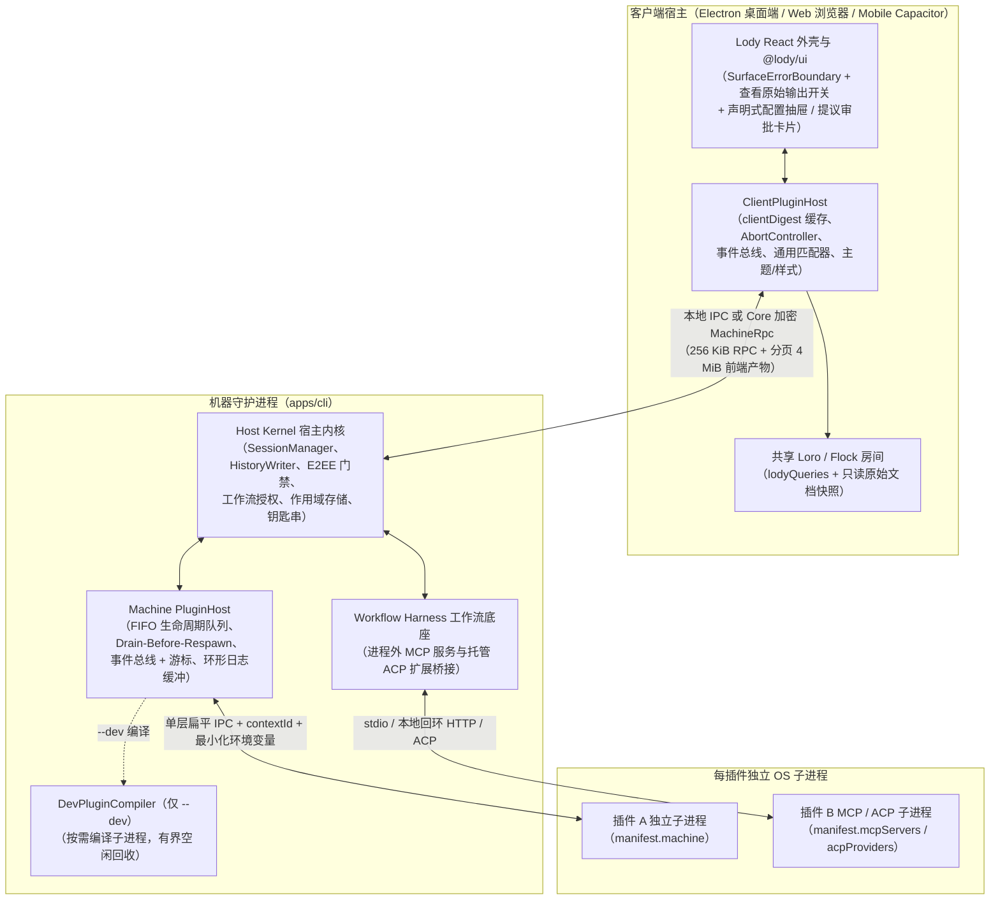

# Lody 插件系统正式规范

Status: draft
Translation: current

[English](plugin-system.md)

本文档是 Lody 插件系统的正式、可直接作为工程实现与验收依据的**规范性说明（Normative Specification）**。本规范将**极简、故障即停（Fail-Stop）的单插件独立 OS 子进程运行时底座**与**无需 Fork Lody 的高可塑性 Agent Workspace 扩展契约**深度结合——完整覆盖扩展性契约（Extensibility Contract）、工作区数据与原始只读状态快照、进程生命周期状态机、开发者体验契约（Developer Experience Contract）、终端用户体验契约（End-User Experience Contract）以及端到端加密（E2EE）安全不变量。

关于上述边界收敛背后的对抗性架构评审依据，详见 [插件架构收敛与 E2EE 工作区边界](../.agents/notes/proposed/architecture/2026-11-22-plugin-architecture-and-e2ee-boundaries.zh.md)。

---

## 1. 规范用语与一致性画像（Normative Language & Conformance Profiles）

本文档中的英文大写关键词 **MUST**、**MUST NOT**、**REQUIRED**、**SHALL**、**SHALL NOT**、**SHOULD**、**SHOULD NOT**、**RECOMMENDED**、**MAY** 与 **OPTIONAL** 严格按照 RFC 2119 与 RFC 8174 解释。

### 1.1 一致性画像（Conformance Profiles）

验证与实现合规性划分为四档画像（详见第 16 章）：

- **Core Conformance（`REQUIRED` 必选核心合规）：** 同时强制覆盖 **桌面端（`Electron`）**、**Web 浏览器端（`web`）**、**无头守护进程端（`headless`）** 以及 **移动端 Capacitor（`apps/mobile-capacitor` 的内联卡片、事件与声明式配置）**。涵盖包校验、单插件子进程隔离、`Drain-Before-Respawn`、单层 IPC（携带 `contextId` 的 `host_call`）、双路径客户端产物分发（钉死版本的 `npm` `.tgz` Web 零机冷启动 + `MachineRpc` `plugin/bundle-chunk` `<= 4 MiB` + `clientDigest` 信任门禁与托管 IndexedDB 持久化）、`npm` 机主自有机器同步 vs `local` 纯本机归属及多机动态 RPC 路由、宿主事件总线（`client` + `machine` + 本地游标续传）、Command Palette / Slash Commands / 客户端签名前 `beforeSend` / `lody.ui` 基础反馈原语、通用工具（`replace` + 可叠加 `enhance`）与结构化消息块渲染器、路由化自定义页面（`screens`、`project.pages`、`session.panels` 分栏面板）、三层侧边栏 + 轻量化 Session/Message/StatusBar 槽位、双层主题与 `@layer lody-plugin` 托管 CSS、Workflow `agentRoles` + `skills` + `mcpServers`、双层工作区数据读取（Tier-1 归一化 `lodyQueries` + 跨端同步 `annotations` + 宿主托管作用域 `storage`；Tier-2 显式 Opt-in 的 `unstable` 白名单快照）、声明式 `manifest.config`（含 `project` 作用域）+ 三层自定义设置页面（`workspace` / `machine` / `project` + 宿主托管 `<PluginSecretField />` + `lody.settings.open`）+ 首次启用 `onboarding` + 显式 `manifest.permissions`、机器所有者远程 `plugin/control`、Agent 辅助创建与 `lody_plugin` `propose_*` 人类确认卡片，以及双模型 E2EE 安全门禁（活跃回合内 `SignedTurnOrigin` 派生 + 机主签发 `DeclaredWorkflowGrant`）。
- **Workflow Provider Conformance（`Conditional` 条件合规）：** 当启用 `manifest.acpProviders`（声明式桥接至 Lody 既有的托管 ACP 扩展契约 `LodyAI/acp-extension-core` 与 `acp-session-start-gate.ts`）时 **REQUIRED**。与 Core 解耦，使自定义 ACP 运行时完整复用原生认证、非 Node 二进制与能力缓存，而非另造简陋启动器。
- **Mobile Extended UI Conformance（`Conditional` 条件合规）：** 当移动端宿主声明 `HostCapabilities.containers.sidebarViews`、`sessionPanels`、`screens` 或 `projectPages` 为 `true`（在移动端抽屉/半屏容器中挂载外壳视图）时 **REQUIRED**。
- **Real Integration Profile（投产发布 `REQUIRED` 必选真实集成验证）：** 零 Mock 的真实 OS 子进程（`SIGTERM`/`SIGKILL`、崩溃与 `--dev` 编译器回收）以及跨端（Electron + 无头 Web + 移动视口）真实 E2E 验收套件（第 16.8 节）。

### 1.2 实现自定义项（Implementation-Defined Items）

以下内容属于明确的 **Implementation-defined** 范畴，插件代码 **MUST NOT** 对其产生隐式耦合：

- 宿主内部存储插件启用标记、作用域 KV 存储、`SessionCreationReceipt` 回执、`DeclaredWorkflowGrant` 授权、`plugin_proposal` 审批状态及信任记录的 SQLite/KV 表结构与路径。
- 在公开的 `@lody/ui` 组件与文档化 `--*` CSS 变量之外的宿主内部 React Fiber 树、类名与 DOM 层级。
- Node `stdio[3]` IPC 通道底层的序列化帧细节（只要无损保留第 9.1 节定义的全部逻辑信封即可）。
- `--dev` 编译子进程内部使用的具体打包器（`esbuild`、`rolldown` 或 `swc`）及空闲回收间隔（只要满足第 8.4 节的环境纯净度与有界空闲/退出清理约束即可）。

---

## 2. 问题陈述、产品愿景与目标（Problem, Product Vision & Goals）

### 2.1 问题陈述与产品北极星

Lody 是横跨本地与远程多机器、同时服务 Desktop、Web 与 Mobile 的 AI 原生多 Agent 工作空间。如果插件系统只提供静态 React 槽位与插件私有 RPC，Lody 就会退化为传统的 CRUD 扩展宿主——一旦开发者想做全局音效反馈、将 Claude/Codex/MCP 的工具输出改造为交互式界面、封装像 Sorbet Super Assistant 一样的完整多 Agent 工作流，或者搭建全自由度工作区指挥台，就只能被迫去 Fork Lody。反过来，如果在运行时底座里让多个插件挤进共享 Worker 并堆砌 Canary 故障复现与静默自动重试，又会拖垮核心守护进程的稳定性。

**产品北极星：** 开发者 **MUST** 能够在**无需 Fork Lody** 的前提下把 Lody 塑造成自己想要的产品；同时底层运行时严格保证任何故障插件都不会卡死守护进程、不会静默污染状态、也不会削弱 E2EE 密码学边界。

### 2.2 核心目标（Goals）

1. **零 Fork 全域可塑性：** 一等公民地支持客户端与机器侧宿主事件订阅（含本地游标续传与长驻后台服务）、Command Palette、Slash Commands、客户端签名前 `beforeSend`、跨工具（`replace` + 可叠加 `enhance`）/结构化消息块通用渲染器（强制附带“查看原始输出”逃生开关）、三层正交侧边栏 + Session/Message/StatusBar 轻量槽位、全屏工作台、双层主题 + `@layer lody-plugin` 托管 CSS，以及完整 Workflow 组合（`agentRoles`、`skills`、`mcpServers`、条件托管 `acpProviders`）。
2. **双层读取、宿主托管存储与受控单点写入：** 以 Tier-1 归一化 `lodyQueries`、跨端同步的实体 `annotations` 及宿主托管原子 `storage` 覆盖主流需求，同时保留显式 Opt-in 的 Tier-2 **`unstable` 白名单快照逃生舱**（`lody.unstable.readSnapshot` / `useUnstableLodySnapshot`），让重度客制化插件不撞墙，也不把内部 CRDT 存储结构焊死进 SemVer `^1.0.0`，并始终保持 `HistoryWriter` 与内核命令作为唯一写路径。
3. **完整的开发者与用户体验闭环：** 快捷脚手架创建、Desktop 与 Web 同步热重载预览、结构化插件诊断面板、声明式 `manifest.config` + 显式 `manifest.permissions` + 首次使用引导抽屉，以及由人类点击确认 `plugin_proposal` 卡片门禁的 Agent 辅助造插件流程。
4. **跨设备一等体验与清晰的多机归属：** 工作区/用户级纯前端插件按工作区单实例挂载且不因单机离线消失；机器级插件按机路由 RPC 并对工作区级 UI 贡献去重；同一套 `@lody/plugin-sdk/client` 产物经 `useHostCapabilities()` 统一运行于 Electron、Web 与 Mobile Capacitor。
5. **严格的 OS 进程隔离与清晰的双模型 E2EE 完整性：** 每个 `machine` 插件独占子进程（纯前端插件 `0` 子进程）、`Drain-Before-Respawn`、读写 `0` 次自动重试（中断副作用返回 `outcome_unknown`），以及在 E2EE 下严格分离活跃回合内 `SignedTurnOrigin` 派生与机主签发 `DeclaredWorkflowGrant` 后台自动化授权。

### 2.3 非目标与禁止的反模式（Non-Goals & Anti-Patterns）

- **不可信恶意代码沙箱：** 插件属于用户主动信任的代码；Lody 不构建 V8 Isolate 或 WASM 安全监狱来运行恶意软件。单个机器插件子进程内，宿主侧 `ActorContext` 用于防止跨调用误用权限，而非防进程内恶意对抗。
- **Agent 未经人类确认静默安装/启用代码：** Agent **MAY** 生成插件源码并通过 `lody_plugin` 发起安装/启用提议，但 **MUST NOT** 在未经人类显式确认的情况下激活可执行代码或写入密钥。`LODY_AGENT_SESSION_ID` 等环境变量仅作为防误触协作护栏，绝不构成针对具备 Shell 能力 Agent 的安全边界。
- **签名后静默篡改提示词（`machine.beforeSessionTurn`）：** 在个人设备完成 `memberInput` 签名后由守护进程静默拼接提示词会破坏 E2EE 提示词完整性，**MUST NOT** 存在；提示词/上下文增强应发生在客户端签名之前（`lody.composer.beforeSend`）。
- **直接暴露可变 CRDT / Loro 内部句柄或黑名单脱敏裸树导出：** 插件读取 Tier-1 归一化查询或 Tier-2 白名单投影冻结快照并通过内核命令写入；禁止直接暴露可变 CRDT 容器或用黑名单过滤后整树吐出内部存储文档。
- **单机多插件共享 Worker、Canary 归因与静默自动重试：** 严禁多插件共驻同一 Worker 或对失败的插件调用做后台自动重试。

### 2.4 信任模型与权限主体（Trust & Principal Model）

| 权限主体                           | 授权范围与边界                                                                                                                                                                                        |
| ---------------------------------- | ----------------------------------------------------------------------------------------------------------------------------------------------------------------------------------------------------- |
| **机器所有者（Machine Owner）**    | 拥有该机器守护进程的完整控制权：审批 `plugin_proposal` 卡片、安装/启用/禁用/卸载插件、配置 `machine` 级密钥，并调用 `'machine'` 作用域接口。                                                          |
| **工作区协作者（Collaborator）**   | 可在 Desktop、Web 或 Mobile 端运行已获信任 `clientDigest` 的前端插件，并仅在获得 `MachineSharing`（E2EE 下）或工作区成员授权的机器与绑定项目上调用 `'project'` / `'session'` 处理器与有根工作流事件。 |
| **工作区只读访客（Guest `read`）** | 只读观察者。可查看历史记录中 `<= 16 KiB` 的内联快照及已授权 `lodyQueries` / 快照，但在 E2EE 工作区中 **MUST NOT** 触发动态 `machine` 插件执行或会话写操作。                                           |
| **编码 Agent（ACP / MCP）**        | 可调用已启用的 `defineTool` 与插件 `mcpServers` 工具，并 **MAY** 调用 `lody_plugin`（`list`、`inspect`、`diagnostics`、`scaffold`、`propose_*`），但 **MUST NOT** 绕过人类确认直接启用可执行插件。    |

---

## 3. 系统架构与跨设备运行拓扑（System Architecture & Cross-Device Topologies）

### 3.1 核心组件



1. **`Host Kernel`：** 负责 Session 生命周期、`HistoryWriter`、超大工具输出的宿主托管产物溢出存储、托管作用域插件 KV `storage`、`SessionCreationReceipt` 持久化、机主签发的 `DeclaredWorkflowGrant` 授权账本、`plugin_proposal` 审批账本、声明式 `manifest.config` 与钥匙串密钥托管、E2EE 授权/执行意图校验，以及带本地单调自增序号日志的规范化 Session/Turn/Tool 事件发射。
2. **`Machine PluginHost`：** 负责插件发现、清单校验、单插件独立 `child_process.fork` 生命周期（`onStart`、长驻 `service`、`onUpgrade`、`onUninstall`）、`Drain-Before-Respawn`、单层 IPC 路由、有界机器侧事件扇出与游标续传及环形日志缓冲。
3. **`Workflow Harness`：** 将插件声明的 `agentRoles`、`skills`、进程外 `mcpServers` 及（`Workflow Provider Conformance`）托管 `acpProviders` 注册进 Lody 原生 Role/Skill/MCP/ACP 子系统，且绝不在守护进程主进程内执行任何 MCP 或 ACP 代码。
4. **`DevPluginCompiler`：** 仅对 `--dev` 插件按需拉起的编译子进程；负责编译 TS/TSX、重算 `clientDigest`、向已连接的 Desktop 与 Web 客户端同步推送热更新，并在有界空闲期后自动退出（实现自定义空闲窗口，如开发态默认 `30 s`，且随 `PluginHost` 关闭立即回收）。
5. **`ClientPluginHost`：** 在 Electron、Web 浏览器与 Mobile Capacitor WebView 中统一运行；区分工作区级纯前端插件与机器级配套产物、对多机同名插件的工作区级 UI 贡献去重、校验 `clientDigest` 信任、执行 `client.js`、挂载 `events`、`commands`、`composer.slashCommands` / `beforeSend`、通用 `tools.matchRender`（`replace` + `enhance`）/ `messages.renderBlock`、侧边栏、轻量槽位、全屏页、`themes`、`@layer lody-plugin` `styles` 与 `useHostCapabilities()`，并执行零泄漏销毁。

### 3.2 模块边界不变量

- **主守护进程零插件代码执行：** `manifest.machine`、`manifest.mcpServers` 与 `manifest.acpProviders` 均 **MUST NOT** 在主守护进程内被 `import()` 或执行。
- **纯前端/资源插件零子进程：** 仅声明 `client`、`themes`、`styles`、`assets`、`config` 或 `skills` 而未声明 `machine` 的插件 **MUST** 以 `0` 个 `PluginHost` 子进程运行。
- **唯一写入口：** 插件可自由读取类型化查询与只读原始文档快照，但一切持久化工作区/会话写操作 **MUST** 经由内核命令（`sessions.*`、`HistoryWriter`、`config.set`）完成。

### 3.3 跨设备运行拓扑规范

| 运行拓扑                                                     | 前端产物分发方式                                                                                                                               | 激活的 UI 扩展面                                                                                                                                                                                                                                                 | 机器侧执行路径                                                                     |
| ------------------------------------------------------------ | ---------------------------------------------------------------------------------------------------------------------------------------------- | ---------------------------------------------------------------------------------------------------------------------------------------------------------------------------------------------------------------------------------------------------------------- | ---------------------------------------------------------------------------------- |
| **`desktop`（`Electron`）**                                  | 托管缓存 → 本地已校验产物、钉死版本 `npm` `.tgz` 或远程 `MachineRpc` `plugin/bundle-chunk`（`Core`）                                           | 全部 Core 内联扩展 + 路由化外壳容器 `containers`（`sidebarViews`、`sessionPanels` 分栏面板、`screens`、`projectPages`）+ 三层自定义设置（`workspace`、`machine`、`project`）                                                                                     | 本地或远程 `WorkspaceMachineRpcFacade`                                             |
| **`web`（浏览器）**                                          | 托管 IndexedDB 缓存 → 直连 CORS 钉死版本 `npm` `.tgz`（`0` 机器在线亦可用）或回退远程 `MachineRpc` `plugin/bundle-chunk`（`<= 4 MiB`，经 `clientDigest` 校验，**纳入 `Core`**） | **与 `desktop` 100% 对等**（全部 Core 内联扩展 + 路由化外壳容器 + 三层自定义设置 + 机主远程 `plugin/control`）                                                                                                                                                   | 远程 `WorkspaceMachineRpcFacade`                                                   |
| **`mobile`（`apps/mobile-capacitor`，iOS 16.4+ / Android）** | 托管缓存 → 直连钉死版本 `npm` `.tgz` 或远程 `MachineRpc` `plugin/bundle-chunk`（`Core`）                                                       | `Core`：会话/输入栏内联扩展（`tools`、`messages`、`composer`、`sidebar.sessionRow`）、`events`、声明式 `manifest.config` 与工作区设置。`Conditional`：通过 `useHostCapabilities()` 协商开放外壳容器 `containers`（`sidebarViews`、`sessionPanels` 抽屉、`screens`、`projectPages`） | 远程 `WorkspaceMachineRpcFacade`                                                   |
| **`headless`（`CLI`）**                                      | 跳过前端产物加载                                                                                                                               | 不适用                                                                                                                                                                                                                                                           | 完整支持 `machine`、`events`、`agentRoles`、`skills`、`mcpServers`、`acpProviders` |

---

## 4. 核心领域模型与标识符规范（Domain Model & Stable Identifiers）

### 4.1 核心实体

- **`WorkspacePluginEntry`：** 同步在工作区内的已发布 `npm` 插件注册记录（E2EE 工作区下存于加密 Workspace Loro 文档内）：`{ plugin_id, source: { kind: 'npm', package_name, exact_version, integrity }, client_digest?, manifest_summary, permissions[], config_schema, enabled, machine_sync: 'manual' | 'owner_machines', sync_owner_user_id?, sync_signature? }`。使 Web/Mobile 端无需在信任前发出任何外部网络请求即可展示权限披露，并在 `0` 机器在线时完成冷启动加载。
- **`PluginInstallation`：** `{ plugin_id, version, scope: 'workspace' | 'machine', source: { kind: 'npm', package_name, exact_version, integrity } | { kind: 'local', origin: 'dir' | 'dev' | 'archive' | 'github' }, root_dir, manifest, enabled, lifecycle_state, client_digest, config_values, secret_keys_present, granted_permissions[], workflow_grant?, active_instance?, workflow_registrations, diagnostics[], logs_ring }`。
- **`MachinePluginInstance`：** `{ instance_id, pid, started_at_ms, registered_handlers, event_subscriptions, has_background_service, inflight_calls }`。
- **`ClientPluginInstance`：** `{ plugin_id, source_key: 'workspace' | 'local' | 'machine:<id>', client_digest, state, abort_controller, cleanup_fn?, contributions, style_elements[], query_cache }`。
- **`DeclaredWorkflowGrant`：** 由机器所有者签发且可随时撤销的工作流授权记录 `{ grant_id, workspace_id, machine_id, plugin_id, allowed_ops[], allowed_project_ids: string[] | '*', allowed_role_ids: string[] | '*', issued_by_user_id, issued_at_ms, signature }`，用于授权回合外的守护进程自动执行（`session.turn.completed`、`onStart`、`machine.service`、`sessions.respondInteraction`）。
- **`PluginProposalRecord`：** `{ workspace_id, machine_id, request_id, proposing_session_id, plugin_id, source_dir_or_pkg, manifest_summary, requested_permissions[], status: 'pending' | 'approved' | 'rejected' | 'superseded', resolved_by_user_id?, resolved_at_ms? }`。
- **`SessionCreationReceipt`：** 按 `(workspace_id, caller_user_id, target_key, plugin_id, request_id)` 持久化的幂等建会回执及活跃 `business_key` 预留记录（第 7.3 节）。

### 4.2 稳定标识符、规范化与摘要规则

1. **`plugin_id`：** **MUST** 匹配 `^[a-z0-9]+(?:-[a-z0-9]+)*$`（`1..64` 位 ASCII 字符，严禁包含 `_`）。
2. **`descriptor_id` / `contribution_id`：** **MUST** 匹配 `^[a-zA-Z0-9]+(?:[._-][a-zA-Z0-9]+)*$`（`1..96` 位）且 **MUST NOT** 包含 `__`。
3. **无损双射命名空间：**
   - 插件 `defineTool` MCP 名称：`plugin__<plugin_id>__<tool_id>`。
   - 插件 `agentRoles` ID：`plugin:<plugin_id>:<role_id>`。
   - 插件 `mcpServers` ID：`plugin:<plugin_id>:<mcp_id>`。
   - 插件 `acpProviders` ID：`plugin:<plugin_id>:<provider_id>`。
4. **`clientDigest`：** 对 `manifest.client` 及全部打包的 `themes`、`styles`、`assets` 相对路径与原始字节带长度前缀计算的 `SHA-256` 小写十六进制摘要（`"lody-client-bundle-v1\0"` 帧头）；仅当无前端产物、主题与样式时省略（`undefined`）。
5. **路径越界防护：** 所有清单路径与 `ctx.dataDir` 文件路径经 `realpath` 解析后 **MUST** 严格位于 `root_dir` 或 `data_dir` 内部；含 `..` 遍历或符号链接逃逸的路径在 I/O 前一律拒绝。

---

## 5. 插件包格式、清单与公开 SDK 契约（Package Format, Manifest & SDK Contract）

### 5.1 插件包目录结构与运行环境纯度

- **前端产物（`manifest.client`）：** 面向 ES2023 + Safari/WKWebView 16.4（`apps/mobile-capacitor/AGENTS.md`）的单文件纯浏览器 ESM 产物。**MUST NOT** 导入 `@lody/plugin-sdk/machine` 或 Node 内置模块（`node:*`）；`react`、`react/jsx-runtime`、`zod`、`@lody/ui` 与 `@lody/plugin-sdk/*` 由 `ClientPluginHost` 外部化注入。
- **机器侧入口（`manifest.machine`）：** 面向 Node >= 22 的 ESM 产物。**MUST NOT** 导入 `@lody/plugin-sdk/client` 或引用 DOM 全局对象（`window`、`document`）。

### 5.2 清单 Schema、声明式配置、显式权限与工作流贡献（`lody.plugin.json`）

`lody.plugin.json` **MUST** 是符合 [`PluginManifest`](../scripts/fixtures/plugin-sdk/sdk/manifest.d.ts) 的严格 UTF-8 JSON：

- **必填项：** `id`、`version`（合法 SemVer）、`sdk`（按标准 SemVer 范围与宿主 SDK 版本匹配——如预览期 `"^0.1.0"`、稳定后 `"^1.0.0"`，严禁硬编码单一字面量）、`title`，且至少声明一项贡献（`client`、`machine`、`skills`、`agentRoles`、`mcpServers`、`acpProviders`、`themes` 或 `styles`）。未知顶层字段 **MUST** 校验失败。
- **显式能力权限声明（`manifest.permissions`）：**
  - 高权限宿主能力 **MUST** 在 `manifest.permissions` 中显式声明，绝不因存在 `manifest.machine` 而隐式默认授予：
    - `sessions.write`（`sessions.create`、`sessions.send`、`sessions.requestStop`、`sessions.requestArchive`、`sessionFork`）
    - `sessions.approve`（`sessions.respondInteraction` —— 结算 ACP 权限或问答提示）
    - `workflow.autonomous`（在活跃人类回合之外调用 `sessions.*` —— 包括 `session.turn.completed`、`onStart` 与 `machine.service` —— 由机主签发的 `DeclaredWorkflowGrant` 支撑）
    - `unstable.rawState`（Tier-2 显式 Opt-in 访问 `lody.unstable.readSnapshot` / `useUnstableLodySnapshot`）
  - 未声明且未获批准却调用受控操作时 **MUST** 返回 `forbidden`。
- **声明式 `config` 与首次引导 `onboarding`：**
  - 支持 `string`、`secret`、`number`、`boolean` 与 `select` 五种字段类型，以及 `scope: "client" | "machine" | "project" | "both"`。
  - 凡是 `type: "secret"` 的字段，`scope` **MUST** 为 `"machine"`（省略时默认为 `"machine"`）；任何将 `secret` 声明为 `"client"`、`"project"` 或 `"both"` 的清单 **MUST** 在校验阶段直接拒绝（`manifest_invalid`）。
  - `onboarding` 列出首次启用时由宿主原生首次配置引导抽屉收集的 `config` 键名（统一收敛至 `manifest.config`，不再并存重复的 `manifest.env`）。
- **工作流字段：** `skills`（`skills/<name>/SKILL.md`）、`agentRoles`（绑定 `promptPath`、`skills`、`mcpServers` 与 `defaultProvider`）、`mcpServers`（v1 Core 面向 `stdio` 进程外入口；`http` 传输须满足宿主显式本地回环端口与就绪握手契约）与 `acpProviders`（条件声明式桥接至 Lody 托管 ACP 扩展契约）。

### 5.3 规范性字节与资源预算上限

| 常量 / 资源                           | 上限                      | 强制执行边界                                                                                          |
| ------------------------------------- | ------------------------- | ----------------------------------------------------------------------------------------------------- |
| `MAX_PLUGIN_RPC_REQUEST_BYTES`        | `262,144`（`256 KiB`）    | 单次请求 UTF-8 上限；适配单个 `1 MiB` E2EE Iroh `purpose 8` 帧。                                      |
| `MAX_INLINE_PLUGIN_TOOL_OUTPUT_BYTES` | `16,384`（`16 KiB`）      | `HistoryWriter` 内联写入上限；`16 KiB .. 2 MiB` 产物由宿主自动溢出至托管回合产物存储并写入内联摘要。 |
| `MAX_UNSTABLE_SNAPSHOT_BYTES`         | `524,288`（`512 KiB`）    | 单次 `lody.unstable.readSnapshot` 切片序列化硬上限；防止 `256 MiB` 子进程 IPC OOM 或主线程卡顿。     |
| `MAX_PLUGIN_ANNOTATION_BYTES`         | `4,096`（`4 KiB`）        | 每个插件在单个 Session 或 Project 上跨端同步的 `annotations[plugin_id]` 元数据上限。                  |
| `MAX_PACKED_CLIENT_BUNDLE_BYTES`      | `4,194,304`（`4 MiB`）    | `client.js` + `themes`/`styles`/`assets` 总包上限；按 `256 KiB` `purpose 9` 分片传输。                |
| `MAX_SUBPROCESS_LOG_RING`             | `500` 行 / `262,144` 字节 | 每插件守护进程环形日志缓冲（单行 `<= 16 KiB`）。                                                      |

### 5.4 SDK 模块导出与双向 Schema 校验

合规宿主 **MUST** 公开与 [`scripts/fixtures/plugin-sdk/sdk/`](../scripts/fixtures/plugin-sdk/sdk/shared.d.ts) 一致的 `@lody/plugin-sdk`、`@lody/plugin-sdk/client`、`@lody/plugin-sdk/machine` 与 `@lody/plugin-sdk/manifest`。所有 `defineQuery`、`defineMutation`、`defineTool` 与 `defineAttachmentSource` 调用在输入与输出两端均 **MUST** 执行 Zod `safeParse`；校验失败返回 `validation_failed`，绝不导致子进程崩溃。

---

## 6. 扩展性契约：事件总线、命令与输入钩子、通用渲染器与工作流组合（Extensibility Contract）

### 6.1 宿主生命周期与 UI 交互事件总线

合规宿主 **MUST** 在 `ClientPluginRegistry.events.on` 与 `MachinePluginRegistry.events.on` 两端同时提供一等公民的推送式事件总线，使插件无需借助 DOM 监听或轮询 Session 状态即可构建实时响应逻辑：

1. **规范化会话与 Agent 生命周期事件（`MachineHostEventMap` —— 机器侧与客户端共享）：**
   - `session.created`、`session.archived`、`session.status.changed`、`session.turn.started`、`session.turn.completed`（含 `agentRoleId?`、`stopReason`: `"end_turn" | "cancelled" | "error" | "max_tokens" | "unknown"` 与 `durationMs`）、`session.tool.started`、`session.tool.completed`（携带归一化 `ObservedToolCall`）、`session.waiting_input`（携带 `PendingInteractionSummary`：`{ requestId, turnId?, kind: "permission" | "elicitation", title?, options }`）以及 `session.interaction.resolved`（`{ requestId, turnId?, kind, outcome }`，使 Slack/Telegram/飞书等远程审批桥接在桌面/移动端完成审批后可同步更新或清理外部按钮消息）。
2. **客户端本地交互事件（`ClientHostEventMap` —— 仅客户端）：**
   - `ui.message.submitted`、`ui.session.switched`、`ui.interaction.resolved` 与 `ui.command.invoked`。
3. **投递、背压、游标续传与回收规则：**
   - 事件投递采用**非阻塞观察者扇出（Observer Fan-out）**：插件 A 的慢回调或抛错 **MUST NOT** 延迟宿主 Session 执行、阻塞 UI 交互或影响插件 B 接收同一事件。
   - 机器侧事件投递 **MUST** 具备有界队列深度，且 **MUST NOT** 让缓慢的 `session.tool.completed` 回调队头阻塞高优先级控制事件（`session.waiting_input`、`session.interaction.resolved`、`session.turn.completed`）；单个事件处理器受 `30_000 ms` 超时约束（超时或关闭时触发 `ctx.signal` 中止），同一事件类型注册多个监听器时叠加触发而非相互覆盖。
   - **本地单调事件游标（`resumeFromCursor`）：** 守护进程在受托管作用域约束的本地 SQLite 有界环形表中记录近期 `MachineHostEventMap` 信封及单调 `seq` 序号，使 `machine.events.on(type, handler, { resumeFromCursor: true })` 在守护进程重启/重载后可按序重放遗漏事件（经 `SessionCreationReceipt` 与 `ctx.storage` 幂等去重），无需每个工作流插件手写 200 行全历史分页扫描。
   - 客户端插件禁用或 `clientDigest` 热替换时，`abort_controller.abort()` **MUST** 自动摘除该实例注册的全部事件监听器。
4. **正交静态资源、生命周期与基础 UI 反馈原语（`lody.assets.url`、`lody.signal`、`lody.ui`）：**
   - `lody.assets.url(relativePath)` 在 Electron 本地协议、Web `plugin/bundle-chunk` 缓存与 Mobile Capacitor WebView 下统一解析打包在 `assets/*` 内的静态资源。
   - `lody.signal: AbortSignal` 在插件禁用或 `clientDigest` 热替换时自动中止，使插件可直接组合标准 Web 平台原语（`AudioContext` / `HTMLAudioElement`、`Canvas`、`fetch`、定时器等）并在卸载时确定性回收资源，无需在 SDK 中为具体业务场景堆砌非原语命名空间（如 `lody.audio`）。
   - `LodyClient.ui` 提供基础宿主反馈原语：`toast`、`confirm`、`openExternalUrl` 与 `copyToClipboard`。

### 6.2 通用工具调用匹配渲染与结构化消息块渲染

插件 **MUST NOT** 被局限于仅能渲染自己注册的 `defineTool`：

1. **自有工具强类型渲染（`tools.render(tool, Component)`）：**
   - 精确匹配 `plugin__<plugin_id>__<tool.id>`，经 Zod `safeParse` 后在 `{ status: "running", output?: undefined }` 与 `{ status: "completed", output: TOutput }` 间收窄类型。
2. **跨 Provider 通用工具调用匹配渲染（`tools.matchRender(spec)`）：**
   - 通过 `ToolCallMatcher`（`toolNames`、`mcpServer`、`acpKinds`、受防回溯保护的 `commandPattern` 以及纯函数谓词 `when(call)`）匹配内置工具、ACP 工具（Claude Code、Codex、Antigravity、自定义 ACP）及任意 MCP 工具。
   - **模式分离（`replace` 唯一胜出 vs `enhance` 可叠加增强）：**
     - **`mode: "replace"`（默认）：** 按以下顺序选出唯一主渲染器：（1）用户在设置中指定的逐工具渲染器覆盖项；否则（2）插件自有工具 `tools.render`；否则（3）最高 `priority`（默认 `0`），平局按 `(plugin_id ASC, source_key ASC, spec.id ASC)` 字典序确定性决出。被遮蔽的 `"replace"` 匹配器在插件诊断面板（第 11.3 节）中记录 `matcher_shadowed`。
     - **`mode: "enhance"`：** 不参与唯一胜出竞争；所有命中的 `"enhance"` 渲染器按 `(priority DESC, plugin_id ASC, source_key ASC, spec.id ASC)` 顺序作为附加信息/操作块叠加挂载，并分别由 `SurfaceErrorBoundary` 独立隔离。
3. **结构化消息块渲染与稳定块身份（`messages.renderBlock(spec)`）：**
   - 匹配语言标签命中 `spec.languages` 的助手 fenced 代码块（如 `sorbet-plan`、`test-report`、`openapi-preview`），向组件传入 `turnId`、确定性块身份 `blockId = "<turnId>:block:<ordinal>"`（该助手回合内 fenced 代码块的 `0` 起始出现序号）、`code`、`meta` 以及 `streaming`（流式生成时为 `true`，围栏闭合后为 `false`）。
   - **有状态增量更新（Stable Block Identity + Stateful Incremental Updates）：** `ClientPluginHost` **MUST** 按 `(session.sessionId, blockId, winner.plugin_id, winner.id)` 维护消息块组件挂载键——**MUST NOT** 将 `code`、`meta`、`streaming` 或临时 AST 节点引用混入挂载 Key。在同一个代码块持续流式输出以及 `streaming: true -> false` 闭合过程中，宿主 **MUST** 保持已挂载的 React 组件实例并原地增量更新 Props，确保插件内部维护的表单输入、图表缩放、选中项或 `useRef` / Canvas 状态绝不因流式刷新而被重置；仅当用户切换“查看原始 Markdown”、`SurfaceErrorBoundary` 捕获渲染崩溃、胜出渲染器/`clientDigest` 热替换或所属回合/会话卸载时才卸载组件。
4. **强制“查看原始输出”逃生开关与 `ai-gui` 布局不变量：**
   - 凡是挂载 `"replace"` 模式的 `tools.matchRender` 或 `messages.renderBlock`，宿主外壳 **MUST** 在插件子树外部渲染不可被插件伪造或隐藏的头部切换按钮（**“查看原始输出 / 查看原始 Markdown”**），并以 `SurfaceErrorBoundary` 包裹插件组件。
   - 遵循 [`packages/components/src/components/ai-gui/AGENTS.md`](../packages/components/src/components/ai-gui/AGENTS.md)：插件工具/消息块渲染器 **MUST NOT** 向正文专用搜索索引注入 `searchBlockId`、**MUST NOT** 在折叠活动组内制造嵌套全高滚动陷阱，且必须保持回合折叠与对齐轨道不变量。

### 6.3 命令面板、签名前输入钩子、路由化自定义页面、三层正交侧边栏与跨设备能力协商

1. **命令面板、Slash Commands 与客户端签名前输入钩子：**
   - `commands.register({ id, title, shortcut?, when?, run })`：向 Lody 命令面板（`Cmd+K`）及非冲突快捷键注册插件动作。
   - `composer.slashCommands.add({ name, description, run })`：在输入栏注册可执行动作的 `/command` 触发器（展开草稿、触发插件流或打开界面）。
   - `composer.beforeSend(handler)`：在用户个人设备完成 E2EE `memberInput` **签名之前**执行的客户端钩子（支持用户可见的 Working Memory / 上下文注入、模板展开或 PII 敏感信息检查，100% 保持 E2EE 完整性，精准补齐禁止守护进程侧 `machine.beforeSessionTurn` 后的缺口）。任何改写结果 **MUST** 反映在最终签发提交的用户输入中，并受交互短时限（`<= 3000 ms`，用户可取消）约束。
2. **路由化自定义页面（`screens`、`project.pages`、`session.panels`）：**
   - 宿主 **MUST NOT** 将 `screens`、`project.pages` 与 `session.panels` 混为一谈地塞进单一全局 `<Dialog>` 弹窗；三者须对应各自独立的空间形态与一等公民 URL 路由（支持浏览器前进/后退、刷新保留、收藏书签与协作者深链分享）：
     - **`screens.add({ id, title, icon?, nav?: "sidebar" | "command-only", order?, Component })`：** 挂载于主工作区 `<Outlet />`（宽屏下保留左侧 Sidebar，与 `/today`、`/schedules` 同级），路由为 `/$workspaceName/p/$pluginId/$screenId`，URL search params 与 `ScreenProps.params` 1:1 双向同步（经 `lody.screens.setParams(next, { replace? })` 更新）。声明 `nav: "sidebar"` 的页面由宿主统一收纳至侧边栏 **Apps / Plugins** 分区，自动联动当前路由高亮、移动端导航与 `Cmd+K`。
     - **`project.pages.add({ id, title, icon?, Component })`：** 挂载于项目上下文主视图并附带宿主面包屑头（`<Project> / <Page Title>`），路由为 `/$workspaceName/projects/$machineId/$projectId/p/$pluginId/$pageId`（同时可通过项目菜单与项目页签切换访问）。
     - **`session.panels.add({ id, title, icon?, Component })`：** 在宽屏 Desktop/Web 端作为会话右侧可拖拽 **Split Pane（分栏面板）** 与对话转录并排展示（移动端退化为 Bottom Sheet / Drawer），让用户边看 Agent 输出边操作面板而不遮挡对话，并同步至 `?panel=<pluginId>:<panelId>`。
   - **冷启动深链解析状态机：** Web 直接访问或刷新插件页面 URL 时 **MUST** 保留原 URL 与查询参数（严禁闪现 404 或踢回 `/chat`），并按需展示明确宿主态：`resolving`（加载 catalog/bundle 骨架屏）、`untrusted`（原地能力披露与 Trust 按钮，批准后原地挂载页面）、`source_offline`（仅 `local` 插件宿主机器离线时展示；`npm` 工作区页面在 `0` 机器在线时直接加载）、`disabled` / `not_installed`（引导启用或前往设置）以及 `safe_mode`（`?safeMode=1` 跳过提示）。
3. **三层正交侧边栏与轻量上下文槽位（基于 [`sidebar-surface.ts`](../packages/components/src/components/sidebar-surface.ts)）：**
   - `sidebar.sessionRow.decorate`：按 `(plugin_id, decorator_id)` 确定性叠加行尾徽章与悬停气泡；自定义 `sidebar.views.add` 树内渲染 `<SessionRow />` 时 **MUST** 自动继承全部活跃装饰器。
   - `sidebar.headerItems` / `footerItems`：使用 `<SidebarRow />` 的顶/底导航项，联动 `screens.add`。
   - `sidebar.views.add`：与宿主内置 `"Default"` 视图并列可选的自定义侧边栏主体；禁用当前视图时立即回退至 `"Default"`。
   - 轻量上下文槽位：`session.headerActions.add`（会话顶栏操作）、`messages.actions.add`（消息/回合底部操作）与 `statusBar.items.add`（状态栏紧凑指标）。
   - **贡献 ID 命名空间：** 传给 `lody.screens.open`、`lody.panels.openSession`、`lody.pages.openProject` 与 `lody.settings.open` 的未限定 ID 严格解析至调用插件自身命名空间（`<calling_plugin_id>:<id>`）；跨插件打开须显式使用 `<plugin_id>:<id>`。
4. **跨设备统一 API 与能力协商（`useHostCapabilities()`）：**
   - 开发者面向单一 `@lody/plugin-sdk/client` 编写跨端代码，通过 `useHostCapabilities()` 读取 `{ platform: "desktop" | "web" | "mobile", formFactor: "wide" | "compact", containers: { sidebarViews, sessionPanels, screens, projectPages } }`；其中 `containers` 与 `ClientPluginRegistry` 的外壳挂载命名空间严格 **1:1 对齐**，绝不混入具体业务特性开关或机器在线状态。
   - 会话与输入栏内联扩展（`tools`、`messages`、`composer`、`commands`、`sidebar.sessionRow`）、`events` 与 `manifest.config` 在 `desktop`、`web` 与 `mobile` 三端均属 `Core Conformance` 必有基线；`desktop` 与 `web` 在 Core 中同时开启全部外壳容器 `containers`（`sidebarViews`、`sessionPanels`、`screens`、`projectPages`），`mobile`（`apps/mobile-capacitor`）在启用 `Mobile Extended UI Conformance` 时开放上述外壳容器。在紧凑端注册未挂载的外壳容器 **MUST NOT** 抛错崩溃——宿主记录 `capability_unavailable_on_platform` 诊断并继续正常运行内联扩展、事件与配置能力。

### 6.4 双层外观体系（SemVer 主题令牌 + 宿主托管 CSS）

- **第一层 —— SemVer 稳定主题令牌（`manifest.themes`、`lody.themes.add`、`lody.themes.activate`）：** `PluginThemeSeedColors` + `PluginThemeTokens`（`fontSans`、`fontMono`、`radius`、`density`）经 [`vscode-theme-dom.ts`](../packages/components/src/lib/vscode-theme/vscode-theme-dom.ts) 与 [`vscode-theme-css.ts`](../packages/components/src/lib/vscode-theme/vscode-theme-css.ts) 派生根级 `--*` CSS 变量，在稳定主版本 SDK 周期内享受 **SemVer 兼容承诺**。
- **第二层 —— 宿主托管自定义样式表（`manifest.styles`、`lody.styles.add`）：** 按实例挂载包裹在 `@layer lody-plugin` 内的 `<style data-lody-plugin="<plugin_id>">`（级联优先级低于宿主关键外壳、`SurfaceErrorBoundary` 与“查看原始输出”逃生开关），禁用/热更新时自动移除、`lody --safe-mode` 一键旁路、绝不跨协作者自动传染，且不冻结宿主内部 React DOM 层级。

### 6.5 完整工作流组合（`agentRoles`、`skills`、`mcpServers`、`acpProviders`）

单个插件包 **MAY** 交付端到端的多 Agent 工作流：

1. **Skills（`manifest.skills`）：** 启用期间注入 Agent Role 选择器与 `CreateSessionRequest.skillIds`。
2. **Agent Roles（`manifest.agentRoles` —— `Core Conformance`）：** 注册为 `plugin:<plugin_id>:<role_id>`，整合系统提示词（`promptPath`）、内置 `skills`、内置 `mcpServers` 与默认 `defaultProvider`。在 Role 选择器中展示插件来源徽章；用户修改时生成用户侧覆盖副本，不污染原插件目录。
3. **进程外 MCP 服务（`manifest.mcpServers` —— `Core Conformance`）：** 按会话通过 Lody 标准 MCP 底座拉起独立子进程（遵循 [`apps/cli/src/agent/AGENTS.md`](../apps/cli/src/agent/AGENTS.md) 核心铁律：**MCP 工具绝不在守护进程主进程内运行**），仅注入最小系统环境变量及 `envKeys` 显式引用的本插件 `manifest.config` 键值。重型、长耗时或需强隔离的工具优先走 `manifest.mcpServers`（`stdio`），避免阻塞或撑爆插件的共享 `machine` 查询/事件子进程；`transport: "http"` 仅在实现宿主显式回环就绪与端口发现契约后允许启用。
4. **托管 ACP Agent 运行时桥接（`manifest.acpProviders` —— `Workflow Provider Conformance`）：** 声明式桥接至 Lody 既有的托管 ACP 扩展契约（`LodyAI/acp-extension-core`、`acp-session-start-gate.ts`、能力缓存与原生登录认证流），注册为 `plugin:<plugin_id>:<provider_id>`，避免另造一套残缺的纯 Node 启动器；支持原生二进制、外部 harness 与 OAuth 登录，无需 Fork `apps/cli/src/agent`。

---

## 7. 工作区数据、双层读取、托管存储与宿主能力契约（Workspace Data, Two-Tier Reads, Storage & Host Capabilities Contract）

### 7.1 第一层（Tier 1）—— 归一化类型化查询（`lodyQueries`）与跨端同步实体元数据（`annotations`）

`lodyQueries` 基于引用计数共享 Loro/Flock 房间、经归一化处理的 `sessionData`/Roost 读取器（透明屏蔽 legacy 行与 `updateCopies` 重复副本）与 `WorkspaceMachineRpcFacade` 提供 SemVer 稳定的响应式查询描述符：

- **工作区级（`WorkspaceRef` —— 不含单一 `machineId`，单机离线仍保持 `ready`）：** `machines`、`projects`、`agentRoles`、`agentConfigs`、`plugins`、`members`、`schedules`、`sessions`。
- **项目 / 机器级：** `gitState`、`worktrees`、`filePreview`、`pullRequests`、`skills` 及作用域过滤的 `sessions`、`schedules`。
- **会话级（`SessionRef`）：** `sessionDetail`、`sessionTurns`（分页完整归一化 `SessionTurnRecord`，含正文、思考、计划、用量、归一化 `ObservedToolCall[]` 与 `SubagentRunSummary[]`）、`subagentRun`（按需通过 `readSubagentRun` 读取子 Agent 转录）、`automations`、`sessionDiff`、`gitState`、`filePreview`。
- **跨插件 `businessKey` 隐私隔离：** 仅当 `createdByPluginId === calling_plugin_id` 时才填充 `SessionSummary.businessKey`。
- **插件命名空间元数据（`annotations[plugin_id]`）：** 插件可通过 `lodyCommands.sessionSetAnnotation` / `projectSetAnnotation` 在单个 Session 或 Project 上附加不超过 `4 KiB` 的 JSON 元数据。元数据随实体跨端同步并在 `SessionSummary` / `ProjectSummary` 中离线可读，彻底消除侧边栏徽章与工作流标签的逐行远程 `defineQuery` RPC 风暴。

### 7.2 第二层（Tier 2）—— 显式 Opt-in 的 Unstable 白名单只读快照（`lody.unstable.readSnapshot` / `useUnstableLodySnapshot`）

对照双层外观体系（第 6.4 节），Lody 为重度客制化插件（自定义指挥台、统计报表、前沿实验性视图）保留只读逃生舱，确保重度定制无需等待上游新增 Tier-1 字段或 Fork Lody——同时不将内部 CRDT 存储格式锁死进 `^1.0.0`，也杜绝黑名单漏脱敏隐患：

1. **显式 Tier-2 / Unstable 定位与权限门控：**
   - 挂载于 `lody.unstable.readSnapshot` / `useUnstableLodySnapshot`（机器侧为 `ctx.lody.unstable.readSnapshot`），须在 `manifest.permissions` 中显式声明 `"unstable.rawState"` 并在安装确认卡中向用户披露。
   - 明确位于 **SemVer 稳定契约之外**（与 `manifest.styles` 同级）：Lody 重构底层 Loro/Flock/Roost 存储 schema 时不承担永久兼容垫片义务。常规工作流与 UI 插件 **MUST** 优先使用 Tier-1 `lodyQueries`、事件载荷与 `annotations`。
2. **白名单顶层域投影（禁止整树黑名单脱敏）：**
   - 宿主 **MUST NOT** 将未过滤的内部 CRDT 原始文档整树导出再按黑名单删敏感字段（新增内部字段时极易静默泄露）。相反，每个 `UnstableSnapshotTarget` 直接复用现有 Loro/Flock 与 `sessionData`/Roost 读取器（零平行 Domain Store），仅按**显式字段白名单**投影公开领域集合（`sessions`、`projects`、`machines`、`roles`、`schedules`、`rateLimits`、`session-turns`）；未来新增的内部控制或凭据字段默认不可见。
3. **强制切片、按需懒物化与硬字节上限：**
   - 禁止无范围全工作区导出：`workspace-state` 与 `project-state` **MUST** 显式提供 `collection` / `path` 切片（必要时分页），`session-transcript` **MUST** 提供 `turnIds` 或有界 `limit` 窗口。
   - 无订阅时零分配；物化后的 `RawDocumentSnapshot`（`{ schemaVersion, revision, doc }`）**MUST** 脱离底层句柄、深度只读冻结（`Object.freeze`），并受 `MAX_UNSTABLE_SNAPSHOT_BYTES`（`512 KiB`）硬上限约束，避免阻塞 React 主线程或撑爆 `256 MiB` 机器子进程 IPC。

### 7.3 共享宿主命令注册表（`lodyCommands`）、会话幂等回执、`respondInteraction` 与游标恢复

0. **第一方与插件共用的类型化宿主命令注册表（`lodyCommands` + `lody.execute` / `useLodyCommand` / `ctx.lody.execute`）：**
   - 第一方 UI 与第三方插件通过客户端 `lody.execute(target, command, input)` / `useLodyCommand` 及机器侧 `ctx.lody.execute(target, command, input)` **共用同一套授权与执行管线**（`sessions.{create, send, respondInteraction, requestStop, requestArchive}` 仅保留为指向 `lodyCommands.session*` 的 SDK 语义别名，IPC 线协议统一收口至单一 `lody.execute` 操作）。
   - **`lodyCommands` 内部稳定性分级：** 核心领域命令（`sessionCreate`、`sessionSend`、`sessionRespondInteraction`、`sessionStop`、`sessionArchive`、`sessionRestore`、`sessionFork`、`sessionUpdateTitle`、`sessionSetAnnotation`、`projectSetAnnotation`、`scheduleSetEnabled`、`scheduleRunNow`）属 Tier-1 稳定契约；与当前侧边栏交互强耦合的分流命令（`sessionSetPinned`、`sessionSnooze`、`sessionSettle`、`sessionMoveToFocus`、`sessionMoveOrder`、`sessionMarkRead`、`sessionMarkUnread`、`pinSection*`，基于 [`status-view/command.ts`](../packages/shared/src/status-view/command.ts)）标注为 **shell-coupled / experimental**，避免侧边栏改版被 1.0 SDK 锁死。
   - **按调用上下文绑定的 `ActorContext` 与第一方 `prefer` / `manage` / `execute` 复用：** 每次 `lodyCommands` 调用均绑定宿主 `ActorContext`（机器侧通过 `host_call.contextId` 关联源调用）：客户端绑定当前登录用户；机器侧 `plugin/query` 与 `plugin/mutate` 绑定发起 RPC 的已认证成员；`ToolExecutionContext` 绑定当前活跃回合的所属/签名用户；回合外的 `MachineEventContext`、`MachineStartupContext` 与 `MachineServiceContext` 在经核验的 `DeclaredWorkflowGrant` 工作流主体下执行（对无明确用户主体的个人偏好命令如 `sessionMarkRead` 一律拒绝 `forbidden`）。两端执行器均复用第一方 `prefer` 与 `manage` 分级守卫（[`use-session-management-guard.ts`](../packages/components/src/hooks/use-session-management-guard.ts)）、`manifest.permissions` 与 E2EE 门禁。
1. **原子化 `(requestId, businessKey)` `sessions.create` 幂等回执：**
   - 按 `(workspace_id, caller_user_id, canonical_target_key, plugin_id, request_id)` 在托管存储中永久持久化（无 TTL）。
   - 重放完全相同的归一化请求（即使目标 Session 后来已归档）始终返回原始 `SessionRef`；复用相同 `requestId` 但篡改参数时拒绝 `idempotency_conflict`。
   - 新 `requestId` 若命中尚未归档的同 `businessKey` 活跃会话则拒绝 `business_key_conflict`；Session 归档后释放 `businessKey` 预留，但永久保留原 `requestId` 回执。
2. **前后端对称、1:1 映射内核的通用交互结算原语（`sessions.respondInteraction`）：**
   - 客户端 `LodyClient.sessions.respondInteraction`（自定义侧边栏、Hover Card、语音/硬件控制器）与机器侧 `MachineHostPort.sessions.respondInteraction`（运行在 `machine.service` 中的飞书/Slack/Telegram 远程审批桥接、自动化策略插件）对称暴露同一 `{ requestId, turnId?, outcome, originTurn? }` 原语，**1:1 映射**至内核 `sessionData.commands.respondPermission` 与 `PermissionOutcomeSchema`（[`use-permission-response.ts`](../packages/components/src/hooks/use-permission-response.ts)、[`message-schemas.ts`](../packages/shared/src/message-schemas.ts)）。
   - 机器侧调用须显式声明并获批 `manifest.permissions: ["sessions.approve"]`（在 E2EE 工作区中回合外调用还须具备有效 `DeclaredWorkflowGrant`）。
3. **基于托管 KV + 本地事件游标的崩溃/重启恢复（免手写全历史对账）：**
   - 工作流插件通过宿主托管原子 `ctx.storage`（第 10.2 节）保存任务状态，并通过 `{ resumeFromCursor: true }`（第 6.1.3 节）在守护进程重启后按序补收遗漏事件，结合 `SessionCreationReceipt`（`requestId`、`businessKey`）实现精确幂等去重。
   - 若插件离线时长超出本地事件环形窗口，`lodyQueries.sessions`（`sessionIds`、`agentRoleId`、包含边界 `updatedAfter`）与 `lodyQueries.sessionTurns` 仍作为兜底追平查询可用。

---

## 8. 生命周期状态机（Lifecycle State Machine）

### 8.1 机器侧插件生命周期状态与长驻服务

- `Disabled`：未启用；`0` 子进程，`0` 工具/事件/Role/MCP/ACP 注册。
- `Starting`：清单校验通过；存在 `manifest.machine` 时派生 `child_process.fork` 并等待 `10_000 ms` `ready` 握手；不含 `manifest.machine` 的插件直接以 `0` 子进程跃迁至 `Running`。
- `Running`：活跃 `instance_id` 正常响应 RPC（`query`、`mutation`、`tool`、`attachmentSource`）、`events`、后台 `service` 与工作流贡献。
  - **非阻塞启动与游标事件补收：** 收到 `ready` 后立即对读查询进入 `Running`，同时将 `subscribedEvents` 接入有界启动暂存队列，触发 `machine.onStart(ctx)`（`30_000 ms` 快速初始化钩子；版本升级时先触发可选 `onUpgrade(ctx, { fromVersion, toVersion })`），随后按序重放 `{ resumeFromCursor: true }` 订阅遗漏的游标事件及启动暂存事件，并拉起已注册的长驻 `machine.service(ctx)`（其 `ctx.signal` 贯穿整个运行代次直至 `shutdown`，使 Slack/Telegram/飞书审批桥接、WebSocket 连接器与本地 Webhook 监听器不再受 `30_000 ms` `onStart` 超时限制）。
- `Stopping`：按 `shutdown -> 2s SIGTERM -> 2s SIGKILL` 排空终止中（中止 `service` `ctx.signal` 并等待清理完成）。
- `Stopped`：`reload` 或守护进程退出过程中的已排空中间态（`active_instance = null`）。
- `Faulted`：意外退出、握手超时、缺失必填密钥/配置或 IPC 协议违规后的隔离态。**严禁后台自动无限重启**；仅在显式 `reload`、`disable` 或 `remove`（或补齐配置保存）时离开 `Faulted`。
- `Removing`：尽最大努力执行可选 `onUninstall(ctx)`（`10_000 ms` 上限）并移除注册表记录，默认保留 `ctx.dataDir` 与作用域 `storage`（除非显式传入 `--purge-data`）。

### 8.2 每插件串行生命周期队列

`PluginHost` 按 `plugin_id` 维护独立 FIFO 异步命令队列，串行化所有 `enable`、`disable`、`reload` 与 `remove`；高频 `--dev` `reload` 可合并为当前过渡之后的单次尾随 `reload`。

### 8.3 阶梯式终止与 Drain-Before-Respawn（旧死新方生）不变量

1. 通过保持连接的 IPC 发送 `{ type: "shutdown", graceMs: 2000 }`（不提前调用 `child.disconnect()`）。
2. 等待 `2000 ms` 监听 OS `close`；未退出则发送 `SIGTERM` 再等 `2000 ms`；仍未退出则发送 `SIGKILL` 并等待 `close`。
3. **Drain-Before-Respawn 核心不变量：** 在旧 OS PID 发出 `close` 事件之前，`PluginHost` **MUST NOT** 启动同一 `plugin_id` 的替代子进程。

### 8.4 `--dev` 独立编译子进程生命周期

`--dev` 源码链接插件在守护进程外的 `DevPluginCompiler` 子进程中按需编译，在有界空闲窗口后自动退出（实现自定义间隔，如开发态默认 `30 s` 以免每次保存重复冷启动），并在 `PluginHost` 关闭时无条件回收（`0` 僵尸进程）。

### 8.5 来源归属（`npm` vs `local`）、多机同步、去重与动态客户端路由

Lody 将插件的**包来源归属**（`npm` vs `local`）与 **UI 挂载模型**分离，确保 Web 在零机器在线时可冷启动、多机同步在共享 E2EE 工作区中保持安全，且去重后的客户端 UI 可跨所有已启用机器协同工作：

1. **公开发布源（`source.kind = "npm"` —— Web 零机冷启动与可选机主自有机器同步）：**
   - 永远钉死**精确不可变版本**（如 `packageName@1.2.3`，禁止浮动 `^` 范围），连同 SRI `integrity`（SHA-512）与 `clientDigest`（SHA-256）写入加密 Workspace Loro 文档中的 `WorkspacePluginEntry`。
   - **Web / Mobile 冷启动管线（`0` 机器在线可用）：** 因为 `manifest_summary`、`permissions` 与 `config_schema` 随 `WorkspacePluginEntry` 同步，Web 在用户批准前**不发任何外部注册表请求**即可展示完整权限披露。批准后客户端按序解析 `(plugin_id, clientDigest)`：（1）托管 IndexedDB 缓存；未命中则（2）直连 CORS 兼容的 `npm` `.tgz`（默认 npmjs 或可配置镜像，浏览器内经 `DecompressionStream('gzip')` 解包）；若受防火墙/私有源阻断则（3）回退至任意在线机器的 `MachineRpc` `plugin/bundle-chunk`。所有路径落盘或 `import()` 前 **MUST** 严格校验 `integrity` / `clientDigest`，镜像站仅作不可信传输通道。
   - **机主自有机器同步（`machineSync: "manual" | "owner_machines"`）：** 用户安装 `npm` 插件并显式勾选 `machineSync: "owner_machines"` 时，**仅该用户本人拥有的机器（`machine.ownerUserId === sync_owner_user_id`，E2EE 下核验机主签名）** 自动调和并安装该精确版本。共享工作区中的协作者添加 `npm` 插件 **MUST NEVER** 触发在其他成员机器上的自动安装。新同步的机器 **MUST NEVER** 自动复制 `secret` 密钥，也 **MUST NEVER** 自动签发 `DeclaredWorkflowGrant`；若缺失必填密钥或工作流授权，该机器落于 `Disabled` / `Needs Setup` 待主人配置。升级必须显式确认，新增 `manifest.permissions` 时重新弹窗。
2. **本地来源（`source.kind = "local"` —— 本地目录、`--dev`、本地 `.tgz` 或 CLI 安装的 GitHub Release）：**
   - 严格绑定单一安装机器（`source_key = "local"` 或 `"machine:<machine_id>"`），**MUST NEVER** 自动同步到其他机器，也 **MUST NEVER** 向 npmjs 发请求。
   - Web 与远程桌面端仅在该机器在线时通过 `MachineRpc` `plugin/bundle-chunk` 流式加载其前端产物（`--dev` 支持 `Trusted Dev Session` 热更新），机器离线时清晰提示离线态。
3. **多机去重与动态客户端路由：**
   - 工作区级 `npm` 客户端插件（`source_key = "workspace"`）**按工作区单实例挂载**，不受单机离线影响。
   - 同一 `plugin_id` 在同一工作区的多台在线机器上启用时，`ClientPluginHost` **MUST** 将工作区全局前端贡献（`events.on`、`commands`、`composer.slashCommands`、`composer.beforeSend`、`tools.matchRender`、`messages.renderBlock`、`sidebar.*`、`screens`、`themes`、`styles`）去重收敛至单一确定性主实例（最高 SemVer，平局按 `source_key ASC`），彻底杜绝双倍音效、重复侧边栏入口或匹配器自遮蔽。
   - **多机动态 RPC 与导航路由器：** 去重后的主 `ClientPluginInstance` **MUST NOT** 将 `useQuery`、`useMutation`、`lody.execute`、`lody.pages.openProject` 或 `lody.panels.openSession` 死绑到单一 `machineId`；相反，**MUST** 按每次调用的 `target.machineId` 动态转发至工作区中启用了该 `plugin_id` 的对应机器（目标机器离线或未启用该插件时返回 `{ status: "unavailable", reason: "machine_offline" | "not_found" }`）。
4. **不可变产物键、模块隔离与 `clientDigest` 幂等规则：**
   - **不可变产物键（Bundle Key：`(plugin_id, clientDigest)`）：** 用于去重共享网络下载、SHA-256 校验、托管 IndexedDB 缓存落盘与静态资源 `assets/*`。
   - **按活跃实例隔离的模块求值：** 每个活跃客户端实例在独立的 ES 模块实例中求值 `client.js`（卸载/HMR 时吊销），同时共享宿主外置的 `react` / `zod` / `@lody/ui` / `@lody/plugin-sdk/*` 单例。
   - 若 `clientDigest` 未变且处于 `Active`，调和过程 **MUST** 原地保留现有实例、事件监听与 `query_cache`。
   - 当 `clientDigest` 变化或执行 `disable` 时，**MUST** 先触发 `abort_controller.abort()`（摘除全部 `events.on` 与进行中查询）、执行 `cleanup_fn`、注销全部 UI/匹配器/命令/主题贡献、移除 `<style>` 节点并清空 `query_cache`，随后才允许挂载新实例。

---

## 9. RPC、事件投递与执行语义（RPC, Event Delivery & Execution Semantics）

### 9.1 单层扁平子进程 IPC 协议

`PluginHost` 与 `machine` 子进程通过 `stdio: ['ignore', 'pipe', 'pipe', 'ipc']` 通信：

- **Host -> Child：** `init`（`pluginId`、`instanceId`、`dataDir`、`config`、`permissions`）、`start`（`ready` 后派发一次以触发 `onUpgrade?` + `onStart` 并启动 `service?`）、`invoke`（`callId`、`kind`、`descriptorId`、`scope`、`target`、`actorUserId`、`input`）、`event`（`eventId`、`seq`、`eventType`、`payload`、`actorUserId?`、`rootUserTurnId?`）、`cancel`（`callId`）、`host_result`、`shutdown`（`graceMs`）。
- **Child -> Host：** `ready`（`handlers`、`subscribedEvents`、`hasService`）、`result`（`callId`、`ok`、`data`/`error`）、`invalidate`、`host_call`（`hostCallId`、`contextId` —— 绑定源 `callId`、`eventId`、`"start"` 或 `"service"` 以便宿主解析精确 `ActorContext`，`op`: `"lody.read" | "lody.unstable.readSnapshot" | "lody.execute" | "storage.get" | "storage.set" | "storage.delete" | "storage.update"`，`payload`）。SDK 便捷方法 `ctx.lody.sessions.*` 直接映射至 `op: "lody.execute"`，不在协议层重复定义操作码。
- `stdout` 与 `stderr` 仅作诊断日志写入 `logs_ring`；畸形 IPC 帧立即终止子进程并置为 `Faulted`。

### 9.2 Core 远程 `MachineRpc` 与前端产物分页流式传输

为在 `Core Conformance` 中确保 Desktop 与 Web 完全一致的插件体验，`WorkspaceMachineRpcFacade` 暴露固定白名单方法：

- `plugin/catalog`：返回已安装/启用插件列表、来源归属（`npm` vs `local`）、`clientDigest`、声明的 `permissions`、活跃 `workflowGrant` 摘要、声明式 `config` Schema 与能力摘要。
- `plugin/bundle-chunk`：以 `256 KiB` `purpose 9` 分片流式读取 `client.js` 与 `themes`/`styles`/`assets`（`<= 4 MiB`），客户端在落盘缓存与执行前强制校验 `clientDigest`（为 `local` / `--dev` / 私有包的主路径，以及公网 `npm` 不可达时的回退路径）。
- `plugin/control`**（仅限机器所有者 —— 覆盖 Desktop、Web 与 Mobile）：** 远程管理 RPC，覆盖 `inspect`、`enable`、`disable`、`reload`、`configure-many`、`set-secret`（向目标机器钥匙串只写不读）、`resolve-proposal`（审批或拒绝 `plugin_proposal` 卡片）与 `manage-workflow-grant`。**MUST NOT** 人为限制为 `transport === "local"`；守护进程 **MUST** 核验 `callerUserId === machine.ownerUserId`、非 Guest `authorizeExecution` 以及写操作对应的个人设备 E2EE 签名，非机主一律拒绝 `forbidden`。
- `plugin/query`、`plugin/mutate`、`plugin/attachment-search`、`plugin/attachment-resolve`：单帧 `<= 256 KiB` 调用。

### 9.3 超时、取消信号与会话 `Stop` 传播

- **超时上限：** `init -> ready` 为 `10_000 ms`；`start`（`machine.onStart`）/ `query` / `mutation` / `attachment-*` / `event` 为 `30_000 ms`；`defineTool` 为 `600_000 ms`（`10 min`）；`machine.service` 随插件运行期无固定超时直至 `shutdown`（`disable` / `reload` / 守护进程退出时中止 `ctx.signal`）。
- **取消与即时 Session `Stop`：** 客户端卸载、入参变更或用户点击 Session `Stop` 均发送 `cancel(callId)` 中止 `ctx.signal`；用户 Session `Stop` 立即完成宿主回合结算，绝不被挂死的插件阻塞。

### 9.4 错误码分类体系与零自动重试铁律

`PluginCallErrorCode` 包含：`untrusted_plugin`、`plugin_disabled`、`plugin_faulted`、`machine_offline`、`forbidden`、`not_found`、`idempotency_conflict`、`business_key_conflict`、`outcome_unknown`、`validation_failed`、`handler_error`。

- **零自动重试铁律：** 客户端与守护进程对失败的 `query`、`mutation` 或 `tool` 调用均执行 **`0` 次自动重试**；`mutation` 或 `tool` 执行期间子进程退出或超时一律返回 `outcome_unknown`。

---

## 10. 持久化、历史写入与数据归属（Persistence, History & Data Ownership）

### 10.1 有界会话历史写入（`HistoryWriter`）与宿主产物自动溢出

- `defineTool` 执行期间 **MUST NOT** 进行流式 Loro 历史写入。
- 工具完成时对校验后的输出序列化为 UTF-8 JSON：
  - `<= 16,384` 字节（`MAX_INLINE_PLUGIN_TOOL_OUTPUT_BYTES`）经 `HistoryWriter` 直接内联写入。
  - `16,384` 字节至 `2 MiB` 的载荷由**宿主自动溢出**至受托管作用域约束的回合产物存储（生命周期与会话绑定回收），并通过 `HistoryWriter` 写入有界内联摘要与产物引用指针，既不丢 LLM/UI 结果，也不逼插件手写文件 GC。超过 `2 MiB` 的载荷以 `validation_failed` 拒绝。

### 10.2 宿主托管作用域存储（`storage`）与插件 `ctx.dataDir`

- **宿主托管作用域 KV/JSON 存储（`ctx.storage` 与客户端 `lody.storage`）：**
  - 宿主 **MUST** 提供受托管作用域保护的原子 KV/JSON 存储原语（`get`、`set`、`delete` 与串行 CAS `update`），机器侧落盘于本地 SQLite，客户端/工作区侧落盘于用户/工作区偏好存储。
  - 消除机器侧插件手写临时文件锁的样板代码，并使零子进程的纯前端插件无需滥用无作用域 `localStorage` 即可存取结构化状态；在 E2EE 成员移除或设备吊销时自动原子擦除。
- **插件 `ctx.dataDir`（大文件 / 二进制 / SQLite）：**
  - 按 `(workspace_id, plugin_id)` 隔离（E2EE 工作区下位于 `<account>/<workspace>/<genesis>/<signing-key>` 托管目录内）。
  - 直接替换状态文件时 **SHOULD** 采用临时文件 + `fs.rename` 原子替换。
  - `disable` 与 `remove` 默认保留 `ctx.dataDir` 与 `storage`；`remove --purge-data` 仅在 `Drain-Before-Respawn` 确认子进程退出后一并清理。

### 10.3 声明式配置、钥匙串密钥隔离与 Web 托管缓存

- `scope: "client"` / `"both"` 的非敏感 `manifest.config` 值持久化于用户/工作区偏好配置（绝不锁死在单台机器的 `catalog.json` 中），在 `0` 机器在线时依然可编辑，并同步注入 `lody.config.get()` 与 `usePluginConfig()`。
- `scope: "project"` 的非敏感 `manifest.config` 值随项目元数据持久化于工作区同步存储（E2EE 工作区下加密存于 Workspace Loro 文档，单插件单项目上限 `<= 16 KiB`，与 `settings.pages.add({ binding: "project" })` 对齐），对有权限查看该项目的成员可读，由机器所有者及具备有效 `MachineSharing` 写权限的协作者可改。
- `type: "secret"` 与 `scope: "machine"` 值**仅**存入目标机器系统钥匙串（OS Keychain / 守护进程加密存储），绝不进入 Loro/Flock 同步文档或下发给客户端（远程仅允许机器所有者经 `plugin/control` `set-secret` / `configure-many` 写入）。
- Web 客户端 **MUST** 将已校验产物（`VerifiedBundleCache`）、已批准的 `(workspace_id, plugin_id, clientDigest)` 信任记录与 `lody.storage` 持久化在托管作用域 IndexedDB（`<account>/<workspace>/<genesis>/<signing-key>`）中，使页面刷新免重复下载与审批，并通过同托管作用域的 `BroadcastChannel` 在多个打开的浏览器标签页间同步信任/配置/`lody.storage` 变更。

### 10.4 作用域查询缓存与精准失效

每个 `ClientPluginInstance` 拥有独立 `query_cache`；`ctx.invalidate(descriptor, target?)` 精准触发匹配订阅刷新，互不干扰其他插件缓存。

---

## 11. 开发者体验契约（Developer Experience Contract）

### 11.1 从零到一脚手架（`lody plugin create`）

`lody plugin create <id> --template <ui | sound | renderer | workflow>` **MUST** 生成零配置可运行工程，包含：

1. 合法的 `lody.plugin.json`、强类型 `@lody/plugin-sdk` 导入及显式 `permissions`。
2. 预置浏览器纯度（`tsconfig.json`）与 Node 纯度（`tsconfig.machine.json`）双编译配置。
3. 可直接运行的示例源码与 `node --test` 本地契约测试。

### 11.2 `--dev` 实时编译与 Desktop + Web 同步热预览

1. `lody plugin link --dev <path>` 监听 `lody.plugin.json`、`client`、`machine`、`themes`、`styles`、`assets`、`skills` 与 `agentRoles`。
2. 修改前端/主题/样式文件时，`DevPluginCompiler` 增量构建并更新 `clientDigest`，**同时向本地 Electron 桌面端与已连接的 Web 浏览器会话实时热替换 `ClientPluginInstance`**（开发者按第 13.2 节授予一次受限 **Trusted Dev Session** 后，同会话内每次保存均免重复弹窗确认），不重启 `machine` 子进程、不打断运行中的 Agent 回合。
3. 修改 `machine` 文件时自动执行串行 `Drain-Before-Respawn` 平滑切换并重新注册处理器、事件与后台服务。
4. `lody plugin preview <path>` 启动内置沙盒预览台（预置合成的 `ObservedToolCall`、`MessageBlock` 与 `SessionSummary` 样本），支持在 Desktop、Web 与 Mobile 紧凑视口下一键验证 UI 与通用匹配器，无需消耗真实大模型 Token。

### 11.3 插件检视器与贡献诊断（Plugin Inspector & Diagnostics）

宿主 **MUST** 在“设置 -> 插件 -> 诊断检视器”及 `lody plugin doctor <path>` 中提供结构化可定位诊断，严禁静默吞掉注册失败：

- 清单校验拒绝、Zod `safeParse` 失败、`"replace"` `tools.matchRender` 优先级被遮蔽（`matcher_shadowed`，明确给出胜出的 `plugin_id:id` 与 `priority`）、`SurfaceErrorBoundary` 捕获崩溃（`surface_render_crashed` 含组件栈）、移动端不支持的宽屏槽位（`capability_unavailable_on_platform`）、缺失权限拒绝（`permission_denied`）以及 E2EE 意图拒绝（`e2ee_intent_rejected`）均记录于 `PluginInstallation.diagnostics`。
- 检视器实时展示 `lifecycle_state`、OS `pid`、`clientDigest`、已获批 `permissions` / `DeclaredWorkflowGrant` 范围、活跃扩展面/命令/匹配器/事件/Role/MCP/ACP 列表与 `500` 行 `logs_ring`。

### 11.4 打包、分享与 SemVer 更新回滚

- `lody plugin pack` 校验环境纯度、打包产物、验证 `MAX_PACKED_CLIENT_BUNDLE_BYTES`（`<= 4 MiB`），输出兼容标准 npm 的 `.tgz` 归档包（可选 `.lodypkg` 后缀），内嵌 `SHA-256` 完整性清单与 `lody.plugin.json`。
- **跨设备规范分发源（`npm`）：** 已发布的 `npm` 包（`packageName@exactVersion` + SRI `integrity`）是 Web 零机冷启动与可选 `owner_machines` 多机同步的规范源，无需 Lody 自建托管后端即可通过 CORS 兼容注册表/镜像在浏览器端直接 `fetch()`。
- **单机本地来源（`local`）：** 本地目录、`--dev` 链接、本地 `.tgz`/`.lodypkg` 归档及固定 GitHub Release / HTTPS 归档链接（因 GitHub 原始 Release 重定向缺乏浏览器 CORS 头）仅安装到目标单机，永不跨机自动同步，在机器在线时经 `plugin/bundle-chunk` 向 Web 流式分发前端产物。
- 升级插件永远钉死精确版本（禁止静默浮动升级），经 `Drain-Before-Respawn` 平滑切换、触发可选 `onUpgrade(ctx, { fromVersion, toVersion })`、完整保留 `ctx.storage`、`ctx.dataDir` 与已有 `config` 值、仅在新增 `permissions` 或必填项时重新弹窗确认，并保留上一代产物支持一键 `lody plugin rollback <id>`。

---

## 12. 终端用户体验契约（End-User Experience Contract）

### 12.1 发现、权限透明披露与信任确认

在启用未知来源插件、授予新权限或信任新的远程 `clientDigest` 前，Lody **MUST** 展示从 `lody.plugin.json` 自动提取的清晰能力披露卡片：

- `在机器 <machine_name> 上运行本地代码`（`manifest.machine`）
- `提供 Agent Role / MCP / ACP 运行时`（`agentRoles`、`mcpServers`、`acpProviders`）
- `接管工具或消息块渲染与注册命令`（`client`）
- `应用主题或自定义 CSS 样式`（`themes`、`styles`）
- `需要配置敏感密钥`（`manifest.config` `secret` 字段）
- 来自 `manifest.permissions` 的显式高权限清单：
  - `创建 / 发送 / 停止会话`（`sessions.write`）
  - `批准或拒绝 Agent 权限弹窗`（`sessions.approve`）
  - `在机器 <machine_name> 上后台自主运行工作流`（`workflow.autonomous` —— 明确展示 `DeclaredWorkflowGrant` 覆盖的项目与 Role 范围）
  - `读取 Unstable 内部状态投影`（`unstable.rawState`）

### 12.2 Agent 辅助创建插件与人类确认审批流（`lody_plugin` MCP）

用户 **MUST** 能够在任意聊天会话中直接让 Agent“帮我写一个某某插件并装上”，在保证绝对执行安全的前提下完成从想法到可用插件的闭环——直接复用 [`schedules/AGENTS.md`](../apps/cli/src/lib/schedules/AGENTS.md)（`schedule_proposal.ts`）与 `lody_agent_role` 的成熟架构：

1. **`lody_plugin` MCP 开放动作：** 仅包含只读与提议类动作：`list`、`inspect`、`diagnostics`、`scaffold`、`propose_install`、`propose_update`、`propose_enable`、`propose_reload`。
2. **幂等 `plugin_proposal` 聊天审批卡片：** 调用 `propose_*` 时先执行 `lody plugin doctor` 静态校验、冻结包 `SHA-256` 摘要与请求的 `permissions`，并按 `requestId` 在当前会话写入唯一幂等的 `plugin_proposal` 系统卡片；重复调用返回最新人类审批结果（`pending` | `approved` | `rejected`）。
3. **人类确认门禁：** `lody_plugin` 暴露 **`0` 个**直接安装/启用/重载/签发工作流授权/写密钥接口；唯有当人类用户在宿主可信卡片上点击**“批准并启用（Approve & Enable）”**（同步签发获批的 `DeclaredWorkflowGrant`）或执行人类交互终端命令时，宿主才激活插件代码。

### 12.3 宿主管理与插件设置分离、三层自定义设置页及宿主密钥原语

Lody 清晰拆分**宿主托管插件管理**与**插件业务设置**，确保无论 `client.js` 是否受信任或加载，用户始终能检视、审批、配置或禁用插件：

1. **宿主管理与诊断层（无需执行 `client.js`）：**
   - 启停、重载、版本升级/回滚、`npm` 插件的 `machineSync: "owner_machines"` 开关、能力与 `manifest.permissions` 披露、`DeclaredWorkflowGrant` 范围审批、`clientDigest` 信任与吊销、PID、诊断与日志一律由宿主可信界面渲染（在 `Disabled`、`Untrusted`、`Faulted` 或 `--safe-mode` 下均保持可用）。
2. **第一层 —— 声明式 `manifest.config` 与首次使用引导抽屉：**
   - 凡声明 `manifest.config` 的插件，Lody 在 Desktop、Web 与 Mobile 端跨工作区、项目与机器作用域自动渲染原生设置表单（文本框、掩码钥匙串输入框、数值步进/滑块、开关与下拉单选），无需手写常规设置 UI。
   - 启用插件时（含通过 `owner_machines` 新同步落盘的机器）若声明了 `manifest.onboarding` 或存在未填写的 `required: true` `manifest.config` 字段，宿主自动弹出**首次使用引导抽屉（First-Run Setup Sheet）**，用户提交后立即进入 `Running`。
3. **第二层 —— 三层自定义设置页面（`settings.pages.add`）与宿主原语：**
   - 在 `client.js` 获信任并激活后，插件 **MAY** 在三种显式作用域上注册高级自定义设置页（OAuth 连接、测试连接、动态拉取远端频道/项目映射、规则表），取代堆砌在 Inspector 底部或藏于右键菜单的零散挂载：
     - **`binding: "workspace"`**（`{ workspace, pluginId, version }`）：挂载于 `设置 -> 插件 -> <插件>` 详情页（并可选在设置左侧栏底部折叠的 `Plugins` 分组中提供快捷入口）；**无需任何机器在线**。
     - **`binding: "machine"`**（兼容 `"installation"`，`{ workspace, machine, pluginId, version }`）：挂载于 `设置 -> 插件 -> <插件>`（多机安装时顶部提供机器切换器）及机器详情页；机主在 Web 端的配置修改经 E2EE 鉴权的远程 `plugin/control` 直达目标守护进程。
     - **`binding: "project"`**（`{ workspace, project, params }`）：直接内嵌于 **项目设置（Project Settings，`/$workspaceName/settings/projects`）** 的专属分组/页签中，不再仅藏于侧边栏右键菜单。
   - **宿主托管设置原语与导航：**
     - **`<PluginSecretField fieldKey target onSaved />`**（`@lody/plugin-sdk/client`）：由宿主渲染掩码密钥输入框并直接经 `plugin/control` `set-secret` 写入目标机器钥匙串；插件 JS 仅能观察到 `{ configured: boolean }` 状态与 `onSaved` 回调，**永远接触不到明文密钥**，消除绕过钥匙串自建明文 mutation 的诱因。
     - **`<PluginConfigForm scope target fields? />`：** 允许自定义设置页直接内嵌复用宿主原生声明式表单，在其上下拼接自定义交互控件。
     - **`lody.settings.open(target?)`：** 一键跳转至插件对应作用域设置页（在 Desktop/Web 打开设置弹窗或在 Mobile 跳转 `/$workspaceName/settings/plugins/$pluginId`）。
   - 在未信任、禁用、离线（`local` 机器插件）或 `--safe-mode` 状态下，自定义设置区优雅降级为声明式表单或内联信任/状态提示。

### 12.4 跨设备无缝体验与故障自愈 UX

- 在 **Web 浏览器**打开工作区时，优先从托管 IndexedDB 或直连 CORS 钉死版本 `npm` `.tgz` 加载工作区插件（`0` 机器在线亦可用），并通过 `plugin/bundle-chunk` 流式拉取 `local` 或回退机器的配套 `clientDigest` 产物，完整对等 **Electron 桌面端**的路由化自定义页面、分栏会话面板、三层设置页、机主远程控制、自定义工具卡片、命令面板、侧边栏、主题与音效/事件体验。
- 在 **Mobile Capacitor** 打开工作区时原生渲染自定义工具/消息卡片、声明式设置与工作区设置，宽屏专属面板/分栏按 `useHostCapabilities()` 优雅折叠协商。
- 插件进入 `Faulted` 或渲染抛错时展示非模态内联恢复横幅（`[重载插件]` / `[查看日志]` / `[禁用]`），并始终提供 `lody --safe-mode` 一键逃生舱。

---

## 13. 安全边界与 E2EE 约束（Security Boundaries & E2EE Constraints）

### 13.1 人类确认门禁与子进程环境变量最小化

- 仅限宿主可信 UI 确认（设置 / `plugin_proposal` 批准按钮）或交互式人类 CLI 命令可激活、授予工作流权限或重载插件代码。CLI 检查 `LODY_AGENT_SESSION_ID` 仅属于**防止协作 Agent 误触自启用的护栏**，绝不是针对具备 Shell 能力 Agent（可自行取消环境变量）的安全边界；来自非受信或沙箱环境的守护进程特权变更必须经由可信 UI 批准或守护进程交互确认令牌。
- 派生的 `machine`、`mcpServers` 与 `acpProviders` 子进程环境变量仅保留最小系统变量（`PATH`、`HOME`、`TMPDIR`、`LANG`、`TZ`、`NODE_ENV`）及 `envKeys` 显式引用的本插件 `manifest.config` 键；守护进程 E2EE 签名密钥、KEK、云端令牌与兄弟插件密钥 **MUST NEVER** 注入子进程。

### 13.2 前端产物信任门控、Web 同源披露与 CSP、受限 `Trusted Dev Session` 与 `lody --safe-mode`

- **普通已安装 / 发布态插件（`devMode !== true`）：** Web、Mobile 与协作者桌面端对远程 `clientDigest` 产物严格执行逐 `(workspace_id, plugin_id, clientDigest)` 显式版本信任确认，**获批前绝不拉取（`npm` `.tgz` 或 `plugin/bundle-chunk`）或执行 `client.js`**（权限披露直接来自加密 `WorkspacePluginEntry`，零前置外网请求）。获批的发布信任记录与已校验产物持久化于托管作用域 IndexedDB（跨浏览器标签页经同托管 `BroadcastChannel` 同步，吊销或移出时原子擦除）。
- **Web 同源风险披露与 CSP 约束：** 由于 Web 端通过 `blob:` ESM URL 在同源会话中加载受信任 `client.js`（不做恶意代码沙箱，见第 2.3 节），Web 部署 CSP **MUST** 放行 `script-src blob:` 及可配置的 `npm` 注册表/镜像 `connect-src`；同时 Web 端信任披露卡片 **MUST** 清晰区分“共享工作区中由其他成员引入的插件”（绝不自动执行，明确提示将在当前浏览器会话运行 UI 代码，并提供一键吊销与 `?safeMode=1` 逃生）。
- **面向 `--dev` 热更新的受限开发态信任会话（`Trusted Dev Session`）：** 当机器所有者运行 `lody plugin link --dev` 时，`PluginHost` 为本次开发链接生成临时 128 位随机 `devSessionNonce`（在 `plugin/catalog` 中仅向机器所有者暴露 `devMode: true`）。以同一机器所有者身份登录的远程 Web/Desktop/Mobile 客户端可显式开启一项**范围受限、可随时撤销的 `Trusted Dev Session` 租约**，严格绑定至 `(workspace_id, machine_id, plugin_id, devSessionNonce)` 且仅存于当前浏览器会话内存/`sessionStorage`（绝不写入永久跨摘要信任库）：
  1. 同一 `devSessionNonce` 下后续由 `DevPluginCompiler` 产出的新 `clientDigest` 自动热替换，免除每次保存文件重复确认；
  2. 宿主顶栏常驻展示不可伪造的 **`Dev HMR Trusted · 撤销（Revoke）`** 状态徽章，支持一键即时撤销；
  3. 若修改 `lody.plugin.json` 新增了授权时尚未包含的能力类别或权限（如新增 `machine`、`mcpServers`、`acpProviders`、`secret` 配置或新的 `manifest.permissions` 项），立即暂停自动热替换并重新弹出权限披露卡片；
  4. 取消 `--dev` 链接、重启 `link --dev`（轮换 `devSessionNonce`）、关闭浏览器标签页或进入 `?safeMode=1` 时租约立即失效。工作区协作者**绝不**开放 `Trusted Dev Session` 自动放行。
- **紧急逃生舱（`lody --safe-mode`）：** `lody --safe-mode`（Web 端为 `?safeMode=1`）跳过全部 `client.js`、`themes` 与 `styles`，确保核心会话查看、权限审批与 `Stop` 始终可用。

### 13.3 E2EE 访客（`read`）与非访客执行门控

在 E2EE 工作区（[`specs/e2ee-foundations.md`](e2ee-foundations.md)、[`packages/shared/src/e2ee-rpc.ts`](../packages/shared/src/e2ee-rpc.ts)）中：

- `plugin/query`、`plugin/mutate` 与 `plugin/attachment-*` **MUST NOT** 列入 `E2EE_READ_QUERY_METHODS`，一律要求非 Guest `authorizeExecution`（`< 15 min` 账本新鲜度）；Guest 调用 `useQuery` 返回 `{ status: "unavailable", reason: "forbidden" }`。

### 13.4 机器所有者与按项目 `MachineSharing`

遵循 [`specs/e2ee/machine-sharing.zh.md`](e2ee/machine-sharing.zh.md)：

- 插件审批启停、`DeclaredWorkflowGrant` 签发与撤销、`machine` 密钥、`acpProviders` 凭据与 `'machine'` 作用域调用**仅限机器所有者**。
- 协作者仅在 `MachineSharing` 同时授权目标机器及全部绑定项目时可调用 `'project'` 与 `'session'` 处理器。

### 13.5 双模型 E2EE 签名执行意图（活跃回合派生 vs 机主签发工作流授权）

遵循 [`packages/shared/src/e2ee-execution-intent.ts`](../packages/shared/src/e2ee-execution-intent.ts) 与[共享成员派生规则](../.agents/notes/implemented/architecture/2026-10-31-e2ee-shared-member-derivation.md)，E2EE 工作区将**回合内人类输入派生**与**回合外后台自主工作流**彻底分离，消除相互冲突：

1. **客户端交互写入（`memberInput`，`kind = 1`）：** 客户端 `lody.execute` / `sessions.{create, send, respondInteraction}` 在个人设备上签发 `E2EE_INTENT_KIND.memberInput`（`kind = 1`，位于用户可见的 `composer.beforeSend` 钩子之后）。
2. **模型 A —— 活跃回合内派生（`ToolExecutionContext`）：**
   - 仅当驱动回合在守护进程运行时**仍处于活跃状态**（例如 `defineTool` 执行期间），且 `originTurn: { session, userTurnId }` 经本地 `sessionData` 核验匹配该回合的人类签名 `memberInput` 时适用。
   - 签发 `derivedFrom` `machineInput`（`kind = 2`），受有效的成员/项目 `MachineSharing`、同一机器及最多 20 跳派生限制。
   - 已签名输入在守护进程重启后仍可在通过当前授权检查后启动，**但历史 `originTurn` 记录本身绝不能在驱动回合结束后授权签发全新输入**。
3. **模型 B —— 机主签发的工作流授权（`DeclaredWorkflowGrant`，覆盖回合后事件、`onStart` 恢复与 `machine.service` 桥接）：**
   - 因为 `session.turn.completed`、`machine.onStart` 恢复与长驻 `machine.service` 连接器（如 Slack/Telegram 审批桥接）运行在活跃人类回合**之后**或**之外**，它们 **MUST NOT** 走活跃回合共享成员派生。
   - 它们必须同时满足：清单声明并获批相应 `manifest.permissions`（`workflow.autonomous`，以及 `sessions.write` / `sessions.approve`），且存在经核验、未撤销的**机器所有者签名 `DeclaredWorkflowGrant`**，精确覆盖 `(workspace_id, machine_id, plugin_id, op, target_project_id, role_id)`（沿用与 Schedules/Automations 相同的机主常驻策略签名模型）。
   - 执行严格以该已声明工作流为主体（不得借机提升协作者权限，也不允许写入 `sessionMarkRead` 等个人偏好）；请求中附带的 `originTurn` 仅作审计溯源记录。
4. **无根交互 RPC：** 在 E2EE 工作区中，无根 `MachineContext`（`query`、`mutation`、`attachmentSource`）调用 `sessions.create`、`send` 与 `respondInteraction` 一律拒绝 `forbidden`。

### 13.6 托管域隔离、白名单投影、静态明文分享与外发披露

- E2EE 守护进程 `ctx.dataDir`、`ctx.storage`、`SessionCreationReceipt`、`DeclaredWorkflowGrant`、本地事件游标环形表以及 Core Web/Desktop/Mobile 前端产物与信任缓存统一置于 `<account>/<workspace>/<genesis>/<signing-key>` 下，在工作区加密态 `unknown` 时保持未挂载，收到经证实的 `e2ee_member_removed` 或 `e2ee_device_revoked` 时原子擦除。
- Tier-2 `lody.unstable.readSnapshot` **MUST** 采用白名单域投影（第 7.2.2 节），确保未来新增的内部密钥、令牌或 E2EE 凭据默认不可见。
- 在线状态、Flock 摘要与遥测彻底剥离 `pluginId`、工具名与插件异常堆栈。
- 静态明文会话分享仅渲染内置兜底卡片展示 `<= 16 KiB` 内联输出，绝不上传 `ctx.dataDir` 或执行第三方 `client.js`。

---

## 14. 故障分类与恢复策略（Failure & Recovery Model）

### 14.1 故障分类

1. **清单 / 配置 / 权限校验故障：** 非法 JSON、非法 ID、非 `"machine"` 作用域的 `secret` 字段、缺失必填密钥或未声明的 `manifest.permissions`。
2. **子进程派生 / 握手 / 崩溃 / 死循环：** 进程退出、`10s` `ready` 超时、`30s`/`10min` 调用超时或同步死循环。
3. **UI 槽位 / 通用匹配器 / 事件监听器故障：** `tools.matchRender`、`messages.renderBlock` 或侧边栏渲染抛错，或 `events.on` 回调异常。
4. **传输 / 授权冲突：** `machine_offline`、`untrusted_plugin`、`forbidden`、`idempotency_conflict`、`business_key_conflict`。

### 14.2 确定性故障隔离与恢复策略表

| 故障场景                           | 进行中 `query`               | 进行中 `mutation` / `tool`    | 宿主隔离动作                            | 恢复路径                              |
| ---------------------------------- | ---------------------------- | ----------------------------- | --------------------------------------- | ------------------------------------- |
| 缺失必填密钥/配置                  | `plugin_disabled`            | `plugin_disabled`             | 弹出首次配置引导抽屉                    | 保存配置后自动启动                    |
| 子进程崩溃 / `SIGKILL`             | `plugin_faulted`（`0` 重试） | `outcome_unknown`（`0` 重试） | 置为 `Faulted` 并记录环形日志           | 点击 `Reload` 或 `lody plugin reload` |
| 调用超时（`30s` / `10m`）          | `handler_error`（`0` 重试）  | `outcome_unknown`（`0` 重试） | 发送 `cancel(callId)`                   | 调用方查询幂等回执或状态              |
| `matchRender` / `renderBlock` 抛错 | 不受影响                     | 不受影响                      | `SurfaceErrorBoundary` 自动回退原始输出 | 热更新修复或切换查看原始输出          |
| `events.on` 监听器抛错             | 不受影响                     | 不受影响                      | 隔离记录至 `diagnostics` + `logs_ring`  | 兄弟插件与宿主会话正常继续            |

### 14.3 宿主重启恢复语义

- **守护进程重启与工作流恢复：** 重新拉起持久化 `enabled = true` 的插件，完整保留 `ctx.storage`、`ctx.dataDir`、`DeclaredWorkflowGrant`、`SessionCreationReceipt`、本地事件游标与 `PluginProposalRecord`。收到 `ready` 后触发 `machine.onStart(ctx)`、按序重放 `{ resumeFromCursor: true }` 遗漏事件并拉起 `machine.service(ctx)`——经 `SessionCreationReceipt` 幂等去重、经 `DeclaredWorkflowGrant` 授权回合后 E2EE 执行，避免因全历史扫描触发 `onStart` 超时。
- **客户端刷新 / 重连：** 基于 `clientDigest` 幂等调和，不触发守护进程子进程重启。

### 14.4 操作员干预控制点

1. `lody --safe-mode` / `?safeMode=1`（旁路全部客户端插件 JS、主题与样式）。
2. 每个通用工具/消息块卡片头部的宿主原生“查看原始输出 / 原始 Markdown”切换开关。
3. `lody plugin disable <id>`、`lody plugin reload <id>`、`lody plugin rollback <id>`、`lody plugin doctor <path>` 与 `lody plugin logs <id>`。

---

## 15. 参考算法（Reference Algorithms）

### 15.1 串行生命周期调度与 Drain-Before-Respawn

```text
function enqueue_lifecycle(host, plugin_id, action):
  queue = host.queues[plugin_id]
  if action == "reload" and queue.has_pending_trailing_reload():
    return queue.join_pending_reload()

  return queue.push_and_run_serially(fn ->
    installation = host.installations[plugin_id]
    switch action:
      case "enable":
        installation.enabled = true
        persist_enabled_flag(plugin_id, true)
        return start_installation(host, installation)
      case "disable":
        installation.enabled = false
        persist_enabled_flag(plugin_id, false)
        unregister_workflow_contributions(host.workflow_harness, installation)
        stop_and_drain_instance(host, installation, reason="plugin_disabled")
        installation.lifecycle_state = "disabled"
        publish_catalog_update(host)
      case "reload":
        unregister_workflow_contributions(host.workflow_harness, installation)
        stop_and_drain_instance(host, installation, reason="plugin_disabled")
        # 核心不变量：旧 OS PID 已发出 'close' 后才允许执行 start_installation
        return start_installation(host, installation)
      case "remove":
        unregister_workflow_contributions(host.workflow_harness, installation)
        stop_and_drain_instance(host, installation, reason="plugin_disabled")
        installation.lifecycle_state = "removing"
        remove_installation_records(host, installation)
        publish_catalog_update(host)
  end)

function stop_and_drain_instance(host, installation, reason):
  instance = installation.active_instance
  if instance is null:
    installation.lifecycle_state = "stopped"
    return

  installation.lifecycle_state = "stopping"
  send_ipc_best_effort(instance.child, {type: "shutdown", graceMs: 2000})
  if not wait_for_process_close(instance.child, timeout_ms=2000):
    send_signal_best_effort(instance.child, SIGTERM)
    if not wait_for_process_close(instance.child, timeout_ms=2000):
      send_signal_best_effort(instance.child, SIGKILL)
      wait_for_process_close_unbounded(instance.child)

  settle_all_inflight(instance, query_code=reason, effectful_code="outcome_unknown")
  installation.active_instance = null
  installation.lifecycle_state = "stopped"
```

### 15.2 机器侧调用、超时、取消与崩溃结算

```text
function invoke_machine_handler(host, principal, plugin_id, kind, descriptor_id, scope, target, raw_input, caller_signal):
  if utf8_byte_length(json_encode(raw_input)) > MAX_PLUGIN_RPC_REQUEST_BYTES:
    return error("validation_failed", "request exceeds 256 KiB")

  auth = authorize_plugin_rpc(host, principal, scope, target)
  if auth is not ok:
    return error("forbidden", auth.reason)

  installation = host.installations[plugin_id]
  if installation is null: return error("not_found", "unknown plugin")
  if installation.lifecycle_state == "faulted": return error("plugin_faulted", installation.last_error.message)
  if installation.lifecycle_state != "running" or installation.active_instance is null:
    return error("plugin_disabled", "plugin is not running")

  instance = installation.active_instance
  descriptor = instance.registered_handlers[kind][descriptor_id]
  if descriptor is null or descriptor.scope != scope:
    return error("not_found", "unregistered descriptor")

  parsed_in = descriptor.input_schema.safeParse(raw_input)
  if not parsed_in.success: return error("validation_failed", parsed_in.error)

  call_id = new_call_id()
  timeout_ms = (kind == "tool") ? 600000 : 30000
  side_effect = (kind in ["mutation", "tool"]) ? "effectful" : "unverified_read"

  promise = register_inflight(instance, call_id, side_effect, timeout_ms, on_timeout=fn ->
    send_ipc_best_effort(instance.child, {type: "cancel", callId: call_id})
    return (side_effect == "effectful") ? error("outcome_unknown", "invocation timed out") : error("handler_error", "query timed out")
  end)
  on_abort(caller_signal, fn -> send_ipc_best_effort(instance.child, {type: "cancel", callId: call_id}) end)

  send_ipc(instance.child, {type: "invoke", callId: call_id, kind, descriptorId: descriptor_id, scope, target, input: parsed_in.data})
  raw_result = await promise  # 严格执行 0 次自动重试

  parsed_out = descriptor.output_schema.safeParse(raw_result)
  if not parsed_out.success: return error("validation_failed", parsed_out.error)
  if kind == "tool":
    encoded_bytes = utf8_byte_length(json_encode(parsed_out.data))
    if encoded_bytes > MAX_SPILLABLE_TOOL_OUTPUT_BYTES: # 2 MiB
      return error("validation_failed", "tool output exceeds 2 MiB ceiling")
    if encoded_bytes > MAX_INLINE_PLUGIN_TOOL_OUTPUT_BYTES:
      return ok(spill_to_host_turn_artifact_with_summary(parsed_out.data))
  return ok(parsed_out.data)
```

### 15.3 通用结果渲染器裁决（`replace` + 可叠加 `enhance`）与强制回退

```text
function resolve_tool_renderer(client_host, user_prefs, observed_call):
  if client_host.safe_mode_enabled or observed_call.user_toggled_raw_view:
    return { primary: BuiltinRawToolSheet, enhancers: [] }

  replace_candidates = []
  enhancers = []
  if is_plugin_own_tool(observed_call.toolName):
    own = client_host.own_tool_renderers[observed_call.toolName]
    if own is not null:
      replace_candidates.push({kind: "own", priority: Infinity, plugin_id: own.plugin_id, source_key: own.source_key, id: own.tool_id, Component: own.Component})

  for matcher in client_host.universal_tool_matchers:
    if matches_declarative_and_predicate(matcher.match, observed_call):
      entry = {kind: "match", priority: matcher.priority ?? 0, plugin_id: matcher.plugin_id, source_key: matcher.source_key, id: matcher.id, mode: matcher.mode ?? "replace", Component: matcher.Component}
      if entry.mode == "enhance":
        enhancers.push(entry)
      else:
        replace_candidates.push(entry)

  enhancers = sort(enhancers, order_by=[priority DESC, plugin_id ASC, source_key ASC, id ASC])
  if replace_candidates is empty:
    return { primary: BuiltinRawToolSheet, enhancers: wrap_each_in_error_boundary(enhancers) }

  winner = select_by_user_override_or_sort(replace_candidates, user_prefs[observed_call.toolName],
    order_by=[priority DESC, is_own DESC, plugin_id ASC, source_key ASC, id ASC])

  for loser in replace_candidates where loser != winner:
    record_diagnostic(client_host, loser.plugin_id, "matcher_shadowed", {winner: winner.plugin_id + ":" + winner.id})

  # 宿主外壳始终在插件子树外层强制挂载“查看原始输出”开关与 SurfaceErrorBoundary
  return {
    primary: wrap_with_host_raw_toggle_and_error_boundary(winner.Component, fallback=BuiltinRawToolSheet),
    enhancers: wrap_each_in_error_boundary(enhancers)
  }

function mount_message_block_renderer(client_host, session_ref, turn_id, block_ordinal, block_ast, winner):
  block_id = turn_id + ":block:" + string(block_ordinal)
  stable_mount_key = session_ref.sessionId + ":" + block_id + ":" + winner.plugin_id + ":" + winner.id
  # 核心不变量：挂载 Key 绝不包含 block_ast.code、block_ast.meta 或 block_ast.streaming；
  # 流式分片追加及 streaming: true -> false 闭合全程原地增量更新 Props，保留组件实例内部交互状态。
  return render_keyed_with_raw_toggle_and_error_boundary(
    key=stable_mount_key,
    Component=winner.Component,
    props={turnId: turn_id, blockId: block_id, language: block_ast.lang, code: block_ast.code, meta: block_ast.meta, streaming: block_ast.streaming, session: session_ref},
    fallback=BuiltinMarkdownCodeFence
  )
```

### 15.4 Agent 提议-人类确认门禁（`lody_plugin` MCP）

```text
function mcp_propose_plugin_action(kernel, invoking_session_id, request_id, action, plugin_dir_or_pkg):
  caller = verify_session_owner_on_this_machine(kernel, invoking_session_id)
  existing = lookup_proposal_by_request_id(kernel, caller.workspace_id, request_id)
  if existing is not null:
    return {status: existing.status, proposalId: existing.id}  # 幂等返回当前审批状态

  doctor_report = validate_and_digest_plugin_package(plugin_dir_or_pkg)
  if not doctor_report.ok:
    return error("validation_failed", doctor_report.diagnostics)

  proposal = insert_proposal_record(kernel, {
    request_id,
    proposing_session_id: invoking_session_id,
    plugin_id: doctor_report.manifest.id,
    digest: doctor_report.package_sha256,
    permissions: doctor_report.manifest.permissions ?? [],
    capabilities: summarize_capabilities(doctor_report.manifest),
    status: "pending",
  })
  append_system_proposal_card_to_session(invoking_session_id, proposal)
  return {status: "pending", proposalId: proposal.id}
  # 仅当人类在宿主可信卡片点击 Approve（校验冻结的 proposal.digest 并同步签发 DeclaredWorkflowGrant）
  # 或完成交互式人类 CLI 确认时，才真正安装/启用插件代码。
```

### 15.5 双模型 E2EE 插件 RPC 与工作流授权门禁

```text
function authorize_e2ee_plugin_session_write(kernel, plugin, context_kind, caller_or_event, op, target_machine_id, target_project_id, role_id):
  required_perm = (op == "sessionRespondInteraction") ? "sessions.approve" : "sessions.write"
  if not plugin.has_granted_permission(required_perm):
    return deny("forbidden: missing manifest permission " + required_perm)

  if not kernel.workspace_is_e2ee:
    return allow_unsigned()

  if context_kind == "client_interactive":
    return require_personal_device_member_input_signature(caller_or_event)

  # 模型 A：活跃回合内派生（仅限 live driving turn，如 defineTool）
  if context_kind == "tool_execution":
    origin = caller_or_event.bound_origin_turn
    if not verify_live_driving_turn_and_stored_member_signature(kernel, origin):
      return deny("forbidden: inactive or unverified driving turn")
    return require_active_sharing_same_machine_and_reserve_derivation_then_sign(origin, target_machine_id, limit=20)

  # 模型 B：回合外自主工作流 / 重启恢复 / 后台服务桥接
  if context_kind in ["machine_event", "machine_startup", "machine_service"]:
    if not plugin.has_granted_permission("workflow.autonomous"):
      return deny("forbidden: missing manifest permission workflow.autonomous")
    grant = verify_owner_signed_workflow_grant(kernel, plugin.id, target_machine_id, op, target_project_id, role_id)
    if grant is null:
      return deny("forbidden: missing or out-of-scope DeclaredWorkflowGrant")
    return sign_as_declared_workflow(grant, provenance_origin=caller_or_event.optional_origin_turn)

  # 无根查询 / 写操作 / 附件解析器
  return deny("forbidden: un-rooted MachineContext cannot originate E2EE Session turns")
```

---

## 16. 一致性测试与验证矩阵（Conformance & Validation Matrix）

验证画像遵循第 1.1 节定义：第 16.1–16.6 节为 `Core Conformance`（`REQUIRED` 必选），第 16.7 节为条件扩展合规（`Workflow Provider` 与 `Mobile Extended UI`），第 16.8 节为 `Real Integration Profile`（投产发布 `REQUIRED` 必选）。

### 16.1 Core Conformance — 清单、环境纯度、配置、权限与 SDK 契约

- 完整校验 `lody.plugin.json`（含 SemVer 范围 `sdk`、`permissions`、`config`（`client` | `machine` | `project` | `both`）、`onboarding`、`agentRoles`、`skills`、`mcpServers`、`acpProviders`、`themes`、`styles`、`assets`）；拒绝非法 ID、未知字段、`..`/符号链接逃逸，以及非 `"machine"` 作用域的 `secret` 配置。
- 强制浏览器纯度（`tsconfig.json`，兼容 Safari/WKWebView 16.4）与 Node 纯度（`tsconfig.machine.json`）编译边界。
- 在编译期严格区分 `useLodyQuery`、`useUnstableLodySnapshot`、`usePluginConfig` 与 `useQuery`。

### 16.2 Core Conformance — 子进程生命周期、IPC、存储与故障即停

- 纯前端 / 音效 / 主题插件派生 `0` 个子进程；`machine` 插件派生 `1` 个独立子进程并严格遵守 FIFO 串行队列与 `Drain-Before-Respawn`（`shutdown -> 2s SIGTERM -> 2s SIGKILL`）。
- `host_call` 携带 `contextId` 且所有宿主命令写操作收口至 `lody.execute`；`machine.service(ctx)` 可越过 `30_000 ms` `onStart` 窗口持续运行并在 `shutdown` 时干净中止。
- `stdio` 环形日志（`<= 500` 行 / `256 KiB`）绝不污染 IPC 帧；超出 `16 KiB`（`<= 2 MiB`）的 `defineTool` 输出自动溢出至宿主回合产物存储并保留内联摘要。
- 超时与崩溃将未完成 `mutation` / `tool` 结算为 `outcome_unknown`（`0` 次自动重试），崩溃后进入 `Faulted` 且禁止后台死循环自动拉起。

### 16.3 Core Conformance — 扩展性验收：事件、命令、自定义页面、通用渲染器、侧边栏与双层外观

- **产品验收场景 —— 音效插件与多机去重：** 工作区级 `npm` 纯前端插件组合 `lody.events.on`、声明式 `config`、`lody.assets.url`、`lody.signal` 与标准 Web Audio，`0` 后端子进程，Web 端在 `0` 机器在线时可冷启动，多机安装同一插件绝不触发双倍音效，`signal` 中止时立即暂停活跃音频，禁用后 `100%` 摘除事件监听。
- **产品验收场景 —— 路由化自定义页面与多机动态路由：** `screens.add({ nav: "sidebar" })` 挂载于 `/$workspaceName/p/$pluginId/$screenId`（刷新与冷启动 `resolving -> untrusted -> active` 全程保留查询参数），`project.pages.add` 挂载于带面包屑头的项目页路由，`session.panels.add` 作为右侧 Split Pane 同步至 `?panel=` 且不遮挡会话；多机去重后的主客户端实例按 `target.machineId` 动态路由 `useQuery` / `useMutation` / `lody.pages.openProject`。
- **产品验收场景 —— 命令面板、Slash Command 与签名前 `beforeSend`：** 插件注册命令面板动作、输入栏 `/slash` 触发器与客户端 `composer.beforeSend` 钩子（在个人设备 E2EE 签名前注入用户可见上下文），并调用 `lody.ui.toast` / `confirm` 反馈。
- **产品验收场景 —— 跨工具（`replace` + `enhance`）与消息块通用渲染：** `tools.matchRender` 对 `"replace"` 选出唯一胜出者（附带“查看原始输出”开关与 `matcher_shadowed` 诊断），同时对 `"enhance"` 可叠加挂载；`messages.renderBlock` 在 `streaming: true -> false` 增量更新期间保持组件实例与内部状态，且不破坏 `ai-gui` 正文搜索与回合折叠不变量。
- **侧边栏、轻量槽位与双层外观：** 三层侧边栏与 Session/Message/StatusBar 槽位确定性叠加；`--*` 主题令牌与 `@layer lody-plugin` `<style>` 干净挂载与还原；`lody --safe-mode` 旁路全部前端插件。

### 16.4 Core Conformance — 双层工作区数据、托管存储、事件游标与工作流 Role/MCP

- **产品验收场景 —— 同步 `annotations` 与 Tier-2 Unstable 逃生舱：** 插件经 `sessionSetAnnotation` 持久化 `<= 4 KiB` 跨端同步元数据（离线可读，无逐行 RPC 风暴）并经宿主托管 `storage` 存取结构化状态；声明 `permissions: ["unstable.rawState"]` 的重度面板经 `useUnstableLodySnapshot` 按白名单、必填切片与 `<= 512 KiB` 上限读取深度冻结投影，且不暴露新增内部敏感字段。
- **产品验收场景 —— 工作流 Role + MCP + 事件游标 + 后台服务恢复：** 启用工作流插件注册 `plugin:<id>:<role>` 并进程外拉起 `manifest.mcpServers`；`machine.events.on("session.turn.completed", ..., { resumeFromCursor: true })` 在原子 `ctx.storage` 记录状态，并在机主签发的 `DeclaredWorkflowGrant` 授权下以 `(requestId, businessKey)` 幂等拉起验证子会话；守护进程重启后经事件游标补收遗漏事件，无 `onStart` 全扫超时且 `0` 重复建会。运行在 `machine.service` 中的桥接插件接收 `session.waiting_input` / `session.interaction.resolved`，并在具备 `sessions.approve` + `workflow.autonomous` 时调用 `sessions.respondInteraction` 结算审批。

### 16.5 Core Conformance — DX、UX、自定义设置、`npm` 同步、提议-确认审批与跨端体验

- **产品验收场景 —— 从零到热预览 DX：** `lody plugin create` 生成可运行工程；`lody plugin link --dev` 在显式开启、范围受限且可随时撤销的 `Trusted Dev Session`（`(workspace_id, machine_id, plugin_id, devSessionNonce)`，普通已安装插件按发布 `clientDigest` 逐版确权并持久化于托管 IndexedDB）下**同步免弹窗热更新 Electron 桌面端与 Web 浏览器会话**，且 `DevPluginCompiler` 在空闲与退出时干净回收子进程；插件检视器与 `lody plugin doctor` 输出结构化诊断。
- **产品验收场景 —— `npm` 零机冷启动、`owner_machines` 同步与本地边界：** 安装钉死版本 `npm` 插件后，全新 Web 浏览器在 `0` 机器在线时即可拉起其 UI（批准前零外网请求，拉取时校验 SRI `integrity` + `clientDigest`，支持回退 `plugin/bundle-chunk`）；开启 `machineSync: "owner_machines"` 仅同步至安装者自有机器（绝不安装到协作者机器、绝不跨机复制 `secret` 或静默签发 `DeclaredWorkflowGrant`）；`local` 插件永不跨机同步。
- **产品验收场景 —— 三层自定义设置与远程机器控制：** `settings.pages.add` 分别在 `workspace`（`0` 机器在线可用）、`machine`（带机器切换器与 Web 远程 `plugin/control`）与 `project`（内嵌 Project Settings）干净挂载；`<PluginSecretField />` 向远程机器钥匙串只写不读，插件 JS 绝不拿到明文；`lody.settings.open(...)` 深链直达 `/$workspaceName/settings/plugins/$pluginId`。
- **产品验收场景 —— Agent 辅助造插件（`lody_plugin`）：** Agent 脚手架生成插件并调用 `propose_install`；聊天流展示列明 `manifest.permissions` 的唯一幂等 `plugin_proposal` 卡片；人类点击 `Approve & Enable`（桌面本地或 Web/Mobile 经机主远程 `plugin/control` 批准）前 `0` 代码执行；点击批准后弹出首次配置引导抽屉收集必填项并立即进入 `Running`。
- **产品验收场景 —— 跨设备对等与适配：** 在 **Web** 打开工作区运行 `npm` 工作区插件（托管 IndexedDB + 直连 `.tgz` / 回退 `plugin/bundle-chunk`）与 `local` 机器配套产物，与桌面端对等；**Mobile Capacitor** 原生渲染内联卡片与声明式/工作区设置，宽屏专属面板通过 `useHostCapabilities()` 平滑协商。

### 16.6 Core Conformance — 安全边界与双模型 E2EE 门禁

- `machine`、`mcpServers` 与 `acpProviders` 子进程环境变量彻底剥离守护进程 E2EE 密钥、云端令牌及兄弟插件密钥。
- 未声明并获批对应 `manifest.permissions` 而调用 `sessions.write`、`sessions.approve`、`workflow.autonomous` 或 `unstable.rawState` 时一律返回 `forbidden`。
- 在 E2EE 工作区中：Guest 无法调用 `plugin/query`、`plugin/mutate` 或 `plugin/control`；非所有者禁止调用 `'machine'` 作用域、远程 `plugin/control`（`enable`/`disable`/`reload`/`set-secret`/`resolve-proposal`/`manage-workflow-grant`）或签发 `DeclaredWorkflowGrant`；`machineSync: "owner_machines"` 绝不安装到他人机器；协作者须具备覆盖全部绑定项目的 `MachineSharing`；**模型 A**（`ToolExecutionContext`）核验活跃驱动回合与 20 跳 `machineInput` 上限（拒绝从已结束/历史回合新派生成员输入）；**模型 B**（`machine_event` / `machine_startup` / `machine_service`）要求有效且未撤销的机主签名 `DeclaredWorkflowGrant` 覆盖目标插件、机器、操作、项目与 Role（且拒绝个人 `prefer` 写操作）；无根查询/写操作拒绝会话写入（`forbidden`）；成员移除或设备吊销时原子擦除 `<account>/<workspace>/<genesis>/<signing-key>` 全部托管存储（`dataDir`、`storage`、回执、授权、游标表以及 IndexedDB 产物与信任缓存）。

### 16.7 条件扩展合规 — Workflow ACP Provider 与移动端全屏扩展 UI

- **`Workflow Provider Conformance`：** 声明式 `manifest.acpProviders` 桥接至 Lody 托管 ACP 扩展运行时（`LodyAI/acp-extension-core` 与 `acp-session-start-gate.ts`），复用原生认证登录、能力缓存、会话级停止/取消与进程外隔离。
- **`Mobile Extended UI Conformance`：** 声明支持 `containers.sidebarViews` / `sessionPanels` / `screens` / `projectPages` 的移动端宿主在抽屉/半屏容器中安全挂载插件视图，严格遵守 `--safe-area-bottom` 与 `--native-keyboard-height`（[`apps/mobile-capacitor/AGENTS.md`](../apps/mobile-capacitor/AGENTS.md)）。

### 16.8 Real Integration Profile — 真实操作系统子进程与跨端 E2E 套件

1. **顽固子进程 Drain-Before-Respawn E2E：** 真实 Node 子进程忽略 `SIGTERM`，触发 `reload` 后在 `<= 4500 ms` 内经 `SIGKILL` 终结，新 PID 严格在旧 PID `close` 后启动，`ctx.storage` 与 `ctx.dataDir` 零损坏。
2. **死循环停止、崩溃 `outcome_unknown` 与零僵尸编译器 E2E：** 真实 `while(true){}` 死循环在 `disable` 后终止且主守护进程保持响应；写操作中途 `SIGKILL` 返回 `outcome_unknown`（`0` 重试）并置为 `Faulted`；`--dev` 编译器在配置的空闲窗口后及守护进程关闭时存活子进程数为 `0`。
3. **Desktop + Web 同步热预览、`npm` 零机冷启动、路由页面与多机去重 E2E：** 编辑 `--dev` 插件源码，验证 Electron 与无头 Chromium Web 会话经 `plugin/bundle-chunk` 同步热更新且订阅与 `<style>` 泄漏数为 `0`；验证钉死版本 `npm` 插件在 Web 端 `0` 机器在线下冷启动、刷新 `/$workspaceName/p/$pluginId/$screenId` 保留参数、打开 `session.panels` 分栏面板与三层自定义设置（含远程 `<PluginSecretField />` 写入），并验证多机工作区动态转发 RPC 且不触发重复音效或侧边栏条目。
4. **全场景产品验收 E2E（`sound-effects`、`test-report`、`focus-sidebar`、`sorbet-workflow`、`lody_plugin` 审批卡片与 `--safe-mode`）：** 在真实环境中验证事件音效触发、通用工具 `"replace"` + `"enhance"` 渲染与“查看原始输出”切换、命令面板与签名前 `beforeSend`、首次配置引导抽屉、人类确认 Agent `plugin_proposal` 卡片及 `DeclaredWorkflowGrant`（含 Web 远程批准）、移动视口卡片/配置展示以及 `lody --safe-mode` 恢复。

---

## 17. 完成定义与仓库证据（Definition of Done & Repository Evidence）

### 17.1 Core Conformance 必达条件

仅当公开 `@lody/plugin-sdk`、`PluginHost`（含带 `contextId` 的 IPC、`storage`、事件游标、`machine.service`、`npm` `owner_machines` 同步与机主远程 `plugin/control`）、`Workflow Harness`（`agentRoles` + `skills` + `mcpServers`）、`DevPluginCompiler`、`ClientPluginHost`（钉死版本 `npm` Web 冷启动 + 托管 IndexedDB + `local` `plugin/bundle-chunk` + 多机去重与动态 RPC 路由，覆盖 Electron、Web 与 Mobile Capacitor）、路由化自定义页面（`screens`、`project.pages`、`session.panels` 分栏面板）、声明式 `manifest.config` + 三层自定义设置（`workspace` / `machine` / `project`、`<PluginSecretField />`、`lody.settings.open`）+ `manifest.permissions` + 首次引导 UI、`lody_plugin` 提议-确认 MCP 与聊天卡片、插件诊断检视器与 CLI（`create|link|preview|doctor|pack`）、双模型 E2EE 运行时门禁（`SignedTurnOrigin` + `DeclaredWorkflowGrant`）及内置参考插件全部落地并通过第 16.1–16.6 节与第 16.8 节自动化验证时，才满足 v1 `Core Conformance`。

### 17.2 条件扩展合规要求

- 经 `manifest.acpProviders` 交付自定义 ACP 运行时须额外通过第 16.7 节 `Workflow Provider Conformance`。
- 在 Mobile Capacitor 开放全屏插件视图/自定义侧边栏须额外通过第 16.7 节 `Mobile Extended UI Conformance`。

### 17.3 投产发布门禁（Operational Release Gate）

第 16.8 节中的每一项真实 E2E 测试 **MUST** 在 CI 中针对真实 OS 子进程及 Electron + Chromium Web + 移动端 WebView 持续执行，严禁静默跳过；任何失败均阻断发布。

### 17.4 仓库证据与当前实现状态（Repository Evidence & Current Implementation Status）

- **规范性文档与 SDK 契约：** 本文档、[插件架构收敛与 E2EE 工作区边界](../.agents/notes/proposed/architecture/2026-11-22-plugin-architecture-and-e2ee-boundaries.zh.md)、[插件系统实施设计与分层 PR 落地计划](../.agents/notes/proposed/architecture/2026-11-23-plugin-system-implementation-design.zh.md)、[`packages/plugin-sdk`](../packages/plugin-sdk/src/index.ts) 以及原型契约 [`scripts/fixtures/plugin-sdk/sdk/`](../scripts/fixtures/plugin-sdk/sdk/shared.d.ts)。
- **已核查宿主模块所有者与边界：** [`packages/ui/src/index.ts`](../packages/ui/src/index.ts)、[`packages/components/src/components/loro-app-sidebar.tsx`](../packages/components/src/components/loro-app-sidebar.tsx)、[`packages/components/src/components/sidebar-surface.ts`](../packages/components/src/components/sidebar-surface.ts)、[`packages/components/src/components/ai-gui/AGENTS.md`](../packages/components/src/components/ai-gui/AGENTS.md)、[`packages/components/src/components/settings/desktop-settings-modal.tsx`](../packages/components/src/components/settings/desktop-settings-modal.tsx)、[`packages/components/src/routes/$workspaceName/_auth/settings.tsx`](../packages/components/src/routes/$workspaceName/_auth/settings.tsx)、[`packages/components/src/hooks/use-permission-response.ts`](../packages/components/src/hooks/use-permission-response.ts)、[`packages/components/src/lib/vscode-theme/vscode-theme-dom.ts`](../packages/components/src/lib/vscode-theme/vscode-theme-dom.ts)、[`packages/components/src/lib/vscode-theme/vscode-theme-css.ts`](../packages/components/src/lib/vscode-theme/vscode-theme-css.ts)、[`packages/components/src/providers/workspace-machine-rpc-facade.ts`](../packages/components/src/providers/workspace-machine-rpc-facade.ts)、[`packages/shared/src/schema.ts`](../packages/shared/src/schema.ts)、[`packages/shared/src/session-data/AGENTS.md`](../packages/shared/src/session-data/AGENTS.md)、[`packages/shared/src/acp/ask-user-question.ts`](../packages/shared/src/acp/ask-user-question.ts)、[`packages/shared/src/acp/history-apply.ts`](../packages/shared/src/acp/history-apply.ts)、[`packages/shared/src/acp/tool-call-history.ts`](../packages/shared/src/acp/tool-call-history.ts)、[`packages/shared/src/e2ee-rpc.ts`](../packages/shared/src/e2ee-rpc.ts)、[`packages/shared/src/e2ee-execution-intent.ts`](../packages/shared/src/e2ee-execution-intent.ts)、[`apps/cli/src/agent/AGENTS.md`](../apps/cli/src/agent/AGENTS.md)、[`apps/cli/src/lib/acp/AGENTS.md`](../apps/cli/src/lib/acp/AGENTS.md)、[`apps/cli/src/lib/schedules/AGENTS.md`](../apps/cli/src/lib/schedules/AGENTS.md)、[`apps/cli/src/lib/e2ee/AGENTS.md`](../apps/cli/src/lib/e2ee/AGENTS.md)、[`apps/cli/src/mcp/AGENTS.md`](../apps/cli/src/mcp/AGENTS.md)、[`apps/mobile-capacitor/AGENTS.md`](../apps/mobile-capacitor/AGENTS.md)、[`packages/platform/AGENTS.md`](../packages/platform/AGENTS.md)、[`packages/e2ee-machine-sharing/AGENTS.md`](../packages/e2ee-machine-sharing/AGENTS.md) 与 [`.agents/docs/failure-containment.md`](../.agents/docs/failure-containment.md)。
- **已执行验证与当前规范-实现差异：**
  - `PR-1` 与 `PR-2` 基础层已落于 [`packages/plugin-sdk`](../packages/plugin-sdk/src/index.ts)、[`packages/shared/src/plugins/`](../packages/shared/src/plugins/manifest-schema.ts)、[`apps/cli/src/plugins/`](../apps/cli/src/plugins/workflow/plugin-host.ts) 与 [`packages/components/src/plugins/`](../packages/components/src/plugins/client-host.ts)。[`scripts/plugin-sdk-contracts.test.mjs`](../scripts/plugin-sdk-contracts.test.mjs) 与 [`scripts/plugin-dev-acceptance.py`](../scripts/plugin-dev-acceptance.py) 验证了基础 SDK 契约、子进程生命周期与本地 CLI 开发闭环。
  - **待 PR-3 / PR-4 对齐的已知差异：** 当前 `manifest-schema.ts` 仍硬编码 `sdk: "^1.0.0"` 且未包含 `manifest.permissions` 与 `scope: "project"`；`ipc-protocol.ts` 的 `host_call` 尚未携带 `contextId` 且重复列举了 `sessions.*` 线协议操作码；`plugin-worker-entry.ts` 每事件类型仅存单个监听器，尚未接入 `machine.service`、`ctx.storage` 与游标续传；`workspace-catalog.ts` 仍将 `plugin/control` 限制在 `transport === 'local'` 并将 RPC/导航硬绑定到单一 `machineId`；`shell-surfaces.tsx` 的 `PluginScreenOutlet` 仍将 `screens`、`project.pages` 与 `session.panels` 渲染于单一 `<Dialog>` 弹窗且缺乏 URL 路由；`settings.pages.add` 尚缺 `binding: 'workspace'`、Project Settings 内嵌挂载、`<PluginSecretField />`、`<PluginConfigForm />` 与 `lody.settings.open`；`VerifiedBundleCache` 与发布信任集仍仅存于内存；钉死版本 `npm` Web 冷启动与 `owner_machines` 同步、多机去重、Tier-2 `lody.unstable.readSnapshot`、`annotations`、`commands`/`slashCommands`/`beforeSend`、`lody.ui`、宿主工具输出自动溢出、`DeclaredWorkflowGrant` 及 `lody_plugin` 审批卡尚待实现。
