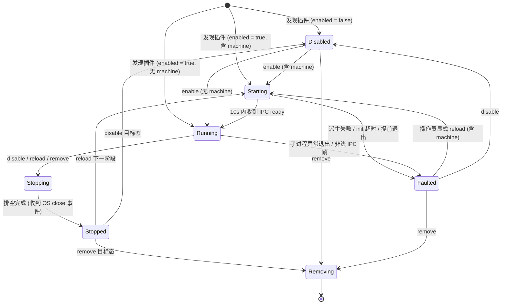

# Lody 插件系统规范（Normative Specification）

Status: draft
Translation: current

[English](plugin-system.md)

目的：正式定义 Lody 插件系统在 `local`、`headless` 与 `web` 三种拓扑下的规范性运行时架构、公开 SDK 契约、子进程与前端生命周期状态机、IPC/RPC 协议语义、端到端加密（E2EE）工作区安全边界、语言无关参考算法及一致性测试矩阵。架构收敛取舍与被否决方案记录于 [插件架构收敛与 E2EE 工作区边界](../.agents/notes/proposed/architecture/2026-11-22-plugin-architecture-and-e2ee-boundaries.zh.md)。

## 1. 规范用语与适用范围（Normative Language）

本文档中的英文规范关键字 `MUST`（必须）、`MUST NOT`（绝对禁止）、`REQUIRED`（必需）、`SHALL`、`SHALL NOT`、`SHOULD`（应当）、`SHOULD NOT`（不应当）、`RECOMMENDED`（推荐）、`MAY`（可以）与 `OPTIONAL`（可选）严格按照 RFC 2119 与 RFC 8174 解释。

`Implementation-defined`（实现自定义）指该行为属于宿主契约的一部分，但本规范不强制规定唯一底层实现机制；符合规范的实现 `MUST` 在实现文档中明确记录其所选策略，并严格满足本文档定义的全部规范性不变量。

### 1.1 一致性级别（Conformance Profiles）

本规范将实现与验证划分为三个级别：

- `Core Conformance`（核心一致性）：所有符合规范的 Lody 宿主实现（`local` 桌面端与 `headless` 守护进程）`REQUIRED` 满足的必选要求，涵盖插件包校验、每插件独立子进程生命周期、单层扁平 IPC、客户端扩展面与双层主题/样式注册表、宿主查询与会话动作、有界持久化以及基础能力与 E2EE 鉴权门控。
- `Extension Conformance`（扩展一致性）：仅当实现选择交付本规范定义的 `OPTIONAL` 扩展能力（即面向 `web` 与跨机器桌面端的远端 `MachineRpc` 插件路由及跨设备 E2EE 前端产物分发）时 `REQUIRED` 满足的要求。
- `Real Integration Profile`（真实集成验证配置）：生产发布前 `REQUIRED` 执行的真实 OS 子进程、真实文件系统故障与真实浏览器/Electron 渲染集成测试集。

### 1.2 实现自定义项清单（Implementation-Defined Items）

符合规范的实现 `MUST` 明确记录以下四项 `Implementation-defined` 选择：

1. **机密环境变量存储后端**：宿主机用于持久化机器拥有者 `manifest.env` 机密值的底层机制（例如 macOS Keychain、Linux Secret Service、Windows DPAPI 或 `0600` 本地加密存储）。
2. **开发态打包器驱动**：`--dev` 临时编译子进程内部使用的打包内核（例如 `esbuild` 或 `rolldown`），前提是满足产物纯度、外部化依赖及 `1000 ms` 空闲自毁不变量。
3. **持久化幂等回执存储**：守护进程用于原子持久化 `(workspace, user, target, pluginId, requestId)` 会话创建回执与活跃 `businessKey` 占位的存储引擎（例如 SQLite 表或原子日志）。
4. **操作员管理界面布局**：插件安装启停界面、侧边栏视图切换器、未信任远端产物确认提示以及 `--safe-mode` 顶部状态横幅的具体视觉排版。

---

## 2. 问题陈述、目标与非目标（Problem & Goals）

### 2.1 问题陈述

固定功能的编码 Agent 客户端在团队需要自定义工具结果卡片、外部 Issue 上下文挂载、多 Agent 侧边栏树或深度主题定制时，往往迫使用户维护硬分叉（Hard Fork）。反之，在本地优先、多机器协同且支持端到端加密（E2EE）的工作台中，朴素的插件架构会在四个位置系统性失效：

- 将运行中工具的流式输出直接写入 Session CRDT 历史，会导致 Loro 文档急剧膨胀并放大 E2EE 密文同步帧开销。
- 在主守护进程内或全机单共享 Worker 内运行后端插件，会造成跨插件连坐崩溃、无法归因的同步死循环或 V8 OOM，以及复杂的金丝雀复现补丁。
- 向 UI 组件 props 预塞宿主状态或采用独占式 `sidebar.replace` 接口，会导致多插件互相覆盖并在单机离线时令工作区视图瘫痪。
- 将动态插件查询视为安全只读接口，或允许无人工根 Turn 的后台回调直接签发会话提示词，会击穿 E2EE 访客隔离、按项目 `MachineSharing` 边界与签名执行意图溯源（`e2eeIntent`）。

Lody 插件系统通过将会话准入、工具权限审批、立即 `Stop`、历史写入与加密密钥保管严格留在宿主内核（Host Kernel），同时提供跨越 `shared`、`client` 与 `machine` 的单一强类型公开 SDK 解决上述问题。

### 2.2 目标（Goals）

- 每个已启用且含 `machine` 入口的插件运行于独立 OS 子进程，具备确定性的 `shutdown -> SIGTERM -> SIGKILL` 串行排空替换（Drain-Before-Respawn）保证。
- 纯前端、纯主题或纯 Skill 插件占用 `0` 个后端子进程；`--dev` 编译子进程空闲自动回收，不留常驻打包器内存或僵尸进程。
- 工具运行态（`running`）零 Loro CRDT 写入即可展示实时进度；完成态（`completed`）依托有界内联快照（`<= 16 KiB`）支持离线秒开，并配合 `ctx.dataDir` 按需拉取大体积产物。
- 前后端对称暴露原始响应式数据 SDK（`lodyQueries` 配合 `useLodyQuery` 与 `ctx.lody.read`）及受控会话动作（`create`、`send`、`answerQuestion`、`requestStop`、`requestArchive`），保持极薄组件 props。
- 通过三层正交侧边栏（`sessionRow.decorate`、`headerItems`/`footerItems` + `screens.add`、可切换 `sidebar.views.add`）及类 Obsidian 双层主题与托管自定义 CSS 体系实现无冲突界面扩展。
- 完整守住 E2EE 工作区安全不变量：非访客执行门控、机器拥有者与 `MachineSharing` 作用域隔离、个人设备 `memberInput` 与人工根 Turn `derivedFrom` `machineInput` 签名约束、256 KiB 单帧 Iroh 快路径上限及撤销时保管域原子擦除。

### 2.3 非目标与明确延后能力（Non-Goals & Deferred Capabilities）

以下内容属于本规范的**明确非目标（Non-Goals）**：

- **不可信恶意代码安全沙箱**：Lody 不使用 V8 Isolate、WASM 沙箱或跨域 iframe 防御机器拥有者主动安装的恶意本地代码。
- **底层 CRDT 直写或权限接管**：插件 `MUST NOT` 直接修改底层 Loro 文档、绕过 Session Inbox 准入、吞掉 `Stop` 信号，或代批/伪造工具 `permission` 审批。
- **跨机器隐式故障转移或静默自动重试**：绑定机器的插件调用严格发往单一目标 `machineId`，`MUST NOT` 静默切机或自动重放失败调用。
- **Agent 自我安装插件**：编码 Agent `MUST NOT` 通过 MCP 或内部工具自行安装、启用、重载或配置插件。

以下能力**明确延后至 v1 核心一致性之后**，在获得真实生产运行时反馈前 `MUST NOT` 纳入公开 v1 SDK 契约：

- 本机回环外设服务（`createLodyClient()`）。
- 可移植多 Agent 角色蓝图（`manifest.agentRoles`、`roleTarget`、`pluginRoleId`）。
- 宿主声明式设置表单生成器（`manifest.settings`、`usePluginSettings`）；v1 插件统一通过 `settings.pages.add` 搭配自有 `defineQuery` / `defineMutation` 实现设置页。
- 跨插件后台轮询观察与等待唤醒谓词（`defineObservation`、`CreateSessionRequest.waitCondition`、`machine.onSessionEvent`、`businessKeyScope: 'project'`）。
- 插件捆绑分发 ACP 二进制与 MCP 子服务（`manifest.acpProviders`、`manifest.mcpServers`）。
- 工作区级独立页面（`workspace.pages.add`）与全局悬浮层/状态栏/快捷键钩子（`shell.overlays`、`shell.statusBar`、`commands.add`）。
- 原生移动端（`apps/mobile`）直接执行 React `client.js` 产物。

### 2.4 信任假设与主体权限模型（Trust & Principal Model）

Lody 插件定义为**用户显式安装并信任的非沙箱代码（Trusted, Unsandboxed Code）**，依靠子进程边界、能力引用鉴权与加密工作区门控控制风险。宿主实现在每次操作中 `MUST` 严格区分四类主体（Principal）：

| 主体类型                                     | 信任级别与权限边界                                                                                                                                                                            |
| -------------------------------------------- | --------------------------------------------------------------------------------------------------------------------------------------------------------------------------------------------- |
| `MachineOwner`（机器拥有者）                 | 机器的人类操作员。唯一获准在该机器安装、启用、停用、重载、移除或 `--dev` 挂载插件、配置 `manifest.env` 密钥，以及在 E2EE 工作区调用 `'machine'` 作用域插件处理函数的主体。                    |
| `Collaborator`（协作者，`admin` / `member`） | 已认证工作区写成员。在 E2EE 工作区中，仅当 `MachineSharing` 实时同时授权目标 `machineId` 及目标绑定的全部项目时，`MAY` 调用远端机器上的 `'project'` 与 `'session'` 作用域处理函数。           |
| `Guest`（访客，`read`）                      | 只读工作区访问者。`MUST NOT` 触发任何插件子进程代码执行（`plugin/query`、`plugin/mutate`、`plugin/attachment-*`）；仅 `MAY` 查看历史内联 `<= 16 KiB` 快照与宿主受控 `useLodyQuery` 目录数据。 |
| `SessionAgent`（会话内编码 Agent）           | 在 Session Turn 内运行的编码模型。`MAY` 通过宿主 MCP 桥调用当前机器已启用的 `defineTool` 工具；`MUST NOT` 调用插件安装/生命周期接口或回答 `ask_user_question` / `permission` 提示。           |

---

## 3. 系统架构与模块职责（System Architecture）

### 3.1 核心组件

1. `Host Kernel`（宿主内核，Lody Core）

   - 独占管理 `HistoryWriter`、Session Inbox 准入与防循环计数、工具 `permission` 交互审批、立即 `Stop` 取消、能力引用签发与校验、E2EE `e2eeIntent` 验签、`MachineSharing` 判定、保管域擦除以及 `lody --safe-mode` 开关。

2. `Machine Plugin Host`（守护进程插件宿主，`PluginHost`）

   - 扫描本机已安装与 `--dev` 插件目录，校验 `lody.plugin.json`、路径纯度与必填 `env`。
   - 维护本机权威内存态 `MachinePluginState`，并为每个 `plugin_id` 维护独立串行生命周期队列。
   - 为每个已启用且声明了 `manifest.machine` 的插件派生、监控并串行排空独立的 `child_process.fork` 子进程。
   - 经单层扁平 IPC 路由 `query`、`mutation`、`tool` 与 `attachmentSource` 调用，执行硬超时与 `AbortSignal` 取消。
   - 将 `defineTool` 桥接至守护进程内部 Session MCP 工具表，将 `skills/` 桥接至技能发现目录，并将子进程 `stdout`/`stderr` 写入有界环形日志缓冲区。

3. `Dev Plugin Compiler`（按需编译子进程，仅 `--dev` 模式）

   - 在独立短生命周期子进程中按需编译 TypeScript/TSX `client` 与 `machine` 源码，校验浏览器/Node 目标纯度并计算 `clientDigest`。
   - 编译空闲满 `1000 ms` 自动退出，保证常驻守护进程零打包器内存占用且退出时零僵尸编译进程。

4. `Client Plugin Host`（前端插件宿主，`ClientPluginHost`）

   - 在非 `--safe-mode` 且工作区 E2EE 模式已解析的前提下，加载已信任 `client.js` ES 模块。
   - 按 `(source_machine_id, plugin_id)` 维护 `ClientPluginInstance`，以 `clientDigest` 控制幂等保留或原子热替换。
   - 管理每插件独立的 `AbortController`、作用域 `useQuery` 缓存、UI 注册项、主题应用句柄与宿主托管 `<style>` 节点，并用独立 `SurfaceErrorBoundary` 包裹每个渲染槽位。

5. `Remote Plugin Transport Bridge`（远端传输桥，`Extension`）
   - 在 `MachineRpc` 与 E2EE 通道（加密 Streams、单帧 Iroh `purpose 8` 请求与 `purpose 9` 分页只读响应）上暴露固定白名单插件方法。

### 3.2 模块边界不变量

- `ClientPluginHost` `MUST NOT` 加载 Node 内置模块、读取 `ctx.env` 机密，或携带守护进程凭据直连外部 API。
- `PluginHost` `MUST NOT` 在主守护进程内直接加载执行插件 `machine.js`；内置迁移插件与第三方插件 `MUST` 走完全一致的子进程隔离路径。
- `PluginHost` 与子进程之间 `MUST NOT` 在 Node IPC 之上嵌套二层内部 WebSocket 服务。
- `ClientPluginHost` 内任一插件界面抛错或样式损坏 `MUST NOT` 导致工作台崩溃、阻塞切换 Session 或阻断 `Stop` 与权限审批。

### 3.3 运行拓扑规范

| 拓扑模式                 | `ClientPluginHost` 行为                                                          | `PluginHost` 行为                                                                                                         |
| ------------------------ | -------------------------------------------------------------------------------- | ------------------------------------------------------------------------------------------------------------------------- |
| `local`（桌面一体）      | 直接加载本机信任的 `client.js`；支持 `--dev` HMR、`themes` 与本地托管 `styles`。 | 运行于本机守护进程；每个已启用 `machine` 插件占 `1` 个子进程（纯前端插件占 `0` 个）。                                     |
| `headless`（纯守护进程） | 不加载（`0` 前端开销）。                                                         | 运行于服务器守护进程；执行 `defineTool`、`defineQuery`、`defineMutation`、`defineAttachmentSource` 与 `skills/`。         |
| `web`（纯浏览器客户端）  | 核心 v1 渲染内置结构化回退视图；启用远端扩展后加载经 `clientDigest` 信任的产物。 | 本地无守护进程；全部 `machine` 调用经 `MachineRpc` 发往目标 `machineId`，机器离线时返回 `unavailable (machine_offline)`。 |

---

## 4. 核心领域模型与标识符规范（Domain Model）

### 4.1 核心实体

#### 4.1.1 `PluginInstallation`（守护进程所有）

表示绑定于 `(workspace_custody_scope, machine_id, plugin_id)` 的已安装或 `--dev` 链接插件记录。

逻辑字段：

- `plugin_id`（字符串，`REQUIRED`）：规范化 kebab-case 标识（`^[a-z0-9]+(?:-[a-z0-9]+)*$`）。
- `machine_id`（字符串，`REQUIRED`）：所属守护进程机器 ID。
- `package_root`（规范化绝对路径，`REQUIRED`）：经 `realpath` 校验的插件包根目录（内含 `lody.plugin.json`）。
- `mode`（`'installed' | 'dev'`，`REQUIRED`）：静态安装包或 `--dev` 源码监听模式。
- `enabled`（布尔值，`REQUIRED`）：持久化的操作员启用开关。
- `manifest`（`PluginManifest`，`REQUIRED`）：校验通过的清单快照。
- `client_digest`（字符串或 `null`）：前端产物与资源归档的 `sha256:<64-hex>` 摘要；无 `client`/`themes`/`styles` 时为 `null`。
- `data_dir`（规范化绝对路径，`REQUIRED`）：绑定当前工作区/保管域身份的插件持久化目录。
- `lifecycle_state`（`'disabled' | 'starting' | 'running' | 'stopping' | 'stopped' | 'faulted' | 'removing'`，`REQUIRED`）。
- `active_instance`（`MachinePluginInstance` 或 `null`）：仅当存在 `manifest.machine` 且状态处于 `'starting' | 'running' | 'stopping'` 时非空。
- `last_error`（`{ code: string, message: string, at_ms: integer }` 或 `null`）。
- `logs_ring`（有界环形日志缓冲区）：最近 `stdout`/`stderr` 行记录（上限 `500` 行、`262_144` UTF-8 字节）。

#### 4.1.2 `MachinePluginInstance`（守护进程运行态实体）

表示为一个含 `machine` 入口的 `PluginInstallation` 派生的单个实时 OS 子进程。

逻辑字段：

- `instance_id`（字符串，`REQUIRED`）：每次启动子进程递增生成的单调运行时令牌（`inst_<counter>`）。
- `plugin_id`（字符串，`REQUIRED`）。
- `pid`（整数，`REQUIRED`）：宿主操作系统进程 PID。
- `started_at_ms`（单调时钟毫秒戳，`REQUIRED`）。
- `registered_handlers`（在收到 `ready` 时冻结的 `query`、`mutation`、`tool` 与 `attachment_source` 处理表）。
- `inflight`（映射 `call_id -> Invocation`）。

#### 4.1.3 `ClientPluginInstance`（前端渲染进程运行态实体）

表示在 `ClientPluginHost` 中已挂载的一个前端插件实例。

逻辑字段：

- `plugin_id`（字符串，`REQUIRED`）。
- `source_machine_id`（字符串，`REQUIRED`）。
- `client_digest`（字符串，`REQUIRED`）：当前实际执行的产物 `sha256:<64-hex>` 摘要。
- `state`（`'untrusted' | 'mounting' | 'active' | 'disposing' | 'disposed' | 'faulted' | 'bypassed_safe_mode'`）。
- `abort_controller`（`AbortController`，`REQUIRED`）：在禁用、`client_digest` 替换或关闭工作区时原子触发 `abort()`。
- `query_cache`（作用域响应式缓存）：按 `(descriptor_id, target_key, canonical_input_json)` 索引。
- `cleanup_fn`（`(() => void | Promise<void>) | null`）：`defineClientPlugin` 返回的可选卸载回调。
- `contributions`（该实例注册的全部 UI 槽位与主题条目集合）。
- `style_elements`（该实例经 `manifest.styles` 与 `lody.styles.add` 注入的全部 `<style>` DOM 节点列表）。

#### 4.1.4 `Invocation`（单次在途调用）

表示已发往某个 `MachinePluginInstance` 且尚未结清的一次后端调用。

逻辑字段：

- `call_id`（字符串，`REQUIRED`）：宿主生成的唯一请求 ID。
- `plugin_id`（字符串，`REQUIRED`）。
- `instance_id`（字符串，`REQUIRED`）：承载本次调用的子进程实例 ID。
- `kind`（`'query' | 'mutation' | 'tool' | 'attachment_search' | 'attachment_resolve'`，`REQUIRED`）。
- `descriptor_id`（字符串，`REQUIRED`）。
- `scope`（`'machine' | 'project' | 'session'`，`REQUIRED`）。
- `target_ref`（`MachineRef | ProjectRef | SessionRef`，`REQUIRED`）。
- `caller`（调用主体身份 + `kind == 'tool'` 时绑定的人工根 Turn 溯源信息）。
- `deadline_ms`（单调时钟截止时间，`REQUIRED`）。
- `side_effect_class`：`query` 与 `attachment_*` 记为 `'unverified_read'`；`mutation` 与 `tool` 记为 `'effectful'`。

#### 4.1.5 能力引用（`WorkspaceRef`、`MachineRef`、`ProjectRef`、`SessionRef`）

能力引用（[`sdk/shared.d.ts`](../scripts/fixtures/plugin-sdk/sdk/shared.d.ts)）是由宿主签发、不可伪造的运行时能力令牌：

- `WorkspaceRef { workspaceId }`：纯逻辑工作区引用，`MUST NOT` 携带 `machineId`。
- `MachineRef { workspaceId, machineId }`：指向唯一确定的一台机器。
- `ProjectRef { workspaceId, machineId, projectId }`：指向绑定于 `machineId` 的单个项目仓库。
- `SessionRef { workspaceId, machineId, sessionId, projectId? }`：指向绑定于 `machineId` 的单个会话（未绑定项目的会话不含 `projectId`）。

手工拼装的同名纯 JSON 字面量对象在未通过宿主能力表核验与实时权限校验前，`LodyClient` 与 `MachineHostPort` `MUST` 拒绝受理。

#### 4.1.6 `SessionCreationReceipt` 与 `BusinessKeyReservation`

由目标机器宿主内核持久化的建会幂等记录：

- `SessionCreationReceipt`：主键 `(workspace_id, caller_user_id, target_key, plugin_id, request_id)` -> `{ normalized_request_sha256, session_ref, created_at_ms }`。Session 归档后依然永久保留该回执。
- `BusinessKeyReservation`：主键 `(workspace_id, caller_user_id, target_key, plugin_id, business_key)` -> `{ active_session_ref, request_id }`。当 `active_session_ref` 进入 `archived = true` 时原子释放该活跃占位。

### 4.2 稳定标识符、规范化与摘要规则

- **`plugin_id`：** `MUST` 匹配 `^[a-z0-9]+(?:-[a-z0-9]+)*$`（长度 `1..64`），禁止包含下划线 `_` 与大写字母，以确保 MCP 工具名映射具备双射无碰撞性。
- **`descriptor_id`（`query`、`mutation`、`tool`、`attachmentSource` 及 UI 槽位 `id`）：** `MUST` 匹配 `^[A-Za-z0-9._-]+$`（长度 `1..128`），且 `MUST NOT` 包含连续双下划线 `__`。
- **规范化 MCP 工具名：** 每个已注册 `defineTool` 统一按 `plugin__<plugin_id>__<tool_id>` 向当前机器 Session 广播；因 `plugin_id` 不含 `_` 且 `tool_id` 不含 `__`，按 `__` 切分（`["plugin", plugin_id, tool_id]`）始终无歧义且零冲突。
- **`clientDigest` 计算规则：** 对全部前端文件（若存在 `client.js` 以及 `manifest.themes[].path` 和 `manifest.styles[]` 引用的全部 `assets/` 文件）按规范化 POSIX 相对路径的 UTF-8 字节升序排列，每个文件按 `relative_path + "\0" + 十进制字节长度 + "\0" + 原始字节` 拼接后计算 `"sha256:" + hex(SHA256(...))`。修改 `machine.js` 或 `skills/` `MUST NOT` 改变 `clientDigest`。
- **`dataDir` 路径包含不变量：** `data_dir` `MUST` 位于 `<custody_root>/plugins/<plugin_id>` 内部；启动或服务插件前，`PluginHost` `MUST` 通过 `lstat` / `realpath` 校验 `package_root`（`installed` 模式）与 `data_dir` 未通过 `..` 或符号链接逃逸出父目录。

---

## 5. 插件包格式与公开 SDK 契约（Package & SDK Contract）

### 5.1 插件包目录结构与运行环境纯度

一个符合规范的插件包目录包含：

- `lody.plugin.json`（`REQUIRED`）：符合 [`sdk/manifest.d.ts`](../scripts/fixtures/plugin-sdk/sdk/manifest.d.ts) 的 UTF-8 JSON 清单。
- `client` 产物（`OPTIONAL`）：纯浏览器 ES 模块（`default` 导出由 `defineClientPlugin` 生成）。
  - `MUST NOT` 导入 `@lody/plugin-sdk/machine`、任何 Node 内置模块（`node:*`、`fs`、`child_process`、`net` 等）或 Electron API。
  - `MUST` 将 `react`、`react/jsx-runtime`、`zod`、`@lody/ui`、`@lody/plugin-sdk` 与 `@lody/plugin-sdk/client` 视为宿主外部依赖（External），确保 React Hooks 与能力引用 Symbol 与 `ClientPluginHost` 共享唯一运行时实例。
- `machine` 产物（`OPTIONAL`）：Node.js 模块（`default` 导出由 `defineMachinePlugin` 生成）。
  - `MUST NOT` 导入 `@lody/plugin-sdk/client` 或依赖浏览器 DOM 全局变量（`window`、`document`）。
  - `MUST` 将 `zod`、`@lody/plugin-sdk` 与 `@lody/plugin-sdk/machine` 视为宿主外部依赖。
- `skills/<skill_name>/SKILL.md`（`OPTIONAL`）：`manifest.skills` 声明的技能目录。
- `assets/**`（`OPTIONAL`）：`manifest.themes` 与 `manifest.styles` 引用的静态主题 JSON 与 CSS 样式文件。

### 5.2 清单 Schema 与校验规则（`lody.plugin.json`）

必填字段：

- `id`（字符串）：符合第 4.2 节 `plugin_id` 正则约束。
- `version`（字符串）：合法 SemVer 版本号（`MAJOR.MINOR.PATCH`）。
- `sdk`（字符串）：`MUST` 等于 `"^1.0.0"`；不兼容的主版本范围 `MUST` 返回 `invalid_manifest`。
- `title`（非空字符串，`<= 120` 字符）。

可选字段：

- `description`（字符串，`<= 500` 字符）。
- `client`（包内 POSIX 相对路径）。
- `machine`（包内 POSIX 相对路径）。
- `skills`（`skills/` 下的技能目录名数组）。
- `themes`（`PluginThemeContribution` 数组：`{ id, label, appearance: 'dark' | 'light', tokens?, path | seed }`，`path` 与 `seed` 互斥）。
- `styles`（包内 `.css` 相对路径数组）。
- `env`（键匹配 `^[A-Z][A-Z0-9_]*$` 的映射：`{ description, required?, secret? }`）。

强校验规则：

1. 清单 `MUST` 至少声明一项有效贡献（`client`、`machine`、`skills`、`themes` 或 `styles` 之一），空清单校验失败。
2. 未定义的顶层未知字段 `MUST` 以 `invalid_manifest` 拒绝（防止拼写错误或被延后的 v2 字段静默失效）。
3. 所有相对路径（`client`、`machine`、`themes[].path`、`styles[]`、`skills[]`）规范化后 `MUST` 位于 `package_root` 内部，严禁包含 `..` 或符号链接逃逸，且目标文件 `MUST` 存在。
4. 若 `manifest.env.<KEY>.required` 为 `true` 而机器拥有者尚未配置非空值，`PluginHost` `MUST` 拒绝启动 `machine` 子进程并记录 `missing_required_env`。

### 5.3 规范性字节与资源预算上限

符合规范的实现 `MUST` 严格执行 [`sdk/shared.d.ts`](../scripts/fixtures/plugin-sdk/sdk/shared.d.ts) 中定义的硬上限：

| 常量 / 阈值                           | 规范数值               | 执行边界                                                                                  |
| ------------------------------------- | ---------------------- | ----------------------------------------------------------------------------------------- |
| `MAX_INLINE_PLUGIN_TOOL_OUTPUT_BYTES` | `16_384`（16 KiB）     | 经校验写入 `HistoryWriter` 的单次 `defineTool` 输出 UTF-8 JSON 最大字节数。               |
| `MAX_PLUGIN_RPC_REQUEST_BYTES`        | `262_144`（256 KiB）   | 单次 `plugin/query`、`plugin/mutate` 或 `plugin/attachment-*` 请求载荷最大 UTF-8 字节数。 |
| `MAX_PACKED_CLIENT_BUNDLE_BYTES`      | `4_194_304`（4 MiB）   | `client.js` 与全部引用 `assets/` 文件未压缩总字节数上限。                                 |
| `MAX_PLUGIN_LOG_LINES` / `BYTES`      | `500` 行 / `262_144` B | 每插件守护进程环形日志上限（单行超过 `16_384` B 时截断）。                                |

### 5.4 SDK 模块导出与双向 Schema 校验

公开 TypeScript 契约由 [`sdk/shared.d.ts`](../scripts/fixtures/plugin-sdk/sdk/shared.d.ts)、[`sdk/client.d.ts`](../scripts/fixtures/plugin-sdk/sdk/client.d.ts)、[`sdk/machine.d.ts`](../scripts/fixtures/plugin-sdk/sdk/machine.d.ts) 与 [`sdk/manifest.d.ts`](../scripts/fixtures/plugin-sdk/sdk/manifest.d.ts) 唯一定义：

- `useLodyQuery` 仅接受 `lodyQueries` 中的 `LodyQueryDescriptor`；`useQuery` 仅接受插件 `defineQuery` 定义的 `QueryDescriptor`。
- 每次调用 `defineQuery`、`defineMutation` 与 `defineTool` 时，`PluginHost`（或子进程引导层）`MUST` 在执行处理函数前用 `descriptor.input.safeParse(rawInput)` 校验入参，并在返回调用方或写入 `HistoryWriter` 前用 `descriptor.output.safeParse(rawOutput)` 校验返回值；任一端校验失败均以 `validation_failed` 拒绝。

---

## 6. 生命周期状态机（Lifecycle State Machine）

### 6.1 机器侧插件生命周期状态机



状态不变量：

- **纯前端 / 主题 / Skill 插件零进程快路径：** 当 `manifest.machine` 缺省时，`enable` 直接完成 `Disabled -> Running` 跃迁，`active_instance = null` 且**派生 `0` 个 OS 子进程**。
- **禁止崩溃自动重启死循环：** 进入 `Faulted` 后 `MUST NOT` 自动后台拉起重试；插件保持故障隔离态（所有动态调用立即返回 `plugin_faulted`），直至操作员显式执行 `reload`、`disable` 或守护进程重启。

### 6.2 每插件串行生命周期队列

`PluginHost` `MUST` 为每个 `plugin_id` 维护独立的 FIFO 异步串行命令队列：

- 同一 `plugin_id` 的 `enable`、`disable`、`reload` 与 `remove` 操作 `MUST` 严格串行依次执行。
- 当前一状态转换尚未完成时连续到达的多次 `reload` 请求 `MAY` 合并为一次尾部（trailing）`reload` 并读取最新磁盘产物，但 `MUST NOT` 与正在执行的启停过程并发重叠。
- 不同插件（`plugin_a` 与 `plugin_b`）之间的生命周期转换 `MAY` 并发执行。

### 6.3 阶梯式终止与 Drain-Before-Respawn（旧死新方生）不变量

停止任何活跃的 `MachinePluginInstance`（用于 `disable`、`reload`、`remove` 或守护进程退出）时，`PluginHost` `MUST` 严格按以下顺序执行：

1. 将 `lifecycle_state` 置为 `stopping` 并立即拒绝新进入的调用（返回 `plugin_disabled`）。
2. 保持 Node IPC 通道连接（等待退出期间 `MUST NOT` 提前调用 `child.disconnect()`，以确保 `shutdown` 帧可靠送达且 OS `close` 事件不丢失），发送 `{ type: "shutdown", graceMs: 2000 }`。
3. 子进程执行 `defineMachinePlugin` 返回的可选清理函数 `MachinePluginCleanup` 后主动 `exit(0)`。
4. 最多等待 `2000 ms` 观察子进程 `close` 事件。
5. 若满 `2000 ms` 仍未收到 `close`，向子进程发送 `SIGTERM`（或平台等价信号），继续最多等待 `2000 ms`。
6. 若累计满 `4000 ms` 仍未收到 `close`，立即发送 `SIGKILL` 并阻塞等待 OS `close` 事件到达。
7. 结清所有残留 `inflight` 调用（`mutation`/`tool` 报 `outcome_unknown`，`query`/`attachment_*` 报 `plugin_disabled`），清空 `active_instance = null`。

**规范性不变量（Drain-Before-Respawn）：** 在 `reload` 过程中，在前一个 `pid` 完整走完步骤 6/7 并触发 OS `close` 事件之前，`PluginHost` `MUST NOT` 调用 `child_process.fork` 启动替代新进程。同一 `(workspace_custody_scope, machine_id, plugin_id)` 在任何时刻 `MUST NEVER` 同时存在两个存活 OS 进程。

### 6.4 `--dev` 独立编译子进程生命周期

- 当存在 `mode == 'dev'` 插件触发源码变更时，构建任务进入 `DevPluginCompiler`。
- 若当前无存活编译子进程，按需派生编译子进程执行构建，并在构建结束后启动/重置 `1000 ms` 空闲定时器；满 `1000 ms` 无新任务时编译子进程自动干净退出。
- 若 `--dev` 编译失败（语法、类型、运行纯度或体积超限），`PluginHost` `MUST` 记录编译错误并向操作员暴露诊断状态，同时继续保留上一次编译成功的有效产物运行，绝不拖垮主守护进程。
- 若 `--dev` 重建仅改变了 `client.js` 或 `assets/`（`machine.js` 字节未变），`PluginHost` 仅更新 `client_digest` 并通知前端热替换，`MUST NOT` 重启正在运行的 `MachinePluginInstance` 或打断在途 `defineTool` 调用。

### 6.5 客户端插件实例生命周期与 `clientDigest` 幂等规则

`ClientPluginHost` 按以下顺序协调前端插件状态：

1. 若处于 `lody --safe-mode`，所有前端插件统一置为 `bypassed_safe_mode`，不加载任何 `client.js`、插件 `themes` 或自定义 `styles`。
2. 若当前工作区 E2EE 模式尚处于 `unknown`，挂起挂载直至模式与保管域代际解析完成。
3. 对每个已启用且含 `client_digest` 的插件：
   - 若产物来自远端机器（`Extension`）且本地用户尚未信任 `(workspace_id, plugin_id, client_digest)`，标记为 `untrusted` 并回退至内置原始视图。
   - **幂等保留规则：** 若 `(source_machine_id, plugin_id)` 当前已处于 `active` 状态且 **`client_digest` 完全一致**，`ClientPluginHost` `MUST` 原地保留该实例、`MUST NOT` 中止 `abort_controller`，并完整保留其 `query_cache`。
   - **原子替换与零泄漏清理规则：** 当 `client_digest` 变化或插件被禁用/移除时，`ClientPluginHost` `MUST` 先完整销毁旧实例——隔离调用 `cleanup_fn()`、执行 `abort_controller.abort()`、注销全部 UI 扩展项、回退被移除的活跃插件主题、并从 DOM 同步移除 `style_elements` 中的全部 `<style>` 节点——随后才允许评估和挂载新 `client_digest` 模块。

---

## 7. RPC 协议与执行语义（RPC & Execution Semantics）

### 7.1 单层扁平子进程 IPC 协议

`PluginHost` 以 `stdio: ['ignore', 'pipe', 'pipe', 'ipc']` 派生 `machine` 子进程。`stdout` 与 `stderr` 仅承载诊断日志流（严禁混传协议帧），保证插件内任意 `console.log` 绝不污染 IPC 消息边界。

宿主发往子进程消息信封（Host -> Child）：

- `{ type: "init", pluginId, instanceId, workspaceId, machineId, dataDir, env }`
- `{ type: "invoke", callId, kind, descriptorId, scope, target, input, toolCallId? }`
- `{ type: "cancel", callId }`
- `{ type: "host_read_result", reqId, ok: true, data } | { type: "host_read_result", reqId, ok: false, code, message }`
- `{ type: "host_session_result", reqId, ok: true, data } | { type: "host_session_result", reqId, ok: false, code, message }`
- `{ type: "shutdown", graceMs }`

子进程发往宿主消息信封（Child -> Host）：

- `{ type: "ready", queries: string[], mutations: string[], tools: ToolWireSpec[], attachmentSources: string[] }`
- `{ type: "invoke_result", callId, data }`
- `{ type: "invoke_error", callId, code: "validation_failed" | "handler_error", message }`
- `{ type: "invalidate", descriptorId, scope, target? }`
- `{ type: "host_read", reqId, scope, target, queryId, input }`
- `{ type: "host_session_action", reqId, action: "create" | "send" | "requestStop" | "requestArchive", target, payload, viaToolCallId? }`
- `{ type: "shutdown_ack" }`

握手与帧校验规则：

- 子进程派生后，`PluginHost` 立即发送 `init` 并启动 `10_000 ms`（`INIT_TIMEOUT_MS`）握手定时器。
- `defineMachinePlugin` 内的全部 `machine.query`、`machine.mutation`、`machine.tool` 与 `machine.attachmentSource` 注册 `MUST` 在发出 `ready` 前同步完成；`ready` 发出后的延迟注册 `MUST` 在子进程内直接抛错。
- 超过 `10_000 ms` 未收到 `ready` 时，`PluginHost` 按第 6.3 节终止子进程并转入 `Faulted`。
- 子进程发出的任何不满足信封结构的非法 IPC 载荷均视为协议违规：`PluginHost` 立即杀死该子进程并转入 `Faulted`。

### 7.2 超时、取消信号与会话 `Stop` 传播

规范性默认硬超时：

- `QUERY_TIMEOUT_MS`：`30_000`（30 秒）
- `MUTATION_TIMEOUT_MS`：`30_000`（30 秒）
- `ATTACHMENT_TIMEOUT_MS`：`30_000`（30 秒）
- `TOOL_TIMEOUT_MS`：`600_000`（10 分钟）

取消与 `Stop` 规则：

1. 当前端 `useQuery` 卸载、查询参数变更或调用硬超时触发时，`PluginHost` 向子进程发送 `{ type: "cancel", callId }`，触发该调用的 `ctx.signal.abort()`。
2. 当用户对正在执行插件 `defineTool` 的 Session 点击 `Stop` 时，宿主内核 `MUST` 立即完成当前 Session Turn 的取消结算，同时由 `PluginHost` 异步发送 `{ type: "cancel", callId }`——即使插件代码未监听 `ctx.signal` 发生挂起，也 `MUST NOT` 阻塞用户侧 `Stop` 的即时响应。
3. 当副作用调用（`mutation` 或 `tool`）因超时终止时，因无法排除超时前已写入外部副作用，宿主 `MUST` 向调用方返回 `outcome_unknown`。

### 7.3 错误码分类体系与零自动重试铁律

所有插件调用失败统一通过 `PluginCallError` 返回 [`sdk/shared.d.ts`](../scripts/fixtures/plugin-sdk/sdk/shared.d.ts) 定义的 11 个规范错误码之一：

| 错误码                  | 规范语义与触发条件                                                                                                                               |
| ----------------------- | ------------------------------------------------------------------------------------------------------------------------------------------------ |
| `untrusted_plugin`      | 远端 `clientDigest` 前端产物尚未获得当前客户端用户显式信任。                                                                                     |
| `plugin_disabled`       | 插件未启用、正在停止或客户端处于 `--safe-mode`。                                                                                                 |
| `plugin_faulted`        | 插件子进程崩溃、`init` 失败、IPC 协议违规或处于故障隔离态等待 `reload`。                                                                         |
| `machine_offline`       | 目标 `machineId` 当前离线或 `MachineRpc` 不可达。                                                                                                |
| `forbidden`             | 调用主体缺少能力引用、E2EE 执行授权、`MachineSharing` 项目授权、人工根 Turn `e2eeIntent` 溯源，或企图经 `answerQuestion` 批准工具 `permission`。 |
| `not_found`             | 未知 `pluginId`、未注册 `descriptorId` 或目标实体不存在。                                                                                        |
| `idempotency_conflict`  | `sessions.create` 复用了已有 `requestId`，但规范化请求参数发生改变。                                                                             |
| `business_key_conflict` | `sessions.create` 使用新 `requestId` 请求的 `businessKey` 当前仍存在未归档活跃会话。                                                             |
| `outcome_unknown`       | `mutation` 或 `tool` 发出后，子进程在返回终态结果前崩溃、断开或超时。                                                                            |
| `validation_failed`     | 请求超过 `256 KiB`、`defineTool` 输出超过 `16 KiB`，或入参/出参 Zod `safeParse` 失败。                                                           |
| `handler_error`         | 插件处理函数内部抛错并返回了结构化异常。                                                                                                         |

**零自动重试铁律：** `PluginHost` 与 `ClientPluginHost` 对任何失败的 `query`、`mutation`、`tool` 或 `attachmentSource` 调用均 `MUST NOT` 执行隐式自动重试。只读查询由调用方显式触发 `refresh()`，结果未明的建会操作由调用方携带原不可变 `requestId` 重放原请求恢复。

### 7.4 远端 `MachineRpc` 传输信封（`Extension`）

交付远端 `web` 或跨机器协作扩展时，宿主 `MUST` 仅在 `MachineRpc` 上注册固定白名单方法：

- 只读目录与产物拉取：`plugin/catalog` 与 `plugin/bundle-chunk`（按 `256 KiB` 分片分页读取，总体积上限 `MAX_PACKED_CLIENT_BUNDLE_BYTES = 4 MiB`，直接复用 E2EE `purpose 9` 分页响应）。
- 动态执行方法：`plugin/query`、`plugin/mutate`、`plugin/attachment-search` 与 `plugin/attachment-resolve`，加密前统一执行 `MAX_PLUGIN_RPC_REQUEST_BYTES = 256 KiB` 上限校验，确保桌面直连 E2EE 调用严格装入单个 `1 MiB` `purpose 8` Iroh QUIC 快路径帧。

---

## 8. 客户端扩展面与双层外观契约（Client Extensions & Appearance）

### 8.1 极薄入参与槽位隔离规则

注册于 `ClientPluginRegistry`（[`sdk/client.d.ts`](../scripts/fixtures/plugin-sdk/sdk/client.d.ts)）的所有前端组件 `MUST` 遵守以下契约：

- **极薄能力引用 Props：** 宿主仅向插件组件传入能力引用（`workspace`、`project`、`session`、`machine`）与只读 `params: Readonly<Record<string, string>>`（以及 `ToolRenderProps` 上的 `toolCallId`、`input`、`status`、`output` 与 `appendToDraft`），`MUST NOT` 向组件 props 预填原始 Git、Diff 或会话列表状态。
- **逐槽位独立异常隔离（`SurfaceErrorBoundary`）：** 每个挂载的插件组件实例（`tools.render`、`composer.actions`、`session.panels`、`screens`、`project.pages`、`sidebar.*`、`settings.pages`）`MUST` 包裹在独立的 `SurfaceErrorBoundary` 中；单个组件渲染抛错仅使该局部槽位降级为宿主恢复提示，绝不卸载同页面其他扩展槽位。
- **`tools.render` 双态渲染与回退：**
  - 工具执行中且 `tool.input.safeParse` 通过时，挂载 `{ status: 'running', output: undefined, toolCallId, input, session, project?, appendToDraft }`。
  - 工具完成后执行 `tool.output.safeParse(storedPayload)`：通过则挂载 `{ status: 'completed', output: parsed.data, ... }`；若校验失败、产物未信任或渲染抛错，宿主 `MUST` 自动回退至内置结构化 JSON 原始卡片，并始终保留外层状态栏、耗时与原始 JSON 切换按钮。
- **路由与面板参数安全边界：** 独立页面参数持久化在 URL 的 `p.<key>` 命名空间下，伴随面板参数通过 `lody.panels.openSession(session, panelId, params)` 传递；URL 与 `params` 字符串视为不可信输入，`MUST NEVER` 用于凭空构造或放大能力引用。

### 8.2 三层正交侧边栏组合规则

侧边栏扩展（底层依托 [`sidebar-surface.ts`](../packages/components/src/components/sidebar-surface.ts)）按三个互不冲突的正交层组合：

1. **会话行装饰层（`sidebar.sessionRow.decorate`）：**
   - 允许多个插件同时注册 `trailing` 徽章与 `hoverCard` 悬停卡片。
   - 按 `(plugin_id, decorator_id)` 字典序确定性排列渲染，每个装饰器包裹独立 `SurfaceErrorBoundary`，任一装饰器抛错 `MUST NOT` 隐藏会话行或阻断点击切换会话。
2. **顶栏与底栏导航项（`sidebar.headerItems.add`、`sidebar.footerItems.add`）：**
   - 使用原生 `<SidebarRow />` 原语渲染在工作区切换器、主会话列表与底栏之间，保持与内置导航行完全一致的交互尺寸。
3. **可切换自定义视图层（`sidebar.views.add` 与 `<SessionRow />`）：**
   - 允许多个插件与宿主内置 `"Default"` 视图并存注册；宿主顶栏视图切换器 `MUST` 始终保留内置 `"Default"` 视图可随时切回。
   - 自定义视图内部凡使用 `<SessionRow session={summary} />` 渲染会话节点时，`<SessionRow />` `MUST` 自动叠加当前所有已启用的 `sidebar.sessionRow.decorate` 徽章与悬停气泡，使行级增强插件与树形视图插件零耦合自动组合。

### 8.3 类 Obsidian 双层主题与托管自定义 CSS 契约

在信任且非沙箱的前端渲染模型下，外观定制严格拆分为**跨版本 SemVer 稳定设计变量**与**可确定性卸载的本地自由 CSS**：

1. **第一层——SemVer 稳定主题契约（`manifest.themes`、`lody.themes.add`、`lody.themes.activate`）：**
   - 支持完整 VS Code 颜色主题 JSON（`path`）或紧凑种子色板（`PluginThemeSeedColors`），并支持可选 `PluginThemeTokens`（`fontSans`、`fontMono`、`radius`、`density`）。
   - 经 [`vscode-theme-dom.ts`](../packages/components/src/lib/vscode-theme/vscode-theme-dom.ts)（`applyVSCodeThemeCssVariables`）与 [`vscode-theme-css.ts`](../packages/components/src/lib/vscode-theme/vscode-theme-css.ts) 统一计算并注入根元素 `--*` CSS 变量，覆盖应用框架、面板、Diff、Monaco、Shiki 与内置终端。
   - 公开文档化的 `--*` CSS 变量名在 SDK `^1.0.0` 周期内受 SemVer 兼容保护；当当前激活的插件主题被禁用、移除或处于 `--safe-mode` 时，宿主 `MUST` 调用其 `dispose()` 清理变量并自动回退至内置默认主题。
2. **第二层——宿主托管本地自定义 CSS（`manifest.styles`、`lody.styles.add`）：**
   - 以 `<style data-lody-plugin="<plugin_id>" data-lody-style="<style_id>">` 注入当前主动开启该插件的本地客户端文档，`MUST NEVER` 自动同步或传染至其他工作区协作者的客户端。
   - `ClientPluginHost` 在 `ClientPluginInstance.style_elements` 中追踪全部 `<style>` 节点，在插件禁用、`clientDigest` 替换或 `--safe-mode` 启动时 `MUST` 同步彻底移除。
   - **DOM 非冻结规则：** 宿主内部 React 组件层级与内部类名不属于公开稳定契约，跨版本兼容承诺仅限公开 `--*` CSS 变量。

---

## 9. 宿主数据与会话能力契约（Host Capabilities）

### 9.1 `lodyQueries` 与响应式订阅语义

`lodyQueries`（[`sdk/shared.d.ts`](../scripts/fixtures/plugin-sdk/sdk/shared.d.ts)）定义 13 个强类型宿主只读描述子，由前端 `useLodyQuery`、`LodyClient.read` 与机器侧 `MachineHostPort.read` 共用：

- **工作区级目录查询（`WorkspaceRef`）：** `machines`、`projects`、`agentRoles`、`members`、`schedules`、`sessions`。前端 `useLodyQuery` `MUST` 直接订阅宿主共享引用计数的 Loro/Flock 房间与在线状态存储（`0` 额外房间连接、`0` 机器 RPC），部分开发机离线时依然保持 `ready`。
- **机器/项目/会话级查询：** `schedules`（`machine`/`project`）、`sessions`（`machine`/`project`）、`sessionDetail`、`gitState`、`worktrees`、`sessionDiff`、`filePreview`、`pullRequests`、`skills`。复用 `WorkspaceMachineRpcFacade` 与平台云端端口，不可达或无权限时收敛为 `{ status: 'unavailable', reason: 'machine_offline' | 'forbidden' | 'unknown', refresh }`。
- **跨插件 `businessKey` 命名空间隐私隔离：** 在 `lodyQueries.sessions` 与 `sessionDetail` 返回结果中，宿主 `MUST` 仅当 `session.createdByPluginId === caller_plugin_id` 时暴露 `SessionSummary.businessKey`（对其他插件一律隐藏为 `undefined`），且 `createdByPlugin: true` 过滤条件 `MUST` 严格限定为当前调用方 `plugin_id`。

### 9.2 会话生命周期动作与建会幂等语义

`LodyClient.sessions` 与 `MachineHostPort.sessions` 对称提供 `create`、`send`、`requestStop` 与 `requestArchive`：

1. **`sessions.create(target, request)` 原子幂等契约：**
   - 计算规范化请求摘要 `H = SHA256(canonical_json({ target, businessKey, roleId, parentSession, prompt, skillIds, pullRequestUrl }))`。
   - 按 `(workspace_id, caller_user_id, target_key, plugin_id, request.requestId)` 查询 `SessionCreationReceipt`：
     - 若命中且 `receipt.normalized_request_sha256 == H`：`MUST` 直接返回原 `receipt.session_ref`（**即使该 Session 此后已被归档**，也不得重复新建会话）。
     - 若命中但 `receipt.normalized_request_sha256 != H`：`MUST` 以 `idempotency_conflict` 拒绝。
   - 若未命中回执且指定了 `request.businessKey`，按 `(workspace_id, caller_user_id, target_key, plugin_id, request.businessKey)` 查询 `BusinessKeyReservation`：
     - 若存在尚未归档的活跃会话占位：`MUST` 以 `business_key_conflict` 拒绝。
   - 否则经宿主内核标准准入创建新 Session，在同一原子事务内写入 `SessionCreationReceipt` 与活跃 `BusinessKeyReservation` 并返回新 `SessionRef`。
   - 当 Session 被归档（`requestArchive` 或用户手动归档）时，`MUST` 释放其 `BusinessKeyReservation`，但 `MUST` 保留其 `SessionCreationReceipt`。
2. **`sessions.send(session, request)`：**
   - 提供 `idempotencyKey` 时按 `(session_id, plugin_id, idempotencyKey)` 去重，经标准 Session Inbox 准入（返回 `started | queued | steered`），受内核防循环上限约束。
3. **`sessions.requestStop` 与 `sessions.requestArchive`：**
   - 核验调用方对 `session` 的能力权限后直接委派宿主内核执行急停或归档。

### 9.3 原地回答追问（`answerQuestion`）与内核权限独占规则

`LodyClient.sessions.answerQuestion(session, request)` 仅存在于前端 `useLody()`，`MachineHostPort` 严禁暴露该方法：

- 宿主内核 `MUST` 核验目标 `session` 当前存在挂起交互且满足 `requestId == request.requestId` **同时** `kind === 'ask_user_question'`（[`ask-user-question.ts`](../packages/shared/src/acp/ask-user-question.ts)），按 `getAskUserQuestionAnswerKey` 规范化键名后经 `WorkspaceWriter.respondSessionPermission`（[`use-permission-response.ts`](../packages/components/src/hooks/use-permission-response.ts)）写入答复。
- **安全红线：** 若 `request.requestId` 指向工具执行权限请求（`kind === 'permission'`），宿主内核 `MUST` 立即以 `forbidden` 拒绝。任何前端或机器侧插件接口均绝无批准、驳回或篡改工具权限弹窗的能力。

---

## 10. 持久化、历史写入与数据归属（Persistence & Data Ownership）

### 10.1 有界会话历史写入（`HistoryWriter`）

- **运行态零流式历史写入：** 在 `defineTool` 执行期间，`PluginHost` `MUST NOT` 向 `HistoryWriter` / Loro 会话文档写入中间流式进度；实时进度一律走 `ctx.dataDir` + `ctx.invalidate` + `useQuery`。
- **16 KiB 完成态内联硬上限：** 工具返回后，`PluginHost` 经 `tool.output.safeParse` 校验并计算 UTF-8 JSON 字节长度：
  - 若 `<= MAX_INLINE_PLUGIN_TOOL_OUTPUT_BYTES`（`16_384` 字节），由 `HistoryWriter` 内联写入对应 `tool_call` 历史记录（[`tool-call-history.ts`](../packages/shared/src/acp/tool-call-history.ts)），确保离线客户端无需请求守护进程即可渲染完成态卡片。
  - 若 `> 16_384` 字节，`PluginHost` `MUST NOT` 截断 JSON 或将超限载荷写入 Loro，而 `MUST` 以 `validation_failed` 拒绝该次工具返回并向 Agent 报告结构化超限错误。产生大体积产物的工具 `MUST` 将完整数据以不可变 `ctx.toolCallId` 为键写入 `ctx.dataDir`，仅返回 `<= 16 KiB` 的摘要与查询键。

### 10.2 插件 `ctx.dataDir` 目录归属、原子写入与清理

- 每个插件安装实例独占单一持久化目录 `ctx.dataDir`（POSIX `0700` 权限 / Windows 所有者独占 DACL）：
  - 明文工作区：`<daemon_state_root>/workspaces/<workspace_id>/plugins/<plugin_id>/data`
  - E2EE 工作区：`<daemon_state_root>/e2ee/<account_hash>/<workspace_id>/content/<genesis>/<signing_key>/plugins/<plugin_id>/data`
- 依托第 6.3 节 Drain-Before-Respawn 保证的单安装实例最多一个存活 OS 进程，无需跨进程文件锁；但单进程内并发异步写入同一状态文件的处理函数 `MUST` 按文件串行化“读—改—写”事务，并使用独占临时文件（`flag: 'wx'`）加原子 `rename` 提交（写入或替换失败时清理自身临时文件且不破坏既有已提交文件）。
- `disable` 保留 `ctx.dataDir`；`remove` 默认保留 `ctx.dataDir`，仅在显式指定 `--purge` 时删除；E2EE 确认成员移除（`RemoveMember`）或设备撤销时随保管域目录无条件擦除。

### 10.3 作用域查询缓存与精准失效

- `ClientPluginHost` 在所属 `ClientPluginInstance.query_cache` 内按 `(descriptor.id, target_key, canonical_input_json)` 缓存 `useQuery` 结果。
- 在 `MachineContext` 或 `ToolExecutionContext` 中调用 `ctx.invalidate(descriptor, target?)` 时，发出 `{ type: "invalidate", descriptorId: descriptor.id, scope: descriptor.scope, target }`。
- 当前挂载的匹配 `useQuery` 订阅（匹配 `plugin_id` + `descriptor.id`，指定 `target` 时精确匹配目标，省略 `target` 时匹配该描述子全部目标）标记过期并触发单次重拉；未挂载缓存项仅标记过期而不产生后台请求。

---

## 11. 安全边界与 E2EE 约束（Security Boundaries & E2EE）

### 11.1 仅限人类管理生命周期与子进程环境变量最小化

1. **Agent MCP 零生命周期暴露：** 任何安装、`--dev` 挂载、启用、停用、重载、移除、信任或写入插件 `env` 机密的命令与 RPC `MUST NOT` 注册到 `apps/cli/src/mcp` 或任何可供 `SessionAgent` 调用的工具面。
2. **子进程环境变量最小化（Environment Scrubbing）：** `PluginHost` 派生 `machine` 子进程时，`MUST` 构造最小化白名单系统环境（仅保留 `PATH`、`HOME`、`TMPDIR`、`LANG`、`TZ`、`NODE_ENV` 等基础非机密运行变量），仅将该插件自身在 `manifest.env` 中声明并已配置的值注入 `ctx.env`——`MUST` 剥离守护进程 E2EE 签名私钥、保管域 KEK、云端会话令牌以及任何其他兄弟插件的 `manifest.env` 机密。

### 11.2 前端产物信任门控与 `lody --safe-mode` 逃生舱

- `MachineOwner` 在桌面端本机安装的本地插件默认对本机客户端受信任。
- 来自远端机器的 `client.js` 产物（`Extension`）在当前客户端用户显式信任 `(workspace_id, plugin_id, client_digest)`（或持有该机器活跃 `MachineOwner` `--dev` 租约）之前 `MUST NOT` 执行，一律降级为宿主内置原始视图并对编程调用返回 `untrusted_plugin`。
- 以 `lody --safe-mode` 启动客户端时，`MUST` 无条件跳过全部 `client.js` 模块评估、全部插件 `themes` 与全部自定义 `styles` 注入，强制切回内置 `"Default"` 侧边栏，同时保证会话浏览、`HistoryWriter`、权限审批与 `Stop` 完整可用。

### 11.3 E2EE 访客（`read`）与非访客执行门控

遵循 [`e2ee-rpc.ts`](../packages/shared/src/e2ee-rpc.ts)「方法名不能证明代码无副作用」原则：

- `plugin/query`、`plugin/mutate`、`plugin/attachment-search` 与 `plugin/attachment-resolve` `MUST NOT` 列入 `E2EE_READ_QUERY_METHODS`；每次调用均 `MUST` 通过非访客 `authorizeExecution`（具备 `admin` 或 `member` 角色且内存账本新鲜度 `< 15 分钟`）。
- 仅限宿主静态托管、零插件子进程代码执行的 `plugin/catalog` 与 `plugin/bundle-chunk`（`Extension`）`MAY` 列入 `E2EE_READ_QUERY_METHODS`。
- 在 E2EE 访客客户端上，针对任何插件 `QueryDescriptor` 的 `useQuery` 调用 `MUST` 确定性返回 `{ status: 'unavailable', reason: 'forbidden', refresh }`。

### 11.4 机器拥有者独占与按项目 `MachineSharing` 门控

遵循 [`specs/e2ee/machine-sharing.zh.md`](e2ee/machine-sharing.zh.md) 与 [`packages/e2ee-machine-sharing/AGENTS.md`](../packages/e2ee-machine-sharing/AGENTS.md)：

- 在 E2EE 工作区中，插件安装/启停/重载、`binding: 'installation'` 设置页、`ctx.env` 密钥配置及全部 `'machine'` 作用域 `defineQuery` / `defineMutation` 调用**严格限定 `MachineOwner` 本人**（协作者调用一律返回 `forbidden`，防止借机器级插件窥探同机未共享私有仓库）。
- `Collaborator` 仅在实时 `MachineSharing` 状态同时共享目标 `machineId` 及该 `ProjectRef` / `SessionRef` 绑定的全部项目时，方 `MAY` 调用 `'project'` 与 `'session'` 作用域处理函数；未绑定项目的 E2EE 会话（`projectId == undefined`）仅限 `MachineOwner` 本人访问。

### 11.5 签名执行意图（`e2eeIntent`）与 20 次派生上限

遵循 [`e2ee-execution-intent.ts`](../packages/shared/src/e2ee-execution-intent.ts)：

- **前端发起的 `sessions.create` / `send`：** 在个人设备上就地对规范化提示词与附件快照签发 `memberInput`（`kind = 1`）。
- **工具内发起的 `ToolExecutionContext.lody.sessions.create` / `send`：** 由守护进程签发携带 `derivedFrom: { sessionId, userTurnId }` 的 `machineInput`（`kind = 2`），锚定当前正在执行 `toolCallId` 的已验签人工根 Turn；共享成员根 Turn `MUST` 强制执行**每根 Turn 最多 20 次派生预留配额**与**禁止跨机器派生规则**（跨机目标以 `forbidden` / `e2ee_derivation_cross_machine_unsupported` 拒绝）。
- **无根 `MachineContext` 绝对禁令：** 在 `query`、`mutation` 或 `attachmentSource` 处理函数内（无活跃人工根 Turn），E2EE 工作区下调用 `ctx.lody.sessions.create` 或 `ctx.lody.sessions.send` `MUST` 立即以 `forbidden` 拒绝。

### 11.6 保管域隔离、脱敏、明文静态分享与外发披露

- **保管域绑定与撤销擦除：** E2EE 工作区下的前端产物缓存与信任记录（`Extension`）以及守护进程 `ctx.dataDir` `MUST` 严格绑定 `<account>/<workspace>/<genesis>/<signing-key>` 保管域（[`client-custody.zh.md`](e2ee/client-custody.zh.md)、[`desktop-custody.zh.md`](e2ee/desktop-custody.zh.md)、[`apps/cli/src/lib/e2ee/AGENTS.md`](../apps/cli/src/lib/e2ee/AGENTS.md)）；收到确认的 `e2ee_member_removed` 或 `e2ee_device_revoked` 终态时，`MUST` 原子擦除对应保管域下的全部插件缓存、信任记录与受管 `dataDir`。
- **Presence 与遥测脱敏：** 在线状态（Presence）帧与 E2EE 遥测上报 `MUST` 剥离全部 `pluginId`、自定义槽位 ID、工具名、Zod 校验详情与插件异常栈，仅允许记录固定 `PluginCallErrorCode` 枚举。
- **明文静态分享回退：** 导出明文静态 Session 分享时，仅导出会话历史内已有的 `<= 16 KiB` 内联结果（`MUST NOT` 读取或上传 `ctx.dataDir`），且外部匿名浏览页固定渲染宿主内置结构化回退视图而不加载第三方 `client.js`。
- **零云端令牌与网络外发披露：** E2EE 插件不获注入任何云端托管令牌；启用声明了 `env` 或 `attachmentSource` 的插件时，`MUST` 向 `MachineOwner` 显式提示该插件 `machine` 代码具备本机 OS 网络访问权限。

---

## 12. 故障分类与恢复策略（Failure & Recovery Model）

### 12.1 故障分类

1. `插件包与构建故障`：`lody.plugin.json` 缺失/非法、`sdk` 主版本不支持、路径/符号链接逃逸、产物体积超限、跨端导入违规或必填 `env` 缺失。
2. `子进程生命周期故障`：`fork` 系统错误、`init` 握手超 `10s`、非零退出或信号强杀、非法 IPC 消息帧、或 `shutdown` 挂起触发 `SIGTERM` / `SIGKILL`。
3. `单次调用故障`：请求超 `256 KiB`、入参/出参 Zod `validation_failed`、`defineTool` 输出超 `16 KiB`、处理函数抛错（`handler_error`）、超时（`30s` / `10min`）、调用方取消（`cancel`）或在途子进程死亡（`outcome_unknown`）。
4. `前端渲染与外观故障`：`client.js` 顶层求值异常、React 组件渲染抛错、主题配色非法或自定义 CSS 破坏局部布局。
5. `鉴权与连续性故障`：`machine_offline`、`untrusted_plugin`、`forbidden`、`idempotency_conflict`、`business_key_conflict`。

### 12.2 确定性故障隔离与恢复策略表

| 故障事件                          | 宿主立即处置动作                                                                                                       | 状态迁移                                     | 恢复触发条件                         |
| --------------------------------- | ---------------------------------------------------------------------------------------------------------------------- | -------------------------------------------- | ------------------------------------ |
| 清单 / 纯度 / 必填 `env` 校验失败 | 拒绝激活并记录 `last_error`。                                                                                          | `Faulted`（不派生子进程）                    | 修复清单或配置 `env` 后显式 `reload` |
| 子进程意外退出 / 非法 IPC 帧      | 结清 `inflight`（`mutation`/`tool` 报 `outcome_unknown`，`query` 报 `plugin_faulted`）；保留环形日志；`0` 次自动重试。 | `Running -> Faulted`                         | 操作员显式 `reload` 或重启守护进程   |
| `--dev` 源码重编译失败            | 记录构建错误；保持上一次编译成功的有效产物继续服务。                                                                   | 维持 `Running`（无历史有效产物则 `Faulted`） | `--dev` 下一次合法源码保存           |
| 单次调用抛错或 Schema 不匹配      | 仅向该次调用方返回 `handler_error` / `validation_failed`；子进程保持存活。                                             | 维持 `Running`                               | 调用方修正入参或手动重拉             |
| 前端 React 扩展组件抛错           | 由局部 `SurfaceErrorBoundary` 捕获并渲染内置回退视图。                                                                 | 其他槽位维持 `Active`                        | 组件重挂载或插件 `reload`            |
| 自定义 CSS 遮挡界面交互           | 操作员以 `lody --safe-mode` 重启客户端并禁用问题插件。                                                                 | `bypassed_safe_mode -> Disabled`             | 禁用后正常重启客户端                 |

### 12.3 宿主重启恢复语义

- **守护进程重启：** `PluginHost` 读取持久化的 `enabled` 标记、`SessionCreationReceipt` 与未归档 `BusinessKeyReservation`；清空进程重启前的内存态 `Faulted` 标记，对所有 `enabled` 插件重新执行标准启动（`Starting -> Running`）；重启前未完成的在途调用不予重放。
- **前端刷新或离线重开：** `ClientPluginHost` 重新挂载已信任 `clientDigest` 产物，并直接从会话 Loro 历史中的 `<= 16 KiB` 内联快照即时渲染已完成的历史工具卡片（即使所属机器当前离线）。

### 12.4 操作员干预控制点

操作员始终握有四项不依赖插件配合的硬控制手段：

1. `plugin reload <plugin_id>`：在 `<= 4s` 内强制排空/强杀卡死旧进程并拉起全新 `instanceId`。
2. `plugin disable <plugin_id>`：强制终止后端子进程、卸载前端槽位/主题/`<style>` 节点并以 `plugin_disabled` 阻断后续调用。
3. `lody --safe-mode`：启动时一键旁路全部前端插件、插件主题与自定义 CSS。
4. `plugin logs <plugin_id>`：无需挂载调试器即可直接查看守护进程有界 `500` 行 / `256 KiB` 环形日志。

---

## 13. 参考算法（Reference Algorithms）

以下与具体编程语言无关的伪代码定义了符合本规范的实现必须遵守的规范性控制流。

### 13.1 串行生命周期调度与 Drain-Before-Respawn

```text
function enqueue_lifecycle(host, plugin_id, action):
  queue = host.queues[plugin_id]
  if action == "reload" and queue.has_pending_trailing_reload():
    return queue.join_pending_reload()

  return queue.push_and_run_serially(fn ->
    installation = host.installations[plugin_id]
    switch action:
      case "enable":
        installation.enabled = true
        persist_enabled_flag(plugin_id, true)
        return start_installation(host, installation)

      case "disable":
        installation.enabled = false
        persist_enabled_flag(plugin_id, false)
        stop_and_drain_instance(host, installation, reason="plugin_disabled")
        installation.lifecycle_state = "disabled"
        publish_catalog_update(host)

      case "reload":
        stop_and_drain_instance(host, installation, reason="plugin_disabled")
        # 核心不变量：旧 OS PID 已发出 'close' 后才允许执行 start_installation
        return start_installation(host, installation)

      case "remove":
        stop_and_drain_instance(host, installation, reason="plugin_disabled")
        installation.lifecycle_state = "removing"
        remove_installation_records(host, installation)
        publish_catalog_update(host)
  end)

function stop_and_drain_instance(host, installation, reason):
  instance = installation.active_instance
  if instance is null:
    installation.lifecycle_state = "stopped"
    return

  installation.lifecycle_state = "stopping"
  # 保持 IPC 连接不断开，确保 shutdown 帧可靠刷出且 'close' 事件按序触发
  send_ipc_best_effort(instance.child, {type: "shutdown", graceMs: 2000})

  exited = wait_for_process_close(instance.child, timeout_ms=2000)
  if not exited:
    send_signal_best_effort(instance.child, SIGTERM)
    exited = wait_for_process_close(instance.child, timeout_ms=2000)

  if not exited:
    send_signal_best_effort(instance.child, SIGKILL)
    wait_for_process_close_unbounded(instance.child)

  settle_all_inflight(instance, query_code=reason, effectful_code="outcome_unknown")
  installation.active_instance = null
  installation.lifecycle_state = "stopped"

function start_installation(host, installation):
  validation = validate_manifest_paths_and_env(installation)
  if validation is not ok:
    installation.lifecycle_state = "faulted"
    installation.last_error = validation.error
    publish_catalog_update(host)
    return

  installation.client_digest = compute_client_digest(installation)
  if installation.manifest.machine is absent:
    installation.lifecycle_state = "running"
    installation.last_error = null
    publish_catalog_update(host)
    return

  installation.lifecycle_state = "starting"
  instance_id = next_monotonic_instance_id()
  scrubbed_env = build_minimal_child_env(installation.manifest.env)
  child = fork_subprocess(installation.manifest.machine, stdio=["ignore", "pipe", "pipe", "ipc"], env=scrubbed_env)

  if child spawn failed:
    installation.lifecycle_state = "faulted"
    installation.last_error = {code: "spawn_failed", message: child.error}
    publish_catalog_update(host)
    return

  attach_ring_buffer_log_pipes(child.stdout, child.stderr, installation.logs_ring)
  send_ipc(child, {type: "init", pluginId: installation.plugin_id, instanceId: instance_id, dataDir: installation.data_dir, env: installation.configured_env})

  ready = wait_for_ipc_ready(child, timeout_ms=10000)
  if ready failed:
    kill_and_await_close(child)
    installation.lifecycle_state = "faulted"
    installation.last_error = ready.error
    publish_catalog_update(host)
    return

  installation.active_instance = {instance_id, pid: child.pid, child, registered_handlers: ready.handlers, inflight: {}}
  installation.lifecycle_state = "running"
  installation.last_error = null
  watch_unexpected_exit(host, installation, installation.active_instance)
  publish_catalog_update(host)
```

### 13.2 机器侧调用、超时、取消与崩溃结算

```text
function invoke_machine_handler(host, principal, plugin_id, kind, descriptor_id, scope, target, raw_input, caller_signal):
  if utf8_byte_length(json_encode(raw_input)) > MAX_PLUGIN_RPC_REQUEST_BYTES:
    return error("validation_failed", "request exceeds 256 KiB")

  auth = authorize_plugin_rpc(host, principal, scope, target)
  if auth is not ok:
    return error("forbidden", auth.reason)

  installation = host.installations[plugin_id]
  if installation is null:
    return error("not_found", "unknown plugin")
  if installation.lifecycle_state == "faulted":
    return error("plugin_faulted", installation.last_error.message)
  if installation.lifecycle_state != "running" or installation.active_instance is null:
    return error("plugin_disabled", "plugin is not running")

  instance = installation.active_instance
  descriptor = instance.registered_handlers[kind][descriptor_id]
  if descriptor is null or descriptor.scope != scope:
    return error("not_found", "unregistered descriptor")

  parsed_in = descriptor.input_schema.safeParse(raw_input)
  if not parsed_in.success:
    return error("validation_failed", parsed_in.error)

  call_id = new_call_id()
  timeout_ms = (kind == "tool") ? 600000 : 30000
  side_effect = (kind in ["mutation", "tool"]) ? "effectful" : "unverified_read"

  promise = register_inflight(instance, call_id, side_effect, timeout_ms, on_timeout=fn ->
    send_ipc_best_effort(instance.child, {type: "cancel", callId: call_id})
    return (side_effect == "effectful") ? error("outcome_unknown", "invocation timed out") : error("handler_error", "query timed out")
  end)

  on_abort(caller_signal, fn ->
    send_ipc_best_effort(instance.child, {type: "cancel", callId: call_id})
  end)

  send_ipc(instance.child, {type: "invoke", callId: call_id, kind, descriptorId: descriptor_id, scope, target, input: parsed_in.data})
  raw_result = await promise  # 任何错误均严格执行 0 次自动重试

  parsed_out = descriptor.output_schema.safeParse(raw_result)
  if not parsed_out.success:
    return error("validation_failed", parsed_out.error)

  if kind == "tool" and utf8_byte_length(json_encode(parsed_out.data)) > MAX_INLINE_PLUGIN_TOOL_OUTPUT_BYTES:
    return error("validation_failed", "inline tool output exceeds 16 KiB; store large artifacts in ctx.dataDir")

  return ok(parsed_out.data)

function on_subprocess_unexpected_exit(host, installation, crashed_instance, exit_info):
  if installation.active_instance != crashed_instance:
    return  # 已被主动 stop/reload 回收

  settle_all_inflight(crashed_instance, query_code="plugin_faulted", effectful_code="outcome_unknown")
  installation.active_instance = null
  installation.lifecycle_state = "faulted"
  installation.last_error = {code: "subprocess_crashed", message: format_exit(exit_info)}
  publish_catalog_update(host)
```

### 13.3 客户端 Bundle 调和与零泄漏替换

```text
function reconcile_client_plugin(client_host, key, desired_entry):
  current = client_host.instances[key]

  if client_host.safe_mode_enabled:
    if current is not null:
      dispose_client_instance(client_host, key, current)
    return

  if desired_entry is null or not desired_entry.enabled or desired_entry.client_digest is null:
    if current is not null:
      dispose_client_instance(client_host, key, current)
    return

  if desired_entry.is_remote and not is_digest_trusted(client_host.custody, desired_entry.plugin_id, desired_entry.client_digest):
    if current is not null:
      dispose_client_instance(client_host, key, current)
    client_host.untrusted[key] = desired_entry.client_digest
    return

  # 幂等性：相同的 clientDigest 原地保留订阅、缓存与挂载状态
  if current is not null and current.state == "active" and current.client_digest == desired_entry.client_digest:
    return

  if current is not null:
    dispose_client_instance(client_host, key, current)

  mount_client_instance(client_host, key, desired_entry)

function dispose_client_instance(client_host, key, instance):
  instance.state = "disposing"
  instance.abort_controller.abort()
  call_isolated(instance.cleanup_fn)
  unregister_all_surfaces(client_host.registry, instance.contributions)
  revert_and_dispose_plugin_themes(client_host.theme_manager, instance.contributions.themes)
  for style_el in instance.style_elements:
    style_el.remove()
  instance.query_cache.clear()
  instance.state = "disposed"
  client_host.instances.remove(key)
```

### 13.4 幂等 Session 创建与业务键预留

```text
function plugin_create_session(kernel, caller_user_id, plugin_id, target, req, e2ee_context):
  verify_e2ee_session_creation_intent(kernel, caller_user_id, target, req, e2ee_context)  # 无交互根签名的 MachineContext 直接拒绝 'forbidden'

  req_hash = sha256(canonical_json({target, businessKey: req.businessKey, roleId: req.roleId, parentSession: req.parentSession, prompt: req.prompt, skillIds: req.skillIds, pullRequestUrl: req.pullRequestUrl}))
  receipt_key = (target.workspaceId, caller_user_id, canonical_target_key(target), plugin_id, req.requestId)

  in_atomic_transaction(kernel.receipt_store):
    existing = lookup_receipt(receipt_key)
    if existing is not null:
      if existing.normalized_request_sha256 != req_hash:
        return error("idempotency_conflict", "requestId reused with different parameters")
      return ok(existing.session_ref)  # 即使 Session 后续已归档，仍原样返回原 SessionRef

    if req.businessKey is present:
      res_key = (target.workspaceId, caller_user_id, canonical_target_key(target), plugin_id, req.businessKey)
      active_res = lookup_active_reservation(res_key)
      if active_res is not null and not is_session_archived(active_res.active_session_ref):
        return error("business_key_conflict", "active Session already exists for businessKey")

    session_ref = kernel.admit_new_session(caller_user_id, target, req, created_by_plugin_id=plugin_id)
    insert_receipt(receipt_key, {normalized_request_sha256: req_hash, session_ref})
    if req.businessKey is present:
      upsert_active_reservation(res_key, {active_session_ref: session_ref, request_id: req.requestId})

    return ok(session_ref)
```

### 13.5 E2EE 插件请求授权门禁

```text
function authorize_plugin_rpc(host, principal, scope, target):
  if not verify_capability_token(host, principal, target):
    return deny("invalid capability reference")

  if not host.workspace_is_e2ee(target.workspaceId):
    return allow()

  # E2EE 只读 Guest 严禁触发任何动态插件代码执行
  if not authorize_non_guest_execution(principal, max_ledger_staleness_ms=900000):
    return deny("guest or stale E2EE ledger cannot execute plugin code")

  if scope == "machine":
    if principal.user_id != host.machine_owner_user_id:
      return deny("machine-scoped E2EE plugin calls are machine-owner-only")
    return allow()

  if principal.user_id == host.machine_owner_user_id:
    return allow()

  # 'project' 或 'session' 作用域下的协作者校验
  bound_projects = resolve_bound_projects(target)
  if bound_projects is empty:
    return deny("unbound E2EE sessions are machine-owner-only")

  if not machine_sharing_grants_all(host.machine_id, principal.user_id, bound_projects):
    return deny("MachineSharing does not grant target machine and all bound projects")

  return allow()
```

---

## 14. 一致性测试与验证矩阵（Conformance & Validation Matrix）

验证画像遵循第 1.1 节定义：

- 第 14.1 至 14.6 节属于 `Core Conformance`（所有合规实现 **MUST** 通过的确定性自动化测试）。
- 第 14.7 节属于 `Extension Conformance`（当交付远程 `MachineRpc`、`web` 或跨协作者 Bundle 分发扩展时 **MUST** 通过）。
- 第 14.8 节属于 `Real Integration Profile`（投产发布前 **MUST** 在真实操作系统子进程与真实浏览器/Electron 环境中通过的端到端验收套件）。

### 14.1 Core Conformance — 清单、环境纯净性与 SDK 契约

- 清单解析器接受合法的 `lody.plugin.json` 包（`client`+`machine`、纯 `machine`、纯 `client`、`themes`/`styles`），并拒绝非法 `id` 字符（含 `_` 或大写字母）、不受支持的 `sdk` 主版本（如 `^2.0.0`）、未知顶层字段、空清单、包含 `..` 的路径段以及越出根目录的符号链接。
- 纯浏览器 TypeScript 编译在 `client` 产物中拒绝导入 `@lody/plugin-sdk/machine` 及 Node 内置模块（`node:fs` 等）。
- 纯 Node TypeScript 编译在 `machine` 产物中拒绝导入 `@lody/plugin-sdk/client` 及 DOM 全局对象（`window`、`document`）。
- `useLodyQuery` 在编译期拒绝插件 `QueryDescriptor` 入参，`useQuery` 在编译期拒绝宿主 `LodyQueryDescriptor` 入参。
- 缺失 `required: true` 的 `manifest.env` 密钥会阻止 `Starting -> Running` 跃迁并记录 `missing_required_env`。

### 14.2 Core Conformance — 子进程生命周期与 Drain-Before-Respawn

- 启用不含 `manifest.machine` 的插件时进入 `Running`，且派生的子进程数为 `0`。
- 启用含 `manifest.machine` 的插件时精确派生 `1` 个独立子进程，并在收到 `ready` 后由 `Starting` 跃迁为 `Running`。
- 子进程在 `10_000 ms` 内未发出 `ready` 时被终止并跃迁至 `Faulted`。
- 按插件隔离的生命周期队列按 FIFO 顺序串行化并发的 `enable` / `reload` / `disable` / `remove` 请求，无并发派生竞态。
- **Drain-Before-Respawn：** 在 `reload` 过程中，若旧子进程捕获并忽略 `shutdown` 与 `SIGTERM`，`PluginHost` 在 `4000 ms` 后升级发送 `SIGKILL`，且严格在旧 PID 发出 `close` 事件**之后**才启动替代 PID。
- `Faulted` 状态的插件不在后台自动重启，在显式 `reload` 前对所有调用持续返回 `plugin_faulted`。

### 14.3 Core Conformance — IPC 帧边界、超时、取消与故障即停

- 子进程写入 `console.log` / `stdout` 与 `stderr` 的内容被捕获进 `logs_ring`（`<= 500` 行、`<= 256 KiB`、单行 `<= 16 KiB`），且绝不污染或破坏 IPC 协议帧。
- 子进程发出的畸形 IPC 帧会立即杀死该子进程并将插件跃迁至 `Faulted`。
- 输入/输出 Zod Schema 校验不匹配返回 `validation_failed`，且不会导致子进程崩溃。
- 请求负载超过 `MAX_PLUGIN_RPC_REQUEST_BYTES`（`256 KiB`）时在派发前即以 `validation_failed` 拒绝。
- 客户端卸载、查询参数变更或 Session `Stop` 会发出 `cancel(callId)` 并中止处理器内的 `ctx.signal`；挂死的工具处理器不会延迟宿主 Session `Stop` 结算。
- 子进程意外退出或调用超时将未完成的 `mutation` 与 `tool` 调用结算为 `outcome_unknown`，将未完成的 `query` 调用直接拒绝，且对读操作与副作用操作均执行 **`0` 次自动重试**。

### 14.4 Core Conformance — 客户端扩展点、侧边栏与双层外观体系

- 目录刷新时若 `clientDigest` 未变，原地保留已挂载的 `ClientPluginInstance`、活跃订阅与 `query_cache`。
- `clientDigest` 变化或执行 `disable` 时，在挂载替代实例前完整执行 `cleanup_fn`、中止 `abort_controller`、注销所有 UI 贡献、回退已移除的插件主题，并移除全部注入的 `<style>` 节点。
- `tools.render` 在工具执行中挂载 `{ status: 'running', output: undefined }`，在 `safeParse` 校验通过后挂载 `{ status: 'completed', output }`；输出 Schema 不匹配或渲染抛错由 `SurfaceErrorBoundary` 干净隔离回退。
- 多个 `sidebar.sessionRow.decorate` 插件在内置 `"Default"` 侧边栏与渲染 `<SessionRow />` 的自定义 `sidebar.views.add` 树上均按确定性顺序组合；单个装饰器抛错不会隐藏 Session 行本身。
- `manifest.themes` 与 `lody.themes.add`（`PluginThemeSeedColors` + `PluginThemeTokens`）通过 `applyVSCodeThemeCssVariables` 干净地应用与回收根级 `--*` CSS 变量。
- `lody --safe-mode` 跳过全部 `client.js` 执行、插件 `themes` 与 `styles`，同时保持 Session 查看、权限审批与 `Stop` 正常可用。

### 14.5 Core Conformance — 宿主能力、幂等性与数据持久化

- `WorkspaceRef` 不携带 `machineId`；单台机器离线时，工作区级 `useLodyQuery` 描述符保持 `ready`，而指向离线机器的 `MachineRef` / `ProjectRef` / `SessionRef` 插件查询解析为 `unavailable (machine_offline)`。
- 未携带宿主签发能力身份的伪造纯 JSON 引用对象被直接拒绝。
- `lodyQueries.sessions` 仅向创建该 Session 的同一 `plugin_id` 暴露 `businessKey`。
- 相同 `(requestId, normalized_payload)` 的 `sessions.create` 在 Session 归档前后均返回原 `SessionRef`；复用相同 `requestId` 但修改参数时以 `idempotency_conflict` 拒绝；新 `requestId` 与未归档 Session 的活跃 `businessKey` 冲突时以 `business_key_conflict` 拒绝；Session 归档后释放 `businessKey` 预留但保留 `requestId` 幂等回执。
- `sessions.answerQuestion` 仅处理 `ask_user_question` 提示词请求，对内核工具审批 `permission` 请求 ID 一律以 `forbidden` 拒绝。
- `<= 16 KiB` 的 `defineTool` 输出内联写入 `HistoryWriter`；`> 16 KiB` 的输出以 `validation_failed` 拒绝且不污染 Loro 历史；并发 `ctx.dataDir` 写入采用独占临时文件加原子 `rename`，在注入 `EACCES`/`EIO` 读、写、重命名故障时始终保持已提交数据完好无损。

### 14.6 Core Conformance — 安全边界、环境变量最小化与 E2EE 门禁

- Agent MCP 工具列表中暴露 `0` 个插件安装、启用、禁用、重载或 `env` 配置工具。
- 派生的 `machine` 子进程环境变量中不包含守护进程 E2EE 托管/签名密钥、云端令牌或其他兄弟插件的 `manifest.env` 密钥。
- 在 E2EE 工作区中：
  - `plugin/query`、`plugin/mutate` 与 `plugin/attachment-*` 不出现在 `E2EE_READ_QUERY_METHODS` 中；只读 Guest 发起的 `useQuery` 解析为 `{ status: 'unavailable', reason: 'forbidden' }`。
  - 非机器所有者的协作者调用 `'machine'` 作用域插件接口时以 `forbidden` 拒绝。
  - 协作者调用 `'project'` 与 `'session'` 作用域插件接口仅在 `MachineSharing` 同时授权目标机器及全部绑定项目时放行，取消共享后立即以 `forbidden` 拒绝。
  - 无交互根签名的 `MachineContext`（`query`、`mutation`、`attachmentSource`）调用 `sessions.create` 与 `sessions.send` 时以 `forbidden` 拒绝；`ToolExecutionContext` 签发 `derivedFrom` `machineInput` 并强制执行 20 跳派生上限与单机规则。
  - 在线状态（Presence）与遥测帧包含 `0` 个插件 ID、工具名或插件异常堆栈；静态明文分享链接渲染内置兜底卡片，不上传 `ctx.dataDir` 且不加载第三方 `client.js`。

### 14.7 Extension Conformance — 远程 `MachineRpc` 与 E2EE Bundle 托管

若实现了远程 `web` 或跨协作者插件 Bundle 分发扩展，实现 **MUST** 额外通过以下检查：

- `plugin/bundle-chunk` 以 `256 KiB` 的 `purpose 9` 分片分页读取 `<= 4 MiB` 的客户端产物，拒绝 `> 4 MiB` 的产物。
- 未获显式信任的远程 `clientDigest` 产物在用户确认信任前不执行 `client.js`，并回退为内置原始视图。
- E2EE 产物缓存与信任记录加密/隔离在 `<account>/<workspace>/<genesis>/<signing-key>` 作用域下，在工作区 E2EE 模式为 `unknown` 期间保持未挂载，并在收到经证实的 `e2ee_member_removed` 或 `e2ee_device_revoked` 时原子擦除。

### 14.8 Real Integration Profile — 真实操作系统子进程与浏览器 E2E 套件

在宣布第一阶段（Phase 1）具备投产条件之前，实现 **MUST** 在零 Mock 子进程、零 Mock DOM 的真实环境中通过以下端到端测试：

1. **顽固子进程 Drain-Before-Respawn E2E：** 启动真实 Node 插件子进程注册 `process.on('SIGTERM', () => {})` 并将自身 PID 写入 `ctx.dataDir`；触发 `reload`；验证旧 PID 在 `<= 4500 ms` 内被 `SIGKILL` 终结，新 PID 严格在旧 PID 退出后启动，且磁盘文件零损坏。
2. **死循环强制停止与零僵尸编译器 E2E：** 在真实 `machine` 子进程中触发 `while(true){}` 同步死循环；调用 `disable`；验证进程在 `<= 4500 ms` 内终止且主守护进程 RPC 全程保持响应；在 `--dev` 模式下修改 TypeScript 源码，等待 `1500 ms` 后断言存活的编译器子进程数为 `0`。
3. **写操作中途崩溃 `outcome_unknown` E2E：** 让真实 `machine` 子进程在 `defineMutation` 执行中途调用 `process.kill(process.pid, 'SIGKILL')`；断言客户端收到 `outcome_unknown`、守护进程精确记录 `1` 次调用（`0` 次重试）并跃迁至 `Faulted`。
4. **浏览器/Electron UI、侧边栏、主题与 `--safe-mode` E2E：** 在真实渲染进程中挂载 `test-report`、`worktrees`、`focus-sidebar` 以及自定义主题 + `styles` 插件；验证工具卡片 `running -> completed` 实时过渡、悬停操作 `answerQuestion` 提交、`disable` 后移除全部 `<style>` 标签并回退 `--*` 主题变量且活跃查询泄漏数为 `0`，以及 `lody --safe-mode` 成功绕过故意注入故障的样式表/组件插件。

---

## 15. 完成定义与仓库证据（Definition of Done & Repository Evidence）

### 15.1 Core Conformance 必达条件（`local` 与 `headless`）

仅当以下全部交付物均落地并通过自动化验证时，实现才满足 v1 `Core Conformance`：

- 符合第 5 节与 [`scripts/fixtures/plugin-sdk/sdk/`](../scripts/fixtures/plugin-sdk/sdk/shared.d.ts) 契约的公开 `@lody/plugin-sdk`（`shared`、`client`、`machine`、`manifest`）。
- 守护进程 `PluginHost`：实现单插件独立 `child_process.fork` 隔离、纯客户端插件 `0` 子进程快速路径、`1000 ms` 空闲回收 `--dev` 编译子进程、按插件隔离的 FIFO 生命周期队列、`shutdown -> 2s SIGTERM -> 2s SIGKILL` Drain-Before-Respawn、单层扁平 IPC、清洗后的最小化子进程环境变量以及有界环形日志缓冲。
- `ClientPluginHost`：实现 `clientDigest` 幂等跳过、`AbortController` + 专属 `query_cache` 零泄漏卸载、`SurfaceErrorBoundary` 故障隔离、三层正交侧边栏扩展、SemVer 稳定 `--*` 主题令牌 + 宿主托管可销毁 `<style>` 样式表以及 `lody --safe-mode`。
- 宿主内核接线：落地 `lodyQueries`、`HistoryWriter` `16 KiB` 内联上限、持久化 `(requestId, businessKey)` Session 创建幂等回执、仅限 `ask_user_question` 的 `answerQuestion`、Agent MCP 零插件管理暴露面以及基础 E2EE 授权/意图签名/托管擦除门禁。
- 内置自举插件（`test-report`、`worktrees`、`focus-sidebar`、`issue-context`）完全基于公开 SDK 运行（零宿主私有模块导入），并通过第 14.1–14.6 节与第 14.8 节全部测试。

### 15.2 扩展能力条件要求（`web` 与跨协作者 Bundle 分发）

- 交付远程插件 UI 或跨机器协作者插件执行前，还 **MUST** 通过第 14.7 节全部检查（`MachineRpc` 方法白名单、Iroh `256 KiB` 单帧预算、`4 MiB` 分页 Bundle 读取、逐 `clientDigest` 显式信任门禁以及 `<account>/<workspace>/<genesis>/<signing-key>` 托管擦除）。

### 15.3 投产发布门禁（Operational Release Gate）

- 第 14.8 节（`Real Integration Profile`）中的每一项测试 **MUST** 在 CI 中针对真实操作系统子进程与无头 Chromium/Electron 持续运行，严禁静默跳过；任何一项失败均阻断发布。

### 15.4 仓库证据与当前实现状态（Repository Evidence & Current Implementation Status）

- **规范性文档与 SDK 契约：** 本文档、[插件架构收敛与 E2EE 工作区边界](../.agents/notes/proposed/architecture/2026-11-22-plugin-architecture-and-e2ee-boundaries.zh.md)，以及 [`sdk/shared.d.ts`](../scripts/fixtures/plugin-sdk/sdk/shared.d.ts)、[`sdk/client.d.ts`](../scripts/fixtures/plugin-sdk/sdk/client.d.ts)、[`sdk/machine.d.ts`](../scripts/fixtures/plugin-sdk/sdk/machine.d.ts) 与 [`sdk/manifest.d.ts`](../scripts/fixtures/plugin-sdk/sdk/manifest.d.ts) 中的 TypeScript SDK 契约定义。
- **已核查宿主模块所有者与边界：** [`packages/ui/src/index.ts`](../packages/ui/src/index.ts)、[`packages/components/src/components/loro-app-sidebar.tsx`](../packages/components/src/components/loro-app-sidebar.tsx)、[`packages/components/src/components/sidebar-surface.ts`](../packages/components/src/components/sidebar-surface.ts)、[`packages/components/src/hooks/use-permission-response.ts`](../packages/components/src/hooks/use-permission-response.ts)、[`packages/components/src/lib/vscode-theme/vscode-theme-dom.ts`](../packages/components/src/lib/vscode-theme/vscode-theme-dom.ts)、[`packages/components/src/lib/vscode-theme/vscode-theme-css.ts`](../packages/components/src/lib/vscode-theme/vscode-theme-css.ts)、[`packages/components/src/providers/workspace-machine-rpc-facade.ts`](../packages/components/src/providers/workspace-machine-rpc-facade.ts)、[`packages/shared/src/schema.ts`](../packages/shared/src/schema.ts)、[`packages/shared/src/acp/ask-user-question.ts`](../packages/shared/src/acp/ask-user-question.ts)、[`packages/shared/src/acp/history-apply.ts`](../packages/shared/src/acp/history-apply.ts)、[`packages/shared/src/acp/tool-call-history.ts`](../packages/shared/src/acp/tool-call-history.ts)、[`packages/shared/src/e2ee-rpc.ts`](../packages/shared/src/e2ee-rpc.ts)、[`packages/shared/src/e2ee-execution-intent.ts`](../packages/shared/src/e2ee-execution-intent.ts)、[`packages/platform/AGENTS.md`](../packages/platform/AGENTS.md)、[`packages/e2ee-machine-sharing/AGENTS.md`](../packages/e2ee-machine-sharing/AGENTS.md)、[`apps/cli/src/lib/e2ee/AGENTS.md`](../apps/cli/src/lib/e2ee/AGENTS.md)、[`apps/cli/src/mcp/AGENTS.md`](../apps/cli/src/mcp/AGENTS.md) 与 [`.agents/docs/failure-containment.md`](../.agents/docs/failure-containment.md)。
- **已执行验证与尚未落地的运行时边界：** [`scripts/plugin-sdk-contracts.test.mjs`](../scripts/plugin-sdk-contracts.test.mjs) 当前已执行浏览器/Node 双 `tsconfig` 环境纯净性编译校验、编译期正反向 SDK 断言（[`contracts.ts`](../scripts/fixtures/plugin-sdk/contracts.ts)、[`machine-contracts.ts`](../scripts/fixtures/plugin-sdk/machine-contracts.ts)）、四个参考插件（[`test-report`](../scripts/fixtures/plugin-sdk/examples/test-report/client.tsx)、[`issue-context`](../scripts/fixtures/plugin-sdk/examples/issue-context/machine.ts)、[`worktrees`](../scripts/fixtures/plugin-sdk/examples/worktrees/client.tsx)、[`focus-sidebar`](../scripts/fixtures/plugin-sdk/examples/focus-sidebar/client.tsx)）以及并发原子写 `ctx.dataDir` 故障注入测试。生产级 `PluginHost`、`DevPluginCompiler`、`ClientPluginHost`、持久化 `SessionCreationReceipt` 存储以及 E2EE RPC/托管擦除门禁尚待按上述第 1–15 节规范在第一阶段实施落地。
