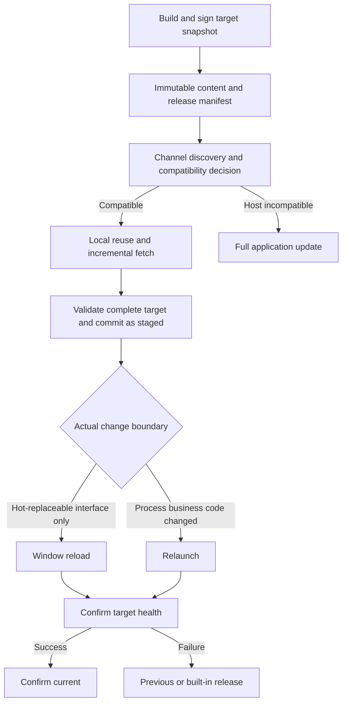

# Portable Desktop Application OTA Specification

Status: draft
Translation: current

[中文](portable-desktop-ota.zh.md)

## 1. Scenario, decision, and evidence boundaries

Users need to receive frequent desktop application updates: when runtime capabilities have not changed, transfer only missing business content; when only the interface changes, reload the window; when business main-process code changes, restart the application; when the runtime, bootstrapper, or native dependencies change, perform a full update. An update failure must not damage the current installation, a version that can be restored to, or user data.

This specification defines a behavioral contract for independently reproducing these capabilities. It does not require Electron, a particular language, repository layout, dependency-injection framework, object-storage provider, or the original project's code structure. The decision for review is to separate the installation trust boundary from independently updateable business code, use immutable target releases and transactional activation, and prove safe recovery and incremental benefits with real behavior. This document does not authorize changes to Lody's runtime or release system.

The normative terms “must,” “should,” and “may” mean acceptance obligation, recommendation that may be departed from for a reason, and optional capability, respectively. Requirement IDs below are stable tracking units. Evidence is classified as: S = observed in fixed-revision source/PR patches; A = described by the supplied article; D = design requirement added to form a complete portable contract; X = behavior evidence actually executed. S and A are not X. Every mandatory clause applies to the target implementation even if the reference implementation has not been shown to satisfy it.

The reference baseline is LobeHub PR #20191 at head `d9eab5a5004ff3d1d92f301c09a971d1186264cf`; historical renderer and Sparkle designs are separately pinned to their respective PR heads. Sparkle PR #19459 had not merged when the article was published; the API shows it later merged on 2026-10-02. Do not attribute later capabilities to the September 29 baseline. This document distinguishes final capabilities from historical approaches and does not require a target project to reconstruct retired intermediate designs. The reference desktop application was not run, and there is no runtime evidence for a target implementation.

This implementation selects only the final capabilities: signed complete Core snapshots, content addressing and dictionary patches, immutable packs/Range, transactional activation and health recovery, and the existing platform full-application updater. Historical renderer-only delivery, source-binding compatibility graphs, gzip CAS, V2 ZIP, and v3 full ZIP remain evidence background only; they are outside the new client, publisher, and compatibility implementation scope. Patch chains require separate acceptance against the selected native full updater.

## 2. Logical architecture and responsibilities

| Logical role | Inputs/outputs and responsibility | Trust and ownership |
| --- | --- | --- |
| Installation Host | Runtime, bootstrapper, trusted public keys, native resources, built-in business version | Delivered as a complete installation recognized by the operating system; ordinary business OTA cannot arbitrarily rewrite it |
| Business release Core | Complete snapshot of main-process business code, preload, interface, and dependencies it can carry | Remote releases are verified before execution and immutable after commit |
| Build/release system | Business artifacts → content manifest, compressed objects, patches, packs, signed release description | Signing private keys are not distributed to clients; the release pointer is the final step |
| Discovery and policy | Query channel, compatibility, release sequence, rollout, and full update | Remote metadata cannot bypass local trust rules |
| Fetch and assembly | Reuse local content, plan downloads, verify and assemble the complete target | Writes only to staging/new objects; must not overwrite the active release |
| Activation and health | Switch resource root, reload/relaunch, confirm health, recover | Each persistent activation transaction has one owner |
| Full application updater | Replace Host, native modules, and business base | Platform installer handles signing, permissions, replacement, and restart |
| Interaction and diagnostics | Show checking/downloading/staged/failure/recovery and the actual current version | Show actual phases; do not describe downloaded content as running |

Roles may be performed by one process or several components. The Host selects and starts the Core; the Core may request versioned capabilities provided by the Host. Downloaded data must not be executed before verification. The minimum rescue path must be independent of successful startup of the Core under test.

## 3. Terminology and release identity

Host is the stable capability boundary; it does not mean “never changes.” Core is all business files delivered by one update, not a directory to which patches are overlaid. Builtin is a known base protected by the installation signature in a complete installation. Object is a byte string identified by the digest of its uncompressed content. Frame is an independent compressed representation of a complete object or patch. Pack is an immutable concatenation container holding multiple frames. Release is a signed set describing a target file tree and its policy, compatibility, and transport.

**ID-01** The implementation must distinguish Host version, Core release ID, monotonic release sequence, protocol version, compatibility identifier, channel, operating system, and architecture. The user-visible version must not change feed lookup; after receiving a Core under the same Host, the client must still find the correct update source. A version-number string does not provide unique compatibility or security-ordering semantics.

**ID-02** A Release ID must be unique and immutable within its namespace; different content must not be published under the same ID. Digests must identify their algorithm; the reference-compatible configuration uses lowercase hexadecimal SHA-256. The target release must be pinned during download; a change to latest must not mix content from two releases.

## 4. Capability scope and replaceable choices

| Mechanism that must be preserved | Replaceable implementation choice | Unacceptable reduction |
| --- | --- | --- |
| Explicit Host/Core trust and compatibility boundary | app.asar + core.asar, other archives/directories | Allow business OTA to arbitrarily rewrite the bootstrapper or public key |
| Signed manifest binding the complete target and transport locations | Canonical JSON + Ed25519 or an equivalent reviewed protocol | Check only downloaded-file hashes when the hashes themselves can be replaced |
| Content addressing, exact-base patches, independent decoding | zstd dictionaries, other bounded and verifiable deltas | Patches without a complete-target fetch path |
| Immutable packs and validated Range requests | Pack count, storage path, concurrency | Replace cost analysis with a fixed “file count exceeds threshold” full-download rule |
| Complete-target assembly and atomic activation | Filesystem rename, transactional database, journal | Overwrite files that are currently executing |
| Health confirmation and bounded failure recovery | Health signal, timeout, rescue UI | Retry the same bad release on every startup |
| Full application update fallback | Sparkle, platform installer, another secure updater | Force business OTA when the runtime changes |
| Real-flow acceptance and evidence | Test driver and observation tools | Treat types/unit tests/directory existence as capability acceptance |

The complete capability scope includes Core OTA, interface reload, process restart, full application update, signing, deltas, direct upgrades across versions, recovery, release isolation, rollout, cleanup, and observability. The historical renderer-only mode explains compatibility conditions and migration; patch chains are a separate optional extension and must not be presented as a required dependency of the Core baseline.

## 5. Compatibility and application mode

**CMP-01** The Host must provide a compatibility description covering runtime/engine version, native module ABI, Host-provided dependencies and their locked resolution, bootstrap and loading protocol, resource layout, signing trust root, platform/architecture, and runtime resources that must remain external. This may use an exact fingerprint or an explicit capability protocol; any dependency change not independently encapsulated must be included in the decision. Compatibility must not be based only on the renderer source directory or a human judgment that a change is “frontend-only.”

**CMP-02** A capability change that cannot be carried and loaded independently by the Core must trigger a full update. The reference implementation requires exact shellAbi equality. If a migration project supports capability-range matching, it must prove that both sides interpret the range consistently and must not relax compatibility without evidence. A cross-platform release must not bypass platform applicability even when its digest is identical.

**CMP-03** Reload must be chosen by checking equivalence of the non-interface execution boundary from the currently running version to the target: changes to the main process, preload, native bindings, startup arguments, protocols, workers, or long-lived subprocess dependencies that require a restart are not allowed. Choose relaunch when uncertain. The target manifest's applyMode relative to the preceding release may only be used as a hint; during a direct upgrade across releases, do not reload based on this hint alone.

**CMP-04** Reload must use a version lease for each window/execution domain: switch before loading the new document; keep lazy-loaded resources for the old page available until it closes; and ensure each document and its preload/worker/API contract belong to a compatible combination. Multiple windows must not mix incompatible releases. Unsaved input must be retained, restored, or allow the user to defer reload; choose restart or defer application when this cannot be guaranteed.

**CMP-05** The historical renderer-only mode requires main/preload and all their actual dependencies to remain unchanged. If this mode is used, the decision must be based on the release-artifact boundary or a provably complete input closure, not inferred from shared package names. The final Host/Core mode includes business main/preload in the Core, narrowing the Host boundary that must remain unchanged; reproducing the reference project's large source-graph algorithm is not required.

## 6. Release data contract and cryptography

**MAN-01** Each release must define at least the semantics in the table below. Field names and encoding may vary, but no semantics may be omitted.

| Data | Semantics that must be expressed |
| --- | --- |
| Protocol/identity | schema, release ID, seq, channel, platform, architecture, or an explicit compatible-distribution constraint |
| Host requirements | compatibility ID/capability requirements; the location for full-update discovery is determined by local trusted policy |
| File tree | canonical relative paths, content hashes, decompressed byte sizes; if permissions/links are supported, their security semantics |
| Object index | Complete frame for every unique target hash, including pack ID, offset, length, and compressed digest |
| Patch index | Exact from hash and to hash, frame location and compressed digest; decoding algorithm |
| Pack index | Immutable relative path, full-pack hash, total size |
| Policy | rollout, application-mode hint, optional predecessor release; previous must not force serial upgrades |
| Signature | Signature algorithm/protocol, public-key selection rule, and signature value; trust root does not come from the same unverified response |

**MAN-02** The implementation must reject unknown required protocols, ambiguous encodings, duplicate keys, duplicate/conflicting file paths, missing objects, different sizes for the same hash, out-of-range integers, overflowing ranges, undeclared packs, and invalid or overlapping frames. Empty files are allowed. Whether an empty business tree can run must be determined by the product entry-point contract; a missing manifest must not be treated as an empty update.

**SEC-01** Download URLs, indexes, sizes, content hashes, version, and policy must be authenticated together. The reference configuration signs canonical JSON after removing signature: object keys are sorted, array order is preserved, and JSON/UTF-8 encoding is deterministic; Ed25519 signatures are represented as Base64. An independent protocol must define handling of numbers, Unicode, duplicate keys, and unknown fields and provide cross-language vectors. Do not verify a different byte representation of an object whose default values or ordering may differ.

**SEC-02** HTTPS protects transport and signatures authenticate the publisher; neither replaces the other. Verify external Core signatures, applicability, and file contents before execution. A built-in Core may rely on a verified complete-installation signature; “from a local directory” is not itself trust. Preventing malicious local tampering requires separate permissions or isolation; self-checking in a directory writable by ordinary users cannot resist a malicious process with the same permissions.

**SEC-03** Download locations may only be formed from verified restricted relative paths and trusted sources. Reject path traversal, absolute paths, NUL, ambiguous backslashes, drive/device paths, and symlink escapes; reject mapping collisions on case-insensitive or Unicode-normalizing filesystems. Verify final path containment during both unpacking and writing to disk; do not execute package installation scripts.

**SEC-04** Compressed frame hashes and decoded content hashes/sizes must be verified separately; also verify the pack hash when fetching a whole pack. Partial downloads must not use the existence of a full-pack hash as a substitute for validating the downloaded segment. Enforce manifest-size, file-count, frame, output, total-disk, memory, concurrency, and time limits before and during decoding to prevent compression bombs and resource exhaustion.

**SEC-05** To prevent accidental sequence rollback, define the namespace and persist the high-water mark. A signed old release can still be replayed; if the product must prevent malicious replay/freezing, it must add trusted freshness and recovery rules. Recovery to a locally confirmed release does not mean arbitrary remote downgrade is allowed. Key rotation requires a full installation or a rotation protocol authenticated by an existing trust root; record revocation, emergency recovery, and the support window for old clients. This is D and does not claim the reference has fully solved it.

## 7. Content, compression, patches, and packs

**OBJ-01** Content identity is calculated from uncompressed bytes. The same content at multiple paths needs only one object; renaming does not change content identity. Changing the compressed representation should not change logical content identity. A new release must fully describe its target tree; file deletion is represented by omission from that tree, and old files must not remain as an overlay.

**DEL-01** A dictionary patch applies only to an exact old content hash that has been verified. Reference configuration: use old file bytes as a zstd dictionary to compress target content; decode with the same dictionary, then verify target hash/size. This differs from a blockmap over a compressed installer and from Sparkle BinaryDelta. If no matching dictionary exists, the patch is not worthwhile, generation fails, or application fails, fetch the complete object for that target; this must not require downloading the whole application.

**DEL-02** The release system may use paths, resource names with build hashes removed, or similarity to find candidate old files, but candidate matching is not evidence of correctness; replay the patch and verify the target before publishing it. Retain a patch only when the compressed patch plus overhead provides a real benefit. Reference v4 attempts patches only for the renderer/CLI scope; this is an optimization choice, and other business files are still updated through complete objects.

**PAK-01** A Pack is an ordered byte concatenation of independently compressed frames, with no additional compression over the whole pack. The signed index gives exact locations; clients do not scan to find frames. The reference uses one objects pack and an optional patches pack, sorts by content identity, and fixes compression parameters. Counts and partitioning may change, but the same inputs/toolchain should produce stable content, and non-semantic data such as timestamps should not cause meaningless changes.

**PAK-02** Every release must provide a complete-object fetch path for all target content; patches are only an optimization. A client on v1 must be able to read v5 directly and assemble it without querying v2/v3/v4 or depending on the server retaining every historical patch. If prior-version content is unavailable, the release system may omit patches and still publish a correct release.

**PAK-03** A Pack must not be overwritten in place; name it by its actual byte digest or use equivalent immutable addressing. Local content deduplication does not imply cross-release remote pack deduplication or guarantee less data uploaded per release. Do not advertise client download savings as server upload/storage savings.

## 8. Fetch planning and HTTP contract

**NET-01** Identify reusable content in builtin, active external releases, retained releases, and the object cache; a path's existence does not mean its content is valid. Verify reuse sources, quarantine bad cache entries, and fetch them again; do not repeatedly reuse them. Deduplicate the missing set by target hash.

**NET-02** Compare at least three candidates: complete-object Range requests, mixed Range requests for available patches, and a complete objects pack. Merge contiguous ranges by pack/offset; account for extra bytes when merging across gaps and obey a per-request budget. The estimate should use compressed bytes and request cost: `bytes / throughput + ceil(requests / concurrency) × latency`. This is a heuristic, not a performance guarantee. Do not use a fixed file count such as 400 as the sole full-pack threshold. Cold-start parameters may be configurable in the implementation and must be calibrated by measurement; a remote telemetry service is not required.

**NET-03** Each request uses one contiguous `Range: bytes=start-end`, where end is inclusive; internal range representation must be consistent. Require 206, exact Content-Range, matching total pack size, and exact actual length. Disallow whole-response Content-Encoding that changes byte representation. A 416, truncation, misalignment, wrong total length, oversized response, or digest failure must not enter the verified cache.

**NET-04** If a Range request returns 200, cancel uncontrolled reading and coalesce into at most one size-bounded complete fetch task that verifies the full-pack hash; do not redownload the entire pack for every Range request. Retry a failed range a bounded number of times and fetch only still-missing content; a failed patch may fall back to the corresponding complete object. Ordinary request failure must not trigger unbounded retries or silently escalate to a full application download. The target implementation must declare retry count/backoff/manual-retry entry point for each failure class.

**NET-05** Fetching, writing a complete pack to disk, and decoding must be bounded. Verify a temporary object before atomically committing it; after process exit, reuse only verified objects. Persistent byte-level resume is optional; without it, explicitly guarantee only object-level reuse. Concurrent fetches of identical content should be coalesced; cancelling one consumer must not disrupt a download that still has an owner.

## 9. Installation layout, local persistence, and storage

**STO-01** Built-in business content may use an archive to reduce installation small-file costs; first launch need not unpack the whole archive. Enumerate which consumers support archive virtual paths: main, preload, renderer protocol, standalone Node/CLI, subprocess cwd, native dynamic libraries, and external tools. Resources that require real paths must be external or safely materialized on demand; hidden dependencies such as CLI must not force a full unpack at first launch.

**STO-02** An external target must be a complete snapshot assembled in a new temporary directory. Prefer hard-linking verified immutable local files; copy across volumes or when permissions/support prevent linking. Archive-internal virtual paths cannot be hard-linked. Never write in place to content sharing an inode. Commit the release and staged record only after verifying the entry point, all target content, and resource references.

**STO-03** Persistent state must be able to express at least: compatibility domain, current, previous, staged, activation-attempt ID, actual-running-version lease, health result, and rejected-retry set. The target may use another structure, but writes must support failure recovery. Atomic rename guarantees visibility only; platforms requiring power-loss durability must also define flush/fsync and directory-commit ordering. Incomplete temporary files must not be interpreted as success.

**STO-04** Estimate peak storage including the built-in installed version, target snapshot, object cache, download temporaries, and assembly temporaries. Disk-full, read-only directory, file-in-use, antivirus blocking, cross-volume link failure, and permission errors must fail safely; do not first delete the only usable release to free space.

**STO-05** GC must protect current, previous, staged, old resource versions still running, fetch/assembly tasks, and objects needed for recovery. Obtain a consistent reference snapshot/lease before deleting unreferenced objects. On ABI/Host update, old pointers become invalid and the new builtin can start; retain old cache according to compatibility and references. Do not delete settings, user files, or business databases. Cleanup of old renderer caches must have explicit directory ownership.

## 10. Client state machine and recovery

**LIF-01** Checking, fetching, and applying are separate state domains; a download failure does not change current. Serialize activation operations for the same installation/configuration directory; use a lock, lease, or equivalent across processes to prevent races. A stale task must not write a pointer after a newer task. Locks must be safely recoverable after a crash.

| State | Entry condition | Allowed next steps and user-visible result |
| --- | --- | --- |
| Idle/Checking | User check or permitted background trigger | No update, Deferred, HostUpdateRequired, or Acquiring; current business continues running |
| Deferred/Rejected | Rollout miss, stale version, incompatibility/blacklist/authentication failure | Keep current version; show an explainable reason and do not falsely claim it is latest |
| Acquiring | Target manifest verified and applicable | Assemble or Failed/Cancelled; verified objects may be reused |
| Assemble | All complete target objects are available | Validate complete tree → Staged; failure does not publish a pointer |
| Staged | Immutable target directory and manifest committed | Wait for user/safe moment to Apply, or be explicitly superseded by another target |
| Applying | Unique attempt, recovery point, and target recorded | reload/relaunch → Probation; issuing the request does not mean success |
| Probation | Target is actually executing | Target-related health signal → Committed; startup error/timeout → Rollback |
| Committed | Health for the matching attempt persisted | current=target; retain a usable previous release; show actual running version |
| Rollback | Candidate unhealthy or user-authorized recovery | Return to safe previous, or builtin as needed; quarantine failed release |
| Recovery | Previous/builtin cannot start normally | Independent rescue entry offers full-install repair, diagnostics, and retry choices |

**LIF-02** Persist recovery intent before activation starts the target; bind health commit to release, attempt ID, and running instance. A late signal from an old process/window must not confirm a new target. Health must include at least main execution-domain initialization and availability of required interface/capabilities; process startup or window creation alone is insufficient. The product must define health timeout, failure count, and recovery threshold. Tests must control time without real waits.

**LIF-03** If the process is killed at any transaction boundary, restart may see only the old complete release, a complete target awaiting confirmation, or a confirmed target; it must never execute a partially assembled release. An unconfirmed startup cannot always be distinguished from normal user exit, system shutdown, or force-kill. The implementation must declare a bounded tolerance policy that avoids infinite crash loops without permanently banning a release after one shutdown.

**LIF-04** Record a failed candidate within the correct compatibility domain and release identity; ordinary automatic checks must not reactivate the same bad candidate. A fixed release, explicit manual retry, or authenticated recovery policy may clear the rejection. If previous is unavailable, return to builtin; if builtin fails, enter rescue rather than restarting recursively.

**LIF-05** Business-data rollback is independent of code rollback. If Core OTA includes data-schema migration, it must remain backward-compatible with retained releases or use a recoverable transaction/backup and verify recovery; code rollback cannot be promised to undo an irreversible database migration. User business writes must not be lost without explanation during update recovery. This is D and must be validated during migration implementation.

## 11. Release, channels, rollout, and upgrade migration

**PUB-01** Namespaces must isolate at least product, channel, Host compatibility domain/version, platform/architecture, and protocol. Reference v4 separates by channel/Host appVersion/core-v4/platform; other projects may use another layout. The full-application discovery entry point should be stable; discovering a rescue update must not depend on successfully executing a bad Core first.

**PUB-02** Publish in this order: all immutable packs → immutable release manifest → verify readability and Range behavior → atomically advance latest. Serialize concurrent releases or use conditional writes with monotonic seq to prevent rollback. Uploading only the release file does not publish a release; a failed latest commit must be safely retryable. Builds with no business changes should avoid meaningless releases.

**PUB-03** Rollout must keep an installation in a stable cohort; repeated checks for the same release/channel must not randomly move it between cohorts. Declare cohort identifier, privacy boundary, and percentage semantics. rollout=0 activates none; rollout=1 covers every eligible installation. Explicitly disclose forced/emergency policy; do not silently ignore a user's disabled-updates setting or work in progress.

**PUB-04** A strict schema-incompatible upgrade must use an independent feed or capability negotiation. Old renderer/v3 clients continue using a protocol they understand; a new Host delivers the new loader, trust, and built-in layout through a full application installation. Do not switch an old updater to a Core it cannot decode. Dual artifacts are allowed during the compatibility period. Stopping an old feed requires a support period, recovery window, and grace period for in-flight downloads, rather than deleting it as soon as a new release ships.

**PUB-05** After installing a complete new Host, first verify and use the builtin compatible with that Host; an external pointer for the old ABI must not override it. Then discover OTA in the new domain. Migrate user settings, business data, and channel selection according to declared rules. When generating new patches, the release system must be able to read the actual preceding protocol and must not assume old CAS objects remain available forever.

## 12. Full application updates and Sparkle configuration

**FUL-01** Provide a full application update when the Host is incompatible, the bootstrapper/trust root changes, native runtime resources change, or the user needs repair. Full updates and Core updates share coordination ownership to prevent activating another Core while the installation is being replaced. A failed download leaves the current complete installation running. The updater handles platform permissions, signing, exit, replacement, restart, and failure recovery.

**FUL-02** The reference macOS approach uses Sparkle: an appcast describes the full package and deltas generated from specific older full builds; BinaryDelta creates file/binary differences over the unpacked application directory. A delta must bind the exact source and target builds and verify signature, target-package integrity, and operating-system requirements. If the source version does not match or the patch is unavailable/fails, fall back to the full installer package. Verify embedded frameworks, helpers, code signing, notarization, installation-location permissions, and actual relaunch in a packaged build. Windows/Linux may choose an equivalent secure full updater; porting Sparkle is not required.

The macOS native update engine interaction contract includes checking, update found, download progress, download complete, install now, install on exit, and failure. If the native engine has already downloaded the update during checking, a separate “start download” action must be idempotent and must not download it again. When changing channels, discard an uninstalled candidate from the old channel so a late callback cannot reactivate it. Defer new checks until the native session ends and release callback ownership when closing. Compare versions using a monotonically increasing build number understood by the native updater while retaining the user-readable version; a prerelease suffix must not be truncated by the native comparator and misclassified as the same version. Declare the downgrade policy for channel changes; do not infer that macOS permits downgrades from Windows policy. These details are acceptance obligations under FUL-01/02 and PUB-01/03.

**FUL-03** A blockmap over compressed output divides package bytes into blocks; a directory-level delta compares unpacked content; Core CAS reuses logical content. They are different algorithms. Do not promise that “changing one line always produces a tiny patch”: ASAR offsets, compilers, signatures, resources, and nondeterministic builds all affect size. Measure using the same artifacts and a real network.

**FUL-04 (optional extension)** If implementing patch chains, model complete builds as nodes and signed deltas as directed edges; verify every exact base, target identity, cumulative cost, maximum hop count, and failure recovery. Compare direct delta/chain/full package, and do not let a missing intermediate release block the final update. Apply each hop to a temporary copy; replace the installation only after final full verification. Core's ability to skip releases does not depend on this extension. Verify separately whether the selected Sparkle version natively supports this; do not claim it exists based only on a later plan in an article.

## 13. User flow, diagnostics, and performance

**UX-01** At minimum, users can observe current Host/Core, check result, download phase, pending application mode, defer/cancel, error reason, and recovery result. Background failure must not block normal business work or create a repeating dialog. A download percentage represents only a clearly defined measurement domain; report reuse/decompression/health separately. Cancellation does not promise to undo an activation that has already completed.

**UX-02** Handle in-progress work and unsaved data before reload/restart; if the user declines application, retain staged or explicitly discard it. Define behavior for multiple windows, tray operation, CLI/subprocesses, and single-instance restart. Manual and automatic checks share policy state and must not apply concurrently.

**OBS-01** Local diagnostics record transaction ID, source/target identity, compatibility decision, plan choice and reason, requested/valid/extra bytes, retries, patch hits, assembly and activation time, health, and recovery reason. Avoid recording tokens, private keys, user content, or persistent personal identifiers. Record client transfer and observable CDN origin separately; receiving 206 does not prove the CDN fetched only one segment.

**PER-01** The acceptance dataset must include no change, renderer-only change, main-process change, 401+ small files, near-full update, multiple-version jump, and Host change. Record release build/upload/signing total time, object count/bytes, and client request count/download/CPU/memory/disk peak, install/first-interactive/reload/relaunch time. The article's 64 minutes → 4–8 minutes is a historical observation in its environment, not a target SLA. Before acceptance, the target project must declare hardware, network, dataset, and budget; do not promise a multiplier in advance.

## 14. Requirements Conformance Verification

The subject of verification is actual product capability, not whether this document or source code contains a passage. Maintain a record for each requirement: `requirementId, source (A/S/D), interpretation, actual target entry point, scenario ID, execution environment/build ID, inputs and fault injection, observed evidence, status, deviation and reproduction steps, owner`. Source paths are for locating code only and cannot serve as passing evidence.

Allowed statuses are: implemented and verified, partially implemented, not implemented, behavioral deviation, and unable to verify. A not-applicable condition requires an applicability rationale and must not hide a required capability. If the product cannot be run or evidence is missing, status is unable to verify; do not infer implementation. Report two independent views: implementation gaps and evidence gaps.

The requirements-coverage denominator is all requirement IDs in the selected capability scope; the numerator counts only passing items with sufficient real behavioral evidence. A partial item does not count as fully passing. If optional FUL-04 is not selected, explicitly mark it unselected rather than complete. Record sub-obligations separately when a requirement contains several, to prevent validating only the success path. Coverage is a navigation aid; a high percentage cannot offset a security or data-loss issue.

| Requirements | Source and main acceptance scenarios | Evidence required to pass |
| --- | --- | --- |
| ID-01/02, MAN-01/02 | S+D; T01/T02/T09 | Identity/protocol changes, rejection of invalid metadata, pinned target snapshot |
| CMP-01/02/05 | A+S+D; T02/T03 | Actual routing for shared dependency, native, and Host changes |
| CMP-03/04 | S+D; T03/T04 | Direct upgrade, old-page lazy loading, multiple windows, and version consistency at real entry points |
| SEC-01/02/03/04/05 | S+D; T09/T10/T15 | Unauthorized content not executed, no path escape, resource limits, and replay policy |
| OBJ-01, DEL-01/02, PAK-01/02/03 | S+D; T05/T06 | Target bytes match, deletion/rename, exact base, and actual direct-upgrade requests |
| NET-01/02/03/04/05 | S+D; T05/T06/T07 | Request logs, byte counts, fault responses, cache, and retry results |
| STO-01/02/03/04/05 | S+D; T08/T11/T12 | Real packaged paths, process interruption, storage, and reference protection |
| LIF-01/02/03/04/05 | S+D; T11/T12/T13 | Startup recovery, late signals, concurrent activation, and business-data result |
| PUB-01/02/03/04/05 | S+D; T02/T14/T15 | Release failure/concurrency, stable rollout, and old-client migration |
| FUL-01/02/03 | A+S+D; T16 | Signed-install delta/full/recovery from failure and real relaunch |
| FUL-04 | A+D; T17 (if selected) | Multi-hop application, bad intermediate-edge recovery, and complete-target verification |
| UX-01/02, OBS-01, PER-01 | A+S+D; T01/T04/T18 | Real interaction, outcome diagnostics, and repeatable performance report |

This delivery contains only the specification and static reference evidence. The runtime verification status of all target capabilities is “unable to verify”; no target implementation can claim to have passed.

## 15. Behavioral Equivalence Testing and acceptance cases

Use a controllable release source, signing test keys, a real packaged application, an HTTP proxy that can inject failures, and a controlled filesystem. Use synthetic business data, never real user records. Unit/property tests can help diagnose issues, but end-to-end evidence must come from real processes/windows/filesystems/HTTP and installation results. Source strings, mock call counts, and theoretical feasibility must not substitute for the results below.

| Scenario | Operation and fault | Required observation |
| --- | --- | --- |
| T01 Normal complete journey | Install A → check B → background download → defer → apply → restart | Work is not interrupted by download; defer keeps A; after application B is displayed and actually runs; Host identity is correct |
| T02 Applicability | Wrong channel/platform/architecture/Host/protocol/old seq; rollout 0/1/partial | Inapplicable content is not executed; full update is discoverable; cohort is stable per installation; no incorrect cross-domain reference |
| T03 Application mode | Change renderer-only, main/preload/shared/native individually; jump across releases | Only safe interface changes reload; main/preload changes restart; Host/native boundary changes require full update; direct upgrade does not reload incorrectly |
| T04 Windows and business state | Multiple windows, lazy loading in old document, running task/unsaved input, lazy-loaded worker | Resource contract is consistent; old release can finish requests; state is retained or explicitly deferred, with no silent loss |
| T05 Content reuse | Change/delete/rename/duplicate content/empty file; corrupt local object | Complete target tree bytes match manifest; deleted files do not remain; valid reuse is not transferred again; bad source is replaced |
| T06 Patches and direct upgrade | Upgrade v1 directly to v5, remove all intermediate manifests; bad/missing dictionary and bad patch | No intermediate-release requests; target is reachable; only failed object falls back to full object; no full-application upgrade hides the error |
| T07 HTTP/planning | 401+ small files; near-full; 200/206/416/misalignment/truncation/oversize/encoding | Reasonable cost choice; controlled full-pack coalescing on 200; anomalies do not pollute cache; bounded retry; per-request and total bytes reconcile |
| T08 Real installation layout | First launch from built-in archive; run main/preload/UI/CLI/native/subprocess | No initial full unpack; real-path capabilities work; first OTA writes a complete snapshot; no invalid archive cwd |
| T09 Authentication and input boundaries | Tamper with tree/index/policy/signature; path escape/collision/large output | Verification failure prevents execution and out-of-bound writes; output/memory bounded; current unchanged |
| T10 Cache/immutability | Modify cache, hard-linked target, same ID with different content, GC while running | Old release bytes unchanged; bad content not reused; same-ID conflict rejected; leased references not deleted |
| T11 Crash matrix | Kill process before/after object commit, directory commit, staged, switch, startup, health | Restart runs only a complete valid release; no partial release/permanent lock/infinite bad-release retries; late health cannot falsely confirm |
| T12 I/O/concurrency | Disk full, read-only, cross-volume, file in use; two processes apply simultaneously | Safe failure/copy fallback; one activation transaction; current and recovery releases complete; task can be cancelled and resumed |
| T13 Recovery and data | Candidate throws/unresponsive interface; previous missing; database already written | Correct recovery/built-in rescue; failed release quarantined; data compatible or recoverable with verification; no silent loss of business writes |
| T14 Release failure | Pack upload interrupted, release manifest failure, concurrent/failed latest, old-package cleanup | latest never points to incomplete release; idempotent retry; no rollback; in-flight/old supported releases remain downloadable |
| T15 Migration/security policy | Old renderer/v3 client → new Host; rotate key/ABI; replay old signed manifest | Old client still uses old protocol; new builtin starts; old pointer does not activate incorrectly; trust/replay policy matches declaration |
| T16 Full update | Sparkle delta from correct/wrong source, missing delta, permission/signature failure, real restart | Correct source installs; otherwise controlled full package; signature failure is not executed; installation/native capability/business state work |
| T17 Patch chain | 2+ hops, missing intermediate edge, bad edge, excess hops, chain costlier than full | Cost-effective reachable path chosen; every hop verified exactly; failure does not damage installation; full-package recovery works |
| T18 Performance/distribution | Cold/warm CDN, sequential/direct-upgrade/401+/near-full under declared environment, repeated runs | Raw samples, percentiles/variance, network/disk peaks compared with budget; local-server results not represented as real CDN |

Equivalence comparison uses the same initial state, logical release content, fault, and user action. Collect normalized traces from reference and target: `check result → fetched object set/bytes → staged → application mode → actual running identity → health/recovery → user-data result`. Ignore file layout, internal class names, thread count, and non-contractual timing; compare allowed state ordering, executed content, and safety outcome. Screenshot similarity is not behavioral equivalence.

When reference behavior conflicts with this specification, record “reference difference/known defect/new requirement in this document” and use the requirements and this document as the acceptance baseline. Do not copy security defects to achieve equivalence or silently rewrite the specification to make tests pass. If the reference cannot start, retain the specification-conformance results and mark equivalence separately as unable to verify.

For each failure, provide a minimal reproduction: build/platform/source and target releases, initial disk and pointers, exact request/response or injection point, steps, expected/actual, logs/network records/file hashes/screenshots, and recovery result. Passing cases also retain evidence of the final actual running release and content. Cases involving external distribution and OS installation must run at their real boundary.

## 16. Cross-architecture migration checklist

Before implementation, deliver a mapping table for this project: Host/Core boundary, ownership of every dependency, every execution entry point, trust sources, compatibility algorithm, feed namespace, supported OS/architectures, persistence primitives, full updater, data migration strategy, health signal, concurrency owner, resource limits, and old-client retirement window. Link each item to relevant requirement IDs and acceptance cases.

Implementation may proceed in stages: “signed complete-target fetch → isolated assembly and recovery → exact reuse → dictionary patches → pack Range planning → safe reload → full-application delta → optional patch chain.” Completing a stage allows claims only for capabilities verified at that stage; a temporary full-fetch implementation must not be described as completing incremental transfer, Range, or hot reload.

Target acceptance must be driven by requirement gaps: first list unimplemented/deviating/unverifiable items, then choose further implementation or actual evidence gathering. Claim complete capability only after every required item has conforming evidence; state remaining optional items, platform limitations, and untested deployment conditions alongside the conclusion.

### 16.1 Minimal protocol walk-through and failure classification

Use old tree {main:M1, ui:A1, shared:S} and target tree {main:M1, ui:A2, logo:S} as logical inputs; letters represent verified content hashes, not wire-field values. Reuse M1 and S locally; fetch a complete frame for A2 or an exact A1→A2 patch for ui; remove the old shared path while retaining its content for logo; assemble only the target's three paths. Reload if the main/preload dependency boundary truly remains unchanged; otherwise relaunch. The target must also provide a complete A2 frame so a client without A1 can update.

    validate_release_and_signature(target)
    assert_compatible(host, target)
    verified_local = verify_available_content(builtin, retained_cores, cache)
    missing = unique(target.content_hashes) - verified_local.hashes
    plan = minimum_estimated_cost(full_frames, exact_base_patches, objects_pack)
    fetch_and_verify_bounded(plan)
    for each failed_patch: fetch_and_verify_its_full_target_object()
    assemble_complete_target_in_new_location()
    verify_tree_and_entry_contracts()
    commit_staged_atomically()
    mode = compare_actual_running_execution_boundary_with_target()
    record_activation_attempt_and_recovery_point()
    activate(mode)
    commit_only_on_matching_health_signal_else_recover()

Every stage failure must produce a stable semantic reason, which may map to `ineligible / incompatible-host / unsupported-protocol / authentication / integrity / transport / resource-limit / storage / cancelled / activation / health / recovery`; do not collapse all failures into “network error.” Retryable does not mean automatically retried; state separately whether staged state or activation side effects have occurred. This walk-through specifies no classes, interfaces, or storage directories.

## 17. Reference evidence and validation limits

The following are public source references; the source project's directory structure is not a migration target. The fixed snapshots were obtained; only static reading is claimed here, not execution of their tests or packaged application.

- [v4 manifest and canonical signature](https://github.com/lobehub/lobehub/blob/d9eab5a5004ff3d1d92f301c09a971d1186264cf/apps/desktop/src/main/core/infrastructure/coreOta/manifest.ts): v3/v4, target tree, complete objects, frame boundaries, and signature. Reference limits are at most 2 packs, 8 GiB/pack, and 256 MiB/frame or file; these are original settings, and migration requires an explicit resource budget rather than copying the numbers blindly.
- [Range planning and fetch](https://github.com/lobehub/lobehub/blob/d9eab5a5004ff3d1d92f301c09a971d1186264cf/apps/desktop/src/main/core/infrastructure/coreOta/pack.ts): concurrency 8, 16 MiB merged ranges, cold estimate 4 MiB/s and 150 ms, two Range attempts, and 200 coalescing into a full fetch. Defaults are not an SLA.
- [v4 pack build](https://github.com/lobehub/lobehub/blob/d9eab5a5004ff3d1d92f301c09a971d1186264cf/apps/desktop/scripts/buildCoreV4.mjs), [dictionary decoding](https://github.com/lobehub/lobehub/blob/d9eab5a5004ff3d1d92f301c09a971d1186264cf/apps/desktop/src/main/core/infrastructure/coreOta/zstdPatch.ts), and [shell ABI inputs](https://github.com/lobehub/lobehub/blob/d9eab5a5004ff3d1d92f301c09a971d1186264cf/apps/desktop/scripts/shellAbi.mjs): content sorting, complete packs, optional patches, renderer/CLI optimization scope, and Host boundary.
- [Update manager](https://github.com/lobehub/lobehub/blob/d9eab5a5004ff3d1d92f301c09a971d1186264cf/apps/desktop/src/main/core/infrastructure/coreOta/CoreUpdateManager.ts), [persistent pointer](https://github.com/lobehub/lobehub/blob/d9eab5a5004ff3d1d92f301c09a971d1186264cf/apps/desktop/src/main/core/infrastructure/coreOta/pointer.ts), and [shell](https://github.com/lobehub/lobehub/tree/d9eab5a5004ff3d1d92f301c09a971d1186264cf/apps/desktop/shell): evidence for activation, recovery, and loading paths.
- [Original project's ASAR/pack specification](https://github.com/lobehub/lobehub/blob/d9eab5a5004ff3d1d92f301c09a971d1186264cf/docs/development/desktop-core-asar-pack-ota-spec.md): distinguishes local/R2 evidence from pending real CDN, complete-installation, and performance acceptance. “Implemented” in the source document does not mean it was re-verified here.
- Historical approaches: [18648](https://github.com/lobehub/lobehub/pull/18648), [18694](https://github.com/lobehub/lobehub/pull/18694), [18724](https://github.com/lobehub/lobehub/pull/18724), [18745](https://github.com/lobehub/lobehub/pull/18745), [18799](https://github.com/lobehub/lobehub/pull/18799), [19351](https://github.com/lobehub/lobehub/pull/19351), [19410](https://github.com/lobehub/lobehub/pull/19410), [19501](https://github.com/lobehub/lobehub/pull/19501), [20191](https://github.com/lobehub/lobehub/pull/20191). Metadata and paginated file lists were obtained; historical implementations are not final-architecture requirements.
- [Sparkle PR #19459](https://github.com/lobehub/lobehub/pull/19459): later full-application delta approach, assessed separately from the 20191 Core baseline. Patch-chain behavior still requires evidence from the selected actual version.

### 17.1 Historical approaches and reference-configuration comparison

The concrete choices and limitations of the original designs are retained below to make the design intent reviewable; they do not all become mandatory parameters for a migration project.

| Topic | Reference static behavior | Migration implication/gap |
| --- | --- | --- |
| Early renderer compression | gzip complete CAS objects + zstd file patches; retained built-in r0 and direct deltas from the most recent release | Not a continuous patch chain; establish the base with a complete release first |
| Renderer V2 | Signed manifest + full ZIP + direct delta ZIP selected by fromVersion; pack contains meta.json and target tree/objects/patches | Old protocol may remain compatible; new projects need not reproduce the intermediate ZIP format |
| Renderer compatibility derivation | Source input → cross-platform main/preload artifacts → source/Vite graph → binding-aware runtime graph; covers side effects, dynamic imports, and conservative fallback | Historical problems included both false matches and false mismatches; the final goal is a provable compatibility boundary, not preserving the same algorithm |
| Release isolation | channel + appVersion separated remote feed and local state, preventing an old r9 from overriding new full-install r0 | An identical compatibility fingerprint still must not cross an incorrect release domain |
| Startup selection | Single-instance lock before OTA-state mutation; validate staged/current/previous candidates, then select builtin | After synchronous loading of an external main entry fails, a new process falls back instead of requiring another version inside a contaminated process |
| Failure count | Increment startup attempt first, clear on health report; quarantine external candidate after 3 failures, enter rescue after repeated builtin failure | Startup attempt is not the same as crash; an unconfirmed normal exit may also consume a count |
| Runtime health | Reload loaded deadline 3 seconds, mount total deadline 15 seconds; first external cold start 60 seconds; two renderer crashes while pending means failure | Original report is not bound to version/attempt and cannot stand in for LIF-02; timeout values are original settings |
| Staging and actual runtime | Relaunch candidate's persistent pointer was promoted at staging time while process still ran old release; reload promoted it at application time | current, running, and staged may differ; UI and acceptance must observe them separately |
| Background refresh | Initial check defaults to 90 seconds, then hourly; auto-reload after a window has been unfocused for 5 minutes; unload veto suppresses it | Target product must decide whether auto-refresh is allowed; verify pointer restoration after veto |
| Rollout | Stable grouping used a hash of userData path + version | Path is not an installation identity that survives migration; target must define its own cohort semantics |
| Pointer persistence | Temporary JSON + rename; no fsync guarantee for that path | Atomic visibility does not imply power-loss durability |
| Rescue | Independent of business Core; checks for full update; if none/failure, offers retry startup, download page, and exit | Verify full-update trust chain separately; OTA signatures do not prove installer safety |

### 17.2 Sparkle follow-up baseline and patch-chain evidence

The fixed Sparkle PR head is `cf13873469593deab6bd17485ee131a95095ca54`, kept separate from the 20191 baseline. Static patches in that version show: macOS uses a native bridge while other platforms continue to use electron-updater; macOS Stable disables external Core OTA in both manager and shell-loader, while Canary keeps Core OTA + Sparkle full updates. This channel policy is the original product's choice and need not be copied by every migration project.

[Release script](https://github.com/lobehub/lobehub/blob/cf13873469593deab6bd17485ee131a95095ca54/apps/desktop/scripts/sparkleAppcast.mjs), [release Action](https://github.com/lobehub/lobehub/blob/cf13873469593deab6bd17485ee131a95095ca54/.github/actions/desktop-publish-sparkle/action.yml), and [packaging configuration](https://github.com/lobehub/lobehub/blob/cf13873469593deab6bd17485ee131a95095ca54/apps/desktop/electron-builder.mjs) show: bridge version 0.5.2, Sparkle tools 2.9.4; framework placed in the application's Frameworks, native addon outside ASAR; separate arm64/x64 feeds; Canary build numbers converted to a native-comparable number. Native automatic checks are disabled; the application schedules checks. Check/download cycle upper bound is configured at 15 minutes; progress is re-counted if native fallback occurs.

Patch-chain integration is not entirely absent: configuration sets `SUDeltaChainHistory=6`, release generation defaults to making direct deltas from 1 older full build, and an external `appcast-history.py` retains 6 historical version entries; upload deltas before updating appcast. If historical feed/old packages are missing, the corresponding delta may be omitted. The historical merge tool and native chain selection are not in the local code read for that PR, and there is no actual multi-hop transfer evidence from this task. Therefore only chain integration intent and invocation configuration can be confirmed; do not claim that every old version has a chain or that a production chain has been verified. When reproducing this, run FUL-04/T17; if not selected, state the scope gap explicitly.

The PR author reported a macOS arm64 package test, but not x64, complete production Developer ID signing/notarization, or full local verification of release CI; an author's report is not X evidence in this document.

Additional security, data migration, power-loss durability, cross-process leases, and acceptance requirements are D; this document must not be used to claim the reference implementation provides those guarantees. This document has no X-level product verification conclusion.
