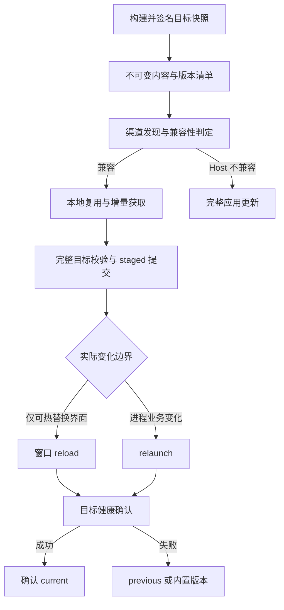

# 可迁移桌面应用增量更新规格

Status: draft
Translation: current

[English](portable-desktop-ota.md)

## 1. 场景、决策与证据边界

用户需要频繁接收桌面业务更新：未改变运行时能力时，只传输缺失业务内容；仅界面变化时可刷新窗口；业务主进程变化时重启应用；运行时、引导器或原生依赖变化时完整更新。更新失败不能破坏当前安装、可回退版本或用户数据。

本规格定义可独立复现这些能力的行为契约，不要求 Electron、特定语言、仓库布局、依赖注入框架、对象存储供应商或原项目代码结构。需要评审的决策是：将安装信任边界与可独立更新业务分离，采用不可变目标版本和事务式激活，并用真实行为证明安全回退及增量收益。本文件不授权修改 Lody 的运行时或发布系统。

规范词“必须”表示验收义务，“应”表示有理由可偏离的建议，“可”表示可选能力。下文需求 ID 为稳定追踪单位。证据分为：S＝固定版本源码/PR 补丁所见；A＝所给文章描述；D＝为形成可迁移完整契约而补充的设计要求；X＝已实际执行的行为证据。S 和 A 均不等于 X。所有强制条款对目标实现有效，即使参考实现尚未证明满足。

参考基线是 LobeHub PR #20191 head `d9eab5a5004ff3d1d92f301c09a971d1186264cf`；历史 renderer 与 Sparkle 设计另以各 PR head 固定。文章发表时未合并的 Sparkle PR #19459，API 显示后来于 2026-10-02 合并；不得把后续能力倒算成 9 月 29 日基线的能力。本文区分最终能力与历史路线，不要求目标项目重建已淘汰的中间方案。本文未运行参考桌面应用，也没有目标实现的运行证据。

本次实施只采用最终能力：签名 Core 完整快照、内容寻址与字典补丁、不可变 pack/Range、事务式激活与健康回退，以及现有平台完整应用更新。历史 renderer-only、源码 binding 图兼容算法、gzip CAS、V2 ZIP 和 v3 全量 ZIP 只作为证据背景，不属于新客户端、服务端或迁移兼容实现范围。补丁链按所选原生完整更新器的实际能力单独验收。

## 2. 逻辑架构与职责

| 逻辑角色 | 输入/输出与职责 | 信任及所有权 |
| --- | --- | --- |
| 安装层 Host | 运行时、引导器、信任公钥、原生资源、内置业务版本 | 由操作系统认可的完整安装交付；不能靠普通业务 OTA 任意改写 |
| 业务版本 Core | 主进程业务、preload、界面及其可携带依赖的完整快照 | 远端版本先验证再执行；提交后不可变 |
| 构建/发布端 | 业务产物→内容清单、压缩对象、补丁、pack、签名版本描述 | 签名私钥不分发到客户端；发布指针是最后一步 |
| 发现与策略 | 查询渠道、兼容性、发布序号、灰度、完整更新 | 远端元数据不能绕过本地信任规则 |
| 获取与组装 | 复用本地内容、制定下载计划、验证并组装完整目标 | 仅写 staging/新对象；不得覆盖活跃版本 |
| 激活与健康 | 切换资源根、reload/relaunch、确认健康、回退 | 一个持久化激活事务有唯一所有者 |
| 完整应用更新器 | 替换 Host、原生模块和业务基底 | 平台安装器负责签名、权限、替换与重启 |
| 交互与诊断 | 展示检查/下载/待应用/失败/回退及当前实际版本 | 展示真实阶段，不把已下载说成已运行 |

角色可由一个进程或多个组件承担。依赖方向是 Host 选择并启动 Core，Core 可请求 Host 提供的版本化能力；下载的数据不得先执行再验证。最小救援路径必须独立于待测试 Core 的启动成功。



## 3. 术语与版本身份

Host 是稳定能力边界，不等于“绝不变化”。Core 是一次更新要交付的全部业务文件，而不是补丁覆盖目录。Builtin 是完整安装中受安装签名保护的已知基底。Object 是按未压缩内容摘要标识的字节串。Frame 是一个完整 object 或补丁的独立压缩表示。Pack 是多个 frame 的不可变拼接容器。Release 是目标文件树及其策略、兼容性和传输描述的签名集合。

**ID-01** 必须区分 Host 版本、Core release ID、发布单调序号、协议版本、兼容标识、渠道、操作系统与架构。用户展示版本不得改变 feed 定位；同一 Host 下接收 Core 后仍能找到正确更新源。版本号字符串不承担唯一的兼容性或安全排序语义。

**ID-02** Release ID 在其命名空间内必须唯一且不可变；同 ID 不得发布不同内容。摘要必须带明确算法；参考兼容配置采用 SHA-256 小写十六进制。下载期间固定目标 release，latest 变动不能把两个版本的内容混组。

## 4. 能力范围与可替换选择

| 必须保留的机制 | 可替换的实现选择 | 不允许的缩水 |
| --- | --- | --- |
| Host/Core 明确信任与兼容边界 | app.asar + core.asar、其他归档/目录 | 业务任意改写引导器和公钥 |
| 签名清单绑定完整目标及传输位置 | canonical JSON + Ed25519 或经评审的等价协议 | 只校验下载文件 hash、但 hash 本身可被替换 |
| 内容寻址、精确基底补丁、独立解码 | zstd 字典、其他有界可验证 delta | 仅有补丁而无完整目标获取路径 |
| 不可变 pack 与受校验 Range | pack 数量、存储路径、并发度 | 固定“文件数超过阈值就全量”代替成本判断 |
| 完整目标组装和原子激活 | 文件系统 rename、事务数据库、日志 | 直接覆盖正在执行的文件 |
| 健康确认、有限失败回退 | 健康信号、超时值、救援 UI | 每次启动再次尝试同一个坏版本 |
| 完整应用更新兜底 | Sparkle、平台安装器、其他安全 updater | 运行时变动仍强行用业务 OTA |
| 真实流程验收和证据 | 测试驱动器和观测工具 | 用类型/单测/目录存在代替能力验收 |

完整能力范围包括 Core OTA、界面刷新、进程重启、完整应用更新、签名、差分、跳级、回退、发布隔离、灰度、清理与观测。历史 renderer-only 模式用于解释兼容性条件与迁移；补丁链是单独可选扩展，不能冒充 Core 基线的必需依赖。

## 5. 兼容性与应用方式

**CMP-01** Host 必须提供兼容描述，覆盖运行时/引擎版本、原生模块 ABI、Host 提供的依赖及锁定解析、引导和加载协议、资源布局、签名信任根、平台/架构、必须外置的运行资源。可用精确指纹或显式能力协议；任何未被独立封装的依赖变化都须进入判定。兼容性不能只看 renderer 源目录或人类判断的“前端改动”。

**CMP-02** 不能被 Core 携带并独立加载的能力变化必须完整更新。参考实现以 shellAbi 精确相等为条件；迁移项目若支持能力范围匹配，须证明双方解释一致，不能无依据放宽兼容性。跨平台 release 即使摘要相同也不能绕过平台适用性。

**CMP-03** reload 必须根据“当前实际运行版本→目标版本”的非界面执行边界等价性判断：主进程、preload、原生绑定、启动参数、协议、worker 与长期子进程依赖均不能发生要求重启的变化。未知情况选 relaunch。目标清单相对上一发布版本的 applyMode 只能作为提示；跳级时不得仅凭这个提示刷新。

**CMP-04** reload 采用每窗口/每执行域的版本租约：切换发生在加载新文档之前；旧页面的懒加载资源在其关闭前保持可用；一次文档及其 preload/worker/API 契约必须属于兼容组合。多个窗口不能混用不兼容版本。未保存输入须保留、恢复或让用户推迟刷新；无法保证时选重启或延后应用。

**CMP-05** 历史 renderer-only 模式要求 main/preload 及其所有实际依赖不变。若采用此模式，必须对发布产物边界或可证明完整的输入闭包判定，而不能根据共享 package 名称猜测。最终 Host/Core 模式将业务 main/preload 纳入 Core，缩小需要保持不变的 Host 边界；不要求复制参考项目的大型源码图算法。

## 6. Release 数据契约与密码学

**MAN-01** 每个 release 至少定义下表语义。字段名和编码可变化，语义不能遗漏。

| 数据 | 必须表达的语义 |
| --- | --- |
| 协议/身份 | schema、release ID、seq、channel、platform、architecture 或明确的兼容分发约束 |
| Host 要求 | 兼容 ID/能力要求；完整更新发现位置由本地可信策略决定 |
| 文件树 | 规范相对路径、内容 hash、解压后字节数；如支持权限/链接，须定义其安全语义 |
| Object 索引 | 每个唯一目标 hash 的完整 frame，含 pack 标识、offset、length、压缩摘要 |
| 补丁索引 | 精确 from hash、to hash、frame 定位和压缩摘要；声明解码算法 |
| Pack 索引 | 不可变相对路径、全包 hash、完整大小 |
| 策略 | rollout、应用方式提示、可选前驱版本；不以 previous 强迫串行升级 |
| 签名 | 签名算法/协议、公钥选择规则及签名值；信任根不来自同一未验证响应 |

**MAN-02** 必须拒绝未知必需协议、歧义编码、重复键、重复/冲突文件路径、缺失 object、相同 hash 对应不同尺寸、越界整数、溢出区间、未声明 pack、非法或重叠 frame。空文件允许；空业务树是否可运行须由产品入口契约决定，不能把缺失清单当空更新。

**SEC-01** 下载地址、索引、大小、内容 hash、版本与策略必须一起被认证。参考配置对移除 signature 后的 canonical JSON 签名：对象键排序，数组顺序保留，确定性 JSON/UTF-8 编码；Ed25519 签名以 Base64 表示。独立协议须明确数字、Unicode、重复键与未知字段处理，并提供跨语言向量；不得对含默认值或重排变化的对象验另一种字节签名。

**SEC-02** HTTPS 保护传输，签名认证发布者，两者不可互相替代。外部 Core 执行前验证签名、适用性和文件内容。安装内置 Core 可依赖经验证的完整安装签名；“来自本地目录”本身不是信任。若要防本地恶意篡改，须另有权限或隔离机制，普通用户可写目录和自校验不能抵御同权限恶意进程。

**SEC-03** 下载位置只能从经验证的受限相对路径与可信源组合。拒绝路径穿越、绝对路径、NUL、反斜杠歧义、盘符/设备路径、符号链接逃逸；在大小写不敏感或 Unicode 归一化文件系统上拒绝映射冲突。解包和落盘均须验证最终路径归属；不执行包内安装脚本。

**SEC-04** 必须分别验证压缩 frame hash、解码后内容 hash/大小；全包获取时另验 pack hash。部分下载不能用“完整 pack hash 存在”代替片段真实性。解码前/中执行 manifest 大小、文件数、frame、输出、总磁盘、内存、并发和耗时限制，防止压缩炸弹与资源耗尽。

**SEC-05** seq 防意外倒退必须明确其命名空间和持久化高水位。签名旧版本仍可被重放；如产品要求防恶意回放/冻结，必须补充受信新鲜度和恢复规则。允许回退到本地已确认版本不等于允许远端任意降级。密钥轮换需完整安装或既有信任根认证的轮换协议；撤销、紧急恢复与旧客户端支持窗口必须记录。此项为 D，不宣称参考已完整解决。

## 7. 内容、压缩、补丁与包

**OBJ-01** 内容身份依据未压缩字节计算。相同内容在多个路径只需一个 object；重命名不改变内容身份。压缩表示变化不应改变逻辑内容身份。新版本必须完整描述目标树，删除文件通过其不在目标树表达，不能遗留旧文件覆盖层。

**DEL-01** 字典补丁只适用于验证过的精确旧内容 hash。参考配置：以旧文件字节作为 zstd dictionary，压缩目标内容；解码时使用相同字典，再验证目标 hash/大小。这不同于对压缩安装包做 blockmap，也不同于 Sparkle BinaryDelta。没有匹配字典、补丁不划算、生成失败或应用失败时，获取该目标完整 object；不能因此要求下载全部应用。

**DEL-02** 发布端可使用路径、去掉构建 hash 的资源名或相似性来寻找候选旧文件，但候选匹配不构成正确性证据；补丁必须回放并校验目标才可发布。仅当实际压缩补丁加开销具有收益时保留。参考 v4 仅对 renderer/CLI 范围尝试补丁；该范围是优化选择，其他业务文件仍通过完整 object 更新。

**PAK-01** Pack 是独立压缩 frame 的有序字节拼接，不再整体压缩。签名索引给出精确定位，客户端不扫描寻找 frame。参考采用一个 objects pack 和可选 patches pack、按内容标识排序、固定压缩参数。可调整数量与分片，但同输入/工具链应能得到稳定内容，时间戳等非语义数据不应导致无意义变化。

**PAK-02** 每个 release 必须包含全部目标内容的完整 object 获取路径；补丁仅优化。v1→v5 可直接读取 v5 并完成组装，不查询 v2/v3/v4，也不依赖服务器保留全部历史补丁。前一版本内容不可用时，发布仍可省略补丁完成正确发布。

**PAK-03** Pack 不可原地覆盖，按实际字节摘要命名或等价不可变寻址。本地按内容去重不意味着远端跨版本 pack 去重，也不保证每次发布上传量更少；不得将客户端节省下载字节宣传成服务器上传/存储节省。

## 8. 获取计划与 HTTP 契约

**NET-01** 从 builtin、活跃外部版本、被保留版本和对象缓存中识别可复用内容；存在路径不等于内容有效。必须验证复用源，坏缓存隔离后重新获取，不能反复重用。以目标 hash 去重缺失集合。

**NET-02** 至少比较完整 object Range、可用补丁混合 Range、完整 objects pack 三类候选。按 pack/offset 合并连续范围；跨间隙合并计入额外字节且遵守单请求预算。应使用压缩字节和请求成本估算：`bytes / throughput + ceil(requests / concurrency) × latency`。这是启发式，不是性能保证。禁止以 400 个等固定文件数作为唯一全包阈值。冷启动参数可配置在实现中，必须测量校准；无须引入远端遥测服务。

**NET-03** 单请求使用一个连续 `Range: bytes=start-end`，end 为包含端点；内部区间表示必须一致。要求 206、精确 Content-Range、总 pack 大小和实际长度一致。禁止会改变字节表示的整体 Content-Encoding。416、截断、错位、错误总长、超量响应和摘要错误不得进入已验证缓存。

**NET-04** Range 返回 200 时取消未受控读取，并至多合并为一个受大小约束、校验全包 hash 的完整获取任务；不能每个 Range 都重复下载整包。单个范围失败有限重试，只处理尚缺内容；补丁失败可退到对应完整 object。普通请求失败不能无界重试或静默升级为完整应用下载。每种失败的重试次数/退避/人工重试入口须在目标实现声明。

**NET-05** 获取、完整包落盘和解码必须有界。临时对象验证后原子提交，进程退出后只复用已验证对象。持久化字节级断点续传为可选能力；若没有，必须明确只保证 object 级重用。并发同内容获取应合并；取消一方不应破坏仍有所有者的下载。

## 9. 安装布局、本地持久化与空间

**STO-01** 内置业务可使用归档减少安装小文件成本，首次启动不要求先展开整个归档。必须枚举哪些消费者支持归档虚拟路径：main、preload、renderer 协议、独立 Node/CLI、子进程 cwd、原生动态库和外部工具。需要真实路径的资源必须外置或按需安全物化，不能让 CLI 等隐含依赖首次全量展开。

**STO-02** 外部目标必须是完整快照，在新临时目录组装。可优先硬链接已验证的不可变本地文件，跨卷/权限/不支持时复制；归档内部虚拟路径不能直接硬链接。共享 inode 内容绝不原地写。入口、全部目标内容与资源引用验证通过后，才提交 release 和 staged 记录。

**STO-03** 持久化状态至少可表达：兼容域、current、previous、staged、激活尝试标识、实际运行版本租约、健康结果及拒绝重试集合。目标实现可用不同结构；写入须支持故障恢复。原子 rename 只保证可见性，要求掉电持久性的平台还须定义 flush/fsync 与目录提交顺序。残缺临时文件不得被解释为成功。

**STO-04** 必须估算包含安装内置版本、目标快照、对象缓存、下载与组装临时数据的峰值空间。磁盘不足、只读目录、文件占用、杀毒软件阻断、跨卷链接失败和权限错误均安全失败；不能先删除唯一可用版本腾空间。

**STO-05** GC 必须保护 current、previous、staged、正在运行的旧资源版本、下载/组装任务和回退所需对象。先获得一致引用快照/租约，再删除无引用对象。跨 ABI/Host 更新时旧指针失效，新 builtin 可启动；旧缓存是否保留由兼容和引用决定，不能删除设置、用户文件或业务数据库。清理旧 renderer 缓存须有明确目录所有权。

## 10. 客户端状态机与恢复

**LIF-01** 检查、获取和应用是不同状态域；下载失败不改变 current。对同一安装/配置目录的激活操作串行化；跨进程用锁、租约或等价机制防竞态。过期任务不能在新任务后写指针。崩溃后锁必须可安全恢复。

| 状态 | 进入条件 | 允许的下一步与用户可见结果 |
| --- | --- | --- |
| Idle/Checking | 用户检查或允许的后台触发 | 无更新、Deferred、HostUpdateRequired、Acquiring；当前业务持续运行 |
| Deferred/Rejected | 灰度未命中、版本旧、不兼容/黑名单/认证失败 | 保持当前版本；显示可解释原因，不谎报最新 |
| Acquiring | 目标清单已验证且适用 | Assemble 或 Failed/Cancelled；已验证对象可复用 |
| Assemble | 完整目标对象已齐备 | 全树校验→Staged；失败不发布指针 |
| Staged | 目标不可变目录与清单已提交 | 等用户/安全时机 Apply，或被明确更新目标替代 |
| Applying | 已记录唯一尝试、回退点和目标 | reload/relaunch→Probation；请求发出不等于成功 |
| Probation | 实际执行目标版本 | 目标相关健康信号→Committed；启动错误/超时→Rollback |
| Committed | 对应尝试健康已持久化 | current=目标，保留可用 previous；显示实际运行版本 |
| Rollback | 候选不健康或用户授权恢复 | 回到安全 previous，必要时 builtin；隔离失败版本 |
| Recovery | previous/builtin 无法正常启动 | 独立救援入口提供修复完整安装、诊断与重试选择 |

**LIF-02** 激活必须先持久化恢复意图，再启动目标；健康提交绑定 release、尝试 ID 和运行实例。旧进程或旧窗口的迟到信号不能确认新目标。健康定义至少包含主执行域初始化与必要界面/能力可用，不以“进程启动”或“窗口创建”代替。健康超时、失败计数及恢复阈值由产品明确，测试必须能控制时间而不依赖真实等待。

**LIF-03** 每个事务边界杀进程后，重启只能看到旧完整版本、待确认的完整目标或已确认目标；不能执行半组装版本。未确认启动与用户正常退出、系统关机、强杀无法完全区分；实现必须声明判断及有限容错策略，避免无限崩溃循环，也避免一次关闭永久封禁。

**LIF-04** 失败候选记录必须隔离到正确的兼容域和 release 身份；普通自动检查不得重新激活同一个坏候选。更新到修复版、明确人工重试或经认证恢复策略可解除。previous 不可用时回 builtin；builtin 失败走救援，不递归重启。

**LIF-05** 业务数据回滚独立于代码回滚。Core OTA 若包含数据结构迁移，必须向后兼容受保留版本，或采用可恢复事务/备份并验证恢复；不能承诺代码回退即可撤销不可逆数据库迁移。用户业务写入不得因更新回退无说明丢失。此为 D，必须在迁移实施时验证。

## 11. 发布、渠道、灰度与升级迁移

**PUB-01** 命名空间至少隔离产品、渠道、Host 兼容域/版本、平台/架构和协议。参考 v4 按渠道/Host appVersion/core-v4/platform 隔离；不同项目可换布局。完整应用发现入口应稳定，不能要求先成功执行坏 Core 才知道有救援更新。

**PUB-02** 发布顺序为全部不可变 pack→不可变版本清单→验证可读与 Range→原子推进 latest。并发发布以单调 seq 和条件写/发布互斥防倒退。仅版本文件上传成功不代表 release 已发布；latest 提交失败须可幂等重试。无业务变化的构建应避免无意义发布。

**PUB-03** 灰度必须对一个安装保持稳定分组，在相同 release/渠道下反复检查不随机跳组；声明分组标识、隐私边界及比例语义。rollout=0 不激活，rollout=1 覆盖全部符合条件安装；强制/紧急策略须明示，不能悄然忽略用户关闭更新或正在工作的状态。

**PUB-04** 严格 schema 不兼容升级必须独立 feed 或能力协商。旧 renderer/v3 客户端继续使用可理解协议；新 Host 通过完整应用安装交付新 loader、信任和内置布局。旧 updater 不得被切到无法解码的 Core。兼容期允许双产物；停旧 feed 必须有支持周期、回退窗口和在途下载宽限，而不是新发布即删除。

**PUB-05** 安装完整新 Host 后，先验证并使用与新 Host 兼容的 builtin；旧 ABI 外部指针不能覆盖它。再发现新域 OTA。用户设置、业务数据及渠道选择按声明迁移。发布端生成新补丁时须能读取上一版实际协议，不能假设旧 CAS 对象永久存在。

## 12. 完整应用更新及 Sparkle 配置

**FUL-01** Host 不兼容、引导器/信任根更新、原生运行资源变化或用户需要修复时，必须提供完整应用更新。完整更新与 Core 更新共享协调所有权，避免在安装替换期间激活另一个 Core。下载失败继续运行当前完整安装；更新器处理平台权限、签名、退出、替换、重新启动和失败恢复。

**FUL-02** macOS 的参考路线是 Sparkle：使用 appcast 描述完整包和从特定旧完整构建生成的 delta；BinaryDelta 对解包后的应用目录生成文件/二进制差异。delta 必须绑定准确源构建和目标构建，验证签名、目标包完整性与操作系统要求；源版本不匹配、补丁不可用/失败时回完整安装包。嵌入 framework、助手、代码签名、notarization、安装位置权限及实际 relaunch 均需在打包态验证。Windows/Linux 可选等价安全完整更新器，无须移植 Sparkle。

macOS 原生更新引擎的交互契约包括检查中、已发现、下载进度、下载完成、立即安装、退出时安装及失败；原生引擎若检查时已经下载，单独“开始下载”操作必须幂等，不得再次下载。切换渠道时废弃旧渠道尚未安装的候选，不能让迟到回调把旧候选重新激活；原生会话未结束时延后新检查，并在关闭时释放回调所有权。比较版本必须采用原生更新器理解的单调构建编号，同时保留用户可读版本；预发布标签不能被原生比较器截断而误判为同版本。渠道切换的降级策略必须声明，不能从 Windows 的策略推定 macOS 也允许降级。上述细化归属于 FUL-01/02 与 PUB-01/03 的验收义务。

**FUL-03** 压缩后 blockmap 对包字节分块，目录级 delta 对解包内容比较，Core CAS 对逻辑内容复用，三者不是同一算法。不得承诺“改一行必然得到极小补丁”，ASAR 偏移、编译器、签名、资源和非确定性构建均会影响大小。必须用相同产物和真实网络测量。

**FUL-04（可选扩展）** 若实现补丁链，必须把完整构建视为节点、签名 delta 视为有向边，验证每跳精确基底、目标身份、累计成本、最大跳数和失败恢复；比较直接 delta/链/完整包，不能让中间版本缺失阻断最终更新。每跳应用于临时副本，最终完整验证后才替换安装。Core 的跳级能力不依赖此扩展。是否由选定版本 Sparkle 原生支持，须另行取证，不能仅凭文章的后续计划宣称存在。

## 13. 用户流程、诊断与性能

**UX-01** 至少可观察当前 Host/Core、检查结果、下载阶段、待应用方式、推迟/取消、错误原因和回退结果。后台失败不得阻断正常业务或弹窗循环。下载百分比仅代表明确计量域；复用/解压/健康阶段另行表达。取消后不承诺已回退已完成的激活。

**UX-02** 刷新/重启前处理正在进行的任务和未保存数据；用户拒绝应用保持 staged 或明确丢弃。多窗口、托盘运行、CLI/子进程与单实例重启都需定义。手动检查与自动检查共享策略状态，不能并发重复应用。

**OBS-01** 本地诊断记录事务 ID、源/目标身份、兼容结论、计划选择及原因、请求/有效/额外字节、重试、补丁命中、组装与激活耗时、健康与回退原因。避免记录令牌、私钥、用户内容或长期个人标识。网络统计分别记录客户端传输与可观测 CDN 回源；收到 206 不证明 CDN 只回源一段。

**PER-01** 验收数据集至少包含无变化、仅 renderer、主进程变化、401+ 小文件、接近全量、跨多版本和 Host 变化。记录发布构建/上传/签名总耗时、对象数量/字节，客户端请求数/下载/CPU/内存/磁盘峰值、安装/首次可交互/reload/relaunch 时间。参考文章的 64 分钟→4–8 分钟是历史环境观测，不是目标 SLA。目标项目必须在验收前声明硬件、网络、数据集和预算，不预先保证倍数收益。

## 14. Requirements Conformance Verification

验证对象是实际产品能力，不是本文是否写了某段代码。每条需求建立记录：`requirementId、来源(A/S/D)、解释、目标实际入口、场景ID、执行环境/构建ID、输入与故障注入、观测证据、状态、偏差与复现步骤、责任人`。源码路径只用于定位，不能作为通过证据。

允许状态为：已实现并验证、部分实现、未实现、行为偏离、无法验证；条件不适用必须给出适用性依据，不能用来隐藏必需能力。无法运行或没有证据时为无法验证；不能推定已实现。报告两个独立视图：实现差距与证据差距。

需求覆盖率分母是所选能力范围内全部需求 ID；分子仅计有充分真实行为证据的通过项。部分项不得算全部通过；可选 FUL-04 若不选择，必须显式标注未选择而非完成。细分需求含多个义务时分别记录，防止只验证成功路径。覆盖率只是导航，安全/数据损失问题不能被高百分比抵销。

| 需求 | 来源与主要验收场景 | 通过所需证据 |
| --- | --- | --- |
| ID-01/02、MAN-01/02 | S+D；T01/T02/T09 | 身份/协议切换、非法元数据拒绝、固定目标快照 |
| CMP-01/02/05 | A+S+D；T02/T03 | 共享依赖、native、Host 变化实际分流 |
| CMP-03/04 | S+D；T03/T04 | 跳级、旧页面懒加载、多窗口及真实入口版本一致 |
| SEC-01/02/03/04/05 | S+D；T09/T10/T15 | 未授权内容不执行、路径不逃逸、受限资源及回放政策 |
| OBJ-01、DEL-01/02、PAK-01/02/03 | S+D；T05/T06 | 目标字节一致、删除/重命名、精确基底及跳级实际请求 |
| NET-01/02/03/04/05 | S+D；T05/T06/T07 | 请求日志、字节计数、故障响应、缓存及重试结果 |
| STO-01/02/03/04/05 | S+D；T08/T11/T12 | 打包态真实路径、进程中断、空间与引用保护 |
| LIF-01/02/03/04/05 | S+D；T11/T12/T13 | 启动恢复、迟到信号、并发激活及业务数据结果 |
| PUB-01/02/03/04/05 | S+D；T02/T14/T15 | 发布故障/并发、稳定灰度、旧客户端迁移 |
| FUL-01/02/03 | A+S+D；T16 | 已签名安装的 delta/全量/失败恢复及真实 relaunch |
| FUL-04 | A+D；T17（选择时） | 多跳实际应用、坏中间边恢复与完整目标验证 |
| UX-01/02、OBS-01、PER-01 | A+S+D；T01/T04/T18 | 真实交互、结果诊断、可重复性能报告 |

当前交付仅有规格和参考静态证据，所有目标能力的运行验证状态均为“无法验证”；没有目标实现可宣称通过。

## 15. Behavioral Equivalence Testing 与验收用例

使用可控制的发布源、签名测试密钥、实际打包应用、可注入故障的 HTTP 代理和受控文件系统。合成业务数据，不使用真实用户记录。单元/属性测试可帮助定位，但端到端证据必须来自真实进程/窗口/文件系统/HTTP 及安装结果。不得以源码字符串、mock 调用次数或理论可行替代下表结果。

| 场景 | 操作及故障 | 必须观察的结果 |
| --- | --- | --- |
| T01 正常完整旅程 | 安装 A→检查 B→后台下载→推迟→应用→再启动 | 工作不被下载中断；推迟保持 A；应用后显示并实际执行 B；Host 身份正确 |
| T02 适用性 | 错渠道/平台/架构/Host/protocol/旧 seq；rollout 0/1/部分 | 不合适内容不执行；完整更新可发现；同安装灰度稳定；没有错误跨域引用 |
| T03 应用方式 | renderer-only、main/preload/shared/native 各改一次；跨多版本 | 仅安全界面变化 reload；main/preload 重启；Host/native 越界完整更新；跳级不会错误刷新 |
| T04 窗口与业务状态 | 多窗口、旧文档懒加载、运行任务/未保存输入、延迟加载 worker | 资源契约一致；旧版本仍可完成请求；状态保留/明确推迟，无静默丢失 |
| T05 内容复用 | 改/删/重命名/重复内容/空文件，损坏本地 object | 完整目标树字节与清单一致；删除不残留；有效复用不重复传；坏源被替换 |
| T06 补丁与跳级 | v1 直升 v5，移除所有中间 manifest；坏/缺字典及坏补丁 | 无中间版本请求；目标可达；仅失败 object 回完整块；不整包升级掩盖错误 |
| T07 HTTP/计划 | 401+ 小文件；近全量；200/206/416/错位/截断/超量/编码 | 成本合理选择；200 受控合并全包；异常不污染缓存；重试有界；逐请求与总字节可核对 |
| T08 真实安装布局 | 从内置归档首启，执行 main/preload/UI/CLI/native/子进程 | 不先全量展开；真实路径能力可用；首次 OTA 写出完整快照；无非法归档 cwd |
| T09 认证与输入边界 | 篡改 tree/索引/策略/signature；路径逃逸/冲突/大输出 | 验证失败阻止执行和越界写；输出/内存受限；current 不变 |
| T10 缓存/不可变性 | 改缓存、硬链接目标、同 ID 不同内容、运行中 GC | 旧版本字节不变；坏内容不复用；同 ID 冲突被拒；租约引用不被删 |
| T11 崩溃矩阵 | 在对象提交、目录提交、staged、切换、启动、健康前后终止进程 | 重启只运行完整合法版本；无半版本、无永久锁、无无限坏版本重试；迟到健康不能误确认 |
| T12 IO/并发 | 磁盘不足、只读、跨卷、文件占用；两进程同时应用 | 安全失败/复制降级；唯一激活事务；当前与回退版本完整；任务可取消并恢复 |
| T13 回退与数据 | 候选抛异常/界面无响应；previous 缺失；数据库已写入 | 正确回退/内置救援；失败版隔离；数据兼容或可验证恢复，无业务写入静默丢失 |
| T14 发布故障 | 上传 pack 中断、版本清单失败、latest 并发/失败、旧包清理 | latest 不指残缺 release；幂等重试；无倒退；在途/旧支持版本仍可下载 |
| T15 迁移/安全政策 | 老 renderer/v3 客户端→新 Host；换 key/ABI；重放旧签名清单 | 老客户端仍用旧协议；新 builtin 可启动；旧指针不误激活；信任与回放政策符合声明 |
| T16 完整更新 | 正确/错误源的 Sparkle delta、缺 delta、权限/签名失败、真实重启 | 正确源可安装；否则受控全量；签名失败不执行；安装与原生能力/业务状态正常 |
| T17 补丁链 | 2+ 跳、缺中间边、坏边、超跳数、链比全量昂贵 | 选择成本合理可达路径；每跳精确验证；失败不破坏安装；可完整包恢复 |
| T18 性能/分发 | 声明环境下冷/热 CDN、连续/跳级/401+/近全量，多次重复 | 原始样本、分位值/离散性、网络/磁盘峰值与预算对照；不把本地服务器结果当真实 CDN |

等价比较采用同一初始状态、逻辑发布内容、故障和用户动作，收集参考与目标的归一化轨迹：`检查结论→获取对象集合/字节→staged→应用方式→实际运行身份→健康/回退→用户数据结果`。忽略文件布局、内部类名、线程数量、非契约计时；比较允许的状态顺序、执行内容和安全结果。不能用截图相似代替行为等价。

参考行为与本规格冲突时，记录“参考差异/已知缺陷/本文新增约束”，以需求和本文为验收基准；禁止为追求等价复制安全缺陷，也不能悄悄改写规范来让测试通过。参考无法启动时保留规范一致性测试结果，等价性结论单独记无法验证。

每个失败案例给出最小复现：构建/平台/源目标版本、初始磁盘与指针、确切请求响应或注入点、操作步骤、预期、实际、日志/网络记录/文件 hash/画面、恢复结果。通过案例同样保留最终实际运行版本和内容证据。涉及外部分发和 OS 安装的案例必须在其真实边界执行。

## 16. 跨架构迁移实施清单

实施前交付映射表：本项目 Host/Core 边界、每种依赖归属、全部执行入口、信任源、兼容算法、feed 命名空间、支持 OS/架构、持久化原语、完整更新器、数据迁移策略、健康信号、并发所有者、资源限额和旧客户端退出窗口。每项链接到相应需求 ID 与验收案例。

可按“签名完整目标获取→隔离组装与恢复→精确复用→字典补丁→pack Range 计划→安全 reload→完整应用 delta→可选补丁链”逐步实施。阶段完成只能声明该阶段已验证能力，不能用先走全量的临时实现声称增量、Range 或热刷新完成。

目标验收须由需求差距驱动：先列未实现/偏离/无法验证项，再选择补充实现或实际取证。所有必需项有符合证据后才可声明完整能力；残留可选项、平台限制、未测部署条件须与结论并列。

### 16.1 最小协议演算与故障判定

以旧树 `{main:M1, ui:A1, shared:S}`、目标树 `{main:M1, ui:A2, logo:S}` 为逻辑输入，字母表示已验证内容 hash 而非线上字段值：M1 与 S 本地复用；ui 获取 A2 的完整 frame 或精确 A1→A2 补丁；删除旧 shared 路径但保留其内容用于 logo；组装只含目标三个路径。若 main/preload 的依赖边界确实不变，可 reload；否则 relaunch。目标还必须提供 A2 完整 frame，保证没有 A1 的客户端也能更新。

```text
validate_release_and_signature(target)
assert_compatible(host, target)
verified_local = verify_available_content(builtin, retained_cores, cache)
missing = unique(target.content_hashes) - verified_local.hashes
plan = minimum_estimated_cost(full_frames, exact_base_patches, objects_pack)
fetch_and_verify_bounded(plan)
for each failed_patch: fetch_and_verify_its_full_target_object()
assemble_complete_target_in_new_location()
verify_tree_and_entry_contracts()
commit_staged_atomically()
mode = compare_actual_running_execution_boundary_with_target()
record_activation_attempt_and_recovery_point()
activate(mode)
commit_only_on_matching_health_signal_else_recover()
```

每阶段失败必须输出稳定的语义原因，可映射为 `ineligible / incompatible-host / unsupported-protocol / authentication / integrity / transport / resource-limit / storage / cancelled / activation / health / recovery`；不得统一成“网络错误”。可重试不等于自动重试，是否已产生 staged 或激活副作用必须单独表达。此演算不指定类、接口或存储目录。

## 17. 参考证据与验证限度

以下为公开源码依据，不把源项目目录作为迁移目标结构。固定快照已取得；这里只声称静态阅读，未执行其测试或打包应用。

- [v4 manifest 与 canonical signature](https://github.com/lobehub/lobehub/blob/d9eab5a5004ff3d1d92f301c09a971d1186264cf/apps/desktop/src/main/core/infrastructure/coreOta/manifest.ts)：v3/v4、目标树、完整 object、frame 边界、签名。参考限制为最多 2 packs、8 GiB/pack、256 MiB/frame/文件；这些是原配置，移植需有明确资源预算而非盲抄数值。
- [Range 计划与获取](https://github.com/lobehub/lobehub/blob/d9eab5a5004ff3d1d92f301c09a971d1186264cf/apps/desktop/src/main/core/infrastructure/coreOta/pack.ts)：8 并发、16 MiB 合并范围、冷估计 4 MiB/s 和 150 ms、Range 两次尝试、200 合并完整获取。默认值不构成 SLA。
- [v4 pack 构建](https://github.com/lobehub/lobehub/blob/d9eab5a5004ff3d1d92f301c09a971d1186264cf/apps/desktop/scripts/buildCoreV4.mjs)、[字典解码](https://github.com/lobehub/lobehub/blob/d9eab5a5004ff3d1d92f301c09a971d1186264cf/apps/desktop/src/main/core/infrastructure/coreOta/zstdPatch.ts)、[shell ABI 输入](https://github.com/lobehub/lobehub/blob/d9eab5a5004ff3d1d92f301c09a971d1186264cf/apps/desktop/scripts/shellAbi.mjs)：内容排序、完整 pack、可选补丁、renderer/CLI 优化范围与 Host 边界。
- [更新管理](https://github.com/lobehub/lobehub/blob/d9eab5a5004ff3d1d92f301c09a971d1186264cf/apps/desktop/src/main/core/infrastructure/coreOta/CoreUpdateManager.ts)、[持久指针](https://github.com/lobehub/lobehub/blob/d9eab5a5004ff3d1d92f301c09a971d1186264cf/apps/desktop/src/main/core/infrastructure/coreOta/pointer.ts)、[shell](https://github.com/lobehub/lobehub/tree/d9eab5a5004ff3d1d92f301c09a971d1186264cf/apps/desktop/shell)：激活、恢复与加载链路依据。
- [原项目 ASAR/pack 规格](https://github.com/lobehub/lobehub/blob/d9eab5a5004ff3d1d92f301c09a971d1186264cf/docs/development/desktop-core-asar-pack-ota-spec.md)：明确区分本地/R2 证据与待真实 CDN、完整安装、性能验收。源文档的“已实现”不等于本文已复验。
- 历史路线：[18648](https://github.com/lobehub/lobehub/pull/18648)、[18694](https://github.com/lobehub/lobehub/pull/18694)、[18724](https://github.com/lobehub/lobehub/pull/18724)、[18745](https://github.com/lobehub/lobehub/pull/18745)、[18799](https://github.com/lobehub/lobehub/pull/18799)、[19351](https://github.com/lobehub/lobehub/pull/19351)、[19410](https://github.com/lobehub/lobehub/pull/19410)、[19501](https://github.com/lobehub/lobehub/pull/19501)、[20191](https://github.com/lobehub/lobehub/pull/20191)。元数据及分页文件清单已取得，历史实现不是最终架构要求。
- [Sparkle PR #19459](https://github.com/lobehub/lobehub/pull/19459)：后续完整应用差分路线，与 20191 Core 基线分开评估。补丁链仍须对选定实际版本进行行为取证。

### 17.1 历史路线与参考配置对照

以下保留原设计的具体选择及限制，便于复核设计意图；不将其全部变成迁移项目的强制参数。

| 主题 | 参考静态行为 | 迁移含义/差距 |
| --- | --- | --- |
| renderer 早期压缩 | gzip 完整 CAS object + zstd 文件补丁；保留内置 r0 和最近版本的直接增量 | 不是连续补丁链；基线必须先由完整发布建立 |
| renderer V2 | 签名 manifest + full ZIP + 按 fromVersion 选择的直接 delta ZIP，pack 含 meta.json 与目标树/对象/补丁 | 旧协议可兼容维护，不要求新项目复建 ZIP 中间格式 |
| renderer 兼容推导 | 源输入→跨平台 main/preload 产物→源码/Vite 图→binding-aware runtime 图；覆盖副作用、动态导入和保守 fallback | 历史问题是误命中与误失配并存；最终目标是可证明的兼容边界，不是维护同一算法 |
| 发布隔离 | channel + appVersion 隔离远端 feed 和本地状态，避免旧 r9 覆盖新完整安装的 r0 | 兼容指纹相同也不能跨错误的发布域 |
| 启动选择 | 单实例锁先于 OTA 状态修改；staged/current/previous 候选验证后选择，最后 builtin | 外部主入口同步加载失败后新进程回退，避免污染进程内再 require 另一版本 |
| 失败计数 | 启动尝试先递增，健康回报清零；3 次失败后隔离外部候选，builtin 连续失败进救援 | 启动尝试不等于崩溃；正常退出未确认也可能消耗次数 |
| 运行健康 | reload loaded 截止 3 秒、mount 总截止 15 秒；首次外部冷启动 60 秒；待确认时两次 renderer crash 判失败 | 原回报不绑定版本/尝试，不能冒充 LIF-02；超时值是原配置 |
| staging 与实际运行 | relaunch 候选在 staging 时就提升持久指针；进程仍执行旧版本；reload 则应用时提升 | current、running、staged 不一定相同，UI 和验收必须分别观察 |
| 后台刷新 | 初检默认 90 秒，每小时检查；窗口无焦点 5 分钟可自动 reload；unload veto 抑制 | 是否允许自动刷新由目标产品明确；veto 后的指针恢复须验证 |
| 灰度 | 使用 userData 路径 + version 的 hash 稳定分组 | 路径不是可跨迁移保持的安装身份；目标须声明自己的分组语义 |
| 指针持久化 | 临时 JSON + rename；无该路径 fsync 保证 | 可见性原子不等于掉电持久性 |
| 救援 | 独立于业务 core，检查完整更新；无更新/失败时提供重试启动、下载页、退出 | 完整更新信任链须单独验证；不能用 OTA 签名代证安装器安全 |

### 17.2 Sparkle 后续基线与补丁链证据

Sparkle 固定 PR head 为 `cf13873469593deab6bd17485ee131a95095ca54`，不混入 20191 基线。该版本静态补丁显示：macOS 使用原生 bridge，其他平台仍用 electron-updater；macOS Stable 同时在 manager 和 shell-loader 禁止外部 Core OTA，Canary 保留 Core OTA + Sparkle 完整更新。这个渠道策略是原产品选择，不要求所有迁移项目照搬。

[发布脚本](https://github.com/lobehub/lobehub/blob/cf13873469593deab6bd17485ee131a95095ca54/apps/desktop/scripts/sparkleAppcast.mjs)、[发布 Action](https://github.com/lobehub/lobehub/blob/cf13873469593deab6bd17485ee131a95095ca54/.github/actions/desktop-publish-sparkle/action.yml)、[打包配置](https://github.com/lobehub/lobehub/blob/cf13873469593deab6bd17485ee131a95095ca54/apps/desktop/electron-builder.mjs) 表明：bridge 版本 0.5.2，Sparkle 工具 2.9.4；framework 放入应用 Frameworks，原生 addon 在 ASAR 外；arm64/x64 分 feed；Canary 构建号转换为原生可比较的编号。原生自动检查关闭，由应用负责检查调度，检查/下载周期上限配置 15 分钟，原生 fallback 时进度重新计量。

补丁链集成并非完全不存在：配置 `SUDeltaChainHistory=6`，发布默认从 1 个旧完整构建生成直接 delta，并通过外部 `appcast-history.py` 保留 6 个历史版本项，先上传 delta 再更新 appcast。缺历史 feed/旧包时允许不生成相应 delta。历史合并工具和原生链选择不在所读 PR 本地代码内，也没有本次实际多跳传输证据，因此只能确认链集成意图和调用配置，不能宣称任意旧版本都有链或生产链已验证。选择复现这部分时执行 FUL-04/T17，未选择须明确范围差距。

该 PR 作者报告了 macOS arm64 打包测试，但未包含 x64、生产 Developer ID 签名/公证与发布 CI 的完整本地验证；作者报告不是本文的 X 证据。

额外安全、数据迁移、掉电持久性、跨进程租约与验收条款属于 D；不能据本文反向宣称参考实现具备这些保证。本文没有 X 级产品验证结论。
