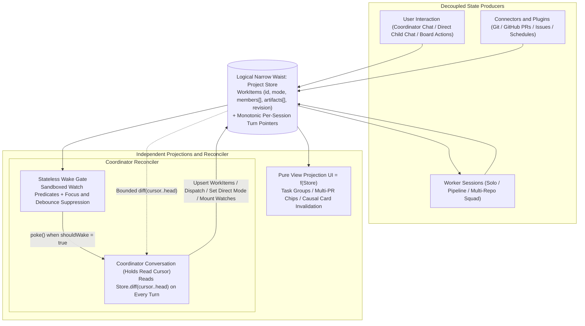

# Project Coordinator Mode

Status: draft
Translation: current

[中文](project-coordinator-mode.zh.md)

## Scenario

A project in Lody spans many conversations across roles, repositories, and machines. Routing every message through a single coordinator conversation breaks down in four situations:

1. **Direct collaboration desynchronization**: when the user works directly inside a child conversation (iterating on design, fixing issues, or opening pull requests), an isolated coordinator retains outdated context and keeps showing stale action cards.
2. **Multi-conversation collaboration**: a single goal frequently requires multiple conversations—such as an implementer paired with an independent reviewer, or parallel conversations across a main repository and submodules—without a shared task identity.
3. **Multi-artifact deliverables**: one task can produce multiple pull requests across repositories alongside non-PR external links (issues, previews, or exported files).
4. **High-bandwidth co-work vs. background orchestration**: relaying multi-turn design discussions through an intermediary adds latency and loses nuance, whereas waking the coordinator on every direct turn causes notification noise and token waste.

## Architecture: Narrow-Waist Project Store and Reconciler Loop

Project Coordinator Mode separates the **Control Plane** (intent decomposition, staffing, cross-session handoffs, and acceptance) from the **Data Plane** (high-bandwidth direct user-to-worker interaction and execution) around a single logical narrow waist: the **Project Store**.

Endpoints do not couple to one another directly:

- **Worker Sessions** execute work and accept direct user turns without knowing whether a coordinator, board, or plugin observes them.
- **Connectors and Plugins** synchronize external state (such as pull requests, CI runs, issues, or scheduled triggers) as observable resources and artifacts without encoding orchestration rules.
- **UI Surfaces** project `Project Store` state purely: board buckets, multi-PR badges, and proactive card freshness derive deterministically without model calls.
- **The Coordinator Reconciler** consumes one unified input path—`Store.diff(cursor..head)`—whether woken by a user message in the coordinator chat or by a stateless `poke()` from the Wake Gate.

## Core Contracts

### 1. `WorkItem` (`T1..Tn`) and Squad Topologies

`WorkItem` is the unit of project tracking between a `Project` and individual `Session`s:

- **Membership (`1..N` conversations)**: a simple task with one child conversation forms an implicit solo `WorkItem` keyed by its `sessionId` with zero extra tool calls or UI nesting. When multiple conversations collaborate on one goal (such as `implement` + `review` pipelines or multi-repository scatter-gather), the coordinator groups them under one `workItemId` with optional per-member `workItemRole` labels. Promoting an existing solo conversation into a multi-session group by reusing its `sessionId` as `workItemId` preserves its `T<n>` number.
- **Aggregated state and deliverables**: a `WorkItem` derives its board bucket (`needsYou`, `working`, `review`, `accepted`) across all members, unions all associated pull requests across members and repositories (`pullRequests[]`), and holds optional typed `externalRefs[]` (issue links, preview URLs, or plugin references). Accepting a `WorkItem` marks and archives all member conversations together.
- **Collaboration mode (`delegated` | `direct`)**:
  - `delegated`: the coordinator briefs workers, collects completion receipts, and presents next-step or review cards.
  - `direct`: for open-ended design, visual iteration, or multi-round back-and-forth, the coordinator seeds the child conversation with context, recommends direct collaboration in the side panel, and steps back until an explicit handoff or watched milestone occurs.

### 2. Physical Storage Ownership

`Project Store` introduces **no new Loro Stream IDs** and **no cross-session write contention**. Its state is partitioned across three existing storage owners and joined in memory:

| Logical Data                                                                                                   | Physical Owner                                                                                                                     | Sync Scope                                                      | Guarantee                                                                                                                                                                                                                 |
| :------------------------------------------------------------------------------------------------------------- | :--------------------------------------------------------------------------------------------------------------------------------- | :-------------------------------------------------------------- | :------------------------------------------------------------------------------------------------------------------------------------------------------------------------------------------------------------------------ |
| `workItems` control map (`id`, `taskNumber`, `title`, `mode`, `externalRefs`, `acceptedAt`)                    | Root key `workItems` on the coordinator's `SessionDoc` (`{workspaceId}:s:{coordinatorSessionId}`, via `sessionControlPlaneSchema`) | Synced with the coordinator session (E2EE-protected `doc` room) | Never bloats workspace-wide `{workspaceId}:meta` or `{workspaceId}:wf:workspace`; garbage-collected automatically when the coordinator session is deleted; ignored safely by older clients via `ignoreUnknownProperties`. |
| Child membership pointers (`workItemId`, `workItemRole`), live status, `latestUserMsgId`, and `pullRequests[]` | Each child conversation's own `SessionMeta` (`{workspaceId}:meta`)                                                                 | Synced in Workspace Meta Flock (~50 B added per grouped child)  | Remote worker machines write only their own `SessionMeta` and `SessionHistory`, never opening or contending on the coordinator's `SessionDoc`. No message previews enter `SessionMeta`.                                   |
| Proactive card causal anchor (`snapshotTurnBySession`) and `actionResolutions`                                 | `coordinator_message.card` inside the coordinator's `SessionHistory`                                                               | Synced with the turn entry                                      | Captures each linked session's `latestUserMsgId` when the card is authored, avoiding cross-machine wall-clock skew.                                                                                                       |
| Coordinator read `cursor` and active Watch Predicates                                                          | Coordinator host machine's private SQLite (`operations.sqlite` and `automations/ledger.sqlite`)                                    | Machine-local only (never synced)                               | High-frequency cursor advances and timer evaluations never broadcast over Loro Streams.                                                                                                                                   |

### 3. Causal Card Invalidation

When the coordinator emits a proactive `card`, the daemon records `snapshotTurnBySession[sessionId] = latestUserMsgId` for every linked child conversation (including sibling conversations in the same `WorkItem`).

- **UI projection**: an unchosen card whose linked session now reports a different `SessionMeta.latestUserMsgId` has been overtaken by direct child activity and automatically collapses as superseded.
- **CLI implicit reply matching**: when a user later types a plain message in the coordinator composer, `resolveCoordinatorPromptReplyHeader` skips open cards whose `snapshotTurnBySession` no longer matches current `SessionMeta.latestUserMsgId`, preventing stale `<related_card_context>` injection.

### 4. Domain-Agnostic Wake Gate and Bounded Lazy Digest

The routing kernel contains no hardcoded domain status enums (such as GitHub PR states):

- **Lazy digest (`diff(cursor..head)`)**: ordinary direct turns between the user and a child conversation do not wake the coordinator. When the coordinator next runs a turn, the host filters changed child sessions in memory via `SessionMeta` against the local `cursor`, performs bounded transient tail reads (`<= 4` concurrent rooms, top-K recent work items) to build a compact `<project_facts_delta>`, and advances `cursor`.
- **Programmable watch predicates (`CodeMode`)**: domain-specific milestones (such as opening a pull request, exporting target asset files, failing CI checks, or receiving external issue triggers) are expressed as sandboxed `lody_automation` predicates over pluggable read adapters (`ctx.read` / `ctx.exec` / `ctx.fetch`) that return either `false` or a wake summary.
- **Physical attention gate**: intrinsic completion of coordinator-owned `Operation`s, unattended child execution blocks/failures, and matched watch predicates pass through one physical gate—suppressing wakeups while the user is actively focused on that child conversation and coalescing bursts within a short debounce window (cancelling the pending wakeup if the user directly intervenes in the child conversation during the window).

## Performance and Security Bounds

- **Zero streaming sync amplification**: ordinary child turns, token streaming, and cursor advances write 0 bytes to `workItems`.
- **No workspace-wide room opens**: board rendering and `diff` candidate filtering inspect in-memory `SessionMeta` only; session documents open transiently only for the bounded subset of conversations whose `latestUserMsgId` advanced since `cursor`.
- **Narrow renderer subscriptions**: virtualized coordinator message rows do not subscribe to board state; staleness sets compute once at the stream container and feed unsettled card rows by key.
- **Ownership boundary**: `lody_coordinator_work_item` verifies coordinator session identity and rejects grouping conversations owned by another user.

## Evidence

- **Implemented and validated (Stages 1–2 — Blackboard, `WorkItem` grouping, multi-PR projection, causal card invalidation, `direct` handoff cards, and SQLite cursor `<project_facts_delta>`)**:
  - Shared contracts and Loro control-plane schema: [`packages/shared/src/coordinator-work-items.ts`](../packages/shared/src/coordinator-work-items.ts), [`packages/shared/src/coordinator-actions.ts`](../packages/shared/src/coordinator-actions.ts), [`packages/shared/src/schema.ts`](../packages/shared/src/schema.ts), [`packages/shared/src/session-doc-schemas.ts`](../packages/shared/src/session-doc-schemas.ts).
  - Daemon `lody_coordinator_work_item` MCP tool, automatic `snapshotTurnBySession` capture on `lody_coordinator_send_message`, stale-card guard in `<related_card_context>`, machine-local SQLite `coordinator_read_cursors` / `coordinator_turn_deltas`, and bounded `<project_facts_delta>` turn injection: [`apps/cli/src/lib/loro/doc.ts`](../apps/cli/src/lib/loro/doc.ts), [`apps/cli/src/mcp/lody-mcp-server.ts`](../apps/cli/src/mcp/lody-mcp-server.ts), [`apps/cli/src/lib/coordinator-reply-context.ts`](../apps/cli/src/lib/coordinator-reply-context.ts), [`apps/cli/src/lib/coordinator-project-delta.ts`](../apps/cli/src/lib/coordinator-project-delta.ts), [`apps/cli/src/orchestration/operation-store.ts`](../apps/cli/src/orchestration/operation-store.ts), [`apps/cli/src/lib/message-handler.ts`](../apps/cli/src/lib/message-handler.ts), [`apps/cli/src/session/coordinator-system-prompt.md`](../apps/cli/src/session/coordinator-system-prompt.md).
  - UI `WorkItem` board grouping, `direct` mode badges, `handoff` proactive cards, multi-PR chips across board/threads/cards, and reactive card supersession: [`packages/components/src/components/project-mode/project-board-model.ts`](../packages/components/src/components/project-mode/project-board-model.ts), [`packages/components/src/components/project-mode/project-board.tsx`](../packages/components/src/components/project-mode/project-board.tsx), [`packages/components/src/components/project-mode/coordinator-action-engine.ts`](../packages/components/src/components/project-mode/coordinator-action-engine.ts), [`packages/components/src/components/project-mode/coordinator-action-bar.tsx`](../packages/components/src/components/project-mode/coordinator-action-bar.tsx), [`packages/components/src/components/project-mode/use-coordinator-action-executor.ts`](../packages/components/src/components/project-mode/use-coordinator-action-executor.ts).
  - Automated suites: [`packages/shared/tests/session-doc-forward-compat.test.ts`](../packages/shared/tests/session-doc-forward-compat.test.ts), [`packages/components/tests/project-board-model.test.ts`](../packages/components/tests/project-board-model.test.ts), [`packages/components/tests/chat-virtual-rows-identity.test.ts`](../packages/components/tests/chat-virtual-rows-identity.test.ts), [`apps/cli/src/mcp/daemon-session-tools.test.ts`](../apps/cli/src/mcp/daemon-session-tools.test.ts), [`apps/cli/src/orchestration/operation-store.test.ts`](../apps/cli/src/orchestration/operation-store.test.ts).
- **Intended behavior not yet implemented (Stage 3)**:
  - Connecting coordinator-scoped `CodeMode` watch predicates, active child-panel focus suppression, and short-window debounce into the `Wake Gate` `poke()` loop.
- **Related context**: [Project coordinator mode gap analysis note](../.agents/notes/proposed/feature/2026-11-11-project-coordinator-mode.md), [Session orchestration](session-orchestration.md), [Automations](../apps/cli/src/automations/AGENTS.md).
