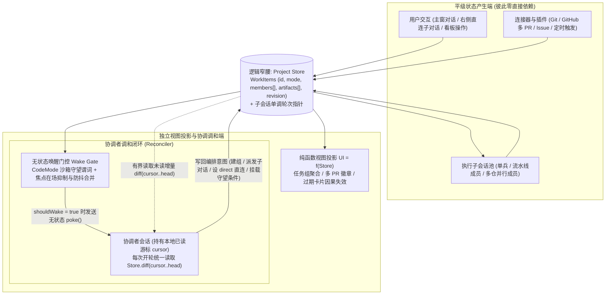

# 项目协调者模式架构与契约

Status: draft
Translation: current

[English](project-coordinator-mode.md)

## 场景与问题

在 Lody 中，一个项目往往横跨多个角色、多个代码仓库与多台机器上的大量对话。如果把协调者设计成所有消息都必须经手转发的“单点星形传声筒”，在实际协作中会遇到四类结构性瓶颈：

1. **直连沟通导致状态失步**：用户在右侧面板直接与子对话多轮讨论、修改实现或创建 PR 后，协调者对这些进展毫不知情，界面上仍挂着过期的动作建议卡片。
2. **缺乏多子对话协作编组**：一个完整任务经常需要多个子对话配合（例如 `A` 负责实现、`B` 负责独立 Review，或主仓库与 Submodule 分别由不同对话并行推进），按“1 个子对话 = 1 个任务”编号无法表达它们之间的协作归属。
3. **多产物与多 PR 关联受限**：同一任务可能关联跨仓库的多个 PR，以及 Issue、预览地址或导出文件等非 PR 交付物。
4. **高频共创与后台编排的边界模糊**：复杂方案讨论若经由协调者来回转述，既增加延迟又丢失细节；反之若子对话每聊一轮都唤醒协调者，又会造成通知噪音与 Token 浪费。

## 整体架构：单一窄腰 `Project Store` 与调和循环

项目协调者模式将 **控制面（Control Plane：意图拆解、选人组队、跨阶段接力、最终验收）** 与 **数据面（Data Plane：用户与子对话的高带宽直连共创及具体执行）** 分离，并围绕唯一逻辑窄腰 **`Project Store`** 收敛所有状态与事件流：

四个端点互不耦合：

- **执行子会话（Worker Sessions）**：只负责执行任务与响应用户直连输入，不感知协调者、看板或外部插件的存在。
- **连接器与插件（Connectors & Plugins）**：只负责把外部状态（PR、CI、Issue、定时事件等）同步为可观测资源与通用关联产物，不内嵌编排业务策略。
- **视图投影层（UI Surface）**：作为 `Project Store` 的纯函数投影，零模型开销地计算看板分桶、多仓库 PR 列表以及卡片是否已被子对话新进展超越。
- **协调者调和器（Coordinator Reconciler）**：无论因用户发话醒来，还是被 `Wake Gate` 的 `poke()` 信号唤醒，都走唯一输入路径读取 `Store.diff(cursor..head)`。

## 核心契约

### 1. `WorkItem`（`T1..Tn` 任务组）与小队拓扑

`WorkItem` 是介于 `Project` 与 `Session` 之间的一等任务单元：

- **成员编组（`0..N` 个子对话）**：`WorkItem` 支持以 `0` 个子对话起步作为独立黑板任务卡（如 `stage: "proposed"` 等待用户确认，或协调者直接跟进事项），也可由单对话任务隐式构成，或通过 `lody_coordinator_work_item` 将 `2..N` 个协作子对话（含同用户手动创建并显式绑定的成员）编入同一 `workItemId` 并标注 `workItemRole`。看板、`<project_facts_delta>` 与 CodeMode 守望共用 `@lody/shared` 的统一成员资格与 `T<n>` 编号内核，确认提案或扩编小队时沿用原 `workItemId` 即可保持编号一致。
- **统一状态优先级与多产物聚合**：看板分桶（`needsYou`、`working`、`review`、`accepted`）与卡片阶段（`proposed`、`working`、`blocked`、`review`、`done`）由同一状态机派生：
  1. `needsYou` 优先级最高：任一成员待用户介入、协调者显式标为 `blocked`（即便同组其他成员仍在运行）或 `proposed` 待确认时，均进入 `needsYou`。
  2. `working`：任一成员正在运行（或独立卡处于 `working`）。
  3. `accepted`：含成员的任务组仅在全部成员已归档/验收或 `acceptedAt >= latestMessageAt` 时处于 `accepted`；验收后产生的新活动会自动使验收失效并回到 `review`。独立任务卡以 `stage: "done"` 或 `acceptedAt` 判定完成。
  4. `review`：其余默认待审阅状态。
  任务卡汇总跨仓库 PR 去重并集（以多人头像式半重叠 PR 堆叠展示），承载可选 `summary`、`progressNote`、`pendingAction` 与 `externalRefs[]`，整组验收会一并归档组内全部成员对话。
- **协作模式（`delegated` | `direct`）**：
  - `delegated`（托管模式）：协调者负责派发简报、回收回执并生成下一步预测卡片。
  - `direct`（直连共创模式）：面对高歧义方案共创、复杂交互打磨或多轮高频微调时，协调者先为子对话注入背景，主动建议用户在右侧面板与子对话直接沟通，自身退居后台守望，避免中间传话损耗。

### 2. 物理存储归属

`Project Store` **不新建任何独立的 Loro Stream ID**，也**不引入跨会话写竞争**，物理上按职责分摊在三个既有存储容器中，由读端在内存拼装：

| 逻辑数据                                                                                      | 物理存储容器                                                                                                                   | 同步范围                                            | 核心保障                                                                                                                                               |
| :-------------------------------------------------------------------------------------------- | :----------------------------------------------------------------------------------------------------------------------------- | :-------------------------------------------------- | :----------------------------------------------------------------------------------------------------------------------------------------------------- |
| `workItems` 控制表（`id`、`taskNumber`、`title`、`mode`、`externalRefs`、`acceptedAt`）       | 协调者自身 `SessionDoc` 根级键 `workItems`（流 `{workspaceId}:s:{coordinatorSessionId}`，经 `sessionControlPlaneSchema` 读写） | 随协调者会话按需同步（天然继承 `doc` 级 E2EE 加密） | 不污染全局 `{workspaceId}:meta` 或 `{workspaceId}:wf:workspace`；删除协调者会话时随房间自动物理回收；旧客户端通过 `ignoreUnknownProperties` 安全忽略。 |
| 子会话归属外键（`workItemId`、`workItemRole`）、运行态、`latestUserMsgId` 与 `pullRequests[]` | 各子会话自身的 `SessionMeta`（流 `{workspaceId}:meta`）                                                                        | 随轻量 Meta Flock 同步（分组子会话仅增约 50 B）     | 远程机器上的子会话只写自己的 `SessionMeta` 与 `SessionHistory`，绝不跨房间打开或争抢协调者文档；`SessionMeta` 严禁写入对话正文摘要。                   |
| 动作卡片因果快照（`snapshotTurnBySession`）与处置记录 `actionResolutions`                     | 协调者历史中的 `coordinator_message.card` 条目                                                                                 | 随消息历史同步                                      | 发卡时冻结关联子会话当时的 `latestUserMsgId`，完全免疫跨机器系统时钟漂移（Clock Skew）。                                                               |
| 协调者已读游标 `cursor` 与守望探针状态                                                        | 协调者宿主机私有 SQLite（`operations.sqlite` 与 `automations/ledger.sqlite`）                                                  | 仅本机私有（不上云同步）                            | 高频游标推进与探针调度不产生任何跨设备网络广播。                                                                                                       |

### 3. 动作卡片因果失效机制

每当协调者通过 `lody_coordinator_send_message` 发出附带 `card` 的消息时，Daemon 自动读取该卡片关联子会话（及同一 `WorkItem` 下其他成员会话）当前的 `SessionMeta.latestUserMsgId`，冻结写入 `card.snapshotTurnBySession`。

- **前端即时折叠**：对于尚未被用户点击选择的开放卡片，一旦任一关联子会话当前的 `SessionMeta.latestUserMsgId` 与快照值不一致（说明用户已在右侧直接向子会话发送了新指令推进任务），卡片立即自动折叠隐藏。
- **CLI 隐式上下文防误绑**：用户后续在协调者输入框直接发送普通文本时，`resolveCoordinatorPromptReplyHeader` 会校验 `snapshotTurnBySession`；已被子会话新轮次超越的旧卡不再注入 `<related_card_context>`。

### 4. 业务无关的唤醒门控与有界增量读取

路由内核不包含任何硬编码的业务状态枚举（例如不把 GitHub PR 状态写死在内核中）：

- **按需懒摘要（`diff(cursor..head)`）**：用户在子会话内的日常多轮直连交流不唤醒协调者。当协调者下一次开启回合时，宿主机先在纯内存中对比 `SessionMeta` 与本地 `cursor` 筛出变动的子会话，仅对最近活跃的 Top-K 会话做有界并发（`<= 4`）的尾部瞬时读取生成紧凑增量摘要；**仅对已确认无变更或已实际写入本轮 `deltaText` 的子会话推进 `cursor`**，因单轮配额、尾读失败或字符预算截断而未送达的更新保留旧游标留待下一轮补读。
- **可编程守望探针（`CodeMode`）**：“什么算有进展”由运行在 `lody_automation` 沙箱中的轻量 JS 谓词按任务目标决定（可读取 `ctx.read` / `ctx.exec` / `ctx.fetch` 暴露的 PR、文件、测试结果或外部插件资源），命中时返回通用唤醒信号，未命中返回 `false`。
- **物理注意力闸门**：协调者自派 `Operation` 结束、子会话无人值守卡死/报错、以及守望探针命中统一经过物理注意力过滤——若用户此刻正聚焦在该子会话面板上则抑制唤醒，并在短防抖窗口内合并同批唤醒；若窗口期内用户已亲手在子会话发消息接管，则自动抵消挂起的唤醒。

## 性能与安全边界

- **流式与高频聊天零同步放大**：日常子会话多轮对话、流式输出与游标推进对 `workItems` 的写入量为 0 字节。
- **禁止全工作区打开房间扫描**：看板聚合与 `diff` 候选筛选只读内存中的 `SessionMeta`，绝不遍历打开未变动子会话的历史房间。
- **窄订阅隔离渲染**：协调者虚拟消息列表中的普通气泡零外部订阅，过期卡片集合在流容器层统一计算并按 Key 驱动未决卡片。
- **权限归属校验**：`lody_coordinator_work_item` 严格校验协调者会话身份与用户归属，禁止将其他用户的会话编入当前任务组。

## 依据与验证

- **已实现并验证（第一、二、三阶段完整闭环 —— 黑板层、`WorkItem` 任务组、多 PR 展示、卡片因果失效、`direct` 建议直连卡片、本地 SQLite 游标与 `<project_facts_delta>` 懒同步、以及 `coordinator.workItems` 守望探针与注意力门控 `Wake Gate`）**：
  - 共享契约、Loro 控制面 Schema 与自动化读取参数：[`packages/shared/src/coordinator-work-items.ts`](../packages/shared/src/coordinator-work-items.ts)、[`packages/shared/src/coordinator-actions.ts`](../packages/shared/src/coordinator-actions.ts)、[`packages/shared/src/automations/reads.ts`](../packages/shared/src/automations/reads.ts)、[`packages/shared/src/schema.ts`](../packages/shared/src/schema.ts)、[`packages/shared/src/session-doc-schemas.ts`](../packages/shared/src/session-doc-schemas.ts)。
  - Daemon `lody_coordinator_work_item` 工具、`lody_coordinator_send_message` 自动冻结 `snapshotTurnBySession` 快照、`<related_card_context>` 过期过滤、本机 SQLite `coordinator_read_cursors` / `coordinator_turn_deltas` 持久化、开轮有界 `<project_facts_delta>` 注入，以及 `coordinator.workItems` 沙箱读取适配器 + 在场聚焦/防抖 `Wake Gate`：[`apps/cli/src/lib/loro/doc.ts`](../apps/cli/src/lib/loro/doc.ts)、[`apps/cli/src/mcp/lody-mcp-server.ts`](../apps/cli/src/mcp/lody-mcp-server.ts)、[`apps/cli/src/lib/coordinator-reply-context.ts`](../apps/cli/src/lib/coordinator-reply-context.ts)、[`apps/cli/src/lib/coordinator-project-delta.ts`](../apps/cli/src/lib/coordinator-project-delta.ts)、[`apps/cli/src/automations/context/coordinator-watch-gate.ts`](../apps/cli/src/automations/context/coordinator-watch-gate.ts)、[`apps/cli/src/automations/context/reads-legacy.ts`](../apps/cli/src/automations/context/reads-legacy.ts)、[`apps/cli/src/automations/workspace-legacy.ts`](../apps/cli/src/automations/workspace-legacy.ts)、[`apps/cli/src/orchestration/operation-store.ts`](../apps/cli/src/orchestration/operation-store.ts)、[`apps/cli/src/lib/message-handler.ts`](../apps/cli/src/lib/message-handler.ts)、[`apps/cli/src/session/coordinator-system-prompt.md`](../apps/cli/src/session/coordinator-system-prompt.md)。
  - 前端任务组看板聚合、`direct` 模式标识、`handoff` 直连交接卡片、多仓库多 PR 徽章与卡片响应式失效：[`packages/components/src/components/project-mode/project-board-model.ts`](../packages/components/src/components/project-mode/project-board-model.ts)、[`packages/components/src/components/project-mode/project-board.tsx`](../packages/components/src/components/project-mode/project-board.tsx)、[`packages/components/src/components/project-mode/coordinator-action-engine.ts`](../packages/components/src/components/project-mode/coordinator-action-engine.ts)、[`packages/components/src/components/project-mode/coordinator-action-bar.tsx`](../packages/components/src/components/project-mode/coordinator-action-bar.tsx)、[`packages/components/src/components/project-mode/use-coordinator-action-executor.ts`](../packages/components/src/components/project-mode/use-coordinator-action-executor.ts)。
  - 自动化测试：[`packages/shared/tests/session-doc-forward-compat.test.ts`](../packages/shared/tests/session-doc-forward-compat.test.ts)、[`packages/components/tests/project-board-model.test.ts`](../packages/components/tests/project-board-model.test.ts)、[`packages/components/tests/chat-virtual-rows-identity.test.ts`](../packages/components/tests/chat-virtual-rows-identity.test.ts)、[`apps/cli/src/mcp/daemon-session-tools.test.ts`](../apps/cli/src/mcp/daemon-session-tools.test.ts)、[`apps/cli/src/orchestration/operation-store.test.ts`](../apps/cli/src/orchestration/operation-store.test.ts)、[`apps/cli/src/automations/automations.test.ts`](../apps/cli/src/automations/automations.test.ts)。
- **关联文档**：[协调者连接器与触发器插件架构](coordinator-connector-triggers.zh.md)、[项目模式与协调者对话缺口梳理](../.agents/notes/proposed/feature/2026-11-11-project-coordinator-mode.zh.md)、[会话编排规范](session-orchestration.zh.md)、[Automations 规范](../apps/cli/src/automations/AGENTS.md)。
