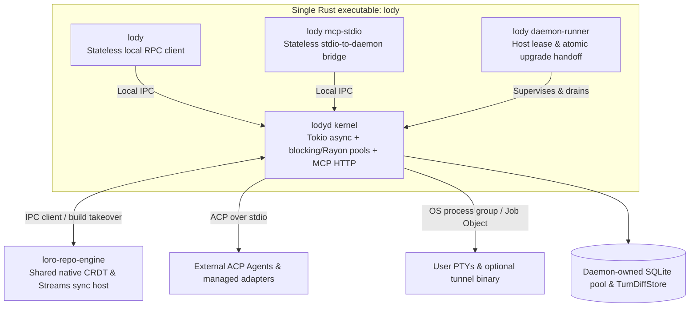

# Rust CLI and daemon architecture

Status: draft
Translation: current

[中文](rust-cli-daemon-architecture.zh.md)

## Scenario and decision

The TypeScript CLI (`apps/cli`) has grown into a multi-role machine runtime: a daemon
supervisor, collaborative document relay, local and remote RPC server, ACP process and
worktree manager, built-in MCP server, automation host, and preview gateway. Under a
single-threaded Node.js event loop and 32-bit WebAssembly CRDT memory, these duties
split across seven or more cooperating Node processes and worker threads while core
session state concentrated in tightly coupled hubs (`MessageHandler`,
`SessionExecutionService`, `SessionDispatchWatcher`, and `LoroDocumentManager`),
with compile-time cloud endpoints and scattered `if (encrypted)` branches.

Re-architect the CLI and daemon into a single zero-dependency Rust executable (`lody`)
built from a six-layer unidirectional Cargo workspace:

1. **One binary, three entry modes**: stateless RPC CLI subcommands (`lody <cmd>`),
   a stateless `mcp-stdio` bridge, a minimal `daemon-runner` lease/upgrade supervisor
   submode, and an in-process async/threaded daemon kernel (`lodyd`).
2. **External `loro-repo-rs` engine seam**: `lodyd` does not reimplement CRDT storage,
   room lifecycles, Presence transport, or Durable Streams room synchronization; it
   consumes the external `loro-repo-rs` engine process through a narrow port alongside
   a coexisting Roost history port.
3. **First-class Self-Hosted and cloud abstraction**: replace compile-time endpoint
   injection and vendor-specific storage/SCM/tunnel assumptions with runtime
   `BackendProfile` discovery and vendor-neutral backend ports.

Existing scoped invariants in [`apps/cli/AGENTS.md`](../apps/cli/AGENTS.md),
[`packages/platform/AGENTS.md`](../packages/platform/AGENTS.md), and
[`packages/shared/AGENTS.md`](../packages/shared/AGENTS.md) remain binding across the
migration.

## Process topology and storage ownership



- **Single-owner local storage.** Standalone CLI invocations and MCP tool handlers
  never open SQLite databases or CRDT repositories directly. `lodyd` is the sole
  process permitted to open daemon-owned SQLite stores and `TurnDiffStore`. Non-offline
  commands connect to `lodyd` over local IPC (or start an on-demand daemon when policy
  permits); purely local static commands (`--version`, `lody review`) execute without
  daemon state.
- **Thin `daemon-runner` submode.** With V8 heap exhaustion and WebAssembly traps
  eliminated, `lody daemon-runner` retains only the uninterrupted Host lease,
  versioned candidate health verification, drained handoff, and rollback guarantees
  defined in [managed daemon updates](daemon-upgrade-installation.md).
- **In-process concurrency.** Built-in MCP HTTP serving, FastCDC snapshot chunking,
  parallel file-tree indexing, diff computation, and filesystem watching run inside
  `lodyd` on Tokio tasks and bounded blocking/Rayon pools rather than separate Node
  subprocesses or worker files.
- **Rollback-safe SQLite layout.** During migration, `lodyd` preserves existing local
  control filenames and schemas (`operations.sqlite3`, `schedules.sqlite`,
  `pr-poller-state.sqlite3`, history RPC rejections, and per-workspace
  `automations/<id>.sqlite`) behind a persistent in-process connection pool. No manual
  data migration is required, bidirectional rollback to the Node CLI remains lossless,
  and per-workspace automation files remain physically unlinkable on E2EE removal or
  device revocation.

## Layering and actor decoupling

Dependencies point strictly downward across six Cargo workspace layers:

| Layer | Crates | Responsibility |
| --- | --- | --- |
| L5 Entry | `bins/lody` | CLI parser/formatters, `mcp-stdio` proxy, `daemon-runner`, and `lodyd` bootstrap |
| L4 Gateways | `lody-gateway-local`, `lody-gateway-remote` | Local IPC, built-in MCP HTTP server, Loro Streams Machine RPC, native `lody-iroh` QUIC listener, and Security Envelope Middleware |
| L3 Core Actors | `lody-daemon-core` | `FleetSupervisor` → `WorkspaceActor` → `SessionActor`, `OperationInbox` coordinator, `AutomationActor` (`rquickjs`), and run-config validation |
| L2 Domains | `lody-acp`, `lody-worktree`, `lody-code-collab`, `lody-preview`, `lody-pr-poller` | Transport-agnostic domain services, worktree/credential broker, parallel file index, loopback/remote preview, and PR reconciliation |
| L1 Ports & Stores | `lody-repo-port`, `lody-backend-ports`, `lody-e2ee`, `lody-db`, `lody-diff-store` | External `loro-repo-rs` + Roost ports, cloud/Self-Hosted ports, E2EE ledger/custody, SQLite pools, and FastCDC snapshots |
| L0 Primitives | `lody-protocol`, `lody-os` | Wire schemas, forward-compatible JSON/CBOR codecs, path-separator rules, OS process groups / Windows Job Objects, PTY, keyring, and memory pressure probes |

### Security envelope termination at L4

Authentication and E2EE envelope verification terminate once in L4 gateway middleware
before any command reaches L3 or L2:

- Local trusted sockets produce `VerifiedPrincipal::LocalHost`.
- Plaintext remote requests verify workspace/machine access through `ControlPlanePort`
  and produce `VerifiedPrincipal::CloudMember`.
- Encrypted workspace requests verify ledger freshness, machine-sharing generation
  policy, and request signatures at the gateway, decrypting payloads into
  `VerifiedPrincipal::EncryptedMember` and sealing replies with the caller's ephemeral
  response key. Domain actors never branch on transport origin or raw ciphertext.

### Single-mailbox `SessionActor`

Each active session runs as an isolated `SessionActor` owning one bounded `mpsc`
command mailbox and an explicit algebraic state machine:

```text
Idle (optional warm AcpHandle)
  ──► Preparing (scoped CancellationToken: worktree + MCP + ACP handshake)
  ──► RunningTurn (exclusive TurnContext + AcpHandle: streaming, permissions, steer)
  ──► Draining (bounded turn-budgets: workspace diff stats + confirmed ACP settlement)
  ──► Idle
```

Local IPC sends, remote RPC fast-path receipts, CRDT metadata wakeups, and
`OperationInbox` / Automation continuations all normalize into `SessionCommand`
messages on that single mailbox. `TurnContext` exists only inside `RunningTurn` and is
dropped on transition, preventing stale callbacks or late flushes from mutating a
subsequent turn. Hierarchical cancellation tokens (`Fleet → Workspace → Session → Turn`)
replace ad-hoc boolean disposal flags.

### Two-stage local IPC cutover

1. **Coexistence stage**: `lodyd` exposes a unified multiplexed local socket
   (`lody-mux.sock`) used by the Rust CLI and built-in MCP client, while an isolated
   `legacy_ipc_compat` module continues serving `probe`, `control`, and `terminal`
   sockets plus the existing run-file contract. Desktop Electron embeds or attaches to
   `lodyd` with zero main-process code changes and full rollback to the Node CLI.
2. **Cutover stage**: once the Node CLI retires, Electron main switches to
   `lody-mux.sock` and `legacy_ipc_compat` is deleted in full.

## External `loro-repo-rs` engine seam

Both desktop-colocated and headless server deployments connect `lodyd` to an
independent `loro-repo-engine` host process using capability and monotonic `build`
sequence checks with drain-before-handoff takeover:

- **Owned by `loro-repo-rs` (not reimplemented in `lodyd`)**: durable storage for
  `Meta`, `wf`/`mf`/`sr` Flocks, and `Session`/`Schedule`/`Preview` documents; bounded
  filtered reads and incremental subscriptions; Ephemeral Presence rooms; and Durable
  Streams synchronization (outbox POST plus multiplexed WebSocket / SSE / long-poll
  live transport). Desktop renderers talk directly to `loro-repo-engine` rather than
  relaying CRDT frames through `lodyd`.
- **Owned by `lodyd`**: explicit author-tagged writes into `RepoEnginePort`; coexisting
  `RoostHistoryPort` reads/writes under identical session access rules; non-CRDT
  Machine RPC and native `lody-iroh` QUIC streams; and `lody-e2ee` key custody. The
  engine never holds device identity or master keys: `lody-e2ee` installs verified
  workspace epoch keys into the engine, runs ledger and mailbox catch-up when the
  engine reports an unknown writer or missing epoch, and executes deferred local
  workspace erasure upon confirmed member removal or device revocation.

## Self-Hosted and cloud backend port contracts

To allow a single published `lody` binary to run unmodified against local-only mode,
Lody Cloud, or enterprise Self-Hosted deployments, `lody-backend-ports` enforces six
runtime contracts:

1. **Runtime `BackendProfile` and `.well-known` discovery**: remove compile-time cloud
   endpoint constants and `.convex.cloud` → `.convex.site` hostname derivation.
   `lody login --server <origin>` fetches `/.well-known/lody-configuration` (with
   optional `profile.toml` override) to resolve explicit control, auth, blob gateway,
   runtime mirror, Iroh relay, and capability descriptors. Local storage, credentials,
   and E2EE pins are namespaced by the canonical origin-tuple `profile_id`.
2. **`ControlPlanePort` with enterprise TLS and OIDC**: support OIDC device and PKCE
   authentication flows so intranet deployments without SMTP can sign in and pair
   machines, alongside configurable custom root CA bundles and forward proxies (while
   preserving mandatory `NO_PROXY` rules for loopback MCP and preview endpoints).
3. **Negotiated `BlobTransferPort`**: replace storage-backend-specific multipart state
   assumptions with a two-step `negotiate_upload` → `execute_upload` contract
   supporting `SingleStreamPut`, `PresignedMultipart`, and `GatewayStagedChunks`,
   allowing cloud object stores and self-hosted OpenDAL/S3/filesystem gateways to
   interoperate with the same client.
4. **Three-tier `ArtifactRegistryPort`**: resolve managed agent binaries, externalized
   ACP adapters, helper binaries, and daemon updates from the public CDN, a
   profile-advertised intranet mirror, or an air-gapped local bundle import.
5. **Pluggable `ScmProviderPort` and `TunnelProviderPort`**: parameterize Git
   credential brokering and PR polling across public GitHub and self-hosted SCM
   endpoints (such as GitHub Enterprise Server or GitLab), and gate remote preview
   tunnels (`LocalLoopbackOnly`, `CloudflareQuickTunnel`, or intranet reverse proxy)
   via `BackendProfile` capabilities.
6. **Graceful `EntitlementPort` degradation**: distinguish `Active`, `GracePeriod`,
   and `ExpiredReadOnly` states so an expired enterprise license blocks only new
   collaborative remote dispatches with an explicit notice while preserving local
   history reads, local recovery, and workspace bundle export.

## Externalized ACP adapters and embedded automation runtime

- **ACP adapters as managed artifacts**: the five TypeScript ACP adapters (`claude`,
  `codex`, `deepseek`, `devin`, `grok`) decouple from the CLI bundle into standalone
  versioned artifacts distributed through `ArtifactRegistryPort` and invoked strictly
  over `ACP over stdio`. High-frequency adapters may subsequently migrate to native
  Rust independently of `lodyd`.
- **Embedded `rquickjs` for Automations**: `AutomationActor` evaluates `CodeMode`
  condition programs inside an in-process `rquickjs` sandbox with per-evaluation heap
  ceilings, a 30-second deadline, bounded `ctx.read` / `ctx.fetch` / `ctx.exec` call
  budgets, and zero external Node.js dependency.
- **Cross-language golden vectors**: shared protocol crates and TypeScript packages
  (`@lody/shared`, `@lody/e2ee-core`) verify wire compatibility against a shared suite
  of JSON, CBOR, and LSCE v2 test vectors in CI.

## Open questions for implementation specs

- Exact binary framing and per-stream backpressure credits for `lody-mux.sock`.
- Packaging format and runtime pin for the standalone TypeScript ACP adapter artifacts
  on hosts without a preinstalled system Node.js.
- Exact schema fields and cache TTL rules for `/.well-known/lody-configuration`.

## Evidence

- Inspected current CLI/daemon coupling and entrypoints:
  [`apps/cli/src/index.ts`](../apps/cli/src/index.ts),
  [`apps/cli/src/commands/daemon-runner.ts`](../apps/cli/src/commands/daemon-runner.ts),
  [`apps/cli/src/commands/start.ts`](../apps/cli/src/commands/start.ts),
  [`apps/cli/src/lib/lody-fleet.ts`](../apps/cli/src/lib/lody-fleet.ts),
  [`apps/cli/src/lib/message-handler.ts`](../apps/cli/src/lib/message-handler.ts),
  [`apps/cli/src/session/session-execution-service.ts`](../apps/cli/src/session/session-execution-service.ts),
  [`apps/cli/src/session/session-dispatch-watcher.ts`](../apps/cli/src/session/session-dispatch-watcher.ts),
  [`apps/cli/src/lib/loro/doc.ts`](../apps/cli/src/lib/loro/doc.ts), and
  [`apps/cli/vite.config.ts`](../apps/cli/vite.config.ts).
- Inspected existing platform, native transport, and lifecycle contracts:
  [`packages/platform/src/cloud-port.ts`](../packages/platform/src/cloud-port.ts),
  [`packages/platform/src/capabilities.ts`](../packages/platform/src/capabilities.ts),
  [`packages/iroh-native/README.md`](../packages/iroh-native/README.md),
  [`packages/e2ee-core/README.md`](../packages/e2ee-core/README.md),
  [`packages/turn-diff-store/AGENTS.md`](../packages/turn-diff-store/AGENTS.md), and
  [daemon memory footprint note](../.agents/notes/implemented/architecture/2026-11-21-daemon-memory-footprint.md).
- Validation status: design specification only; no Rust workspace crates or runtime
  changes are implemented or benchmarked in this change.
