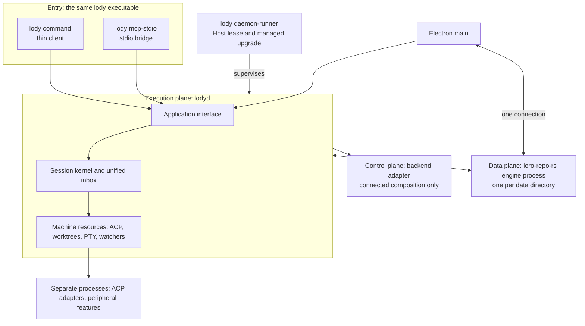

# Rust CLI and daemon architecture

Status: draft
Translation: current

[中文](rust-cli-daemon-architecture.zh.md)

## Scenario and decision

`apps/cli` is at once the machine's execution host, the local and cloud relay for
collaborative documents, a local and remote RPC server, the ACP process and worktree
manager, the built-in MCP server, the Automations host and the preview gateway. Its
problems fall into two groups:

- **Tied to the language.** A single-threaded Node event loop and the WebAssembly
  memory ceiling of Loro and Flock split one daemon into a watchdog, a Worker, an
  HTTP MCP host, four kinds of Code Collab worker and several wrapper processes.
- **Independent of the language.** Session state is spread across `MessageHandler`,
  `SessionExecutionService` and `SessionDispatchWatcher`. One user action is
  implemented separately in the CLI command, the MCP tool, local control and remote
  RPC. One-shot commands and the daemon's own subsystems both write the workspace
  repository directly. One input arrives over three paths that race each other.

A new language does not remove the second group. This Spec therefore decides how
responsibilities are divided first, and that the implementation is Rust second:

1. **Three planes, one owner each.** The data plane belongs to the separate
   `loro-repo-rs` engine process, the execution plane to `lodyd`, and the control
   plane is a replaceable backend adapter.
2. **Session logic is a pure state machine that performs no I/O.** The runtime only
   executes the actions it emits.
3. **Every activated input enters one durable session inbox.** A session consumes only
   from that inbox; there is no parallel journal alongside `OperationInbox` or
   unpromoted `messageQueue` drafts.
4. **One application interface.** The CLI, MCP, local IPC and remote RPC are
   projections of it.
5. **Ports, implementations and composition are separate.** The local composition
   constructs no implementation of a connected backend.

The invariants in [`apps/cli/AGENTS.md`](../apps/cli/AGENTS.md),
[`packages/platform/AGENTS.md`](../packages/platform/AGENTS.md),
[`packages/shared/AGENTS.md`](../packages/shared/AGENTS.md) and the
[failure-containment rules](../.agents/docs/failure-containment.md) remain binding
during the migration. The data plane follows the approved
[native engine Spec](native-engine-cloud-e2ee.md), which this document does not
change.

## Three planes and their processes



| Durable state | Owner |
| --- | --- |
| Workspace Meta, the `wf`/`mf`/`sr` Flock tables, Session/Schedule/Preview documents (including unpromoted `messageQueue` drafts), the upload outbox, content encryption | Engine process |
| Unified session inbox and operation store (`operations.sqlite3`), `schedules.sqlite`, `pr-poller-state.sqlite3`, history RPC rejection records, per-workspace `automations/<id>.sqlite`, the turn diff store, the E2EE ledger and key custody | `lodyd` |
| Roost session history | `lodyd` today; see [open questions](#open-questions) for a transfer |

- **Single owner.** No process other than the owner opens these stores. This also
  binds the daemon subsystems that currently borrow the one-shot command path to
  write the repository (Automations, Schedules, the PR poller).
- **The renderer does not connect to the engine.** Under the approved Spec the
  renderer reads plaintext only through Electron main; `lodyd` and main each hold one
  connection.
- **Starting on demand is not going online.** A `lodyd` started by a one-shot command
  acquires a local storage lease without claiming the online Host lease: it opens
  storage only, publishes no presence and accepts no dispatch. When an online `lodyd`
  starts (`daemon start` or Electron), the storage-only instance drains its in-flight
  command and releases the storage lease before the online owner opens any store, so
  two `lodyd` processes never hold the same SQLite or Roost files concurrently.
- **`daemon-runner` keeps its duties.** The Host lease, release verification, channel
  and downgrade confirmation, candidate health checks, bounded drain and failure
  rollback all remain as the
  [managed daemon update Spec](daemon-upgrade-installation.md) requires. Only the
  restart reasons specific to the JS heap and the WASM runtime disappear.
- **Local SQLite files keep their names and schemas** (owner decision), held by
  long-lived connections inside `lodyd`. Old and new versions can replace each other
  only if those schemas are frozen during the rollout or changed on both sides
  together, and only after in-flight turns are drained.

## Code structure

Dependencies run only downward through this table, and implementations appear only
at the composition root. The names are illustrative, not final crate names.

| Role | Contents | May depend on |
| --- | --- | --- |
| Composition root | The `lody` executable: selects the local or connected composition and assembles implementations | Everything |
| Entry | CLI rendering, `mcp-stdio`, local IPC, remote RPC and Iroh, MCP HTTP | Application interface |
| Runtime | Actor shells, the supervision tree, resource leases, executing the kernel's actions | Application interface, kernel, ports |
| Application interface | Commands and queries, authorization by caller, the single protocol definition | Kernel, ports |
| Kernel | Session, turn and admission state machines; no I/O, no clock, no async runtime | Nothing |
| Ports | Traits and data types only: engine, history, backend, ACP, worktree, storage | Nothing |
| Implementations | Engine client, Roost, connected backend, ACP client, SQLite, OS primitives | Ports |

The reasons for this division:

- Moving today's five coupled hubs into one orchestration crate only produces a new
  god module. With the kernel separate from the runtime, the kernel can be replayed
  deterministically from an event sequence and compared step by step with the
  existing TypeScript implementation.
- Entry code depends only on the application interface, so an action such as
  creating a session has one implementation.
- The default `local` Cargo build does not compile or link connected backend crates,
  so the public local-only build cannot issue authenticated cloud requests at the
  binary level. The `connected` Cargo build links the vendor-neutral backend crates,
  and its composition root still instantiates no connected client until an explicit
  backend profile is present.

## Session kernel

The kernel is a transition function: it takes the current state and one event and
returns the new state and a set of actions to execute.

```text
Idle (keeps the last released turn and an optional warm Agent)
  → Preparing (worktree, MCP, ACP handshake)
  → Running (streamed output, permission waits, Steer)
  → Settling (bounded wrap-up)
  → Idle
```

- **A released turn is not destroyed.** When a live Agent continues background child
  activity or emits late tool output after `end_turn` (`sessionActivity`), that work
  still belongs to the frozen invocation of the released turn, so `Idle` retains it.
  Schedules and matched Automations do not reuse that released turn; they enter the
  inbox as distinct new turns with their own turn ID and frozen author provenance.
- **Late events are dropped by generation.** Every Agent event carries a generation;
  one that does not match the current turn changes no state.
- **Control input never queues behind output.** Cancel, permission replies, Steer and
  shutdown use a separate channel and cannot be held up by streamed chunks.
- **Sessions do not wait on each other.** Delegation, child-session admission, fork
  and edit-and-resend are asynchronous messages whose replies return as events. No
  session waits on another while holding its own mailbox.
- **Goal turns, child admission counts and inbox execution ownership** are kernel
  state, not flags added by the runtime.
- **State that does not belong to one session lives one level up.** The start-retry
  window and the deduplication of capability refreshes and runtime installs belong to
  the workspace. ACP start concurrency, PTYs, file watchers and worktrees belong to
  the machine and are lent to sessions as leases.

One session's failure does not block another, and every wait on a user path is
bounded. After a remote input arrives, only correctness-critical setup may stand
before ACP `prompt`.

## Unified session inbox (single source of admission truth)

Admission is not a second log placed in front of or beside `OperationInbox` or
`messageQueue`; each stage of an input has exactly one owner:

- **Unpromoted queued drafts stay solely in the data plane.** Pending items in a
  session's `messageQueue` are not pre-copied into local SQLite while waiting. Cross-
  device edits, reordering, deletion, and Stop-induced `paused: true` markers keep a
  single source of truth in the synced document until the moment one item is promoted.
- **Activated inputs share one inbox in `operations.sqlite3`.** `OperationInbox`
  evolves into the single durable admission store for every runnable turn—local IPC,
  the remote RPC fast path, a newly promoted `messageQueue` item or CRDT activation
  pointer, delegated completion batches, Automations, and Schedules—deduplicated by
  input/turn ID and preserving human-over-automatic yield, submission fencing, and
  `pauseInbox` semantics in one state machine.
- The fast path only delivers an accepted payload earlier; it writes the same
  idempotent inbox entry and never creates a second input.
- A reply still waits for the user message to be durable in the data plane before it
  is written to history, and that wait exists in one place.
- A cancelled or retired entry never starts. After a crash, an uncertain turn is
  recovered or settled from this single inbox, and draining before rollback leaves no
  separate journal file invisible to the previous CLI.

## Security boundary

Verification has two levels, each with one job:

1. **The transport envelope is handled at entry.** The trusted local socket, the
   access check of an ordinary cloud workspace, and signature verification and
   decryption of an encrypted workspace's envelope yield a verified caller at entry.
   The response is sealed for the channel it arrived on.
2. **Every input is verified again when it is admitted into the inbox.** Inputs to an
   encrypted workspace also arrive as signed rows through document sync, which entry
   code never sees. The inbox judges each candidate under the workspace's security
   policy before recording admission: only signed content counts, an unsigned `resume`
   is not a requested target, the executing identity comes from verification, and an
   entry's `userId` is display data.

The kernel receives only verified input and contains no encryption branch. Sealing,
signing and opening content is done by the engine; ledger verification, key receipt
and distribution, rotation and machine sharing stay in `lodyd`. An unknown workspace
mode authorizes no plaintext egress.

## Connected backends and composition

The default `local` build excludes connected backend crates at compile time. In the
`connected` build, `lodyd` still runs the local composition when no backend profile
exists: it constructs no connected client and issues no cloud request (public
managed-runtime downloads remain the existing exception). A profile is created only
when the user explicitly runs `lody login --server <origin>`, which reads
`/.well-known/lody-configuration` (a `profile.toml` may override it). One `connected`
binary therefore serves both the official cloud and enterprise self-hosted instances
through the same runtime profile path, with local storage, credentials and encryption
anchors isolated per profile.

Today the CLI mixes build-time endpoint inlining (`vite.config.ts`) with runtime
environment reads (`const.ts`) and derives the auth site address by replacing
`.convex.cloud`. The backend profile replaces all three; the site address is delivered
explicitly.

Ports stay vendor-neutral. Six are fixed now: the control plane (including OIDC
sign-in, a custom CA and proxies), negotiated object upload, the artifact source
(public, internal mirror, offline bundle), code hosting, the preview tunnel, and
entitlement status. An expired entitlement refuses only new remote collaboration
dispatch; reading local history, local recovery and workspace export always remain
available.

## Separate-process boundaries

- **ACP adapters.** The five existing TypeScript adapters leave the CLI build and are
  called as independently managed artifacts over ACP on stdio (owner decision). They
  still need a JavaScript runtime, so the whole is not dependency-free.
- **Peripheral features.** iOS/Android preview, device streaming and tunnels have
  heavy dependencies and no relation to the kernel. They may stay in separate
  processes behind a versioned protocol indefinitely instead of being rewritten with
  the kernel.
- **Automation programs.** `lodyd` evaluates them in-process with `rquickjs`, bounded
  in memory, time and call count (owner decision). Registered programs are user
  data: replacing the engine requires showing that they evaluate to the same result.

## One definition across languages

Web, mobile and Electron continue to use TypeScript, so packages such as
`@lody/shared` and `@lody/e2ee-core` do not go away. Protocol types are generated for
TypeScript from the application interface's single definition rather than written
twice. Wire and persisted formats do not change, and both languages check the same
byte-exact vectors. Whether the encryption core also becomes a single implementation
is an open question.

## Migration order and acceptance

1. **Do the language-independent part first.** Establish single-owner storage in the
   existing CLI, split out the ACP adapters, and build a black-box behavior suite at
   the process boundaries (local IPC, ACP stdio, the engine connection) that the Node
   daemon passes.
2. **The Rust thin client and `mcp-stdio` bridge**, and a kernel that can be replayed
   against the TypeScript implementation.
3. **Replace the process and thread boundaries that already exist**: file scanning,
   diffing and the turn diff store.
4. **`lodyd` in the local composition**, including the built-in MCP server,
   Automations and Schedules. It replaces the CLI embedded in the desktop after
   passing the same black-box suite. Electron's launch path and packaging change;
   only the local socket protocols stay the same during the rollout.
5. **The connected composition, encrypted workspaces and Iroh.** Electron then moves
   to the single multiplexed channel and the legacy protocol module is deleted.

The two-stage local IPC cutover and the separate engine process for every host are
owner decisions that this document keeps.

## Open questions

- Whether Roost history transfers to the data plane, leaving `lodyd` with only
  rebuildable state and the unified session inbox.
- Whether a long-lived process should hold each Agent's stdio so that upgrading or
  crashing `lodyd` does not end turns in progress.
- Whether the encryption core keeps an implementation in each language or becomes
  one implementation compiled for the clients.
- Whether the current Effect v4 migration continues during the rewrite, freezes, or
  keeps only the units that define kernel boundaries.
- Whether extending `OperationInbox` in `operations.sqlite3` to cover non-delegated
  ordinary activations needs additive columns (shared with the Node CLI before
  cutover) or fits within the existing `inbox_inputs` / receipt tables.
- Who starts and supervises the engine on a host without Electron, the drain order
  of the engine and `lodyd` during an upgrade, and how sessions recover after an
  engine crash.
- Whether the entitlement port belongs in a Spec in the public repository.
- The multiplexed channel's frame format and backpressure parameters, how adapters
  are packaged for hosts without Node installed, and the discovery document's fields
  and cache policy.

## Evidence

- Implementation inspected:
  [`apps/cli/src/lib/message-handler.ts`](../apps/cli/src/lib/message-handler.ts),
  [`apps/cli/src/session/session-execution-service.ts`](../apps/cli/src/session/session-execution-service.ts)
  (per-session state tables, the retained released turn),
  [`apps/cli/src/session/session-dispatch-watcher.ts`](../apps/cli/src/session/session-dispatch-watcher.ts)
  (three input paths, per-entry handling of encrypted input),
  [`apps/cli/src/session/turn-history-gate.ts`](../apps/cli/src/session/turn-history-gate.ts),
  [`apps/cli/src/lib/command-runtime.ts`](../apps/cli/src/lib/command-runtime.ts)
  (one-shot commands write the repository directly),
  [`apps/cli/src/mcp/lody-mcp-http-server.ts`](../apps/cli/src/mcp/lody-mcp-http-server.ts)
  (why the host is a subprocess),
  [`apps/cli/src/commands/daemon-runner.ts`](../apps/cli/src/commands/daemon-runner.ts),
  [`apps/cli/src/utils/const.ts`](../apps/cli/src/utils/const.ts),
  [`packages/shared/src/convex-site-url.ts`](../packages/shared/src/convex-site-url.ts),
  [`apps/electron/src/main/services/cli-service.ts`](../apps/electron/src/main/services/cli-service.ts)
  and [`apps/cli/vite.config.ts`](../apps/cli/vite.config.ts).
- Size: `apps/cli/src` has 604 non-test files with about 195,000 lines and 352 test
  files with about 180,000 lines; the CLI references `@lody/shared` 939 times.
- Not validated: this change is design only, with no Rust code and no memory or
  performance measurement. This repository currently contains no integration code
  for the native engine, so the data plane is described from the approved Spec alone.
  The internals of `@opencode/codemode` were not inspected.
- The companion document, whiteboard and crate explorer under `.ryugi/artifacts/`
  record the earlier proposal. Where they differ from this document, this document
  governs.
