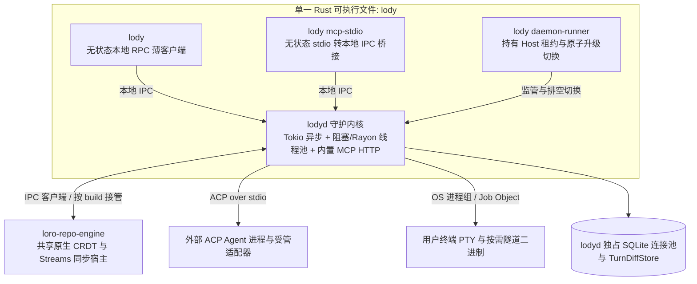

# Rust CLI 与 daemon 架构

Status: draft
Translation: current

[English](rust-cli-daemon-architecture.md)

## 背景场景与核心决策

当前基于 TypeScript 的 CLI（`apps/cli`）在演进中承担了多重机器侧运行时角色：守护进程监督器、协作文档本地/云中继、多协议 RPC 服务端、ACP 进程与 Worktree 沙箱管家、内置 MCP 服务器、Automations 宿主以及预览网关。受限于 Node.js 单线程事件循环与 32 位 WebAssembly 线性内存上限，单个守护运行时被迫裂变为 7 个以上的子进程与 Worker 线程；同时核心会话状态高度坍缩进双向耦合的巨石模块（`MessageHandler`、`SessionExecutionService`、`SessionDispatchWatcher`、`LoroDocumentManager`），并伴随编译期写死云端地址及散落全链路的 `if (encrypted)` 分支。

决定将 Lody CLI 与守护进程重构为基于 **六层单向 Cargo Workspace** 构建的单一零依赖 Rust 可执行文件（`lody`）：

1. **单一二进制、四种运行入口**：无状态本地 RPC 薄客户端命令（`lody <cmd>`）、无状态 `mcp-stdio` 转发桥、极薄的 `daemon-runner` 租约/升级监督子模式，以及单进程多线程异步守护内核（`lodyd`）。
2. **预留外部 `loro-repo-rs` 数据引擎接缝**：`lodyd` 不重复自研 CRDT 本地存储、房间生命周期、Presence 传输或 Durable Streams 云房间同步，而是通过窄端口连接独立的 `loro-repo-engine` 宿主进程，并保留与之并存的 Roost 历史端口。
3. **原生面向企业私有化部署（Self-Hosted）与公有云的统一抽象**：废除编译期写死端点及云厂商专属的对象分片、代码托管与隧道假设，在底层固化运行时 `BackendProfile` 自动发现与厂商无关的后端端口契约。

[`apps/cli/AGENTS.md`](../apps/cli/AGENTS.md)、[`packages/platform/AGENTS.md`](../packages/platform/AGENTS.md) 与 [`packages/shared/AGENTS.md`](../packages/shared/AGENTS.md) 中的既有作用域不变量在迁移期间继续有效。

## 进程拓扑与存储单写者所有权



- **Single-Owner Storage（本地存储单写者铁律）**：独立 CLI 命令进程与 MCP 工具进程严禁直接打开任何 SQLite 数据库或 CRDT 仓库。唯有 `lodyd` 拥有打开守护进程所属 SQLite 库与 `TurnDiffStore` 的权限。非离线命令统一通过本地 IPC 请求 `lodyd`（必要时按策略拉起带空闲租约的守护进程）；纯本地静态命令（如 `--version`、`lody review`）无状态直接执行。
- **极薄 `daemon-runner` 子模式**：消除 V8 OOM 与 WASM Trap 后，`lody daemon-runner` 仅保留[托管 daemon 更新规范](daemon-upgrade-installation.zh.md)所要求的固定 Host 租约持有、候选版本健康校验、有界排空切换与失败回退职责。
- **单进程原生并发**：内置 MCP HTTP 服务、FastCDC 快照分块、并行文件树扫描、Diff 计算与目录监听全部回归 `lodyd` 进程内部，由 Tokio 异步运行时与有界阻塞/Rayon 线程池承载，不再拆分独立 Node 子进程与 Worker 文件。
- **支持无损双向回滚的 SQLite 管理**：灰度迁移期原样保留本地控制面库的文件名与表结构（`operations.sqlite3`、`schedules.sqlite`、`pr-poller-state.sqlite3`、历史 RPC 拒绝记录表，以及按工作区分文件的 `automations/<id>.sqlite`），仅在 `lodyd` 内收口为常驻连接池（单写 + 多读），无需任何手动迁移，保障新旧 CLI 随时无损回滚，并保留加密工作区移除/吊销时直接物理 `unlink` 单工作区文件的安全擦除边界。

## 六层架构划分与 Actor 解耦机制

Cargo Workspace 按以下六层严格保持自顶向下单向依赖：

| 层级 | Crate 集合 | 核心职责 |
| --- | --- | --- |
| L5 宿主入口 | `bins/lody` | CLI 参数解析与输出渲染、`mcp-stdio` 代理、`daemon-runner` 及 `lodyd` 启动装配 |
| L4 接入网关 | `lody-gateway-local`, `lody-gateway-remote` | 本地 IPC、内置 MCP HTTP 服务、Loro Streams Machine RPC、原生 `lody-iroh` QUIC 监听与统一安全信封中间件 |
| L3 核心编排 | `lody-daemon-core` | `FleetSupervisor` → `WorkspaceActor` → `SessionActor` 层级树、`OperationInbox` 协调器、`AutomationActor`（`rquickjs`）与运行配置校验 |
| L2 领域服务 | `lody-acp`, `lody-worktree`, `lody-code-collab`, `lody-preview`, `lody-pr-poller` | 与传输无关的 ACP 客户端、Worktree 与 Git 凭证代理、并行文件索引、Loopback/远端预览网关及 PR 轮询对账 |
| L1 端口与存储 | `lody-repo-port`, `lody-backend-ports`, `lody-e2ee`, `lody-db`, `lody-diff-store` | 外部 `loro-repo-rs` 与 Roost 端口、公有云/自部署统一后端端口、E2EE 账本与密钥托管、SQLite 连接池与 FastCDC 快照 |
| L0 基础原语 | `lody-protocol`, `lody-os` | 协议 DTO、前向兼容 JSON/CBOR 编解码、跨平台路径分隔符契约、POSIX 进程组 / Windows Job Object、PTY、系统钥匙串与内存水位探测 |

### L4 安全信封中间件（终结全链路加密分支）

认证与 E2EE 信封验签加解密统一在 L4 网关入口一次终结，向 L3/L2 仅传递强类型的 `VerifiedPrincipal`：

- 本机受信 Socket 请求签发 `VerifiedPrincipal::LocalHost`；
- 普通云工作区请求经 `ControlPlanePort` 访问校验后签发 `VerifiedPrincipal::CloudMember`；
- 加密工作区请求在网关层统一完成账本新鲜度、机器共享策略代际（generation）与签名验证，解密载荷后产出 `VerifiedPrincipal::EncryptedMember`，并按请求方临时公钥自动封包响应。内部领域 Actor 不再感知底层传输来源或密文格式。

### `SessionActor` 单信箱有限状态机

每个活跃会话由独立的 `SessionActor` 承载，独占唯一的有界 `mpsc` 命令信箱与显式状态枚举：

```text
Idle（可选持有预热 AcpHandle）
  ──► Preparing（派生独立 CancellationToken：Worktree + MCP + ACP 握手）
  ──► RunningTurn（独占 TurnContext + AcpHandle：流式缓冲、权限挂起、Steer 判定）
  ──► Draining（有界 turn-budgets：工作区 Diff 统计刷新 + 确认 ACP 结算）
  ──► Idle
```

本地 IPC 发送、远端 RPC 快路径回执、CRDT 元数据唤醒以及 `OperationInbox` / Automation 续跑统一归一化为 `SessionCommand` 串行消费。`TurnContext` 仅存在于 `RunningTurn` 分支并在状态离开时由编译器自动 Drop，从根源上消除跨回合异步回调串扰；`Fleet → Workspace → Session → Turn` 层级 `CancellationToken` 取代手写布尔销毁标志。

### 本地 IPC 两阶段平滑切换

1. **灰度共存阶段**：`lodyd` 原生提供单一多路复用通道 `lody-mux.sock`（供 Rust 薄 CLI 与内置 MCP 使用），同时在隔离模块 `legacy_ipc_compat` 中继续监听 `probe`、`control`、`terminal` Socket 并维护既有 run 文件格式，使现有 Electron 主进程零改动无缝接入并支持随时回退 Node CLI。
2. **彻底切换阶段**：待旧 Node CLI 退役后，将 Electron 主进程切至 `lody-mux.sock`，随后整块删除 `legacy_ipc_compat` 兼容模块。

## 外部 `loro-repo-rs` 数据引擎预留边界

桌面共驻与无头服务器场景统一连接独立的 `loro-repo-engine` 宿主进程，复用基于能力集与递增 `build` 序号的排空接管机制：

- **归属 `loro-repo-rs` 负责（`lodyd` 不重复实现）**：`Meta`、`wf`/`mf`/`sr` Flock 及 `Session`/`Schedule`/`Preview` 文档持久化；有界条件筛选读取与增量订阅；Ephemeral Presence 收发；以及 Durable Streams 远端同步（Outbox POST 与多路复用 WebSocket / SSE / long-poll 下行传输）。桌面渲染进程直连 `loro-repo-engine`，不再由 `lodyd` 中转本地 Loro 数据面。
- **保留在 `lodyd` 的职责**：通过 `RepoEnginePort` 带明确本地作者身份提交写入；维护并存的 `RoostHistoryPort` 并保持与引擎一致的会话读授权规则；独立承载非 CRDT 的 Machine RPC 与原生 `lody-iroh` QUIC 通道；以及由 `lody-e2ee` 独占管理设备身份与主密钥。引擎不持有主密钥，`lody-e2ee` 验证账本后向引擎装入工作区 Epoch 密钥，在收到引擎未知写入者/缺钥事件时触发账本与信箱补齐，并在确认成员移除或设备吊销后执行本地工作区数据擦除。

## 企业私有化部署（Self-Hosted）与云端统一端口契约

为使同一份公开发布的 `lody` 二进制无需重新编译即可运行于纯本地模式、官方云或企业内网私有化环境，`lody-backend-ports` 固化以下六项运行时契约：

1. **运行时 `BackendProfile` 与 `.well-known` 自动发现**：废除编译期注入云端点常量及 `.convex.cloud` → `.convex.site` 域名替换推导。执行 `lody login --server <origin>` 自动拉取 `/.well-known/lody-configuration`（同时兼容 `profile.toml` 显式覆盖），获取控制面、认证站点、对象网关、运行时镜像源、Iroh 中继及实例能力集，并按规范化端点元组派生的 `profile_id` 物理隔离本地存储、凭证与加密锚点。
2. **支持企业 TLS 与 OIDC 的 `ControlPlanePort`**：原生支持 OIDC Device / PKCE 免密登录流（消除无 SMTP 内网环境的邮件验证依赖），并统一支持自定义企业根证书 CA Bundle 与正向代理配置（同时对本地 Loopback MCP 与预览端口强制保留 `NO_PROXY`）。
3. **协商式对象传输 `BlobTransferPort`**：以 `negotiate_upload` → `execute_upload` 两步契约（支持 `SingleStreamPut`、`PresignedMultipart`、`GatewayStagedChunks` 三种传输计划）取代绑定单一对象存储的跨请求分片假设，统一兼容云端对象存储与自托管 OpenDAL / S3 / 本地文件系统网关。
4. **三级制品分发 `ArtifactRegistryPort`**：受管 Agent 二进制、剥离后的外部 ACP 适配器、辅助二进制与守护进程更新包统一支持公网 CDN、`BackendProfile` 下发的企业内网镜像源，以及纯气隙（Air-Gapped）本地离线包导入。
5. **能力化插拔的 `ScmProviderPort` 与 `TunnelProviderPort`**：Git 凭证代理与 PR 轮询支持参数化配置公有 GitHub 或企业自建代码托管 API 端点（如 GitHub Enterprise Server / GitLab）；远端预览按实例下发能力在 `LocalLoopbackOnly`、`CloudflareQuickTunnel` 与企业内网反向代理网关间动态切换。
6. **`EntitlementPort` 宽限期软降级契约**：区分 `Active`、`GracePeriod` 与 `ExpiredReadOnly` 状态；授权到期时仅拒绝新建远端协作派发并展示明确提示，永久保留本地历史读取、本地恢复与工作区全量导出能力。

## 外部化 ACP 适配器与内嵌自动化脚本运行时

- **TS ACP 适配器剥离为独立受管制品**：现有的五个 TypeScript 内置适配器（`claude`、`codex`、`deepseek`、`devin`、`grok`）从 CLI 构建树拆出，作为独立版本化受管制品纳入 `ArtifactRegistryPort` 分发，并严格通过标准 `ACP over stdio` 协议调用；高频适配器可在后续独立演进为原生 Rust 实现。
- **Automations 内嵌 `rquickjs` 沙箱**：`AutomationActor` 在进程内通过 `rquickjs` 执行 `CodeMode` 条件脚本，强制约束单次求值堆内存上限、30 秒超时以及有界的 `ctx.read` / `ctx.fetch` / `ctx.exec` 调用配额，彻底解除对外部 Node.js 的运行时依赖。
- **跨语言黄金测试向量**：Rust 协议层与 TypeScript 共享包（`@lody/shared`、`@lody/e2ee-core`）在 CI 中共同校验同一组 JSON、CBOR 与 LSCE v2 逐字节测试向量。

## 后续子规范待细化问题

- `lody-mux.sock` 多路复用帧的具体二进制头格式与单流背压窗口参数。
- 剥离后的五个 TypeScript ACP 适配器在无预装系统 Node.js 主机上的独立打包载体与运行时锁定方式。
- `/.well-known/lody-configuration` 发现文档的精确 JSON Schema 字段与客户端缓存刷新策略。

## 证据与核对入口

- 已核查的现有 CLI/daemon 耦合热点与入口路径：
  [`apps/cli/src/index.ts`](../apps/cli/src/index.ts)、
  [`apps/cli/src/commands/daemon-runner.ts`](../apps/cli/src/commands/daemon-runner.ts)、
  [`apps/cli/src/commands/start.ts`](../apps/cli/src/commands/start.ts)、
  [`apps/cli/src/lib/lody-fleet.ts`](../apps/cli/src/lib/lody-fleet.ts)、
  [`apps/cli/src/lib/message-handler.ts`](../apps/cli/src/lib/message-handler.ts)、
  [`apps/cli/src/session/session-execution-service.ts`](../apps/cli/src/session/session-execution-service.ts)、
  [`apps/cli/src/session/session-dispatch-watcher.ts`](../apps/cli/src/session/session-dispatch-watcher.ts)、
  [`apps/cli/src/lib/loro/doc.ts`](../apps/cli/src/lib/loro/doc.ts) 及
  [`apps/cli/vite.config.ts`](../apps/cli/vite.config.ts)。
- 已核查的既有平台抽象、原生传输与生命周期规范：
  [`packages/platform/src/cloud-port.ts`](../packages/platform/src/cloud-port.ts)、
  [`packages/platform/src/capabilities.ts`](../packages/platform/src/capabilities.ts)、
  [`packages/iroh-native/README.md`](../packages/iroh-native/README.md)、
  [`packages/e2ee-core/README.md`](../packages/e2ee-core/README.md)、
  [`packages/turn-diff-store/AGENTS.md`](../packages/turn-diff-store/AGENTS.md) 及
  [daemon 内存占用实测笔记](../.agents/notes/implemented/architecture/2026-11-21-daemon-memory-footprint.zh.md)。
- 验证范围声明：本变更仅交付架构设计规范（Spec），尚未包含 Rust Cargo Workspace 代码实现或运行时基准实测。
