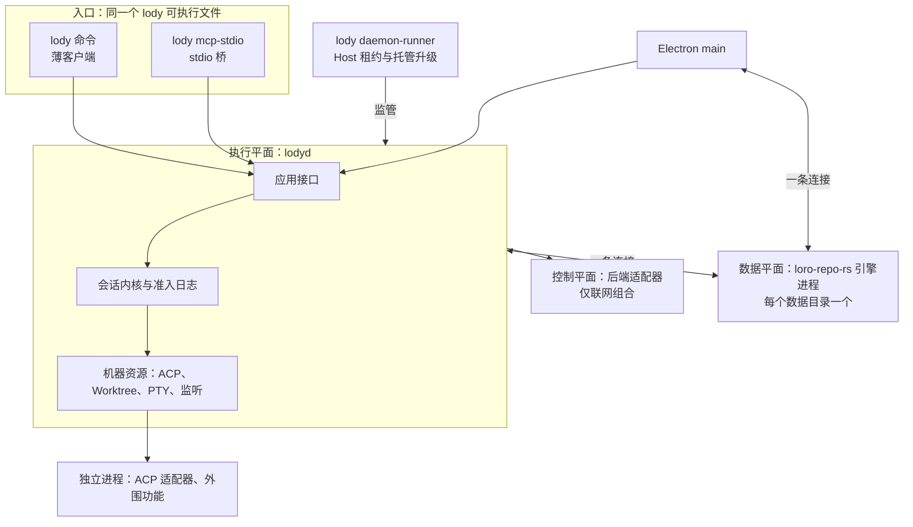

# Rust CLI 与 daemon 架构

Status: draft
Translation: current

[English](rust-cli-daemon-architecture.md)

## 背景与决定

`apps/cli` 现在同时是机器上的执行宿主、协作文档的本地和云端中继、本地与远端 RPC 服务端、ACP 进程和 Worktree 管理器、内置 MCP 服务器、Automations 宿主和预览网关。它有两类问题：

- **与语言有关的**：Node 单线程和 Loro/Flock 的 WebAssembly 内存上限，让一个 daemon 分裂成看门狗、Worker、HTTP MCP host、四类 Code Collab worker 和若干包装进程。
- **与语言无关的**：会话状态分散在 `MessageHandler`、`SessionExecutionService`、`SessionDispatchWatcher` 之间；同一个用户动作在 CLI 命令、MCP 工具、本地控制和远端 RPC 里各实现一遍；独立命令和 daemon 自己的子系统都会直接写工作区仓库；同一条输入从三条路径到达并互相竞争。

第二类问题换语言不会消失。本 Spec 因此先定职责怎么切，再定用 Rust 实现：

1. **三个平面，各有一个所有者**：数据平面归独立的 `loro-repo-rs` 引擎进程，执行平面归 `lodyd`，控制平面是可替换的后端适配器。
2. **会话逻辑是不做 I/O 的纯状态机**，运行时只是执行它产出的动作。
3. **所有输入先进一本持久的准入日志**，会话只从日志消费。
4. **一层应用接口**，CLI、MCP、本地 IPC 和远端 RPC 都是它的投影。
5. **端口、实现、组合分开**：本地组合不构造任何联网后端的实现。

[`apps/cli/AGENTS.md`](../apps/cli/AGENTS.md)、[`packages/platform/AGENTS.md`](../packages/platform/AGENTS.md)、[`packages/shared/AGENTS.md`](../packages/shared/AGENTS.md) 和[故障隔离规则](../.agents/docs/failure-containment.md)里的不变量在迁移期间继续有效。数据平面遵循已批准的 [native 引擎 Spec](native-engine-cloud-e2ee.zh.md)，本文不修改它。

## 三个平面与进程



| 持久状态 | 所有者 |
| --- | --- |
| Workspace Meta、`wf`/`mf`/`sr` Flock、Session/Schedule/Preview 文档、上传 outbox、内容加解密 | 引擎进程 |
| 准入日志、`operations.sqlite3`、`schedules.sqlite`、`pr-poller-state.sqlite3`、历史 RPC 拒绝记录、按工作区的 `automations/<id>.sqlite`、Turn Diff 库、E2EE 账本与密钥托管 | `lodyd` |
| Roost 会话历史 | 目前 `lodyd`，是否移交见[待决定问题](#待决定问题) |

- **单一所有者**：除所有者之外，任何进程都不打开这些存储。这条同样约束 daemon 内部现在借用一次性命令路径写仓库的子系统（Automations、Schedules、PR 轮询）。
- **渲染进程不直连引擎**：按已批准的 Spec，renderer 只经 Electron main 读明文，`lodyd` 和 main 各持一条连接。
- **按需启动不等于上线**：一次性命令拉起的 `lodyd` 只开存储，不发布在线状态，也不接受派发；它不抢占已有的 Host 租约。
- **`daemon-runner` 的职责不变**：Host 租约、发布包校验、通道与降级确认、候选版本健康检查、有界排空和失败回退，都按[托管 daemon 更新规范](daemon-upgrade-installation.zh.md)保留。只有 JS 堆和 WASM 运行时特有的重启原因消失。
- **本地 SQLite 文件保留原名和表结构**（owner 已定），由 `lodyd` 内的常驻连接持有。新旧版本可互相回退的前提是：灰度期内这些表结构冻结，或两边同步变更；切换前先排空进行中的回合。

## 代码结构

依赖只允许沿下表自上而下；实现只在组合根出现。表中的名字是示意，不是最终 crate 名。

| 角色 | 内容 | 允许依赖 |
| --- | --- | --- |
| 组合根 | `lody` 可执行文件：选择本地或联网组合，装配实现 | 全部 |
| 入口 | CLI 渲染、`mcp-stdio`、本地 IPC、远端 RPC 与 Iroh、MCP HTTP | 应用接口 |
| 运行时 | Actor 外壳、监管树、资源租约、执行内核产出的动作 | 应用接口、内核、端口 |
| 应用接口 | 命令与查询、按调用者的授权判断、唯一的协议定义 | 内核、端口 |
| 内核 | 会话、回合、准入的状态机；无 I/O、无时钟、无异步运行时 | 无 |
| 端口 | 只有 trait 和数据类型：引擎、历史、后端、ACP、Worktree、存储 | 无 |
| 实现 | 引擎客户端、Roost、联网后端、ACP 客户端、SQLite、OS 原语 | 端口 |

这样切的理由：

- 把现有的五个耦合中心搬进一个编排 crate，只会得到新的上帝模块。内核与运行时分开后，内核可以用事件序列确定性回放，也可以和现有 TypeScript 实现逐步对照。
- 入口只依赖应用接口，所以“创建会话”这类动作只有一份实现。
- 本地组合不链接联网后端的实现，公开默认构建因此无法发出认证云请求，这比运行时判断更可靠。

## 会话内核

内核是一个转移函数：输入当前状态和一个事件，输出新状态和一组待执行的动作。

```text
Idle（保留上一个已释放回合、可选的预热 Agent）
  → Preparing（Worktree、MCP、ACP 握手）
  → Running（流式输出、权限等待、Steer）
  → Settling（有界收尾）
  → Idle
```

- **已释放的回合不销毁**。Agent 在回合结束后被后台任务、定时唤醒或 cron 叫醒时，它的工作仍归属上一个回合冻结的调用上下文；`Idle` 必须保留它。
- **迟到事件按代际丢弃**。每个 Agent 事件带代际号，与当前回合不符的不改变状态。
- **控制输入不排在输出后面**。取消、权限答复、Steer 和关闭走独立通道，不会被流式 chunk 挡住。
- **会话之间不互相等待**。委派、子会话准入、Fork 和编辑重发都是异步消息，答复作为事件回来；任何会话都不在持有自己信箱时等另一个会话。
- **目标回合、子会话准入计数、收件箱执行归属**是内核状态，不是运行时的附加标志。
- **不属于单个会话的状态放在上一级**：启动重试窗口、能力刷新和运行时安装的去重属于工作区；ACP 启动并发、PTY、文件监听和 Worktree 属于机器，以租约借给会话。

一个会话失败不阻塞其他会话，每个用户路径上的等待都有上界；远端输入到达后，只有正确性必需的准备可以挡在 ACP `prompt` 之前。

## 准入日志

每个会话有一本持久的输入日志。本地 IPC、远端 RPC 快路径、CRDT 文档观察、跨会话委派、Automations 和 Schedules 都只做一件事：往日志追加一条，以用户回合 ID 去重。会话按日志顺序消费，日志是“哪条输入算数、按什么顺序”的唯一答案。

- 快路径只是让内容提前到达，不产生第二份输入。
- 回复写入历史之前仍要等用户消息在数据平面落盘，但这个等待只在一处。
- 被取消或撤回的条目永不启动；崩溃后状态不确定的回合由日志重放决定是恢复还是结算。

## 安全边界

验证分两层，各管一件事：

1. **传输信封在入口处理**。本机受信 Socket、普通云工作区访问校验、加密工作区的信封验签和解密，在入口得到一个已验证的调用者，响应按原通道封装。
2. **每条输入在进入准入日志时再验证一次**。加密工作区的输入也会作为带签名的行经文档同步到达，入口看不到它们。日志按工作区的安全策略逐条判断：只认签名覆盖的内容，未签名的 `resume` 不作为请求目标，执行身份取自验证结果，条目里的 `userId` 只是显示数据。

内核只接收已验证的输入，不出现加密分支。内容的封装、签名和解封由引擎完成；账本验证、密钥接收与分发、轮换和机器共享留在 `lodyd`。工作区模式未知时不授权任何明文外发。

## 联网后端与组合

没有后端配置时，`lodyd` 按本地组合运行，不构造任何联网实现，也不发云请求；公开的受管运行时下载是既有例外。只有用户显式执行 `lody login --server <origin>` 才建立后端配置，它读取 `/.well-known/lody-configuration`（可被 `profile.toml` 覆盖），官方云和企业自部署走同一条路径。本地存储、凭证和加密锚点按后端配置隔离。

CLI 现在是在运行时读取环境变量里的端点，认证站点地址由 `.convex.cloud` 替换推导而来；后端配置取代这两者，站点地址改为显式下发。

端口保持与厂商无关，现在定下的有六个：控制面（含 OIDC 登录、自定义 CA 和代理）、协商式对象上传、制品源（公网、内网镜像、离线包）、代码托管、预览隧道、授权状态。授权到期只拒绝新建远端协作派发，本地历史读取、本地恢复和工作区导出始终可用。

## 独立进程的边界

- **ACP 适配器**：现有五个 TypeScript 适配器从 CLI 构建中拆出，作为独立受管制品经 ACP over stdio 调用（owner 已定）。它们仍需要 JavaScript 运行时，因此整体不是零依赖。
- **外围功能**：iOS/Android 预览、设备串流和隧道这类依赖重、与内核无关的功能，可以长期留在带版本协议的独立进程里，不必随内核一起重写。
- **Automations 脚本**：在 `lodyd` 内用 `rquickjs` 执行，限制内存、时长和调用次数（owner 已定）。已注册的脚本是用户数据，替换引擎前要证明它们的求值结果不变。

## 跨语言只留一份定义

Web、手机和 Electron 继续使用 TypeScript，`@lody/shared`、`@lody/e2ee-core` 这类包不会消失。协议类型由应用接口这一份定义生成 TypeScript，不手写两份。线上和持久化格式不变，由两种语言共同校验同一组逐字节向量。加密核心是否也收敛成一份实现，见待决定问题。

## 迁移顺序与验收

1. **先做与语言无关的部分**：在现有 CLI 里落实存储单一所有者；拆出 ACP 适配器；在进程边界（本地 IPC、ACP stdio、引擎连接）上建立一套黑盒行为测试，先让 Node daemon 通过。
2. **Rust 薄客户端与 `mcp-stdio` 桥**，以及可与 TypeScript 对照回放的内核。
3. **替换已有的进程和线程边界**：文件扫描、Diff、Turn Diff 库。
4. **本地组合的 `lodyd`**，包含内置 MCP、Automations 和 Schedules；通过同一套黑盒测试后替换桌面内嵌的 CLI。Electron 的启动方式和打包需要改动，只有本地 Socket 协议在灰度期保持不变。
5. **联网组合、加密工作区和 Iroh**；之后 Electron 切到单一多路复用通道，删除旧协议兼容模块。

本地 IPC 分两阶段切换、引擎统一走独立进程，都是 owner 已定的决定，本文沿用。

## 待决定问题

- Roost 历史是否移交数据平面，使 `lodyd` 只保留可重建状态和准入日志。
- 是否让常驻进程持有 Agent 的 stdio，使 `lodyd` 升级或崩溃时不终止进行中的回合。
- 加密核心是保留两种语言的实现，还是只留一份并编译给客户端使用。
- 现行的 Effect v4 迁移在重写期间继续、冻结，还是只保留能划定内核边界的单元。
- 准入日志的存储格式，以及回退到旧版本时如何保证其中的输入不丢。
- 无 Electron 的主机上引擎由谁启动和监管；升级时引擎与 `lodyd` 的排空顺序；引擎崩溃后会话如何恢复。
- 授权状态端口是否适合留在公开仓库的 Spec 里。
- 多路复用通道的帧格式与背压参数；适配器在没有预装 Node 的主机上的打包方式；发现文档的字段和缓存策略。

## 证据与核对入口

- 已核查的现有实现：
  [`apps/cli/src/lib/message-handler.ts`](../apps/cli/src/lib/message-handler.ts)、
  [`apps/cli/src/session/session-execution-service.ts`](../apps/cli/src/session/session-execution-service.ts)（按会话的状态表、已释放回合的保留）、
  [`apps/cli/src/session/session-dispatch-watcher.ts`](../apps/cli/src/session/session-dispatch-watcher.ts)（三路输入、加密输入的逐条判断）、
  [`apps/cli/src/session/turn-history-gate.ts`](../apps/cli/src/session/turn-history-gate.ts)、
  [`apps/cli/src/lib/command-runtime.ts`](../apps/cli/src/lib/command-runtime.ts)（一次性命令直接写仓库）、
  [`apps/cli/src/mcp/lody-mcp-http-server.ts`](../apps/cli/src/mcp/lody-mcp-http-server.ts)（拆出子进程的原因）、
  [`apps/cli/src/commands/daemon-runner.ts`](../apps/cli/src/commands/daemon-runner.ts)、
  [`apps/cli/src/utils/const.ts`](../apps/cli/src/utils/const.ts)、
  [`packages/shared/src/convex-site-url.ts`](../packages/shared/src/convex-site-url.ts)、
  [`apps/electron/src/main/services/cli-service.ts`](../apps/electron/src/main/services/cli-service.ts) 和
  [`apps/cli/vite.config.ts`](../apps/cli/vite.config.ts)。
- 规模：`apps/cli/src` 非测试代码 604 个文件、约 19.5 万行，测试 352 个文件、约 18 万行；CLI 对 `@lody/shared` 有 939 处引用。
- 未验证：本变更只有设计，没有 Rust 代码，也没有内存或性能测量。本仓库目前没有 native 引擎的接入代码，数据平面的描述只依据已批准的 Spec。`@opencode/codemode` 的内部实现未核查。
- 配套的 `.ryugi/artifacts/` 文档、白板和 Crate 沙盘是早期方案的记录；与本文不一致处以本文为准。
