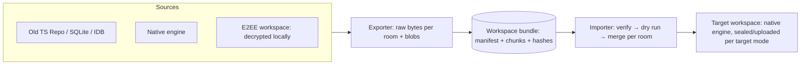

# Workspace full export and import

Status: draft
Translation: current

[中文](workspace-export-import.zh.md)

A workspace owner wants to back up a whole workspace, then merge it back after
changing device or storage. Lody itself must move data from the old loro-repo (TS)
and old Flock storage into native loro-repo-rs. The existing `lody export` produces
human-readable Markdown/JSON. It drops deletion records, clocks and peers, so it
cannot be imported. `lody migrate --from-oss` covers only one direction, local OSS
to cloud. This Spec defines a lossless, verifiable, mergeable workspace bundle. It
is the shared base for backup, device change and every future storage migration.

This is a draft for review and is not implemented. The owner has already decided
three points, which this document does not reopen:

1. Only workspace owners and admins may export or import.
2. An encrypted (E2EE) workspace is exported as a plaintext bundle, decrypted
   locally by an authorized member device.
3. Import merges into an existing workspace. It is not limited to empty or new
   workspaces.

## Scenario and responsibilities



- The **exporter** reads raw CRDT bytes (Loro snapshots, Flock files) room by room
  through a source adapter, plus referenced blobs, and writes the bundle. It never
  converts data to JSON and rebuilds it.
- The **bundle** is a self-describing, versioned file that can be streamed in
  chunks. Its manifest lists each entry's format, size and hash.
- The **importer** verifies the whole bundle, runs a dry run that writes nothing
  and reports the impact, then merges room by room into the target with CRDT
  merge. An encrypted target reseals with its existing keys. The renderer never
  takes part.
- A **domain codec** is the only code each room kind needs: room recognition,
  format version, references, import validation and, when needed, format
  conversion. Migration, backup and device change share the same codecs.

## Export scope

"Full" means every room of collaborative workspace data **that the exporter is
allowed to read**. It does not mean every byte on the server.

| Domain | Room / storage | Exported | Notes |
| --- | --- | --- | --- |
| Workspace Meta | Meta Flock (`e/m/ef…`) | Yes | Includes deletion records; decides whether other rooms are visible |
| Workspace catalog: projects, MCP definitions, Roles, project MCP defaults | `<ws>:wf:workspace` Flock | Yes | Shared definitions only; MCP credentials are never in these rows |
| Session control and history | `session-*` Loro documents | Yes | Full oplog, including unknown fields and opaque entries |
| Roost session bodies | Today the executing machine's local `roost-history.sqlite3`; a Roost room under native | Needs SDK support | See owner question 4; a coverage gap until then. The writer identity seed is never exported |
| Machines and agent configuration | `<ws>:mf:<machine>` Flock, `machine-*` documents, legacy `agent-*` documents | Yes | Restricted on import, see below; the durable command queue (`cmd` family) is never imported |
| Schedules | `<ws>:sr` Flock + `schedule-*` documents | Yes | |
| Preview comments | Old: one Loro document per session; new: Flock rows | Yes | The bundle keeps the source format; import converts to the target format |
| Legacy task documents, legacy session comments | `task-*`, `${ws}:ti`, `session-comment-*` | Yes | Losslessness only; no new feature |
| Attachments, images | Cloud: stored under `<ws>/<session>/<id>`; local: `session-files/<ws>/` | Yes (blobs) | Only those referenced by current or historical versions; deduplicated by content hash. Cloud files expire after 90 days; unreachable ones become gaps |
| Code Collab content-addressed snapshots | Executing machine's local `code-collab-v2/<ws>/diff-store.sqlite3`, 100-day / 1 GiB retention | Partly (blobs) | Read from the owning machine (directly on this machine, otherwise through existing Machine RPC and its permissions while online); offline or collected ones become gaps |
| Prompt Shortcuts | `shortcut-index:*`, `shortcut-body:*` outside the workspace namespace | Not in v1 | Separate authorization model, unsupported in E2EE; designed separately |
| File index FI/FIS | `<ws>:fi:*` / `fis` | No | Rebuilt by its owner; 180-day TTL |
| Presence, machine-monitor, ephemeral | Transient channels | No | Not durable data |
| Machine-local runtime state | Automation ledger, schedule runtime, operations/inbox, PR poller SQLite | No | Belongs to the executing machine, not to collaborative workspace data |
| Uncommitted pending sends | Renderer IndexedDB `lody-session-inputs-v1` | No | Not yet conversation content; export asks the user to send or discard them first |
| Usage, notifications, session sharing, members | Cloud service records | No | Not CRDT data; usage remains available through human-readable `lody export` |

**Never exported:** all credentials (provider logins, API keys, MCP local
authentication values, keychain entries, Streams/cloud tokens, GitHub
credentials); all keys and device identities (E2EE device/epoch keys, ledger,
recovery vault, host identity keys, pairing and custody receipts); members, roles,
invitations, billing/plan/usage billing; machine-local runtime state (worktrees,
terminals, local ACP agent sessions, source directories); caches and UI
preferences.

**Coverage report:** entries the exporter cannot read (no permission, expired in
the cloud, Roost not yet supported, unknown source format) are never skipped
silently. The manifest records each as a `gap` with its reason, and import and the
UI show "this bundle is incomplete". In an ordinary workspace an owner/admin cannot
necessarily read other members' private machine sessions (see
[session access](session-access.md)), so "full" is naturally bounded by what the
exporter can read. See owner question 1.

## Bundle format

A bundle is a ZIP64 file (store mode, no further compression) with extension
`.lodybundle`; the CLI may also write an equivalent directory. ZIP allows streaming
writes and random reads on every platform, so a large bundle can be verified or
imported partially.

```text
manifest.json                    canonical JSON, written last; without it the bundle is incomplete
rooms/<model>/<sha256>.<n>       raw room bytes, chunks of at most 64 MiB
blobs/sha256/<ab>/<sha256>       attachments, images, diff snapshots, named by content hash
```

Manifest fields (v1):

- `format: "lody-workspace-bundle"`, `version: 1`. A higher major version is
  rejected, not guessed.
- Source: workspace ID, content mode (`plaintext` / `e2ee-decrypted`), genesis hash
  for E2EE, exporter account and device ID, Lody and SDK versions, export start and
  end time.
- Each room entry: source room ID, `model` (`meta` / `flock` / `loro` / `roost`),
  `codec` (such as `session-loro/v1`, `preview-comment-loro/v1`), `encoding`
  (`flock-file/v1` = `Flock.exportFile()` / `exportFlockRaw` bytes;
  `loro-snapshot/v1` = complete Loro snapshot; Roost to be decided), source version
  (Loro VV / Flock version), chunk list with per-chunk and whole SHA-256, and whether
  the source contains unuploaded local edits.
- Blob entries: SHA-256, length, kind, original file name/MIME (display only).
- `gaps`: uncovered entries and their reasons.
- `digest`: SHA-256 of the rest of the manifest (canonical JSON).

**Lossless:** rooms store only raw SDK export bytes, so deletion records, HLC
clocks, peers, metadata, unknown fields and container identity are kept as is.
Rebuilding Flock through `scan → put` and Loro through JSON is forbidden, matching the
[migration plan](https://github.com/LodyAI/Lody/blob/native-repo-integration/.agents/docs/electron-loro-repo-rs-migration.zh.md#5-旧数据共存和回滚)
and the [OSS migration rules](../apps/cli/src/lib/oss-migration/AGENTS.md).

**Consistency:** the SDK has no atomic cross-room snapshot. Each room is a complete
state of itself at some moment. Export reads Meta first and then the rooms it
references; rooms created later are not included. A referenced but missing room is
a `gap`.

**Verification:** hashes detect corruption and truncation, not tampering. An
owner/admin holding a plaintext bundle can forge any content anyway. Bundle
authenticity is not a security premise; safety comes from authorization at import
(below).

**Protecting a plaintext bundle:**

- Write only to the location chosen in the save dialog; the CLI requires `--out`.
  The file is created 0600 (Windows: current-user-only ACL) under a temporary name
  and atomically renamed after `manifest.json` is written.
- Before export, warn that the file contains every conversation body and
  attachment and anyone holding it can read them. For E2EE workspaces additionally
  state that this removes end-to-end encryption.
- Optional passphrase encryption: a streaming AEAD layer around the whole bundle
  (Argon2id key derivation, chunked XChaCha20-Poly1305 with chunk index and
  final-chunk flag in AAD), extension `.lodybundle.enc`. Defaults: owner question 3.
- Never uploaded automatically, never placed in the cloud, workspace data directory
  or logs.

## Import merge semantics

### Flow

1. **Verify:** stream the bundle, check every chunk hash and stage it in a local
   directory (0700). Any failure stops; the target is untouched.
2. **Admit:** check the importer's role, target workspace mode, bundle version and
   that every codec is known. An unknown codec rejects the whole bundle instead of
   being treated as empty.
3. **Dry run:** in a temporary native namespace isolated from the target, merge the
   target's current state with the bundle, compute per codec which rows/documents
   would change, and report additions, updates, rejected rooms with reasons,
   mappings and coverage gaps. The UI shows this report and writes only after
   confirmation.
4. **Write:** merge room by room in dependency order, Meta last: blobs → body
   documents (sessions, schedules, comments…) → catalog Flocks (wf, sr, mf) → Meta.
   Bodies are invisible until Meta is merged, so an interruption leaves only
   invisible rooms, never "a listed session that opens empty".
5. **Finish:** write an import receipt and, when needed, the post-import writes
   below.

### CRDT merge result

- Each room is merged with `importRoomState` (Loro: `importLoroRaw`). The result
  equals two offline devices reconnecting: Loro merges causally, Flock takes LWW by
  HLC per key, and deletion records participate.
- **Target deletions are not resurrected:** a newer target deletion wins under LWW.
  For a session whose body the target has purged while Meta keeps the deletion
  record, the importer skips that body room and leaves no orphan. Conversely, a newer
  deletion in the bundle deletes the target's data; that is what merge means, and the
  dry-run report lists everything that would be deleted.
- Merge is monotonic: inputs already executed or dequeued do not return to pending
  because older state was imported.

### Idempotency and recovery

- Merging the same bytes again is a no-op (the version is already covered) and
  causes no new upload.
- A local import journal keyed by `(target workspace, bundle digest)` records each
  room as `pending / imported / rejected`, fsynced and atomically renamed. After an
  interruption, rerunning the same bundle continues; importing a completed room again
  is a no-op.
- **No half-imported state** means user-visible data appears only once Meta is
  merged, and Meta is a single-room write that is atomic by itself. The SDK has no
  cross-room transaction and merged CRDT data cannot be withdrawn, so rollback is
  not an option; completing the import is. Rooms rejected in the dry run receive no
  bytes.
- Import completes once the target is locally durable. Upload progress is shown
  separately; failures are retried by normal sync and do not fail the import.

### Source workspace ≠ target workspace

| Reference | Handling |
| --- | --- |
| Entity IDs (session, project, schedule, Role, comment) | Kept. They are UUIDs, collisions are negligible, and keeping them makes reimport idempotent |
| Rooms embedding the workspace ID (`<ws>:wf:workspace`, `<ws>:sr`) | Rewritten to the target workspace ID; row contents unchanged |
| Loro peers, Flock clock peers | Kept, never remapped (remapping breaks CRDT identity and idempotency) |
| User IDs (authors, `SessionMeta.userId`, Role creators) | Kept as provenance and grant nothing; non-members display as "unknown member" |
| Machines (`<ws>:mf:<machine>`, `SessionMeta.machineId`) | Machine rooms are not imported; sessions keep the original machine ID and show "machine unavailable", read only |
| Attachment/image references | Blobs are uploaded to the target (blobs the target still has are skipped on same-workspace restore); history is not rewritten. A "old reference → new reference" map is written at the session HEAD, reusing the OSS migration's `resolveArchivedAttachment` approach |

After a cross-workspace import, the safety rules proven by
[OSS migration](../apps/cli/src/lib/oss-migration/README.md) apply as new writes
(the original state stays in the oplog, so nothing is lost): imported sessions stop
collaboration and have dispatch pointers and pending queues cleared; imported
schedules are disabled; machine durable commands do not migrate. A same-workspace
restore does none of this, because merge itself is monotonic.

### Importing into an E2EE workspace

- Import must run on an admitted owner/admin personal device of the target
  workspace. Writes go through that device's protected native namespace, whose
  existing protector reseals them with the target's **current** epoch key and this
  device's signature. Bundle plaintext never travels through a plaintext cloud path.
- Attachment blobs are reuploaded with fresh random file keys. The map lives in
  protected conversation content, never in URLs or plaintext metadata.
- Signed execution intents carried in the bundle fail signature verification in the
  target and are therefore not executable. The importer never re-signs old intents.
- Import writes only CRDT content rooms. Ledger, members, devices and machine
  sharing policies are outside the bundle, and the importer has no ability to write
  them; they come only from their own signing workflows.
- Importing an E2EE-sourced bundle into an ordinary workspace places plaintext where
  the server can read it and needs explicit confirmation (owner question 2).

## Authorization and security

**Who may use it:** the local OSS desktop has one local user, treated as owner.
Ordinary cloud workspaces use the cloud member role. E2EE workspaces use the role of
this device's member in the **verified ledger**, never a server-reported role field.

**Where checks happen:**

- Export: checked locally before starting; the cloud composition also requests an
  export registration from the cloud (role check plus audit). Note that export reads
  only data the exporter can already sync, so a modified client that bypasses the
  local check reads nothing more. The export role restriction is product policy plus
  audit; the real read boundary remains existing sync/decryption permission.
- Import: checked locally; the cloud composition requests an import registration.
  The real defense is **per-row validation**: every change computed by the dry run
  must pass the same authorization rules the domain's ordinary write commands use
  (for example only users permitted by `canManageAgentRole` change a Role, only the
  machine owner changes machine rows, session sharing grants belong to the machine
  owner). Any failure rejects the whole room and is reported: raw Flock bytes cannot
  be merged partially, and rejecting a whole room is safer than silently rewriting
  it. Import therefore cannot do anything the importer could not do through the
  ordinary UI.
- Writes go through the normal sync path, where existing cloud room write
  permissions still apply.

**Revocation:** export and import recheck the role before each room (cloud role
subscription; ledger head for E2EE). On revocation they stop at once: export does
not write `manifest.json`, so the leftover file cannot be imported; import stops at
the current room and keeps its journal, and only someone still authorized may
continue. Data already written to a local file or merged cannot be recalled, which
matches existing revocation semantics.

**Data import cannot alter:** members, roles, invitations, ledger, device
identities, signed policies and billing are not in the bundle, and the importer has
no write path for them. An unrecognized room or codec rejects the whole bundle.

**Audit:** the cloud composition records start/finish, actor, workspace, bundle
digest, room count and byte count on the server, without bodies; E2EE audit records
likewise contain only opaque counts. Import also writes a visible import receipt in
the target workspace (time, actor, source workspace ID, bundle digest) so every
member can see that a bundle was imported. Local OSS writes only a local log.

## Entry points

- **CLI:** `lody workspace export --out <file> [--passphrase] [--workspace <id>]` and
  `lody workspace import <file> [--workspace <id>] [--dry-run] [--yes]`. The dry-run
  report is shown and confirmed by default; `--yes` is for automation. The existing
  human-readable `lody export` stays unchanged.
- **Desktop:** Settings → Workspace → Data: "Export workspace…" (save dialog,
  passphrase option, coverage report) and "Import into this workspace…" (choose file →
  dry-run report → confirm → progress, resumable). Hidden from non-owner/admin users.
- **Where it runs:** on the Node side (one-shot CLI or desktop data host/daemon). The
  renderer sees only progress and reports, never the engine or raw bytes.
- **Local OSS:** fully local, no cloud requests; blobs come from local file storage.
- **Cloud:** the additional export/import registration and audit use
  `packages/cloud-api` DTOs and an optional `packages/platform` capability port. The
  port is absent in the OSS composition and the feature still works. Attachments are
  read from the cloud relay and uploaded to the target relay.

## Relation to the native migration

Old format → native no longer needs a migration per domain; it is a special case of
the same pipeline:

```text
old storage (frozen SQLite backup / flushed IDB) --source adapter--> in-memory bundle entries
    --> importer (target = native namespace of the same workspace)
```

- Source adapters: `legacy-repo` (reads a consistent backup read only) and
  `native-engine` (`exportFlockRaw`, `exportLoroRaw`). Migration need not write a
  `.lodybundle` file, but uses the same manifest, hashes, journal and codecs.
- The only difference from a same-workspace import: a source with unuploaded local
  edits uses `enqueueOutbox: true` attributed to the original writer; proven synced
  state uses `false`. This is a fact reported by the source adapter, not a guess by
  the importer.
- **Format changes** are a codec conversion step, for example
  `preview-comment-loro/v1` → new Flock rows. Conversion creates new CRDT operations,
  so old causal history does not appear in the new format; the bundle always keeps
  the original format, so conversion can be redone.
- Freezing, publishing the room owner, no dual writes and leaving Roost alone remain
  the migration coordinator's rules; export/import supplies only "read out
  completely" and "merge losslessly". The native Workspace Meta integration (in
  progress in another session) should write Meta read-out/merge as this pipeline's
  first codec (`meta-flock/v1`) rather than a separate migration framework.
- `lody migrate --from-oss` can later be replaced by "OSS export → cloud workspace
  import"; it stays until this pipeline covers all its checks (append-cas,
  historical attachment scan, collaboration stop).

## Delivery phases

Line counts are product-code estimates, excluding tests and docs.

| Phase | Scope | Acceptance cases | Budget |
| --- | --- | --- | --- |
| A. Bundle and core pipeline | Manifest/chunks/hashes, ZIP read/write, import journal, codec interface; generic `meta-flock`, `flock-room`, `loro-room` codecs; `native-engine` source; same-workspace import; CLI export/import/dry run; local plaintext only | Deletion records and clocks round-trip (read back register evidence, not get/scan); reimport changes and uploads nothing; rerun after interruption at each room boundary gives the same result; truncated/tampered chunks rejected with target untouched; unknown codec rejected | ~1,300 |
| B. Legacy migration | `legacy-repo` source (consistent SQLite backup + IDB export); `enqueueOutbox` source facts; Meta migration converges on this pipeline; Preview comments format conversion | After old store → native, Loro VVs cover every source; sources with unuploaded edits enter the outbox; rerunning conversion gives the same result | ~700 |
| C. Blobs and cross-workspace | Attachment/image/diff snapshot blobs; cross-workspace mapping and post-import writes; per-row authorization | Changes to another user's Role, another user's machine rows or sharing grants reject the whole room; imported sessions stop collaboration and schedules are disabled; attachment map resolves historical references | ~1,200 |
| D. Cloud and desktop | Cloud registration/audit DTOs and port; role checks and abort on revocation; desktop settings page and progress; passphrase encryption | Non-owner/admin sees no entry and CLI refuses; revocation stops at a room boundary; OSS composition makes zero cloud requests | ~1,100 (plus private backend) |
| E. E2EE | Local decrypted export; import reseals with the target's current keys; attachment re-encryption; E2EE → ordinary confirmation | Exported bundle imports into an ordinary workspace; other member devices decrypt after import; old execution intents are not executable; ledger/members unchanged | ~800 |
| F. Roost | Depends on SDK raw export/import that keeps original signed records | Roost sessions round-trip with identical bodies and signature verification | ~400 + SDK |

Phases A and B can run in parallel with the native Meta integration; each phase after
C is reviewed independently.

## Owner questions

1. **Is "full" bounded by what the exporter can read?** Background: in an ordinary
   workspace an owner/admin may not read sessions on other members' private machines;
   in E2EE owners/admins have no cross-member machine content rights either. Options:
   (a) export only what the exporter can read and record the rest as gaps; (b) add a
   new owner/admin "read everything for export" permission. Cost: (b) changes the
   current privacy model and in E2EE needs new key distribution. **Recommend (a).**
2. **May an E2EE-sourced bundle be imported into an ordinary workspace?** Options:
   (a) allowed with a second confirmation; (b) forbidden; (c) only into another E2EE
   workspace. Cost: (b)/(c) restrict backup and device-change scenarios; (a) risks
   making content server-readable by mistake. **Recommend (a).**
3. **Is passphrase encryption on by default?** Options: (a) on by default for E2EE
   workspaces and off for ordinary ones, switchable; (b) off everywhere by default;
   (c) mandatory everywhere. Cost: with (c) a forgotten passphrase loses the backup;
   with (b) plaintext E2EE content easily lands in a synced folder. **Recommend (a).**
4. **What about Roost?** Background: Roost will become the default, but the current
   SDK client offers only `roostRead/roostReadTurns`, with no raw export/import that
   keeps the original signed records; the migration plan also leaves Roost alone.
   Options: (a) v1 lists Roost sessions as gaps and phase F follows SDK raw
   interfaces; (b) rewrite from read-out JSON (loses signatures and original writers,
   not lossless). **Recommend (a)**, and ask the SDK side to schedule Roost raw
   export/import.
5. **How are cross-workspace conflicts handled?** Background: OSS migration treats an
   existing ID or deletion record in the target as a conflict and stops; this Spec
   uses CRDT merge per the owner decision. Options: (a) merge, with the dry-run report
   listing every overwrite/deletion for confirmation; (b) treat the same ID from a
   different source workspace as a conflict and reject the room. Cost: with (a), two
   independent workspaces that happen to share IDs (for example both imported from
   one bundle then edited) overwrite each other, which is exactly what merge means;
   (b) is more conservative but cannot serve "both sides edited, merge back".
   **Recommend (a).**
6. **Is machine configuration imported across workspaces?** Options: (a) not
   imported; sessions show the machine as unavailable (this document); (b) imported
   as read-only "offline machine" records; (c) like `lody migrate --from-oss`, the
   importer explicitly maps a source machine to one of their own machines in the
   target, moving local projects and agent configuration. Cost: (b) creates a
   permanently offline machine nobody can manage; (c) rewrites `machineId`, which is
   a new write rather than a merge and can map only to the importer's own machine.
   **Recommend (a) for v1 and (c) as a later device-change phase.**
7. **Are Prompt Shortcuts in v1?** They have their own permission, provider and
   revision model. **Recommend not; design them separately.**

## Evidence

- Intent: this document; the three owner decisions were relayed by the Lody session
  "🤯 loro-repo-rs 接入" and have no human approval record yet.
- Inspected implementation: [`lody export`](../apps/cli/src/commands/export.ts),
  [session-export](../apps/cli/src/lib/session-export/),
  [OSS migration](../apps/cli/src/lib/oss-migration/README.md),
  [E2EE room mapping](../packages/shared/src/workspace-streams-content.ts),
  [session access](session-access.md), [E2EE foundations](e2ee-foundations.md),
  [encrypted attachment decision](../.agents/notes/implemented/architecture/2026-10-28-encrypted-attachments.md);
  loro-repo `795bafcb` client types `exportFlockRaw`, `exportLoroRaw`,
  `importRoomState`, `importLoroRaw`, `flockReadRegisters`; migration plan §5 on
  branch `native-repo-integration`.
- No validation was executed; this Spec contains design only.
