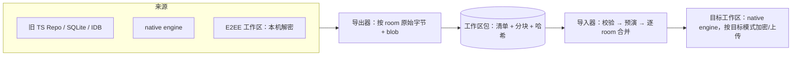

# 工作区全量导出与导入

Status: draft
Translation: current

[English](workspace-export-import.md)

工作区 owner 想把整个工作区备份下来，换一台设备或换一套存储后再合并回去；Lody 自己也要把
旧 loro-repo（TS）/ 旧 Flock 数据搬进 native loro-repo-rs。现有 `lody export` 只产出给人看的
Markdown/JSON，丢了删除记录、时钟和 peer，不能导回去；`lody migrate --from-oss` 只覆盖
“OSS 本地 → 云”这一个方向。本 Spec 定义一套无损、可校验、可合并的工作区包（bundle），作为
备份、换设备和今后所有存储迁移的共同底座。

本文是待审草稿，不代表已实现。owner 已定三点，下文不再讨论：

1. 导出和导入只允许工作区 owner 和 admin。
2. 加密（E2EE）工作区由有权限的成员设备在本机解密后导出明文包。
3. 导入是合并进一个已存在的工作区，不限于空工作区或新工作区。

## 场景与职责



- **导出器** 从一个“来源适配器”逐 room 读出原始 CRDT 字节（Loro snapshot、Flock 文件），
  外加被引用的 blob，写成包。它不把数据转成 JSON 再重建。
- **包** 是自描述、版本化、可分块流式处理的文件，清单列出每个条目的格式、大小和哈希。
- **导入器** 先完整校验包，再做不写入的预演（dry-run）得出影响报告，最后逐 room 用 CRDT
  合并写入目标；目标是加密工作区时由目标现有密钥重新封装。导入期间不经过 renderer。
- **领域编解码器（codec）** 是每类 room 唯一需要写的代码：声明 room 识别、格式版本、引用关系、
  导入校验和（必要时）格式转换。迁移、备份、换设备共用同一套 codec。

## 导出范围

“全量”指**导出者有权读取、且属于工作区可协作数据**的全部 room；不是服务器上所有字节。

| 领域 | room / 存储 | 是否导出 | 说明 |
| --- | --- | --- | --- |
| Workspace Meta | Meta Flock（`e/m/ef…`） | 是 | 包含删除记录；决定其它 room 是否“可见” |
| 工作区目录：项目、MCP 定义、Role、项目默认 MCP | `<ws>:wf:workspace` Flock | 是 | 只有共享定义；MCP 凭据本来就不在行里 |
| Session 控制与历史 | `session-*` Loro 文档 | 是 | 完整 oplog，含 unknown 字段和 opaque 条目 |
| Roost 会话正文 | 当前为执行机本地 `roost-history.sqlite3`；native 下为 Roost room | 需要 SDK 支持 | 见“待 owner 决定”第 4 条；不支持前列为覆盖缺口。写者身份种子不导出 |
| 机器与 Agent 配置 | `<ws>:mf:<machine>` Flock、`machine-*` 文档、旧 `agent-*` 文档 | 是 | 导入规则受限，见下文；持久命令队列（`cmd` 族）不导入 |
| Schedule | `<ws>:sr` Flock + `schedule-*` 文档 | 是 | |
| Preview comments | 旧：每会话 Loro 文档；新：Flock 行 | 是 | 包内保存来源格式，导入时按目标格式转换 |
| 旧 task 文档、旧 session-comment | `task-*`、`${ws}:ti`、`session-comment-*` | 是 | 只为无损，不新增功能 |
| 附件、图片 | 云：按 `<ws>/<session>/<id>` 存放；本地：`session-files/<ws>/` | 是（blob） | 只导出被当前或历史版本引用的；按内容哈希去重。云端文件 90 天过期，取不到的记为 gap |
| Code Collab 内容寻址快照 | 执行机本地 `code-collab-v2/<ws>/diff-store.sqlite3`，100 天 / 1 GiB 回收 | 部分（blob） | 从所属机器读取（本机直接读，其它机器在线时经已有的 Machine RPC 和权限）；离线或已回收的记为 gap |
| Prompt Shortcuts | 工作区命名空间外的 `shortcut-index:*`、`shortcut-body:*` | 第一版不导出 | 独立授权模型，E2EE 下不支持，单独设计 |
| 文件索引 FI/FIS | `<ws>:fi:*`/`fis` | 否 | 可由 owner 重建，180 天 TTL |
| presence、machine-monitor、ephemeral | 临时通道 | 否 | 不是持久数据 |
| 机器本地运行状态 | 自动化 ledger、schedule 运行表、operations/inbox、PR 轮询等 SQLite | 否 | 属于执行机，不属于工作区协作数据 |
| 未提交的待发送输入 | renderer IndexedDB `lody-session-inputs-v1` | 否 | 尚未成为会话内容；导出前提示先发送或丢弃 |
| 用量、通知、会话分享、成员 | 云端服务记录 | 否 | 不是 CRDT 数据；用量可继续用 `lody export` 导出给人看 |

**明确不导出：** 一切凭据（provider 登录、API key、MCP 本地认证值、keychain、Streams/云
token、GitHub 凭据）；一切密钥与设备身份（E2EE 设备/epoch 密钥、ledger、恢复 vault、
host 身份密钥、配对与 custody 回执）；成员、角色、邀请和计费/套餐/用量账单；机器本地
运行状态（worktree、终端、ACP agent 的本地会话、源码目录）；缓存和 UI 偏好。

**覆盖报告：** 导出者读不到（无权限、云端已过期、Roost 暂不支持、来源格式未知）的条目不静默
跳过：清单逐条记为 `gap`，写明原因。导入和 UI 都会显示“这份包不完整”。owner/admin 在普通
工作区不一定能读别人的私有机器会话（见 [单会话访问](session-access.zh.md)），所以“全量”
天然受导出者可读范围限制；这一点见待决定第 1 条。

## 包格式

包是一个 ZIP64 文件（store 模式，不再压缩），扩展名 `.lodybundle`；CLI 也可输出等价目录。
选 ZIP 是因为各平台都能流式写、随机读，便于大包只校验或只导入部分条目。

```text
manifest.json                    规范 JSON，最后写入；没有它包就是不完整的
rooms/<model>/<sha256>.<n>       room 原始字节，按 ≤ 64 MiB 分块
blobs/sha256/<ab>/<sha256>       附件、图片、diff 快照，按内容哈希命名
```

清单字段（v1）：

- `format: "lody-workspace-bundle"`、`version: 1`。读到更高主版本直接拒绝，不猜。
- 来源：工作区 ID、内容模式（`plaintext` / `e2ee-decrypted`）、E2EE 时的 genesis hash、
  导出者账户 ID 和设备 ID、Lody 与 SDK 版本、导出开始/结束时间。
- 每个 room 条目：来源 room ID、`model`（`meta` / `flock` / `loro` / `roost`）、
  `codec`（如 `session-loro/v1`、`preview-comment-loro/v1`）、`encoding`
  （`flock-file/v1` = `Flock.exportFile()`/`exportFlockRaw` 字节；`loro-snapshot/v1` =
  完整 Loro snapshot；Roost 待定）、来源版本（Loro VV / Flock 版本）、分块列表及每块与整体
  SHA-256、来源是否含未上传的本地编辑。
- blob 条目：SHA-256、长度、kind、原文件名/MIME（这些只是展示信息）。
- `gaps`：未覆盖条目及原因。
- `digest`：对清单其余部分（规范 JSON）的 SHA-256。

**无损：** room 只存 SDK 原始导出字节，所以删除记录、HLC 时钟、peer、metadata、unknown
字段和容器身份都原样保留。禁止 `scan → put` 重建 Flock、禁止 JSON 重建 Loro，这与
[迁移计划](https://github.com/LodyAI/Lody/blob/native-repo-integration/.agents/docs/electron-loro-repo-rs-migration.zh.md#5-旧数据共存和回滚)
和 [OSS 迁移规则](../apps/cli/src/lib/oss-migration/AGENTS.md) 一致。

**一致性：** SDK 没有跨 room 原子快照。每个 room 是其自身某一时刻的完整状态；导出先读 Meta，
再读 Meta 引用的 room，之后新建的 room 不进包。被引用却缺失的 room 记为 `gap`。

**校验：** 哈希只防损坏和截断，不防篡改——能拿到明文包的 owner/admin 本来就能伪造任意内容。
包的真实性不作为安全前提；安全靠导入端的权限校验（见下文）。

**明文包保护：**

- 只写到用户在保存对话框里选的位置；CLI 必须给 `--out`。文件以 0600（Windows：仅当前用户
  ACL）创建，先写临时名，`manifest.json` 写完后原子改名。
- 导出前提示：包含全部对话正文和附件，任何拿到文件的人都能读；E2EE 工作区额外强调“这会
  解除端到端加密”。
- 可选口令加密：整个包外面再套一层流式 AEAD（Argon2id 派生密钥，XChaCha20-Poly1305 分块，
  块号和“最后一块”标志进 AAD），扩展名 `.lodybundle.enc`。默认值见待决定第 3 条。
- 不自动上传、不进云、不写入工作区数据目录或日志。

## 导入合并语义

### 流程

1. **校验：** 流式读入，逐块核对哈希，先落到本机暂存目录（0700）。任一失败即停，目标未被写。
2. **准入：** 核对导入者角色、目标工作区模式、包版本、每个 codec 都已知。未知 codec 整包拒绝，
   不当成空数据。
3. **预演：** 在与目标隔离的临时 native namespace 中，把目标当前状态与包合并，按 codec 规则
   计算“会改变哪些行/文档”，产出报告：新增、更新、被拒绝的 room 及原因、映射、覆盖缺口。
   UI 默认先展示报告，用户确认后才写。
4. **写入：** 按依赖顺序逐 room 合并，Meta 最后：blob → 正文文档（session、schedule、
   comments…）→ 目录类 Flock（wf、sr、mf）→ Meta。正文在 Meta 发布前对用户不可见，所以
   中断只会留下不可见的 room，不会出现“列表里有会话、点开是空的”。
5. **收尾：** 写入一条导入回执，并按需在目标里追加“导入后处理”写入（见下文）。

### CRDT 合并结果

- 每个 room 调用 `importRoomState`（Loro 为 `importLoroRaw`）把包里的字节合并进目标。
  结果等同两台离线设备重新联网：Loro 按因果合并，Flock 按每个 key 的 HLC 取 LWW，删除记录
  参与比较。
- **目标里的删除不会被“复活”：** 目标中更新的删除记录在 LWW 中胜出；目标里已彻底清除正文
  但 Meta 仍有删除记录的会话，导入器跳过对应正文 room，不留孤儿。反过来，包里更晚的删除会删掉
  目标里对应的数据——这是合并的本义，预演报告会列出全部“将被删除”的条目。
- 合并是单调的：已执行、已出队的消息不会因导入旧状态而回到待执行。

### 幂等与恢复

- 同一份字节再次合并是空操作（版本已被覆盖）；不会产生新的上传。
- 本机导入日志以 `(目标工作区, 包 digest)` 为键，逐 room 记录 `pending / imported / rejected`，
  fsync 后原子改名。中断后用同一份包重跑即可继续；已完成的 room 再导一次也只是空操作。
- **不留半导入状态** 的含义是：用户可见的数据只在 Meta 合并后出现；Meta 是单 room 写入，
  自身原子。SDK 不提供跨 room 事务，已合并的 CRDT 数据也无法撤回，所以“回滚”不是选项，
  “继续完成”才是。预演阶段拒绝的 room 不会写入任何字节。
- 导入完成以“目标本地持久化”为准；上传进度单独显示，失败由正常同步重试，不让导入失败。

### 来源工作区 ≠ 目标工作区

| 引用 | 处理 |
| --- | --- |
| 实体 ID（session、项目、schedule、Role、comment） | 保留。都是 UUID，碰撞可忽略；保留才能让重复导入幂等 |
| 含工作区 ID 的 room（`<ws>:wf:workspace`、`<ws>:sr`） | 改写为目标工作区 ID；行内容不变 |
| Loro peer、Flock 时钟 peer | 保留，不重映射（重映射会破坏 CRDT 身份和幂等） |
| 用户 ID（作者、`SessionMeta.userId`、Role 创建者） | 保留为历史出处，不授予任何权限；非目标成员显示为“未知成员” |
| 机器（`<ws>:mf:<machine>`、`SessionMeta.machineId`） | 机器 room 不导入；会话保留原机器 ID，显示为“机器不可用”，只读 |
| 附件 / 图片引用 | blob 重新上传到目标（同工作区恢复时目标仍有的 blob 跳过）；不改写历史，在会话 HEAD 写入一张“旧引用 → 新引用”映射表，沿用 OSS 迁移的 `resolveArchivedAttachment` 方式 |

跨工作区导入后，沿用 [OSS 迁移](../apps/cli/src/lib/oss-migration/README.md) 已验证的安全
规则，以新写入的方式（原状态仍在 oplog 里，不算丢失）：导入的会话停止协作、清空派发指针和
待执行队列；导入的 schedule 置为停用；机器持久命令不迁移。同一工作区内的恢复不做这些处理，
因为合并本身是单调的。

### 导入进 E2EE 工作区

- 导入必须在目标工作区里一台已准入的 owner/admin 个人设备上运行；写入走该设备的 protected
  native namespace，由现有 protector 用目标**当前** epoch 密钥和本设备签名重新封装。包里的
  明文不经过云端明文通道。
- 附件 blob 用新的随机文件密钥重新上传；映射表写在受保护的会话内容里，不进 URL 或明文元数据。
- 包里带来的已签名执行意图（signed execution intent）在目标里验不过签名，因此不可执行；
  导入器不重签旧意图。
- 导入只写 CRDT 内容 room。ledger、成员、设备、机器共享策略都在包外，导入器也没有写它们的
  能力——这些数据只能由各自的签名流程产生。
- E2EE 来源导入到普通工作区等于把明文放进服务器可读的位置，需要显式确认（见待决定第 2 条）。

## 权限与安全

**谁能用：** 本地 OSS 桌面只有本机用户，即视为 owner。云普通工作区按云端成员角色；E2EE 工作区按
**已验证 ledger** 中该设备所属成员的角色，不信服务器返回的角色字段。

**校验位置：**

- 导出：本地检查角色后才开始；云组合同时向云端申请一次导出登记（检查角色并写审计）。
  需要承认：导出只读取导出者本来就能同步到的数据，被改过的客户端绕过本地检查也读不到更多；
  所以导出的角色限制是产品策略加审计，真正的读边界仍是现有同步/解密权限。
- 导入：本地检查角色；云组合申请导入登记。真正的防线是**逐行校验**：预演算出的每一处变更都要
  通过该领域正常写命令所用的同一套授权规则（例如 Role 只能由 `canManageAgentRole` 允许的人
  修改，机器行只能由机器 owner 修改，session 共享授权只属于机器 owner）。任何一处不通过，整个
  room 被拒绝并写入报告——Flock 原始字节无法只合并一部分，拒绝整 room 比悄悄改写更安全。
  因此借导入能做到的事，不超过导入者本人用正常界面能做到的事。
- 写入经由正常同步路径，云端现有的 room 写权限照常生效。

**撤销：** 导出和导入在每个 room 前重新检查角色（云端角色订阅；E2EE 为 ledger head）。发现被撤销
立即停止：导出不写 `manifest.json`，留下的文件不可导入；导入停在当前 room，日志保留，只有仍
有权限的人能继续。已经写进本地文件或已合并的数据无法收回，这与现有撤销语义一致。

**不能借导入篡改的数据：** 成员、角色、邀请、ledger、设备身份、签名策略、计费——都不在包里，
导入器也没有对应写入口。包里出现无法识别的 room 或 codec 整包拒绝。

**审计：** 云组合由服务端记录 start/finish、操作者、工作区、包 digest、room 数和字节数，不含正文；
E2EE 工作区的审计记录同样只含不透明计数。导入另在目标工作区写一条可见的导入回执（时间、操作者、
来源工作区 ID、包 digest），所有成员都能看到“这里导入过一份包”。本地 OSS 只写本机日志。

## 入口

- **CLI：** `lody workspace export --out <file> [--passphrase] [--workspace <id>]` 和
  `lody workspace import <file> [--workspace <id>] [--dry-run] [--yes]`。默认先显示预演报告并要求
  确认；`--yes` 用于自动化。现有 `lody export`（给人看的导出）保持不变。
- **桌面：** 设置 → 工作区 → 数据：“导出工作区…”（保存对话框、口令选项、覆盖报告）与
  “导入到此工作区…”（选择文件 → 预演报告 → 确认 → 进度，可中断后继续）。非 owner/admin 不显示。
- **执行位置：** 都在 Node 侧（CLI one-shot 或桌面 data host / daemon）执行，renderer 只看进度和
  报告，不接触 engine 或原始字节。
- **本地 OSS：** 全程本地，不发任何云请求；blob 来自本地文件存储。
- **云平台：** 额外的导出/导入登记与审计走 `packages/cloud-api` DTO 和 `packages/platform` 可选
  能力端口；OSS 组合中该端口不存在，功能仍可用。附件从云 relay 读取、向目标 relay 上传。

## 与 native 迁移的关系

旧格式 → native 不再为每个领域各写迁移，而是同一条管线的特例：

```text
旧存储（冻结的 SQLite 备份 / 已 flush 的 IDB）--来源适配器--> 内存中的包条目
    --> 导入器（目标 = 同一工作区的 native namespace）
```

- 来源适配器：`legacy-repo`（只读打开一致备份）与 `native-engine`（`exportFlockRaw`、
  `exportLoroRaw`）。迁移不必真的落盘成 `.lodybundle`，但走同一份清单、哈希、日志和 codec。
- 迁移与“同工作区导入”唯一的区别：来源含未上传的本地编辑时，用 `enqueueOutbox: true` 并归属
  到原写者；已证明同步过的用 `false`。这是来源适配器报告的事实，不是导入器猜的。
- **格式变化** 由 codec 的转换步骤处理，例如 `preview-comment-loro/v1` → 新 Flock 行。转换会
  产生新的 CRDT 操作，旧的因果历史不会出现在新格式里；包始终保存原始格式，所以转换可以重做。
- 冻结、发布 room owner、不双写、Roost 不碰等规则仍由迁移协调器负责；导出/导入只提供“完整读出”
  和“无损合并”两个动作。Workspace Meta 的 native 接入（另一会话进行中）应把 Meta 的读出/合并
  写成本管线的第一个 codec（`meta-flock/v1`），而不是另造一个迁移框架。
- `lody migrate --from-oss` 长期可由“OSS 导出 → 云工作区导入”替代；在本管线覆盖其全部检查
  （append-cas、附件历史扫描、协作停止）之前保留不动。

## 分阶段实施

行数为产品代码估算，不含测试和文档。

| 阶段 | 范围 | 验收用例 | 预算 |
| --- | --- | --- | --- |
| A. 包与核心管线 | 清单/分块/哈希、ZIP 读写、导入日志、codec 接口；`meta-flock`、`flock-room`、`loro-room` 三个通用 codec；来源 `native-engine`；同工作区导入；CLI 导出/导入/预演；仅本地明文 | 删除记录与时钟往返一致（读回 register 证据而非 get/scan）；重复导入零变化零上传；中断在每个 room 边界后重跑结果相同；截断/篡改块被拒绝且目标未写；未知 codec 拒绝 | ~1,300 |
| B. 旧格式迁移 | 来源 `legacy-repo`（一致 SQLite 备份 + IDB 导出）；`enqueueOutbox` 来源事实；Meta 迁移收敛到本管线；Preview comments 格式转换 | 旧库 → native 后 Loro VV 覆盖全部来源；含未上传编辑的来源进入 outbox；转换重跑结果一致 | ~700 |
| C. Blob 与跨工作区 | 附件/图片/diff 快照 blob；跨工作区映射与导入后处理；逐行授权校验 | 他人 Role、他人机器行、共享授权的改动整 room 拒绝；导入会话停协作、schedule 停用；附件映射可解析历史引用 | ~1,200 |
| D. 云与桌面 | 云登记/审计 DTO 与端口；角色校验与撤销中止；桌面设置页与进度；口令加密 | 非 owner/admin 看不到入口且 CLI 拒绝；中途撤销停在 room 边界；OSS 组合零云请求 | ~1,100（另有私有后端） |
| E. E2EE | 设备本机解密导出；导入以目标当前密钥重新封装；附件重新加密；E2EE → 普通的确认 | 导出包可在普通工作区导回；导入后其它成员设备可解密；旧执行意图不可执行；ledger/成员不变 | ~800 |
| F. Roost | 依赖 SDK 原始导出/导入（保留原签名记录） | Roost 会话往返后正文与签名验证一致 | ~400 + SDK |

阶段 A、B 可与 Meta native 接入并行；C 之后的阶段各自独立评审。

## 待 owner 决定

1. **“全量”是否受导出者可读范围限制？** 背景：普通工作区里 owner/admin 未必能读别人私有机器
   上的会话；E2EE 里 owner/admin 也没有跨成员的机器内容权限。选项：(a) 只导出导出者能读的，
   其余记为 gap；(b) 给 owner/admin 新增“为导出读取全部”的权限。代价：(b) 改变现有隐私模型，
   在 E2EE 下还需要新的密钥分发。**推荐 (a)。**
2. **是否允许把 E2EE 来源的包导入普通工作区？** 选项：(a) 允许但必须二次确认；(b) 禁止；
   (c) 只允许导入另一个 E2EE 工作区。代价：(b)/(c) 让备份换设备场景受限，(a) 有误操作导致
   服务器可读的风险。**推荐 (a)。**
3. **口令加密是否默认开启？** 选项：(a) E2EE 工作区默认开、普通工作区默认关，可关闭；(b) 全部
   默认关；(c) 全部强制。代价：(c) 忘记口令即丢备份；(b) 明文 E2EE 内容容易被随手放进同步盘。
   **推荐 (a)。**
4. **Roost 怎么办？** 背景：Roost 将成默认，但当前 SDK client 只有 `roostRead/roostReadTurns`，没有
   保留原签名记录的原始导出/导入；迁移计划也明确“Roost 不碰”。选项：(a) 第一版把 Roost 会话
   列为 gap，补 SDK 原始接口后做阶段 F；(b) 先按读出的 JSON 重新写入（丢签名和原写者，不无损）。
   **推荐 (a)**，并请 SDK 侧排期 Roost 原始导出/导入。
5. **跨工作区导入时冲突怎么处理？** 背景：OSS 迁移把“目标已有同 ID 或删除记录”视为冲突并停下；
   本 Spec 按 owner 决定做 CRDT 合并。选项：(a) 合并，预演报告列出全部覆盖/删除，用户确认；
   (b) 同 ID 但来源工作区不同时视为冲突、整 room 拒绝。代价：(a) 两个独立工作区恰好共享 ID 的
   情况（例如从同一份包分别导入后各自修改）会互相覆盖，这正是“合并”的本义；(b) 更保守但
   无法用于“两边都改过再合回来”。**推荐 (a)。**
6. **机器配置是否跨工作区导入？** 选项：(a) 不导入，会话标记机器不可用（本文做法）；(b) 导入为
   “已离线机器”的只读记录；(c) 像 `lody migrate --from-oss` 那样，由导入者把来源机器显式映射到
   自己在目标里的一台机器，迁入本地项目和 Agent 配置。代价：(b) 会出现一台永远离线、无人能管理
   的机器；(c) 要改写 `machineId`，属于新写入而非合并，且只能映射到导入者本人的机器。
   **推荐第一版 (a)，(c) 作为换设备场景的后续阶段。**
7. **Prompt Shortcuts 是否进第一版？** 它有独立的权限、provider 和 revision 模型。**推荐不进，
   单独设计。**

## 证据

- 意图：本文；owner 三项决定来自 lody 会话“🤯 loro-repo-rs 接入”的转达，尚未有人工批准记录。
- 已检查的实现：[`lody export`](../apps/cli/src/commands/export.ts)、
  [session-export](../apps/cli/src/lib/session-export/)、
  [OSS 迁移](../apps/cli/src/lib/oss-migration/README.md)、
  [E2EE 房间映射](../packages/shared/src/workspace-streams-content.ts)、
  [单会话访问](session-access.zh.md)、[E2EE 基础](e2ee-foundations.zh.md)、
  [加密附件决定](../.agents/notes/implemented/architecture/2026-10-28-encrypted-attachments.zh.md)；
  loro-repo `795bafcb` 的 client 类型 `exportFlockRaw`、`exportLoroRaw`、`importRoomState`、
  `importLoroRaw`、`flockReadRegisters`；
  分支 `native-repo-integration` 上的迁移计划 §5。
- 未执行任何验证；本 Spec 只含设计。
